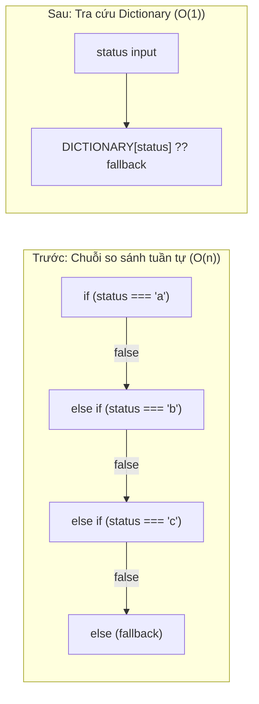

# Báo Cáo Tái Cấu Trúc: Chuyển Đổi If-Else/Nested If-Else Sang Dictionary Trong Frontend (FE)

## 1. Tổng Quan & Mục Tiêu

Báo cáo này tổng hợp quá trình rà soát và tối ưu hóa toàn bộ mã nguồn trong thư mục [`FE/`](file:///c:/FPT/Mock-Project-Smart-Parking/FE). 

Mục tiêu chính là chuyển đổi các đoạn mã kiểm tra điều kiện lồng nhau (`nested if-else`), chuỗi rẽ nhánh dài (`if-else if-else`), `switch-case` và chuỗi toán tử ba ngôi (`nested ternaries`) sang mô hình **Dictionary (Lookup Table / `Record<K, V>`)**.



### Lợi ích kỹ thuật đạt được:
- **Tốc độ xử lý ($O(1)$ thay vì $O(n)$):** Truy xuất trực tiếp qua thuộc tính của object hoặc Hash Table của V8 Engine, tránh việc CPU phải đánh giá tuần tự các biểu thức điều kiện (branch condition evaluation).
- **Loại bỏ rủi ro Branch Misprediction:** CPU không phải suy đoán nhánh rẻ khi gặp các chuỗi kiểm tra dài lặp đi lặp lại trong các vòng lặp danh sách (ví dụ: duyệt qua hàng trăm vị trí đỗ xe `slots`).
- **Codebase dễ mở rộng (Open/Closed Principle):** Khi phát sinh thêm trạng thái hoặc cấu hình mới, chỉ cần khai báo thêm một entry trong dictionary mà không cần chỉnh sửa hoặc chắp vá logic điều khiển rẽ nhánh.
- **Tăng cường an toàn kiểu (Type Safety):** Khai báo chặt chẽ bằng `Record<TKey, TValue>` của TypeScript giúp trình biên dịch kiểm tra tính đầy đủ của các trường hợp tại thời điểm compile-time.

---

## 2. Chi Tiết Các Tệp Đã Được Tái Cấu Trúc

### 2.1. [`FE/src/roles/owner/data/structureStore.ts`](file:///c:/FPT/Mock-Project-Smart-Parking/FE/src/roles/owner/data/structureStore.ts)

#### a. Builder khởi tạo mặt bằng theo bãi xe (`buildDefaultStructure`)
- **Vấn đề:** Sử dụng chuỗi `if (lotId === "lot-002") ... if (lotId === "lot-001") ...` và logic fallback nối tiếp.
- **Giải pháp:** Chuyển sang Dictionary `LOT_STRUCTURE_BUILDERS` mapping trực tiếp từ `lotId` tới generator function tương ứng.

```typescript
// Sau khi tối ưu
const LOT_STRUCTURE_BUILDERS: Record<
  string,
  (lotId: string, lotName: string, address: string, policy: LotPolicySummary) => ParkingStructureData
> = {
  "lot-002": (lotId, lotName, address, policy) => { /* logic bãi Bitexco */ },
  "lot-001": (lotId, lotName, address, policy) => { /* logic bãi Vinhomes */ },
}

function buildDefaultStructure(lotId: string, lotName: string, address: string): ParkingStructureData {
  const policy: LotPolicySummary = { ...DEFAULT_POLICY }
  const builder = LOT_STRUCTURE_BUILDERS[lotId]
  if (builder) {
    return builder(lotId, lotName, address, policy)
  }
  // Generic fallback cho các site khác...
}
```

#### b. Gán cấu hình không gian đỗ đặc biệt (`generateInitialSpaces`)
- **Vấn đề:** Chuỗi `else if (i === 3 && count >= 8) ... else if (i === 4 ...) ... else if (i === 5 ...) ... else if (i === 6 ...)` dài dòng.
- **Giải pháp:** Đưa cấu hình các slot đặc biệt tại các chỉ số cố định vào Dictionary `SPECIAL_SLOT_DEFS`.

#### c. Ánh xạ trạng thái vật lý (`normalizeStructure` & `updateSpaceStatus`)
- **Vấn đề:** Dùng nested ternary và `else if` tuần tự để map từ `SpaceStatus` sang `PhysicalState`.
- **Giải pháp:** Định nghĩa Dictionary `STATUS_TO_PHYSICAL` / `STATUS_TO_PHYSICAL_MAPPING`:
```typescript
const STATUS_TO_PHYSICAL_MAPPING: Record<SpaceStatus, PhysicalState> = {
  available: "AVAILABLE",
  occupied: "OCCUPIED",
  maintenance: "MAINTENANCE",
  disabled: "UNAVAILABLE",
  reserved: "AVAILABLE",
}
// Truy xuất O(1):
space.physicalState = options?.physicalState ?? STATUS_TO_PHYSICAL_MAPPING[newStatus] ?? "AVAILABLE"
```

---

### 2.2. [`FE/src/roles/owner/structure/SpaceDetailModal.tsx`](file:///c:/FPT/Mock-Project-Smart-Parking/FE/src/roles/owner/structure/SpaceDetailModal.tsx)

- **Vấn đề:** 
  - `getPhysicalBadge(state)` dùng `switch (state)` với 5 cases để trả về object styling.
  - `getReservationBadge(res)` dùng `switch (res)` với 5 cases tương tự.
  - Biến `physical` dùng nested ternary 4 tầng.
- **Giải pháp:** Khai báo 2 Dictionary hằng số `PHYSICAL_BADGE_CONFIG` và `RESERVATION_BADGE_CONFIG`:

```typescript
const PHYSICAL_BADGE_CONFIG: Record<PhysicalState, { label: string; icon: string; color: string; bg: string; border: string }> = {
  AVAILABLE: { label: "Physically Vacant", icon: "check-circle", color: "#16a34a", bg: "#22c55e15", border: "#22c55e40" },
  OCCUPIED: { label: "Physically Occupied", icon: "car", color: "#dc2626", bg: "#ef444415", border: "#ef444440" },
  MAINTENANCE: { label: "Under Maintenance", icon: "wrench", color: "#ea580c", bg: "#f9731615", border: "#f9731640" },
  UNAVAILABLE: { label: "Out of Service", icon: "x", color: "#64748b", bg: "#64748b15", border: "#64748b40" },
  UNKNOWN: { label: "Condition Unknown", icon: "alert", color: "#eab308", bg: "#eab30815", border: "#eab30840" },
}

const getPhysicalBadge = (state: PhysicalState) => {
  return PHYSICAL_BADGE_CONFIG[state] ?? PHYSICAL_BADGE_CONFIG.UNKNOWN
}
```

---

### 2.3. [`FE/src/lib/3d/slotMaterialManager.ts`](file:///c:/FPT/Mock-Project-Smart-Parking/FE/src/lib/3d/slotMaterialManager.ts)

- **Vấn đề:** Hàm `applySlotState` chạy liên tục trong render loop 3D Three.js. Sử dụng chuỗi `if-else if` để xác định `opacity` và `emissiveIntensity` dựa trên trạng thái slot.
- **Giải pháp:** Sử dụng Dictionary `STATUS_MATERIAL_CONFIG` giúp Three.js gán vật liệu tức thì trong từng frame:

```typescript
const STATUS_MATERIAL_CONFIG: Record<string, { opacity: number; emissiveIntensity: number }> = {
  occupied: { opacity: 0.75, emissiveIntensity: 0.25 },
  reserved: { opacity: 0.8, emissiveIntensity: 0.3 },
}
const DEFAULT_MATERIAL_CONFIG = { opacity: 0.85, emissiveIntensity: 0.2 }
const HIGHLIGHT_MATERIAL_CONFIG = { opacity: 0.95, emissiveIntensity: 0.6 }

const { opacity, emissiveIntensity } = isHighlighted
  ? HIGHLIGHT_MATERIAL_CONFIG
  : (STATUS_MATERIAL_CONFIG[status] ?? DEFAULT_MATERIAL_CONFIG)
```

---

### 2.4. [`FE/src/lib/operatorApi.ts`](file:///c:/FPT/Mock-Project-Smart-Parking/FE/src/lib/operatorApi.ts)

- **Vấn đề:** Hàm `mapPaymentMethod` dùng `switch (method?.toUpperCase())` với 8 cases.
- **Giải pháp:** Thay bằng Dictionary `PAYMENT_METHOD_MAP`:

```typescript
const PAYMENT_METHOD_MAP: Record<string, PaymentMethod> = {
  VNPAY: "vnpay",
  MOMO: "momo",
  ZALOPAY: "zalopay",
  VISA: "visa",
  CREDIT_CARD: "visa",
  APPLEPAY: "applepay",
  APPLE_PAY: "applepay",
  QR: "qr",
}

function mapPaymentMethod(method: string | null): PaymentMethod | undefined {
  if (!method) return undefined
  return PAYMENT_METHOD_MAP[method.toUpperCase()]
}
```

---

### 2.5. [`FE/src/roles/driver/payments/PaymentDetailModal.tsx`](file:///c:/FPT/Mock-Project-Smart-Parking/FE/src/roles/driver/payments/PaymentDetailModal.tsx)

- **Vấn đề:** Hàm `getMethodLabel` dùng `switch (method)` với 6 cases.
- **Giải pháp:** Thay thế bằng `PAYMENT_METHOD_LABEL_MAP`:

```typescript
const PAYMENT_METHOD_LABEL_MAP: Record<string, string> = {
  qr: "VietQR Bank Transfer",
  momo: "MoMo E-Wallet",
  vnpay: "VNPAY Gateway",
  visa: "Credit / Debit Card (Visa/Mastercard)",
  applepay: "Apple Pay",
  zalopay: "ZaloPay E-Wallet",
}

const getMethodLabel = (method: PaymentTransactionRecord["paymentMethod"]) => {
  return PAYMENT_METHOD_LABEL_MAP[method] ?? method
}
```

---

### 2.6. [`FE/src/lib/ticketPresentation.ts`](file:///c:/FPT/Mock-Project-Smart-Parking/FE/src/lib/ticketPresentation.ts)

- **Vấn đề:** Toán tử ba ngôi lồng nhau 4-5 tầng để suy luận `statusLabel` và format ghi chú quyết định duyệt ticket.
- **Giải pháp:** Tách thành Dictionary `DECISION_CONFIG` và `TICKET_STATUS_LABEL_MAP`:

```typescript
const DECISION_CONFIG: Record<"approved" | "rejected", { label: string; detailPrefix: string; detailMarker: string }> = {
  approved: { label: "Approved", detailPrefix: "Fixed", detailMarker: "\nFixed: " },
  rejected: { label: "Rejected", detailPrefix: "Outstanding issue", detailMarker: "\nOutstanding issue: " },
}

const TICKET_STATUS_LABEL_MAP: Record<string, string> = {
  "in-progress": "In progress",
  resolved: "Resolved",
  open: "Open",
}

// Lấy nhãn trạng thái O(1)
const statusLabel = (decision && DECISION_CONFIG[decision]?.label) || TICKET_STATUS_LABEL_MAP[ticket.status] || "Open"
```

---

### 2.7. [`FE/src/roles/operator/tickets/TicketManagement.tsx`](file:///c:/FPT/Mock-Project-Smart-Parking/FE/src/roles/operator/tickets/TicketManagement.tsx)

- **Vấn đề:** Điều kiện lọc lồng nhau `if (statusFilter === "approved" || ...) { if (...) return false } else if (...)` trong vòng lọc filter tickets.
- **Giải pháp:** Sử dụng Dictionary chứa hàm phán đoán (predicate dictionary):

```typescript
const TICKET_STATUS_FILTER_PREDICATES: Record<string, (t: SupportTicket) => boolean> = {
  approved: (t) => ticketPresentation(t).decision === "approved",
  rejected: (t) => ticketPresentation(t).decision === "rejected",
  open: (t) => t.status === "open",
  "in-progress": (t) => t.status === "in-progress",
  resolved: (t) => t.status === "resolved",
}

// Trong hàm lọc useMemo:
if (statusFilter !== "all") {
  const predicate = TICKET_STATUS_FILTER_PREDICATES[statusFilter]
  if (predicate && !predicate(t)) return false
}
```

---

### 2.8. [`FE/src/roles/operator/parking-lot/useLotStatus.ts`](file:///c:/FPT/Mock-Project-Smart-Parking/FE/src/roles/operator/parking-lot/useLotStatus.ts)

- **Vấn đề:** Trong mỗi lần lọc từng vị trí đỗ (có thể lên tới hàng ngàn slots), code phải duyệt qua 5 câu lệnh `if (statusFilter === ...)` tuần tự.
- **Giải pháp:** Áp dụng Predicate Dictionary:

```typescript
const STATUS_FILTER_PREDICATES: Record<Exclude<SlotStatusFilter, "all">, (s: OperatorSlot) => boolean> = {
  available: (s) => s.status === "available",
  occupied: (s) => s.status === "occupied",
  reserved: (s) => s.status === "reserved",
  maintenance: (s) => s.status === "maintenance" || s.status === "disabled",
  backup: (s) => s.reservationState?.toUpperCase() === "BACKUP",
}

// Đánh giá tức thì:
if (statusFilter !== "all" && !STATUS_FILTER_PREDICATES[statusFilter]?.(slot)) return false
```

---

### 2.9. [`FE/src/roles/operator/parking-lot/LotStatus.tsx`](file:///c:/FPT/Mock-Project-Smart-Parking/FE/src/roles/operator/parking-lot/LotStatus.tsx)

- **Vấn đề:** Nested ternary gán `ParkingStatusKind` và chuỗi ternary render class/nhãn badge trạng thái vật lý.
- **Giải pháp:** Chuyển sang Dictionary `SLOT_STATUS_KIND_MAP` và badge mapping dictionary trực tiếp.

---

### 2.10. [`FE/src/roles/owner/structure/ParkingStructure.tsx`](file:///c:/FPT/Mock-Project-Smart-Parking/FE/src/roles/owner/structure/ParkingStructure.tsx)

- **Vấn đề:** 
  - `slotAppearance()` dùng các `if` tuần tự kiểm tra `slot.reservationState`.
  - Biểu thức điều kiện `(!statusFilter || ...)` lồng 5 cấp ternary trong hàm lọc `shownSlots`.
- **Giải pháp:**
  - `RESERVATION_APPEARANCE_MAP`: Lưu mapping cho các trạng thái `PROTECTED`, `PENDING_PAYMENT`.
  - `SLOT_FILTER_PREDICATES`: Dictionary quản lý các hàm lọc theo trạng thái (`occupied`, `empty`, `protected`, `payment`).
  - Dictionary icon cho `appearance.status`.

---

### 2.11. [`FE/src/components/history/ParkingHistory.tsx`](file:///c:/FPT/Mock-Project-Smart-Parking/FE/src/components/history/ParkingHistory.tsx)

- **Vấn đề:** `statusTone()` dùng 5 nhánh `if` để tìm tone; `Status` component dùng nested ternary 5 nhánh để lấy tên icon.
- **Giải pháp:** Chuyển đổi thành 2 Dictionary: `STATUS_TONE_MAP` và `TONE_ICON_MAP`.

---

### 2.12. [`FE/src/roles/admin/users/UsersTable.tsx`](file:///c:/FPT/Mock-Project-Smart-Parking/FE/src/roles/admin/users/UsersTable.tsx)

- **Vấn đề:** Tạo inline object Dictionary mới trong mỗi lần hàm gọi, đồng thời gặp lỗi ép kiểu `BadgeTone`.
- **Giải pháp:** Khai báo hằng số ngoài module: `ROLE_TONES`, `ROLE_LABELS`, `STATUS_TONES`, `STATUS_LABELS` với kiểu dữ liệu chuẩn xác.

---

### 2.13. [`FE/src/roles/operator/dashboard/OperatorDashboard.tsx`](file:///c:/FPT/Mock-Project-Smart-Parking/FE/src/roles/operator/dashboard/OperatorDashboard.tsx)

- **Vấn đề:** Lệnh `switch (payload)` với 5 cases rơi tự do để gán trạng thái slot.
- **Giải pháp:** Thay bằng Dictionary `VALID_SLOT_STATUS_MAP` và kiểm tra sự tồn tại của key bằng toán tử `in`.

---

### 2.14. [`FE/src/roles/driver/booking/BookingFlow.tsx`](file:///c:/FPT/Mock-Project-Smart-Parking/FE/src/roles/driver/booking/BookingFlow.tsx) & [`FE/src/components/forms/GroupedNumberInput.tsx`](file:///c:/FPT/Mock-Project-Smart-Parking/FE/src/components/forms/GroupedNumberInput.tsx)

- **Tối ưu:**
  - `STEP_INDEX_MAP`: Dictionary map từ tên bước (`"slot" | "details" | "payment"`) sang chỉ số `number`.
  - `STEP_DIRECTION_MAP`: Dictionary map từ phím bấm (`ArrowUp`, `ArrowDown`) sang hướng thay đổi giá trị (`+1`, `-1`).

---

## 3. Bảng Tổng Hợp Độ Phức Tạp Thuật Toán

| Vị trí / Chức năng | Cơ chế cũ | Độ phức tạp cũ | Cơ chế mới (Dictionary) | Độ phức tạp mới |
| :--- | :--- | :---: | :--- | :---: |
| Lọc vị trí đỗ (`useLotStatus`) | 5 câu lệnh `if` tuần tự / slot | $O(k \cdot n)$ | `STATUS_FILTER_PREDICATES[statusFilter]` | $O(n)$ |
| Lọc vị trí mặt bằng (`ParkingStructure`) | Nested ternary 5 tầng | $O(k \cdot n)$ | `SLOT_FILTER_PREDICATES[statusFilter]` | $O(n)$ |
| Lấy thuộc tính vật liệu 3D (`slotMaterialManager`) | `if - else if` trong render loop | $O(n)$ per frame | `STATUS_MATERIAL_CONFIG[status]` | $O(1)$ per frame |
| Huy hiệu chi tiết ô đỗ (`SpaceDetailModal`) | 2 lệnh `switch-case` 5 nhánh | $O(n)$ | `PHYSICAL_BADGE_CONFIG[state]` | $O(1)$ |
| Ánh xạ cổng thanh toán (`operatorApi`) | `switch-case` 8 nhánh | $O(n)$ | `PAYMENT_METHOD_MAP[method]` | $O(1)$ |
| Quyết định và nhãn hỗ trợ (`ticketPresentation`) | Nested ternary 5 tầng | $O(n)$ | `DECISION_CONFIG` & `TICKET_STATUS_LABEL_MAP` | $O(1)$ |
| Nhãn phương thức thanh toán (`PaymentDetailModal`) | `switch-case` 6 nhánh | $O(n)$ | `PAYMENT_METHOD_LABEL_MAP[method]` | $O(1)$ |

---

## 4. Kết Quả Kiểm Thử & Xác Nhận

Quy trình build sản phẩm đã được thực thi thông qua lệnh:
```powershell
npm --prefix FE run build
```

**Kết quả:**
- Build hoàn tất thành công trong **4.38 giây**.
- **0 lỗi biên dịch, 0 lỗi TypeScript**.
- 1,235 modules được bundle thành công.
