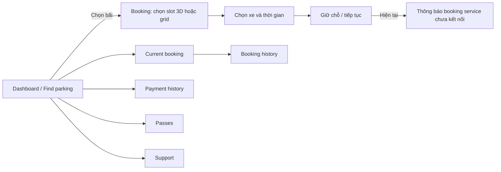

# FE Screen Flow — SmartParking

> Khảo sát theo mã nguồn FE hiện tại (15/10/2026). Tài liệu mô tả màn hình **đang được nối vào ứng dụng**, không suy đoán luồng backend hoặc các component chưa được sử dụng.

## 1. Cách điều hướng

- `src/App.tsx` chỉ khai báo các URL thực: `/`, `/dashboard/finance`, `/dashboard/operation`, `/pos`, và `/change-password` (được xử lý trực tiếp trước `Routes`). URL khác quay về `/`.
- Tại `/`, màn hình phụ thuộc vào `view` của `AppContext`, không có URL riêng cho từng trang public hoặc từng tab dashboard. `setView(...)` chuyển giữa các trang public, đăng nhập, đăng ký và dashboard theo vai trò.
- Sau khi tải, FE gọi `authApi.currentUser()`. Phiên hợp lệ đặt `view` theo `user.role`; chưa đăng nhập bắt đầu ở Landing. Phiên hết hạn đưa về màn hình Sign In. Đăng xuất thành công đưa về Landing.
- Các tab dashboard là state trong từng dashboard. Sidebar và tìm kiếm ở dashboard navbar gửi `sp:dashboard-nav`; profile/security mở modal. Đổi tab không đổi URL. Tải lại trang có thể quay về tab mặc định.
- `RoleRoute` kiểm tra quyền cho ba URL operator. Không đăng nhập về `/`; sai quyền về đường dẫn home của tài khoản. Operator `financial`, `operation`, `cashier` lần lượt có home path `/dashboard/finance`, `/dashboard/operation`, `/pos`.

## 2. Sơ đồ tổng quan

```mermaid
flowchart TD
    Start[Truy cập ứng dụng] --> Restore{Khôi phục phiên}
    Restore -->|Không có phiên| Landing[Landing /]
    Restore -->|Driver| Driver[Driver dashboard /]
    Restore -->|Owner| Owner[Owner dashboard /]
    Restore -->|Admin| Admin[Admin dashboard /]
    Restore -->|Operator| OpRole{Phân quyền operator}
    OpRole -->|Operation| Operation[/dashboard/operation]
    OpRole -->|Financial| Financial[/dashboard/finance]
    OpRole -->|Cashier| POS[/pos]
    Landing --> SignIn[Sign In]
    Landing --> SignUp[Sign Up]
    Landing --> Public[Trang thông tin công khai]
    SignUp -->|Driver| DriverOTP[Xác minh OTP]
    DriverOTP --> SignIn
    SignUp -->|Business / Owner| OwnerOTP[Xác minh email]
    OwnerOTP --> Pending[Pending Approval]
    Pending -->|Sau khi Admin duyệt, đăng nhập| SignIn
    SignIn -->|Đăng nhập thành công| Restore
    SignIn --> Forgot[Quên mật khẩu: yêu cầu mã → xác minh → đặt lại]
    Owner -->|Chưa hoàn tất thiết lập| Onboard[Wizard tạo bãi 5 bước]
    Onboard --> Structure[Parking Structure]
    Admin --> Applications[Applications: duyệt / từ chối Owner]
    Driver --> Booking[Tìm bãi → chọn slot → thông tin đặt chỗ]
    Booking --> Blocked[Chưa kết nối dịch vụ đặt chỗ]
```

## 3. Public và xác thực

| Điểm vào / màn hình | Chuyển tiếp chính | Ghi chú |
| --- | --- | --- |
| Landing | Sign In, Sign Up, Pricing, Business | Navbar mở Landing, Pricing, Support; footer có thêm các trang thông tin/chính sách. |
| Trang thông tin | Pricing, Support, FAQ, Business, About, Affiliates, Careers, Terms of Service, Privacy Policy, Payment & Refund | Đều render qua `view` ở `/`, không phải route riêng. |
| Sign In | Đăng nhập bằng mật khẩu hoặc mã email/SMS → dashboard theo vai trò | Có nhánh TOTP khi yêu cầu; quên mật khẩu mở modal yêu cầu mã → xác minh → đặt lại. |
| Sign Up: Driver | Form → `DriverOtpForm` → Sign In | Có thể dùng lại yêu cầu xác minh đang chờ. |
| Sign Up: Business/Owner | Form + chấp thuận Partner Agreement → `OwnerVerification` → Pending Approval | Admin duyệt/từ chối ở Applications. Pending Approval có nút về Landing hoặc Support. |
| `/change-password` | Đặt mật khẩu ban đầu bằng `challengeId` và `token` trong query → liên kết về `/` | Màn hình `BootstrapPassword` độc lập với layout navbar/footer. |

## 4. Driver

Điểm vào sau đăng nhập là `/` với tab mặc định **Dashboard / Find parking**.



| Tab / màn hình | Nội dung hoặc nhánh |
| --- | --- |
| Dashboard / Find parking | Tìm và lọc bãi hoạt động; chọn bãi để mở `BookingFlow`. Nếu bản đồ thiếu cấu hình, danh sách tìm kiếm vẫn có thể dùng. |
| BookingFlow | Các state trong component: `slot` → `details` → `payment` → `qr`. Luồng tạo mới hiện dừng ở `details` vì thao tác giữ chỗ chỉ hiện thông báo chưa có Driver booking service. `payment`/`qr` có trong mã để dùng với booking được truyền vào qua `resumeBooking`, nhưng dashboard hiện chỉ mở flow với `lot`. Thanh toán trực tuyến ngoài QR cũng báo gateway chưa được cấu hình. |
| Current booking | `ActiveBookings`. |
| Booking history | `BookingHistory`. |
| Payment history | `PaymentHistory`. |
| Passes | `Subscriptions`. |
| Support | `DriverSupport`. |
| Profile | Navbar mở modal Account/Security; Driver còn có My Vehicles. |

## 5. Owner

Sau đăng nhập, nếu `user.onboardingComplete` chưa có, FE hiện wizard tạo bãi trước dashboard: **Lot Type → Structure → Devices → Pricing & Policy → Confirm**. Hoàn tất chuyển sang **Parking Structure** của site vừa tạo.

| Tab sidebar | Màn hình | Chuyển tiếp liên quan |
| --- | --- | --- |
| Dashboard | `OwnerOverview` | Lọc All Sites hoặc một site. |
| Sites | `SiteManagement` | Tạo site mới → Parking Structure của site đó. |
| My parking lots | `LotManagement` | Quản lý lot, dùng bộ lọc site. |
| Parking Structure | `ParkingStructure` | Cấu hình tầng, khu, chỗ đỗ của site. |
| Operators | `OperatorManagement` | Quản lý nhân sự theo site. |
| Financial | `RevenueDashboard` | Lọc All Sites hoặc một site. |
| Policies | `PolicySettings` | Thiết lập chính sách. |

## 6. Operator và Cashier

| Quyền / URL | Màn hình, tab khả dụng | Luồng chính |
| --- | --- | --- |
| Operation — `/dashboard/operation` | Dashboard Overview; Gate Check-In; Gate Check-Out; Lot Status & 3D Map; Backup Slots & Buffer; Driver Support Tickets; Emergency Dispatch; My Assignments | Overview có thể mở check-in theo biển số hoặc Lot Status theo trạng thái slot. Có thể chọn site được giao nếu có nhiều site. |
| Financial — `/dashboard/finance` | Financial Reports & Reconciliation | Xem booking đã hoàn tất, doanh thu ghi nhận, khoản chờ đối soát. Route này cũng cho phép tài khoản Owner truy cập trực tiếp. |
| Cashier — `/pos` | Cashier POS Terminal | Tra biển số hoặc mã đặt chỗ → xác nhận phiên đang check-in → xác nhận checkout. Giao diện nêu rõ không mô phỏng thu tiền. |

## 7. Admin

Điểm vào là `/` với tab mặc định **Overview**.

| Tab sidebar | Màn hình | Vai trò trong luồng |
| --- | --- | --- |
| Dashboard | `Overview` | Tổng quan hệ thống. |
| Applications | `Applications` | Xem hồ sơ Owner đang chờ và duyệt/từ chối; đây là bước tiếp theo sau Owner xác minh email. |
| User management | `Users` | Quản lý tài khoản. |
| Audit log | `AuditLogView` | Xem nhật ký. |
| System configuration | `SystemConfig` | Cấu hình hệ thống. |

`AdminSettings` có state `settings` trong `AdminDashboard`, nhưng sidebar và dashboard navbar hiện không có mục điều hướng đến đó.

## 8. Ghi chú khi phát triển / kiểm thử thủ công

1. Các mục Driver/Owner/Admin và các tab Operation/Financial là màn hình nội bộ của dashboard, nên kiểm tra bằng menu sau khi đăng nhập, không truy cập bằng URL tab riêng.
2. Với Owner mới, cần đi qua wizard trước khi kiểm tra các tab quản trị; hồ sơ đăng ký Owner cần xác minh email và được Admin duyệt.
3. Không coi đặt chỗ/thanh toán mới là end-to-end hoàn chỉnh: `BookingFlow` đã có UI cho các bước tiếp theo nhưng chức năng giữ chỗ và gateway còn báo chưa cấu hình.
4. Các component `WalletView`, `PolicyManagement`, `OwnerWorkspace` hiện không được `App.tsx` hay dashboard import vào luồng hiển thị; vì vậy không liệt kê chúng như màn hình truy cập được.

### Nguồn đối chiếu chính

`src/App.tsx`, `src/context/AppContext.tsx`, `src/components/navigation/RoleRoute.tsx`, `src/components/layout/{Navbar,DashboardNavbar,Footer}.tsx`, `src/roles/authentications/`, `src/roles/{driver,owner,operator,admin}/dashboard/`, `src/roles/driver/booking/BookingFlow.tsx`, `src/roles/owner/parking-lots/CreateParkingLotForOwner.tsx`.
