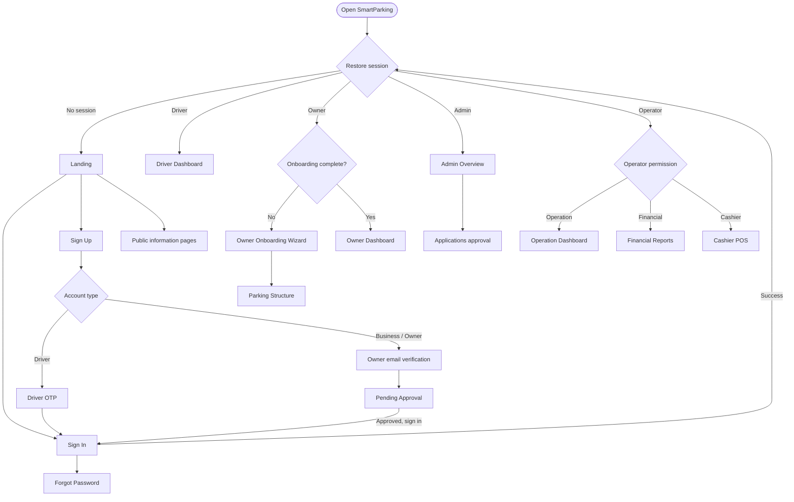
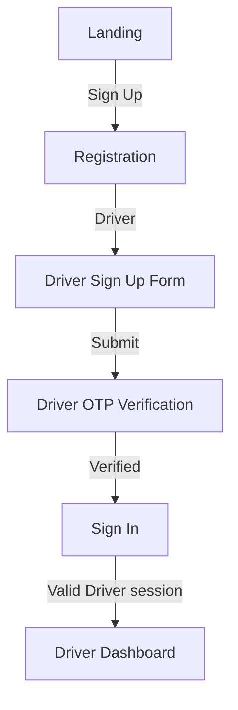
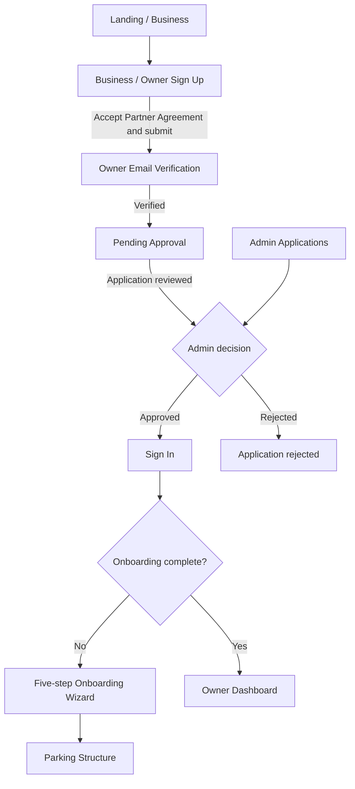
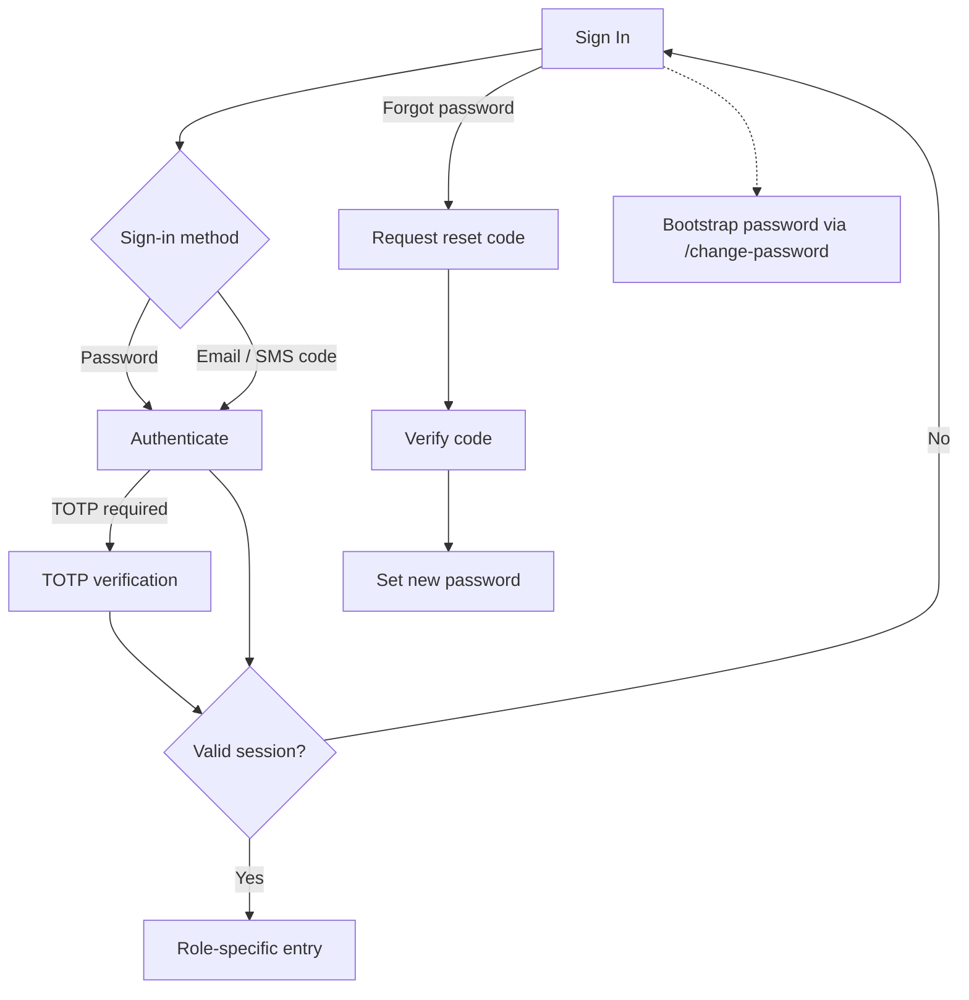
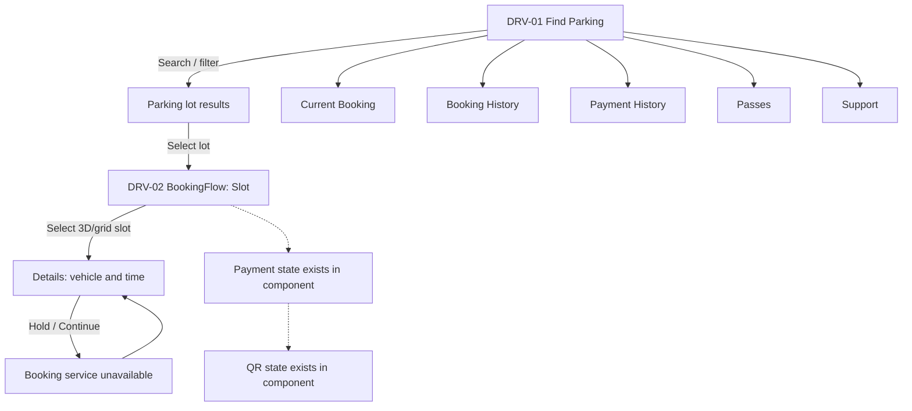
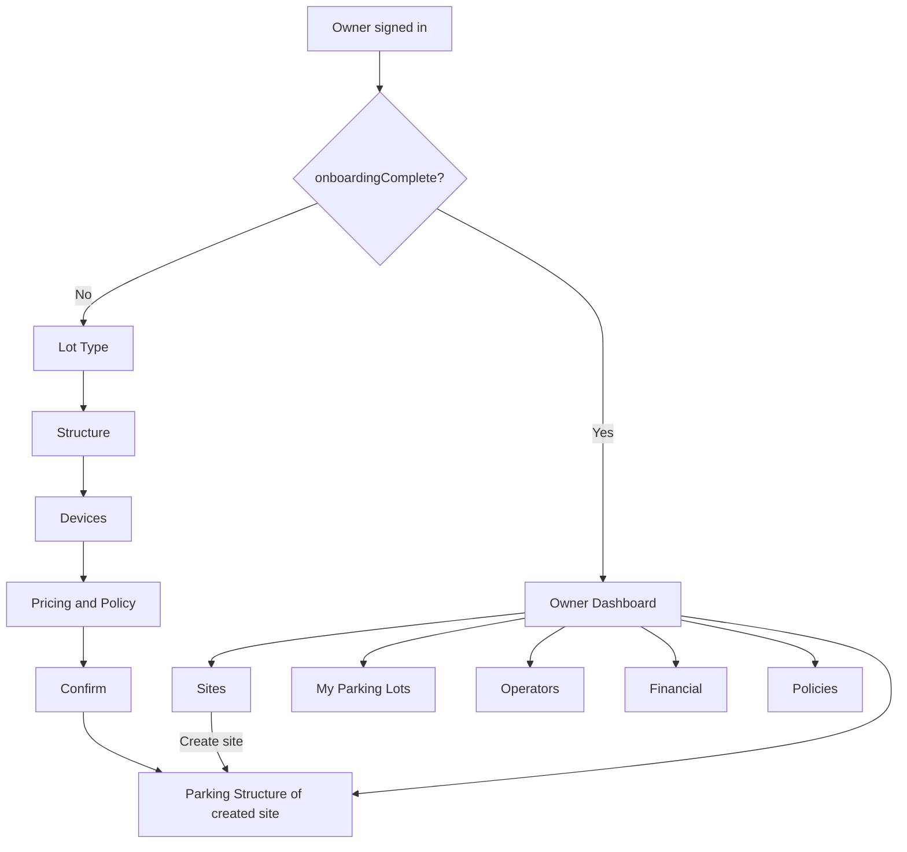
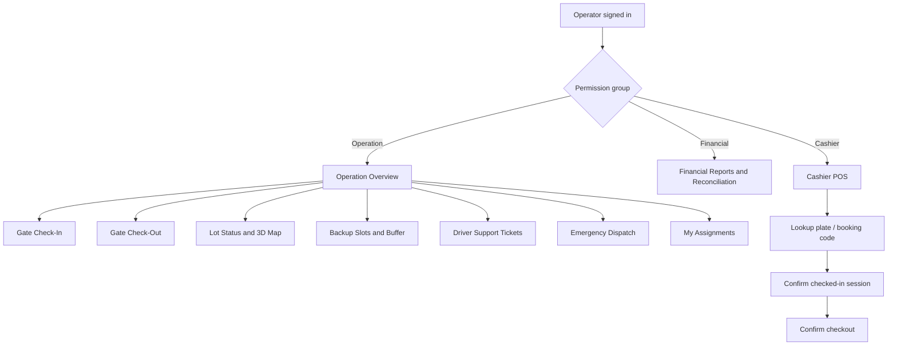
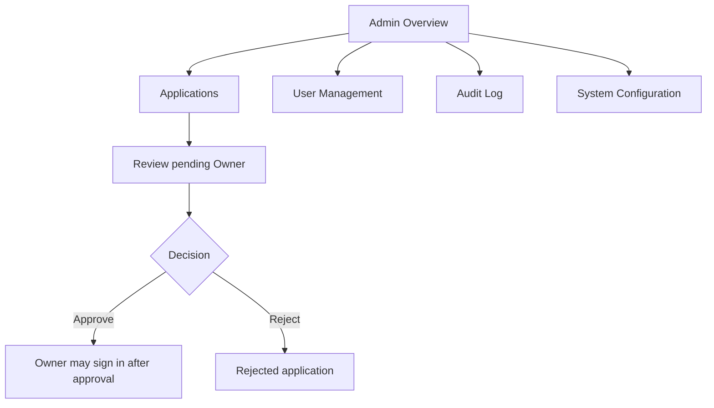

# SMARTPARKING — FRONT-END SCREEN FLOW

**Document type:** FE Screen Flow  
**Reference:** `FE_SCREEN_FLOW.md` (khảo sát FE ngày 15/10/2026)  
**Scope:** Các màn hình đã được nối vào ứng dụng theo tài liệu nguồn; không xác nhận lại repository ở phiên này.

## 1. Purpose & conventions

Tài liệu mô tả **người dùng đang ở màn hình nào, thực hiện hành động gì, và FE chuyển tới màn hình/trạng thái nào**. Đây là luồng điều hướng giao diện, không phải API sequence diagram hoặc khẳng định backend đã xử lý thành công.

| Ký hiệu | Ý nghĩa |
| --- | --- |
| `PUB`, `AUTH`, `DRV`, `OWN`, `OPR`, `FIN`, `POS`, `ADM` | Nhóm Screen ID |
| **Route** | URL có thể truy cập trực tiếp |
| **View / Tab** | Màn hình do state quản lý, không có URL riêng |
| **Modal** | Lớp giao diện mở trên màn hình hiện tại |
| **Blocked** | FE có màn hình nhưng thao tác chưa thể hoàn tất do dịch vụ chưa kết nối |
| **Not linked** | Component/state có trong mã nhưng không có đường điều hướng được xác nhận |

### 1.1 Navigation architecture

- Các URL được ghi nhận: `/`, `/dashboard/operation`, `/dashboard/finance`, `/pos`, `/change-password` (đường dẫn cuối được xử lý riêng trước `Routes`). URL khác chuyển về `/`.
- Tại `/`, `AppContext.view` quyết định màn hình public/auth/dashboard. Chuyển view qua `setView(...)` không đổi URL.
- Dashboard Driver/Owner/Admin dùng tab state; sidebar và navbar dùng sự kiện `sp:dashboard-nav`. Profile/security dùng modal. Refresh có thể quay về tab mặc định.
- Khi khởi động, FE gọi `authApi.currentUser()` để khôi phục phiên. Không có phiên → Landing; phiên hết hạn → Sign In; đăng xuất thành công → Landing.
- `RoleRoute` kiểm soát các route operator; chưa đăng nhập → `/`; sai quyền → home path của tài khoản. Operator theo nhóm quyền: operation → `/dashboard/operation`, financial → `/dashboard/finance`, cashier → `/pos`.

## 2. Master screen flow

## 3. Screen inventory

### 3.1 Guest / Authentication

| Screen ID | Screen name | UI type / URL | Main transition |
| --- | --- | --- | --- |
| PUB-01 | Landing | View `/` | Sign In, Sign Up, Pricing, Business, public pages |
| PUB-02 | Pricing | View `/` | Public navigation |
| PUB-03 | Support | View `/` | Public navigation; Pending Approval → Support |
| PUB-04 | FAQ | View `/` | Public navigation |
| PUB-05 | Business | View `/` | Public navigation / Owner registration entry |
| PUB-06 | About | View `/` | Public navigation |
| PUB-07 | Affiliates | View `/` | Public navigation |
| PUB-08 | Careers | View `/` | Public navigation |
| PUB-09 | Terms of Service | View `/` | Public navigation |
| PUB-10 | Privacy Policy | View `/` | Public navigation |
| PUB-11 | Payment & Refund | View `/` | Public navigation |
| AUTH-01 | Sign In | View `/` | Role dashboard / OTP or TOTP branch / Forgot Password |
| AUTH-02 | Sign Up — Driver | View `/` | Driver OTP |
| AUTH-03 | Driver OTP | View `/` | Sign In |
| AUTH-04 | Sign Up — Business/Owner | View `/` | Owner Verification |
| AUTH-05 | Owner Verification | View `/` | Pending Approval |
| AUTH-06 | Pending Approval | View `/` | Landing / Support; đăng nhập sau khi được duyệt |
| AUTH-07 | Forgot Password | Modal/flow from Sign In | Request code → Verify → Reset |
| AUTH-08 | Bootstrap Password | Route `/change-password` | Link về `/`; dùng `challengeId`, `token` |
| AUTH-09 | Account / Security | Modal | Close → màn hình trước đó |

### 3.2 Driver

| Screen ID | Screen / component | UI type | Main transition |
| --- | --- | --- | --- |
| DRV-01 | Dashboard / Find Parking | Default tab `/` | Select parking lot → DRV-02; sidebar → DRV-03..07 |
| DRV-02 | BookingFlow | Internal flow | Slot → Details → Hold attempt (Blocked) |
| DRV-03 | Current Booking / `ActiveBookings` | Tab | Sidebar navigation |
| DRV-04 | Booking History / `BookingHistory` | Tab | Sidebar navigation |
| DRV-05 | Payment History / `PaymentHistory` | Tab | Sidebar navigation |
| DRV-06 | Passes / `Subscriptions` | Tab | Sidebar navigation |
| DRV-07 | Support / `DriverSupport` | Tab | Sidebar navigation |
| DRV-08 | My Vehicles | Profile-related UI | Close/return |
| DRV-09 | Account / Security | Modal | Close/return |

### 3.3 Owner

| Screen ID | Screen / component | UI type | Main transition |
| --- | --- | --- | --- |
| OWN-00 | Onboarding Wizard | Conditional entry | Lot Type → Structure → Devices → Pricing & Policy → Confirm → OWN-04 |
| OWN-01 | Dashboard / `OwnerOverview` | Tab | All Sites / selected site filter |
| OWN-02 | Sites / `SiteManagement` | Tab | Create Site → OWN-04 for new site |
| OWN-03 | My Parking Lots / `LotManagement` | Tab | Site filter / management |
| OWN-04 | Parking Structure / `ParkingStructure` | Tab | Configure floors, zones, slots |
| OWN-05 | Operators / `OperatorManagement` | Tab | Operator management by site |
| OWN-06 | Financial / `RevenueDashboard` | Tab | All Sites / selected site filter |
| OWN-07 | Policies / `PolicySettings` | Tab | Policy settings |

### 3.4 Operator / Financial / Cashier

| Screen ID | Screen | URL / type | Main transition |
| --- | --- | --- | --- |
| OPR-01 | Dashboard Overview | `/dashboard/operation` tab | Gate Check-In / Lot Status |
| OPR-02 | Gate Check-In | Operation tab | From Overview / sidebar |
| OPR-03 | Gate Check-Out | Operation tab | Sidebar navigation |
| OPR-04 | Lot Status & 3D Map | Operation tab | From Overview / sidebar |
| OPR-05 | Backup Slots & Buffer | Operation tab | Sidebar navigation |
| OPR-06 | Driver Support Tickets | Operation tab | Sidebar navigation |
| OPR-07 | Emergency Dispatch | Operation tab | Sidebar navigation |
| OPR-08 | My Assignments | Operation tab | Sidebar navigation |
| FIN-01 | Financial Reports & Reconciliation | `/dashboard/finance` | Reports / reconciliation; Owner may access route |
| POS-01 | Cashier POS Terminal | `/pos` | Lookup → checked-in session → checkout confirmation |

### 3.5 Admin

| Screen ID | Screen / component | UI type | Main transition |
| --- | --- | --- | --- |
| ADM-01 | Overview / `Overview` | Default tab `/` | Sidebar navigation |
| ADM-02 | Applications / `Applications` | Tab | Review Owner application → Approve / Reject |
| ADM-03 | User Management / `Users` | Tab | Account management |
| ADM-04 | Audit Log / `AuditLogView` | Tab | Log viewing |
| ADM-05 | System Configuration / `SystemConfig` | Tab | System settings |

## 4. Detailed screen flows

### 4.1 Guest → Driver registration

### 4.2 Guest → Owner registration & approval

**Lưu ý:** Sơ đồ diễn tả quan hệ nghiệp vụ giữa màn hình Admin Applications và trạng thái hồ sơ Owner, không ngụ ý Owner tự động được điều hướng ngay khi Admin duyệt.

### 4.3 Sign In, session & password

**Lưu ý:** `BootstrapPassword` là một đường dẫn độc lập từ liên kết chứa token, không phải bước bắt buộc xuất phát từ Sign In; đường nét đứt chỉ nhóm chức năng mật khẩu.

### 4.4 Driver — Find Parking & Booking

**Current implementation boundary:** `BookingFlow` có state `slot → details → payment → qr`, nhưng luồng tạo booking mới từ dashboard hiện dừng tại thao tác giữ chỗ ở `details`. `payment`/`qr` tồn tại cho trường hợp `resumeBooking`; không mô tả là luồng đặt chỗ mới đã hoàn tất. Thanh toán online ngoài QR cũng chưa được cấu hình theo tài liệu nguồn.

### 4.5 Owner — Onboarding & Management

### 4.6 Operation / Financial / Cashier

**Lưu ý:** Các mũi tên từ Overview đến tab operation biểu diễn khả năng điều hướng qua menu; riêng lối tắt được xác nhận từ Overview là Check-In theo biển số và Lot Status theo trạng thái slot. POS không mô phỏng thu tiền.

### 4.7 Admin — Owner approval & management

## 5. Screen transition matrix

| Flow ID | From | User action / condition | To | Result / constraint |
| --- | --- | --- | --- | --- |
| TR-01 | App startup | No valid session | PUB-01 | Landing |
| TR-02 | App startup | Valid session | Role entry | Driver/Owner/Admin `/`; operator permission route |
| TR-03 | PUB-01 | Sign In | AUTH-01 | View change |
| TR-04 | PUB-01 | Sign Up | AUTH-02 / AUTH-04 | Depends on account type |
| TR-05 | AUTH-02 | Submit Driver registration | AUTH-03 | OTP verification |
| TR-06 | AUTH-03 | OTP verified | AUTH-01 | Sign In |
| TR-07 | AUTH-04 | Accept agreement & submit | AUTH-05 | Email verification |
| TR-08 | AUTH-05 | Verified | AUTH-06 | Pending Admin approval |
| TR-09 | ADM-02 | Approve Owner application | Owner can subsequently sign in | No automatic browser redirect asserted |
| TR-10 | AUTH-01 | Successful authentication | Role entry | Role-dependent navigation |
| TR-11 | AUTH-01 | Forgot password | AUTH-07 | Request → verify → reset |
| TR-12 | Owner entry | Onboarding incomplete | OWN-00 | Five-step wizard |
| TR-13 | OWN-00 | Confirm completed | OWN-04 | Structure of created site |
| TR-14 | OWN-02 | Create new site | OWN-04 | Structure of new site |
| TR-15 | DRV-01 | Select parking lot | DRV-02 | Booking slot selection |
| TR-16 | DRV-02 | Continue after details | Blocked notice | Booking service not connected |
| TR-17 | OPR-01 | Open Check-In | OPR-02 | Operation tab |
| TR-18 | OPR-01 | Open Lot Status | OPR-04 | Operation tab |
| TR-19 | POS-01 | Lookup then confirm session | POS checkout state | No simulated money collection |
| TR-20 | Dashboard | Sidebar / navbar selection | Selected tab | URL unchanged for state-based dashboards |
| TR-21 | Any authenticated screen | Session expired | AUTH-01 | Sign In |
| TR-22 | Any authenticated screen | Successful sign out | PUB-01 | Landing |
| TR-23 | Protected operator URL | Unauthenticated | `/` | RoleRoute redirect |
| TR-24 | Protected operator URL | Wrong permission | Account home path | RoleRoute redirect |
| TR-25 | Unknown URL | Route not matched | `/` | Fallback |

## 6. Exceptions, limitations & test checkpoints

| Case | Expected FE behavior / observation |
| --- | --- |
| Session missing on startup | Show Landing |
| Session expired | Show Sign In |
| Operator opens unauthorized route | Redirect to account home path |
| Reload on internal dashboard tab | May return to default tab; tab is state, not URL |
| Owner not onboarded | Show wizard before normal Owner dashboard |
| Owner application awaiting approval | Pending Approval screen, Landing / Support options |
| Driver map config unavailable | Parking results list remains usable |
| New Driver booking hold | Unavailable notice; do not report successful booking/payment |
| Online payment gateway unavailable | Do not treat online payment as operational |
| POS checkout | Confirm session/checkout; do not claim cash collection simulation |
| `AdminSettings` | State exists but no confirmed sidebar/navbar navigation |
| `WalletView`, `PolicyManagement`, `OwnerWorkspace` | Not linked to active App/dashboard flow in source document |

## 7. Traceability & verification notes

**Source-referenced files:**

- `src/App.tsx`
- `src/context/AppContext.tsx`
- `src/components/navigation/RoleRoute.tsx`
- `src/components/layout/{Navbar,DashboardNavbar,Footer}.tsx`
- `src/roles/authentications/`
- `src/roles/{driver,owner,operator,admin}/dashboard/`
- `src/roles/driver/booking/BookingFlow.tsx`
- `src/roles/owner/parking-lots/CreateParkingLotForOwner.tsx`

**Evidence level:** Tài liệu này được chuẩn hóa từ file `FE_SCREEN_FLOW.md` do nhóm cung cấp. Không có source branch `fe-v2.1` được tải và xác minh trực tiếp trong lần biên tập này. Các tên tab, trạng thái và giới hạn triển khai chỉ phản ánh tài liệu nguồn; bảng Screen ID và Transition ID là quy ước tài liệu mới để hỗ trợ review/test.
