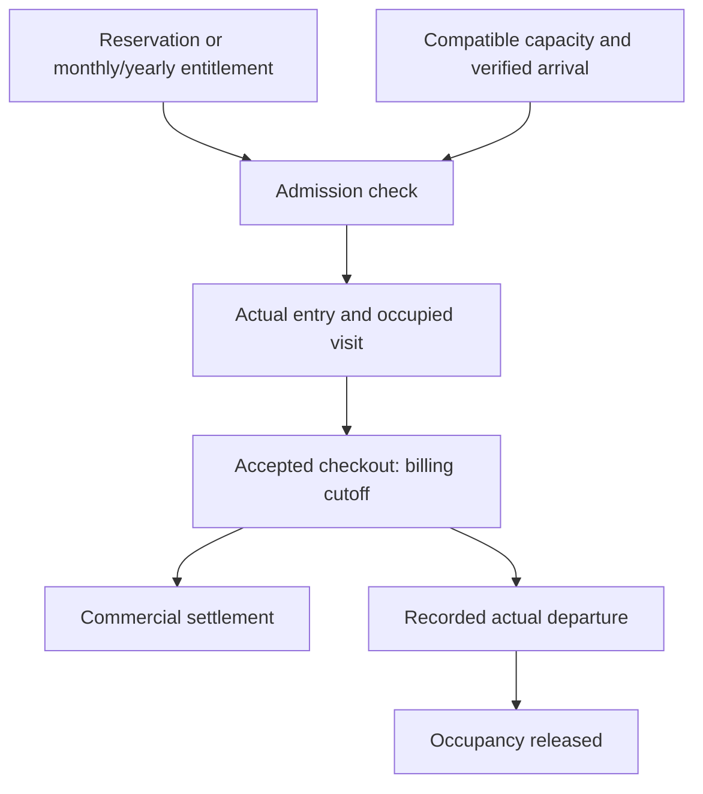

# SmartPark — Consolidated SRS v1.1

**v1.1 documentation review candidate based on approved decisions · Updated 21 October 2026**
The preceding v1.0 RC3 baseline was a review candidate, not a signed release. The [approved decision register](../../05-project-management/decision-log/2026-10-20-approved-v1.1-changes.md) governs this update; implementation and [acceptance scenarios](../../04-testing/requirements-traceability/acceptance-scenarios.md) remain **NOT RUN/not assessed**, not product acceptance.

## 1. Purpose and how to use this document

SmartPark is a Vietnam-focused web parking management system for Drivers, Operators, Owners and Admins. It connects discovery and reservations with on-site parking operations, fee calculation, payments, monthly/yearly coverage and accountable support. It supports cars, motorcycles and permitted account-free/non-plated walk-in workflows without assuming every lot uses numbered spaces.

Read this file first for **what the product must do and its limits**. Then read the [solution architecture overview](../../02-architecture/solution-architecture/smartpark-solution-architecture-v1.1.md) for ownership and technical direction. Follow the links beside each topic for exact rules, boundary examples and implementation contracts. This overview summarizes approved decisions; it does not replace detailed requirement IDs or introduce new policy.

Authority: explicit approved amendments and the synchronized active baseline govern. If a summary omits a condition, use the detailed contract. If sources conflict, flag the concrete difference for correction rather than inventing a rule. Older v0.8/v0.9 documents and historical alternatives do not override the active modular baseline.

| Status | Meaning |
|---|---|
| Confirmed / implementation pending | Required behavior is agreed; delivery needs code and evidence. |
| Confirmed direction / POST-v1.0 detail | General scope and authority remain; detailed AI/LPR integration and evaluation are intentionally later. |
| Future / outside MVP | Not an active MVP delivery requirement. |
| NOT RUN | Expected outcome specified; no acceptance pass claimed. |

## 2. Product scope and users

| Role | Main responsibilities | Authority boundary |
|---|---|---|
| Driver | Manage own account/vehicles; discover lots; reserve; view visits; pay; buy monthly/yearly parking coverage; submit appeals/support. | Own records and eligible actions only. |
| Operator | Assigned-lot arrival, allocation, visits, checkout/cash, incidents and audited emergency recovery. | Current lot assignment; no global account/vehicle ownership authority. |
| Owner | Configure owned lots, permitted policies/tariffs/plans, create and assign Operators, review business reports and escalations. | Owned organization/lots; approved configuration bounds. |
| Admin | Combined Partner/first-lot and additional-lot review, platform account/security/audit functions, reviewed binding disputes and account recovery. | Explicit platform functions; no blanket operational override. |

Owner-created Operators remain pending until email activation, verified contact and mandatory consented VNeID simulation; password setup is optional, with scoped assignment and no Admin approval per hire. Simulation is also mandatory for Driver/Owner registration, clearly labelled and not government verification. Per the [21 October V11-06 clarification](../../05-project-management/decision-log/2026-10-21-vneid-simulation-guid.md), the fake API returns a GUID substitute tied to the user and persisted in the User & Access database; it is not a government identity number or an authentication token. The sole seeded Admin is exempt, with no Admin registration route or role management. Removing a grant blocks future protected actions while retaining history. Recovery does not approve an Owner, unblock an account or grant a role.

Details: [complete action-by-role matrix](permissions.md) · [identity and access requirements](modules/01-identity-access.md).

## 3. Functional scope at a glance

| Area | v1.1 direction | Detailed requirements |
|---|---|---|
| Identity, vehicles and recovery | Password or either independently verified email/phone OTP; optional TOTP for all four roles; backup codes and reviewed Admin recovery; guarded vehicle binding. | [Identity/access](modules/01-identity-access.md) and [security/recovery flows](authentication-recovery.md) |
| Facility and capacity | Owner-managed structure, vehicle categories, represented spaces or category pools; maintenance/closure and safe change handling. | [Facility/capacity](modules/02-facility-capacity.md) |
| Discovery and visualization | MapTiler current/manual origin, 5 km/expansion, category/lot-type/distance/price/availability filters; current tariff or interval estimated total; detail-to-internal-2D/3D handoff. | [Discovery/visualization](modules/03-discovery-visualization.md) |
| Reservations and allocation | Specific-slot preference, zone or capacity booking; compatible claims, payment hold, allocation, alternatives, cancellation/no-show. | [Reservations/allocation](modules/04-reservations-allocation.md) |
| Parking operations | Walk-in and reserved visits; arrival, entry, identification, tickets/cards, checkout, departure, incidents and appeals. | [Sessions/operations](modules/05-sessions-operations.md) |
| Pricing and payment | Versioned tariffs, coverage-adjusted minimums, prepayment, verified collection, refunds and PDF invoices; payOS priority. | [Pricing/payments](modules/06-pricing-payments.md) |
| Monthly/yearly coverage | Explicit Owner enablement of Driver products; yearly 12 calendar months/max one yearly advance period; monthly max three unchanged; separate accepted financial policies and available-only coverage. | [Monthly passes](modules/07-monthly-passes.md) |
| Notifications and reporting | Scoped live views and reports; in-app notification, email/SMS declared modes, audit and asynchronous support. | [Notifications/reporting](modules/08-notifications-reporting.md) |
| Files and evidence | Validated uploads, authorized access, owner-controlled retention, acknowledged holds and recoverable deletion. | [File/media](modules/09-file-media.md) |
| Assistant and recognition | Approved-content help, scoped reads and reservation preparation; recognition/manual review direction. Detailed integration/evaluation POST-v1.0. | [AI/LPR scope and limits](modules/10-ai-assistance.md) |

Existing requirement/rule/use-case/story IDs remain stable; maintained catalogues include future/deferred scope and are not delivered-feature counts. Browse [use cases](../use-cases/README.md), [stories](../use-cases/user-stories/catalogue.md) and [traceability](../requirements-traceability/matrix.csv) when planning or testing a specific change.

## 4. Main journeys and lifecycle boundaries

**Partner Registration:** Keep the Owner role and immediately persist pending identity/application. Complete consented simulation and save first-lot setup plus actual agreement uploads before email OTP/verification, then Admin reviews the combined application. Setup/verification/resend credentials are restricted; application ID alone is not authorization. Email verification is mandatory for review; phone need only be verified before phone OTP login.

**Initial review:** Admin may replace only uploaded agreement/policy documents while the initial application is pending, preserving original/replacement versions, actor/time/reason and concurrency-safe approval binding. No other fields or additional-lot documents may be edited. Approval/rejection are the only final immutable outcomes; no in-app corrections/re-acceptance. Modified-document approval emails “Your application was approved with some modifications”. Rejection records a safe reason and prevents repeat initial registration with that email.

**Provisioning and later lots:** Approval is distinct from pending/failed/unknown/successful provisioning; retry uses stable identities and cannot duplicate sites. Normal Owner login waits for successful initial provisioning; never ask the Owner to recreate the first lot. Approved activation does not open parking: Facility configuration and Operations readiness are still required. Each additional lot has independent review; rejection leaves Owner/other lots unaffected. Draft as new creates a distinct proposal, even with identical content, while request retry remains idempotent. Final rejected history is never reopened.

**Service authority:** User owns identity, organization/membership and review evidence; Facility configuration; Operations accepted occupancy/claims, discovery and plan/coverage; Payment tariffs/financial terms; IoT raw observations/integrations. A combined form or stored proposal does not move this authority to legacy Parking Service.

**Reservation:** Driver selects vehicle, time and product, reviews accepted terms, and confirms. Positive-priced bookings enter a payment hold; genuinely zero-priced bookings can confirm without payment after the same capacity/eligibility checks. Verified money and a compatible claim allow confirmation; allocation selects fulfillment, then arrival/admission and parking follow. Specific-slot booking protects a preference but does not promise that exact physical slot under every recovery condition.

**Parking visit:** At the lot, the Operator validates the reservation/monthly entitlement or walk-in context and compatible availability. Actual entry creates the accepted visit/occupancy facts. Accepted checkout freezes the billable cutoff. Payment settlement, gate action and actual departure are separate facts; only actual departure releases occupancy. A paid stay cannot simply be reopened to continue parking.

**Monthly/yearly coverage:** Owner separately enables these Driver products. Yearly covers 12 consecutive calendar months with at most one yearly period purchased in advance; monthly remains max three prepaid periods. Yearly financial/refund/renewal policies are separately configurable and design-pending without invented rates/defaults. Driver buys disclosed product-specific terms. Full verified payment and the entitlement commit must meet the accepted product deadline; the monthly 15-minute/strict A<H contract remains unchanged and yearly deadline settings require design agreement. Coverage reduces eligible ordinary fees but does not reserve capacity while the vehicle is outside. Voluntary cancellation first requires explicit resolution of dependent future reservations; closure uses its separate failure rules.

The diagram distinguishes facts; it does not authorize departure without the required settlement or audited emergency workflow. Full guards, exceptional transitions, timing equality and concurrency rules are in [state transitions and races](state-transitions.md) and [checkout/departure use case](../use-cases/uc-gate-02.md).

## 5. Business rules that shape the product

| Topic | Main direction | Examples and exact rules |
|---|---|---|
| Capacity safety | Never commit incompatible overlapping claims or displace an occupied vehicle. Physical status and reservation/protection are separate. UNKNOWN is not freely allocatable; occupied backup is counted once. | [Capacity rules](../business-rules/02-facility-capacity.md) |
| Booking defaults | Minimum 15 minutes; maximum 24 hours; advance booking 7 days; inter-booking buffer 0; no active-booking cap by default. An enabled cap is lot/account-scoped and counts pending-payment, confirmed and allocated bookings. | [Policy catalogue: bounds and authority](../business-rules/policy-catalogue.md) |
| Allocation and lateness | Allocation lead time is one hour. Protect compatible claims; preserve stable allocations. Driver may request reallocation up to twice. Optional late tolerance and no-show use authoritative arrival evidence. Offer acceptance must occur strictly before expiry. | [Reservation/allocation rules](../business-rules/04-reservations-allocation.md) |
| Ordinary session exemption | A whole ordinary session up to 15 minutes is free. Once exceeded, charge the full applicable uncovered duration, without subtracting 15 minutes. Covered time counts toward elapsed duration but is never charged. | [Pricing rules](../business-rules/06-pricing-payments.md) |
| Reserved minimum and prepayment | A completed reserved visit owes its disclosed coverage-adjusted booked minimum plus eligible extras, even for a short physical stay. Prepayment is credited once. Owner chooses full payment (default), percentage >0–100%, or positive fixed deposit with no policy upper cap. | [Money examples and settlement](modules/06-pricing-payments.md) |
| Rounding and zero-price bookings | Sum unrounded values, then round once half-up to the nearest 1,000 VND. A positive-price deposit rounding to zero is invalid; genuinely zero-priced monthly-covered reservations explicitly confirm without payment. | [Calculation rules](../business-rules/06-pricing-payments.md) |
| Cancellation and no-show | Refund accepted percentages of eligible money actually collected. Do not collect an unpaid remainder as a penalty. Default ordinary bands: ≥30 minutes 100%; ≥15 and <30 minutes 50%; <15 minutes 0%; no-show 0%, subject to lifecycle eligibility. | [Refund table and examples](modules/06-pricing-payments.md) |
| Refund execution | Surplus creates one refund obligation; covered checkout may complete before payout. Approval is not payout proof. Unsupported online refunds remain pending/reconciled; no silent cash fallback. | [Refund rules](../business-rules/06-pricing-payments.md) and [appeals/refunds](../use-cases/uc-inc-02.md) |
| Monthly/yearly products | Calendar-based, available-only fee coverage with distinct advance limits and accepted financial policy; no guaranteed slot/capacity or automatic renewal. Cancel dependent future reservations explicitly before voluntary pass cancellation. | [M-01–M-09 and examples](../business-rules/07-monthly-passes.md) |
| Facility closure | Temporary closure keeps the pass active and refunds verified unavailable intervals once. Permanent closure cancels remaining coverage and refunds eligible unused value. No automatic extension. | [Monthly closure handling](modules/07-monthly-passes.md) |
| Abuse and incidents | Booking-abuse restrictions govern new bookings, not login or all existing rights. Incidents require scoped human review; no invented fine, towing, ban or automatic binding transfer. | [Abuse examples](modules/04-reservations-allocation.md) and [Operations rules](../business-rules/05-sessions-operations.md) |
| Policy changes | Owners change only approved choices/bounds. Preserve accepted versions; unspecified ranges stay locked. Planned capacity reductions coordinate recovery; explicit descendant/dependency handling and one-lot all-or-nothing multiselect batches return per-item errors without partial mutation. Emergencies preserve physical facts and affected rights. | [Policy authority](../business-rules/policy-catalogue.md) and [Facility changes](modules/02-facility-capacity.md) |

A useful payment example: a 100,000 VND reservation with 30,000 VND collected owes the remaining 70,000 VND on a completed visit, absent other adjustments; a no-show does not create that additional debt. A 300,000 VND deposit against a 125,000 VND final charge creates a 175,000 VND surplus refund. See the linked payment module for boundary cases.

## 6. Security, privacy and support

Normal completed login returns necessary tokens; profile/onboarding data is retrieved separately, such as /me. Preserve required MFA challenges and safe meaningful pending/rejected/provisioning failure reasons after sufficient credential validation. Driver verification never auto-logs in. Access remains 15 minutes, refresh absolute 7 days/inactivity24 hours, OTP expiry5 minutes/three failures/15-minute lock.

Protect the single seeded Admin from administrative disable/lock/delete/role or authority changes, including self/last-Admin loss; ordinary own profile/security and authentication lockouts remain. Maintainer recovery is the sole-Admin route. Explicit re-enable with reason removes only administrative disable, never approval/contact/role/grant/security/booking restrictions or revoked sessions.

Vehicle removal is soft only with active-dependency guards and retained associations; it does not approve transfer. Cleanup follows retention/holds.

All protected reads, writes, exports and live subscriptions enforce current role and resource scope. Either verified bound email or phone works independently for primary OTP login. If TOTP is enabled, it is additionally required before a normal session. Backup-code replacement and Admin-assisted recovery preserve restricted recovery flows, evidence review and session revocation; Admin never learns or chooses another user's password.

Support is asynchronous. Assigned Operators handle lot matters; Admin handles platform/account/global binding disputes. There is no implied 24/7 staffing promise. Binding disputes require verified contact and relevant evidence; notifying an existing holder does not authorize transfer merely because they do not respond.

Initial Partner agreement uploads are User-owned, versioned restricted assets with protected reads; arbitrary document URLs grant nothing. Exact upload formats/limits, retention classification and additional simulation fields/consent/completion evidence encoding remain Q01/Q02 design work; the simulated GUID return, user association and database persistence are approved requirements. Evidence is accessed through authorized owning-service routes. Images have a maximum 30-day retention class; financial documents retain seven years from issuance; conversations retain 90 days from the last message, unaffected by administrative reads. Holds and other retention classes follow the detailed contract rather than a single blanket deletion rule.

Details: [TOTP and account recovery](authentication-recovery.md) · [Media/retention/holds](modules/09-file-media.md) · [Support/audit/reporting](modules/08-notifications-reporting.md) · [legal reference status](reference/legal-source-register.md).

## 7. Integrations and acceptance expectations

payOS QR has implementation priority. Native VNPay, MoMo and ZaloPay remain separate planned options with honest real/fixture/deferred labels; payOS transactions are not relabelled as native provider transactions. Controlled low-value payOS production tests plus deterministic failure/race fixtures replace the earlier sandbox requirement. Cash remains an assigned-Operator workflow. Real refund capability still needs evidence.

MapTiler discovery defaults to current-time backend availability and labelled current tariff when no interval is supplied, with no invented duration/total or comparison of unlike raw billing units. Selected intervals use interval availability and estimated total. Full lots, stale/disconnected/provider-failure and denied-location states are explicit. Selected detail opens internal 2D/3D booking; backend capacity confirmation remains required. External directions only; embedded routing/turn-by-turn excluded. Omit unsourced travel estimates and label Haversine as straight-line distance.

Notification failures preserve created identities/applications and committed decisions; distinguish queued from delivered and retry delivery without repeating provisioning.

Email capture/SMS fixtures, deterministic hardware events, manual map fallback and fixture coordinates are the current local acceptance modes where specified. Cloudinary is the first media adapter to evaluate. AI/LPR direction is retained without claiming delivered model integration or accuracy.

| Local quality objective | Approved baseline |
|---|---|
| Core API latency | p95 ≤500 ms; provider work separately measured |
| Unexpected errors | <1%; expected business conflicts reported separately |
| Healthy SignalR freshness | p95 ≤2 seconds |
| Workload | 20 concurrent users for 10 minutes; separate 50-user, one-minute burst |
| Recovery | Restart ≤5 minutes; daily backup/RPO ≤24 hours; restore ≤30 minutes |
| Invariants | No incompatible double commitment, duplicate financial effect or unauthorized access is excused by aggregate targets |

These are local mock-project targets, not achieved results or production SLOs. See [full local recipe and evidence requirements](modules/11-quality-deployment.md), [acceptance scenarios](../../04-testing/requirements-traceability/acceptance-scenarios.md) and [payOS test plan](../../04-testing/payment-integration/payos-test-plan.md).

## 8. Deferred work and release status

**POST-v1.0 detail:** exact Assistant/LPR models, tools, provider integration, datasets, confidence contracts and evaluation. General authority boundaries and manual/ordinary-UI fallback remain applicable.

**Future/outside MVP:** real IoT adapters and full offline operation; product simulator UI; guaranteed monthly capacity/slots and automatic renewal; EV charging; event/demand pricing; personalized AI ranking, forecasting and anomaly detection; additional card channels; advanced analytics/CMS; production HA and Kafka. Native mobile and a full helpdesk product remain excluded. Minimal approved support and current TOTP/account recovery remain included.

V11-08 selects development database reset only after documentation update and approval; this task performs no reset. Target environments, responsible teammate, scripts and date remain implementation-plan actions, replacing migration/grandfathering. Schema/seed fixes still precede execution.

Implementation gaps are not silently deferred features. Team execution still covers API/schema alignment, provider/refund capability checks, security configuration, recovery and acceptance evidence. Final release sign-off, actual delivery assignments and published support availability remain open operational actions.

Follow [the complete deferred/implementation register](../../05-project-management/decision-log/deferred-and-implementation-register.md), [PM release actions](../../05-project-management/decision-log/pm-release-actions.md) and [baseline manifest](baselines/v1.1/manifest.md). This integration retains existing requirement IDs and unrelated SEC-01/SEC-02, PAY-01, reservation, settlement and retention invariants.

Design/implementation owners and exit criteria: [V11-DES-01–12](../../05-project-management/decision-log/deferred-and-implementation-register.md#v11-design-and-implementation-actions). Requirement approval does not imply an approved wire contract or completed implementation.
