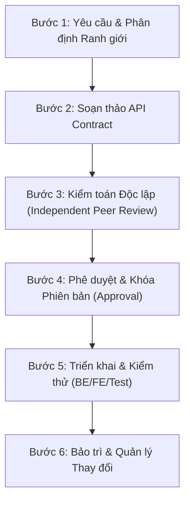

# Quy trình chuẩn hóa: Quản lý vòng đời API Contract (Operation Service)

**Mục đích**: Tài liệu này định nghĩa quy trình thao tác chuẩn (SOP — Standard Operating Procedure) cho việc thiết kế, tài liệu hóa, kiểm toán, phê duyệt và duy trì các **API Contract** trong phạm vi **Operation Service** thuộc dự án SmartPark. Mọi thành viên trong team và AI Agent đều **BẮT BUỘC** phải tuân thủ quy trình này khi tham gia phát triển các tính năng vận hành bãi, đặt chỗ và chính sách hoạt động.

---

## 1. Các tài nguyên đầu vào & Phân cấp thẩm quyền (Inputs & Authority Hierarchy)

Khi thiết kế API Contract cho Operation Service, thông tin phải được thu thập và đối chiếu theo thứ bậc thẩm quyền sau:

1. **Tài liệu yêu cầu đã được phê duyệt (Confirmed Requirements Baseline)**:
   - *SRS hiện hành:* `docs/01-requirements/srs/smartpark-srs-v1.1.md` và các module liên quan (`02-facility-capacity.md`, `04-reservations-allocation.md`).
   - *Danh mục chính sách chuẩn:* `docs/01-requirements/business-rules/policy-catalogue.md` (v1.1).
   - *Business Rules:* `BR-POL-01`, `BR-POL-02`, `BR-POL-03`, `BR-POL-04`, `BR-CAP-04`.
2. **Ranh giới dịch vụ & Mô hình dữ liệu (Service Boundaries & Persistence Baseline)**:
   - Schema DDL tương ứng: `scripts/database/microservices/03b-reservation-operations-service-db.sql` (bảng `operational_policies`, `reservations`, `operational_capacity_configs`).
   - Ranh giới kiến trúc: `docs/02-architecture/source-code-architecture-rules.md` (Zero Cross-DB Rule, Domain POCO thuần túy).
3. **Biểu mẫu tiêu chuẩn (Standard Template)**:
   - `docs/02-architecture/api/operation-service/00-api-contract-template.md`.

> **Nguyên tắc phân định nguồn sự thật (Single Source of Truth):**
> - Phân biệt rõ: (1) Quy định đã được dự án xác nhận, (2) Đề xuất chuẩn hóa kỹ thuật, và (3) Quyết định nghiệp vụ/kiến trúc còn mở (`OPEN` / `UNRESOLVED`).
> - Giữ nguyên trạng thái `OPEN` cho `FR-POL-09` (ngưỡng camera LPR). Tuyệt đối không tự ý quyết định hay biến giả định thành baseline. Mọi điểm chưa rõ phải được gắn nhãn `[OPEN QUESTION]` và chuyển lên người có thẩm quyền.

---

## 2. Nguyên tắc kỹ thuật cốt lõi (Core Engineering Principles)

### 2.1 Ranh giới Sở hữu & Rào chắn Dữ liệu (Service Boundaries & Guardrails)
- **Operation Service làm chủ độc quyền:** Toàn bộ tham số vận hành phi tài chính (Non-financial policies).
- **Payment Service làm chủ độc quyền:** Biểu phí (`tariffs`), phương thức cọc (`prepayment`), tỉ lệ hoàn tiền khi hủy chỗ (`cancellation refund rate`).
- **Zero Cross-DB Rule:** Tuyệt đối không truy vấn chéo vào cơ sở dữ liệu của service khác (như `PaymentDb` hay `FacilityDb`). Mọi trao đổi dữ liệu phải qua hợp đồng API công khai hoặc sự kiện bất đồng bộ.

### 2.2 Vòng đời Chính sách & Tính Bất biến (Policy Lifecycle & Immutability)
1. **Phân cấp giải quyết giá trị (Hierarchy Resolution - BR-POL-01):**
   $$\text{Admin Defaults/Bounds} \longrightarrow \text{Owner/Lot Override} \longrightarrow \text{Specific Scope} \longrightarrow \text{Accepted Context}$$
2. **Quản lý Bản nháp & Kích hoạt (Draft & Activation):**
   - Mọi thay đổi cấu hình phải được thực hiện trên bản nháp (`Draft`).
   - Kích hoạt (`Publish/Activate`) sẽ kiểm tra toàn bộ bounds và sinh ra một số phiên bản mới (`revision_number`). Hỗ trợ kích hoạt tức thời hoặc theo lịch định sẵn (`scheduled_activation_at`).
3. **Tính bất biến của giao dịch đã xác nhận (BR-POL-03):**
   - Đặt chỗ (Reservation) hoặc phiên đỗ (Session) khi đã được chấp thuận sẽ giữ nguyên snapshot phiên bản chính sách tại thời điểm đó.
   - Các sửa đổi chính sách sau này **chỉ áp dụng cho các giao dịch mới**, tuyệt đối không hồi tố (retroactive) làm thay đổi điều khoản của các booking đã tồn tại.

### 2.3 Phân định 3 Trục Versioning Độc lập
1. **API Version (Route HTTP):** Ví dụ `/api/v1/lots/{siteId}/policies/...`. Chỉ tăng khi có breaking change phá vỡ hợp đồng giao tiếp với Client.
2. **Document Revision (Vòng đời file tài liệu):** Đánh số revision của file markdown (bắt đầu từ `v1.0`).
3. **Policy Revision (Phiên bản dữ liệu nghiệp vụ):** Số phiên bản cấu hình chính sách của từng bãi xe (ví dụ: `revision_number = 1, 2, 3...`), được lưu vết bất biến trong cơ sở dữ liệu.

### 2.4 Chính sách Idempotency & Concurrency
- Header bắt buộc khi mutate dữ liệu: `Idempotency-Key` (UUID v4 do Client sinh ra).
- Khóa tính duy nhất: `Scope = (tenant_id, site_id, endpoint_route, idempotency_key)`.
- Xử lý xung đột sửa đổi đồng thời (Optimistic Concurrency Control) dựa trên phiên bản hiện hành.

---

## 3. Quy trình chuẩn 6 bước (Standard 6-Step Workflow)

### Bước 1: Yêu cầu & Phân định Ranh giới
- Thu thập yêu cầu từ SRS v1.1, User Stories (`US-OW02`), Business Rules (`BR-POL-01..04`).
- Xác định đúng Service sở hữu và ranh giới không xâm phạm (Payment vs Operation).

### Bước 2: Soạn thảo API Contract
- Sử dụng biểu mẫu chuẩn `00-api-contract-template.md`.
- Đặc tả rõ ràng các endpoints, schemas, headers, và ma trận mã lỗi chi tiết.
- Cung cấp đầy đủ synthetic payload examples cho cả Happy Path và Error Paths.

### Bước 3: Kiểm toán Độc lập (Independent Peer Review)
- Kích hoạt song song:
  - `document-audit-agent`: Soát lỗi lệch chuẩn với SRS và API Design rules.
  - `architect-audit-agent`: Kiểm tra vi phạm Inward Dependency Rule và Zero Cross-DB.

### Bước 4: Phê duyệt & Khóa Phiên bản (Approval Gate)
- Báo cáo kết quả review cho Tech Lead / User.
- Khi được phê duyệt, chuyển trạng thái contract từ `Draft` $\rightarrow$ `Approved`.

### Bước 5: Triển khai & Kiểm thử (Implementation & Test)
- Đội ngũ BE (`SPARK-230`) xây dựng Controller, MediatR Handlers, Validation và Repositories.
- Đội ngũ QA (`SPARK-232`) viết test tự động đối soát chính xác theo contract.

### Bước 6: Bảo trì & Quản lý Thay đổi
- Bất kỳ thay đổi nào làm phá vỡ tích hợp bắt buộc phải tăng API Version (`/api/v2/`) và khởi tạo contract mới.
