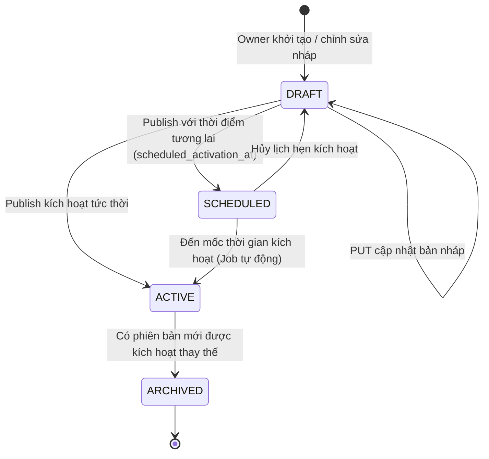

# Owner Configures Parking Lot Policies — API Contract Specification

> **Feature Key:** `SPARK-233` (API Design) / `SPARK-230` (Backend Implementation)  
> **Parent Story:** `[US-OW02] SPARK-245`  
> **Service Owner:** `Operation Service` (`SmartParking.OperationService`)  
> **Target Interface / Route:** `/api/v1/lots/{siteId}/policies/...`  
> **Document Revision:** `v1.0`  
> **API Version:** `v1`  
> **Contract Status:** `Approved`  
> **Communication Type:** `Client-to-Backend HTTP REST`  
> **Author:** `AI Subagent (coding-agent)`  
> **Reviewer:** `Tech Lead / Architecture Reviewer`  
> **SRS / BR Baseline:** `SRS v1.1 §3.2.4–3.2.5`, `BR-POL-01..04`, `policy-catalogue v1.1`  

---

### Lịch sử thay đổi (Revision History / Change Log)

| Revision | Ngày | Tác giả | Người duyệt | Loại thay đổi | Mô tả thay đổi / Jira Key |
| :---: | :---: | :--- | :--- | :--- | :--- |
| `v1.0` | 2026-11-06 | AI Assistant | Tech Lead | Initial | Khởi tạo tài liệu đặc tả hợp đồng API mức kiến trúc theo task `SPARK-233` |

---

## 1. Tổng quan & Phạm vi nghiệp vụ (Overview & Business Scope)

### 1.1 Mục đích nghiệp vụ (Business Objective)
Cung cấp bộ API chuẩn hóa cho phép Chủ bãi xe (Owner) cấu hình các chính sách vận hành của bãi đỗ xe thuộc sở hữu (`owned lot`), bao gồm:
- Tra cứu danh mục chính sách, giới hạn trần/sàn do Admin quy định và giá trị đang có hiệu lực (`effective values`).
- Quản lý bản nháp cấu hình (`Draft Revision`), kiểm tra tính hợp lệ trước khi áp dụng.
- Kích hoạt chính sách ngay lập tức hoặc lên lịch kích hoạt trong tương lai (`Scheduled Activation`).
- Truy vết toàn bộ lịch sử thay đổi phiên bản (`Revision History`) và truy xuất snapshot chính sách đã áp dụng cho các lượt đặt chỗ / giao dịch trong quá khứ.

### 1.2 Ranh giới Dịch vụ & Bên tiêu thụ (Service Boundary & Consumer Scope)
- **Bên tiêu thụ (Consumers):**
  - *Owner Web Portal*: Giao diện web dành cho Chủ bãi xe để xem và chỉnh sửa chính sách.
  - *Reservation & Operations Core*: Đọc giá trị chính sách có hiệu lực để tính toán cửa sổ giữ chỗ, lead time phân bổ, và thời gian bảo vệ chỗ đỗ.
  - *Internal Service Callers*: Các service nội bộ tra cứu snapshot chính sách để đối soát.
- **Ranh giới Bất khả xâm phạm (Zero Cross-DB & Service Ownership):**
  - **Operation Service** nắm quyền sở hữu độc quyền toàn bộ tham số vận hành phi tài chính (bảng `operational_policies`).
  - **Payment & Pricing Service** nắm quyền sở hữu độc quyền biểu phí tài chính (`tariffs`, `prepayment_mode`, `cancellation_refund_rate` tại `04-payment-pricing-service-db.sql`).
  - API này **tuyệt đối không duplicate bảng giá** và **không truy vấn trực tiếp vào PaymentDb**.

### 1.3 Xác thực & Phân quyền (Authentication & Authorization)
- **Cơ chế xác thực:** `Bearer JWT` (chuẩn RFC 6750).
- **Quyền hạn bắt buộc (Required Permission):** `LOT_POLICY_MANAGE`.
- **Phạm vi tài nguyên (Resource Scope):** Bắt buộc kiểm tra `owned-lot scope`. Người dùng đăng nhập với vai trò `OWNER` chỉ được phép đọc và ghi cấu hình cho các bãi xe (`siteId`) mà mình sở hữu hợp pháp. Mọi nỗ lực truy cập bãi xe của Owner khác sẽ bị từ chối ngay với HTTP `403 Forbidden` (`CROSS_LOT_ACCESS_DENIED`).

### 1.4 Chính sách Idempotency (Idempotency Policy)
- **Header quy chuẩn:** `Idempotency-Key` (UUID v4 do Client sinh ra, bắt buộc đối với endpoint `POST /publish` và khuyến nghị cho `PUT /draft`).
- **Phạm vi duy nhất (Uniqueness Scope):**  
  $$\text{Scope} = (\text{tenant\_id}, \text{site\_id}, \text{endpoint\_route}, \text{idempotency\_key})$$
- **Hành vi xử lý:**
  - *Cùng Key + Cùng Payload (đã xử lý):* Trả về nguyên vẹn kết quả thành công trước đó kèm header `Idempotency-Replayed: true`.
  - *Cùng Key + Khác Payload:* Trả về HTTP `409 Conflict` (`IDEMPOTENCY_PAYLOAD_MISMATCH`).
  - *Yêu cầu đang xử lý (In-flight):* Trả về HTTP `409 Conflict` (`OPERATION_IN_PROGRESS`).

### 1.5 Bảng truy vết yêu cầu hai chiều (Bi-directional Traceability Matrix)

| Mã Yêu cầu | Tài liệu nguồn | Mô tả nghiệp vụ | Ánh xạ Hợp đồng API |
| :--- | :--- | :--- | :--- |
| `FR-POL-01` | SRS v1.1 §3.2.4 | Owner cấu hình chính sách bãi xe trong khoảng Admin cho phép | `PUT /draft`, `POST /publish` |
| `FR-POL-03` | SRS v1.1 §3.2.4 | Cung cấp danh mục chính sách typed, scoped kèm units | `GET /catalogue` |
| `FR-POL-04` | SRS v1.1 §3.2.4, `BR-POL-02` | Validate bounds, từ chối cấu hình sai phạm với lý do an toàn | Error matrix 400 `POLICY_OUT_OF_BOUNDS` |
| `FR-POL-05` | SRS v1.1 §3.2.4, `BR-POL-03` | Lưu vết revision, không hồi tố lên các booking đã chấp nhận | `GET /revisions`, `GET /revisions/{version}` |
| `FR-POL-07` | SRS v1.1 §3.2.4, `BR-POL-01` | Phân cấp giải quyết: Admin bounds $\rightarrow$ Owner override | Mô hình `effective_value` tại `GET /catalogue` |
| `FR-POL-08` | SRS v1.1 §3.2.4 | Hỗ trợ draft, scheduled activation và revision history | `GET /draft`, `PUT /draft`, `POST /publish` |
| `UC-POL-01` | Use Case Index | Use Case cấu hình chính sách bãi và biểu phí | Toàn bộ 6 endpoints trong hợp đồng này |
| `US-OW02` | User Story | Owner muốn cấu hình chính sách bãi xe trong phạm vi cho phép | Mục tiêu nghiệp vụ của hợp đồng |
| `FR-AUTH-06`| SRS v1.1 §3.1 | Phân quyền truy cập và bảo vệ phạm vi tài nguyên sở hữu | RBAC `LOT_POLICY_MANAGE` + `owned-lot scope` |

### 1.6 Bảng ghi nhận Trạng thái Mở / Hoãn lại (Open & Deferred Items)

> [!WARNING]
> **FR-POL-09 — LPR Threshold Configuration (Trạng thái: OPEN / Deferred):**  
> Yêu cầu cấu hình ngưỡng nhận diện camera biển số LPR hiện đang thuộc diện nghiên cứu chuyên sâu (`OPEN`). Hợp đồng API này **không tự ý baseline hóa** trường này vào cấu hình chính thức.

---

## 2. Mô hình Danh mục Chính sách & Động cơ Phân cấp (Policy Catalogue Engine)

### 2.1 Danh mục 14 Chính sách Vận hành thuộc Quyền sở hữu của Operation Service

Dựa trên chuẩn mực `docs/01-requirements/business-rules/policy-catalogue.md` (v1.1) và schema `operational_policies`:

| Key | Kiểu dữ liệu | Đơn vị | Phạm vi | Admin Default | Admin Permitted Bounds | Ý nghĩa khi Unset / Disabled |
| :--- | :--- | :--- | :--- | :--- | :--- | :--- |
| `RESERVATION_MIN_DURATION` | `integer` | Phút (`minutes`) | Lot | `15` | `15` đến `60` phút | Kế thừa Admin Default (15 phút) |
| `RESERVATION_MAX_DURATION` | `integer` | Giờ (`hours`) | Lot | `24` | `1` đến `168` giờ (7 ngày) | Kế thừa Admin Default (24 giờ) |
| `MAX_ADVANCE_BOOKING` | `integer` | Ngày (`days`) | Lot | `7` | `1` đến `30` ngày | Kế thừa Admin Default (7 ngày) |
| `INTER_BOOKING_BUFFER` | `integer` | Phút (`minutes`) | Lot | `0` | `0` đến `60` phút | `0` là giá trị hợp lệ (cho phép đặt liền kề) |
| `MAX_ACTIVE_BOOKINGS` | `integer?` | Số lượng | Tài khoản/Lot | `null` | `1` đến `10` lượt (hoặc `null`) | `null` nghĩa là Disabled (không giới hạn) |
| `RESERVATION_MODE` | `string` | Enum | Lot | `SPECIFIC_SLOT` | `SPECIFIC_SLOT`, `ZONE_ONLY` | Mặc định chọn ô cụ thể |
| `PAYMENT_HOLD_DURATION` | `integer` | Phút (`minutes`) | Lot/Booking | `15` | `5` đến `30` phút | Kế thừa Admin Default (15 phút) |
| `RESERVATION_PROTECTION_WINDOW` | `integer` | Giờ (`hours`) | Lot/Booking | `4` | `1` đến `12` giờ | Kế thừa Admin Default (4 giờ) |
| `ALLOCATION_LEAD_TIME` | `integer` | Phút (`minutes`) | Lot/Booking | `60` | `15` đến `180` phút | Kế thừa Admin Default (60 phút) |
| `ALTERNATIVE_OFFER_DURATION` | `integer` | Phút (`minutes`) | Lot/Booking | `5` | `3` đến `15` phút | Kế thừa Admin Default (5 phút) |
| `OCCUPANCY_VALIDITY_TIMESPAN` | `integer` | Giờ (`hours`) | Lot/Booking | `4` | `1` đến `8` giờ | Kế thừa Admin Default (4 giờ) |
| `DRIVER_REALLOCATION_REQUEST_LIMIT` | `integer` | Số lần | Lot/Booking | `2` | `0` đến `5` lần | Kế thừa Admin Default (2 lần) |
| `ARRIVAL_LATE_TOLERANCE` | `integer?` | Phút (`minutes`) | Lot | `15` | `15` đến `30` phút (hoặc `null`) | `null` = Giữ chỗ đến hết thời gian đặt |
| `PARKING_PRODUCT_ENABLED` | `object` | Boolean flags | Lot | `{ "monthly": false, "yearly": false }` | Cờ bật/tắt tường minh | Không tự bật ngầm khi có giá |

### 2.2 Thuật toán Phân giải Giá trị Hiệu lực (Effective Value Resolution Algorithm)
Mỗi tham số chính sách khi được truy vấn qua API sẽ được tính toán qua 3 bước nghiêm ngặt:
1. **Kiểm tra Override của Owner tại Bãi xe (`siteId`):** Nếu bãi xe có cấu hình ghi đè hợp lệ và đang ở trạng thái `ACTIVE`, kiểm tra xem giá trị đó có thỏa mãn $\text{AdminMin} \le \text{ConfiguredValue} \le \text{AdminMax}$ hay không.
2. **Nếu hợp lệ:** Giá trị hiệu lực $\text{EffectiveValue} = \text{ConfiguredValue}$, nguồn gốc $\text{Source} = \text{"OWNER\_OVERRIDE"}$.
3. **Nếu chưa cấu hình (Unset) hoặc vi phạm bounds:** Hệ thống tự động fallback về giá trị mặc định của nền tảng: $\text{EffectiveValue} = \text{AdminDefault}$, nguồn gốc $\text{Source} = \text{"ADMIN\_DEFAULT"}$.

### 2.3 Máy trạng thái Vòng đời Phiên bản Chính sách (Policy Revision State Machine)



### 2.4 Nguyên tắc Bất biến đối với Giao dịch trong Quá khứ (`BR-POL-03`)
- Khi một lượt đặt chỗ (`Reservation`) được tạo và chấp thuận, hệ thống sẽ lưu mã phiên bản chính sách đang áp dụng (`applied_policy_revision_id` hoặc số version).
- Khi Owner publish chính sách mới (tạo version mới), version mới **chỉ có hiệu lực cho các lượt đặt chỗ phát sinh sau thời điểm kích hoạt**.
- Các lượt đặt chỗ đã tồn tại tuyệt đối giữ nguyên các điều khoản cũ (thời gian giữ chỗ, dung sai đến muộn, lead time), đảm bảo tính toàn vẹn và công bằng pháp lý.

---

## 3. Đặc tả Hợp đồng HTTP REST API (Interface Specification)

### 3.1 Bảng tổng hợp Endpoints

| HTTP Method | Route URL | Tên Thao tác | Mô tả tóm tắt | Quyền bắt buộc |
| :---: | :--- | :--- | :--- | :--- |
| `GET` | `/api/v1/lots/{siteId}/policies/catalogue` | Read Effective Catalogue | Lấy danh mục chính sách, giá trị mặc định, bounds và giá trị đang có hiệu lực | `LOT_POLICY_MANAGE` |
| `GET` | `/api/v1/lots/{siteId}/policies/draft` | Read Draft Policy | Đọc nội dung bản nháp chính sách chưa công bố | `LOT_POLICY_MANAGE` |
| `PUT` | `/api/v1/lots/{siteId}/policies/draft` | Upsert Draft Policy | Cập nhật các giá trị override trong bản nháp | `LOT_POLICY_MANAGE` |
| `POST` | `/api/v1/lots/{siteId}/policies/publish` | Publish Policy Revision | Xuất bản bản nháp thành chính sách chính thức (ngay hoặc hẹn giờ) | `LOT_POLICY_MANAGE` |
| `GET` | `/api/v1/lots/{siteId}/policies/revisions` | List Policy Revisions | Xem danh sách lịch sử các phiên bản chính sách đã ban hành | `LOT_POLICY_MANAGE` |
| `GET` | `/api/v1/lots/{siteId}/policies/revisions/{version}` | Read Revision Snapshot | Xem chi tiết snapshot một phiên bản chính sách trong lịch sử | `LOT_POLICY_MANAGE` |

---

### 3.2 Chi tiết Endpoint 1: Tra cứu Danh mục & Giá trị Hiệu lực (`GET .../catalogue`)

- **URL:** `GET /api/v1/lots/{siteId}/policies/catalogue`
- **Mục đích:** Cung cấp cho Web Portal của Owner toàn bộ bảng thông số chính sách để hiển thị giao diện cấu hình trực quan.
- **Headers:** `Authorization: Bearer <token>`
- **Response 200 OK:**
```json
{
  "success": true,
  "data": {
    "siteId": "7c9e6679-7425-40de-944b-e07fc1f90ae7",
    "activeRevision": 3,
    "activeSince": "2026-10-15T08:00:00Z",
    "hasDraft": true,
    "policies": [
      {
        "key": "PAYMENT_HOLD_DURATION",
        "category": "RESERVATION_WINDOW",
        "dataType": "integer",
        "unit": "minutes",
        "adminDefault": 15,
        "adminBounds": {
          "min": 5,
          "max": 30
        },
        "configuredValue": 10,
        "effectiveValue": 10,
        "source": "OWNER_OVERRIDE",
        "isConfigurable": true
      },
      {
        "key": "ARRIVAL_LATE_TOLERANCE",
        "category": "CHECKIN_TOLERANCE",
        "dataType": "integer",
        "unit": "minutes",
        "adminDefault": 15,
        "adminBounds": {
          "min": 15,
          "max": 30
        },
        "configuredValue": null,
        "effectiveValue": 15,
        "source": "ADMIN_DEFAULT",
        "isConfigurable": true
      },
      {
        "key": "PARKING_PRODUCT_ENABLED",
        "category": "PRODUCT_SUBSCRIPTION",
        "dataType": "object",
        "unit": "boolean_flags",
        "adminDefault": {
          "monthly": false,
          "yearly": false
        },
        "adminBounds": null,
        "configuredValue": {
          "monthly": true,
          "yearly": false
        },
        "effectiveValue": {
          "monthly": true,
          "yearly": false
        },
        "source": "OWNER_OVERRIDE",
        "isConfigurable": true
      }
    ]
  }
}
```

---

### 3.3 Chi tiết Endpoint 2: Đọc Bản nháp Chính sách (`GET .../draft`)

- **URL:** `GET /api/v1/lots/{siteId}/policies/draft`
- **Mục đích:** Cho phép Owner xem lại cấu hình đang soạn thảo trước khi quyết định publish.
- **Headers:** `Authorization: Bearer <token>`
- **Response 200 OK:**
```json
{
  "success": true,
  "data": {
    "siteId": "7c9e6679-7425-40de-944b-e07fc1f90ae7",
    "status": "DRAFT",
    "targetRevision": 4,
    "updatedAt": "2026-11-06T09:30:00Z",
    "scheduledActivationAt": null,
    "policies": {
      "paymentHoldDurationMinutes": 10,
      "arrivalLateToleranceMinutes": 20,
      "minReservationDurationMinutes": 15,
      "maxReservationDurationHours": 24,
      "reservationProtectionWindowHours": 4,
      "allocationLeadTimeMinutes": 60,
      "occupancyValidityTimespanHours": 4,
      "driverReallocationRequestLimit": 2,
      "maxAdvanceBookingDays": 7,
      "interBookingBufferMinutes": 0,
      "parkingProductEnabled": {
        "monthly": true,
        "yearly": false
      }
    }
  }
}
```
*(Nếu chưa có bản nháp nào được tạo, trả về `200 OK` với `data: null`).*

---

### 3.4 Chi tiết Endpoint 3: Cập nhật Bản nháp Chính sách (`PUT .../draft`)

- **URL:** `PUT /api/v1/lots/{siteId}/policies/draft`
- **Headers:** 
  - `Authorization: Bearer <token>`
  - `Content-Type: application/json`
  - `Idempotency-Key: <UUID>` *(tùy chọn)*
- **Request Body Sample:**
```json
{
  "policies": {
    "paymentHoldDurationMinutes": 10,
    "arrivalLateToleranceMinutes": 20,
    "minReservationDurationMinutes": 30,
    "maxReservationDurationHours": 48,
    "reservationProtectionWindowHours": 4,
    "allocationLeadTimeMinutes": 60,
    "occupancyValidityTimespanHours": 4,
    "driverReallocationRequestLimit": 3,
    "maxAdvanceBookingDays": 14,
    "interBookingBufferMinutes": 5,
    "parkingProductEnabled": {
      "monthly": true,
      "yearly": true
    }
  }
}
```
- **Response 200 OK:**
```json
{
  "success": true,
  "data": {
    "siteId": "7c9e6679-7425-40de-944b-e07fc1f90ae7",
    "status": "DRAFT",
    "targetRevision": 4,
    "updatedAt": "2026-11-06T10:15:00Z",
    "message": "Draft policy configuration saved successfully."
  }
}
```

---

### 3.5 Chi tiết Endpoint 4: Xuất bản Chính sách (`POST .../publish`)

- **URL:** `POST /api/v1/lots/{siteId}/policies/publish`
- **Headers:** 
  - `Authorization: Bearer <token>`
  - `Content-Type: application/json`
  - `Idempotency-Key: 550e8400-e29b-41d4-a716-446655440000` *(Bắt buộc)*
- **Request Body Sample:**
```json
{
  "activationMode": "IMMEDIATE",
  "scheduledActivationAt": null,
  "publishNote": "Cập nhật tăng thời gian đặt trước lên 14 ngày và mở bán vé năm"
}
```
*(Trường hợp hẹn giờ: `"activationMode": "SCHEDULED"`, `"scheduledActivationAt": "2026-11-10T00:00:00Z"`).*

- **Response 200 OK (Kích hoạt ngay):**
```json
{
  "success": true,
  "data": {
    "siteId": "7c9e6679-7425-40de-944b-e07fc1f90ae7",
    "status": "ACTIVE",
    "newRevision": 4,
    "activatedAt": "2026-11-06T10:20:00Z",
    "publishNote": "Cập nhật tăng thời gian đặt trước lên 14 ngày và mở bán vé năm"
  }
}
```

---

### 3.6 Chi tiết Endpoint 5: Lịch sử các Phiên bản Chính sách (`GET .../revisions`)

- **URL:** `GET /api/v1/lots/{siteId}/policies/revisions?page=1&pageSize=10`
- **Headers:** `Authorization: Bearer <token>`
- **Response 200 OK:**
```json
{
  "success": true,
  "data": {
    "siteId": "7c9e6679-7425-40de-944b-e07fc1f90ae7",
    "totalRevisions": 4,
    "items": [
      {
        "revisionNumber": 4,
        "status": "ACTIVE",
        "effectiveFrom": "2026-11-06T10:20:00Z",
        "effectiveTo": null,
        "publishedBy": "3fa85f64-5717-4562-b3fc-2c963f66afa6",
        "publishNote": "Cập nhật tăng thời gian đặt trước lên 14 ngày và mở bán vé năm"
      },
      {
        "revisionNumber": 3,
        "status": "ARCHIVED",
        "effectiveFrom": "2026-10-15T08:00:00Z",
        "effectiveTo": "2026-11-06T10:20:00Z",
        "publishedBy": "3fa85f64-5717-4562-b3fc-2c963f66afa6",
        "publishNote": "Cấu hình ban đầu cho bãi xe"
      }
    ]
  }
}
```

---

### 3.7 Chi tiết Endpoint 6: Tra cứu Snapshot Phiên bản Quá khứ (`GET .../revisions/{version}`)

- **URL:** `GET /api/v1/lots/{siteId}/policies/revisions/{version}`
- **Headers:** `Authorization: Bearer <token>`
- **Response 200 OK:**
```json
{
  "success": true,
  "data": {
    "siteId": "7c9e6679-7425-40de-944b-e07fc1f90ae7",
    "revisionNumber": 3,
    "status": "ARCHIVED",
    "effectiveFrom": "2026-10-15T08:00:00Z",
    "effectiveTo": "2026-11-06T10:20:00Z",
    "publishedBy": "3fa85f64-5717-4562-b3fc-2c963f66afa6",
    "policies": {
      "paymentHoldDurationMinutes": 15,
      "arrivalLateToleranceMinutes": 15,
      "minReservationDurationMinutes": 15,
      "maxReservationDurationHours": 24,
      "reservationProtectionWindowHours": 4,
      "allocationLeadTimeMinutes": 60,
      "occupancyValidityTimespanHours": 4,
      "driverReallocationRequestLimit": 2,
      "maxAdvanceBookingDays": 7,
      "interBookingBufferMinutes": 0,
      "parkingProductEnabled": {
        "monthly": false,
        "yearly": false
      }
    }
  }
}
```

---

## 4. Ma trận Mã lỗi & Xử lý Ngoại lệ (Error Catalogue)

| HTTP Status | Machine Error Code | Điều kiện Kích hoạt | Response Body Mẫu | Biện pháp Khắc phục của Client |
| :---: | :--- | :--- | :--- | :--- |
| `400` | `POLICY_OUT_OF_BOUNDS` | Giá trị cấu hình vượt quá giới hạn Admin quy định (ví dụ: `paymentHoldDurationMinutes = 45 > 30`) | `{"success": false, "code": "POLICY_OUT_OF_BOUNDS", "message": "paymentHoldDurationMinutes must be between 5 and 30 minutes."}` | Điều chỉnh lại giá trị nằm trong khoảng `adminBounds` |
| `400` | `INVALID_TIME_DURATION` | `minReservationDuration` lớn hơn `maxReservationDuration` | `{"success": false, "code": "INVALID_TIME_DURATION", "message": "Min duration cannot exceed max duration."}` | Kiểm tra logic thời lượng |
| `401` | `UNAUTHORIZED` | Thiếu token hoặc token JWT hết hạn | `{"success": false, "code": "UNAUTHORIZED", "message": "Authentication required."}` | Đăng nhập lại để lấy token mới |
| `403` | `FORBIDDEN` | Người dùng thiếu quyền `LOT_POLICY_MANAGE` | `{"success": false, "code": "FORBIDDEN", "message": "Permission LOT_POLICY_MANAGE is required."}` | Liên hệ quản trị viên cấp quyền |
| `403` | `CROSS_LOT_ACCESS_DENIED` | Owner cố tình truy cập vào bãi xe mà mình không sở hữu | `{"success": false, "code": "CROSS_LOT_ACCESS_DENIED", "message": "You do not own this parking lot."}` | Chỉ thao tác trên các bãi xe thuộc sở hữu của mình |
| `404` | `SITE_NOT_FOUND` | `siteId` không tồn tại trong hệ thống | `{"success": false, "code": "SITE_NOT_FOUND", "message": "Parking lot not found."}` | Kiểm tra lại định danh `siteId` |
| `404` | `REVISION_NOT_FOUND` | Số phiên bản `version` không tồn tại | `{"success": false, "code": "REVISION_NOT_FOUND", "message": "Policy revision not found."}` | Tra cứu danh sách revision trước |
| `409` | `NO_DRAFT_TO_PUBLISH` | Gọi `POST /publish` khi chưa có bản nháp nào được lưu | `{"success": false, "code": "NO_DRAFT_TO_PUBLISH", "message": "No draft policy exists to publish."}` | Lưu bản nháp trước khi publish |
| `409` | `IDEMPOTENCY_PAYLOAD_MISMATCH`| Dùng lại `Idempotency-Key` với payload khác | `{"success": false, "code": "IDEMPOTENCY_PAYLOAD_MISMATCH", "message": "Idempotency key payload mismatch."}` | Sinh key UUID v4 mới |
| `409` | `OPERATION_IN_PROGRESS` | Request cùng key đang được xử lý trong hàng đợi | `{"success": false, "code": "OPERATION_IN_PROGRESS", "message": "Another publish operation is in progress."}` | Chờ vài giây rồi thử lại |
| `422` | `UNPROCESSABLE_ENTITY` | Thiếu các tham số bắt buộc để kích hoạt | `{"success": false, "code": "UNPROCESSABLE_ENTITY", "message": "Draft contains invalid configuration."}` | Điền đầy đủ các trường bắt buộc |

---

## 5. Yêu cầu Phi chức năng & Kiểm toán Hệ thống (NFRs & Auditing)

1. **Hiệu năng & SLA Độ trễ:**
   - Endpoint `GET /catalogue` và `GET /draft` phải phản hồi dưới $\le 100\text{ms}$ (P95).
   - Endpoint `POST /publish` phải hoàn tất transaction dưới $\le 250\text{ms}$ (P95).
2. **Kỷ luật Logging chuẩn `ILogger<T>`:**
   - Bắt buộc ghi structured logs cho các sự kiện: Tạo bản nháp, Sửa bản nháp, Xuất bản chính sách, Từ chối phân quyền (`CROSS_LOT_ACCESS_DENIED`), và Lỗi vi phạm bounds.
   - Định dạng log mẫu:
     ```text
     [INFO] Policy draft updated for SiteId: {SiteId}, TenantId: {TenantId}, UpdatedBy: {AccountId}
     [INFO] Policy revision published for SiteId: {SiteId}, NewRevision: {RevisionNumber}, Mode: {ActivationMode}
     [WARN] Cross-lot access attempt rejected for SiteId: {SiteId}, CallerAccount: {AccountId}
     ```
   - Tuyệt đối không log thông tin nhạy cảm (JWT tokens, password, thông tin cá nhân PII).
3. **Kế hoạch Kiểm thử Tự động Bắt buộc (Mandatory Test Coverage):**
   - **Unit Tests:**
     - Test bộ giải quyết độ ưu tiên (`EffectiveValueResolverTests`): Test fallback về Admin default khi unset; test áp dụng override khi hợp lệ; test từ chối khi vượt quá bounds.
     - Test FluentValidation: Bao phủ kiểm tra toàn bộ 14 tham số trong các kịch bản cận biên (edge cases).
   - **Integration Tests:**
     - Test kiểm tra phân quyền Owner: Gọi API với Owner A trên bãi xe của Owner B $\rightarrow$ Mong đợi `403 CROSS_LOT_ACCESS_DENIED`.
     - Test luồng hoàn chỉnh: Tạo draft $\rightarrow$ Đọc draft $\rightarrow$ Publish $\rightarrow$ Kiểm tra catalog cập nhật $\rightarrow$ Kiểm tra lịch sử revision tăng thêm 1.
