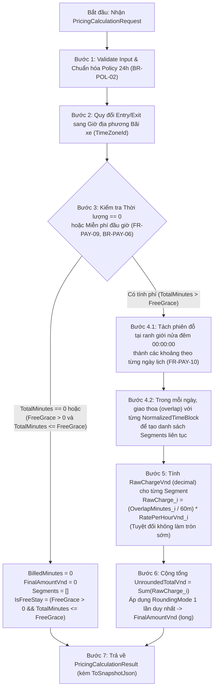

# Parking Pricing Calculator — API & Domain Contract Specification

> **Feature Key:** `SPARK-229`  
> **Service Owner:** `Payment Service` *(Financial Domain — theo quyết định kiến trúc `SA-10`)*  
> **Target Interface / Route:** `IParkingPricingCalculator` *(Authoritative Deliverable của `SPARK-229`)* | *(Companion HTTP Route định hướng cho task tích hợp sau: `POST /api/v1/pricing/calculate`)*  
> **Document Revision:** `v1.1` *(Đã cập nhật phản hồi Review P0/P1 và chuẩn hóa chi tiết kỹ thuật cho bước Implementation)*  
> **API Version:** `N/A` *(Phạm vi bàn giao chính thức của `SPARK-229` là Internal C# Domain Interface; phần HTTP route là đặc tả companion định hướng cho task tích hợp sau)*  
> **Contract Status:** `Approved` *(Baseline v1.1 sẵn sàng cho Implementation Handoff)*  
> **Communication Type:** `Internal Domain Interface` *(Authoritative cho `SPARK-229`)*  
> **Author:** `Tuong Van (VanNT)`  
> **Reviewer:** `Independent AI / Technical Reviewer`  
> **SRS / BR Baseline:** `SRS v0.9 (2026-10-05), Business Rules v0.8.5, Solution Architecture v0.9`  

---

### Lịch sử thay đổi (Revision History / Change Log) `[Required]`

| Revision | Ngày | Tác giả | Người duyệt | Loại thay đổi | Mô tả thay đổi / Jira Key |
| :---: | :---: | :--- | :--- | :--- | :--- |
| `v1.0` | `2026-10-13` | `Tuong Van (VanNT)` | `Independent Reviewer` | Initial | Khởi tạo tài liệu đặc tả hợp đồng tính giá đỗ xe cốt lõi theo task `SPARK-229`. |
| `v1.1` | `2026-10-13` | `Tuong Van (VanNT)` | `Independent Reviewer` | Clarification / Non-breaking | Giải quyết 5 điểm review P0/P1 và chốt chi tiết kỹ thuật cho bước Implementation:<br>1. Phân định rõ `IParkingPricingCalculator` là deliverable chính của `SPARK-229`, HTTP route là companion spec.<br>2. Đồng bộ kiểu dữ liệu C# – JSON – DB (`InvoiceRoundedMinutes`, `LocalEntryTime`, `ToSnapshotJson()`).<br>3. Chốt công thức bất biến cho `IsFreeStay` khi `entryTime == exitTime` và `freeParkingGraceMinutes == 0`.<br>4. Chuẩn hóa giải thuật tách `TimeOnly` 6 trường hợp (bao gồm khung giờ qua đêm và khung 24h) và bảng mã lỗi `PricingDomainException`. |

*Quy ước phân loại thay đổi:*
- **Initial:** Soạn thảo bản đầu tiên của tài liệu contract này.
- **Clarification / Non-breaking:** Bổ sung ví dụ, làm rõ giải thuật, sửa lỗi chính tả, bổ sung trường tùy chọn không phá vỡ client cũ (tăng Document Revision: `v1.0` $\rightarrow$ `v1.1`, giữ nguyên API Version).
- **Sửa lỗi tính toán (Bug Fix):** Sửa lỗi implementation khiến kết quả sai lệch so với quy tắc đã duyệt (tăng Document Revision: `v1.0` $\rightarrow$ `v1.1`, giữ nguyên API Version).
- **Thay đổi chính sách giá (Business Policy / Data Change):** Thay đổi bảng giá, mức phí, khung giờ áp dụng theo cấu hình bãi xe $\rightarrow$ Đây là thay đổi cấu hình dữ liệu (Configuration Data), **KHÔNG** làm thay đổi API Contract hay API Version.
- **Breaking Change:** Thay đổi cấu trúc trường bắt buộc, xóa trường, đổi kiểu dữ liệu hoặc thay đổi hành vi hợp đồng làm phá vỡ tích hợp của consumer hiện tại (yêu cầu khởi tạo contract mới cho API Version mới, ví dụ `/api/v2/`, file `...-v2.contract.md` với Document Revision ban đầu là `v1.0`).

---

## 1. Tổng quan & Phạm vi nghiệp vụ (Overview & Business Scope) `[Required]`

### 1.1 Mục đích nghiệp vụ (Business Objective) `[Required]`
Tài liệu này định nghĩa **Hợp đồng tính toán phí đỗ xe cốt lõi (Core Parking Pricing Calculator Contract)** thuộc miền Tài chính (**Payment Service**). Thành phần này cung cấp một động cơ tính toán tất định (deterministic calculation engine) để xác định số tiền phí đỗ xe cuối cùng dựa trên thời gian vào/ra thực tế của phương tiện và cấu hình biểu giá theo khung giờ (time-block pricing) của bãi xe.

Hợp đồng này giải quyết bài toán tách biệt hoàn toàn logic tính giá phức tạp ra khỏi tầng điều phối Checkout (`SPARK-213`–`SPARK-216`) và tầng tích hợp cổng thanh toán (`SPARK-247`), đảm bảo mọi luồng nghiệp vụ đều sử dụng chung một nguồn quy tắc tính toán duy nhất, chính xác và có thể kiểm toán (auditable).

### 1.2 Ranh giới & Consumer (Consumer & Boundary Scope) `[Required]`

> [!IMPORTANT]
> **Chốt phạm vi Deliverable của Task `SPARK-229` (Implementation Scope):**
> 1. **Deliverable bắt buộc trong `SPARK-229`:** Hiện thực hóa C# Domain Contract `IParkingPricingCalculator`, class `ParkingPricingCalculator` và các Domain Records/Exceptions trong project `SmartParking.PaymentService.Domain`, kèm bộ Unit Tests đầy đủ trong `SmartParking.PaymentService.Tests`.
> 2. **Companion HTTP Spec (`POST /api/v1/pricing/calculate`):** Được đặc tả sẵn tại Mục 2.1 để đóng vai trò thiết kế DTO chuẩn cho các task tích hợp HTTP Controller / Checkout tiếp theo. Trong phạm vi `SPARK-229`, FE chưa gọi trực tiếp endpoint HTTP này.

- **Bên tiêu thụ (Consumer / Caller):**
  - **Payment Order & Checkout Orchestrator (`SPARK-247`, `SPARK-213`–`SPARK-216`):** Gọi `IParkingPricingCalculator.Calculate(...)` để lấy số tiền phải thu (`FinalAmountVnd`), số phút làm tròn ghi hóa đơn (`InvoiceRoundedMinutes`) và bản chụp `ToSnapshotJson()` khi xe làm thủ tục ra bãi.
  - **Reservation Workflow:** Gọi để tính phí dự kiến và truyền lại `PricingPolicySnapshot` đã đóng băng trong `reservations.accepted_pricing_snapshot` (`C-22` / `BR-POL-03`) khi tính phí ra bãi thực tế.
- **Service sở hữu (Owning Service):** `Payment Service` (`SmartParking.PaymentService.Domain`).
- **Loại giao tiếp (Communication Type):** `Internal Domain Interface` (Primary/Authoritative cho `SPARK-229`).
- **Ranh giới Phạm vi (In-Scope vs Out-of-Scope):**
  - **Trong phạm vi (`SPARK-229` Confirmed Scope):**
    1. Tính phí đỗ xe dựa trên mốc thời gian thực tế ghi nhận (`EntryTime` và `ExitTime` theo `FR-PAY-11`, `C-21`).
    2. Áp dụng thời gian đỗ xe miễn phí đầu giờ kiểu bao gồm (`Inclusive Free-Parking Duration`: khi `FreeParkingGraceMinutes > 0` và thời gian đỗ $\le$ ngưỡng miễn phí thì tiền = `0 VND` theo `FR-PAY-09`).
    3. Cắt lát phiên đỗ xe theo các khung giờ hiệu lực (`time-block pricing`) do Chủ bãi (Owner) cấu hình theo từng loại xe (`FR-BAS-05`, `C-08`).
    4. Tự động tách phân đoạn khi thời gian đỗ vắt qua nửa đêm (`00:00:00` giờ địa phương) và áp dụng biểu giá hiệu lực của từng ngày tương ứng (`FR-PAY-10`).
    5. Tính phí từng phân đoạn bằng số thực chính xác cao (`decimal`) **không làm tròn sớm**, cộng tổng các phân đoạn và chỉ áp dụng quy tắc làm tròn tiền tệ **1 lần duy nhất** ở kết quả cuối cùng (`FR-PAY-10`, `§3.5.1`).
    6. Nhận và bảo toàn phiên bản biểu giá (`PolicyVersion` / `TariffId`) đã chấp thuận cho các giao dịch đặt trước (`FR-POL-05`, `C-22`, `BR-POL-03`).
  - **Ngoài phạm vi (`SPARK-229` Explicitly Out of Scope):**
    1. **Không** gọi cổng thanh toán bên ngoài (VNPay, MoMo, ZaloPay) hay xử lý thu tiền mặt `CASH_COLLECT` (`SPARK-247`).
    2. **Không** xử lý Webhook, Hoàn tiền (Refund `FR-PAY-06`) hay sinh file PDF Hóa đơn (`FR-PAY-07`).
    3. **Không** tự ý phát minh các bộ kích hoạt giá động theo sự kiện, ngày lễ hoặc mật độ nhu cầu (Event/Holiday/Demand-driven pricing thuộc phạm vi `FUTURE` theo `C-08`).
    4. **Không** áp dụng mô hình báo giá tạm thời tại cổng ra (`exit-quote / clearance window / requote` đã bị vô hiệu hóa theo `C-21` và `BR-PAY-05`).
    5. **Không** tự ý giải quyết ngầm các xung đột chưa chốt trong `FR-PAY-01/02` và `BR-PAY-01` (như phụ phí qua đêm cố định của khách vãng lai chồng lên time-block slicing).

### 1.3 Xác thực, Phân quyền & Quy tắc lấy Biểu giá (Auth, Scope & Tariff Resolution) `[Conditional]`
- **Tại tầng Domain Engine (`IParkingPricingCalculator`):**
  - Là thành phần tính toán thuần túy trong bộ nhớ (in-memory stateless engine), nhận trực tiếp đối tượng `PricingPolicySnapshot` đã được tầng Application nạp sẵn và thực hiện kiểm tra toàn vẹn cấu trúc biểu giá (`BR-POL-02`).
- **Tại tầng Application / HTTP Adapter (Khi ghép nối DB và Web API):**
  1. **Kiểm tra Xác thực & Quyền truy cập (`401` / `403`):**
     - Mọi lời gọi từ Client/Operator phải có JWT hợp lệ (`401 UNAUTHORIZED` nếu thiếu/hết hạn).
     - Kiểm tra phạm vi tài nguyên: `tenantId` và `siteId` trong yêu cầu phải thuộc quyền quản lý/truy cập của caller. Nếu caller thuộc tenant khác hoặc Operator không được phân công vào `siteId` đó $\rightarrow$ Từ chối với `403 FORBIDDEN`.
  2. **Quy tắc giải quyết Nguồn Biểu giá (Tariff Resolution Rules):**
     - **Trường hợp A — Phiên đỗ xe gắn với Đặt chỗ trước đã duyệt (`reservationId != null`):**
       - Hệ thống đọc cột `reservations.accepted_pricing_snapshot` (`JSONB`) đã đóng băng lúc đặt chỗ (`C-22`, `BR-POL-03`).
       - Nếu snapshot bị rỗng (`null`), hỏng cấu trúc JSON hoặc không khớp `siteId`/`vehicleType` $\rightarrow$ Trả lỗi `422 Unprocessable Entity` (`CORRUPTED_POLICY_SNAPSHOT`). **Tuyệt đối không tự động fallback sang bảng giá vãng lai hiện hành** (vì sẽ vi phạm cam kết giá lúc đặt chỗ).
     - **Trường hợp B — Khách vãng lai (`reservationId == null` / Walk-in):**
       - Hệ thống truy vấn bảng `tariffs` đang hoạt động (`is_active = true`) theo `(tenant_id, site_id, vehicle_type)` kết hợp với `site_operational_settings.free_parking_grace_minutes` của `site_id` đó.
       - Nếu bãi xe chưa cấu hình bảng giá active cho loại xe này $\rightarrow$ Trả lỗi `404 Not Found` (`TARIFF_NOT_FOUND`). Tuyệt đối không mặc định tính giá `0 VND` (`BR-POL-02`).

### 1.4 Chính sách Idempotency (Idempotency Policy) `[Conditional]`
- **Đánh giá bản chất:** Phép tính giá (`Calculate`) là một **Hàm thuần túy không trạng thái (Stateless Pure Calculation)**, không ghi/sửa dữ liệu trong DB và không tạo giao dịch thanh toán.
- **Tính chất Idempotent tự nhiên (Naturally Idempotent):** Với cùng một bộ tham số đầu vào `(EntryTime, ExitTime, VehicleType, Policy)`, động cơ tính toán luôn trả về chính xác cùng một kết quả ở mọi lần gọi.
- **Quy định Header:** Không yêu cầu `Idempotency-Key` cho hàm tính giá. (`Idempotency-Key` bắt buộc tại API tạo đơn thanh toán thuộc `SPARK-247`).

### 1.5 Bảng truy vết yêu cầu hai chiều (Bi-directional Traceability) `[Required]`

#### Chiều 1: Từ Contract $\rightarrow$ Yêu cầu SRS / Business Rules
| Mã yêu cầu | Phân loại & Trạng thái | Nội dung điều khoản nghiệp vụ | Mục hiện thực trong Contract |
| :--- | :---: | :--- | :--- |
| **`FR-PAY-09`** | FR (`Confirmed - C`) | Thời gian đỗ miễn phí mang tính bao gồm (inclusive): nếu thời gian tính phí $\le$ thời gian miễn phí cấu hình ($N > 0$) thì phí đỗ xe = `0 VND`; chỉ tính phí khi vượt quá ngưỡng này. | Mục 2.4, Mục 3.1 (Bước 3), Mục 3.3 |
| **`FR-PAY-10`** | FR (`Confirmed - C`) | Tính giá theo thời gian thực tế địa phương và độ giao thoa thực tế (actual overlap) với các khung giờ biểu giá. Khoảng đỗ qua nửa đêm phải tách tại ranh giới ngày (`00:00:00`). Cộng tổng các phân đoạn chưa làm tròn trước khi làm tròn tiền tệ 1 lần duy nhất ở kết quả cuối. | Mục 2.2, Mục 3.1 (Bước 4, 5, 6), Mục 3.2, Mục 6 |
| **`FR-PAY-11` / `C-21`** | FR (`Confirmed - C`) | Giá đỗ xe cuối cùng được xác định từ `entryTime` và `exitTime` thực tế ghi nhận. Mô hình `quote/clearance/requote` không hoạt động trong v0.9. | Mục 1.2, Mục 2.4, Mục 3.1 (Bước 1, 2) |
| **`FR-BAS-05` / `C-08`** | FR (`Confirmed - C`) | Hỗ trợ định giá động (Dynamic pricing) trong phạm vi MVP thông qua các khung giờ (time blocks) do Owner cấu hình theo loại xe. Các trigger lễ/sự kiện/nhu cầu để ở tương lai (FUTURE). | Mục 1.2, Mục 2.4, Mục 3.1 (Bước 4), Mục 3.2 |
| **`FR-POL-05` / `C-22` / `BR-POL-03`** | FR/BR (`Confirmed - C`) | Giao dịch đặt chỗ đã được chấp thuận (`ACCEPTED` / `CONFIRMED`) giữ nguyên phiên bản chính sách/biểu giá tại thời điểm chấp thuận; các chỉnh sửa bảng giá về sau không áp dụng hồi tố (no retroactive repricing). | Mục 1.3, Mục 2.4, Mục 3.1 (Bước 7) |
| **`BR-PAY-05`** | BR (`Frozen/Inactive - F`) | Đóng băng đề xuất quote/clearance/requote; chỉ sử dụng thời gian vào/ra thực tế. | Mục 1.2 |
| **`BR-PAY-06`** | BR (`Approved/Open - A/X`) | Khi $N > 0$ và $\text{exit} - \text{entry} \le N$ thì miễn phí; khi $N = 0$ thì tắt chế độ miễn phí. Khi vượt ngưỡng $N$, tính phí trên toàn bộ khoảng thời gian đỗ chứ không trừ đi $N$ phút miễn phí. | Mục 3.1 (Bước 3), Mục 3.3 |
| **`BR-POL-01` / `BR-POL-02`** | BR (`Approved - A`) | Mỗi tham số chính sách có kiểu, đơn vị, phạm vi và phiên bản rõ ràng. Từ chối cấu hình thiếu, âm, chồng lấn (overlapping) hoặc có khoảng trống không phủ kín khung giờ — tuyệt đối không coi cấu hình lỗi là miễn phí (`0 VND`). | Mục 3.1 (Bước 1), Mục 3.2, Mục 4.2 |
| **`C-23` / `BR-VEH-03`** | Decision (`Confirmed - C`) | Hỗ trợ phương tiện `CAR`, `MOTORCYCLE` (và `OVERSIZED` theo DB schema). Ô đỗ `EV` là thuộc tính/loại slot, chưa triển khai tính tiền sạc điện EV riêng trong MVP. | Mục 2.1.B, Mục 2.4 |
| **`FR-PAY-01/02` / `BR-PAY-01`** | FR/BR (`Unresolved - X`) | Các chi tiết chưa chốt về làm tròn từng block 60 phút hay ghép phụ phí qua đêm cố định của khách vãng lai được giữ nguyên trạng thái `OPEN`, không tự ý đóng cứng. | Mục 7.2 (`[OPEN QUESTION]`) |

#### Chiều 2: Từ Yêu cầu $\rightarrow$ Kịch bản kiểm thử Unit Test (`SmartParking.PaymentService.Tests`)
| Mã yêu cầu | Tiêu chuẩn nghiệm thu (Acceptance Criteria) | Test Method / Scenario ID | Kết quả mong đợi |
| :--- | :--- | :--- | :--- |
| **`FR-PAY-09`** | Thời gian đỗ nhỏ hơn ngưỡng miễn phí cấu hình ($10\text{ phút} < 15\text{ phút}$) | `TC_PRICE_01_BelowFreeThreshold` | `FinalAmountVnd = 0`, `IsFreeStay = true`, `BilledMinutes = 0`, `InvoiceRoundedMinutes = 10`, `Segments = []` |
| **`FR-PAY-09`** | Thời gian đỗ bằng đúng ngưỡng miễn phí cấu hình ($15\text{ phút} = 15\text{ phút}$, inclusive) | `TC_PRICE_02_AtExactFreeThreshold` | `FinalAmountVnd = 0`, `IsFreeStay = true`, `BilledMinutes = 0`, `InvoiceRoundedMinutes = 15`, `Segments = []` |
| **`FR-PAY-09`, `BR-PAY-06`** | Thời gian đỗ vượt ngưỡng miễn phí ($16\text{ phút} > 15\text{ phút}$), tính phí toàn bộ 16 phút | `TC_PRICE_03_AboveFreeThresholdFullCharge` | `IsFreeStay = false`, `BilledMinutes = 16`, tính tiền trên toàn bộ `16 phút` |
| **`BR-PAY-06`** | Cấu hình `FreeParkingGraceMinutes = 0` (tắt miễn phí):<br>- Đỗ 5 phút $\rightarrow$ tính phí 5 phút (`IsFreeStay = false`).<br>- Đỗ 0 phút (`entry == exit`) $\rightarrow$ `0 VND` nhưng `IsFreeStay = false`. | `TC_PRICE_04_ZeroFreeGraceDisabled` | `IsFreeStay = false` trong cả 2 trường hợp vì chính sách miễn phí đang tắt (`N = 0`) |
| **`FR-PAY-09`, `BR-PAY-06`** | Đỗ 0 phút (`entry == exit`) khi `FreeParkingGraceMinutes = 15` ($> 0$) | `TC_PRICE_05_ZeroDurationWithActiveGrace` | `TotalParkedMinutes = 0`, `InvoiceRoundedMinutes = 0`, `BilledMinutes = 0`, `FinalAmountVnd = 0`, `IsFreeStay = true` |
| **`FR-PAY-10`, `FR-BAS-05`** | Đỗ xe nằm trọn trong 1 khung giờ duy nhất (VD: `08:00` $\rightarrow$ `10:00` trong ca Ngày `06:00–18:00`) | `TC_PRICE_06_SingleTimeBlock` | Trả về 1 phân đoạn (`Segments.Count = 1`), `FinalAmountVnd` đúng bằng $2\text{ giờ} \times \text{đơn giá ngày}$ |
| **`FR-PAY-10`, `FR-BAS-05`** | Đỗ xe vắt qua ranh giới 2 khung giờ trong cùng 1 ngày (`16:30` $\rightarrow$ `19:00`, cắt tại `18:00`) | `TC_PRICE_07_MultiTimeBlockSameDay` | Tách thành 2 phân đoạn: `[16:30, 18:00)` theo giá Ngày và `[18:00, 19:00)` theo giá Đêm |
| **`FR-PAY-10`** | Đỗ xe qua nửa đêm (`23:40` ngày D $\rightarrow$ `00:20` ngày D+1), kiểm tra cả input UTC (`Z`) quy đổi sang `+07:00` | `TC_PRICE_08_MidnightCrossingAndUtcConversion` | Bắt buộc tách tại `00:00:00+07:00` thành 2 phân đoạn thuộc 2 ngày lịch khác nhau (`D` và `D+1`) |
| **`FR-PAY-10`** | Đỗ xe kéo dài nhiều ngày liên tiếp (VD: 36 giờ qua 2 lần nửa đêm và nhiều khung giờ) | `TC_PRICE_09_MultiDayContinuousStay` | Tách chính xác theo từng mốc `00:00:00` và từng khung giờ trong mỗi ngày; tổng `OverlapMinutes` bằng `TotalParkedMinutes` |
| **`FR-PAY-10`** | Nhiều phân đoạn có số tiền lẻ thập phân (`decimal`), kiểm tra cộng tổng trước rồi mới làm tròn 1 lần ở cuối + kiểm tra đủ 4 `MonetaryRoundingMode` | `TC_PRICE_10_SingleFinalRoundingAndModes` | `RawChargeVnd` giữ nguyên phần thập phân ($8333.333...$), cộng tổng $16666.666...$, làm tròn 1 lần ra `16667` (`HALF_UP_WHOLE_VND`) |
| **`FR-POL-05`, `BR-POL-03`** | Tính giá khi truyền vào `PricingPolicySnapshot` đã đóng băng của booking cũ và xuất `ToSnapshotJson()` | `TC_PRICE_11_PreserveAcceptedPolicyAndSnapshotJson` | Giữ đúng `AppliedTariffId`, `AppliedPolicyVersion`; `ToSnapshotJson()` xuất JSON camelCase hợp lệ |
| **`FR-PAY-11`, `BR-POL-02`** | Đầu vào lỗi: `exitTime < entryTime`, loại xe lệch, khung giờ bị hở (gap), chồng lấn (overlap), hoặc timezone sai | `TC_PRICE_12_InvalidInputAndPolicyRejection` | Ném `PricingDomainException` với đúng `Code` và `Field` quy định tại Mục 4.2 |

---

## 2. Đặc tả Hợp đồng Giao tiếp (Communication Contract Specification) `[Required]`

*(Lưu ý: Đối với task `SPARK-229`, **Mục 2.4 (C# Internal Domain Interface)** là hợp đồng chính thức được hiện thực hóa trong code. **Mục 2.1 (HTTP REST API)** là đặc tả companion định hướng để khi ghép nối HTTP Controller ở task tích hợp sau, cấu trúc JSON giữa C# và HTTP đồng nhất 1:1).*

### 2.1 Đặc tả Companion HTTP REST API `[Conditional — Deferred Companion Spec]`
- **HTTP Method:** `POST`
- **URL Path dự kiến:** `/api/v1/pricing/calculate`
- **Headers:**
  - `Content-Type: application/json`
  - `Authorization: Bearer <token>` *(hoặc S2S Internal Authentication header)*
  - `traceparent: <w3c-trace-context>`

#### A. Tham số Path & Query Parameters
*Không sử dụng. Toàn bộ dữ liệu đầu vào truyền qua Request Body JSON.*

#### B. Request Body Schema

| Tên trường (JSON) | Kiểu dữ liệu | Bắt buộc | Cho phép Null | Giá trị mặc định | Ràng buộc & Định dạng | Ý nghĩa nghiệp vụ |
| :--- | :--- | :---: | :---: | :--- | :--- | :--- |
| `tenantId` | `String (UUID)` | Có | Không | — | UUID v4 khác `Guid.Empty` | Định danh doanh nghiệp sở hữu bãi xe (`tenants.id`) |
| `siteId` | `String (UUID)` | Có | Không | — | UUID v4 khác `Guid.Empty` | Định danh bãi đỗ xe (`parking_sites.id`) |
| `sessionId` | `String (UUID)` | Không | Có | `null` | UUID v4 hợp lệ | Định danh phiên đỗ xe thực tế (`parking_sessions.id`), truyền `null` nếu tính nháp |
| `reservationId` | `String (UUID)` | Không | Có | `null` | UUID v4 hợp lệ | Định danh đơn đặt chỗ trước (`reservations.id`) nếu phiên đỗ gắn với booking |
| `vehicleType` | `String (Enum)` | Có | Không | — | `CAR` \| `MOTORCYCLE` \| `OVERSIZED` | Loại phương tiện dùng để chọn biểu giá tương ứng (`tariffs.vehicle_type`) |
| `entryTime` | `String (ISO-8601)` | Có | Không | — | Có timezone offset (VD: `2026-10-12T08:00:00+07:00` hoặc `...Z`) | Thời điểm thực tế xe vào bãi đã được hệ thống ghi nhận (`FR-PAY-11`) |
| `exitTime` | `String (ISO-8601)` | Có | Không | — | Có timezone offset; bắt buộc `exitTime >= entryTime` | Thời điểm thực tế xe ra bãi đã được hệ thống ghi nhận (`FR-PAY-11`) |
| `policyOverride` | `Object` | Không | Có | `null` | `PricingPolicySnapshot` (xem bảng dưới) | Cấu hình biểu giá chỉ định trực tiếp (nếu `null`, tầng Application sẽ tự truy vấn theo quy tắc tại Mục 1.3) |

**Cấu trúc đối tượng `PricingPolicySnapshot`:**

| Tên trường (JSON) | Kiểu dữ liệu | Bắt buộc | Cho phép Null | Giá trị mặc định | Ràng buộc & Định dạng | Ý nghĩa nghiệp vụ |
| :--- | :--- | :---: | :---: | :--- | :--- | :--- |
| `tariffId` | `String (UUID)` | Có | Không | — | UUID v4 khác `Guid.Empty` | ID bảng giá áp dụng (`tariffs.id`) |
| `tariffName` | `String` | Có | Không | — | $1\text{–}100$ ký tự (sau khi `Trim()`) | Tên bảng giá (VD: `"Biểu giá Ô tô Tiêu chuẩn 2026"`) |
| `policyVersion` | `Integer` | Có | Không | — | $\ge 1$ | Phiên bản bảng giá (`tariffs.version`) phục vụ truy vết `BR-POL-03` |
| `vehicleType` | `String (Enum)` | Có | Không | — | `CAR` \| `MOTORCYCLE` \| `OVERSIZED` | Loại phương tiện của bảng giá (phải khớp với `request.vehicleType`) |
| `timeZoneId` | `String` | Không | Không | `"Asia/Ho_Chi_Minh"` | IANA hoặc Windows TimeZone ID hợp lệ | Múi giờ địa phương của bãi xe dùng để xác định khung giờ và mốc nửa đêm `00:00:00` |
| `freeParkingGraceMinutes` | `Integer` | Có | Không | `15` | $\ge 0$ | Số phút miễn phí đầu giờ (`site_operational_settings.free_parking_grace_minutes`). Bằng `0` nghĩa là tắt chế độ miễn phí (`BR-PAY-06`) |
| `roundingMode` | `String (Enum)` | Không | Không | `"HALF_UP_WHOLE_VND"` | `HALF_UP_WHOLE_VND` \| `CEILING_WHOLE_VND` \| `HALF_UP_THOUSAND` \| `CEILING_THOUSAND` | Quy tắc làm tròn tiền tệ áp dụng **1 lần duy nhất** ở tổng cuối cùng |
| `timeBlocks` | `Array<Object>` | Có | Không | — | Phải phủ kín 24h (`00:00`–`24:00`), không chồng lấn | Danh sách các khung giờ và đơn giá trong ngày |
| `timeBlocks[].blockCode` | `String` | Có | Không | — | $1\text{–}50$ ký tự (sau khi `Trim()`) | Mã định danh khung giờ (VD: `"DAY_SHIFT"`, `"NIGHT_SHIFT"`) |
| `timeBlocks[].startTime` | `String (Time)` | Có | Không | — | `HH:mm` hoặc `HH:mm:ss` (`00:00` đến `23:59`) | Giờ bắt đầu khung giá theo giờ địa phương (inclusive) |
| `timeBlocks[].endTime` | `String (Time)` | Có | Không | — | `HH:mm` hoặc `HH:mm:ss` (`00:00` đại diện cho `24:00` cuối ngày) | Giờ kết thúc khung giá theo giờ địa phương (exclusive). Xem quy tắc chuẩn hóa `TimeOnly` tại Mục 3.2 |
| `timeBlocks[].ratePerHourVnd` | `Integer (int64)` | Có | Không | — | $\ge 0$ (Đơn vị: VND/giờ) | Đơn giá theo giờ (60 phút) áp dụng cho khung giờ này |

#### C. Response Body Schema (Success Path & Snapshot JSON Structure) `[Required]`

- **HTTP Status:** `200 OK`
- **Lưu ý quan trọng:** Đối tượng `data` bên dưới cũng chính là cấu trúc chuỗi JSON được sinh ra từ phương thức `PricingCalculationResult.ToSnapshotJson()` để ghi vào cột `JSONB` `invoices.pricing_snapshot` trong DB.

| Tên trường (JSON) | Kiểu dữ liệu | Cho phép Null | Ý nghĩa nghiệp vụ & Quy tắc sinh dữ liệu |
| :--- | :--- | :---: | :--- |
| `success` | `Boolean` | Không | Luôn là `true` khi tính toán thành công (trên HTTP envelope) |
| `data.currency` | `String` | Không | Cố định là `"VND"` |
| `data.localEntryTime` | `String (ISO-8601)` | Không | Thời điểm vào bãi đã quy đổi sang múi giờ địa phương của bãi xe kèm offset địa phương (VD: `"2026-10-12T08:00:00+07:00"`) |
| `data.localExitTime` | `String (ISO-8601)` | Không | Thời điểm ra bãi đã quy đổi sang múi giờ địa phương của bãi xe kèm offset địa phương |
| `data.timeZoneId` | `String` | Không | Múi giờ địa phương đã sử dụng để tính toán (VD: `"Asia/Ho_Chi_Minh"`) |
| `data.totalParkedMinutes` | `Decimal (Number)` | Không | Tổng thời gian đỗ thực tế tính bằng phút chính xác từ `Ticks` (không qua `double`): `(decimal)(exitTime - entryTime).Ticks / TimeSpan.TicksPerMinute` |
| `data.invoiceRoundedMinutes` | `Integer (int32)` | Không | Tổng số phút đỗ đã làm tròn lên số nguyên `(int)Math.Ceiling(totalParkedMinutes)` để lưu vào cột `invoices.total_parked_minutes` (`INT`) |
| `data.billedMinutes` | `Decimal (Number)` | Không | Tổng số phút tính phí (`0` nếu `totalParkedMinutes == 0` hoặc `isFreeStay == true`; bằng `totalParkedMinutes` trong các trường hợp còn lại) |
| `data.freeParkingGraceMinutes` | `Integer (int32)` | Không | Ngưỡng số phút miễn phí đầu giờ đã áp dụng |
| `data.isFreeStay` | `Boolean` | Không | Công thức bất biến: `(freeParkingGraceMinutes > 0) && (totalParkedMinutes <= freeParkingGraceMinutes)` |
| `data.unroundedTotalVnd` | `Decimal (Number)` | Không | Tổng số tiền thô cộng dồn từ các phân đoạn trước khi làm tròn (phục vụ kiểm toán/đối soát) |
| `data.finalAmountVnd` | `Integer (int64)` | Không | **Số tiền cuối cùng phải thanh toán (số nguyên VND)** sau khi làm tròn 1 lần duy nhất |
| `data.roundingMode` | `String (Enum)` | Không | Quy tắc làm tròn đã áp dụng cho `finalAmountVnd` |
| `data.appliedTariffId` | `String (UUID)` | Không | ID bảng giá đã áp dụng |
| `data.appliedTariffName` | `String` | Không | Tên bảng giá đã áp dụng |
| `data.appliedPolicyVersion` | `Integer (int32)` | Không | Phiên bản biểu giá đã áp dụng |
| `data.segments` | `Array<Object>` | Không | Danh sách chi tiết từng phân đoạn thời gian đã cắt lát (rỗng `[]` nếu `billedMinutes == 0`) |
| `data.segments[].segmentIndex` | `Integer (int32)` | Không | Thứ tự phân đoạn bắt đầu từ `1` |
| `data.segments[].localDate` | `String (YYYY-MM-DD)` | Không | Ngày lịch địa phương của phân đoạn (minh chứng tách qua nửa đêm `00:00:00`) |
| `data.segments[].segmentStart` | `String (ISO-8601)` | Không | Mốc bắt đầu của phân đoạn (có offset địa phương của bãi xe) |
| `data.segments[].segmentEnd` | `String (ISO-8601)` | Không | Mốc kết thúc của phân đoạn (có offset địa phương của bãi xe) |
| `data.segments[].blockCode` | `String` | Không | Mã khung giờ áp dụng cho phân đoạn này |
| `data.segments[].overlapMinutes` | `Decimal (Number)` | Không | Thời lượng giao thoa thực tế của phân đoạn (phút) |
| `data.segments[].ratePerHourVnd` | `Integer (int64)` | Không | Đơn giá VND/giờ của khung giờ này |
| `data.segments[].rawChargeVnd` | `Decimal (Number)` | Không | Tiền phí chưa làm tròn của phân đoạn: $(\text{overlapMinutes} / 60) \times \text{ratePerHourVnd}$ |

---

### 2.2 Quy ước Tiền tệ và Thời gian (Currency & Timestamp Conventions) `[Required]`

#### Quy ước Tiền tệ (Currency Standard):
- **Đơn vị tiền tệ chính thức:** `VND`.
- **Biểu diễn số tiền thanh toán cuối cùng (`FinalAmountVnd`) và đơn giá (`RatePerHourVnd`):**
  - Bắt buộc biểu diễn bằng **Số nguyên (`long` / `int64`)** theo đơn vị VND.
  - Phí đỗ xe thực tế hoàn toàn nằm trong giới hạn `Number.MAX_SAFE_INTEGER` ($9 \times 10^{15}\text{ VND}$) của JavaScript Client.
- **Tính toán trung gian nội bộ (`RawChargeVnd`, `UnroundedTotalVnd`):**
  - Trong mã nguồn C# Backend, bắt buộc sử dụng kiểu `decimal` (128-bit high-precision decimal). Tuyệt đối cấm sử dụng `float` hoặc `double`.
  - Không làm tròn số tiền ở từng phân đoạn (`RawChargeVnd` giữ nguyên độ chính xác `decimal`).
- **Quy tắc làm tròn 1 lần ở cuối (Single Final Rounding):**
  - Sau khi cộng tổng $\text{unroundedTotalVnd} = \sum \text{rawChargeVnd}_i$, hệ thống áp dụng `RoundingMode` **đúng 1 lần duy nhất** để chuyển thành số nguyên `FinalAmountVnd` (`long`):
    - **`HALF_UP_WHOLE_VND` *(Giá trị mặc định chuẩn cho MVP & Unit Tests)*:** `(long)Math.Round(unroundedTotalVnd, 0, MidpointRounding.AwayFromZero)`
    - `CEILING_WHOLE_VND`: `(long)Math.Ceiling(unroundedTotalVnd)`
    - `HALF_UP_THOUSAND`: `(long)(Math.Round(unroundedTotalVnd / 1000m, 0, MidpointRounding.AwayFromZero) * 1000m)`
    - `CEILING_THOUSAND`: `(long)(Math.Ceiling(unroundedTotalVnd / 1000m) * 1000m)`

#### Quy ước Thời gian & Cách Serialize `DateTimeOffset` (Timestamp & Business Time):
- **Đầu vào (`EntryTime`, `ExitTime`):**
  - Kiểu C# là `DateTimeOffset`, nhận bất kỳ offset hợp lệ nào (ví dụ: UTC `"2026-10-12T16:30:00Z"` hoặc giờ địa phương `"2026-10-12T23:30:00+07:00"`).
- **Quy đổi và Serialize đầu ra (`LocalEntryTime`, `LocalExitTime`, `SegmentStart`, `SegmentEnd`):**
  - Engine dùng `TimeZoneInfo.ConvertTime(timestamp, siteTimeZone)` để chuyển `DateTimeOffset` sang đúng offset của múi giờ bãi xe (`TimeZoneId`, mặc định `"Asia/Ho_Chi_Minh"` có offset `+07:00`).
  - Khi serialize ra JSON qua `ToSnapshotJson()`, mọi trường `DateTimeOffset` luôn giữ định dạng ISO-8601 kèm offset địa phương của bãi xe (ví dụ: `"2026-10-12T23:30:00+07:00"`).

---

### 2.3 Tham chiếu OpenAPI 3.1 Specification `[Conditional]`
- **Trạng thái hiện tại:** Không bắt buộc trong phạm vi `SPARK-229` vì deliverable hiện tại là Internal C# Domain Contract (`API Version: N/A`).
- **Khi mở rộng HTTP Adapter:** File OpenAPI sẽ được xuất tại `docs/02-architecture/api/payment-service/openapi.yaml` làm nguồn sự thật kỹ thuật cho HTTP DTOs.

---

### 2.4 Hợp đồng C# Application / Domain (Internal Interface) `[Required — Authoritative Deliverable for SPARK-229]`

#### Cấu trúc Project & File hiện thực hóa:
- **Domain Project:** `src/Services/PaymentService/SmartParking.PaymentService.Domain/SmartParking.PaymentService.Domain.csproj` (`TargetFramework: net10.0`)
- **Test Project:** `tests/Services/SmartParking.PaymentService.Tests/SmartParking.PaymentService.Tests.csproj` (`TargetFramework: net10.0`, `xUnit`)
- **Namespace:** `SmartParking.PaymentService.Domain.Pricing`

#### Định nghĩa C# Interface & Domain Types chính thức:

```csharp
using System.Text.Json;
using System.Text.Json.Serialization;

namespace SmartParking.PaymentService.Domain.Pricing;

/// <summary>
/// Hợp đồng tính toán giá đỗ xe cốt lõi thuộc miền Tài chính (Payment Service — SPARK-229).
/// Đảm bảo tính tất định (deterministic), không trạng thái (stateless) và tuân thủ SRS v0.9.
/// </summary>
public interface IParkingPricingCalculator
{
    /// <summary>
    /// Tính toán chi phí đỗ xe từ thời điểm vào/ra thực tế và cấu hình biểu giá hiệu lực.
    /// </summary>
    /// <param name="request">Thông tin phiên đỗ xe và chính sách biểu giá áp dụng.</param>
    /// <returns>Kết quả tính giá chi tiết kèm phân đoạn và phương thức xuất JSON snapshot.</returns>
    /// <exception cref="PricingDomainException">
    /// Ném ra khi dữ liệu thời gian hoặc cấu hình biểu giá vi phạm quy tắc nghiệp vụ.
    /// </exception>
    PricingCalculationResult Calculate(PricingCalculationRequest request);
}

public enum PricingVehicleType
{
    CAR,
    MOTORCYCLE,
    OVERSIZED
}

public enum MonetaryRoundingMode
{
    HALF_UP_WHOLE_VND,
    CEILING_WHOLE_VND,
    HALF_UP_THOUSAND,
    CEILING_THOUSAND
}

public sealed class PricingDomainException(string code, string message, string? field = null) : Exception(message)
{
    public string Code { get; } = code;
    public string? Field { get; } = field;
}

public sealed record TimeBlockRule(
    string BlockCode,
    TimeOnly StartTime,
    TimeOnly EndTime,
    long RatePerHourVnd
);

public sealed record PricingPolicySnapshot(
    Guid TariffId,
    string TariffName,
    int PolicyVersion,
    PricingVehicleType VehicleType,
    int FreeParkingGraceMinutes,
    IReadOnlyList<TimeBlockRule> TimeBlocks,
    string TimeZoneId = "Asia/Ho_Chi_Minh",
    MonetaryRoundingMode RoundingMode = MonetaryRoundingMode.HALF_UP_WHOLE_VND
);

public sealed record PricingCalculationRequest(
    Guid TenantId,
    Guid SiteId,
    PricingVehicleType VehicleType,
    DateTimeOffset EntryTime,
    DateTimeOffset ExitTime,
    PricingPolicySnapshot Policy,
    Guid? SessionId = null,
    Guid? ReservationId = null
);

public sealed record PricingSegmentBreakdown(
    int SegmentIndex,
    DateOnly LocalDate,
    DateTimeOffset SegmentStart,
    DateTimeOffset SegmentEnd,
    string BlockCode,
    decimal OverlapMinutes,
    long RatePerHourVnd,
    decimal RawChargeVnd
);

public sealed record PricingCalculationResult(
    string Currency,
    DateTimeOffset LocalEntryTime,
    DateTimeOffset LocalExitTime,
    string TimeZoneId,
    decimal TotalParkedMinutes,
    int InvoiceRoundedMinutes,
    decimal BilledMinutes,
    int FreeParkingGraceMinutes,
    bool IsFreeStay,
    decimal UnroundedTotalVnd,
    long FinalAmountVnd,
    MonetaryRoundingMode RoundingMode,
    Guid AppliedTariffId,
    string AppliedTariffName,
    int AppliedPolicyVersion,
    IReadOnlyList<PricingSegmentBreakdown> Segments
)
{
    private static readonly JsonSerializerOptions SnapshotSerializerOptions = new()
    {
        PropertyNamingPolicy = JsonNamingPolicy.CamelCase,
        WriteIndented = false,
        Converters = { new JsonStringEnumConverter() }
    };

    /// <summary>
    /// Xuất bản chụp JSON chuẩn hóa (camelCase, enum dạng string) của kết quả tính tiền
    /// để lưu trực tiếp vào cột JSONB invoices.pricing_snapshot.
    /// </summary>
    public string ToSnapshotJson() => JsonSerializer.Serialize(this, SnapshotSerializerOptions);
}
```

---

## 3. Các module nghiệp vụ theo Domain (Domain-Specific Modules) `[Conditional Appendices]`

*(Áp dụng **[MODULE A]: Biến thể Tính toán Tài chính** cho `SPARK-229`. Bỏ qua **[MODULE B]** vì tích hợp cổng thanh toán và Webhook thuộc phạm vi `SPARK-247`).*

### 3.1 [MODULE A]: Các bước thực thi giải thuật (Step-by-step Calculation Engine)



#### Bước 1: Kiểm tra tính hợp lệ của Đầu vào & Chính sách biểu giá (Input & Policy Validation — `BR-POL-02`)
Thứ tự kiểm tra tất định trong `ParkingPricingCalculator.Calculate(request)`:
1. **Kiểm tra `request` và định danh cơ bản (`INVALID_INPUT`):**
   - Nếu `request is null` $\rightarrow$ Ném `PricingDomainException("INVALID_INPUT", "Request must not be null.", "request")`.
   - Nếu `request.TenantId == Guid.Empty` $\rightarrow$ Ném `PricingDomainException("INVALID_INPUT", "TenantId must not be empty.", "tenantId")`.
   - Nếu `request.SiteId == Guid.Empty` $\rightarrow$ Ném `PricingDomainException("INVALID_INPUT", "SiteId must not be empty.", "siteId")`.
2. **Kiểm tra sự tồn tại của `Policy` (`INVALID_PRICING_POLICY`):**
   - Nếu `request.Policy is null` $\rightarrow$ Ném `PricingDomainException("INVALID_PRICING_POLICY", "Pricing policy snapshot is required.", "policy")`.
3. **Kiểm tra khoảng thời gian (`FR-PAY-11` — `INVALID_TIME_RANGE`):**
   - Nếu `request.ExitTime < request.EntryTime` $\rightarrow$ Ném `PricingDomainException("INVALID_TIME_RANGE", "ExitTime must be greater than or equal to EntryTime.", "exitTime")`.
4. **Kiểm tra sự tương thích loại phương tiện (`VEHICLE_TYPE_MISMATCH`):**
   - Nếu `!Enum.IsDefined(request.VehicleType)` hoặc `!Enum.IsDefined(request.Policy.VehicleType)` hoặc `request.VehicleType != request.Policy.VehicleType` $\rightarrow$ Ném `PricingDomainException("VEHICLE_TYPE_MISMATCH", "Request vehicleType does not match policy vehicleType.", "vehicleType")`.
5. **Kiểm tra tính toàn vẹn của các tham số `Policy` (`BR-POL-02` — `INVALID_PRICING_POLICY`):**
   - `Policy.TariffId == Guid.Empty` $\rightarrow$ Lỗi `INVALID_PRICING_POLICY` (`field: "policy.tariffId"`).
   - `string.IsNullOrWhiteSpace(Policy.TariffName)` hoặc `Policy.TariffName.Trim().Length > 100` $\rightarrow$ Lỗi `INVALID_PRICING_POLICY` (`field: "policy.tariffName"`).
   - `Policy.PolicyVersion < 1` $\rightarrow$ Lỗi `INVALID_PRICING_POLICY` (`field: "policy.policyVersion"`).
   - `Policy.FreeParkingGraceMinutes < 0` $\rightarrow$ Lỗi `INVALID_PRICING_POLICY` (`field: "policy.freeParkingGraceMinutes"`).
   - `!Enum.IsDefined(Policy.RoundingMode)` $\rightarrow$ Lỗi `INVALID_PRICING_POLICY` (`field: "policy.roundingMode"`).
   - `Policy.TimeBlocks is null || Policy.TimeBlocks.Count == 0` $\rightarrow$ Lỗi `INVALID_PRICING_POLICY` (`field: "policy.timeBlocks"`).
6. **Chuẩn hóa và kiểm tra phủ kín 24 giờ của `TimeBlocks` (`OVERLAPPING_TIME_BLOCKS` / `UNCOVERED_TIME_BLOCKS`):**
   - Thực hiện theo quy tắc chi tiết tại **Mục 3.2**.

#### Bước 2: Quy đổi Múi giờ Địa phương & Tính tổng thời lượng (`FR-PAY-10`, `FR-PAY-11`)
1. Giải quyết đối tượng múi giờ từ `Policy.TimeZoneId` (xem bảng ánh xạ IANA $\leftrightarrow$ Windows tại **Mục 3.2**). Nếu mã múi giờ rỗng hoặc không tồn tại $\rightarrow$ Ném `PricingDomainException("INVALID_TIMEZONE", ..., "policy.timeZoneId")`.
2. Chuyển đổi `EntryTime` và `ExitTime` sang giờ địa phương của bãi xe (giữ đúng offset của `siteTimeZone`):
   $$\text{localEntry} = \text{TimeZoneInfo.ConvertTime}(\text{EntryTime}, \text{siteTimeZone})$$
   $$\text{localExit} = \text{TimeZoneInfo.ConvertTime}(\text{ExitTime}, \text{siteTimeZone})$$
3. Tính tổng thời gian đỗ thực tế bằng kiểu `decimal` trực tiếp từ `Ticks` (`long` $\rightarrow$ `decimal`, tuyệt đối không dùng `.TotalSeconds` hay `.TotalMinutes` vì chúng trả về `double` vi phạm Mục 2.2) và số phút nguyên cho hóa đơn:
   $$\text{totalParkedMinutes} = \frac{\text{decimal}((\text{ExitTime} - \text{EntryTime}).\text{Ticks})}{\text{decimal}(\text{TimeSpan.TicksPerMinute})}$$
   $$\text{invoiceRoundedMinutes} = \text{int}(\text{Math.Ceiling}(\text{totalParkedMinutes}))$$

#### Bước 3: Kiểm tra Thời lượng bằng 0 & Thời gian Miễn phí Đầu giờ (`FR-PAY-09`, `BR-PAY-06`)
1. **Công thức bất biến cho cờ `isFreeStay`:**
   $$\text{isFreeStay} = (\text{Policy.FreeParkingGraceMinutes} > 0) \land (\text{totalParkedMinutes} \le \text{Policy.FreeParkingGraceMinutes})$$
   *(Khi `FreeParkingGraceMinutes == 0`, chế độ miễn phí đầu giờ đã bị tắt theo `BR-PAY-06` nên `isFreeStay` luôn là `false`, kể cả khi `totalParkedMinutes == 0`).*
2. **Nếu $\text{totalParkedMinutes} == 0$ hoặc $\text{isFreeStay} == \text{true}$:**
   - Phiên đỗ xe không phát sinh phí: đặt `billedMinutes = 0m`, `unroundedTotalVnd = 0m`, `finalAmountVnd = 0L`, `segments = []`.
   - Chuyển thẳng tới **Bước 7**.
3. **Nếu $\text{totalParkedMinutes} > \text{Policy.FreeParkingGraceMinutes}$ (và $\text{totalParkedMinutes} > 0$):**
   - Theo `BR-PAY-06`: Đặt `isFreeStay = false`, thời gian tính phí là **toàn bộ khoảng thời gian đỗ** ($\text{billedMinutes} = \text{totalParkedMinutes}$), không trừ đi số phút miễn phí đầu giờ.

#### Bước 4: Tách Ranh giới Nửa đêm (`00:00:00`) & Cắt lát Khung giờ (`FR-PAY-10`, `FR-BAS-05`)
1. **Tách tại ranh giới ngày địa phương (Midnight Splitting):**
   - Duyệt từ $\text{cursor} = \text{localEntry}$ đến $\text{localExit}$.
   - Ngày lịch hiện tại là $\text{localDate} = \text{DateOnly.FromDateTime}(\text{cursor.DateTime})$.
   - Xác định mốc nửa đêm tiếp theo $\text{nextMidnight}$ bằng cách tạo `DateTime` tại `00:00:00` của ngày kế tiếp $(\text{localDate.AddDays}(1))$ kèm offset của `siteTimeZone` tại thời điểm đó.
   - Điểm kết thúc của lát cắt trong ngày là $\text{daySliceEnd} = \min(\text{localExit}, \text{nextMidnight})$.
   - Thu được khoảng đỗ trong ngày $[\text{cursor}, \text{daySliceEnd})$ thuộc ngày lịch $\text{localDate}$. Dịch $\text{cursor} = \text{daySliceEnd}$ và lặp lại cho đến khi $\text{cursor} == \text{localExit}$.
2. **Giao thoa với các khung giờ đã chuẩn hóa (Time-Block Overlap Slicing):**
   - Với mỗi khoảng đỗ trong ngày $[\text{daySliceStart}, \text{daySliceEnd})$ thuộc ngày lịch $\text{localDate}$ (với mốc đầu ngày $\text{dayStart} = 00:00:00$ của $\text{localDate}$):
   - Duyệt qua các mảnh `NormalizedTimeBlock` $[\text{startSpan}, \text{endSpan})$ theo thứ tự thời gian từ `00:00` đến `24:00`:
     - $\text{blockStart} = \text{dayStart} + \text{startSpan}$
     - $\text{blockEnd} = \text{dayStart} + \text{endSpan}$
     - $\text{segStart} = \max(\text{daySliceStart}, \text{blockStart})$
     - $\text{segEnd} = \min(\text{daySliceEnd}, \text{blockEnd})$
   - Nếu $\text{segEnd} > \text{segStart}$, tạo một phân đoạn tính phí hợp lệ (`segmentIndex` tăng dần từ `1`) với thời lượng giao thoa thực tế tính trực tiếp từ `Ticks` (không qua `double`):
     $$\text{overlapMinutes}_i = \frac{\text{decimal}((\text{segEnd} - \text{segStart}).\text{Ticks})}{\text{decimal}(\text{TimeSpan.TicksPerMinute})}$$

#### Bước 5: Tính Phí từng Phân đoạn Không làm tròn sớm (Unrounded Segment Charge — `FR-PAY-10`)
- Với mỗi phân đoạn $i$, tính số tiền thô bằng phép toán `decimal` chính xác cao:
  $$\text{rawChargeVnd}_i = \left(\frac{\text{overlapMinutes}_i}{60m}\right) \times \text{decimal}(\text{ratePerHourVnd}_i)$$
- **Quy tắc bắt buộc:** Giữ nguyên giá trị `decimal` của $\text{rawChargeVnd}_i$, tuyệt đối không làm tròn tiền tệ ở từng phân đoạn.

#### Bước 6: Cộng tổng & Làm tròn Tiền tệ 1 lần duy nhất (Single Final Rounding — `FR-PAY-10`, `§3.5.1`)
1. Tính tổng số tiền chưa làm tròn của toàn bộ phiên đỗ:
   $$\text{unroundedTotalVnd} = \sum_{i=1}^{n} \text{rawChargeVnd}_i$$
2. Áp dụng quy tắc làm tròn `Policy.RoundingMode` **đúng 1 lần duy nhất** trên $\text{unroundedTotalVnd}$ để thu được số nguyên `finalAmountVnd` (`long`):
   - `HALF_UP_WHOLE_VND`: `(long)Math.Round(unroundedTotalVnd, 0, MidpointRounding.AwayFromZero)`
   - `CEILING_WHOLE_VND`: `(long)Math.Ceiling(unroundedTotalVnd)`
   - `HALF_UP_THOUSAND`: `(long)(Math.Round(unroundedTotalVnd / 1000m, 0, MidpointRounding.AwayFromZero) * 1000m)`
   - `CEILING_THOUSAND`: `(long)(Math.Ceiling(unroundedTotalVnd / 1000m) * 1000m)`

#### Bước 7: Bảo toàn Phiên bản Chính sách & Xuất Snapshot (`FR-POL-05`, `C-22`, `BR-POL-03`)
- Khởi tạo `PricingCalculationResult` chứa đầy đủ thông số kiểm toán (`AppliedTariffId`, `AppliedTariffName` đã `Trim()`, `AppliedPolicyVersion`, `FreeParkingGraceMinutes`, `RoundingMode`, `Segments`, `UnroundedTotalVnd`, `FinalAmountVnd`).

---

### 3.2 Quy tắc Chuẩn hóa `TimeOnly` 24 Giờ & Ánh xạ Múi giờ Đa nền tảng (Implementation Rules)

#### A. Giải thuật chuẩn hóa `TimeBlockRule` sang miền $[00:00, 24:00)$ (`TimeSpan`):
Trong .NET, kiểu `System.TimeOnly` có miền giá trị từ `00:00:00` (`TimeOnly.MinValue`) đến `23:59:59.9999999` (không có literal `24:00`). Do đó, với mỗi `TimeBlockRule(BlockCode, StartTime, EndTime, RatePerHourVnd)`:
1. Kiểm tra `BlockCode` không rỗng (`1–50` ký tự sau khi `Trim()`) và `RatePerHourVnd >= 0`. Nếu vi phạm $\rightarrow$ Ném `INVALID_PRICING_POLICY` (`field: "policy.timeBlocks"`).
2. Đặt `startSpan = StartTime.ToTimeSpan()` và `endSpan = EndTime.ToTimeSpan()`:
   - **Trường hợp 1 — Khung giờ trọn 24h (`StartTime == 00:00` và `EndTime == 00:00`):**
     - Nếu `TimeBlocks.Count == 1`: đại diện cho 1 khung giờ duy nhất phủ trọn ngày `[TimeSpan.Zero, TimeSpan.FromHours(24))`.
     - Nếu `TimeBlocks.Count > 1`: một khung giờ `[00:00, 00:00)` đi kèm các khung giờ khác sẽ gây chồng lấn hoặc có độ dài bằng 0 $\rightarrow$ Ném `INVALID_PRICING_POLICY` (`field: "policy.timeBlocks"`).
   - **Trường hợp 2 — Khung giờ có độ dài bằng 0 khác nửa đêm (`StartTime == EndTime` và `StartTime != 00:00`):**
     - Ví dụ `08:00` $\rightarrow$ `08:00` $\rightarrow$ Không hợp lệ, ném `INVALID_PRICING_POLICY` (`field: "policy.timeBlocks"`).
   - **Trường hợp 3 — Khung giờ kết thúc vào cuối ngày (`StartTime > 00:00` và `EndTime == 00:00`):**
     - Ví dụ `18:00` $\rightarrow$ `00:00` (tức `24:00`): chuẩn hóa thành 1 mảnh `[startSpan, TimeSpan.FromHours(24))`.
   - **Trường hợp 4 — Khung giờ bình thường trong ngày (`StartTime < EndTime`):**
     - Ví dụ `06:00` $\rightarrow$ `18:00`: chuẩn hóa thành 1 mảnh `[startSpan, endSpan)`.
   - **Trường hợp 5 — Khung giờ vắt qua nửa đêm (`StartTime > EndTime` và `EndTime != 00:00`):**
     - Ví dụ Ca đêm `18:00` $\rightarrow$ `06:00`: tự động tách thành **2 mảnh chuẩn hóa trong ngày**:
       1. Mảnh đầu ngày: `[TimeSpan.Zero, endSpan)` (tức `00:00` $\rightarrow$ `06:00`).
       2. Mảnh cuối ngày: `[startSpan, TimeSpan.FromHours(24))` (tức `18:00` $\rightarrow$ `24:00`).
3. **Kiểm tra Phủ kín 24h và Không chồng lấn (`BR-POL-02`):**
   - Sắp xếp tất cả các mảnh đã chuẩn hóa theo `StartSpan` tăng dần, sau đó theo `EndSpan` tăng dần.
   - **Kiểm tra chồng lấn (`OVERLAPPING_TIME_BLOCKS`):** Duyệt $k$ từ $0$ đến $m-2$; nếu $\text{slice}[k+1].\text{StartSpan} < \text{slice}[k].\text{EndSpan}$ $\rightarrow$ Ném `PricingDomainException("OVERLAPPING_TIME_BLOCKS", ..., "policy.timeBlocks")`.
   - **Kiểm tra hở khung giờ (`UNCOVERED_TIME_BLOCKS`):**
     - Nếu $\text{slice}[0].\text{StartSpan} > \text{TimeSpan.Zero}$ (hở đầu ngày)
     - Hoặc tồn tại $k$ mà $\text{slice}[k+1].\text{StartSpan} > \text{slice}[k].\text{EndSpan}$ (hở ở giữa)
     - Hoặc $\text{slice}[m-1].\text{EndSpan} < \text{TimeSpan.FromHours}(24)$ (hở cuối ngày)
     $\rightarrow$ Ném `PricingDomainException("UNCOVERED_TIME_BLOCKS", ..., "policy.timeBlocks")`.

#### B. Giải quyết Múi giờ Đa hệ điều hành (Cross-platform TimeZone Resolution):
- Sử dụng `TimeZoneInfo.TryFindSystemTimeZoneById(timeZoneId, out var tz)`.
- Hỗ trợ fallback hai chiều cho múi giờ Việt Nam (`"Asia/Ho_Chi_Minh"` $\leftrightarrow$ `"SE Asia Standard Time"`) và `"UTC"` để đảm bảo chạy đồng nhất 100% trên cả Windows và Linux container.

---

### 3.3 Ma trận các ca biên quan trọng (Critical Edge Cases Matrix) `[Conditional: Bắt buộc đối với động cơ tính giá]`

| Kịch bản biên | Đầu vào mô phỏng | Hành vi kỳ vọng của hệ thống | Căn cứ nghiệp vụ / Mã BR |
| :--- | :--- | :--- | :--- |
| **1. Đỗ đúng bằng ngưỡng miễn phí (Exact Free Boundary)** | `freeGrace = 15` phút; `entry = 08:00:00`, `exit = 08:15:00` (`total = 15.0` phút) | Được miễn phí hoàn toàn: `isFreeStay = true`, `billedMinutes = 0`, `finalAmountVnd = 0`, `segments = []`. | `FR-PAY-09` (Inclusive `<=`) |
| **2. Vượt ngưỡng miễn phí 1 giây / 1 phút** | `freeGrace = 15` phút; `entry = 08:00:00`, `exit = 08:16:00` (`total = 16.0` phút) | Không miễn phí: `isFreeStay = false`, tính tiền trên **toàn bộ 16 phút** (`billedMinutes = 16`), không trừ 15 phút đầu. | `FR-PAY-09`, `BR-PAY-06` |
| **3. Tắt chế độ miễn phí (`freeGrace = 0`) và đỗ 5 phút** | `freeGrace = 0` phút; `entry = 08:00:00`, `exit = 08:05:00` (`total = 5.0` phút) | Tính phí ngay từ phút đầu tiên: `isFreeStay = false`, `billedMinutes = 5.0`, tính tiền cho 5 phút đỗ. | `BR-PAY-06` ($N=0$ disables) |
| **4. Thời lượng đỗ bằng 0 (`entry == exit`)** | `entry = 08:00:00`, `exit = 08:00:00` (`total = 0` phút) | Hợp lệ, `billedMinutes = 0`, `finalAmountVnd = 0`, `segments = []`. Nếu `freeGrace > 0` thì `isFreeStay = true`; nếu `freeGrace == 0` thì `isFreeStay = false`. | `FR-PAY-09`, `BR-PAY-06` |
| **5. Đỗ xe qua nửa đêm (`Midnight Crossing`)** | `entry = 2026-10-12T23:30:00+07:00`, `exit = 2026-10-13T01:00:00+07:00` | Bắt buộc cắt tại `2026-10-13T00:00:00+07:00` thành ít nhất 2 segment: Segment 1 (`localDate = 2026-10-12`, 30 phút) và Segment 2 (`localDate = 2026-10-13`, 60 phút). | `FR-PAY-10` |
| **6. Khung giờ cấu hình vắt qua đêm (`18:00` $\rightarrow$ `06:00`)** | Policy khai báo Ca ngày `06:00–18:00` và Ca đêm `18:00–06:00`; xe đỗ `17:00` $\rightarrow$ `07:00` sáng hôm sau | Engine tách Ca đêm thành `[00:00, 06:00)` và `[18:00, 24:00)`, kết hợp tách nửa đêm tạo ra 4 segments liên tục: `[17:00, 18:00)` Ngày D, `[18:00, 24:00)` Đêm D, `[00:00, 06:00)` Đêm D+1, `[06:00, 07:00)` Ngày D+1. | `FR-PAY-10`, `FR-BAS-05` |
| **7. Tổng nhiều phân đoạn có phần thập phân lẻ** | 2 phân đoạn liên tiếp mỗi phân đoạn 20 phút ở đơn giá `25.000 VND/giờ` ($\text{raw}_1 = 8333.3333...$, $\text{raw}_2 = 8333.3333...$) | Giữ nguyên số lẻ khi cộng: $8333.3333... + 8333.3333... = 16666.6666...$, sau đó làm tròn 1 lần ra `16.667 VND` (nếu làm tròn sớm từng chặng sẽ bị sai thành $8333 + 8333 = 16.666\text{ VND}$). | `FR-PAY-10` (No premature rounding) |
| **8. Request gửi Timestamp ở múi giờ UTC (`Z`)** | `entry = 2026-10-12T16:30:00Z` (tức `23:30:00+07:00`), `exit = 2026-10-12T17:30:00Z` (tức `00:30:00+07:00` ngày hôm sau) | Quy đổi sang `Asia/Ho_Chi_Minh` (+07:00) trước khi cắt lát $\rightarrow$ Phát hiện chính xác xe đỗ qua nửa đêm địa phương (`23:30` $\rightarrow$ `00:30`) dù theo giờ UTC vẫn cùng ngày `2026-10-12`. | `FR-PAY-10`, Mục 2.2 |
| **9. Khung giờ biểu giá bị hở hoặc chồng lấn** | `timeBlocks` chỉ cấu hình `06:00–18:00` và `19:00–06:00` (bị hở `18:00–19:00`) | Từ chối tính toán, ném lỗi `UNCOVERED_TIME_BLOCKS` (`422`), tuyệt đối không tính `0 VND` cho khoảng `18:00–19:00`. | `BR-POL-02` |

---

## 4. Danh mục Mã lỗi & Phản hồi (Error & Exception Handling) `[Required]`

### 4.1 Cấu trúc phản hồi lỗi chuẩn (Standard Error Envelope)
Khi gọi qua C# Internal Interface `IParkingPricingCalculator`, các lỗi vi phạm được ném ra dưới dạng `PricingDomainException` mang thuộc tính `Code` và `Field`. Khi bọc qua HTTP Adapter, middleware ánh xạ `PricingDomainException` sang cấu trúc lỗi chuẩn của SmartPark:

```json
{
  "success": false,
  "errorCode": "INVALID_TIME_RANGE",
  "message": "Thời gian ra bãi không thể trước thời gian vào bãi.",
  "traceId": "00-4bf92f3577b34da6a3ce929d0e0e4736-00f067aa0ba902b7-01",
  "errors": [
    {
      "field": "exitTime",
      "message": "Thời điểm ra bãi (exitTime) phải lớn hơn hoặc bằng thời điểm vào bãi (entryTime)."
    }
  ],
  "timestamp": "2026-10-13T01:00:00Z"
}
```

### 4.2 Bảng mã lỗi thực tế của Endpoint & Engine (Error Matrix)

| HTTP Status | Mã lỗi (`errorCode` / `Exception.Code`) | `Exception.Field` (trong C#) | Nguồn phát sinh | Điều kiện kích hoạt | Hành vi khuyến nghị cho Consumer / FE |
| :---: | :--- | :--- | :---: | :--- | :--- |
| **400** | `INVALID_INPUT` | `"request"` \| `"tenantId"` \| `"siteId"` | Domain / API | `request == null`, `tenantId` hoặc `siteId` là `Guid.Empty`, hoặc sai định dạng JSON/UUID/Timestamp | Kiểm tra lại dữ liệu form/request trước khi gửi. |
| **401** | `UNAUTHORIZED` | `null` | HTTP Adapter | Thiếu hoặc hết hạn JWT token khi gọi qua HTTP | Chuyển hướng đăng nhập hoặc làm mới access token. |
| **403** | `FORBIDDEN` | `null` | Application / HTTP | Caller không thuộc `tenantId` hoặc Operator không được phân quyền vào `siteId` | Hiển thị thông báo: *"Bạn không có quyền thao tác tại bãi đỗ xe này"*. |
| **404** | `TARIFF_NOT_FOUND` | `"vehicleType"` | Application | Không tìm thấy bảng giá (`tariffs`) đang active cho `(tenantId, siteId, vehicleType)` đối với khách vãng lai | Hiển thị cảnh báo cho Operator/Owner: *"Bãi xe chưa kích hoạt biểu giá cho loại phương tiện này"*. |
| **422** | `CORRUPTED_POLICY_SNAPSHOT` | `"reservationId"` | Application | Đơn đặt chỗ có `accepted_pricing_snapshot` bị trống hoặc hỏng cấu trúc không thể đọc | Chặn tự động thanh toán; chuyển sang luồng Operator kiểm tra đối soát phiên đỗ. |
| **422** | `INVALID_TIME_RANGE` | `"exitTime"` | Domain Engine | `exitTime < entryTime` | Báo lỗi trường `exitTime`: *"Giờ ra bãi phải sau hoặc bằng giờ vào bãi"*. |
| **422** | `VEHICLE_TYPE_MISMATCH` | `"vehicleType"` | Domain Engine | `request.VehicleType != request.Policy.VehicleType` hoặc enum loại xe không hợp lệ | Báo lỗi cấu hình: *"Loại phương tiện không khớp với biểu giá áp dụng"*. |
| **422** | `INVALID_PRICING_POLICY` | `"policy"` \| `"policy.tariffId"` \| `"policy.tariffName"` \| `"policy.policyVersion"` \| `"policy.freeParkingGraceMinutes"` \| `"policy.roundingMode"` \| `"policy.timeBlocks"` | Domain Engine | `Policy == null`, `freeParkingGraceMinutes < 0`, `policyVersion < 1`, `timeBlocks` rỗng, `blockCode` rỗng, hoặc `ratePerHourVnd < 0` | Báo lỗi cấu hình biểu giá không hợp lệ (không cho phép kích hoạt hoặc tính tiền). |
| **422** | `OVERLAPPING_TIME_BLOCKS` | `"policy.timeBlocks"` | Domain Engine | Các khung giờ trong `timeBlocks` bị chồng lấn nhau (`BR-POL-02`) | Hiển thị lỗi trên màn hình cấu hình biểu giá của Owner: *"Các khung giờ không được chồng lấn nhau"*. |
| **422** | `UNCOVERED_TIME_BLOCKS` | `"policy.timeBlocks"` | Domain Engine | Các khung giờ trong `timeBlocks` không phủ kín đủ 24 giờ (`00:00`–`24:00`) (`BR-POL-02`) | Hiển thị lỗi trên màn hình cấu hình biểu giá của Owner: *"Biểu giá phải phủ kín đủ 24 giờ trong ngày"*. |
| **422** | `INVALID_TIMEZONE` | `"policy.timeZoneId"` | Domain Engine | `timeZoneId` rỗng hoặc không tồn tại trong hệ thống | Báo lỗi cấu hình múi giờ của bãi xe. |
| **500** | `INTERNAL_SERVER_ERROR` | `null` | Infrastructure | Lỗi hệ thống hoặc mất kết nối DB ngoài dự kiến | Hiển thị thông báo lỗi hệ thống tạm thời và cho phép thử lại. |

---

## 5. Yêu cầu phi chức năng (Non-Functional Requirements — NFRs) `[Conditional / Optional]`

- **Mục tiêu hiệu năng (Latency Target):**
  - *In-memory Domain Engine (`IParkingPricingCalculator.Calculate`):* Thời gian thực thi $\le 5\text{ ms}$ (p99) cho phiên đỗ kéo dài tới 30 ngày.
  - *HTTP Endpoint (khi bọc qua Web API):* Độ trễ nội bộ $\le 50\text{ ms}$ (p95); Client timeout khuyến nghị $3.000\text{ ms}$.
- **Tính tất định & An toàn luồng (Determinism & Thread Safety):**
  - Implementation của `ParkingPricingCalculator` phải hoàn toàn **Stateless** và **Thread-safe** (đăng ký `Singleton` hoặc `Scoped` trong DI container đều an toàn tuyệt đối).
  - Tuyệt đối không gọi `DateTime.Now` hay `DateTimeOffset.UtcNow` bên trong thuật toán tính tiền — mọi phép tính chỉ dựa vào `request.EntryTime` và `request.ExitTime`.
- **Khả năng kiểm toán (Auditability):**
  - Phương thức `PricingCalculationResult.ToSnapshotJson()` xuất ra bản chụp JSON đầy đủ của kết quả tính phí để lưu vào `invoices.pricing_snapshot` phục vụ đối soát và giải quyết khiếu nại (`FR-INC-05`, `FR-PAY-06`).

---

## 6. Các ví dụ minh họa thực tế (Worked Examples) `[Required]`

*(Lưu ý: **Ví dụ 1 và Ví dụ 2** dưới đây sử dụng chung cấu hình biểu giá mẫu cho xe Ô tô (`CAR`) tại Bãi xe Trung tâm Quận 1, múi giờ `Asia/Ho_Chi_Minh` (`+07:00`), miễn phí đầu giờ `15 phút`:*
- *Khung giờ Ngày (`DAY_SHIFT`): `06:00` $\rightarrow$ `18:00`, đơn giá `20.000 VND / giờ`.*
- *Khung giờ Đêm (`NIGHT_SHIFT`): `18:00` $\rightarrow$ `06:00` sáng hôm sau, đơn giá `30.000 VND / giờ`.*
- *Quy tắc làm tròn mặc định: `HALF_UP_WHOLE_VND`.*
*Riêng **Ví dụ 3** sử dụng một cấu hình `PricingPolicySnapshot` độc lập với đơn giá ca đêm `25.000 VND / giờ` để minh họa phép chia thập phân tuần hoàn).*

---

### Ví dụ 1: Trường hợp đỗ xe miễn phí đầu giờ (Inclusive Free Duration — `FR-PAY-09`)
- **Kịch bản:** Xe Ô tô vào bãi lúc `08:00:00+07:00` và ra bãi lúc `08:15:00+07:00` cùng ngày. Tổng thời gian đỗ = `15 phút` $\le$ `freeParkingGraceMinutes` (`15 phút`).
- **Kết quả (`200 OK` / `PricingCalculationResult`):**
```json
{
  "success": true,
  "data": {
    "currency": "VND",
    "localEntryTime": "2026-10-12T08:00:00+07:00",
    "localExitTime": "2026-10-12T08:15:00+07:00",
    "timeZoneId": "Asia/Ho_Chi_Minh",
    "totalParkedMinutes": 15,
    "invoiceRoundedMinutes": 15,
    "billedMinutes": 0,
    "freeParkingGraceMinutes": 15,
    "isFreeStay": true,
    "unroundedTotalVnd": 0,
    "finalAmountVnd": 0,
    "roundingMode": "HALF_UP_WHOLE_VND",
    "appliedTariffId": "7c9e6679-7425-40de-944b-e07fc1f90ae7",
    "appliedTariffName": "Biểu giá Ô tô Tiêu chuẩn 2026",
    "appliedPolicyVersion": 1,
    "segments": []
  }
}
```

---

### Ví dụ 2: Đỗ xe vắt qua nhiều khung giờ trong cùng một ngày (Multi-Block Overlap — `FR-PAY-10`, `FR-BAS-05`)
- **Kịch bản:** Xe Ô tô vào bãi lúc `16:30:00+07:00` và ra bãi lúc `19:00:00+07:00` ngày `2026-10-12`.
- **Phân tích giải thuật:**
  1. Tổng thời gian đỗ = `150 phút` ($> 15\text{ phút}$ miễn phí) $\rightarrow$ `isFreeStay = false`, tính phí toàn bộ `150 phút`.
  2. Tách theo khung giờ tại mốc `18:00:00+07:00`:
     - **Segment 1 (`DAY_SHIFT`):** `16:30` $\rightarrow$ `18:00` (`90 phút` = $1.5\text{ giờ}$). Phí = $\frac{90}{60} \times 20.000 = 30.000\text{ VND}$.
     - **Segment 2 (`NIGHT_SHIFT`):** `18:00` $\rightarrow$ `19:00` (`60 phút` = $1.0\text{ giờ}$). Phí = $\frac{60}{60} \times 30.000 = 30.000\text{ VND}$.
  3. Tổng cộng: `unroundedTotalVnd = 60000`, làm tròn 1 lần $\rightarrow$ `finalAmountVnd = 60000`.
- **Response (`200 OK` / `PricingCalculationResult`):**
```json
{
  "success": true,
  "data": {
    "currency": "VND",
    "localEntryTime": "2026-10-12T16:30:00+07:00",
    "localExitTime": "2026-10-12T19:00:00+07:00",
    "timeZoneId": "Asia/Ho_Chi_Minh",
    "totalParkedMinutes": 150,
    "invoiceRoundedMinutes": 150,
    "billedMinutes": 150,
    "freeParkingGraceMinutes": 15,
    "isFreeStay": false,
    "unroundedTotalVnd": 60000,
    "finalAmountVnd": 60000,
    "roundingMode": "HALF_UP_WHOLE_VND",
    "appliedTariffId": "7c9e6679-7425-40de-944b-e07fc1f90ae7",
    "appliedTariffName": "Biểu giá Ô tô Tiêu chuẩn 2026",
    "appliedPolicyVersion": 1,
    "segments": [
      {
        "segmentIndex": 1,
        "localDate": "2026-10-12",
        "segmentStart": "2026-10-12T16:30:00+07:00",
        "segmentEnd": "2026-10-12T18:00:00+07:00",
        "blockCode": "DAY_SHIFT",
        "overlapMinutes": 90,
        "ratePerHourVnd": 20000,
        "rawChargeVnd": 30000
      },
      {
        "segmentIndex": 2,
        "localDate": "2026-10-12",
        "segmentStart": "2026-10-12T18:00:00+07:00",
        "segmentEnd": "2026-10-12T19:00:00+07:00",
        "blockCode": "NIGHT_SHIFT",
        "overlapMinutes": 60,
        "ratePerHourVnd": 30000,
        "rawChargeVnd": 30000
      }
    ]
  }
}
```

---

### Ví dụ 3: Ca biên trọng yếu — Đỗ xe qua Nửa đêm & Làm tròn 1 lần ở cuối (`FR-PAY-10`)
- **Kịch bản:** Sử dụng một cấu hình biểu giá riêng cho kịch bản kiểm thử làm tròn (`NIGHT_SHIFT` có `ratePerHourVnd = 25.000 VND / giờ`, không dùng chung với policy mẫu `30.000 VND / giờ` ở Ví dụ 1 & 2). Xe Ô tô đỗ từ `23:40:00+07:00` ngày `2026-10-12` đến `00:20:00+07:00` ngày `2026-10-13`.
- **Phân tích giải thuật:**
  1. Tổng thời gian đỗ = `40 phút` ($> 15\text{ phút}$ miễn phí) $\rightarrow$ Tính phí toàn bộ `40 phút`.
  2. Tách tại ranh giới nửa đêm `2026-10-13T00:00:00+07:00`:
     - **Segment 1 (Ngày `2026-10-12`, `NIGHT_SHIFT`):** `23:40` $\rightarrow$ `24:00` (`20 phút`).
       $$\text{rawChargeVnd}_1 = \frac{20}{60} \times 25.000 = 8.333,3333333333333333333333333\text{ VND}$$
     - **Segment 2 (Ngày `2026-10-13`, `NIGHT_SHIFT`):** `00:00` $\rightarrow$ `00:20` (`20 phút`).
       $$\text{rawChargeVnd}_2 = \frac{20}{60} \times 25.000 = 8.333,3333333333333333333333333\text{ VND}$$
  3. **Cộng tổng chưa làm tròn:**
     $$\text{unroundedTotalVnd} = 8.333,3333333333333333333333333 + 8.333,3333333333333333333333333 = 16.666,666666666666666666666667\text{ VND}$$
  4. **Làm tròn 1 lần ở cuối (`HALF_UP_WHOLE_VND`):**
     $$\text{finalAmountVnd} = 16.667\text{ VND}$$
     *(Lưu ý: Nếu vi phạm quy tắc và làm tròn sớm ở từng segment thành `8.333 VND`, tổng sẽ bị sai lệch thành `16.666 VND`. Khi viết Unit Test `TC_PRICE_10` cần khởi tạo một `PricingPolicySnapshot` riêng với đơn giá `25.000 VND/giờ` cho case này).*

---

### Ví dụ 4: Trường hợp lỗi nghiệp vụ / Validation (Error Path — `422 Unprocessable Entity`)
- **Kịch bản:** Caller truyền `exitTime` (`07:30`) nhỏ hơn `entryTime` (`08:00`).
- **Response (`422 Unprocessable Entity`):**
```http
HTTP/1.1 422 Unprocessable Entity
Content-Type: application/json

{
  "success": false,
  "errorCode": "INVALID_TIME_RANGE",
  "message": "ExitTime must be greater than or equal to EntryTime.",
  "traceId": "00-9a8b7c6d5e4f3a2b1c0d9e8f7a6b5c4d-1122334455667788-01",
  "errors": [
    {
      "field": "exitTime",
      "message": "ExitTime must be greater than or equal to EntryTime."
    }
  ],
  "timestamp": "2026-10-13T01:00:00Z"
}
```

---

## 7. Ghi chú Triển khai, Ánh xạ Dữ liệu & Câu hỏi Mở (Implementation Notes & Open Items) `[Optional]`

### 7.1 Ánh xạ dữ liệu vào Cơ sở dữ liệu (Database Persistence Mapping)

| Thuộc tính / Đối tượng Domain | Bảng đích trong DB | Cột đích / Kiểu DB | Quy tắc chuyển đổi kiểu dữ liệu |
| :--- | :--- | :--- | :--- |
| `Result.InvoiceRoundedMinutes` (`int`) | `smartpark_payment.invoices` | `total_parked_minutes` (`INT`) | Bằng `(int)Math.Ceiling(TotalParkedMinutes)` để tương thích cột `INT` trong DB, trong khi số phút thập phân chính xác `TotalParkedMinutes` được giữ trong `pricing_snapshot`. |
| `Result.FinalAmountVnd` (`long`) | `smartpark_payment.invoices` | `base_parking_fee` & `final_amount` (`DECIMAL(12,2)`) | Ép kiểu an toàn từ `long` sang `decimal` khi ghi vào cột `DECIMAL(12,2)`. |
| `Result.ToSnapshotJson()` (`string`) | `smartpark_payment.invoices` | `pricing_snapshot` (`JSONB`) | Lưu bản chụp JSON kết quả tính tiền (`PricingCalculationResult`) phục vụ kiểm toán, xuất PDF hóa đơn và đối soát hoàn tiền. |
| `PricingPolicySnapshot` (Policy JSON) | `smartpark_reservation.reservations` | `accepted_pricing_snapshot` (`JSONB`) | Lưu cấu hình biểu giá đã đóng băng (`PricingPolicySnapshot` gồm `timeBlocks`, đơn giá, `freeParkingGraceMinutes`, `roundingMode`), **không phải** kết quả tính tiền `PricingCalculationResult`, để khi xe ra bãi có thể đọc lại policy này và tính tiền theo `entryTime`/`exitTime` thực tế (`BR-POL-03`). |
| `PricingPolicySnapshot` (Input) | `smartpark_parking.tariffs` & `site_operational_settings` | `tariff_rules` (`JSONB`), `version` (`INT`), `free_parking_grace_minutes` (`INT`) | Nguồn cấu hình biểu giá và thời gian miễn phí của bãi xe (`02-parking-service-db.sql`). |

### 7.2 Danh mục Câu hỏi Mở & Bảng Quyết định Baseline cho Implementation (`[OPEN QUESTION]`)
Tuân thủ nguyên tắc minh bạch hóa các điểm `X` (Unresolved) trong SRS v0.9 và Business Rules v0.8.5, bảng dưới đây chốt **Quyết định Baseline để code và kiểm thử cho `SPARK-229`**:

| Mã câu hỏi | Vấn đề nghiệp vụ trong SRS / BR | Quyết định Baseline hiện thực trong `SPARK-229` | Trạng thái |
| :--- | :--- | :--- | :---: |
| **`OQ-PRICE-01`** | **Xung đột giữa Time-Block Slicing và Phụ phí qua đêm cố định của khách vãng lai (`FR-PAY-01/02`, `BR-PAY-01` — Status `X`):** `BR-PAY-01` yêu cầu không tự ý chồng phụ phí qua đêm cố định lên time-block slicing khi chưa chốt. | Hiện thực đúng giải thuật **Time-Block Overlap Slicing** đã được xác nhận (`Status C` tại `FR-PAY-10` và `C-08`). Không tự ý cộng thêm phụ phí qua đêm trọn gói. | `Baseline Locked for SPARK-229` |
| **`OQ-PRICE-02`** | **Cách tính thời lượng phân đoạn (`§3.5.1` vs `BR-PAY-01`):** Tính chính xác theo độ giao thoa thực tế (`Exact Overlap`) hay làm tròn thời lượng từng phân đoạn theo bước nhảy 15 phút / 60 phút? | Hiện thực **Exact Overlap** ($\frac{\text{overlapMinutes}}{60} \times \text{ratePerHourVnd}$) khớp câu chữ `FR-PAY-10`: *"calculate the charge from the actual overlap with each pricing interval. Calculate each segment's monetary charge without premature rounding"*. | `Baseline Locked for SPARK-229` |
| **`OQ-PRICE-03`** | **Quy tắc làm tròn tiền tệ mặc định (`RoundingMode`):** Làm tròn đến đồng nguyên (`HALF_UP_WHOLE_VND`) hay làm tròn đến nghìn đồng (`HALF_UP_THOUSAND`)? | Mặc định là **`HALF_UP_WHOLE_VND`** (`MidpointRounding.AwayFromZero` đến đồng nguyên VND), đồng thời hỗ trợ đủ 4 chế độ trong enum `MonetaryRoundingMode` để cấu hình linh hoạt theo từng bãi xe. | `Baseline Locked for SPARK-229` |
| **`OQ-PRICE-04`** | **Định dạng lưu trữ của `reservations.accepted_pricing_snapshot` khi tích hợp Reservation Service sau này:** Cột này cần đủ thông tin `timeBlocks` và đơn giá để tính lại khi xe thực tế ra bãi. | Ghi nhận rõ: cột `reservations.accepted_pricing_snapshot` lưu cấu trúc **`PricingPolicySnapshot`** (serialize riêng ở task Reservation), còn `PricingCalculationResult.ToSnapshotJson()` chỉ dùng để lưu kết quả tính tiền vào `invoices.pricing_snapshot`. | `Baseline Locked for SPARK-229` |
