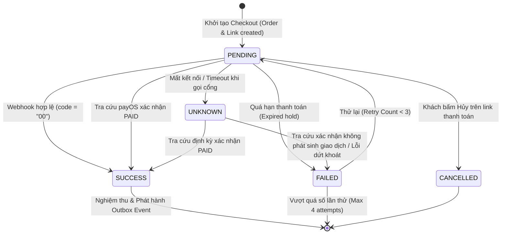

# Cổng Thanh toán Số (Payment Gateway Integration — payOS MVP) — API & Provider Contract Specification

> **Feature Key:** `SPARK-249` *(Subtask của `SPARK-247` / `US-D02`)*  
> **Service Owner:** `Payment Service` *(Financial Domain — Quản lý tiền, đối soát, hóa đơn và cổng thanh toán)*  
> **Target Interface / Route:**  
> - Public Client API: `POST /api/v1/payments/orders/{orderId}/checkout`  
> - Webhook Callback: `POST /api/v1/payments/callbacks/payos`  
> - Query Status API: `GET /api/v1/payments/transactions/{transactionId}/status`  
> - C# Outbound Port: `SmartParking.PaymentService.Domain.Ports.IPaymentGatewayPort`  
> **Document Revision:** `v1.0` *(Khởi tạo đặc tả tích hợp payOS MVP theo quyết định `PAY-01`)*  
> **API Version:** `v1` *(HTTP endpoints do SmartPark quản lý: `/api/v1/payments/...`)*  
> **Contract Status:** `Draft`  
> **Communication Type:** `Client-to-Backend HTTP` | `Webhook / Asynchronous` | `Outbound Port & Adapter (Hexagonal)`  
> **Author:** `Tuong Van (VanNT)`  
> **Reviewer:** `Independent AI / Technical Reviewer`  
> **SRS / Decision Baseline:** `SRS v0.9 (2026-10-05), Decision PAY-01 (2026-10-13), payOS Design RC3 (2026-10-13)`  

---

### Lịch sử thay đổi (Revision History / Change Log)

| Revision | Ngày | Tác giả | Người duyệt | Loại thay đổi | Mô tả thay đổi / Jira Key |
| :---: | :---: | :--- | :--- | :--- | :--- |
| `v1.0` | `2026-10-16` | `Tuong Van (VanNT)` | `Independent Reviewer` | Initial | Khởi tạo tài liệu đặc tả API Contract cho luồng tích hợp Cổng thanh toán số theo task `SPARK-249`. Áp dụng quyết định `PAY-01`: ưu tiên triển khai `payOS` (VietQR) cho giai đoạn MVP, thiết kế Outbound Port độc lập để sẵn sàng mở rộng VNPay/MoMo/ZaloPay trong tương lai. |

---

## 1. Tổng quan & Phạm vi nghiệp vụ (Overview & Business Scope)

### 1.1 Mục đích nghiệp vụ (Business Objective)
Tài liệu này định nghĩa **Hợp đồng tích hợp Cổng thanh toán số (Payment Gateway Integration Contract)** thuộc **Payment Service**. Hợp đồng cung cấp giải pháp xử lý dòng tiền thanh toán số tự động cho Khách gửi xe (Driver) thanh toán phí đỗ xe (`PARKING_FEE`) hoặc phí đặt chỗ (`RESERVATION_FEE`), tự động đối soát và phát hành trạng thái thanh toán đáng tin cậy.

Theo quyết định phê duyệt kiến trúc **`PAY-01` (13/10/2026)**, dự án ưu tiên triển khai giải pháp thanh toán qua **payOS** (chuẩn VietQR NAPAS247 liên ngân hàng) cho giai đoạn MVP nhằm giải quyết rào cản pháp lý (MoMo/VNPay/ZaloPay yêu cầu Giấy phép đăng ký kinh doanh pháp nhân, trong khi payOS hỗ trợ kết nối tài khoản ngân hàng cá nhân). Đồng thời, tài liệu thiết lập tầng trừu tượng **Outbound Port (`IPaymentGatewayPort`)** theo kiến trúc Hexagonal / Clean Architecture để cách ly hoàn toàn mã nguồn nghiệp vụ lõi (Core Domain) với SDK của payOS, cho phép tích hợp thêm VNPay, MoMo, ZaloPay trong tương lai mà không làm thay đổi tầng Application.

### 1.2 Ranh giới & Phân quyền (Consumer & Boundary Scope)
- **Bên tiêu thụ (Consumer / Caller):**
  - **Driver Web / Mobile App:** Gửi yêu cầu khởi tạo thanh toán (`POST /checkout`), nhận liên kết thanh toán (`checkoutUrl`) hoặc chuỗi mã QR (`qrCode`) để quét app ngân hàng.
  - **payOS Payment Webhook:** Hệ thống payOS bắn HTTP POST Webhook về máy chủ SmartPark khi tài khoản ngân hàng nhận được tiền chuyển khoản khớp lệnh.
  - **Operator / Admin Web:** Gọi tra cứu trạng thái giao dịch (`GET /status`) phục vụ giải quyết khiếu nại hoặc kiểm tra đối soát thủ công tại cổng.
- **Service sở hữu:** `Payment Service` (`SmartParking.PaymentService.API`, `SmartParking.PaymentService.Application`, `SmartParking.PaymentService.Infrastructure`).
- **Phân định ranh giới liên dịch vụ (Cross-Service Boundary):**
  - Payment Service chỉ chịu trách nhiệm quản lý **Dòng tiền và Hóa đơn** (Order, Transaction, Invoice, Webhook).
  - Khi thanh toán thành công (`SUCCESS`), Payment Service phát sinh sự kiện thanh toán thành công (Domain Event / Outbox Event). Dịch vụ Vận hành (`ParkingService` / `Operations`) sẽ tiêu thụ sự kiện này một cách bất đồng bộ để nâng barie giải phóng xe hoặc xác nhận đặt chỗ. **Tuyệt đối không để Payment Service can thiệp trực tiếp vào database của ParkingService**.

### 1.3 Xác thực & Phân quyền (Authentication & Authorization)
- **Client Checkout API (`/checkout`):**
  - Yêu cầu `Authorization: Bearer <JWT Token>`.
  - Roles được phép: `DRIVER`, `OPERATOR`, `ADMIN`.
  - Ràng buộc sở hữu (Tenant & Resource Isolation): Chỉ chủ tài khoản (`account_id` khớp trong JWT) hoặc Operator phụ trách bãi xe (`site_id`) mới được phép khởi tạo thanh toán cho đơn hàng đó.
- **Webhook Callback API (`/callbacks/payos`):**
  - **Không** sử dụng JWT Bearer.
  - Xác thực qua **Chữ ký số HMAC-SHA256**: Kiểm tra `signature` đi kèm trong payload bằng `checksumKey` do payOS cung cấp. Mọi request sai chữ ký đều bị từ chối ngay lập tức (`400 Bad Request` hoặc `401 Unauthorized`).
- **Query Transaction Status API (`/status`):**
  - Yêu cầu `Authorization: Bearer <JWT Token>` của Driver sở hữu giao dịch hoặc nhân viên quản lý (`OPERATOR`, `ADMIN`).

### 1.4 Chính sách Idempotency & An toàn Dòng tiền (Idempotency & Financial Safety)
- **Header bắt buộc trên Client Checkout:** `Idempotency-Key: <UUID v4>`.
- **Phạm vi khóa duy nhất (Uniqueness Scope):**  
  `Scope = (tenant_id, account_id, payment_order_id, idempotency_key)`.
- **Hành vi xử lý:**
  - *Cùng Key + Cùng Payload (Đã xử lý):* Trả về nguyên trạng thông tin giao dịch thanh toán ban đầu kèm header `Idempotency-Replayed: true`.
  - *Cùng Key + Khác Payload:* Từ chối ngay lập tức với HTTP `409 Conflict`, mã lỗi `IDEMPOTENCY_PAYLOAD_MISMATCH`.
  - *Yêu cầu đang xử lý (In-flight):* Trả về HTTP `409 Conflict`, mã lỗi `OPERATION_IN_PROGRESS`.
- **Chống trừ tiền hai lần (Double-Charging Prevention):**
  - Mất kết nối mạng hoặc timeout khi gọi sang payOS **không đồng nghĩa với việc giao dịch thất bại**.
  - Giao dịch được lưu ở trạng thái `UNKNOWN`. Hệ thống không cho phép Driver khởi tạo thanh toán mới cho cùng đơn hàng cho đến khi kết quả giao dịch cũ được làm rõ thông qua API Tra cứu (Lookup/Reconcile) hoặc Webhook.
  - Giới hạn thử lại: `PAYMENT_RETRY_LIMIT = 3` (tối đa 1 lần khởi tạo ban đầu + 3 lần thử lại = 4 lượt thử tổng cộng cho các lỗi dứt khoát).

### 1.5 Bảng truy vết yêu cầu hai chiều (Bi-directional Traceability)

#### Chiều 1: Từ Contract $\rightarrow$ SRS / Business Rules / Quyết định
| Mã yêu cầu | Phân loại | Nội dung nghiệp vụ | Mục hiện thực trong Contract |
| :--- | :---: | :--- | :--- |
| **PAY-01** | Architecture Decision | Ưu tiên triển khai `payOS QR` cho MVP; native VNPay/MoMo giữ phương án dự phòng. | Mục 1.1, Mục 2, Mục 3 |
| **FR-PAY-03** | Functional Req | Hỗ trợ thanh toán điện tử cho khách gửi xe (VietQR / Cổng số). | Mục 2.1 |
| **FR-PAY-04** | Functional Req | Tiếp nhận và xác thực kết quả thanh toán từ cổng thanh toán qua Webhook tự động. | Mục 2.2 |
| **FR-PAY-05** | Functional Req | Đối soát và tra cứu trạng thái giao dịch thanh toán trực tiếp từ nhà cung cấp. | Mục 2.3 |
| **FR-BAS-16** | Security Req | Bảo mật dữ liệu thanh toán, không lưu trữ thông tin thẻ nhạy cảm; ký bảo mật HMAC. | Mục 1.3, Mục 2.2 |

#### Chiều 2: Từ Yêu cầu $\rightarrow$ Kịch bản kiểm thử (Verification & Test Scenarios)
| Mã yêu cầu | Tiêu chuẩn nghiệm thu (Acceptance Criteria) | Test Scenario ID | Kết quả mong đợi |
| :--- | :--- | :--- | :--- |
| **AC-PAY-01** | Khởi tạo link thanh toán VietQR payOS thành công cho đơn hàng hợp lệ. | `TC_PAY_CHECKOUT_01` | Trả về HTTP 200, `checkoutUrl`, `qrCode`, trạng thái `PENDING`. |
| **AC-PAY-02** | Chặn khởi tạo trùng lặp với cùng `Idempotency-Key` nhưng khác payload. | `TC_PAY_IDEMPOTENCY_02` | Trả về HTTP 409 Conflict (`IDEMPOTENCY_PAYLOAD_MISMATCH`). |
| **AC-PAY-03** | Xác thực chữ ký số Webhook từ payOS chính xác; từ chối giả mạo chữ ký. | `TC_PAY_WEBHOOK_03` | Chữ ký hợp lệ trả HTTP 200; chữ ký sai trả HTTP 400 Bad Request. |
| **AC-PAY-04** | Xử lý Webhook trùng lặp (Idempotent Webhook Consumer). | `TC_PAY_WEBHOOK_04` | Không xử lý cộng tiền/đổi trạng thái lần 2; trả về HTTP 200 thành công. |
| **AC-PAY-05** | Timeout cuộc gọi khởi tạo chuyển trạng thái `UNKNOWN`, kích hoạt tra cứu. | `TC_PAY_RECONCILE_05` | Không cho phép tạo đơn mới; kết quả tra cứu payOS quyết định trạng thái cuối. |

---

## 2. Đặc tả Hợp đồng Giao tiếp HTTP REST & Webhook

### 2.1 API Khởi tạo Thanh toán (Initiate Checkout / Payment Link)

- **HTTP Method:** `POST`
- **URL Path:** `/api/v1/payments/orders/{orderId}/checkout`
- **Headers:**
  - `Content-Type: application/json`
  - `Authorization: Bearer <token>`
  - `Idempotency-Key: <uuid-v4>` *(Bắt buộc)*
  - `traceparent: <w3c-trace-context>` *(Tùy chọn)*

#### A. Tham số Path
| Tham số | Vị trí | Kiểu dữ liệu | Bắt buộc | Ràng buộc | Ý nghĩa nghiệp vụ |
| :--- | :---: | :--- | :---: | :--- | :--- |
| `orderId` | Path | `UUID` | Có | Chuẩn UUID v4 | Định danh duy nhất của đơn hàng thanh toán (`payment_orders.id`). |

#### B. Request Body Schema
| Tên trường (JSON) | Kiểu dữ liệu | Bắt buộc | Nullable | Mặc định | Ràng buộc & Enum | Ý nghĩa nghiệp vụ |
| :--- | :--- | :---: | :---: | :--- | :--- | :--- |
| `paymentMethod` | `String` | Có | Không | - | `PAYOS`, `CASH`, `VNPAY`, `MOMO`, `ZALOPAY` | Phương thức thanh toán lựa chọn. Mặc định cho cổng số MVP là `PAYOS`. |
| `returnUrl` | `String` | Không | Có | Cấu hình FE | Hợp lệ định dạng URL | Đường dẫn FE redirect khi người dùng hoàn tất quét mã/thanh toán. |
| `cancelUrl` | `String` | Không | Có | Cấu hình FE | Hợp lệ định dạng URL | Đường dẫn FE redirect khi người dùng bấm hủy trên trang thanh toán. |

*Mẫu Request Body:*
```json
{
  "paymentMethod": "PAYOS",
  "returnUrl": "https://smartparking.vn/driver/checkout/success",
  "cancelUrl": "https://smartparking.vn/driver/checkout/cancel"
}
```

#### C. Response Body Schema (Success Path — HTTP 200 OK / 201 Created)
| Tên trường (JSON) | Kiểu dữ liệu | Nullable | Ý nghĩa nghiệp vụ & Quy tắc sinh dữ liệu |
| :--- | :--- | :---: | :--- |
| `success` | `Boolean` | Không | Luôn là `true` khi khởi tạo thành công. |
| `data.paymentTransactionId` | `UUID` | Không | Định danh bản ghi giao dịch dòng tiền (`payment_transactions.id`). |
| `data.orderCode` | `Int64` | Không | Mã đơn hàng số nguyên duy nhất tạo ra cho payOS VietQR. |
| `data.amount` | `Int64` | Không | Số tiền phải thanh toán cuối cùng (Số nguyên VND, không có phần thập phân). |
| `data.checkoutUrl` | `String` | Không | Đường link mở trang thanh toán chuẩn của payOS. |
| `data.qrCode` | `String` | Không | Chuỗi mã VietQR tĩnh/động để FE tự render mã QR trực tiếp trên màn hình. |
| `data.accountNumber` | `String` | Không | Số tài khoản ngân hàng thụ hưởng nhận chuyển khoản. |
| `data.accountName` | `String` | Không | Tên chủ tài khoản ngân hàng thụ hưởng. |
| `data.bin` | `String` | Không | Mã định danh ngân hàng thụ hưởng (VD: `970422` cho MBBank). |
| `data.status` | `String` | Không | Luôn khởi tạo ở trạng thái `PENDING`. |
| `data.expiresAt` | `String` | Không | Mốc thời gian hết hạn của link thanh toán (ISO-8601 kèm timezone). |

*Mẫu Response Body Thành công:*
```json
{
  "success": true,
  "data": {
    "paymentTransactionId": "f7d3a2b1-5e8c-4a3d-9c2b-1a2b3c4d5e6f",
    "orderCode": 202610160012,
    "amount": 25000,
    "checkoutUrl": "https://pay.payos.vn/web/c7a8b9e0f1a2b3c4",
    "qrCode": "00020101021238540010A00000072701240006970422011001234567890208QRIBFTTA53037045405250005802VN62230819Thanh toan do xe 20266304ABCD",
    "accountNumber": "0123456789",
    "accountName": "SMARTPARKING CORP",
    "bin": "970422",
    "status": "PENDING",
    "expiresAt": "2026-10-16T11:45:00+07:00"
  }
}
```

---

### 2.2 Hợp đồng Webhook IPN Callback của payOS (Webhook Ingestion)

- **HTTP Method:** `POST`
- **URL Path:** `/api/v1/payments/callbacks/payos`
- **Headers:**
  - `Content-Type: application/json`
  - *(Chữ ký số nằm trong trường `signature` của body JSON)*

#### A. Schema Payload từ payOS gửi đến
| Tên trường (JSON) | Kiểu dữ liệu | Bắt buộc | Ý nghĩa dữ liệu payOS |
| :--- | :--- | :---: | :--- |
| `code` | `String` | Có | Mã trạng thái Webhook: `"00"` là thành công. |
| `desc` | `String` | Có | Mô tả trạng thái: `"success"` hoặc thông điệp lỗi. |
| `data.orderCode` | `Int64` | Có | Mã đơn hàng số nguyên đối soát khớp với `payment_orders`. |
| `data.amount` | `Int64` | Có | Số tiền thực tế người dùng đã chuyển khoản thành công (VND). |
| `data.description` | `String` | Có | Nội dung chuyển khoản trên tin nhắn biến động số dư. |
| `data.accountNumber` | `String` | Có | Số tài khoản ngân hàng thụ hưởng nhận tiền. |
| `data.reference` | `String` | Có | Mã giao dịch tham chiếu của hệ thống ngân hàng Core Banking. |
| `data.transactionDateTime` | `String` | Có | Thời gian ngân hàng xử lý giao dịch (`YYYY-MM-DD HH:mm:ss`). |
| `data.currency` | `String` | Có | Đơn vị tiền tệ: `"VND"`. |
| `data.paymentLinkId` | `String` | Có | Định danh payment link do payOS sinh ra. |
| `data.counterAccountName` | `String` | Không | Tên người chuyển tiền (nếu ngân hàng cung cấp). |
| `data.counterAccountNumber`| `String` | Không | Số tài khoản người chuyển tiền. |
| `signature` | `String` | Có | Chữ ký số HMAC-SHA256 của toàn bộ dữ liệu trong `data`. |

*Mẫu Webhook Payload do payOS gửi đến:*
```json
{
  "code": "00",
  "desc": "success",
  "data": {
    "orderCode": 202610160012,
    "amount": 25000,
    "description": "Thanh toan phi do xe SPARK-2026",
    "accountNumber": "0123456789",
    "reference": "FT26290881923401",
    "transactionDateTime": "2026-10-16 11:35:10",
    "currency": "VND",
    "paymentLinkId": "c7a8b9e0f1a2b3c4",
    "code": "00",
    "desc": "success",
    "counterAccountBankId": "970407",
    "counterAccountBankName": "Techcombank",
    "counterAccountName": "NGUYEN VAN A",
    "counterAccountNumber": "190367891234"
  },
  "signature": "7d6f5e4c3b2a109876543210fedcba9876543210abcdef0123456789abcdef01"
}
```

#### B. Thuật toán Xác thực Chữ ký số payOS (Signature Verification)
1. **Trích xuất dữ liệu:** Lấy đối tượng `data` từ payload.
2. **Sắp xếp khóa từ điển:** Sắp xếp tất cả các cặp khóa - giá trị trong `data` theo thứ tự alphabet tăng dần (bỏ qua các trường có giá trị `null` hoặc `undefined`).
3. **Tạo chuỗi ký chuẩn hóa:** Nối các cặp theo định dạng `key1=value1&key2=value2...`.
4. **Tính toán HMAC-SHA256:** Sử dụng `checksumKey` (khóa bí mật tích hợp) tính chuỗi băm HMAC-SHA256 dạng Hex.
5. **So khớp an toàn (Constant-time Comparison):** So sánh chuỗi vừa tính với trường `signature` nhận được bằng giải thuật so sánh thời gian bất biến (`CryptographicOperations.FixedTimeEquals` trong .NET) để chống Timing Attack.

#### C. Phản hồi của SmartPark gửi lại cho payOS
- **Thành công (HTTP 200 OK):**
  ```json
  {
    "success": true,
    "message": "Webhook processed successfully"
  }
  ```
- **Lỗi chữ ký số không hợp lệ (HTTP 400 Bad Request):**
  ```json
  {
    "success": false,
    "errorCode": "INVALID_WEBHOOK_SIGNATURE",
    "message": "Chữ ký webhook không hợp lệ."
  }
  ```

---

### 2.3 API Tra cứu Trạng thái Giao dịch (Transaction Query & Reconciliation)

- **HTTP Method:** `GET`
- **URL Path:** `/api/v1/payments/transactions/{transactionId}/status`
- **Headers:**
  - `Authorization: Bearer <token>`

#### A. Tham số Path
| Tham số | Vị trí | Kiểu dữ liệu | Bắt buộc | Ý nghĩa nghiệp vụ |
| :--- | :---: | :--- | :---: | :--- |
| `transactionId` | Path | `UUID` | Có | Định danh giao dịch `payment_transactions.id`. |

#### B. Logic xử lý đồng bộ với payOS
1. Nếu giao dịch trong DB đã ở trạng thái dứt khoát (`SUCCESS` hoặc `CANCELLED`), trả về ngay kết quả từ database.
2. Nếu giao dịch đang ở trạng thái `PENDING` hoặc `UNKNOWN`:
   - Hệ thống chủ động gọi Outbound Port sang payOS API:  
     `GET https://api-merchant.payos.vn/v2/payment-requests/{paymentLinkId}` (kèm `x-client-id` và `x-api-key`).
   - Nếu payOS phản hồi trạng thái `PAID` $\rightarrow$ cập nhật DB sang `SUCCESS`, ghi nhận `paid_at`, phát hành sự kiện Outbox.
   - Nếu payOS phản hồi `CANCELLED` hoặc quá hạn $\rightarrow$ cập nhật `CANCELLED` / `FAILED`.
   - Nếu payOS vẫn `PENDING` $\rightarrow$ giữ nguyên `PENDING`.

#### C. Response Body Schema (HTTP 200 OK)
```json
{
  "success": true,
  "data": {
    "transactionId": "f7d3a2b1-5e8c-4a3d-9c2b-1a2b3c4d5e6f",
    "orderId": "a1b2c3d4-e5f6-7a8b-9c0d-1e2f3a4b5c6d",
    "orderCode": 202610160012,
    "amount": 25000,
    "paymentMethod": "PAYOS",
    "gatewayTransactionId": "FT26290881923401",
    "status": "SUCCESS",
    "paidAt": "2026-10-16T11:35:10+07:00",
    "isAuthoritative": true
  }
}
```

---

## 3. Máy trạng thái Thanh toán & Thiết kế C# Outbound Port

### 3.1 Biểu đồ Máy trạng thái Thanh toán (Payment State Machine)



#### Ma trận Quy tắc Chuyển trạng thái:
1. **Nguyên tắc Thẩm quyền Backend:** Chỉ có Backend xác thực qua Webhook có chữ ký số hợp lệ hoặc API tra cứu đối soát từ payOS mới được phép chuyển trạng thái sang `SUCCESS`. **Frontend tuyệt đối không được tự ý quyết định giao dịch thành công**.
2. **Tính Bất biến của Thành công (Immutability of Success):** Khi giao dịch đã đạt trạng thái `SUCCESS`, mọi Webhook hoặc Callback đến sau mang trạng thái `FAILED`/`CANCELLED` do trễ mạng đều bị bỏ qua; tuyệt đối không cho phép lùi trạng thái từ `SUCCESS` về `FAILED`.
3. **Xử lý trạng thái `UNKNOWN`:**
   - Trạng thái `UNKNOWN` phát sinh khi gọi payOS bị lỗi mạng (504 Timeout, Socket drop).
   - Hệ thống **không được coi là FAILED** và cấm Client tạo giao dịch mới cho đến khi hoàn tất tra cứu.
4. **Giới hạn Thử lại (`PAYMENT_RETRY_LIMIT = 3`):**  
   Đơn hàng được phép có tối đa 1 lượt tạo ban đầu + 3 lượt thử lại = **4 lượt thử tổng cộng**. Khi vượt quá 4 lượt, đơn hàng bị đóng băng ở trạng thái `FAILED`.

---

### 3.2 Hợp đồng C# Outbound Port (Clean Architecture / Ports & Adapters)

Để đảm bảo tuân thủ nghiêm ngặt **Inward Dependency Rule** của Clean Architecture, tầng Core Domain và Application hoàn toàn không tham chiếu tới payOS SDK. Toàn bộ tương tác với payOS được trừu tượng hóa qua Port:

#### A. Port Interface (`SmartParking.PaymentService.Domain.Ports.IPaymentGatewayPort`)
```csharp
namespace SmartParking.PaymentService.Domain.Ports;

public interface IPaymentGatewayPort
{
    /// <summary>
    /// Định danh cổng thanh toán (VD: "PAYOS", "VNPAY", "MOMO")
    /// </summary>
    string ProviderCode { get; }

    /// <summary>
    /// Khởi tạo liên kết thanh toán / QR Code với nhà cung cấp cổng
    /// </summary>
    Task<PaymentInitiateResult> InitiatePaymentAsync(
        PaymentInitiateRequest request, 
        CancellationToken cancellationToken = default);

    /// <summary>
    /// Xác thực và trích xuất dữ liệu từ Webhook Callback
    /// </summary>
    Task<PaymentCallbackResult> VerifyAndParseWebhookAsync(
        string rawPayload, 
        string signature, 
        CancellationToken cancellationToken = default);

    /// <summary>
    /// Chủ động tra cứu trạng thái giao dịch từ hệ thống nhà cung cấp cổng
    /// </summary>
    Task<PaymentVerificationResult> QueryTransactionAsync(
        long orderCode, 
        string? gatewayTransactionId, 
        CancellationToken cancellationToken = default);
}
```

#### B. Các DTOs Hợp đồng Trung lập (Application Contracts)
```csharp
namespace SmartParking.PaymentService.Application.DTOs.Gateways;

public record PaymentInitiateRequest(
    Guid TransactionId,
    long OrderCode,
    long AmountVnd,
    string Description,
    string ReturnUrl,
    string CancelUrl,
    DateTimeOffset ExpiresAt
);

public record PaymentInitiateResult(
    bool IsSuccess,
    string? CheckoutUrl,
    string? QrCode,
    string? AccountNumber,
    string? AccountName,
    string? Bin,
    string? GatewayTransactionId,
    string? ErrorCode,
    string? ErrorMessage
);

public record PaymentCallbackResult(
    bool IsValidSignature,
    long OrderCode,
    long AmountVnd,
    string? GatewayTransactionId,
    string? BankReference,
    string PaymentStatus, // "SUCCESS", "FAILED", "PENDING"
    DateTimeOffset TransactionTime,
    string? RawPayload
);

public record PaymentVerificationResult(
    bool IsFound,
    string PaymentStatus, // "SUCCESS", "FAILED", "PENDING", "UNKNOWN"
    long AmountVnd,
    string? GatewayTransactionId,
    DateTimeOffset? PaidAt
);
```

#### C. Hiện thực tại Tầng Infrastructure (`PayOsAdapter`)
- Class `PayOsAdapter` nằm tại `SmartParking.PaymentService.Infrastructure.Adapters.Outbound.PayOsAdapter`.
- Kế thừa `IPaymentGatewayPort`. Sử dụng SDK chính thức của payOS (`PayOS` NuGet package) hoặc gọi HTTP REST API trực tiếp.
- Đăng ký DI trong `InfrastructureDependencyInjection.cs`:
  ```csharp
  services.AddScoped<IPaymentGatewayPort, PayOsAdapter>();
  services.AddScoped<PaymentGatewayDispatcher>(); // Hỗ trợ chọn Adapter theo ProviderCode
  ```

---

## 4. Ma trận Ca biên Nguy cấp & Danh mục Mã lỗi

### 4.1 Ma trận Ca biên Nguy cấp (Critical Edge Cases Matrix)

| # | Kịch bản Ca biên | Dấu hiệu nhận biết | Hành vi kỳ vọng của hệ thống | Căn cứ nghiệp vụ |
| :-: | :--- | :--- | :--- | :--- |
| **1** | **Callback đến sau khi Đơn hàng đã hết hạn** | Webhook payOS báo thành công, nhưng `payment_orders.expires_at < CURRENT_TIMESTAMP`. | Hệ thống ghi nhận tiền đã vào tài khoản (`SUCCESS`), phát sinh Domain Event đặc biệt để Vận hành kiểm tra giải phóng chỗ; nếu chỗ đã bị hủy hoặc cấp cho người khác, tự động sinh bản ghi `refund_requests` để hoàn tiền cho khách. | `FR-PAY-04`, `PAY-01` |
| **2** | **Chuyển khoản thiếu hoặc thừa tiền** | `webhook.data.amount != payment_orders.final_amount`. | Giữ trạng thái đơn hàng ở `PENDING` hoặc `UNKNOWN`. Ghi log kiểm toán tài chính cảnh báo `AMOUNT_MISMATCH`. Tuyệt đối không tự động gạch nợ thành công. | `FR-PAY-03`, `PAY-01` |
| **3** | **Webhook gửi lặp nhiều lần (Replay/Duplicate)** | payOS gửi lại cùng một Webhook với cùng `reference` hoặc `paymentLinkId`. | Tra cứu bảng `provider_webhooks`. Nếu đã tồn tại bản ghi đã xử lý (`PROCESSED`), trả về ngay HTTP 200 `{ "success": true }` mà không cộng tiền hay cập nhật lại trạng thái. | `FR-PAY-04`, `Idempotency` |
| **4** | **Người dùng hủy trên cổng thanh toán nhưng ngân hàng vẫn trừ tiền** | Khách bấm Hủy trên link payOS, nhưng trước đó đã kịp quét QR và app ngân hàng đã trừ tiền. | Webhook ngân hàng bắn về sau đó vẫn là nguồn thẩm quyền tối cao. Tiền vào tài khoản sẽ được ghi nhận và đưa vào hàng đợi đối soát để xử lý tiếp quyền lợi cho khách. | `PAY-01` |
| **5** | **Timeout khi gọi payOS tạo Payment Link** | Mạng chập chờn, gọi payOS bị `HttpRequestException` hoặc HTTP 504. | Không báo thất bại ngay lập tức; chuyển sang trạng thái `UNKNOWN`. Kích hoạt cơ chế tra cứu kiểm tra xem link đã được tạo trên payOS chưa trước khi quyết định tạo lại. | `PAY-01 §3` |

---

### 4.2 Danh mục Mã lỗi Chuẩn (Error Codes Matrix)

Mọi phản hồi lỗi đều tuân thủ cấu trúc envelope chuẩn của hệ thống:
```json
{
  "success": false,
  "errorCode": "<MÃ_LỖI>",
  "message": "<Mô tả thông báo lỗi thân thiện>",
  "traceId": "00-4bf92f3577b34da6a3ce929d0e0e4736-00f067aa0ba902b7-01",
  "timestamp": "2026-10-16T11:30:00Z"
}
```

| HTTP Status | Mã lỗi (`errorCode`) | Ý nghĩa nghiệp vụ & Hướng xử lý |
| :---: | :--- | :--- |
| `400 Bad Request` | `INVALID_INPUT` | Tham số gửi lên không đúng định dạng hoặc thiếu trường bắt buộc. |
| `400 Bad Request` | `INVALID_WEBHOOK_SIGNATURE` | Chữ ký HMAC của Webhook payOS không khớp với `checksumKey`. Từ chối request. |
| `400 Bad Request` | `ORDER_NOT_IN_PAYABLE_STATE` | Đơn hàng không ở trạng thái hợp lệ để thanh toán (VD: Đơn hàng đã `PAID` hoặc `CANCELLED`). |
| `404 Not Found` | `PAYMENT_ORDER_NOT_FOUND` | Không tìm thấy mã đơn hàng thanh toán tương ứng với `orderId`. |
| `404 Not Found` | `PAYMENT_TRANSACTION_NOT_FOUND` | Không tìm thấy mã giao dịch thanh toán tương ứng với `transactionId`. |
| `409 Conflict` | `IDEMPOTENCY_PAYLOAD_MISMATCH` | Gửi cùng `Idempotency-Key` nhưng nội dung payload bị thay đổi. |
| `409 Conflict` | `OPERATION_IN_PROGRESS` | Một yêu cầu thanh toán khác với cùng khóa đang trong quá trình xử lý. |
| `409 Conflict` | `ACTIVE_PAYMENT_PENDING` | Đơn hàng đang có một giao dịch thanh toán trực tuyến chưa kết thúc, không được tạo đè. |
| `422 Unprocessable` | `PAYMENT_RETRY_LIMIT_EXCEEDED` | Đơn hàng đã vượt quá giới hạn 3 lần thử lại (`PAYMENT_RETRY_LIMIT = 3`). |
| `502 Bad Gateway` | `PAYMENT_GATEWAY_ERROR` | Cổng thanh toán payOS phản hồi lỗi hoặc không kết nối được. |
| `504 Gateway Timeout`| `PAYMENT_GATEWAY_TIMEOUT` | Hết thời gian chờ phản hồi từ payOS. Giao dịch chuyển sang trạng thái `UNKNOWN`. |

---

## 5. Rà soát Tính tương thích Cơ sở Dữ liệu (Database Compatibility)

Đối chiếu với schema cơ sở dữ liệu Payment Service tại [`scripts/database/microservices/04-payment-service-db.sql`](file:///d:/A-Van/Project/ojt/Mock-Project-Smart-Parking/scripts/database/microservices/04-payment-service-db.sql):

1. **Bảng `payment_orders`:**
   - Trường `order_code` (VARCHAR(100) UNIQUE): Lưu trữ mã `orderCode` số nguyên dạng string (VD: `"202610160012"`).
   - Trường `status`: Khớp hoàn toàn với các enum `'PENDING', 'PAID', 'FAILED', 'CANCELLED', 'REFUNDED'`.
2. **Bảng `payment_transactions`:**
   - Trường `gateway_transaction_id`: Lưu `paymentLinkId` hoặc mã tham chiếu `reference` của ngân hàng.
   - Trường `payment_method`: Hiện tại SQL schema có `CHECK (payment_method IN ('VNPAY', 'MOMO', 'ZALOPAY', 'CASH'))`.
   - ⚠️ **Khuyến nghị kỹ thuật cho bước `SPARK-250`:** Cần bổ sung giá trị `'PAYOS'` vào CHECK constraint này để hỗ trợ lưu trữ chuẩn xác.
3. **Bảng `provider_webhooks`:**
   - Lưu trữ toàn bộ payload thô và định danh `provider = 'PAYOS'`, `provider_event_id = webhook.data.reference` để đảm bảo tính Idempotent tuyệt đối cho Webhook.

---

> **Kết luận Phê duyệt:** Tài liệu đặc tả này là Baseline chính thức để chuyển giao cho task [`SPARK-250`](https://jira.smartparking.vn/browse/SPARK-250) (Payment Gateway — BE Integration) bắt đầu triển khai mã nguồn C#.
