# Hóa đơn Khách hàng & Bàn giao Thanh toán Checkout (Customer Invoice API Contract & Checkout Handoff)

> **Feature Key:** `SPARK-321` *(Tích hợp trực tiếp với `SPARK-214`, `SPARK-240` / `US-O02`)*  
> **Service Owner:** `Payment Service` *(Financial Domain — Quản lý Biểu giá, Dòng tiền, Đối soát và Hóa đơn Tài chính)*  
> **Target Interface / Route:**  
> - **S2S Checkout Preparation API:** `POST /api/v1/payments/orders/prepare`  
> - **Authoritative Customer Invoice by ID:** `GET /api/v1/payments/invoices/{invoiceId}`  
> - **Authoritative Customer Invoice by Order:** `GET /api/v1/payments/orders/{orderId}/invoice`  
> - **Authoritative Customer Invoice by Session:** `GET /api/v1/payments/invoices?sessionId={sessionId}`  
> - **Durable Outbox Integration Event:** `PaymentSucceededV1` *(MassTransit RabbitMQ)*  
> **Document Revision:** `v1.0` *(Chuẩn hóa Hợp đồng Hóa đơn và Ranh giới bàn giao Checkout theo Baseline v1.1)*  
> **API Version:** `v1` *(HTTP endpoints do SmartPark quản lý: `/api/v1/payments/...`)*  
> **Contract Status:** `In Review`  
> **Communication Type:** `Server-to-Server HTTP (S2S)` | `Client-to-Backend HTTP` | `Transactional Outbox Event`  
> **Author:** `Tuong Van (VanNT)`  
> **Reviewer:** `Technical Lead / Independent AI Architecture Reviewer`  
> **SRS & Database Baseline:** `SRS v1.1 (Modules 05, 06, 08), 04-payment-pricing-service-db.sql, SPARK-229, SPARK-247/249, SPARK-296`  

---

### Lịch sử thay đổi (Revision History / Change Log)

| Revision | Ngày | Tác giả | Người duyệt | Loại thay đổi | Mô tả thay đổi / Jira Key |
| :---: | :---: | :--- | :--- | :--- | :--- |
| `v1.0` | `2026-11-02` | `Tuong Van (VanNT)` | `Technical Lead` | Initial | Khởi tạo tài liệu đặc tả API Contract cho Hóa đơn khách hàng (Customer Invoice) và Ranh giới bàn giao thanh toán (Checkout Handoff) theo task `SPARK-321`. Tích hợp chặt chẽ với backend Checkout (`SPARK-214`) và nghiệp vụ Operator check-out (`SPARK-240`). Đóng băng ranh giới tài chính, tuyệt đối không phát minh quy tắc thuế/VAT hoặc yêu cầu bắt buộc PDF ngoài SRS. |

---

## 1. Tổng quan & Ranh giới Nghiệp vụ (Overview & Business Boundaries)

### 1.1 Mục đích nghiệp vụ (Business Objective)
Tài liệu này định nghĩa **Hợp đồng Hóa đơn Khách hàng (Customer Invoice API Contract)** và **Ranh giới Bàn giao Tích hợp Thanh toán (Checkout Integration Boundary)** giữa hai phân hệ độc lập: **Parking Operations** và **Payment & Pricing Service**.

Hợp đồng này giải quyết 3 bài toán kiến trúc cốt tử:
1. **Ranh giới sự thật tài chính (Authoritative Financial Result):** `Payment Service` là nguồn sự thật duy nhất (Single Source of Truth) về biểu giá, tính cước tất định (`SPARK-229`), thu tiền (`SPARK-247`/`SPARK-249`) và phát hành dữ liệu hóa đơn. Phía Checkout / Trình duyệt **tuyệt đối không được tự tính tiền** hoặc truy vấn trực tiếp vào `PaymentDb`.
2. **Tách biệt Trạng thái Tài chính và Trạng thái Vận hành Vật lý:**
   - Hóa đơn đã thanh toán (`INVOICE PAID`) **không đồng nghĩa** với việc xe đã rời bãi vật lý.
   - Xe đi qua cổng barie (`ACTUAL DEPARTURE`) **không đồng nghĩa** với việc thanh toán tự động thành công.
3. **Bảo vệ mốc tính cước (Billable Cutoff Freeze):** Khi bảo vệ / cổng quét biển số ra và chấp thuận phiên thanh toán, mốc thời gian `pricingCutoffAt` được đóng băng cố định. Việc xe rời cổng trễ sau khi đã trả tiền không làm phát sinh tính lại giá hồi tố (No retroactive repricing).

> [!WARNING]
> **Tuân thủ giới hạn thiết kế (Design Boundary Rule):**
> Tuyệt đối **KHÔNG** phát minh các quy tắc thuế VAT, các loại mã giảm giá (voucher/discount) phức tạp, yêu cầu bắt buộc xuất file PDF hay các trường tài khoản kế toán doanh nghiệp chưa được quy định trong SRS v1.1. Dữ liệu Hóa đơn ở đây là **Bản thể hiện dữ liệu tài chính chính thức (Authoritative JSON Financial Representation)**.

---

### 1.2 Phân định Quyền sở hữu Dữ liệu (Field & Service Ownership Mapping)

| Miền dữ liệu / Khái niệm | Service sở hữu (Owner) | Database sở hữu | Trách nhiệm & Quyền hạn |
| :--- | :---: | :---: | :--- |
| **Biểu giá & Tính phí (`Tariff`, `PricingPolicy`)** | `Payment Service` | `PaymentDb` | Lưu trữ cấu hình giá, tính cước từng phân đoạn, làm tròn tiền tệ. |
| **Giao dịch & Dòng tiền (`Order`, `Transaction`)** | `Payment Service` | `PaymentDb` | Tạo mã đơn (`orderCode`), kết nối payOS/tiền mặt, đối soát IPN webhook. |
| **Hóa đơn Tài chính (`Invoice`, `LineItems`)** | `Payment Service` | `PaymentDb` | Đánh số hóa đơn (`invoiceNumber`), lưu snapshot giá, phát hành trạng thái hóa đơn. |
| **Phiên đỗ xe (`ParkingSession`)** | `Parking Operations` | `OperationsDb` | Quản lý trạng thái xe trong bãi (`ACTIVE` $\rightarrow$ `PAYMENT_PENDING` $\rightarrow$ `COMPLETED`). |
| **Cổng ra & Rời bãi (`Gate`, `ActualExitTime`)** | `Parking Operations` | `OperationsDb` | Ra lệnh mở barie vật lý, ghi nhận `actual_exit_time`, giải phóng sức chứa bãi. |
| **Hồ sơ Khách hàng & Phương tiện (`User`, `Vehicle`)** | `User Service` | `UserDb` | Quản lý thông tin chủ xe, biển số liên kết, email nhận thông báo. |

---

### 1.3 Ma trận Truy vết Yêu cầu (Traceability Matrix)

| Mã yêu cầu / Jira | Phân loại | Nội dung nghiệp vụ | Mục hiện thực trong Contract |
| :--- | :---: | :--- | :--- |
| **SPARK-321** | Jira Task | Customer Invoice Contract & Checkout Handoff Boundary. | Toàn bộ tài liệu |
| **SPARK-214** | Jira Dependency | Checkout Backend Implementation & Unit Tests (vuminhtienv). | Mục 2 (Prepare S2S), Mục 9.1 |
| **SPARK-240** | Jira Dependency | [US-O02] Operator check vehicles out & departure recording. | Mục 1.1, Mục 5, Mục 9.3 |
| **SPARK-229** | Contract Baseline | Động cơ tính phí đỗ xe tất định (`IParkingPricingCalculator`). | Mục 2.1, Mục 3.2 (Line Items) |
| **SPARK-247/249** | Contract Baseline | Cổng thanh toán payOS VietQR & Thu tiền mặt tại bốt. | Mục 2.2, Mục 5 |
| **FR-PAY-04/05** | Functional Req | Tiếp nhận Webhook đối soát tự động và tra cứu trạng thái. | Mục 2.2, Mục 7 |
| **FR-PAY-07** | Functional Req | Phát hành hóa đơn/biên lai lịch sử thanh toán chính xác. | Mục 3 (Invoice Contract) |
| **BR-PAY-04** | Business Rule | Phát hành hóa đơn bất biến, Idempotent cho nghĩa vụ đã tất toán. | Mục 3.1, Mục 6 |
| **BR-GATE-02** | Business Rule | Xác thực check-out đóng băng thời gian tính tiền tại cổng. | Mục 2.1, Mục 5 |

---

## 2. Đặc tả Bàn giao Checkout: Parking Operations $\rightarrow$ Payment Service (S2S Handoff)

### 2.1 API S2S Chuẩn bị Đơn Thanh toán (Prepare Parking Fee Order)

Endpoint này được gọi nội bộ (Server-to-Server) từ `OperationService` sang `PaymentService` ngay khi bảo vệ/hệ thống tại cổng quét biển số ra và xác thực phiên đỗ xe hợp lệ.

- **HTTP Method:** `POST`
- **URL Path:** `/api/v1/payments/orders/prepare`
- **Caller (Consumer):** `Parking Operations` (`SmartParking.OperationService`).
- **Authorization:** Service Identity (Mutual Service JWT hoặc Internal Secret Header `X-Internal-Service-Key`).
- **Quy tắc tính cước an toàn:** Phía Checkout truyền mốc thời gian chốt cước `pricingCutoffAt`. `PaymentService` tự nạp Biểu giá hiệu lực (`tariff`) và gọi `IParkingPricingCalculator.Calculate(...)` để tính toán số tiền chính thức. **Không bao giờ tin cậy số tiền do client truyền lên**.

#### A. Request Body Schema (`PrepareParkingFeeOrderRequestDto`)

| Trường | Kiểu dữ liệu | Bắt buộc | Ràng buộc | Ý nghĩa nghiệp vụ |
| :--- | :--- | :---: | :--- | :--- |
| `tenantId` | `UUID` | Có | Format UUID v4 | Đơn vị vận hành hệ thống bãi đỗ. |
| `siteId` | `UUID` | Có | Format UUID v4 | Định danh bãi đỗ xe diễn ra check-out. |
| `sessionId` | `UUID` | Có | Format UUID v4 | Định danh phiên đỗ xe (`parking_sessions.id`). |
| `vehicleType` | `String` | Có | `CAR`, `MOTORCYCLE`, `OVERSIZED` | Phân loại phương tiện áp dụng biểu giá. |
| `plateNumber` | `String` | Có | Chuẩn biển số xe | Biển số xe quét được tại cổng ra. |
| `entryTime` | `DateTimeOffset` | Có | ISO-8601 UTC | Thời điểm xe vào bãi thực tế. |
| `pricingCutoffAt` | `DateTimeOffset` | Có | $\ge \text{entryTime}$ | Thời điểm chốt cước tính tiền (đóng băng mốc tính phí). |
| `accountId` | `UUID` | Không | Nullable UUID | Định danh tài khoản khách hàng (nếu có tài khoản đăng ký). |
| `penaltyAmount` | `Decimal` | Không | $\ge 0$, Mặc định `0` | Tiền phạt vi phạm do Operations xác định (VD: Đỗ quá giờ cho phép). |
| `penaltyReason` | `String` | Không | Tối đa 255 ký tự | Lý do phạt vi phạm tương ứng. |
| `idempotencyKey` | `String` | Có | Tối đa 255 ký tự | Khóa chống tạo trùng đơn (Khuyến nghị: `checkout:session:{sessionId}`). |

*Ví dụ Request Payload:*
```json
{
  "tenantId": "3fa85f64-5717-4562-b3fc-2c963f66afa6",
  "siteId": "8a123456-5717-4562-b3fc-2c963f66afa6",
  "sessionId": "b920cd2b-5717-4562-b3fc-2c963f66afa6",
  "vehicleType": "CAR",
  "plateNumber": "51A-123.45",
  "entryTime": "2026-11-02T08:00:00Z",
  "pricingCutoffAt": "2026-11-02T11:30:00Z",
  "accountId": "e5f6a1b2-5717-4562-b3fc-2c963f66afa6",
  "penaltyAmount": 20000,
  "penaltyReason": "Đỗ quá hạn đặt chỗ 45 phút",
  "idempotencyKey": "checkout:session:b920cd2b-5717-4562-b3fc-2c963f66afa6"
}
```

#### B. Response Body Schema (HTTP 200 OK / 201 Created)

```json
{
  "success": true,
  "data": {
    "orderId": "d7a12345-5e8c-4a3d-9c2b-1a2b3c4d5e6f",
    "orderCode": "1730534400123",
    "sessionId": "b920cd2b-5717-4562-b3fc-2c963f66afa6",
    "currency": "VND",
    "baseParkingFee": 45000,
    "penaltyFee": 20000,
    "finalAmount": 65000,
    "status": "PENDING",
    "tariffId": "7c123456-5717-4562-b3fc-2c963f66afa6",
    "tariffVersion": 2,
    "totalParkedMinutes": 210,
    "expiresAt": "2026-11-02T11:45:00Z",
    "createdAt": "2026-11-02T11:30:02Z"
  }
}
```

---

## 3. Đặc tả Hợp đồng Hóa đơn Khách hàng (Authoritative Customer Invoice Contract)

Dữ liệu Hóa đơn do `Payment Service` quản lý và phát hành. Khi thanh toán hoàn tất (`PAID`), bản ghi Hóa đơn được hoàn thiện bất biến, lưu vết `pricing_snapshot` JSONB để đảm bảo khả năng kiểm toán 100%.

### 3.1 Các Endpoint Tra cứu Hóa đơn Chính thức

Hệ thống hỗ trợ 3 endpoint đọc Hóa đơn tùy thuộc vào ngữ cảnh của Caller:

1. **Tra cứu theo Invoice ID (Dành cho Lịch sử thanh toán / Biên lai Driver):**  
   `GET /api/v1/payments/invoices/{invoiceId}`
2. **Tra cứu theo Order ID (Dành cho Luồng Checkout / Sau khi thanh toán PayOS):**  
   `GET /api/v1/payments/orders/{orderId}/invoice`
3. **Tra cứu theo Session ID (Dành cho Checkout Backend `SPARK-214` đối soát phiên):**  
   `GET /api/v1/payments/invoices?sessionId={sessionId}`

---

### 3.2 Cấu trúc Bản tin Hóa đơn Khách hàng (`CustomerInvoiceResponseDto`)

> [!IMPORTANT]
> Đây là bản thể hiện dữ liệu tài chính chính thức theo đúng phạm vi yêu cầu của `SPARK-321`. Cấu trúc bao gồm đầy đủ: Định danh, Tham chiếu phiên đỗ, Thông tin bãi & xe, Mốc thời gian chốt cước, Phiên bản biểu giá, Chi tiết từng dòng cước (`line items`), Thời gian miễn phí bao gồm (`grace minutes`), Tiền phạt phát sinh và Trạng thái tài chính.

#### Schema chi tiết của Hóa đơn JSON (`HTTP 200 OK`):

```json
{
  "success": true,
  "data": {
    "invoiceIdentity": {
      "invoiceId": "a1b2c3d4-5e8c-4a3d-9c2b-1a2b3c4d5e6f",
      "invoiceNumber": "INV-20261102-0042",
      "paymentOrderId": "d7a12345-5e8c-4a3d-9c2b-1a2b3c4d5e6f",
      "orderCode": "1730534400123",
      "issuedAt": "2026-11-02T11:32:05Z"
    },
    "customerReference": {
      "accountId": "e5f6a1b2-5717-4562-b3fc-2c963f66afa6",
      "customerType": "REGISTERED_DRIVER",
      "displayName": "Nguyễn Văn A"
    },
    "parkingSessionReference": {
      "sessionId": "b920cd2b-5717-4562-b3fc-2c963f66afa6",
      "referenceType": "PARKING_SESSION",
      "siteId": "8a123456-5717-4562-b3fc-2c963f66afa6",
      "siteName": "Bãi đỗ xe Tòa nhà Landmark 81",
      "vehicleType": "CAR",
      "plateNumber": "51A-123.45"
    },
    "timing": {
      "entryTime": "2026-11-02T08:00:00Z",
      "pricingCutoffAt": "2026-11-02T11:30:00Z",
      "totalDurationMinutes": 210,
      "billableDurationMinutes": 210
    },
    "tariffPolicy": {
      "tariffId": "7c123456-5717-4562-b3fc-2c963f66afa6",
      "tariffVersion": 2,
      "policyName": "Biểu giá Ô tô Tiêu chuẩn Ngày/Đêm",
      "freeParkingGraceMinutes": 15
    },
    "financialSummary": {
      "subtotalParkingFee": 45000,
      "totalPenaltyFee": 20000,
      "discountAmount": 0,
      "finalTotalAmount": 65000,
      "currency": "VND"
    },
    "financialStatus": {
      "status": "PAID",
      "isSettled": true,
      "paidAt": "2026-11-02T11:32:04Z",
      "paymentMethod": "PAYOS",
      "transactionReference": "f7d3a2b1-5e8c-4a3d-9c2b-1a2b3c4d5e6f",
      "gatewayTransactionId": "FT26307999812"
    },
    "lineItems": [
      {
        "itemType": "PARKING_TIME_BLOCK",
        "description": "Đỗ xe khung giờ Sáng (08:00 - 11:30)",
        "startTime": "2026-11-02T08:00:00Z",
        "endTime": "2026-11-02T11:30:00Z",
        "durationMinutes": 210,
        "coveredMinutes": 0,
        "chargeableMinutes": 210,
        "unitRate": 15000,
        "unit": "HOURLY_BLOCK",
        "amount": 45000
      },
      {
        "itemType": "PENALTY_OVERSTAY",
        "description": "Phí phạt đỗ quá hạn đặt chỗ 45 phút",
        "startTime": null,
        "endTime": null,
        "durationMinutes": 45,
        "coveredMinutes": 0,
        "chargeableMinutes": 45,
        "unitRate": 20000,
        "unit": "FIXED_PENALTY",
        "amount": 20000
      }
    ]
  }
}
```

---

### 3.3 Giải thích các trường dữ liệu bắt buộc (Field Dictionary)

| Nhóm trường | Tên trường | Kiểu dữ liệu | Ý nghĩa & Quy tắc nghiệp vụ |
| :--- | :--- | :---: | :--- |
| **Identity** | `invoiceNumber` | `String` | Mã số hóa đơn duy nhất toàn hệ thống (Format: `INV-YYYYMMDD-XXXX`). |
| | `paymentOrderId` | `UUID` | Khóa ngoại liên kết đơn hàng trong `payment_orders`. |
| **Customer** | `customerType` | `Enum` | `REGISTERED_DRIVER` (có tài khoản) hoặc `GUEST_DRIVER` (xe vãng lai). |
| | `displayName` | `String?` | Tên chủ xe hoặc biển số xe được che một phần bảo mật nếu là khách vãng lai. |
| **Timing** | `entryTime` | `DateTime` | Thời gian xe vào bãi do Operations ghi nhận. |
| | `pricingCutoffAt`| `DateTime` | Mốc thời gian chốt tính tiền cố định, không thay đổi sau khi tạo đơn. |
| **Tariff** | `tariffVersion` | `Integer` | Số hiệu phiên bản biểu giá (`policy_revisions.revision_number`). |
| | `freeParkingGraceMinutes` | `Integer` | Ngưỡng miễn phí đầu giờ kiểu bao gồm (`FR-PAY-09`). Nếu đỗ $\le$ ngưỡng thì cước = 0. |
| **Financial**| `subtotalParkingFee` | `Decimal` | Cước đỗ xe gốc được tính từ các phân đoạn thời gian. |
| | `totalPenaltyFee` | `Decimal` | Tiền phạt vi phạm từ Operations (nếu có). |
| | `finalTotalAmount` | `Decimal` | Số tiền thực thu cuối cùng = Subtotal + Penalty - Discount. |
| **Status** | `status` | `Enum` | Trạng thái tài chính: `PENDING`, `PAID`, `FAILED`, `CANCELLED`. |
| | `paymentMethod` | `Enum` | Phương thức thực tế đã thanh toán: `PAYOS` hoặc `CASH`. |
| **LineItems**| `coveredMinutes` | `Integer` | Số phút được miễn phí (bảo hiểm/grace period) trong phân đoạn này. |
| | `chargeableMinutes`| `Integer` | Số phút thực tế bị tính phí trong phân đoạn này. |

---

## 4. Bảo mật, Xác thực & Phân quyền Truy cập (Security & Authorization Matrix)

Theo tiêu chí nghiệm thu của `SPARK-321`: *"Invoice data does not expose provider secrets/internal payment data"* và *"Cross-user invoice access is denied"*.

### 4.1 Ma trận Phân quyền Truy cập Hóa đơn (Authorization Matrix)

| Vai trò người dùng (Caller Role) | Ngữ cảnh Token (JWT Claims) | Phạm vi Hóa đơn được phép truy cập | Hành vi khi vi phạm |
| :--- | :--- | :--- | :---: |
| **Tài xế (`DRIVER`)** | `sub` / `account_id` | Chỉ các Hóa đơn có `customerReference.accountId == caller.accountId` HOẶC xe gắn biển số đã verify của tài xế. | **`403 FORBIDDEN`** (`FORBIDDEN_INVOICE_ACCESS`) |
| **Nhân viên Cổng (`OPERATOR`)** | `site_id`, `tenant_id` | Các Hóa đơn thuộc bãi xe (`siteId`) mà Operator đang được phân công trực. | **`403 FORBIDDEN`** (`OPERATOR_SITE_MISMATCH`) |
| **Quản trị viên (`ADMIN`)** | `tenant_id` | Toàn bộ Hóa đơn thuộc phạm vi `tenantId` của Admin. | **`403 FORBIDDEN`** (`CROSS_TENANT_ACCESS_DENIED`) |
| **Dịch vụ nội bộ (`S2S Checkout`)** | Mutual Service Secret | Đọc thông tin hóa đơn phục vụ đối soát đóng phiên qua `sessionId`. | **`401 UNAUTHORIZED`** nếu thiếu S2S token |

### 4.2 Nguyên tắc Bảo vệ Dữ liệu Nhạy cảm (No Secrets Exposure)
1. Dữ liệu trả về của Hóa đơn **tuyệt đối không để lộ**:
   - `checksumKey`, `apiKey`, `clientSecret` của payOS.
   - Chữ ký số HMAC (`signature`).
   - Token xác thực nội bộ của ngân hàng.
2. Với xe vãng lai (`accountId == null`):
   - Màn hình POS cổng chỉ hiển thị thông tin phục vụ thu tiền và in hóa đơn tại chỗ.
   - Endpoint public không cho phép duyệt danh sách hóa đơn tự do nếu không có mã đơn hoặc phiên làm việc hợp lệ.

---

## 5. Máy Trạng thái: Tài chính vs Vận hành Vật lý (Financial State Machine)

Hai máy trạng thái sau đây hoàn toàn độc lập và chỉ đồng bộ với nhau qua Sự kiện Bất đồng bộ (`PaymentSucceededV1`):

```text
[MÁY TRẠNG THÁI TÀI CHÍNH (PAYMENT SERVICE)]
         ┌──────────────────┐
         │     PENDING      │ (Khi Checkout gọi POST /orders/prepare)
         └────────┬─────────┘
                  │
        ┌─────────┴─────────┐
        ▼                   ▼
 ┌─────────────┐     ┌─────────────┐
 │    PAID     │     │   FAILED    │ (Thanh toán lỗi / Quá hạn / Hủy)
 └─────────────┘     └─────────────┘

-----------------------------------------------------------------------

[MÁY TRẠNG THÁI VẬN HÀNH PHIÊN ĐỖ XE (OPERATIONS SERVICE)]
         ┌──────────────────┐
         │      ACTIVE      │ (Xe đang đỗ trong bãi)
         └────────┬─────────┘
                  │ [Quét biển số ra] Chốt pricingCutoffAt = Now
                  ▼
         ┌──────────────────┐
         │ PAYMENT_PENDING  │ (Chờ tiền về - Khóa thời gian tính cước)
         └────────┬─────────┘
                  │ [Nhận sự kiện PaymentSucceededV1 từ RabbitMQ]
                  ▼
         ┌──────────────────┐
         │    COMPLETED     │ (Cho phép mở barie)
         └────────┬─────────┘
                  │ [Cảm biến từ/camera phát hiện xe lăn bánh qua cổng]
                  ▼
         ┌──────────────────┐
         │     DEPARTED     │ (Chính thức giải phóng sức chứa ô đỗ)
         └──────────────────┘
```

> [!CAUTION]
> **Quy tắc Kiến trúc Bất biến:**
> - `PaymentService` chuyển trạng thái sang `PAID` $\rightarrow$ Chưa chắc xe đã rời bãi (`DEPARTED`).
> - `OperationService` chỉ cho phép mở barie khi trạng thái phiên là `COMPLETED`.
> - Việc giải phóng capacity (`release occupancy`) chỉ được thực hiện khi xe thực sự đi qua cổng (`DEPARTED`).

---

## 6. Tính Bất biến & Xử lý Trùng lặp (Idempotency & Replay Semantics)

1. **Chuẩn bị đơn hàng Idempotent (`POST /orders/prepare`):**
   - Sử dụng khóa duy nhất: `Scope = (tenantId, sessionId, idempotencyKey)`.
   - Nếu gọi lại với cùng `sessionId` và `idempotencyKey` khi đơn hàng đang `PENDING`: Hệ thống trả về đơn hàng hiện tại kèm `orderId` cũ, **không tính toán lại và không tạo ra bản ghi mới**.
2. **Đối soát giao dịch trùng lặp (Duplicate Webhook / Cash Collection):**
   - Nếu Webhook payOS hoặc hành động thu tiền mặt được gọi nhiều lần cho một đơn hàng đã `PAID`: Hệ thống bỏ qua bước ghi DB, trả về ngay HTTP 200 OK và **không đẩy thêm sự kiện `PaymentSucceededV1` trùng lặp vào Outbox**.
3. **Tính bất biến của Hóa đơn (Immutable Financial Record):**
   - Hóa đơn sau khi đã phát hành (`PAID`) sẽ được đóng băng vĩnh viễn. Mọi sự thay đổi về sau của bảng giá không làm thay đổi số tiền trên hóa đơn cũ.

---

## 7. Danh mục Mã lỗi Chuẩn Enterprise (Error Catalogue)

Tất cả các lỗi trả về từ API đều tuân thủ cấu trúc lỗi chuẩn của SmartParking:

```json
{
  "success": false,
  "errorCode": "INVOICE_NOT_FOUND",
  "message": "Không tìm thấy hóa đơn tài chính tương ứng với định danh yêu cầu.",
  "timestamp": "2026-11-02T11:35:00Z"
}
```

| HTTP Status | Mã lỗi (`errorCode`) | Ngữ cảnh phát sinh lỗi | Hướng dẫn xử lý cho Client / Checkout |
| :---: | :--- | :--- | :--- |
| **`400`** | `INVALID_CUTOFF_TIME` | `pricingCutoffAt` nhỏ hơn thời điểm xe vào bãi `entryTime`. | Operations kiểm tra lại đồng hồ hệ thống và dữ liệu phiên đỗ. |
| **`401`** | `UNAUTHORIZED` | Thiếu token xác thực hoặc token hết hạn. | Thực hiện đăng nhập lại hoặc truyền đúng S2S mutual key. |
| **`403`** | `FORBIDDEN_INVOICE_ACCESS` | Driver cố tình truy cập hóa đơn của tài khoản khác. | Chặn hiển thị trên FE, cảnh báo vi phạm quyền bảo mật. |
| **`404`** | `TARIFF_NOT_FOUND` | Bãi xe chưa cấu hình biểu giá hiệu lực cho loại phương tiện này. | Cần cấu hình bảng giá trên trang Quản trị trước khi tính tiền. |
| **`404`** | `ORDER_NOT_FOUND` | `orderId` truyền vào không tồn tại trong `payment_orders`. | Kiểm tra lại luồng khởi tạo đơn thanh toán trước đó. |
| **`404`** | `INVOICE_NOT_FOUND` | Đơn hàng chưa phát hành hóa đơn hoặc `invoiceId` không tồn tại. | Kiểm tra xem đơn hàng đã hoàn tất thanh toán hay chưa. |
| **`409`** | `IDEMPOTENCY_PAYLOAD_MISMATCH` | Cùng `idempotencyKey` nhưng nội dung request khác nhau. | Sinh UUID mới cho mỗi thao tác thanh toán khác nhau. |
| **`422`** | `UNSETTLED_PAYMENT_ORDER` | Yêu cầu đọc hóa đơn chính thức khi đơn hàng vẫn đang `PENDING`. | Tiếp tục chờ Webhook hoặc tra cứu trạng thái thanh toán. |

---

## 8. Sơ đồ Tuần tự Tích hợp Toàn trình (Checkout $\rightarrow$ Payment $\rightarrow$ Invoice)

```mermaid
sequenceDiagram
    autonumber
    actor Driver as Khách / Bảo vệ
    participant Gate as Màn hình POS Cổng ra
    participant OPS as Parking Operations (SPARK-214)
    participant PAY as Payment Service (SPARK-321)
    participant PayOS as Cổng thanh toán payOS
    participant MQ as RabbitMQ (Outbox)

    %% Giai đoạn 1: Chuẩn bị Checkout
    Driver->>Gate: 1. Quét biển số xe ra tại cổng
    Gate->>OPS: 2. Gửi yêu cầu check-out (SessionId, Plate)
    OPS->>OPS: 3. Đóng băng mốc tính phí: pricingCutoffAt = Now<br/>Chuyển Session: ACTIVE -> PAYMENT_PENDING
    OPS->>PAY: 4. POST /api/v1/payments/orders/prepare (SessionId, CutoffAt, ...)
    PAY->>PAY: 5. Tính giá chuẩn (SPARK-229) + Lưu PaymentOrder (PENDING)
    PAY-->>OPS: 6. Trả về orderId, finalAmount (65.000đ), breakdown
    OPS-->>Gate: 7. Hiển thị số tiền 65.000đ và lựa chọn thanh toán

    %% Giai đoạn 2: Thanh toán payOS
    Gate->>PAY: 8. POST /api/v1/payments/orders/{orderId}/checkout (PAYOS)
    PAY-->>Gate: 9. Trả về mã QR VietQR payOS
    Gate->>Driver: 10. Khách quét mã thanh toán bằng App Ngân hàng
    Driver->>PayOS: 11. Chuyển khoản thành công
    PayOS->>PAY: 12. Webhook POST /callbacks/payos (Báo đã nhận tiền)

    %% Giai đoạn 3: Hoàn tất tài chính & Xuất Hóa đơn
    rect rgb(35, 45, 55)
        Note over PAY: GIAO DỊCH NGUYÊN TỬ (ATOMIC DB COMMIT)
        PAY->>PAY: 13. Update PaymentOrder = PAID
        PAY->>PAY: 14. Tạo bản ghi Hóa đơn chính thức (Invoices table)
        PAY->>PAY: 15. INSERT OutboxMessage (PaymentSucceededV1)
    end
    PAY-->>PayOS: 16. Phản hồi 200 OK cho Webhook

    %% Giai đoạn 4: Đẩy Event mở cổng
    PAY-)MQ: 17. MassTransit Worker đẩy sự kiện "PaymentSucceededV1" lên Queue
    MQ-)OPS: 18. Operations Consumer nhận "PaymentSucceededV1"
    OPS->>OPS: 19. Cập nhật ParkingSession: PAYMENT_PENDING -> COMPLETED
    OPS-->>Gate: 20. Bắn tín hiệu mở barie cho xe rời bãi!

    %% Giai đoạn 5: Đọc Hóa đơn chính thức
    Gate->>PAY: 21. GET /api/v1/payments/orders/{orderId}/invoice
    PAY-->>Gate: 22. Trả về CustomerInvoiceResponseDto đầy đủ (Xem & In biên nhận)
```



---

## 9. Hướng dẫn Bàn giao Kỹ thuật (Handoff Notes for Engineering)

### 9.1 Ghi chú dành cho Backend Checkout (`SPARK-214` — `vuminhtienv`)
1. **Endpoint tích hợp bắt buộc:**
   - Khi xe tới cổng ra, gọi S2S: `POST /api/v1/payments/orders/prepare`.
   - Lưu lại `orderId` và `orderCode` nhận được vào context của phiên đỗ.
2. **Quy tắc chốt mốc thời gian:**
   - Chốt `pricingCutoffAt = DateTimeOffset.UtcNow` tại thời điểm xác thực biển số thành công.
   - Truyền nguyên mốc thời gian này sang Payment. Sau khi gọi thành công, chuyển `ParkingSession.Status = PAYMENT_PENDING`.
3. **Nhận kết quả thanh toán:**
   - Đăng ký Consumer lắng nghe sự kiện `PaymentSucceededV1` từ RabbitMQ.
   - Khi nhận event, cập nhật `ParkingSession.Status = COMPLETED`. Chỉ khi trạng thái là `COMPLETED` mới cho phép kích hoạt lệnh mở barie.
4. **Đọc Hóa đơn đối soát:**
   - Gọi `GET /api/v1/payments/invoices?sessionId={sessionId}` khi cần hiển thị lại chi tiết cước đã thanh toán mà **không bao giờ truy vấn trực tiếp vào database của Payment**.

---

### 9.2 Ghi chú dành cho Frontend POS & Driver App (`FE`)
1. **Hiển thị chi tiết cước:**
   - Sử dụng mảng `lineItems` trong Hóa đơn để hiển thị bảng phân rã cước: Khung giờ nào, đơn giá bao nhiêu, có thời gian miễn phí bao nhiêu phút.
2. **Phân biệt rạch ròi trạng thái:**
   - Màn hình POS cổng ra phải phân biệt rõ:
     - Đã nhận tiền (`PAID`): Đổi màu xanh "Thanh toán thành công".
     - Chờ barie mở và xe qua cổng (`COMPLETED` $\rightarrow$ `DEPARTED`).
3. **In biên lai tại chỗ:**
   - Dùng dữ liệu JSON từ `GET /orders/{orderId}/invoice` để render trực tiếp mẫu in biên lai nhiệt tại bốt trực. Không phụ thuộc vào file PDF từ server.

---

### 9.3 Ghi chú dành cho Đội ngũ Kiểm thử (`QA Verification` — `SPARK-240`)
1. **Kiểm tra tính Độc lập Trạng thái:**
   - Test case thanh toán thành công nhưng xe chưa rời cổng: Trạng thái Invoice phải là `PAID`, nhưng Session chỉ là `COMPLETED`, chưa được ghi nhận `DEPARTED`.
2. **Kiểm tra Bảo vệ Mốc tính cước:**
   - Cho xe đứng tại bốt 30 phút sau khi đã chốt `pricingCutoffAt` rồi mới thanh toán: Số tiền thu phải giữ nguyên như lúc quét ban đầu, không được tính thêm tiền đỗ phát sinh trong lúc chờ.
3. **Kiểm tra Phân quyền Chéo (Cross-User Denial):**
   - Dùng token của Driver B để gọi `GET /invoices/{invoiceId_của_Driver_A}`: Hệ thống bắt buộc phải trả về HTTP `403 Forbidden` (`FORBIDDEN_INVOICE_ACCESS`).
4. **Kiểm tra Idempotency:**
   - Gửi 2 request `POST /orders/prepare` cùng `idempotencyKey` liên tiếp: Phải trả về cùng 1 `orderId`, không được sinh 2 đơn khác nhau.
