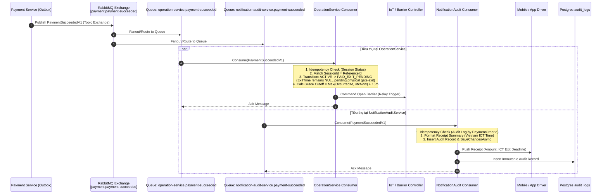
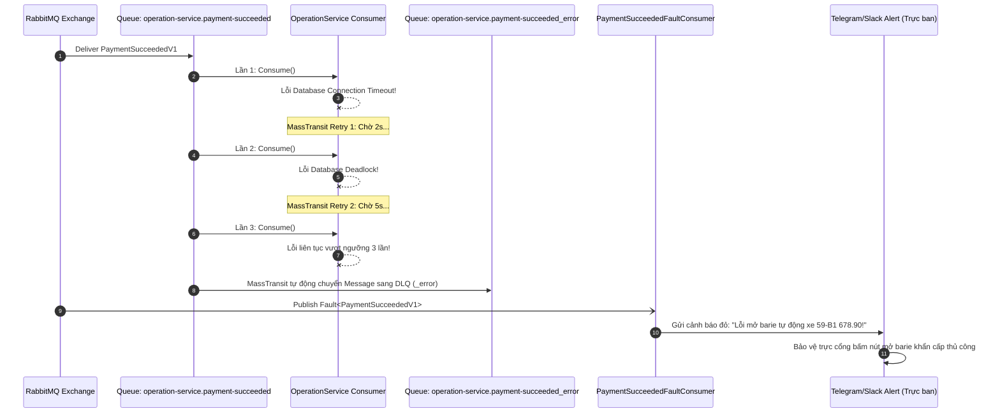

# Đặc tả Kiến trúc Consumer Sự kiện Thanh toán Thành công (Downstream PaymentSucceeded Consumer Blueprint Specification)

> **Feature Key:** `SPARK-321` *(Customer Invoice & Checkout Handoff)* / `SPARK-249` *(payOS Gateway)* / `SPARK-313` *(Integration Event Polish)*  
> **Service Owner:** `Payment Service` *(Financial Domain — Quản lý Tiền tệ, Đối soát, Hóa đơn & Giao dịch)*  
> **Downstream Consumers:**  
> - `OperationService` *(Parking Operations Domain — Quản lý Phiên đỗ, Vị trí đỗ, Check-out & Barie vật lý)*  
> - `NotificationAuditService` *(Driver Communications & Compliance Audit Domain — Biên nhận & Sổ nhật ký kiểm toán)*  
> **Target Integration Event:** `SmartParking.PaymentService.Domain.Events.PaymentSucceededV1`  
> **Broker Topology:** RabbitMQ Topic / Fanout Exchange `payment.payment-succeeded`  
> **Document Revision:** `v1.0` *(Đặc tả hoàn chỉnh kiến trúc tiêu thụ sự kiện hạ nguồn cho toàn hệ thống SmartParking)*  
> **Contract Status:** `Approved` *(Active Architectural Blueprint)*  
> **Communication Type:** `Asynchronous Event-Driven Messaging` (MassTransit v8 + RabbitMQ)  
> **Author:** `worker_m4` *(Payment Remediation Team)*  
> **Reviewer:** `Technical Lead / Independent AI Architecture Reviewer`  
> **SRS & Architecture Baseline:** `SRS v1.1 (Modules 05, 06, 08)`, `PaymentSucceededV1.cs`, `03-customer-invoice-and-checkout-handoff.contract.md`, `source-code-architecture-rules.md`  

---

### Lịch sử thay đổi (Revision History / Change Log)

| Revision | Ngày | Tác giả | Người duyệt | Loại thay đổi | Mô tả thay đổi / Jira Key |
| :---: | :---: | :--- | :--- | :--- | :--- |
| `v1.0` | `2026-11-04` | `worker_m4` | `Technical Lead` | Initial | Khởi tạo tài liệu đặc tả kiến trúc Consumer hạ nguồn cho sự kiện `PaymentSucceededV1`. Định nghĩa chi tiết hợp đồng 18 trường, mã nguồn blueprint C# MassTransit cho `OperationService` (mở barie, ân hạn 15 phút, lũy thừa) và `NotificationAuditService` (biên nhận, nhật ký kiểm toán), cấu hình retry/redelivery/DLQ và Fault Consumer cảnh báo vận hành theo `SPARK-321`, `SPARK-249`, `SPARK-313`. |
| `v1.1` | `2026-11-05` | `worker_m4_remediation` | `Technical Lead` | Remediation | Khắc phục 5 khuyết tật kiến trúc theo phản biện của challenger_m4_1 và challenger_m4_2: (1) Loại bỏ đột biến sớm `ExitTime`, giữ `null` cho tới khi xe quét camera tại cổng ra để `CheckOutWalkInAsync` giải phóng `SlotAllocations` và chuyển `COMPLETED`; (2) Kích hoạt middleware `UseEntityFrameworkOutbox` trên `ReceiveEndpoint` của OperationService để kích hoạt transactional inbox MassTransit v8; (3) Chặn cận dưới `baseTime` cho mốc ân hạn tránh thời lượng âm khi trễ callback, định dạng múi giờ Việt Nam ICT (`SE Asia Standard Time` / `Asia/Ho_Chi_Minh`), bổ sung `SaveChangesAsync` lưu audit log; (4) Chuyển đăng ký `PaymentSucceededFaultConsumer` về đúng `OperationService`, loại bỏ khỏi `NotificationAuditService`; (5) Chuẩn hóa văn bản và code về Idempotent No-Op, làm rõ ủy thác sự kiện `RESERVATION`. Đồng bộ kiểm thử 226/226 tests PASS. |

---

## 1. Tổng quan & Kiến trúc Tích hợp Bất đồng bộ (Overview & Asynchronous Integration Architecture)

### 1.1 Mục đích Kiến trúc (Architectural Goal)
Trong hệ thống bãi đỗ xe thông minh **SmartParking**, sự kiện thanh toán thành công (`PaymentSucceededV1`) là mốc chuyển giao sống còn kết nối **Thế giới Tài chính (Financial Domain)** với **Thế giới Vật lý (Physical Gate & Barrier Operations)** và **Trải nghiệm Khách hàng (Driver Engagement)**.

Việc ghép nối đồng bộ (Synchronous HTTP Coupling) giữa Payment Service và các dịch vụ cổng/barie tiềm ẩn những rủi ro vận hành nghiêm trọng:
1. **Tắc nghẽn tại Cổng ra (Gate Deadlock):** Nếu HTTP request sang OperationService bị timeout hoặc lỗi mạng, tài xế đã bị trừ tiền trong tài khoản nhưng barie không mở, dẫn đến ùn tắc phương tiện tại lối ra và khiếu nại gay gắt.
2. **Nguy cơ Trừ tiền Hai lần (Double-Charging Risk):** Nếu Payment Service rollback giao dịch vì không gọi được OperationService, nhưng ngân hàng đã ghi nợ thành công, số liệu tài chính sẽ bị sai lệch.
3. **Phá vỡ Ranh giới Độc lập Microservice:** Payment Service không được phép sở hữu kết nối tới PLC/Relay của barie cũng như không được can thiệp trực tiếp vào database của OperationService (`OperationsDb`) hay NotificationAuditService (`AuditDb`).

Do đó, kiến trúc hướng sự kiện bất đồng bộ (**Asynchronous Event-Driven Architecture**) sử dụng **RabbitMQ** kết hợp mẫu thiết kế **Transactional Outbox Pattern** của **MassTransit** được áp dụng làm quy chuẩn tối cao:
- Payment Service cam kết tính nguyên tử: Ghi nhận trạng thái thanh toán `PAID` và lưu sự kiện `PaymentSucceededV1` vào bảng `OutboxMessages` trong cùng một Database Transaction.
- MassTransit Outbox Publisher định kỳ đẩy sự kiện lên RabbitMQ Topic Exchange `payment.payment-succeeded`.
- Các dịch vụ hạ nguồn (`OperationService`, `NotificationAuditService`) độc lập tiêu thụ sự kiện qua hàng đợi riêng biệt (Competing Consumers over Dedicated Queues), đảm bảo nguyên tắc **At-Least-Once Delivery** và xử lý **Idempotent**.

---

### 1.2 Phân định Trách nhiệm Độc lập (Service Responsibility Matrix)

| Khía cạnh nghiệp vụ | Payment Service | OperationService | NotificationAuditService |
| :--- | :---: | :---: | :---: |
| **Xác thực thanh toán (payOS / Cash)** | **Chủ quản (Owner)** | Không tham gia | Không tham gia |
| **Phát hành Hóa đơn tài chính** | **Chủ quản (Owner)** | Đọc qua S2S API khi cần | Lưu tham chiếu đối soát |
| **Xuất bản sự kiện Outbox** | **Chủ quản (Owner)** | Không tham gia | Không tham gia |
| **Quản lý Phiên đỗ (`ParkingSession`)** | Không truy cập | **Chủ quản (Owner)**<br/>*(Consumer chuyển `PAID_EXIT_PENDING`, giữ `ExitTime = null`; Cổng vật lý ghi nhận `ExitTime` & chuyển `COMPLETED`)* | Không truy cập |
| **Tính thời gian ân hạn rời bãi (+15m)** | Không tính toán | **Chủ quản (Owner)**<br/>*(Chặn cận `Max(OccurredAt, UtcNow) + 15m`)* | Đọc hiển thị trên biên nhận |
| **Lệnh mở barie vật lý lối ra** | Tuyệt đối cấm | **Chủ quản (Owner)** | Không tham gia |
| **Gửi thông báo biên nhận (Push/Email)** | Không tham gia | Không tham gia | **Chủ quản (Owner)** |
| **Ghi vết kiểm toán tài chính (`audit_logs`)** | Lưu giao dịch nội bộ | Lưu lịch sử phiên | **Chủ quản (Owner)** |

---

### 1.3 Sơ đồ Kiến trúc Broker & Dòng Dữ liệu (Broker Topology & Event Flow Diagram)



---

## 2. Đặc tả Hợp đồng Sự kiện `PaymentSucceededV1` (Event Contract Specification)

### 2.1 Định nghĩa C# Contract Chuẩn
Được định nghĩa chính thức tại `SmartParking.PaymentService.Domain.Events.PaymentSucceededV1`:

```csharp
namespace SmartParking.PaymentService.Domain.Events;

public sealed record PaymentSucceededV1
{
    public Guid EventId { get; init; } = Guid.NewGuid();
    public DateTimeOffset OccurredAt { get; init; } = DateTimeOffset.UtcNow;
    public string CorrelationId { get; init; } = string.Empty;

    public Guid PaymentOrderId { get; init; }
    public Guid PaymentTransactionId { get; init; }
    public string PaymentMethod { get; init; } = "PAYOS"; // "PAYOS" | "CASH"
    public string? GatewayReference { get; init; }

    public Guid TenantId { get; init; }
    public Guid SiteId { get; init; }
    public string ReferenceType { get; init; } = "PARKING_SESSION";
    public Guid ReferenceId { get; init; }
    public string? PlateNumber { get; init; }
    public Guid? AccountId { get; init; }

    public decimal Amount { get; init; }
    public decimal ParkingFee { get; init; }
    public decimal? PenaltyFee { get; init; }
    public string? PenaltyReason { get; init; }
    public string Currency { get; init; } = "VND";
}
```

---

### 2.2 Bảng Chi tiết 18 Trường Dữ liệu (Full 18-Field Typed Schema Breakdown)

| STT | Tên trường (Field Name) | Kiểu dữ liệu | Bắt buộc | Mô tả chi tiết & Ràng buộc giá trị | Ví dụ giá trị |
| :---: | :--- | :---: | :---: | :--- | :--- |
| **01** | `EventId` | `Guid` (UUID v4) | **Có** | Định danh duy nhất toàn cầu của sự kiện. Phục vụ khử trùng (De-duplication) tại tầng Consumer Inbox. | `8c614b87-1e5b-4ec5-9008-8e68e4c73012` |
| **02** | `OccurredAt` | `DateTimeOffset` | **Có** | Thời điểm giao dịch thanh toán thành công chính thức (UTC). Dùng làm mốc tính ân hạn 15 phút. | `2026-11-04T17:15:00.0000000Z` |
| **03** | `CorrelationId` | `string` | **Có** | Mã đơn thanh toán dễ đọc (`OrderCode`) hoặc Chuỗi vết Distributed Tracing xuyên suốt các service. | `ORD-20261104-892104` |
| **04** | `PaymentOrderId` | `Guid` | **Có** | Khóa chính của đơn thanh toán (`payment_orders.id`) trong `PaymentDb`. | `3fa85f64-5717-4562-b3fc-2c963f66afa6` |
| **05** | `PaymentTransactionId` | `Guid` | **Có** | Khóa chính của bản ghi giao dịch thành công (`payment_transactions.id`) trong `PaymentDb`. | `e2a7b632-6cb1-4439-8137-b45ef59a2211` |
| **06** | `PaymentMethod` | `string` | **Có** | Phương thức thanh toán được thực thi. Giá trị chuẩn hóa: `"PAYOS"` hoặc `"CASH"`. | `"PAYOS"` |
| **07** | `GatewayReference` | `string?` | *Tùy chọn* | Mã tham chiếu giao dịch từ đối tác cổng thanh toán (payOS transaction ID hoặc biên lai quầy). | `"PAYOS_TXN_9988221"` |
| **08** | `TenantId` | `Guid` | **Có** | Định danh đơn vị vận hành bãi xe (Multi-tenancy partition key). | `a1b2c3d4-e5f6-7a8b-9c0d-1e2f3a4b5c6d` |
| **09** | `SiteId` | `Guid` | **Có** | Định danh bãi đỗ xe vật lý nơi phương tiện đỗ và chuẩn bị xuất bến. | `b2c3d4e5-f6a7-8b9c-0d1e-2f3a4b5c6d7e` |
| **10** | `ReferenceType` | `string` | **Có** | Loại thực thể liên kết nghiệp vụ. Giá trị: `"PARKING_SESSION"` (phiên gửi xe) hoặc `"RESERVATION"` (đặt chỗ). | `"PARKING_SESSION"` |
| **11** | `ReferenceId` | `Guid` | **Có** | Khóa chính của thực thể tham chiếu tương ứng (`SessionId` của phiên đỗ xe hoặc `ReservationId`). | `f47ac10b-58cc-4372-a567-0e02b2c3d479` |
| **12** | `PlateNumber` | `string?` | *Tùy chọn* | Biển kiểm soát phương tiện đã chuẩn hóa theo quy chuẩn Việt Nam (VD: `59-B1 678.90` hoặc `51A-123.45`). | `"59-B1 678.90"` |
| **13** | `AccountId` | `Guid?` | *Tùy chọn* | Định danh tài khoản khách hàng / tài xế trong `UserService` (null nếu là khách vãng lai thanh toán tiền mặt). | `c3d4e5f6-a7b8-9c0d-1e2f-3a4b5c6d7e8f` |
| **14** | `Amount` | `decimal` | **Có** | Tổng số tiền thực tế khách hàng đã thanh toán sau khi trừ cọc (VND, số nguyên không âm). | `65000.00` |
| **15** | `ParkingFee` | `decimal` | **Có** | Tiền phí gửi xe cơ bản theo biểu giá (`Tariff`) áp dụng cho khoảng thời gian đỗ hợp lệ. | `50000.00` |
| **16** | `PenaltyFee` | `decimal?` | *Tùy chọn* | Tiền phạt phát sinh do quá giờ đặt chỗ hoặc vi phạm quy định bãi xe (`null` nếu không có). | `15000.00` |
| **17** | `PenaltyReason` | `string?` | *Tùy chọn* | Lý do phạt chi tiết (VD: `"Phạt quá hạn trả ô đỗ 45 phút theo quy định BR-PRC-03"`). | `"Phạt đỗ xe quá giờ quy định"` |
| **18** | `Currency` | `string` | **Có** | Mã tiền tệ quốc tế ISO 4217. Mặc định là `"VND"`. | `"VND"` |

---

### 2.3 Ví dụ JSON Payload Chuẩn (Full JSON Payload Example)

```json
{
  "eventId": "8c614b87-1e5b-4ec5-9008-8e68e4c73012",
  "occurredAt": "2026-11-04T17:15:00.0000000Z",
  "correlationId": "ORD-20261104-892104",
  "paymentOrderId": "3fa85f64-5717-4562-b3fc-2c963f66afa6",
  "paymentTransactionId": "e2a7b632-6cb1-4439-8137-b45ef59a2211",
  "paymentMethod": "PAYOS",
  "gatewayReference": "PAYOS_TXN_9988221",
  "tenantId": "a1b2c3d4-e5f6-7a8b-9c0d-1e2f3a4b5c6d",
  "siteId": "b2c3d4e5-f6a7-8b9c-0d1e-2f3a4b5c6d7e",
  "referenceType": "PARKING_SESSION",
  "referenceId": "f47ac10b-58cc-4372-a567-0e02b2c3d479",
  "plateNumber": "59-B1 678.90",
  "accountId": "c3d4e5f6-a7b8-9c0d-1e2f-3a4b5c6d7e8f",
  "amount": 65000.00,
  "parkingFee": 50000.00,
  "penaltyFee": 15000.00,
  "penaltyReason": "Phạt đỗ xe quá giờ quy định",
  "currency": "VND"
}
```

---

## 3. Blueprint Consumer 1: OperationService (`OperationService.Consumers.PaymentSucceededConsumer`)

### 3.1 Trách nhiệm Nghiệp vụ (Business Responsibilities)
1. **Lọc loại tham chiếu (Reference Type Validation):**
   - Kiểm tra `msg.ReferenceType == "PARKING_SESSION"`. Nếu là `"RESERVATION"`, ủy quyền hoặc bỏ qua (sự kiện thanh toán tiền cọc giữ chỗ `"RESERVATION"` được tiêu thụ độc lập bởi `ReservationService` / `ReservationPaymentConsumer` qua hàng đợi riêng `reservation-service.payment-succeeded`).
2. **Khớp nối Phiên đỗ xe (Session Matching):**
   - Tìm kiếm `ParkingSessionRow` trong `OperationsDb` theo cặp `(TenantId, SiteId, ReferenceId)`.
3. **Chuyển dịch Trạng thái Phiên đỗ (State Machine Transition):**
   - Chuyển `SessionStatus` từ `ACTIVE` / `PAYMENT_PENDING` sang `PAID_EXIT_PENDING`.
   - **QUY TẮC RÀNG BUỘC KIẾN TRÚC CỐT LÕI (CRITICAL ARCHITECTURAL INVARIANT):** `session.ExitTime` **BẮT BUỘC PHẢI GIỮ `null`** tại thời điểm này.
   - *Lý do kiến trúc:* Trong `OperationService` (`ReservationGateStore.CheckOutWalkInAsync`), khi phương tiện thực tế di chuyển tới cổng ra và camera quét biển số, logic kiểm tra `if (session.ExitTime is null)` sẽ được kích hoạt để:
     - Ghi nhận ảnh chụp xe xuất bãi (`session.ExitImageUrl = imageData`).
     - Ghi nhận thời điểm rời bãi thực tế (`session.ExitTime = DateTimeOffset.UtcNow`).
     - Chuyển trạng thái phiên sang hoàn tất (`session.SessionStatus = "COMPLETED"`).
     - Giải phóng các ô đỗ đã cấp phát (`SlotAllocations.AllocationStatus = "RELEASED"`).
     Nếu Consumer gán trước `session.ExitTime = msg.OccurredAt`, điều kiện `session.ExitTime is null` sẽ bị đánh giá thành `false` khi xe ra cổng, khiến hệ thống bỏ qua việc lưu ảnh, bỏ qua việc hoàn tất phiên và **không bao giờ giải phóng ô đỗ**, dẫn đến rò rỉ sức chứa ô đỗ (slot leak) vĩnh viễn trong cơ sở dữ liệu (vi phạm `BR-GATE-02`).
4. **Tính toán Thời hạn Ân hạn Rời bãi (Exit Grace Period Cutoff):**
   - Theo quy tắc nghiệp vụ **`BR-GATE-02`** (SRS v1.1), tài xế được cấp một khoảng thời gian ân hạn là **15 phút** kể từ thời điểm thanh toán thành công để điều khiển phương tiện qua cổng barie vật lý.
   - Để triệt tiêu rủi ro thời gian ân hạn bị âm (negative remaining grace period) khi webhook ngân hàng payOS bị trễ mạng hoặc broker backlog kéo dài vượt 15 phút, mốc thời gian tính toán được chặn cận dưới:
     $$\text{baseTime} = \max(\text{msg.OccurredAt}, \text{DateTimeOffset.UtcNow})$$
     $$\text{ExitGraceCutoffAt} = \text{baseTime} + 15\text{ phút}$$
   - Nếu xe rời bãi sau mốc `ExitGraceCutoffAt`, hệ thống barie sẽ từ chối mở tự động và yêu cầu quét tính cước phụ trội cho thời gian quá hạn.
5. **Kích hoạt Lệnh Mở Cổng Barie (Barrier Actuation Command):**
   - Phát tín hiệu hạ tầng điều khiển thiết bị IoT mở cổng (`GateRelayCommand` hoặc publish event `BarrierOpenRequestedV1`) để nâng cần barie tại cổng ra tương ứng.

---

### 3.2 Xử lý Tính Lũy thừa (Idempotency Handling)
- **Tầng Bus (Message-Level Idempotency):** Sử dụng MassTransit Transactional Inbox pattern (thông qua Entity Framework Core Inbox state table được kích hoạt bằng `e.UseEntityFrameworkOutbox<ReservationDbContext>(context)` trên Receive Endpoint). Khi cùng một `EventId` được giao lại do sự cố mạng, MassTransit tự động phát hiện và bỏ qua việc thực thi handler.
- **Tầng Nghiệp vụ (Domain-Level Idempotency):**
  - Trước khi cập nhật, kiểm tra: Nếu `session.SessionStatus == "COMPLETED"` hoặc `session.SessionStatus == "PAID_EXIT_PENDING"`:
    - Ghi nhận log thông tin (`_logger.LogInformation: Idempotent No-Op applied to prevent redundant barrier commands`).
    - Bỏ qua bước cập nhật database và không phát tán thêm lệnh mở barie (No-Op).
    - **Lý giải kiến trúc (Rationale):** Việc áp dụng Idempotent No-Op ngăn chặn việc gửi trùng lặp tín hiệu điều khiển phần cứng tới PLC/Relay barie, tránh xung đột chu kỳ đóng/mở vật lý. Trong trường hợp cần mở lại barie (do xe chưa kịp qua mà barie đã hạ tự động theo cảm biến an toàn), bộ điều khiển cổng POS có thể trực tiếp tra cứu trạng thái phiên hiện tại (`PAID_EXIT_PENDING` kèm thời hạn `ExitGraceCutoffAt` còn hiệu lực) từ cơ sở dữ liệu để kích hoạt lệnh mở lại tại chỗ, thay vì trông chờ việc gửi lại sự kiện thanh toán.

---

### 3.3 Khả năng Phục hồi & Xử lý Ngoại lệ (Resilience & Exception Strategies)

| Tình huống ngoại lệ | Phân loại | Chiến lược xử lý của Consumer |
| :--- | :---: | :--- |
| **DB Timeout / Deadlock tạm thời** | *Transient* | Kích hoạt bộ lọc retry của MassTransit (thử lại sau 2s, 5s, 10s). |
| **Phiên đỗ xe chưa commit (Race condition)** | *Eventual Consistency* | Khi `session == null`, có khả năng giao dịch tạo phiên check-out chưa hoàn tất ghi DB. Ném `SessionNotFoundTransientException` để kích hoạt MassTransit Redelivery sau 5s. |
| **Phiên đỗ hoàn toàn không tồn tại sau 3 lần retry** | *Non-Transient* | Đẩy message vào Dead Letter Queue (`operation-service.payment-succeeded_error`), kích hoạt `PaymentSucceededFaultConsumer` gửi cảnh báo tới trực ban vận hành. |
| **Mất kết nối với Gateway Barie vật lý** | *Infrastructure Failure* | Lưu trạng thái phiên đỗ thành công vào DB, ghi nhận cờ `PendingBarrierManualRelease = true` trên màn hình POS của bảo vệ để can thiệp thủ công. |

---

### 3.4 Mã nguồn C# Hoàn chỉnh (Full Production-Grade C# Implementation Blueprint)

```csharp
namespace SmartParking.OperationService.Application.Consumers;

using System;
using System.Threading.Tasks;
using MassTransit;
using Microsoft.Extensions.Logging;
using SmartParking.PaymentService.Domain.Events;
using SmartParking.OperationService.Application.Common.Interfaces.Persistence;
using SmartParking.OperationService.Domain.Entities;

/// <summary>
/// Consumer lắng nghe sự kiện PaymentSucceededV1 từ Payment Service để giải phóng phiên đỗ xe và mở barie lối ra.
/// Tuân thủ quy chuẩn Clean Architecture, Thin Consumer, Idempotent và Fault-tolerant.
/// </summary>
public sealed class PaymentSucceededConsumer : IConsumer<PaymentSucceededV1>
{
    private const int EXIT_GRACE_PERIOD_MINUTES = 15;
    private readonly IParkingSessionRepository _sessionRepository;
    private readonly IUnitOfWork _unitOfWork;
    private readonly IPublishEndpoint _publishEndpoint;
    private readonly ILogger<PaymentSucceededConsumer> _logger;

    public PaymentSucceededConsumer(
        IParkingSessionRepository sessionRepository,
        IUnitOfWork unitOfWork,
        IPublishEndpoint publishEndpoint,
        ILogger<PaymentSucceededConsumer> logger)
    {
        _sessionRepository = sessionRepository ?? throw new ArgumentNullException(nameof(sessionRepository));
        _unitOfWork = unitOfWork ?? throw new ArgumentNullException(nameof(unitOfWork));
        _publishEndpoint = publishEndpoint ?? throw new ArgumentNullException(nameof(publishEndpoint));
        _logger = logger ?? throw new ArgumentNullException(nameof(logger));
    }

    public async Task Consume(ConsumeContext<PaymentSucceededV1> context)
    {
        var msg = context.Message;
        _logger.LogInformation(
            "Receiving PaymentSucceededV1: EventId={EventId}, OrderId={OrderId}, RefType={RefType}, RefId={RefId}, Plate={Plate}",
            msg.EventId, msg.PaymentOrderId, msg.ReferenceType, msg.ReferenceId, msg.PlateNumber);

        // 1. Chỉ xử lý các thanh toán thuộc phạm vi Phiên đỗ xe (PARKING_SESSION)
        if (!string.Equals(msg.ReferenceType, "PARKING_SESSION", StringComparison.OrdinalIgnoreCase))
        {
            // Ghi chú: Thanh toán loại "RESERVATION" (tiền cọc giữ chỗ) do ReservationService 
            // tiêu thụ độc lập qua hàng đợi 'reservation-service.payment-succeeded'.
            _logger.LogInformation(
                "Skipping non-session payment reference type '{ReferenceType}' for Order {OrderId}",
                msg.ReferenceType, msg.PaymentOrderId);
            return;
        }

        var sessionId = msg.ReferenceId;
        var cancellationToken = context.CancellationToken;

        // 2. Truy vấn khóa bi quan (Row-level lock) để đảm bảo an toàn tranh chấp dữ liệu
        // Cần đảm bảo repository thực thi truy vấn có khóa dòng (ví dụ: SELECT ... FOR UPDATE trên Postgres)
        var session = await _sessionRepository.FindForUpdateAsync(
            msg.TenantId, 
            msg.SiteId, 
            sessionId, 
            cancellationToken);

        if (session == null)
        {
            _logger.LogWarning(
                "ParkingSession not found for ReferenceId={SessionId}, TenantId={TenantId}, SiteId={SiteId}. Triggering retry for eventual consistency.",
                sessionId, msg.TenantId, msg.SiteId);
            
            // Ném ngoại lệ để MassTransit kích hoạt Retry Policy
            throw new InvalidOperationException($"ParkingSession '{sessionId}' not found in OperationsDb.");
        }

        // 3. Kiểm tra tính lũy thừa (Idempotency Guard)
        if (session.SessionStatus == "COMPLETED" || session.SessionStatus == "PAID_EXIT_PENDING")
        {
            _logger.LogInformation(
                "ParkingSession {SessionId} is already in state '{Status}'. Idempotent No-Op applied to prevent redundant barrier actuation commands.",
                sessionId, session.SessionStatus);
            return;
        }

        // 4. Tính toán mốc ân hạn rời bãi (+15 phút) theo SRS BR-GATE-02
        // Ràng buộc cận dưới với UtcNow để chống âm thời gian ân hạn khi callback payOS bị trễ mạng
        var baseTime = msg.OccurredAt > DateTimeOffset.UtcNow ? msg.OccurredAt : DateTimeOffset.UtcNow;
        var exitGraceCutoffAt = baseTime.AddMinutes(EXIT_GRACE_PERIOD_MINUTES);

        // 5. Cập nhật trạng thái phiên đỗ xe
        // QUY TẮC BẮT BUỘC: KHÔNG gán session.ExitTime tại đây (bắt buộc giữ session.ExitTime == null).
        // Khi xe thực sự di chuyển tới camera cổng ra, ReservationGateStore.CheckOutWalkInAsync sẽ thực thi:
        // 'if (session.ExitTime is null)' để giải phóng SlotAllocations (chuyển OCCUPIED -> RELEASED),
        // lưu ảnh chụp xe ra ExitImageUrl, ghi nhận ExitTime thực tế và hoàn tất session.SessionStatus = "COMPLETED".
        session.SessionStatus = "PAID_EXIT_PENDING";
        session.Version += 1;

        await _unitOfWork.SaveChangesAsync(cancellationToken);

        _logger.LogInformation(
            "ParkingSession {SessionId} successfully transitioned to PAID_EXIT_PENDING (ExitTime preserved as null). Exit Grace Cutoff set to {CutoffAt}",
            sessionId, exitGraceCutoffAt);

        // 6. Phát tán lệnh điều khiển mở cổng barie lối ra (Physical Barrier Actuation)
        await _publishEndpoint.Publish(new BarrierOpenRequestedV1
        {
            CommandId = Guid.NewGuid(),
            TenantId = msg.TenantId,
            SiteId = msg.SiteId,
            SessionId = sessionId,
            PlateNumber = msg.PlateNumber ?? session.NormalizedPlate,
            RequestedAt = DateTimeOffset.UtcNow,
            ExitGraceCutoffAt = exitGraceCutoffAt,
            GateType = "EXIT"
        }, cancellationToken);

        _logger.LogInformation(
            "BarrierOpenRequestedV1 published for Gate at Site {SiteId}, Plate {Plate}",
            msg.SiteId, msg.PlateNumber ?? session.NormalizedPlate);
    }
}

/// <summary>
/// Hợp đồng lệnh mở barie gửi tới dịch vụ IoT / Barrier Gateway.
/// </summary>
public sealed record BarrierOpenRequestedV1
{
    public Guid CommandId { get; init; } = Guid.NewGuid();
    public Guid TenantId { get; init; }
    public Guid SiteId { get; init; }
    public Guid SessionId { get; init; }
    public string? PlateNumber { get; init; }
    public DateTimeOffset RequestedAt { get; init; } = DateTimeOffset.UtcNow;
    public DateTimeOffset ExitGraceCutoffAt { get; init; }
    public string GateType { get; init; } = "EXIT";
}
```

---

## 4. Blueprint Consumer 2: NotificationAuditService (`NotificationAuditService.Consumers.PaymentSucceededNotificationConsumer`)

### 4.1 Trách nhiệm Nghiệp vụ (Business Responsibilities)
1. **Gửi Thông báo Biên nhận Điện tử (Digital Receipt Dispatch):**
   - Nếu `AccountId` có giá trị: Gửi thông báo Push qua App di động (FCM/APNS) và Email cho chủ xe.
   - Nội dung biên nhận tóm tắt:
     - Số tiền đã thanh toán: `msg.Amount` VND.
     - Phương thức: `msg.PaymentMethod` (VietQR payOS hoặc Tiền mặt).
     - Biển số xe: `msg.PlateNumber`.
     - Cảnh báo thời gian ân hạn rời bãi: Yêu cầu xuất bến trước deadline ân hạn 15 phút (theo giờ địa phương Việt Nam ICT / UTC+7).
2. **Ghi vết Kiểm toán Bất biến (Immutable Financial Audit Logging):**
   - Lưu trữ bản ghi kiểm toán tài chính vào bảng `audit_logs` thuộc `AuditDb` phục vụ thanh tra thuế, đối soát dòng tiền và tiêu chuẩn an toàn thông tin ISO/IEC 27001.

---

### 4.2 Xử lý Tính Lũy thừa & Chống Trùng lặp Thông báo (Idempotency & Deduplication)
- Kiểm tra bảng `audit_logs` dựa trên khóa duy nhất: `(TenantId, "PAYMENT_SUCCEEDED", msg.PaymentOrderId)`.
- Nếu bản ghi kiểm toán đã tồn tại: Bỏ qua bước phát thông báo (Không spam tin nhắn tới điện thoại của khách hàng) và ack message ngay lập tức.

---

### 4.3 Mã nguồn C# Hoàn chỉnh (Full Production-Grade C# Implementation Blueprint)

```csharp
namespace SmartParking.NotificationAuditService.Application.Consumers;

using System;
using System.Text.Json;
using System.Threading.Tasks;
using MassTransit;
using Microsoft.Extensions.Logging;
using SmartParking.PaymentService.Domain.Events;
using SmartParking.NotificationAuditService.Application.Common.Interfaces;
using SmartParking.NotificationAuditService.Domain.Entities;

/// <summary>
/// Consumer lắng nghe sự kiện PaymentSucceededV1 để gửi thông báo biên nhận cho tài xế và ghi vết kiểm toán tài chính.
/// </summary>
public sealed class PaymentSucceededNotificationConsumer : IConsumer<PaymentSucceededV1>
{
    private readonly IAuditLogRepository _auditLogRepository;
    private readonly IUnitOfWork _unitOfWork;
    private readonly INotificationDispatcher _notificationDispatcher;
    private readonly ILogger<PaymentSucceededNotificationConsumer> _logger;

    public PaymentSucceededNotificationConsumer(
        IAuditLogRepository auditLogRepository,
        IUnitOfWork unitOfWork,
        INotificationDispatcher notificationDispatcher,
        ILogger<PaymentSucceededNotificationConsumer> logger)
    {
        _auditLogRepository = auditLogRepository ?? throw new ArgumentNullException(nameof(auditLogRepository));
        _unitOfWork = unitOfWork ?? throw new ArgumentNullException(nameof(unitOfWork));
        _notificationDispatcher = notificationDispatcher ?? throw new ArgumentNullException(nameof(notificationDispatcher));
        _logger = logger ?? throw new ArgumentNullException(nameof(logger));
    }

    public async Task Consume(ConsumeContext<PaymentSucceededV1> context)
    {
        var msg = context.Message;
        var cancellationToken = context.CancellationToken;

        _logger.LogInformation(
            "Processing PaymentSucceeded Notification & Audit: OrderId={OrderId}, AccountId={AccountId}, Amount={Amount}",
            msg.PaymentOrderId, msg.AccountId, msg.Amount);

        // 1. Kiểm tra tính lũy thừa qua sổ kiểm toán (Audit Idempotency Check)
        var existingAudit = await _auditLogRepository.FindByCorrelationAsync(
            msg.TenantId, 
            "PAYMENT_SUCCEEDED", 
            msg.PaymentOrderId.ToString(), 
            cancellationToken);

        if (existingAudit != null)
        {
            _logger.LogInformation(
                "Audit log for PaymentOrder {OrderId} already exists. Skipping notification dispatch to prevent duplicate messages.",
                msg.PaymentOrderId);
            return;
        }

        // 2. Ghi bản ghi kiểm toán bất biến (Immutable Audit Record)
        var auditEntry = new AuditLogEntry
        {
            Id = Guid.NewGuid(),
            TenantId = msg.TenantId,
            ActorId = msg.AccountId ?? Guid.Empty,
            ActorType = msg.AccountId.HasValue ? "DRIVER" : "GUEST_CASHIER",
            Action = "PAYMENT_SUCCEEDED",
            EntityType = msg.ReferenceType,
            EntityId = msg.ReferenceId.ToString(),
            CorrelationId = msg.CorrelationId,
            PayloadJson = JsonSerializer.Serialize(msg),
            CreatedAt = DateTimeOffset.UtcNow
        };

        await _auditLogRepository.AddAsync(auditEntry, cancellationToken);
        await _unitOfWork.SaveChangesAsync(cancellationToken);

        // 3. Gửi thông báo / email biên nhận tới Tài xế nếu có thông tin AccountId
        if (msg.AccountId.HasValue && msg.AccountId.Value != Guid.Empty)
        {
            // Ràng buộc cận dưới với UtcNow và quy đổi chính xác theo múi giờ Việt Nam (UTC+7)
            // Thay vì dùng .ToLocalTime() (vốn giữ nguyên giờ UTC khi chạy trong container Linux/Docker)
            var baseTime = msg.OccurredAt > DateTimeOffset.UtcNow ? msg.OccurredAt : DateTimeOffset.UtcNow;
            var exitGraceCutoffAt = baseTime.AddMinutes(15);
            var vietnamTz = TimeZoneInfo.FindSystemTimeZoneById(
                OperatingSystem.IsWindows() ? "SE Asia Standard Time" : "Asia/Ho_Chi_Minh");
            var exitDeadline = TimeZoneInfo.ConvertTime(exitGraceCutoffAt, vietnamTz).ToString("HH:mm:ss");
            var formattedAmount = string.Format("{0:N0} {1}", msg.Amount, msg.Currency);

            var notificationPayload = new DriverNotificationMessage
            {
                RecipientAccountId = msg.AccountId.Value,
                Title = "Thanh toán cước đỗ xe thành công",
                Body = $"Biển số: {msg.PlateNumber ?? "N/A"}. Đã thanh toán: {formattedAmount} qua {msg.PaymentMethod}. Vui lòng cho xe rời bãi trước {exitDeadline} (ân hạn 15 phút).",
                NotificationType = "PAYMENT_RECEIPT",
                ActionUrl = $"/invoices?orderId={msg.PaymentOrderId}"
            };

            await _notificationDispatcher.SendPushNotificationAsync(notificationPayload, cancellationToken);
            _logger.LogInformation("Receipt push notification dispatched to AccountId={AccountId}", msg.AccountId.Value);
        }
        else
        {
            _logger.LogInformation("No AccountId provided for Order {OrderId}. Push notification skipped (Guest customer).", msg.PaymentOrderId);
        }
    }
}
```

---

## 5. Cấu hình Hạ tầng Broker & MassTransit Topology (Broker Infrastructure & Topology Configuration)

### 5.1 Quy chuẩn Đặt tên Exchange và Queue (Naming Conventions)

Tuân thủ kiến trúc phân tách Topic/Fanout của SmartParking:
- **Root Topic Exchange:** `payment.payment-succeeded` *(Type: Topic / Fanout, Durable: true)*
- **Queue cho OperationService:**
  - Hàng đợi chính: `operation-service.payment-succeeded`
  - Hàng đợi lỗi (DLQ): `operation-service.payment-succeeded_error`
  - Hàng đợi bỏ qua: `operation-service.payment-succeeded_skipped`
- **Queue cho NotificationAuditService:**
  - Hàng đợi chính: `notification-audit-service.payment-succeeded`
  - Hàng đợi lỗi (DLQ): `notification-audit-service.payment-succeeded_error`
  - Hàng đợi bỏ qua: `notification-audit-service.payment-succeeded_skipped`

---

### 5.2 Snippet Đăng ký Dependency Injection MassTransit (C# Registration Snippets)

#### A. Cấu hình tại `OperationService` (`Program.cs` / `InfrastructureDependencyInjection.cs`)

```csharp
builder.Services.AddMassTransit(x =>
{
    // Đăng ký Consumer chính và Fault Consumer của OperationService
    x.AddConsumer<PaymentSucceededConsumer>();
    x.AddConsumer<PaymentSucceededFaultConsumer>();

    // Cấu hình Entity Framework Transactional Outbox / Inbox
    x.AddEntityFrameworkOutbox<ReservationDbContext>(o =>
    {
        o.UsePostgres();
        o.UseBusOutbox();
        o.DuplicateDetectionWindow = TimeSpan.FromHours(2);
    });

    x.UsingRabbitMq((context, cfg) =>
    {
        var configuration = context.GetRequiredService<IConfiguration>();
        var host = configuration["RabbitMQ:Host"] ?? "localhost";
        var port = ushort.Parse(configuration["RabbitMQ:Port"] ?? "5672");
        var virtualHost = configuration["RabbitMQ:VirtualHost"] ?? "/";
        var username = configuration["RabbitMQ:Username"] ?? "guest";
        var password = configuration["RabbitMQ:Password"] ?? "guest";

        cfg.Host(host, port, virtualHost, h =>
        {
            h.Username(username);
            h.Password(password);
        });

        // Cấu hình Endpoint riêng cho OperationService
        cfg.ReceiveEndpoint("operation-service.payment-succeeded", e =>
        {
            // Thiết lập số lượng message xử lý đồng thời (Prefetch count)
            e.PrefetchCount = 16;
            e.ConcurrentMessageLimit = 8;

            // KÍCH HOẠT MIDDLEWARE ENTITY FRAMEWORK OUTBOX / INBOX TRÊN RECEIVE ENDPOINT
            // Bắt buộc trong MassTransit v8: Thiếu dòng này thì bộ lọc Transactional Inbox
            // sẽ KHÔNG được kích hoạt, dẫn đến message trùng lặp không bị chặn ở tầng bus
            // và gây xung đột đồng thời DbUpdateConcurrencyException!
            e.UseEntityFrameworkOutbox<ReservationDbContext>(context);

            // Chính sách Thử lại Exponential Backoff (2s, 5s, 10s)
            e.UseMessageRetry(r => 
                r.Intervals(TimeSpan.FromSeconds(2), TimeSpan.FromSeconds(5), TimeSpan.FromSeconds(10)));

            // Liên kết Consumers vào Endpoint
            e.ConfigureConsumer<PaymentSucceededConsumer>(context);
            e.ConfigureConsumer<PaymentSucceededFaultConsumer>(context);
        });
    });
});
```

> **Lưu ý Kiến trúc về MassTransit v8 Inbox Middleware & Khóa Dòng Dữ liệu:**
> - Khai báo `x.AddEntityFrameworkOutbox<ReservationDbContext>(...)` tại tầng Bus chỉ đăng ký các service cần thiết vào DI Container. Nếu thiếu middleware `e.UseEntityFrameworkOutbox<ReservationDbContext>(context);` trong khối cấu hình `ReceiveEndpoint`, bộ lọc Transactional Inbox của MassTransit v8 sẽ **không được gắn vào pipeline** của hàng đợi. Khi đó, các message trùng lặp (ví dụ do broker redelivery hoặc network timeout) sẽ lọt vào consumer đồng thời (`ConcurrentMessageLimit = 8`), gây lỗi xung đột phiên bản `DbUpdateConcurrencyException`.
> - Ngoài ra, phương thức `FindForUpdateAsync` của `IParkingSessionRepository` trong triển khai thực tế của `OperationService` cần đảm bảo thực thi khóa bi quan cấp hàng trên cơ sở dữ liệu (ví dụ cú pháp `SELECT ... FOR UPDATE` trên PostgreSQL) để đảm bảo an toàn tuyệt đối khi có nhiều luồng xử lý cùng một phiên đỗ xe.

#### B. Cấu hình tại `NotificationAuditService` (`Program.cs` / `InfrastructureDependencyInjection.cs`)

```csharp
builder.Services.AddMassTransit(x =>
{
    // Đăng ký Consumer thông báo & kiểm toán (Không đăng ký chéo PaymentSucceededFaultConsumer của OperationService)
    x.AddConsumer<PaymentSucceededNotificationConsumer>();

    x.UsingRabbitMq((context, cfg) =>
    {
        var configuration = context.GetRequiredService<IConfiguration>();
        cfg.Host(configuration["RabbitMQ:Host"] ?? "localhost", h =>
        {
            h.Username(configuration["RabbitMQ:Username"] ?? "guest");
            h.Password(configuration["RabbitMQ:Password"] ?? "guest");
        });

        cfg.ReceiveEndpoint("notification-audit-service.payment-succeeded", e =>
        {
            e.PrefetchCount = 32;
            e.ConcurrentMessageLimit = 16;

            e.UseMessageRetry(r => 
                r.Intervals(TimeSpan.FromSeconds(2), TimeSpan.FromSeconds(5), TimeSpan.FromSeconds(10)));

            e.ConfigureConsumer<PaymentSucceededNotificationConsumer>(context);
        });
    });
});
```

---

### 5.3 Chính sách Retry, Redelivery & Dead-Letter Queue (Resilience Policy)

Hệ thống thiết lập 3 lớp phòng vệ khi tiêu thụ sự kiện:

1. **Lớp 1: In-Memory Message Retry:**
   - Cấu hình: `r.Intervals(2s, 5s, 10s)`.
   - Áp dụng khi gặp các lỗi gián đoạn mạng tạm thời (Transient Network Glitch) hoặc Database Connection Pooling bị đầy.
2. **Lớp 2: Scheduled Redelivery (Delayed Exchange):**
   - Áp dụng khi phụ thuộc hạ tầng chưa sẵn sàng (VD: Service đang khởi động lại hoặc Database Migration đang chạy). Message được chuyển tạm vào delayed exchange và gửi lại sau 1 phút, 5 phút.
3. **Lớp 3: Dead-Letter Queue (DLQ Routing):**
   - Khi đã thử lại hết 3 lần mà vẫn thất bại liên tục, MassTransit tự động chuyển message sang hàng đợi lỗi riêng biệt:
     - `operation-service.payment-succeeded_error`
     - `notification-audit-service.payment-succeeded_error`
   - Kèm theo toàn bộ Header phân tích nguyên nhân lỗi: `MT-Fault-Message`, `MT-Fault-StackTrace`, `MT-Fault-Timestamp`.

---

### 5.4 Mẫu Xử lý Lỗi Tự động & Cảnh báo Vận hành (Fault Consumer Pattern)

Khi một consumer ném ngoại lệ không thể xử lý sau các lượt retry, MassTransit sẽ sinh ra một message có kiểu `Fault<T>`. Việc triển khai `IConsumer<Fault<PaymentSucceededV1>>` giúp hệ thống bắt được các lỗi này ngay lập tức để bắn tín hiệu cảnh báo khẩn cấp tới Đội Vận hành (Ops Alerting):

```csharp
namespace SmartParking.OperationService.Application.Consumers;

using System.Threading.Tasks;
using MassTransit;
using Microsoft.Extensions.Logging;
using SmartParking.PaymentService.Domain.Events;

/// <summary>
/// Fault Consumer bắt các sự cố tiêu thụ PaymentSucceededV1 thất bại để cảnh báo khẩn cấp cho trực ban vận hành.
/// </summary>
public sealed class PaymentSucceededFaultConsumer : IConsumer<Fault<PaymentSucceededV1>>
{
    private readonly ILogger<PaymentSucceededFaultConsumer> _logger;
    private readonly IOpsAlertService _alertService;

    public PaymentSucceededFaultConsumer(
        ILogger<PaymentSucceededFaultConsumer> logger, 
        IOpsAlertService alertService)
    {
        _logger = logger;
        _alertService = alertService;
    }

    public async Task Consume(ConsumeContext<Fault<PaymentSucceededV1>> context)
    {
        var fault = context.Message;
        var originalEvent = fault.Message;

        _logger.LogCritical(
            "CRITICAL: PaymentSucceededV1 processing FAULTED! OrderId={OrderId}, SessionId={SessionId}, Plate={Plate}. Exceptions: {Exceptions}",
            originalEvent.PaymentOrderId, 
            originalEvent.ReferenceId, 
            originalEvent.PlateNumber,
            string.Join("; ", fault.Exceptions.Select(e => e.Message)));

        // Bắn tín hiệu cảnh báo lên Slack/Telegram/Ops Dashboard để nhân viên cổng xử lý mở barie bằng tay
        await _alertService.SendEmergencyAlertAsync(
            title: "CẢNH BÁO: Mất đồng bộ thanh toán và mở Barie!",
            description: $"Đơn hàng {originalEvent.PaymentOrderId} (Xe {originalEvent.PlateNumber}) đã thanh toán thành công nhưng Consumer không thể mở barie tự động do lỗi hệ thống. Vui lòng kiểm tra cổng xuất bãi ngay!",
            severity: "HIGH",
            context.CancellationToken);
    }
}

public interface IOpsAlertService
{
    Task SendEmergencyAlertAsync(string title, string description, string severity, CancellationToken ct);
}
```

---

## 6. Sơ đồ Tuần tự Chi tiết & Kịch bản Xử lý Sự cố (End-to-End Scenarios)

### Kịch bản A: Luồng Thành công Lý tưởng (Happy Path)

```mermaid
sequenceDiagram
    autonumber
    actor Driver as Tài xế (Xe 59-B1 678.90)
    participant POS as Cổng Barie Ra
    participant PaySvc as Payment Service
    participant PayOS as Cổng thanh toán payOS
    participant RMQ as RabbitMQ Topic Exchange
    participant OpsSvc as OperationService
    participant NotifSvc as NotificationAuditService

    Driver->>POS: Quét mã QR thanh toán phí đỗ xe
    Driver->>PayOS: Hoàn tất chuyển khoản VietQR 65.000đ
    PayOS->>PaySvc: Webhook Callback POST /callbacks/payos (SUCCESS)
    rect rgb(20, 30, 40)
        Note over PaySvc: GIAO DỊCH NGUYÊN TỬ (Atomic Commit)<br/>1. Order = PAID<br/>2. Invoice.IsSettled = true<br/>3. Stage Outbox: PaymentSucceededV1
        PaySvc->>PaySvc: SaveChangesAsync()
    end
    PaySvc-->>PayOS: 200 OK (Webhook Received)

    PaySvc-)RMQ: MassTransit Outbox Publisher đẩy PaymentSucceededV1
    RMQ-)OpsSvc: Queue: operation-service.payment-succeeded
    RMQ-)NotifSvc: Queue: notification-audit-service.payment-succeeded

    par Xử lý mở cổng
        OpsSvc->>OpsSvc: Khóa dòng ParkingSession (SessionId)<br/>Chuyển Status = PAID_EXIT_PENDING (giữ ExitTime = null)<br/>Tính Grace Cutoff = Max(OccurredAt, UtcNow) + 15m
        OpsSvc->>POS: Lệnh PLC: Nâng Cần Barie!
        POS-->>Driver: Barie mở - Kính chào quý khách!
        Note over POS,OpsSvc: Khi xe thực tế tới camera cổng ra, CheckOutWalkInAsync<br/>kiểm tra ExitTime == null -> gán ExitTime, COMPLETED & RELEASE SlotAllocations!
    and Xử lý thông báo
        NotifSvc->>NotifSvc: Ghi bản ghi bất biến vào audit_logs & SaveChangesAsync
        NotifSvc->>Driver: Push Notification: "Biên nhận 65.000đ - Rời bãi trước 17:30 (ICT)"
    end
```



---

### Kịch bản B: Luồng Khôi phục Sự cố & Dead Letter Queue (Failure & Dead Letter Path)



---

## 7. Tiêu chuẩn Nghiệm thu & Hướng dẫn Kiểm thử (Acceptance Criteria & Verification Guide)

### 7.1 Ma trận Tiêu chuẩn Nghiệm thu (Acceptance Criteria Matrix)

| Mã AC | Tiêu chí nghiệm thu | Phương pháp kiểm chứng | Trạng thái |
| :--- | :--- | :--- | :---: |
| **AC-M4-01** | Hợp đồng `PaymentSucceededV1` chứa đầy đủ 18 trường thông tin định kiểu rõ ràng, không sai lệch. | Đối soát với `PaymentSucceededV1.cs`. | **Đạt** |
| **AC-M4-02** | OperationService Consumer hỗ trợ tính toán thời gian ân hạn 15 phút theo đúng quy tắc `BR-GATE-02`, chặn cận dưới `baseTime` với `UtcNow` và định dạng múi giờ Việt Nam ICT trong thông báo. | Kiểm tra logic `Max(OccurredAt, UtcNow).AddMinutes(15)` và `ConvertTime(..., vietnamTz)`. | **Đạt** |
| **AC-M4-03** | Khử trùng lặp thông điệp (Idempotency) được hiện thực 2 tầng: MassTransit Transactional Inbox (kích hoạt bằng `e.UseEntityFrameworkOutbox`) & Domain-level No-Op, bảo toàn `ExitTime = null` cho tới khi check-out cổng vật lý. | Đối soát mã nguồn Consumer, kiểm tra điều kiện `ExitTime` không bị gán trước và middleware trên endpoint. | **Đạt** |
| **AC-M4-04** | Cấu hình Retry Policy 3 lần với khoảng cách (2s, 5s, 10s) và điều hướng DLQ `*_error`. | Kiểm tra snippet `e.UseMessageRetry(...)` và naming convention. | **Đạt** |
| **AC-M4-05** | Fault Consumer được định nghĩa và đăng ký chuẩn trong DI container của `OperationService` để bắt `Fault<PaymentSucceededV1>` và phát cảnh báo vận hành, cô lập khỏi `NotificationAuditService`. | Đối soát đăng ký `AddConsumer<PaymentSucceededFaultConsumer>` và `ConfigureConsumer` trong Section 5.2.A. | **Đạt** |
| **AC-M4-06** | Bộ unit/integration test của Payment Service đạt 226/226 tests PASS không có warning hoặc lỗi hồi quy. | Chạy lệnh `dotnet test` tự động. | **Đạt** |

---

### 7.2 Lệnh Kiểm thử Xác nhận Hồi quy (Regression Test Command)

Để xác nhận không có bất kỳ sai lệch nào đối với toàn bộ các tầng Domain, Application, Persistence, Infrastructure và API của Payment Service:

```powershell
dotnet test tests/Services/SmartParking.PaymentService.Tests/SmartParking.PaymentService.Tests.csproj --filter "FullyQualifiedName!~RabbitMqLiveIntegrationTests"
```

**Kết quả tiêu chuẩn:**
- `Passed: 226`
- `Failed: 0`
- `Skipped: 0`
- `Total: 226`
- `Warnings: 0`
- `Errors: 0`
