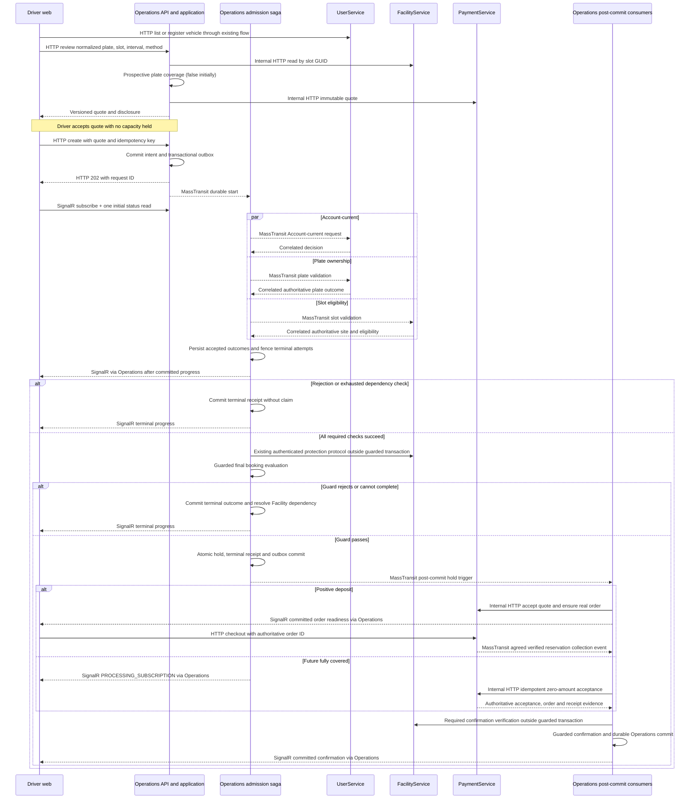

# Reservation architecture — review, admission and confirmation

**Status:** Approved target for SPARK-273. Subscription coverage and covered confirmation are future. See the [18 November decision amendment](../../05-project-management/decision-log/2026-11-18-SPARK-273-reservation-contract-amendment.md) for precedence and the [owner handoffs](../../05-project-management/handoffs/2026-11-18-SPARK-273-reservation-owner-handoffs.md) for source evidence and rollout gates. The [historical proposal](reservation-first-slice-implementation-proposal.md) retains the Facility protocol, Account-current replay, trust boundary and checkpoint decisions.

## Ownership

| Owner | Authority and boundary |
| --- | --- |
| Operations | Authenticated request receipt, EF-backed MassTransit Saga StateMachine, plate/site/interval booking constraints, prospective and final entitlement checks, reservation and capacity claim, durable status projection, SignalR and guarded confirmation. |
| UserService | Account-current and role decision; active vehicle registration and unambiguous plate ownership by initiating Account. Reuse existing registration flow. |
| FacilityService | Slot GUID resolution to authoritative site/tenant and eligibility, configuration/version facts, and structure/physical writer coordination with Operations. |
| PaymentService | Versioned commercial quote, tariff/coverage amounts, currency and acceptance; real order, payOS and verified collection through the agreed reservation event; future genuine zero-value order and durable receipt/invoice evidence. |
| Frontend | Vehicle selection/registration, review and consent, authenticated progress and recovery, checkout for the real order. Operations commits entitlement. |

## Request to confirmation

If final evaluation rejects, Operations commits the terminal rejection without creating a hold, fences any uncommitted effects and completes or aborts Facility coordination as applicable. The diagram omits reconciliation and connection recovery, which are specified below and in the [API](../../03-design/api/reservation-first-slice-api-design.md).

The initial receipt and start intent are durable before HTTP 202. The saga accepts only the current request/branch/attempt and matching immutable input. It persists one outcome per required branch, fails logically on the first definitive rejection and fences terminal attempts against late, duplicate, contradictory or out-of-order messages. Transport faults and timeout exhaustion are dependency outcomes. The reservation exception in the [authorization ADR](authorization-freshness-and-current-access.md) sends one logical request per branch. D defaults to 15 seconds from admission and covers the guarded booking decision. Persistent Operations Quartz jobs enforce D and positive H. A timely structure hold rejects with STRUCTURE_BUSY. The owner-issued plate result establishes the admission-time observation. A transfer recorded before the check must reject, and transfer/removal after booking alone leaves the booking valid. Preserve the [accepted 9 November read-to-commit race](../../05-project-management/decision-log/2026-11-09-reservation-confirmation-and-arrival.md#approved-identity-and-workflow-checks) for changes after the durable plate decision. Verify this boundary with UserService; the read establishes no lease or atomicity across service stores.

Before the final short Operations transaction, obtain the applicable Facility protection with existing coordination. Under Operations guards, resolve current local policy, restrictions, same-plate/site overlap, physical-session compatibility, applicable capacity and quote binding/validity. Use the canonical plate and slot/site/tenant from correlated authoritative answers. Recheck current local plate entitlement with the same site and interval. Changed coverage/version, changed binding or expired quote requires renewed review. Store the authoritative temporary claim, accepted policy/deadline context, Account, canonical plate, site/tenant, slot, interval and required commercial references. External HTTP stays outside this transaction. Preserve the Facility token outcome/complete/abort recovery.

The owning transaction must atomically capture the terminal receipt, reservation, claim and hold trigger using the MassTransit transactional outbox. EF saga finalization and terminal fencing must survive replay without recreating the hold, even if finalized saga storage is cleaned up. The saga ends at the committed hold. Durable post-commit delivery is needed because the process can die after local commit and before dispatch or the Payment HTTP call. HTTP provides the authoritative acceptance response, while the outbox provides durable scheduling independently of the browser and any in-memory task.

Confirmation is a separate guarded Operations transition. Bind verified Payment collection or future covered acceptance to the exact booking, commercial terms and current claim. Preserve the Facility confirmation gate and current capacity/physical constraints. For verified paid collections, preserve the existing compatible reacquisition exception before T where permitted, or reconcile the money. A future covered reservation uses the same hold deadline H = min(hold creation + effective reservation hold duration, T). Confirm only with verified acceptance and a valid protected claim at the guarded checkpoint strictly before H. If expiry wins or protection cannot be established, close/release the hold under existing rules and require a fresh submission and review. Same-operation replay may recover commercial evidence for reconciliation; it cannot reopen the booking. Evaluate once using Operations database time under the guards. Paid eligibility remains strictly before T. Persist confirmation, evaluation and effect identity and the outbox fact atomically. The result becomes visible after durable commit. Preserve the [10 November checkpoint](../../05-project-management/decision-log/2026-11-10-reservation-evaluation-checkpoint.md) and [11 November competing-writer proof gate](../../05-project-management/decision-log/2026-11-11-reservation-event-driven-confirmation.md).

See the [Payment confirmation contract](../../05-project-management/handoffs/2026-11-19-SPARK-273-payment-authority.md#owner-agreement-and-wire-contracts) for the separate paid/covered evidence requirements and the open generic event exception.

## State transitions

Conceptual states below describe the target. The reservation status for covered acceptance is future. Keep paid and covered expiry guards distinct.

| Layer | Trigger | Durable outcome / observable meaning |
| --- | --- | --- |
| Review | Valid selection, resolved slot and Payment quote | Preview/review available with validity, amounts and version. No reservation or hold. |
| Review | Quote expiry, input/coverage change, unavailable owner | Renew review, or show dependency unavailable. No claim. |
| Admission | Durable create | Pending with three branch states. Only committed owner checks can be shown successful. |
| Admission | Definitive failed check | Terminal rejected. Remaining in-flight reads cannot reopen request. |
| Admission | Timeout or unavailable dependency after policy budget | Terminal dependency outcome. No business rejection inferred. |
| Admission | All checks passed | Final booking evaluation pending. Guarded decision records rejection, dependency outcome or committed hold. |
| Reservation | Ordinary hold committed | `PENDING_PAYMENT`. Order preparation pending. |
| Payment readiness | Authoritative order created/replayed and recorded | Ready with order ID. Reservation remains `PENDING_PAYMENT`. |
| Payment readiness | Definitive unpayable order or expired checkout | Closed/unavailable with a reason. Release or reconcile under the applicable hold and financial rules. |
| Payment readiness | Ambiguous order or payment effect | Unknown/pending reconciliation. Reuse stable effect identity. Never start a new effect on an unknown result. |
| Reservation | Future fully covered hold committed | `PENDING_COMMERCIAL_ACCEPTANCE`; UI shows `PROCESSING_SUBSCRIPTION`. |
| Commercial readiness | Future acceptance evidence received and validated | Confirmation may proceed under guards. An ambiguous response stays unknown; an explicit invalid quote/entitlement is a known rejection. |
| Reservation | Eligible guarded paid or covered confirmation succeeds | `CONFIRMED` after commit. |
| Reservation | Hold expires, invalidation or cancellation prevents confirmation | Release/expire as applicable. The pre-T compatible reacquisition exception is for verified paid collections. Future covered expiry requires fresh review and a new request. Late evidence reconciles without reviving a terminal claim. |

Allocation, expiry, cancellation, arrival, actual parking, departure, final settlement, refunds and disputes use their existing owners and policies. Customer access stays Account-scoped. Gate association uses canonical plate and trusted evidence. Plate knowledge alone confers no reservation access.
