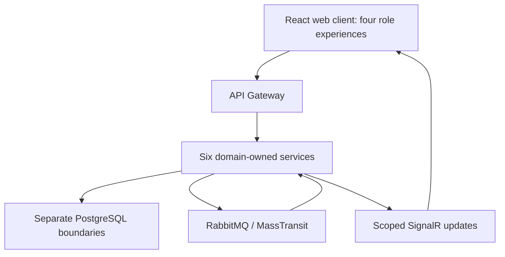

# SmartPark — Solution Architecture v1.1 review candidate

**Main architecture overview · 21 October 2026 · v1.1 documentation review candidate based on approved decisions**
Stable `v1.0` filename retained as a compatibility entry; this is the current v1.1 overview. Original source: `docs` branch at [923e9c7](https://github.com/Quangthm/Mock-Project-Smart-Parking/commit/923e9c783c77f1feb75440cbc79d8422c0b03c16). This describes the approved target and known implementation work, not a claim that the repository already implements every boundary. Requirements release remains a review candidate and product acceptance remains NOT RUN.

## 1. Purpose and governing decisions

Use this document for **how the solution is organized and why each responsibility belongs where it does**. Read the [consolidated SRS](../../01-requirements/srs/smartpark-srs-v1.0.md) for product behavior; follow the linked contracts for exact schemas, security flows and race handling. This overview consolidates existing decisions and does not grant new privileges or change prices, capacity rules or acceptance gates.

The current direction is six domain-owned services with Clean Architecture, PostgreSQL persistence, synchronous APIs for immediate decisions, and RabbitMQ/MassTransit for durable asynchronous outcomes. Search belongs inside Operations; Assistant belongs inside IoT & Recognition; General Support belongs inside Notification & Audit. Their presence does not require new deployable services.

This current overview supersedes the *overview direction* of the retained v0.9 architecture where it conflicts: Kafka is deferred, the old independent Reservation/Search split is not the selected target, tariffs belong to Payment, accepted occupancy belongs to Operations, and RC2/RC3 security/payment amendments apply. Older API/schema/design documents remain useful implementation references only where consistent with the current contracts.

## 2. Architecture drivers

| Driver | Resulting design direction |
|---|---|
| Correct competing reservations and occupancy | Operations evaluates accepted occupancy and claims within one authoritative boundary. |
| Reliable money without duplicate effects | Payment owns attempts, verification, ledger/refund state and reconciliation; money and capacity fulfillment remain separate. |
| Scoped access for four roles | User & Access owns identity/current grants; each service enforces its own resource authorization. |
| Recoverable cross-service work | Local transactions plus durable outbox/inbox and one workflow coordinator; no shared database transaction assumption. |
| Feasible student-project delivery | Docker local profile, one instance per required service; clear fixtures and measured local targets. |
| Replaceable providers | SDK/HTTP integrations stay behind Infrastructure adapters; domain records retain stable references. |

Details: [ownership and durable contracts](../service-boundaries/ownership-and-events.md) · [mandatory state/race invariants](../../01-requirements/srs/state-transitions.md).

## 3. Logical structure

The diagram shows the synchronous entry path, persistence ownership, durable event exchange and live client updates; individual services are listed below. Each service owns its persistence. React/three.js consumes authorized projections; the gateway, broker, 3D scene and Assistant are not alternative business authorities. SignalR updates clients; it does not replace durable inter-service messaging.

## 4. Service ownership and module boundaries

| Service | Owns | Key boundary |
|---|---|---|
| User & Access | Accounts, credentials, sessions, roles/current grants, organization membership, Partner applications/review/document versions, Operator scopes, profiles and registered-vehicle binding history. | Facility validates referenced site existence; resource services still authorize current access. |
| Facility & Visualization | Sites/floors/zones/slots, paths, categories, configured capacity, layout, maintenance/closure configuration and fixed 3D asset references. | Defines resources; does not own accepted occupancy or reservation availability. |
| Parking Operations | Reservations, claims, allocations, accepted occupancy/uncertainty, admission, visits, checkout/departure, tickets/QR/cards, incidents/appeals, monthly/yearly Driver rights/plan definitions and Search. | Owns compatible fulfillment and business availability. |
| Payment & Pricing | Tariffs, financial snapshots, orders/attempts, online adapters/cash records, verification/reconciliation, refunds, invoices and monthly/yearly paid financial periods. | Payment success is not proof that Operations committed a right. |
| IoT & Recognition | Devices/readers, raw observations, recognition/evidence; separate Assistant module and conversations/tool history. | Supplies observations/help; never grants entry, payment clearance or domain rights. Real hardware is deferred. |
| Notification & Audit | Delivery attempts, audit projections and a separate General Support module, including ACCOUNT_RECOVERY cases. | Source services retain authoritative facts. Support case approval is not a credential reset. |

Each domain owns its reports; cross-domain screens compose authorized APIs/projections. No shared Policy or Media database is introduced. Monthly/yearly coverage is split deliberately: Operations owns entitlement and admission; Payment owns price, collected money and refunds.

See [full ownership/event matrix](../service-boundaries/ownership-and-events.md) and [action-by-role permissions](../../01-requirements/srs/permissions.md).

## 5. Technology and local deployment direction

| Component | Current direction | Scope qualifier |
|---|---|---|
| Backend | ASP.NET Core / .NET 10; per-service Clean Architecture | `net10.0` is present in the inspected UserService project. No claim of a full code audit. |
| Frontend | React, Tailwind CSS, Material UI; three.js for digital twin | UI reads backend facts; MapTiler provides geographic discovery, separate from internal 2D/3D booking visualization. |
| Entry/API | API Gateway and authenticated HTTP/OpenAPI contracts | Routing/edge checks do not replace owning-service authorization. |
| Persistence | PostgreSQL; service-owned databases/credentials | One server may host the separate local databases. |
| Durable events | RabbitMQ + MassTransit | Kafka is deferred. |
| Live views | Scoped SignalR | Reconnect reloads authoritative state; Redis scale-out is optional. |
| Media | Cloudinary first evaluation adapter; service-owned asset metadata | Capabilities must be tested; R2 migration/dual writes are future. |
| Payments | payOS QR first; native VNPay/MoMo/ZaloPay separately labelled | Low-value production tests plus fixtures; refund capability unverified. |
| Packaging/deployment | Docker local profile, one instance per required service | No required Kubernetes/HA cluster or unapproved production capacity/cost claim. |
| Device integration | MQTT direction for later real IoT | Current hardware acceptance is deterministic fixtures/Operator workflows. |

Cloud provider/region, production scaling and exact library/provider settings remain implementation/deployment decisions within approved scope. See [quality/deployment profile](../../01-requirements/srs/modules/11-quality-deployment.md).

## 6. Clean Architecture inside a service

| Layer | Responsibility | Keep outside it |
|---|---|---|
| API | Transport contracts, authentication entry, request/error mapping and composition. | Business rules embedded in controllers. |
| Application | Use-case orchestration, validation/authorization, transaction/workflow coordination through ports. | Direct coupling to another service's DbContext or provider-specific business semantics. |
| Domain | Entities, value concepts, state guards and invariants. | HTTP, provider SDKs, EF DbContext and UI dependencies. |
| Persistence | Owning-service repositories, mappings, migrations, local transactions and durable records. | Cross-service joins/foreign keys or ownership bypass. |
| Infrastructure | Provider, broker, email/SMS, storage and other external adapters implementing ports. | Replacing domain authority with SDK return values. |

Dependencies point toward domain/application contracts. Persistence and Infrastructure implement those contracts; the API composition root wires implementations. A common library may share technical contracts/utilities, not shared mutable domain tables or a universal policy engine. Exact handler/repository patterns are implementation choices consistent with these boundaries.

See [layering and integration obligations](../service-boundaries/ownership-and-events.md) and [concrete payOS layer placement](../payment-integration/payos.md).

## 7. Data, contracts and consistency

**Persistence ownership.** Each service uses its own credentials and logical database. Cross-service identifiers are references validated through APIs, workflows/events or justified projections. There are no cross-service SQL joins, foreign keys, repository calls or DbContext access. A single local PostgreSQL host does not imply a shared domain schema.

**Immediate decisions.** Use authenticated HTTP/OpenAPI when the caller needs an immediate result. Avoid same-workflow synchronous dependency cycles; choose one coordinator. Accepted policy/tariff/coverage versions and timestamps are preserved with the relevant transaction rather than reinterpreted from today's configuration.

**Durable outcomes.** Commit critical originating facts and outbox intent locally; publish to RabbitMQ; consumers apply inbox deduplication/version guards. Design for redelivery and recoverable once-only business effects, without promising exactly-once transport. Notifications and central audit projections may lag; their delivery failure does not undo the originating fact.

**Contract contents.** Carry stable operation/event IDs, schema and aggregate versions, accepted/occurred times, scope and correlation/causation references with minimal payload. Keep secrets, tokens and unnecessary personal/evidence content out of events. Exact event names and wire schemas remain design work.

Details: [command/event contract matrix](../service-boundaries/ownership-and-events.md) · [schema alignment backlog](../database/alignment-backlog.md) · [API workspace](../api/README.md). Historical schema findings must be rechecked before migration; an old export is not proof of the deployed state.

## 8. Critical cross-service workflows

| Workflow | Coordinator and handoff | Recovery invariant |
|---|---|---|
| Reserve and pay | Operations guards compatible claim; Payment creates/verifies money; Operations confirms/fulfills. | Late ordinary money reacquires compatible capacity if available, otherwise refund/reconciliation; no displacement. |
| Monthly/yearly purchase/renewal | Operations validates coverage; Payment settles full amount; Operations commits entitlement. | Full verification plus entitlement commit strictly before hold expiry; late money cannot be backdated into activation. |
| Checkout and departure | Operations records accepted cutoff; Payment calculates/settles; Operations records actual departure. | Money coverage, gate action and physical release remain distinct; UNKNOWN blocks blind unpaid recovery. |
| Partner approval/provisioning | User & Access commits combined review, coordinates organization/membership and Facility first-site provisioning through durable service contracts. | Pending/failed/unknown provisioning blocks normal Owner login; reconcile/retry the same operation without duplicate tenants/sites. Approval email is not readiness/opening. |
| Additional-lot application | User & Access owns proposal/review; Facility owns authorized configuration. | Immutable rejection leaves Owner/other lots unaffected; Draft as new creates a distinct proposal; identical content allowed, retries deduplicated. |
| Planned capacity reduction | Facility proposes structural change; Operations commits restriction/recovery before planned reduction completes. | Emergency physical closure is recorded promptly and safe admission restrictions preserve occupants and rights. Explicit descendant/dependency handling and same-lot all-or-nothing batches return per-item validation errors. |
| Refund | Authorized case or automatic surplus obligation feeds Payment. | Reserve eligible balance including pending/UNKNOWN refunds; completion needs payout evidence. |
| Account recovery | Support owns case history; authorized Admin review leads to User & Access credential workflow. | Current security/session version invalidates prior access; no self-approved Admin recovery or support-database credential writes. |

A lost response is not evidence of failure. Lookup/reconcile the same logical operation before retrying an uncertain external effect. Three extra payment attempts after the initial attempt apply only to definitive retryable failure; broker redelivery does not consume a new business attempt.

Full detail: [states, money/capacity races and unknown outcomes](../../01-requirements/srs/state-transitions.md) · [payOS adapter](../payment-integration/payos.md) · [authentication/recovery contract](../../01-requirements/srs/authentication-recovery.md).

Partner Registration uses the existing Owner role. Persist the pending identity/account and combined first-lot application immediately. Save setup and mandatory consented simulated VNeID before email OTP; verified email precedes combined review. The [21 October V11-06 clarification](../../05-project-management/decision-log/2026-10-21-vneid-simulation-guid.md) requires the fake VNeID API to return a GUID substitute that User & Access persists linked to the user; field/schema and retry consistency remain pending, and the identifier is neither government verification nor an auth token. The sole seeded Admin is exempt from simulation; Operators complete it during verified email activation with optional password. Driver verification never automatically logs in. Admin may replace only uploaded initial pending agreement/policy documents with versioned evidence and concurrent-review protection. Final approval/rejection is immutable; initial rejected email cannot register again. See [coordination contract](../service-boundaries/ownership-and-events.md#partner-review-and-provisioning-coordination).

Activation/authorization and operational opening remain separate. Owner email must be verified for approval; supplied phone must be separately verified before phone OTP login. Restricted onboarding credentials never grant a normal Owner session. Normal successful login returns necessary tokens, with separate profile retrieval, safe failures and MFA challenge preserved.

Monthly/yearly products are Driver parking coverage enabled explicitly by Owner per lot, independent of price. A yearly period is 12 calendar months, at most one period in advance; unchanged monthly limits and applicable when-space-available coverage remain. Operations defines coverage; Payment defines financial/refund terms with a separate yearly policy set (values pending). No capacity guarantee or new renewal default is implied.

MapTiler discovery uses backend facts from Operations/Facility/Payment, a consented current or manual origin, 5 km default/expansion, Haversine ordering and independent vehicle/lot-type filters. Default-now search displays current availability and unit-labelled tariff without inventing duration/total; selected intervals use interval availability and estimated total. Details hand context to internal 2D/3D booking and backend capacity confirmation. External directions only; omit unsourced travel estimates. Source/freshness and stale/unavailable states remain visible.

## 9. Security, media and live projections

User & Access owns passwords, primary OTP, optional TOTP, backup codes, sessions and current grants. Enabled TOTP gates normal login after primary proof. Each consuming service checks current resource authority, including private cached results and SignalR subscriptions. Gateway checks alone are insufficient. Turnstile is an abuse-control component, not authentication or authorization.

ACCOUNT_RECOVERY is a reviewed, restricted workflow. Admin authorizes a user-chosen password reset; a TOTP reset requires replacement enrollment rather than silently restoring unrestricted access. MVP has one protected seeded Admin, no Admin registration and no role-management feature. Application-level lock/disable/delete/role changes targeting that account are prohibited; ordinary own profile/security actions and authentication lockouts remain. Admin recovery follows the controlled maintainer runbook. Neither workflow grants business privileges.

Asset bytes sit behind a provider adapter; the business owner stores stable asset IDs, sensitivity, lifecycle and retention/hold metadata. Other services use opaque references and authorized content routes. Upload and database commit are reconciled; evidence is not called preserved until the owner acknowledges a hold. Fixed 3D templates remain deployment assets.

SignalR supplies authorized updates and stale/disconnected indicators. On reconnect the client reloads current facts. It never becomes an admission/capacity ledger, and recognition observations do not automatically free an occupied space.

Details: [security flows](../../01-requirements/srs/authentication-recovery.md) · [last-Admin runbook](../service-boundaries/admin-recovery-runbook.md) · [media lifecycle](../service-boundaries/media-contract.md) · [live views and reporting](../../01-requirements/srs/modules/08-notifications-reporting.md).

## 10. AI and external-provider boundaries

Assistant calls authorized domain APIs for approved-content help, search, scoped reads and reservation form preparation. The user confirms final terms through the normal UI; financial/security operations use their ordinary screens. Model text is not authoritative availability, price, permission or success. Recognition supplies evidence/uncertain outcomes; Operations accepts visit identification through reviewed rules.

Gemini/OpenAI and device-free recognition are retained directions, with exact models/tools, data-sharing, datasets/confidence and evaluation POST-v1.0. This does not remove current manual fallback or permit autonomous writes. payOS, media, maps and notification adapters similarly cannot redefine domain outcomes when a provider lacks a capability.

Details: [AI/LPR scope](../../01-requirements/srs/modules/10-ai-assistance.md) · [deferred versus implementation-pending work](../../05-project-management/decision-log/deferred-and-implementation-register.md).

## 11. Quality, evidence and delivery priorities

Target the approved local workload: core API p95 ≤500 ms, healthy SignalR freshness p95 ≤2 seconds, unexpected errors <1%, restart ≤5 minutes, daily backup/RPO ≤24 hours and restore ≤30 minutes. Report provider latency and expected conflicts separately. No incompatible capacity commitment, duplicate money effect or unauthorized access is excused by average performance.

For payment acceptance, use controlled low-value payOS production evidence plus isolated deterministic failure/race fixtures and tested Operator cash. No separate VNPay sandbox adapter is required. Do not interpret fixture success as actual collection or refund delivery. Real refund execution and advertised payer-app compatibility need their own evidence.

Suggested execution sequence, not new sprint commitments: align ownership/contracts and schema; implement current authorization and durable operations; complete capacity/money workflows; integrate projections/providers; then execute boundary, recovery and acceptance tests. Accountable people, dates, technical configuration and concrete capability blockers remain team work. No new coverage percentage, CI gate or production SLA is invented here.

Use [canonical acceptance scenarios](../../04-testing/requirements-traceability/acceptance-scenarios.md), [payOS execution plan](../../04-testing/payment-integration/payos-test-plan.md) and [full measurement recipe](../../01-requirements/srs/modules/11-quality-deployment.md). The maintained acceptance catalogue records scenario count/status; all new v1.1 scenarios are NOT RUN. Existing task-specific historical test reports do not automatically close current scenarios.

Development reset is a future implementation task only after documentation update and approval (V11-08), replacing migration/grandfathering of invalid development applications. Schema/seed compatibility must be fixed first. Target environments, accountable teammate, reviewed reset/seed scripts and execution date are TBD in [DB31](../database/alignment-backlog.md#v11-schema-and-seed-alignment-pending); no reset/setup or runtime acceptance was executed by this documentation update.

## 12. Detailed reading map and change discipline

| Need | Start here |
|---|---|
| Product scope and business rules | [Consolidated SRS](../../01-requirements/srs/smartpark-srs-v1.0.md) |
| Ownership, communication and layering | [Service contracts](../service-boundaries/ownership-and-events.md) |
| Capacity/payment timing and retries | [State/race contract](../../01-requirements/srs/state-transitions.md) |
| Database migration gaps | [Alignment backlog](../database/alignment-backlog.md) |
| Provider implementation | [payOS](../payment-integration/payos.md) and [media](../service-boundaries/media-contract.md) |
| Design assets and UI guidance | [Design index](../../03-design/README.md) |
| Deferred scope and release actions | [Register](../../05-project-management/decision-log/deferred-and-implementation-register.md) and [PM actions](../../05-project-management/decision-log/pm-release-actions.md) |

When behavior changes, update its owning requirement/rule, affected contract, traceability, decision and acceptance records together; refresh these summaries if the overarching direction changes. Never promote an older proposal, SQL default, demo value or implementation shortcut into policy by copying it into this overview.
