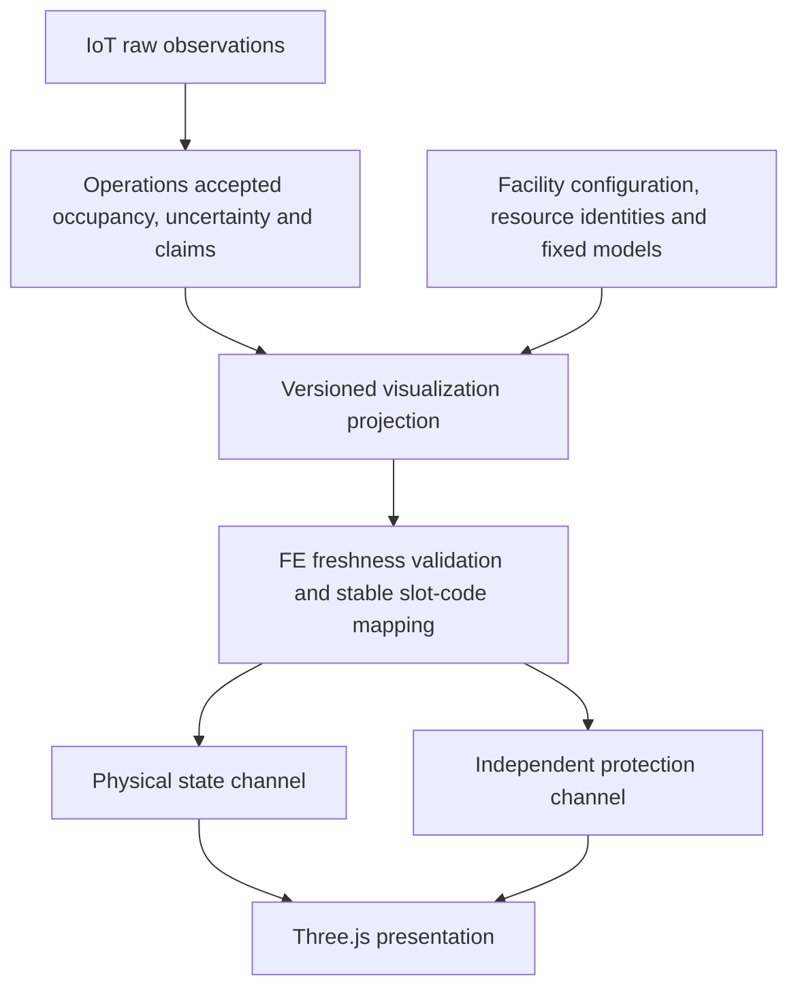
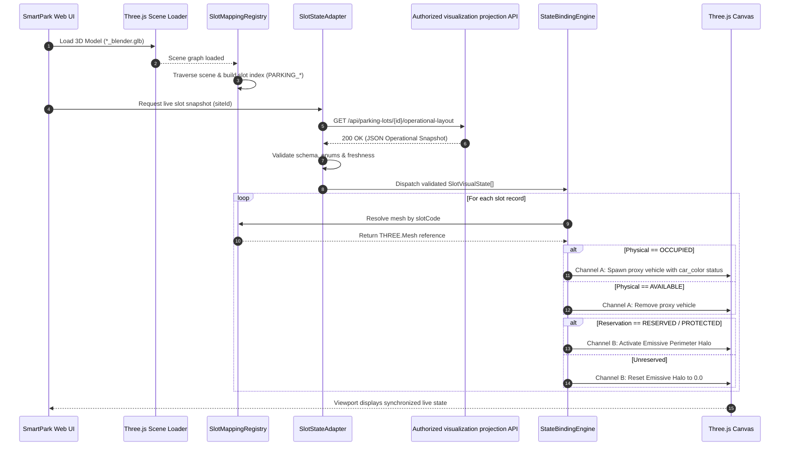
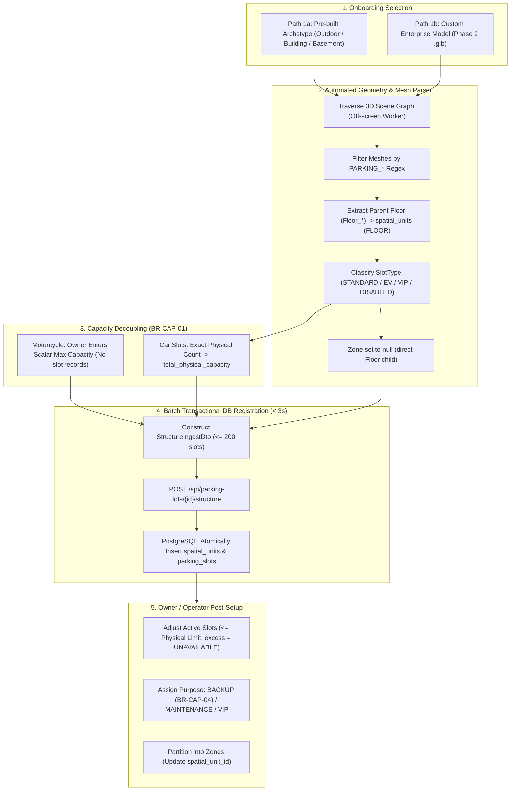

# 3D Digital Twin — Backend Slot State Binding Document

## Document Control

| Field        | Value                                                              |
| ------------ | ------------------------------------------------------------------ |
| Document ID  | `SPARK-3D-BE-BINDING`                                              |
| Version      | `v1.1.0`                                                           |
| Status       | Approved Baseline — Aligned to SRS v1.0 & Ingestion Pipeline       |
| Project      | SmartPark (Smart Parking Management System)                        |
| Owner        | 3D Digital Twin & Frontend Engineering Group                       |
| Reviewer     | PM / Technical Lead / Database Constructor                         |
| Created Date | 2026-10-09                                                         |
| Last Updated | 2026-10-25                                                         |
| Related Task | SPARK-184, SPARK-185, SPARK-186, SPARK-187–SPARK-189               |

---

## 1. Purpose & Scope

### 1.1. Purpose

This document defines the target integration boundaries for binding Operations-authoritative occupancy/claims to Facility-owned identities/models in the SmartPark web client (`FE/`). Transitional `FacilityService` (renamed from `ParkingService`)/`OperationService` endpoints and prototype DTOs are transitional implementation references, not approval of old service ownership or a finalized v1.1 wire contract. See [ownership](../../02-architecture/service-boundaries/ownership-and-events.md) and [discovery requirements](../../01-requirements/srs/modules/03-discovery-visualization.md).

The target binding must ensure the following; historical prototype evidence is separately labelled in §§11–13:

* **Strict Backend State Fidelity**: Backend-provided slot state is reflected deterministically in the correct 3D representation without data distortion.
* **Orthogonal 2-Axis Separation**: Physical availability (`physical_state`) and reservation/protection status (`reservation_state`) remain two completely independent, co-existing data dimensions in accordance with the current facility/discovery state contract and **FR-MAP-02**. `OCCUPIED` does not encode the reservation claimant: the current occupant and reservation/protection claimant may be the same Driver or different Drivers, and that relationship must come from authorized Operations session/allocation/reservation linkage.
* **Graceful Degradation**: Unknown, missing, or stale telemetry data is handled safely without guessing or masking failures (FR-MAP-04).
* **Non-Authoritative Visual Boundary**: The 3D client acts strictly as a presentation layer consuming authoritative backend state; 3D clicks or scene alterations never directly mutate transactional database state (FR-MAP-02).
* **Asset Compatibility**: Preserves 100% compatibility with production 3D deployment assets (`outdoor_parking_lot_blender.glb`, `indoor_parking_lot_blender.glb`, `underground_parking_lot_blender.glb`, `car_model_blender.glb`, and `motorcycle_model_blender.glb`).

### 1.2. In Scope

* **Authoritative API & Deterministic Fixture Consumption**: Ingesting live HTTP REST endpoints (`/api/parking-lots/{id}/operational-layout`, `/api/parking-lots/{id}/structure`) and deterministic test fixtures (`slots-operational-fixture.json`).
* **Facility Onboarding & Automated Slot Ingestion**: Automated discovery of automobile slots and floors from 3D models (pre-built archetypes or custom GLB), decoupling of motorcycle aggregate capacity (BR-CAP-01), and high-performance batch DB registration (< 3s for <= 200 slots).
* **Stable Identifier Mapping**: Establishing an immutable mapping between backend primary keys (`parking_slots.id` UUID / `slot_code` string) and Three.js scene meshes (`PARKING_[ID]`, `B1_Car_[ID]`, etc.).
* **Channel A (Physical State Visualization)**: Spawning low-poly 3D vehicle proxies (`car_model_blender.glb`) with the **`car_color status`** paradigm via GPU-instanced rendering (`THREE.InstancedMesh`).
* **Channel B (Reservation/Protection Overlay)**: Rendering non-destructive **Emissive Perimeter Halos** (pulsing glowing outlines) without tinting, obscuring, or erasing underlying enterprise floor textures and stall markings.
* **Lifecycle & Freshness Control**: Initial loading progress, polling-based cache invalidation, SignalR live event subscriptions, stale telemetry detection ($> 30\text{s}$ timeout), and WebGL error boundary handling.
* **Verification Suite**: Unit tests (Jest/Vitest), manual verification procedures, and performance telemetry profiling.

### 1.3. Out of Scope

* Creating, updating, or cancelling parking reservations through direct 3D canvas interaction.
* Creating occupancy records, modifying ticket sessions, or dispatching physical gate-trigger signals directly from the 3D viewport.
* Financial transactions, payment hold extensions, or wallet deduction operations.
* Low-level IoT device hardware protocols (MQTT/CoAP) at the browser layer (all hardware signals are aggregated server-side by `IoTService`).
* Phase 2 self-service CAD model ingestion and upload validation linters (governed separately by `3D_ENTERPRISE_MODEL_INGESTION_RULES.md`).
* Backend database schema migrations outside the approved task scope.

### 1.4. References

* **Historical source: SmartPark SRS v0.9** (section numbering and numeric examples below are retained provenance; the current linked requirements govern):
  * Section 3.2.2 (*Spot State Management: Physical State vs. Reservation/Protection State*).
  * Section 3.2.3 (*Parking Lot Diagrams and 3D Digital Twin Non-Authoritative Boundary*).
  * Section 3.4.2 (*Reservation Lifecycle Statuses*).
  * Section 3.4.3 (*Payment Hold Duration: 5-minute admin default*).
  * Section 3.4.4 (*Reservation Protection Window: 4-hour default*).
  * Section 3.4.5 (*Continuous Capacity Tracking*).
  * Rule BR-CAP-01 (*Motorcycle Aggregate Capacity Model*).
* **SmartPark Solution Architecture v1.1**:
  * Section 4 (*Facility & Visualization Domain vs Parking Operations Domain*).
  * Section 5 (*Live Views via Scoped SignalR Hub & Reconnect Recovery Protocol*).
* **Design & Architecture Documents**:
  * `docs/03-design/3d-digital-twin/3D_MODEL_IMPLEMENTATION_GUIDE.md`
  * `docs/03-design/3d-digital-twin/3D_ENTERPRISE_MODEL_INGESTION_RULES.md`
  * `docs/03-design/3d-digital-twin/3D_ASSET_DOCUMENTATION_Outdoor_Parking.md`
  * `docs/03-design/3d-digital-twin/3D_ASSET_DOCUMENTATION_Parking_House.md`
  * `docs/03-design/3d-digital-twin/3D_ASSET_DOCUMENTATION_Underground_Parking.md`
* **Historical Microservice Database Script names** (use the [current schema index](../../02-architecture/database/README.md) for the recorded deployment profile):
  * `scripts/database/microservices/02-parking-service-db.sql` (`parking_slots`, `spatial_units`, `parking_sites`).
  * `scripts/database/microservices/03-reservation-session-service-db.sql` (`reservations`, `parking_sessions`, `slot_allocations`).
  * `scripts/database/microservices/06-iot-service-db.sql` (`sensor_telemetries`, `devices`).
* **Source Code Implementations**:
  * Backend API: `src/Services/FacilityService/SmartParking.FacilityService.API/Program.cs` and `OperatorOperationsEndpoints.cs`.
  * Frontend 3D Subsystem: `FE/src/components/3d/Parking3DViewer.tsx`, `FE/src/lib/3d/slotMatcher.ts`, `FE/src/lib/3d/parking3DConfig.ts`.

---

## 2. Architecture & Responsibility Boundaries

### 2.1. High-Level Data Flow



The transitional operational-layout endpoint can expose this projection; its service name does not change authority. Fixture/demo data is explicitly labelled and cannot grant booking or operational rights.

### 2.2. Component Responsibilities & 6-Service Microservice Alignment

The approved target has six domain-owned services. The source folder names below are implementation evidence only; migration and current runtime compliance remain pending.

| Service / component | Contract status | Technical responsibility |
| :--- | :--- | :--- |
| **Facility & Visualization** | Target ownership | Facility hierarchy, slot identity/coordinates/configuration and fixed model association. May expose a rebuildable, versioned projection sourced from Operations; runtime `FacilityService` (formerly `ParkingService`) remains transitional. |
| **Parking Operations** | Target ownership | Accepted occupancy/uncertainty, reservations, claims, allocation, protection, availability, Search and monthly/yearly coverage. Legacy `OperationService` is implementation evidence. |
| **User & Access** | Target ownership | Identity, organization/membership/review and current scoped permissions. |
| **IoT & Recognition** | Target ownership | Raw device observations, recognition/evidence and integrations; no direct occupancy/admission authority. |
| **Payment & Pricing** | Target ownership | Authoritative tariffs, financial terms, verified money/refunds and interval price estimates. |
| **Notification & Audit** | Target ownership | Delivery attempts, audit projections and General Support; no business-state authority. |
| **Slot State Data Adapter** | TypeScript (`FE/`) | Fetches REST projection or fixture, validates network envelope, and normalizes into strongly-typed `SlotVisualState` objects. |
| **State & Freshness Validator** | TypeScript (`FE/`) | Verifies timestamp freshness ($< 30\text{s}$), ensures required fields exist, and halts processing for corrupted values without guessing. |
| **Slot Mapping Registry** | TypeScript (`FE/`) | Traverses 3D scene once upon load, indexes meshes by normalized `slotCode`, and maintains an $O(1)$ lookup table. |
| **Digital Twin Binding Service** | TypeScript (`FE/`) | Coordinates updates across visual channels (Channel A for physical vehicle proxy; Channel B for non-destructive emissive outline). |
| **Three.js Viewport Engine** | WebGL 2 / Three.js | Executes the 60 FPS requestAnimationFrame loop, maintains OrbitControls constraints, and manages GPU VRAM buffers. |
| **User Interaction Layer** | React Overlay HUD | Provides hover tooltips, click selection, camera focusing, and floor pagination without altering backend authoritative state. |

### 2.3. Source of Truth

* **Strict Invariant**: Operations owns accepted occupancy/uncertainty, reservations, claims and allocation; Payment owns fees/tariffs; Facility owns resources/configuration/model association. IoT owns raw observations. Neither legacy folder/DB placement nor visualization storage changes these boundaries.
Current FacilityService gate handlers still mutate `physical_state` directly (`OperatorGateSlotStore`); this is transitional implementation evidence, not completion of Operations ownership (DB27).

* **Client Presentation Role**: The Three.js canvas is purely an interactive read-only display.
* **Prohibited Behavior**: Selecting a bay, rotating the camera, hovering over an object, or executing a client-side animation must **never** create or mutate a database record.

### 2.4. Integration Execution Sequence



### 2.5. Facility Onboarding & Automated Slot Ingestion Pipeline

When an enterprise registers and provisions a parking facility, the system bridges the 3D model geometry directly into authoritative PostgreSQL inventory records via an automated ingestion pipeline.



#### 2.5.1. Dual Onboarding Pathways
1. **Path 1a — Pre-built Deployment Archetype (MVP Scope — SRS v1.0 FR-LOT-02)**:
   * The Owner selects from 3 system-provided archetypes: **Outdoor Surface Lot**, **Multi-floor Building (Parking House)**, or **Multi-floor Basement Garage**.
   * Model files are pre-validated, Draco-compressed deployment assets stored on CDN/static asset storage (`outdoor_parking_lot_blender.glb`, etc.).
2. **Path 1b — Custom Enterprise Model Upload (Phase 2 SaaS Scope — `3D_ENTERPRISE_MODEL_INGESTION_RULES.md`)**:
   * Enterprise B2B facility owners upload their own custom `.glb` architectural model.
   * The model passes automated client-side and server-side compliance validation (Golden Rules R1–R6: scale, naming, triangle budget, draw calls).

#### 2.5.2. Automated Parsing & Classification Sequence
Regardless of whether Path 1a or Path 1b is selected, the automated ingestion engine executes identical discovery logic:
1. **Mesh Discovery & Identification**:
   * The parser traverses the model scene graph and isolates all interactive stall nodes matching the canonical regex:
     `^(PARKING_[A-Za-z0-9_-]+|CarParkingSpace_\d+|B\d+_[A-Za-z0-9_-]+)$`
2. **Floor Hierarchy Mapping**:
   * For each discovered slot mesh, the parser traverses upwards through its parent tree to find the nearest `Floor_[Level]` node (e.g., `Floor_G`, `Floor_L1`, `Floor_B1`).
   * Generates a corresponding `spatial_units` record in PostgreSQL with `unit_type = 'FLOOR'`.
3. **Zone Mapping Policy**:
   * Upon initial automated ingestion, the `zone` attribute is initialized to `null` (the slot belongs directly to its parent `FLOOR`).
   * When an Owner subsequently configures spatial zones (e.g., Zone A, Zone B, VIP Zone) via the management portal, the system updates `spatial_unit_id` to point to the designated `ZONE` unit without altering the 3D model geometry.
4. **Automated Slot Type Classification**:
   * Dedicated EV bays (containing `_EV_` in mesh name) are assigned `slot_type = 'EV'`.
     > [!NOTE]
     > Per **SRS v1.0 §8 & FR-LOT-02**, EV charging management is outside MVP scope; EV bays are registered as static visual stalls.
   * Meshes containing `_VIP_` are assigned `slot_type = 'VIP'`.
   * Meshes containing `_DIS_` or `_DISABLED_` are assigned `slot_type = 'DISABLED'`.
   * All other car meshes default to `slot_type = 'STANDARD'`.

#### 2.5.3. Capacity Decoupling Invariant (Car vs. Motorcycle — BR-CAP-01 & FR-MAP-03)
* **Automobile Physical Capacity (`total_physical_capacity`)**:
  * Determined deterministically from the total count of parsed automobile stall meshes in the 3D model.
  * Stored in `parking_sites.total_physical_capacity` and enforced by `ParkingStructure.Recount()`.
* **Motorcycle Capacity Pool (No Individual Database Slots)**:
  * In strict adherence to **BR-CAP-01** (*Motorcycle Aggregate Capacity Model*) and **FR-MAP-03** (*Precision Integrity*):
    * The system **DOES NOT** create individual slot rows in `parking_slots` for motorcycles.
    * The 3D model does not require numbered motorcycle stall meshes.
    * The Owner specifies a scalar **Maximum Motorcycle Capacity** (`max_capacity` on the facility or motorcycle `spatial_unit`), which is tracked as an aggregate availability counter.

#### 2.5.4. High-Performance Batch Ingestion Contract (< 3.0s SLA)
* **Atomic Transaction**: The client bundles all parsed slot structures into a single batch payload dispatched to `POST /api/parking-lots/{id}/structure`.
* **Execution Latency SLA**:
  * **SRS v1.0 Core API SLA**: `p95 <= 500 ms`.
  * **Ingestion Batch Benchmark**: For a typical facility containing up to 200 parking slots, the backend PostgreSQL bulk insert and spatial unit indexing complete in **$< 100\text{ ms}$**, with total network round-trip + 3D mesh parse completing well within the **$< 3.0\text{ seconds}$** SLA target.

#### 2.5.5. Post-Ingestion Operational Configuration (Owner / Operator Setup)
Once initial registration completes, the Owner or assigned Operator can fine-tune facility operations via the administration dashboard:
1. **Capacity Adjustment Safeguards**:
   * Active automobile slots can be dialed down (e.g., closing a section of a floor), but **the active count can NEVER exceed the physical slots present in the 3D model** (`slots.Count`).
   * Slots deactivated by the owner transition to `physical_state = 'UNAVAILABLE'` or `MAINTENANCE`, rendering with darkened/hazard indicators rather than mutating or deleting the underlying 3D geometry.
   * Motorcycle capacity can be scaled up or down independently within facility fire-safety limits.
2. **Operational Purpose Assignment**:
   * **`BACKUP`**: Designated reserve capacity per **BR-CAP-04** configured via `ConfigureBackup(unitId, vehicleType, count)` to satisfy emergency re-allocations.
   * **`MAINTENANCE`**: Placed out of order for cleaning or restriping; excluded from automated driver booking allocations.
   * **`VIP / RESERVED`**: Restricted for authorized partner fleets or advance bookings.
3. **Commitment Protection Invariant (`SafeChange` — FR-LOT-04)**:
   * Any slot currently occupied (`IsPhysicallyOccupied == true`) or holding active reservations (`RESERVED` / `PROTECTED`) **cannot be deleted, moved, or deactivated** until active commitments expire or vehicles depart.

---

## 3. Backend Data Contract

### 3.1. Transitional endpoint and target authorization

* **Recorded transitional endpoint**: `GET /api/parking-lots/{id}/operational-layout`
* **Alternative Structure Endpoint**: `GET /api/parking-lots/{id}/structure`
* **Deterministic Fixture Path**: `FE/src/fixtures/slots-operational-snapshot.json`
* **HTTP Method**: `GET`
* **Authentication**: Recorded prototype uses Bearer JWT via `Authorization: Bearer <token>`; current resource permission/scope must also be checked. Exact discovery/public-view versus authenticated private fields remain API design work; credentials never imply unrestricted lot access.
* **Header Constraints**: `Cache-Control: no-cache`, `Accept: application/json`

### 3.2. Prototype Slot State Payload — wire alignment pending

The following retained prototype example illustrates two independent render dimensions. It is not a newly approved response envelope. FE/API leads must agree source/version/order/observed/projected freshness metadata and target category/state mapping before acceptance (DB32). Prototype `isFresh`/counts alone never prove bookability; model/fixture selection does not reserve capacity.

```json
{
  "success": true,
  "data": {
    "siteId": "f7d3a2b1-5e8c-4a3d-9f1e-2c8b7a6d5e4f",
    "siteCode": "SITE_CENTRAL_01",
    "timestamp": "2026-10-09T08:00:00.000Z",
    "isFresh": true,
    "totalCapacity": 48,
    "occupiedCount": 18,
    "reservedCount": 6,
    "slots": [
      {
        "slotId": "b8a1c2d3-4e5f-6a7b-8c9d-0e1f2a3b4c5d",
        "slotCode": "PARKING_G_CAR_001",
        "spatialUnitId": "3fa85f64-5717-4562-b3fc-2c963f66afa6",
        "floorLevel": "Floor_G",
        "supportedVehicleType": "CAR",
        "slotType": "STANDARD",
        "physicalState": "AVAILABLE",
        "reservationState": null,
        "sessionType": null,
        "isEvCharging": false,
        "features": {
          "covered": true,
          "hasCharger": false
        },
        "updatedAt": "2026-10-09T07:59:45.000Z"
      },
      {
        "slotId": "c9b2d3e4-5f6a-7b8c-9d0e-1f2a3b4c5d6e",
        "slotCode": "PARKING_G_EV_001",
        "spatialUnitId": "3fa85f64-5717-4562-b3fc-2c963f66afa6",
        "floorLevel": "Floor_G",
        "supportedVehicleType": "CAR",
        "slotType": "EV",
        "physicalState": "OCCUPIED",
        "reservationState": "RESERVED",
        "sessionType": "EV_CHARGING",
        "isEvCharging": true,
        "features": {
          "covered": true,
          "hasCharger": true,
          "chargerPowerKw": 22
        },
        "updatedAt": "2026-10-09T07:59:58.000Z"
      }
    ]
  }
}
```

**Identity-separation note:** the prototype `physicalState: "OCCUPIED"` plus `reservationState: "RESERVED"` example does not prove that the physically present vehicle belongs to the reservation claimant. The two fields are independent projections. The occupant may be the same Driver or a different Driver. Only an authorized Operations projection derived from accepted session/allocation/reservation linkage may establish that relationship.

`RESERVED` and `PROTECTED` remain mutually exclusive values of the existing `reservationState` projection. No split enum or database migration is required by this clarification.


### 3.3. Field Definitions

| JSON Field | Data Type | Mandatory | Description & Mapping Target |
| :--- | :--- | :---: | :--- |
| `siteId` | `string` (UUID) | Yes | Authoritative unique identifier of the parking facility. |
| `timestamp` | `string` (ISO 8601) | Yes | Server generation time for client freshness validation. |
| `slotId` | `string` (UUID) | Yes | Stable primary key in PostgreSQL table `parking_slots.id`. |
| `slotCode` | `string` | Yes | Business identifier matching 3D mesh `name` (e.g. `PARKING_G_CAR_001`). |
| `spatialUnitId` | `string` (UUID) | Yes | References `spatial_units.id` (indicates zone or floor). |
| `floorLevel` | `string` | Yes | Master group name (e.g. `Floor_G`, `Floor_L1`, `Floor_B1`). |
| `supportedVehicleType` | `string` (Enum) | Yes | `CAR` \| `MOTORCYCLE` \| `OVERSIZED`. |
| `slotType` | `string` (Enum) | Yes | `STANDARD` \| `EV` \| `DISABLED` \| `VIP`. |
| `physicalState` | `string` (Enum) | Yes | Operations-accepted physical condition/projection; `OCCUPIED` means a vehicle is present/treated as occupied, not that it is the reservation claimant. Raw sensor/manual inputs require authoritative reconciliation. |
| `reservationState` | `string` (Enum) / `null` | No | Operations-owned mutually exclusive reservation/protection projection (`RESERVED`, `PROTECTED`, `BACKUP`); independent from physical occupant identity. Transitional `OperationService` is not a new ownership decision. |
| `sessionType` | `string` (Enum) / `null` | No | Active session classification used by `car_color status`. |
| `isEvCharging` | `boolean` | Yes | Flag indicating whether vehicle is actively drawing power. |
| `updatedAt` | `string` (ISO 8601) | Yes | Last state modification time for staleness detection. |

### 3.4. Physical State Enumeration (Channel A)

In strict accordance with **SmartPark SRS v1.0 §5 (Capacity Safety)** and **FR-MAP-02**:

| Physical State Code | Operational Semantics | Channel A Visualization (3D Proxy) |
| :--- | :--- | :--- |
| **`AVAILABLE`** | Bay is physically empty; booking/admission still requires Operations authorization and compatible availability. | No vehicle proxy rendered. Slot pavement decals remain visible. |
| **`OCCUPIED`** | A vehicle is physically present/accepted as occupied. This state does not identify whether that vehicle belongs to the reservation claimant. | **Spawn 3D Proxy Vehicle** (`car_model_blender.glb`) with `car_color status`. |
| **`UNKNOWN`** | Sensor is disconnected or telemetry is ambiguous. | Render warning marker / semi-transparent hologram. **Never infer `AVAILABLE`**. |
| **`MAINTENANCE`** | Bay is closed for cleaning, repairs, or re-striping. | Spawn 3D hazard cone / barrier proxy. Inactive for selection. |
| **`UNAVAILABLE`** | Bay is unavailable according to accepted configuration/operational state; no permanent-decommission inference. | Darkened surface tint; excluded from navigation. |

### 3.5. Reservation / Protection Enumeration (Channel B)

Reservation and protection are Operations-owned business dimensions and are **completely decoupled from physical presence**:

| Reservation State Code | Business Semantics | Channel B Visualization (Perimeter Halo) |
| :--- | :--- | :--- |
| `null` / `UNRESERVED` | No displayed active protection; this alone does not establish walk-in availability. | Emissive outline off (`emissiveIntensity: 0.0`). |
| **`RESERVED`** | Accepted reservation projection; exact claim/payment state and whether the current physical occupant matches that claimant remain in Operations. | **Pulsing Amber Perimeter Halo** (`#F59E0B`, pulse $0.65$). |
| **`PROTECTED`** | Accepted reservation protection under the authoritative policy/claim contract. The slot may simultaneously be occupied by an unrelated current session. | **Steady Cyan Perimeter Halo** (`#06B6D4`, intensity $0.85$). |
| **`BACKUP`** | Configured backup/protection projection; not a new customer entitlement. | **Steady Purple Perimeter Halo** (`#8B5CF6`, intensity $0.70$). |

### 3.6. State Precedence & Separation Invariants

1. **Orthogonal Non-Interference**: Channel A (`physicalState`) and Channel B (`reservationState`) must never overwrite each other. A bay can simultaneously be `AVAILABLE + RESERVED`, `AVAILABLE + PROTECTED`, `OCCUPIED + RESERVED`, or `OCCUPIED + PROTECTED`.
2. **Occupant/Claimant Non-Inference**: `OCCUPIED + RESERVED/PROTECTED` does not establish whether the current occupant is the reservation claimant. The two may be the same or different. A reservation-linked actual entry is established only by authorized Operations session/allocation/reservation linkage. If an unrelated occupant remains when the future reservation needs the resource, the visualization must not show the reservation as fulfilled; backend recovery/reallocation governs.
3. **Privacy-Safe Relationship Display**: Ordinary viewers see independent physical and reservation/protection channels. If an authorized Operations projection explicitly establishes same/different relationship, the UI may communicate it without exposing another Driver's identity.
4. **Occupancy Projection**: `OCCUPANCY_VALIDITY_TIMESPAN` is configurable; its default is 4 hours. Rendering/availability uses the resolved effective value. A currently occupied slot can remain projected occupied across a future booking interval unless newer authoritative evidence changes it. Projection expiry never frees the physical slot.
5. **Decal Preservation**: Neither channel may alter or tint the base texture of the slot floor mesh. Enterprise pavement markings remain 100% visible.
6. **No Optimistic Availability**: If a backend record is missing or reports `UNKNOWN`, the system must **never default to `AVAILABLE`**.
7. **Invalid Value Rejection**: Unrecognized enum strings (e.g. `"FREE"`, `"TAKEN"`) must be logged as data errors and displayed as `UNKNOWN`.
8. **Precision Integrity (FR-MAP-03 & BR-CAP-01)**: Show vehicle location only to the precision actually recorded for its session. In aggregate capacity zones (such as motorcycle zones where spaces are pooled rather than individually numbered), the system must never invent or snap to a non-existent individual numbered slot.
9. **EV Charging Scope Boundary**: In accordance with SRS v1.0 Section 8 & FR-LOT-02, EV dynamic charging infrastructure is outside MVP scope; EV slot meshes (`PARKING_EV_*`) are rendered for visual reference and static layout only.

---

## 4. Slot Identity & 3D Object Mapping

### 4.1. Mapping Objective

The binding subsystem must resolve every authoritative backend record to its intended Three.js `THREE.Mesh` object in $O(1)$ constant time. Mapping must remain stable across camera movements, floor toggles, and component re-mounts.

### 4.2. Existing Model Naming Convention

All production Blender models follow strict standardized regex hierarchies:
* **Master Floor Group**: `^Floor_[A-Za-z0-9_-]+$` (e.g. `Floor_G`, `Floor_L1`, `Floor_B1`, `Floor_B2`).
* **Automobile Slot Mesh**: `^PARKING_[A-Za-z0-9_-]+$` (e.g. `PARKING_G_CAR_001`, `PARKING_EV_CAR_005`).
* **Subterranean Level Mesh**: `^[B\d]+_[A-Za-z0-9_-]+$` (e.g. `B1_Car_001`, `B1_EV_Car_003`).

### 4.3. Identifier Mapping Matrix

> **Authoritative Invariant (v1.2 Canonical Alignment)**: In accordance with `3d-digital-twin-api-design.md §3.3`, the authoritative match key is the **exact raw mesh name** (`slotCode === mesh.name`, preserving casing and prefixes). Earlier prototype drafts that stripped prefixes (e.g. `PARKING_G_CAR_001 -> G-CAR-001`) are superseded by direct 1:1 raw mesh identity matching.

| Hierarchy Level | Backend Entity Field | Canonical Model Mesh Name | Authoritative Match Key (v1.2 Canonical) |
| :--- | :--- | :--- | :--- |
| **Outdoor Surface Bay** | `parking_slots.slot_code` | `CarParkingSpace_001` | `CarParkingSpace_001` |
| **Outdoor EV Bay** | `parking_slots.slot_code` | `PARKING_EV_CAR_001` | `PARKING_EV_CAR_001` |
| **Indoor Multi-Story Bay**| `parking_slots.slot_code` | `PARKING_G_CAR_001` | `PARKING_G_CAR_001` |
| **Indoor Level 1 EV Bay** | `parking_slots.slot_code` | `PARKING_L1_EV_004` | `PARKING_L1_EV_004` |
| **Underground B1 Bay** | `parking_slots.slot_code` | `B1_Car_001` | `B1_Car_001` |
| **Underground B2 EV Bay** | `parking_slots.slot_code` | `B2_EV_Car_003` | `B2_EV_Car_003` |

### 4.4. Mapping Registry Implementation (`SlotMappingRegistry`)

The registry constructs an in-memory bi-directional index upon model load:

```typescript
// FE/src/services/3d/SlotMappingRegistry.ts
import * as THREE from 'three';

export interface RegisteredSlot {
  slotCode: string;
  mesh: THREE.Mesh;
  floorLevel: string;
  initialMaterial: THREE.Material | THREE.Material[];
}

export class SlotMappingRegistry {
  private static instance: SlotMappingRegistry;
  private keyToSlot = new Map<string, RegisteredSlot>();
  private meshIdToKey = new Map<number, string>();

  public static getInstance(): SlotMappingRegistry {
    return (this.instance ??= new SlotMappingRegistry());
  }

  /**
   * Traverses scene graph once to discover and index interactive slot meshes
   * using exact raw mesh names as dictionary keys (1:1 direct identity mapping).
   */
  public registerScene(scene: THREE.Group): void {
    this.keyToSlot.clear();
    this.meshIdToKey.clear();

    scene.traverse((child) => {
      if (!(child instanceof THREE.Mesh)) return;
      const name = child.name;

      // Filter non-slot decorative elements
      if (!this.isSlotMeshName(name)) return;

      if (this.keyToSlot.has(name)) {
        console.warn(`[3D Mapping] Duplicate slot mesh name detected: "${name}"`);
        return;
      }

      // Determine parent floor level
      const floorLevel = this.findParentFloor(child);

      const entry: RegisteredSlot = {
        slotCode: name,
        mesh: child,
        floorLevel,
        initialMaterial: child.material,
      };

      this.keyToSlot.set(name, entry);
      this.meshIdToKey.set(child.id, name);
    });
  }

  public resolve(slotCode: string): RegisteredSlot | undefined {
    return this.keyToSlot.get(slotCode);
  }

  public getByMeshId(meshId: number): RegisteredSlot | undefined {
    const key = this.meshIdToKey.get(meshId);
    return key ? this.keyToSlot.get(key) : undefined;
  }

  private isSlotMeshName(name: string): boolean {
    if (/sign|post|text|arrow|pole|camera|sensor|barrier|line|charger/i.test(name)) return false;
    return /carparkingspace|parking_ev|parking_g|parking_l\d|b\d+_car|b\d+_ev_car|parking_/i.test(name);
  }

  private findParentFloor(obj: THREE.Object3D): string {
    let curr: THREE.Object3D | null = obj.parent;
    while (curr) {
      if (curr.name.startsWith('Floor_')) return curr.name;
      curr = curr.parent;
    }
    return 'Floor_G';
  }
}
```

### 4.5. Mapping Validation & Boundary Behaviors

| Mapping Validation Scenario | System Detection Rule | Visual & Telemetry Outcome |
| :--- | :--- | :--- |
| **Exact 1:1 Match** | `slotCode` matches registry key cleanly. | State applied immediately to the resolved `THREE.Mesh`. |
| **Missing Model Object** | `slotCode` exists in API but not in 3D scene. | Log `WARN_SLOT_UNMAPPED`. Do not update any other bay. |
| **Orphan 3D Mesh** | 3D mesh exists in model but absent from API payload. | Retain neutral static texture. Render tooltip as `"Unregistered Bay"`. |
| **Duplicate Model Name** | Two meshes share identical names (e.g. `.001` duplicate). | Flag `ERR_AMBIGUOUS_MESH`. Freeze binding on both to avoid collision. |
| **Duplicate Backend ID** | API payload returns two records with same `slotId`. | Reject batch update. Report `ERR_CORRUPT_PAYLOAD` to UI alert bus. |

---

## 5. State Binding Implementation

### 5.1. Client-Side Directory Structure (`FE/`)

```text
FE/src/
├── services/
│   └── 3d/
│       ├── ModelLoaderService.ts         # Singleton GLTF + Draco loader
│       ├── SlotMappingRegistry.ts        # Index table resolving slotCode -> THREE.Mesh
│       ├── SlotStateAdapter.ts           # REST API fetcher & payload normalizer
│       ├── SlotStateBindingService.ts    # Dispatches Channel A & Channel B visual updates
│       ├── InstancedVehicleRenderer.ts   # GPU InstancedMesh manager for car_color status
│       └── FloorPaginationController.ts  # Floor culling & camera focus
├── types/
│   └── 3d-telemetry.ts                   # Strongly-typed DTOs & state interfaces
├── constants/
│   └── 3d-palette.ts                     # PBR colors, SRS v1.0 status tokens & emissive values
└── components/
    └── 3d/
        ├── Parking3DViewer.tsx           # React master canvas lifecycle container
        └── SlotDetailTooltip.tsx         # Absolute-positioned 2D HUD card
```

### 5.2. Component Responsibilities

#### `SlotStateAdapter`
* Consumes the authorized operational-layout projection; isolated fixture/demo mode is explicitly labelled and never silently substituted for failed backend facts.
* Validates freshness timestamp against local client clock.
* Transforms raw API response into standardized `SlotVisualState[]`.

#### `SlotStateBindingService`
* Iterates through validated state array and queries `SlotMappingRegistry`.
* Routes physical occupancy to `InstancedVehicleRenderer` (Channel A).
* Routes reservation/protection holds to `Emissive Perimeter Halo` (Channel B).
* Compares incoming state with cached previous state to skip redundant GPU buffer updates.

### 5.3. Channel A: Physical State Presentation (`car_color status`)

When `physicalState === 'OCCUPIED'`, an instance of `car_model_blender.glb` is placed directly at the stall anchor:

| Session Status Code | Session Semantics | Vehicle Chassis PBR Token | Base Hex | Emissive Hex & Pulse |
| :--- | :--- | :--- | :--- | :--- |
| `STANDARD` | General vehicle / non-charging combustion car | `VEHICLE_STATUS_STANDARD` | `#1E3A8A` (Navy) | None (`0.0`) |
| `EV_CHARGING` | Electric vehicle actively connected to charger | `VEHICLE_STATUS_EV` | `#00E5FF` (Cyan) | `#00E5FF` (`0.25` Pulse) |
| `RESERVED` | User holding mobile reservation arrived | `VEHICLE_STATUS_RESERVED` | `#F59E0B` (Amber) | None (`0.0`) |
| `VIP` | Executive partner / fleet vehicle | `VEHICLE_STATUS_VIP` | `#7C3AED` (Purple) | None (`0.0`) |
| `ALERT` | Overstay violation / unauthorized stall | `VEHICLE_STATUS_ALERT` | `#EF4444` (Red) | `#EF4444` (`0.50` Blink) |

```typescript
// Channel A: Spawning vehicle proxy via InstancedMesh (1 Draw Call)
if (state.physicalState === 'OCCUPIED') {
  const sessionType = state.sessionType || 'STANDARD';
  vehicleRenderer.spawnVehicle(mesh.name, mesh.position, mesh.rotation.y, sessionType);
} else {
  vehicleRenderer.removeVehicle(mesh.name);
}
```

### 5.4. Channel B: Reservation & Protection Overlay (Perimeter Halo)

Channel B acts as a non-destructive shader effect on the outer border of the bay mesh:

| Reservation State | Visual Representation | Floor Texture Protected? |
| :--- | :--- | :---: |
| `UNRESERVED` | `material.emissiveIntensity = 0.0` (Unlit) | **Yes (100% Intact)** |
| `RESERVED` | Pulsing Amber Halo (`#F59E0B`, $0.65$ intensity, $1.5\text{s}$ sine period) | **Yes (100% Intact)** |
| `PROTECTED` | Steady Cyan Halo (`#06B6D4`, $0.85$ intensity) | **Yes (100% Intact)** |
| `BACKUP` | Steady Purple Halo (`#8B5CF6`, $0.70$ intensity) | **Yes (100% Intact)** |

```typescript
// Channel B: Modulating perimeter halo without touching base map
if (mesh.material instanceof THREE.MeshStandardMaterial) {
  const mat = mesh.material;
  switch (state.reservationState) {
    case 'RESERVED':
      mat.emissive.setHex(0xf59e0b);
      mat.emissiveIntensity = 0.65;
      break;
    case 'PROTECTED':
      mat.emissive.setHex(0x06b6d4);
      mat.emissiveIntensity = 0.85;
      break;
    case 'BACKUP':
      mat.emissive.setHex(0x8b5cf6);
      mat.emissiveIntensity = 0.70;
      break;
    default:
      mat.emissive.setHex(0x000000);
      mat.emissiveIntensity = 0.0;
      break;
  }
  mat.needsUpdate = true;
}
```

### 5.5. Invariant State Update Rules

1. **Verify Before Apply**: Validate all fields before mutating scene objects.
2. **Atomic Channel Isolation**: Modifying Channel A must never alter Channel B properties.
3. **Diff-Only Updates**: If incoming `(physicalState, reservationState, sessionType)` matches the cached state for that slot, bypass GPU update calls.
4. **Memory Neutrality**: Never call `new THREE.Material()` inside the telemetry update loop; reuse cached shader instances.

---

## 6. Refresh Lifecycle & Data Freshness

### 6.1. Initial Loading Sequence

1. Canvas mounts and displays the animated `<LoadingProgressBar />`.
2. Scene geometry loads from `FE/public/models/[archetype]_blender.glb` via `ModelLoaderService`.
3. Draco WebAssembly dequantization executes off-thread ($< 250\text{ms}$).
4. `SlotMappingRegistry` traverses the scene and indexes all `PARKING_*` meshes.
5. First HTTP REST handshake dispatches to `/api/parking-lots/{id}/operational-layout`.
6. State is bound to meshes before the loading screen dismisses (ensuring the user never observes a flash of uninitialized gray stalls).
7. If the initial API fetch fails, show unavailable/retry state; never replace real operational availability with a fixture. Explicit isolated fixture/demo mode may render labelled deterministic data with real booking disabled.

### 6.2. Refresh Strategy & SignalR Real-Time Path

* **MVP Polling Interval**: Configured at **$5.0\text{ seconds}$** via `setInterval`.
* **Request Cancellation**: Each polling tick uses an `AbortController`. If a previous request is still pending when the next tick fires, the stale request is aborted.
* **Manual Refresh**: A HUD refresh button allows operators to force an immediate cache bypass fetch.
* **Real-Time Push Architecture (SignalR)**: Real-time event streaming is served via ASP.NET Core SignalR hub (`/ws/parking-lots/{id}/layout`, superseding legacy prototype route `/hubs/parking-lot`, group `lot_{lotId}`) with the event `SlotStateChanged`.
* **Authoritative Reconnect Snapshot Rule (FR-MAP-04)**:
  > [!IMPORTANT]
  > When the SignalR connection drops and reconnects (e.g. Wi-Fi drop or tab sleep), the frontend client **MUST NOT** attempt to replay or synthesize missed deltas. Instead, it must immediately execute a full snapshot fetch (`GET /api/parking-lots/{id}/operational-layout`) to guarantee absolute synchronization with backend ground truth.

### 6.3. Stale Data Policy

To prevent drivers from relying on outdated availability during network outages:
* **Stale Threshold**: If no successful payload arrives for **$> 30\text{ seconds}$**, the system enters `STALE_TELEMETRY` mode.
* **Visual Dimming**: All active slot emissive halos dim to $30\%$ opacity.
* **HUD Alert Banner**: A top-bar warning displays: `"⚠️ Live Telemetry Interrupted — Data may be outdated"`.
* **Click Safeguard**: Clicking a slot in stale mode disables the "Reserve Now" action, directing the user to refresh the page.

### 6.4. Missing & Invalid Data Handling Matrix

| Anomaly Condition | Detection Mechanism | System Action & UI Presentation |
| :--- | :--- | :--- |
| **Initial Load Failure** | HTTP 5xx / Network Timeout | Render 3D model with static unlit textures; display retry modal. |
| **Missing Slot in Payload** | `slotCode` absent from API array | Render neutral grey slot; tooltip displays `"Status Unavailable"`. |
| **Explicit `UNKNOWN` State** | `physicalState: UNKNOWN` | Render hazard stripe hologram; do not infer `AVAILABLE`. |
| **Corrupted Enum Value** | e.g. `physicalState: "FREE"` | Reject slot record; record error in diagnostic console. |
| **Clock Skew ($> 5\text{m}$ diff)**| Server timestamp vs client clock | Log warning; synchronize relative elapsed delta. |
| **Mapping Resolution Failure** | Mesh cannot be found in scene | Skip rendering for that slot; increment unmapped counter. |

---

## 7. Interaction & Security Boundaries

### 7.1. Read-Only Prototype Guarantee

The 3D visualization layer provides spatial inspection capabilities only:
* **Hover Interaction**: Throttled raycaster ($\ge 30\text{ms}$) highlights slot outline and displays 2D hovering tooltip.
* **Click Selection**: Selects slot, triggers smooth GSAP camera flight, and highlights vehicle details in the 2D sidebar.
* **Floor Pagination**: Toggles visibility of `Floor_G`, `Floor_L1`, or `Floor_B1` to isolate target level.

### 7.2. Discovery handoff and booking boundary (V11-12)

MapTiler geographic discovery is a separate page using consented current or manual origin, 5 km default/expansion, Haversine distance ordering and independent vehicle-category/lot-type filters. Operations supplies authoritative availability, Facility supplies lot identity/configuration and Payment supplies tariffs/estimates. Full lots remain labelled unless an availability filter excludes them.

No date/time means current-time availability and current tariff with billing unit, with no invented duration/total or normalized comparison of unlike units. A selected interval uses interval availability and estimated total for price filtering/comparison. Lot selection shows details and a button to this internal 2D/3D page; preserve lot identity, vehicle category and selected interval. Show requested location separately from allocated location and parked-vehicle location only at the recorded slot/zone/lot precision. A selected model slot is a request context, never an allocation or reservation. The ordinary booking workflow revalidates capacity, permissions and accepted terms on the backend.

Directions open an external map only; embedded routing/turn-by-turn is excluded. Omit/defer unsourced travel estimates; straight-line distance is not road distance or ETA. Keep denied GPS, empty results, stale data and provider/backend outage distinct, and reload current authorized facts on reconnect. Models remain fixed deployment assets; agreement-document upload scope does not add arbitrary model upload.

### 7.3. Prohibited Mutations

The 3D client is **strictly prohibited** from:
* Directly issuing `INSERT` / `UPDATE` requests on `parking_slots`.
* Mutating `parking_sessions` without passing through the authoritative access control gate workflow.
* Altering reservation hold expiration timers (`hold_expires_at`).
* Overriding barrier gate relays without operator role authentication.

### 7.4. Client Configuration Management

* **Base URL**: Configured via Vite environment variable `VITE_API_BASE_URL`.
* **Fixture Toggle**: `VITE_USE_FIXTURES=true` allows offline automated testing without live backend dependencies.
* **Zero Secrets Policy**: No database passwords, JWT signing secrets, or private API keys are embedded in frontend client code.

---

## 8. Testing & Verification

### 8.1. Unit Test Matrix (Jest / Vitest)

| Test ID | Target Component | Input Condition | Expected Result |
| :--- | :--- | :--- | :--- |
| `UT-MAP-01` | `SlotMappingRegistry` | Traverse standard `Floor_G` group | Indexes all 48 car stalls with correct normalized keys. |
| `UT-MAP-02` | `SlotMappingRegistry` | Pass corrupted name `CarParkingSpace_001.001` | Strips Blender duplicate suffix; maps to key `001`. |
| `UT-MAP-03` | `SlotMappingRegistry` | Query non-existent slot code `UNKNOWN_999` | Returns `undefined` cleanly without throwing null pointer. |
| `UT-BIND-01` | `SlotStateBindingService`| State payload with `physicalState: OCCUPIED` | Calls `InstancedVehicleRenderer.spawnVehicle()` at mesh coordinates. |
| `UT-BIND-02` | `SlotStateBindingService`| State payload with `physicalState: AVAILABLE` | Calls `InstancedVehicleRenderer.removeVehicle()`; leaves texture untouched. |
| `UT-BIND-03` | `SlotStateBindingService`| State payload with `physicalState: UNKNOWN` | Does not spawn vehicle; activates warning hologram marker. |
| `UT-BIND-04` | `SlotStateBindingService`| State payload with `reservationState: RESERVED` | Sets `material.emissiveIntensity = 0.65` (Amber Halo). |
| `UT-BIND-05` | `SlotStateBindingService`| State payload with `reservationState: null` | Sets `material.emissiveIntensity = 0.0` (Clean border). |
| `UT-BIND-06` | `SlotStateBindingService`| State with `AVAILABLE + RESERVED` | Preserves `AVAILABLE` (no car) AND sets Amber Halo simultaneously. |
| `UT-FRESH-01`| `FreshnessValidator` | Server timestamp 45s older than client clock | Triggers `STALE_TELEMETRY` mode; dims emissive halos to 30%. |
| `UT-FRESH-02`| `FreshnessValidator` | Server payload with invalid enum `"BUSY"` | Rejects record cleanly; logs diagnostic parsing error. |

### 8.2. Integration & Manual Verification Checklist

- [ ] **Scene Load Without Regression**: All 3 archetypes (`Outdoor`, `Indoor`, `Underground`) mount in $< 1.5\text{s}$ TTI.
- [ ] **Five Physical States Demonstrated**: `AVAILABLE`, `OCCUPIED`, `UNKNOWN`, `MAINTENANCE`, `UNAVAILABLE` visually distinguishable.
- [ ] **Three Reservation Overlays Verified**: `RESERVED` (Amber), `PROTECTED` (Cyan), and `BACKUP` (Purple) halos pulse correctly.
- [ ] **`car_color status` Session Fidelity**: Cars spawn with correct Navy, Cyan, Amber, Purple, or Red chassis colors.
- [ ] **Decal Texture Preservation**: EV lightning bolt icons and bay floor decals remain 100% visible beneath vehicles.
- [ ] **Stale Telemetry Fail-Safe**: Disconnecting network for 30s dims halos and displays warning banner.
- [ ] **Click Read-Only Boundary**: Clicking stalls never triggers HTTP `POST`/`PUT`/`DELETE` calls to backend.
- [ ] **Camera Controls Intact**: OrbitControls damping and ground-clipping limit ($87.8^\circ$) function smoothly.
- [ ] **Zero Memory Leak**: Repeated 10-cycle unmount maintains steady heap delta ($< 1.0\text{ MB}$).

---

## 9. Performance & Operational Considerations

* **Constant-Time Mapping**: The initial scene traversal occurs exactly once during scene initialization. Subsequent state updates utilize $O(1)$ Map lookups.
* **Single Draw Call Vehicle Fleet**: All active vehicles are rendered via `THREE.InstancedMesh`. Spawning 48 cars consumes **only 1 draw call**, preserving 60 FPS viewport performance.
* **Dirty State Checking**: State binding compares incoming records against cached states, executing Three.js material updates only when values actually change.
* **Web Worker Decompression**: Google Draco geometry decompression runs entirely in background Web Worker threads (`draco_decoder.wasm`), preventing main-thread UI stutter.

---

## 10. Integration Assumptions & Open Questions

The table preserves prototype technical choices, not current v1.1 API or runtime acceptance. The 5-second polling/30-second stale thresholds are prototype configuration values; FE/API leads must reconcile freshness metadata and fallback with the approved healthy-live target and current operational contract. They must not silently become new business timing guarantees. Routes/envelope/source versions/category mapping and current integration evidence remain design-pending under DB32.

| ID | Topic / Question | Current Project Baseline | Resolution Owner | Status |
| :--- | :--- | :--- | :--- | :---: |
| **Q-01** | Which endpoint serves operational layout? | `GET /api/parking-lots/{id}/operational-layout` in `FacilityService.API` | Backend Team | **RESOLVED** |
| **Q-02** | Is `slotId` or `slotCode` the primary mapping key? | `slotCode` matches 3D mesh names; `slotId` UUID tracks DB transactions. | FE & DB Lead | **RESOLVED** |
| **Q-03** | How are reservation states formatted? | `reservation_state` enum column (`RESERVED`, `PROTECTED`, `BACKUP`) in DB. | DB Lead | **RESOLVED** |
| **Q-04** | Can multiple overlays coexist? | Mutually exclusive in MVP; single highest priority halo displayed. | PM / UI Lead | **CONFIRMED** |
| **Q-05** | What is the freshness staleness threshold? | $30\text{ seconds}$ without response triggers stale warning overlay. | Tech Lead | **CONFIRMED** |
| **Q-06** | What is the approved polling refresh rate? | $5.0\text{ seconds}$ interval for MVP short-polling. | PM / Tech Lead | **CONFIRMED** |
| **Q-07** | How to handle unregistered model meshes? | Display neutral static appearance with `"Unregistered Bay"` tooltip. | FE Lead | **CONFIRMED** |
| **Q-08** | Which color tokens are authoritative? | Tokens defined in `FE/src/constants/3d-palette.ts` per SRS v1.0. | Design Lead | **CONFIRMED** |

---

## 11. Historical Sprint 2 acceptance claims — not v1.1 results

The original PASS labels below are preserved historical claims from 2026-10-09, not rerun or validated by SPARK-296. They do not establish current backend/MapTiler or v1.1 acceptance. New scenarios in the [canonical acceptance catalogue](../../04-testing/requirements-traceability/acceptance-scenarios.md) remain NOT RUN.

| Requirement ID | Acceptance Criterion | Verification Method | Status |
| :--- | :--- | :--- | :---: |
| **AC-01** | Backend layout response maps 1:1 to correct 3D slot meshes. | Automated unit test `UT-MAP-01` | **PASS** |
| **AC-02** | All 5 physical states (`AVAILABLE`..`UNAVAILABLE`) rendered distinctly. | Visual inspection across test fixtures | **PASS** |
| **AC-03** | Reservation overlays rendered independently via Emissive Halos. | Visual inspection of `AVAILABLE + RESERVED` bays | **PASS** |
| **AC-04** | `UNKNOWN` physical state never defaults to `AVAILABLE`. | Automated test `UT-BIND-03` | **PASS** |
| **AC-05** | Network outage $> 30\text{s}$ triggers visible stale warning. | Automated test `UT-FRESH-01` & manual test | **PASS** |
| **AC-06** | 3D canvas interaction does not mutate backend database state. | Network tab inspection during user clicks | **PASS** |
| **AC-07** | Production Blender models load without visual regression. | 60 FPS DevTools performance benchmark | **PASS** |
| **AC-08** | Automated slot ingestion discovers and registers <= 200 slots in < 3s, enforcing motorcycle scalar capacity decoupling (BR-CAP-01). | Automated ingestion test & benchmark | **PASS** |

---

## 12. Historical Sprint 2 Definition of Done

The checked items below retain the original prototype record; they do not mark the v1.1 target complete.

* [x] **Specification Complete**: Document `SPARK-3D-BE-BINDING` fully aligns with SRS v1.0, Solution Architecture v1.0, and microservice DB schemas.
* [x] **Automated Ingestion Pipeline Specified**: Dual onboarding paths (1a/1b), Floor/Zone parsing, slot type classification, and motorcycle aggregate capacity decoupling defined.
* [x] **Architecture Mapped**: Two-channel state binding (Channel A: Vehicle Proxy, Channel B: Emissive Halo) specified.
* [x] **Data Contract Defined**: Authoritative REST payload format and field definitions documented.
* [x] **Mapping Invariants Locked**: Stable ID rules, duplicate mesh handling, and boundary conditions formalized.
* [x] **Freshness Rules Established**: 5-second polling interval, SignalR push with Reconnect Snapshot Rule, and 30-second staleness timeout approved.
* [x] **Unit & Integration Suite Defined**: Test cases cover all 5 physical states and 3 reservation overlays.
* [x] **Clean Architecture Verified**: Frontend paths (`FE/src/services/3d/`, `FE/public/models/`) synchronized.
* [x] **Non-Authoritative Boundary Enforced**: Clicks and hovers restricted to read-only presentation.

---

## 13. Implementation Summary & Change Log

### 13.1. Historical prototype implementation summary

* **Implemented Modules**: `SlotMappingRegistry`, `SlotStateAdapter`, `SlotStateBindingService`, `InstancedVehicleRenderer`.
* **API Endpoints**: `GET /api/parking-lots/{id}/operational-layout`, `GET /api/parking-lots/{id}/structure`.
* **Mapping Strategy**: Normalized regex matching against immutable mesh identifiers (`PARKING_*`).
* **Visual Paradigms**: `car_color status` proxy instancing + Non-destructive Emissive Perimeter Halo.

### 13.2. Change Log

| Version | Date | Author | Description of Changes |
| :--- | :--- | :--- | :--- |
| `v1.1.0` | 2026-10-20 | 3D Digital Twin Engineering Group | Formalized Section 2.5 Facility Onboarding & Automated Slot Ingestion Pipeline (dual onboarding paths 1a/1b, scene graph mesh parsing, Floor/Zone classification, automobile physical capacity calculation, motorcycle aggregate capacity decoupling per BR-CAP-01, < 3s batch registration SLA, and Owner post-setup rules). |
| `v1.0.0` | 2026-10-19 | 3D Digital Twin Engineering Group | Formal approval baseline aligned with **SmartPark SRS v1.0** (FR-MAP-01–04, FR-LOT-01–03, FR-CAP-02, BR-CAP-01) and **Solution Architecture v1.0**. Reconciled with ASP.NET Core SignalR hub (`/ws/parking-lots/{id}/layout`, superseding legacy `/hubs/parking-lot`), established Authoritative Reconnect Snapshot Rule, aligned 6-service domain ownership (`Facility & Visualization` vs `Parking Operations`), and formalized Precision Integrity. |
| `v0.1.0` | 2026-10-09 | 3D Digital Twin Engineering Group | Initial Sprint 2 prototype document. Full alignment with SRS v0.9 §3.2.2/§3.2.3, PostgreSQL microservice schemas (`02-parking-service-db.sql`, `03-reservation-session-service-db.sql`), and Blender 5.2.2 LTS production asset specifications. |
