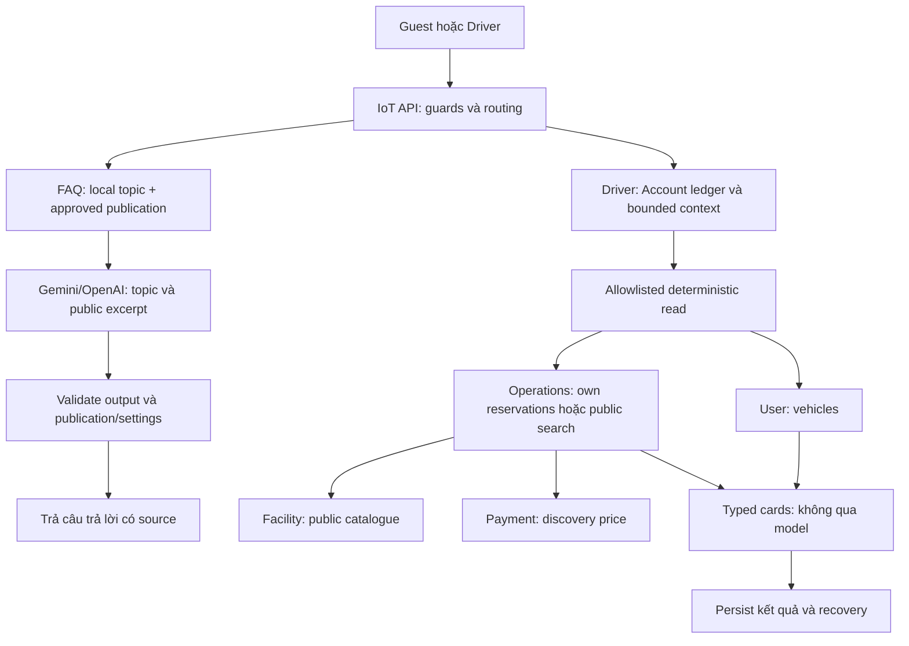
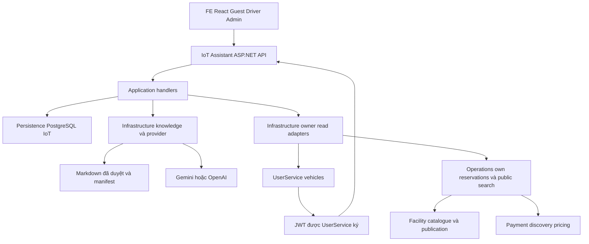
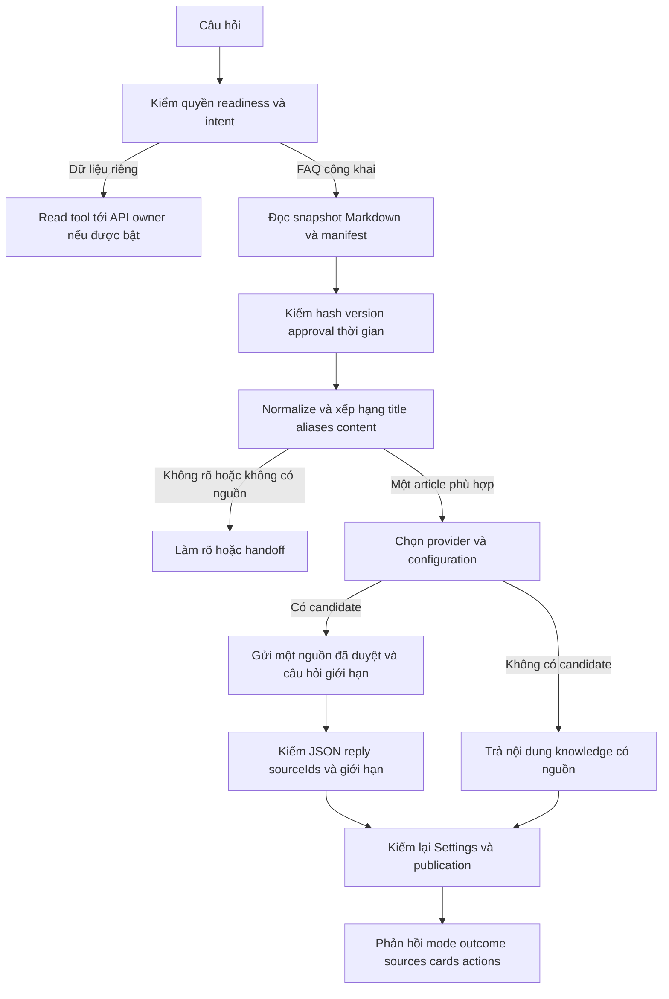
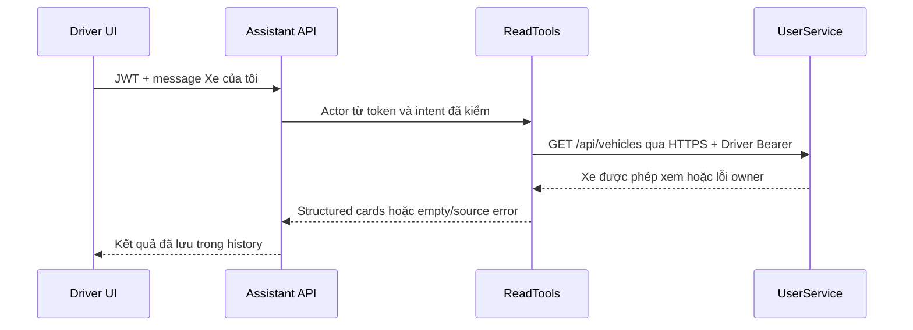

# AIChatbot — Lịch sử thiết kế

Tập hợp bản thiết kế trước đợt biên tập ngày 17/11/2026. Các trạng thái, số liệu và phương án thuộc thời điểm ghi trong từng phần. Tài liệu hiện hành là [thiết kế](../chatbot-design.md) và [lộ trình](../chatbot-roadmap.md).

| Bản lưu | Phạm vi |
| --- | --- |
| [Thiết kế giai đoạn đầu](#tai-lieu-1) | Các quyết định và phương án đã lưu trước đây |
| [Hướng dẫn hợp nhất trước biên tập](#legacy-guide) | Sáu chuyên đề cùng khảo sát lịch sử và lệnh demo |
| [Tổng quan ngày 12/11](#legacy-overview) | Kiến trúc, giải trình RAG và các phiếu review |
| [Kế hoạch ngày 08/11](#legacy-plan) | Kế hoạch S01–S10 tại thời điểm ghi |
| [Dependency](#legacy-dependencies) | Phiếu owner và các quyết định chờ chốt |

# Chatbot — Lịch sử thiết kế và kế hoạch

Lưu trữ theo yêu cầu gộp tài liệu ngày 08/11/2026. Nội dung dưới đây là lịch sử, không phải trạng thái hiện tại hoặc phê duyệt mới. Các công việc chưa xong vẫn theo dõi ở [nhật ký đang làm](../../../../ai/tasks/active/chatbot-development-progress.md).

- [assistant-overview-and-roadmap.md](#tai-lieu-1)
- [assistant-reintegration-plan.md](#tai-lieu-2)
- [assistant-r1-jwt-decision.md](#tai-lieu-3)
- [assistant-delivery-plan.md](#tai-lieu-4)
- [ASSISTANT-S01-S10-MASTER-REVIEW.md](#tai-lieu-5)
- [LEADER-REVIEW-DECISIONS.md](#tai-lieu-6)

<a id="tai-lieu-1"></a>

## Bản gốc: docs/03-design/ai/assistant-overview-and-roadmap.md

<a id="tai-lieu-1-ai-chatbot-smartpark--tổng-quan-hệ-thống-và-lộ-trình-hoàn-thiện"></a>

# AI Chatbot SmartPark — Tổng quan hệ thống và lộ trình hoàn thiện

**Cập nhật mục tiêu S01 — 05/11/2026:** mục tiêu đã được người dùng xác nhận gồm guest FAQ Việt/Anh, Driver tra xe/lịch đặt/chi tiết qua API thật, chuẩn bị và sửa draft qua hội thoại, rồi chuyển form thường để người dùng xác nhận. Settings gom provider/key/model, discovery/test, ưu tiên và failover; khách không thấy provider/model. Đây là phạm vi kế hoạch S01–S10, không còn chỉ FAQ đăng nhập. Xem [contract v0.4.1](../../api/assistant-s01-end-to-end-api-design.md), [ma trận API](../chatbot-design.md#assistant-s01-api-matrix) và [delivery plan](../chatbot-roadmap.md) để triển khai mới. Các mục recovery B dưới đây giữ làm lịch sử/nền tảng; hạn chế “FAQ đầu tiên” không thu hẹp mục tiêu mới. B chỉ là quyết định JWT của Assistant, không thay quyền hiện hành của domain services.

**Khảo sát lại sau develop (HEAD 3d3def76 + staged Assistant):** search/lịch đặt Driver vẫn localStorage; own vehicles có HTTP thật (ActiveBookings mới bổ sung metadata xe từ API). Facility đã chuyển routes sang controller, vẫn owner scope. Operations có checkout/gate và Payment có create order/cash, nhưng prepare route/DTO lệch nhau; còn mock authentication và thiếu resource checks/replay correctness. Driver quote/create/own list-detail vẫn chưa có. FE generic revocation hub chưa khớp route/event UserService (G08). Chưa nghiệm thu runtime trong S01.

Authorization ADR/matrix 04/11 đã chốt TOKEN cho reads/default, REQUEST Account-current Saga cho create reservation và SERVICE cho invocation không có user; không hỏi lại hướng này. D01 chỉ còn delegation/trust mapping; D02–D04 và wire/use-case details D05 vẫn IN REVIEW. Phần giải thích recovery B bên dưới là lịch sử; câu “mỗi domain request phải current-session” nếu gặp ở tài liệu cũ đã được ADR supersede. Xem matrix §6 và contract v0.4.1 trước S02–S08.

Cập nhật: 04/11/2026. Dành cho người triển khai và leader; đọc độc lập, không cần mở tài liệu khác. Đây là bản tổng hợp định hướng và trạng thái, không phải xác nhận mọi đề xuất đã được duyệt. Provider và knowledge đã được tái tích hợp cho demo FAQ; người dùng báo demo đã chạy được. Bộ knowledge một file được kiểm thử ngoại tuyến, chưa nghiệm thu bản dịch qua provider thật sau thay đổi này. Không yêu cầu chọn lại các quyết định đã có.

<a id="tai-lieu-1-1-mục-tiêu-cuối-cùng-là-gì"></a>

## 1. Mục tiêu cuối cùng là gì?

Xây chatbot trong SmartPark để người dùng hỏi bằng ngôn ngữ tự nhiên và nhận trợ giúp đúng phạm vi, đúng quyền, dựa trên nguồn được duyệt. Chatbot phải dùng được trong ứng dụng đang có, không phá đăng nhập, database hoặc chức năng của các thành viên khác.

**Đích hoàn thành đầu tiên: chatbot FAQ dành cho Driver, có đăng nhập, lưu hội thoại riêng theo tài khoản, trả lời bằng AI dựa trên tài liệu được duyệt, có nguồn và xử lý lỗi rõ ràng.** FAQ nghĩa là hỏi đáp hướng dẫn sử dụng và chính sách tĩnh. Đây là phạm vi khôi phục đầu tiên, chưa phải toàn bộ khả năng AI của SmartPark.

Ví dụ đạt mục tiêu: Driver đăng nhập, hỏi cách đặt chỗ; chatbot giải thích theo tài liệu hiện hành và hiển thị nguồn. Người dùng mở lại hội thoại sau khi tải lại trang. Tài khoản khác không đọc được hội thoại đó. Khi chưa có nguồn phù hợp, chatbot nói rõ giới hạn thay vì tự đoán.

Sau khi phần này ổn mới xét tìm bãi theo dữ liệu thật, đọc đặt chỗ của chính người dùng, chuẩn bị biểu mẫu đặt chỗ hoặc hỗ trợ tác vụ khác. Mỗi chức năng mở rộng có kiểm tra quyền và API nghiệp vụ riêng. AI không tự quyết giá, thu tiền, giữ chỗ hoặc cấp quyền.

<a id="tai-lieu-1-2-vì-sao-đang-có-cảm-giác-nhiều-phần-rời-nhau"></a>

## 2. Vì sao đang có cảm giác nhiều phần rời nhau?

Quá trình hiện tại có hai việc khác mục đích:

| Việc | Mục đích | Kết quả chứng minh được |
| --- | --- | --- |
| Khôi phục chatbot thật từ code cũ | Đưa chức năng vào baseline hiện tại, sửa phần lệch kiến trúc và bảo mật | Nền tảng xác thực/lỗi đã được triển khai một phần; chưa hoàn chỉnh |
| Làm demo bằng interface và mock theo yêu cầu leader | Kiểm tra giao diện có gửi đến backend, nhận phản hồi, xử lý chờ/lỗi hay không trước khi có cấu hình thật | Có chat mô phỏng chạy được, chưa có model hoặc dữ liệu nghiệp vụ |

Demo là một mốc kiểm tra kết nối, không thay thế phần xác thực, lưu trữ, tri thức hoặc provider còn thiếu. Docker chỉ là cách chạy chương trình; Docker chạy được không có nghĩa chatbot đã có AI thật.

**Không cần làm lại từ đầu.** Giữ code nền đã kiểm chứng, giữ demo làm công cụ thử, rồi quay lại hoàn thiện các phần còn thiếu theo thứ tự ở mục 7.

<a id="tai-lieu-1-3-phương-án-b-nghĩa-là-gì"></a>

## 3. Phương án B nghĩa là gì?

Phương án B chỉ quyết định **cách API chatbot kiểm tra đăng nhập**. Nó không chọn provider, không quyết định lưu hội thoại và không phải tên một loại AI.

Luồng đăng nhập và gọi chatbot thật:

1. UserService xác thực đăng nhập và cấp JWT, tức token có chữ ký và thời hạn.
2. Frontend gửi token đó khi gọi API chatbot tại IoTService.
3. IoTService tự kiểm tra chữ ký bằng public key tin cậy, bên phát hành, đối tượng nhận, thời hạn và các trường nhận diện bắt buộc.
4. IoT lấy AccountId và role từ token đã xác minh, kiểm quyền và chủ sở hữu hội thoại.
5. Chỉ sau đó mới xử lý câu hỏi.

IoT **không gọi lại UserService để hỏi tài khoản hiện tại ở mỗi request**, không đọc database của UserService và không giữ private key để cấp token. UserService vẫn phụ trách đăng nhập, refresh token và quản lý tài khoản.

| Khái niệm | Ý nghĩa và trách nhiệm |
| --- | --- |
| Public key | IoT dùng kiểm tra chữ ký; người vận hành cung cấp từ nguồn tin cậy |
| Private key | UserService dùng ký token; không chuyển sang IoT |
| Issuer / audience | Xác định bên phát hành và đối tượng nhận token; phải khớp cấu hình thực tế, không đoán từ token |
| AccountId | Chủ sở hữu hội thoại; các Account khác nhau không đọc chéo dù cùng một User |
| UserId | Nhận diện User để liên hệ ngữ cảnh; không thay AccountId làm chủ hội thoại |
| ICurrentActor | Interface nội bộ cung cấp danh tính đã xác minh cho Application; tên này không có nghĩa phải gọi UserService |
| Capabilities | API cho frontend biết chức năng nào thực sự sẵn sàng; không tự cấp quyền cho người dùng |

Cấu hình xác thực hiện triển khai yêu cầu JWT RS256, chữ ký RSA hợp lệ, thời hạn hợp lệ và claims bắt buộc. Access token baseline có thời hạn 15 phút. Người dùng đã xác nhận chấp nhận giới hạn của B: nếu tài khoản bị khóa, đổi role hoặc token bị thu hồi sau lúc cấp, IoT có thể vẫn nhận token cũ đến hết hạn. B hiện không bảo đảm thu hồi tức thời. Muốn thay đổi giới hạn này phải duyệt thêm cơ chế kiểm tra/đồng bộ; không tự lén bổ sung phụ thuộc UserService.

Việc tạm hoãn ICurrentActor trong demo nghĩa là demo không dùng tài khoản thật. Không có nghĩa chatbot production có thể bỏ kiểm tra danh tính.

<a id="tai-lieu-1-4-ai-được-dùng-và-chatbot-được-trả-lời-gì"></a>

## 4. Ai được dùng, và chatbot được trả lời gì?

| Người dùng / câu hỏi | Phạm vi đầu tiên | Vì sao |
| --- | --- | --- |
| Driver hỏi hướng dẫn sử dụng/chính sách | Có, khi FAQ thật hoàn thiện và nguồn được duyệt | Đúng phạm vi khôi phục hiện tại |
| Owner hỏi doanh thu tháng này | Chưa | Cần hợp đồng API doanh thu, quyền Owner và phạm vi bãi do Owner quản lý; không thể chỉ mở thêm role |
| Operator hoặc Admin dùng API Driver | Không mặc định; API hiện thiết kế chỉ nhận Driver | Role cao hơn không tự có quyền đọc hội thoại Driver |
| Driver hỏi số chỗ trống, giá, trạng thái thanh toán thực tế | Chưa trong FAQ đầu tiên | Phải lấy từ API nghiệp vụ có thẩm quyền; model/tài liệu tĩnh không biết trạng thái hiện tại |
| Người mở trang demo | Có thể thử câu trả lời mẫu công khai | Demo tách riêng, không chứng minh phân quyền của hệ thống thật |

JWT cho biết danh tính/role tại thời điểm cấp; không tự cung cấp số liệu doanh thu hoặc phạm vi dữ liệu được truy cập. Chức năng doanh thu và mở rộng role để sau, đúng yêu cầu đã thống nhất.

<a id="tai-lieu-1-5-cấu-trúc-hệ-thống-làm-ở-đâu-vì-sao-đặt-ở-đó"></a>

## 5. Cấu trúc hệ thống: làm ở đâu, vì sao đặt ở đó?

Luồng mục tiêu:

```text
Frontend SmartPark
  → API IoT: JWT, quyền, kiểm tra dữ liệu đầu vào
  → Application: điều phối nghiệp vụ qua IMediator
      → Kho hội thoại: kiểm tra Account, lưu/đọc trạng thái
      → Kho tri thức: lấy nội dung được phép sử dụng
      → Adapter provider: gọi model bằng cấu hình backend
  → Lưu kết quả, kiểm điều kiện trả dữ liệu
  → Frontend hiển thị câu trả lời, nguồn hoặc lỗi
```

| Thành phần | Làm gì / vì sao | Vị trí triển khai |
| --- | --- | --- |
| Frontend | Hiển thị chat, gửi yêu cầu, xử lý token theo luồng hiện có; không giữ provider key | `FE/src`, tích hợp hẹp vào ứng dụng hiện tại |
| API | Nhận HTTP, xác thực JWT, tạo actor tin cậy, trả lỗi thống nhất, health/readiness | `src/Services/IoTService/SmartParking.IoTService.API` |
| Application | Điều phối câu hỏi/hội thoại và định nghĩa interface; không phụ thuộc HttpContext hoặc SDK provider | `src/Services/IoTService/SmartParking.IoTService.Application` |
| Domain | Quy tắc sở hữu và vòng đời hội thoại khi triển khai dữ liệu thật | Trong IoTService; bổ sung theo kiến trúc đã review, chưa coi project Domain là đã tồn tại |
| Infrastructure | Adapter provider, nguồn tri thức và các tích hợp ngoài; mock hiện cũng nằm ở đây | `src/Services/IoTService/SmartParking.IoTService.Infrastructure` |
| Persistence | Truy cập kho hội thoại của IoT, lưu request/kết quả; không truy cập bảng service khác | Phần persistence cần khôi phục có chọn lọc và review schema trước khi thêm |
| UserService | Cấp/refresh JWT và quản lý tài khoản; cung cấp hợp đồng issuer/audience/public key | Service đang có của nhóm, không sao chép code sang IoT |
| Các service nghiệp vụ | Xác định dữ liệu và quyền thật khi có chức năng mở rộng | Gọi API của service sở hữu; không đọc trực tiếp DB của họ |
| Docker | Đóng gói/chạy các tiến trình | Tận dụng Dockerfile chung, demo dùng file Compose bổ sung riêng |

Hiện IoT có các project API, Application và Infrastructure cho phần này. Không tạo đủ mọi project/abstraction chỉ để sơ đồ đẹp; thêm Domain/Persistence khi phần hội thoại thực sự cần, theo quy chuẩn của repo.

<a id="tai-lieu-1-6-trạng-thái-thực-tế-đến-hiện-tại"></a>

## 6. Trạng thái thực tế đến hiện tại

| Phần | Đã có | Còn thiếu / giới hạn |
| --- | --- | --- |
| Chọn lọc recovery | Đã rà hướng khôi phục trên baseline hiện tại | Không merge nguyên nhánh recovery; mỗi phần tiếp theo vẫn phải đối chiếu code hiện tại |
| JWT phương án B | Code xác minh token và test HTTP bằng khóa RSA test | Chưa nối cấu hình thật vào host production và chưa nghiệm thu bằng token triển khai thật |
| Actor, lỗi, capabilities | Có code và kiểm thử riêng; capability thật chưa bật FAQ | Chưa tạo thành luồng chatbot production hoàn chỉnh |
| Host demo | Chạy opt-in ở môi trường Demo, có health/CORS | Không mở API production hoặc mô phỏng tài khoản thật |
| Chat demo | Frontend gọi API, hỗ trợ mock hoặc provider theo cấu hình và hiển thị nguồn | Chưa gọi live bằng key thật trong session; không có lịch sử server, reload mất hội thoại |
| Provider | Người dùng đã yêu cầu cả Google AI Studio/Gemini và OpenAI ngày 29/10; recovery có GeminiFaqModel và OpenAiFaqModel | Đã có adapter demo trong baseline hiện tại và test HTTP giả lập; chưa có nghiệm thu live. Model đã đối chiếu trang tài liệu chính thức ngày 03/11/2026: `gemini-3.8-flash` và `gpt-5.4-mini-2026-03-17`; quyền tài khoản/quota và kết quả live vẫn chưa xác minh |
| Tri thức FAQ | Ngày 04/11 người dùng duyệt gộp thành một file tiếng Việt smartpark-knowledge.md, giữ 10 chủ đề và mã nguồn; AI diễn đạt tiếng Anh theo câu hỏi | Bộ đọc mới tách mục và tìm từ khóa Việt/Anh, chỉ gửi phần Nội dung; mỗi câu hỏi đọc lại file. Cần cập nhật image Assistant một lần để nhận định dạng mới. 72 case recovery chưa được đánh giá đầy đủ; publication production và chất lượng model thật vẫn là việc riêng |
| Kho hội thoại | Có thiết kế đích | Chưa triển khai storage, ownership, chống trùng, phục hồi và retention hoàn chỉnh |
| Docker demo | Có overlay, kiểm tra cấu hình ghép và review tĩnh | Chưa có bằng chứng build/runtime Docker thành công trong session; từng bị chặn vì `.env` thiếu mật khẩu RabbitMQ |
| UI chatbot thật | Đã có trang demo tách riêng | Chưa tích hợp đầy đủ đăng nhập, lịch sử, nguồn và phục hồi vào UI chính |

Bằng chứng kiểm thử đã ghi nhận ở mốc code gần nhất: backend 500 pass, 68 skipped; 5 test transport frontend mới pass; build frontend và kiểm tra trình duyệt demo pass. Full frontend suite còn 31 lỗi harness ở phần không thay đổi, không được báo toàn bộ frontend xanh. Đây là kết quả lịch sử tại mốc đó, không thay cho kiểm tra các thay đổi sau này. Test mock/RSA test không chứng minh provider hoặc hệ thống triển khai thật đã chạy.

<a id="tai-lieu-1-7-một-lộ-trình-duy-nhất-từ-hiện-tại-đến-chatbot-faq-hoàn-chỉnh"></a>

## 7. Một lộ trình duy nhất từ hiện tại đến chatbot FAQ hoàn chỉnh

Không tiếp tục mở nhiều hướng đồng thời. Ưu tiên kế tiếp theo phản hồi mới nhất: **khôi phục knowledge/retrieval và hai adapter đã chọn → nối demo FAQ trả lời bằng model thật, có nguồn → hoàn thiện host JWT và storage → UI chính → nghiệm thu toàn luồng**. Các bước chi tiết bên dưới là các khối công việc; demo AI có thể thực hiện phần knowledge/provider trước host/storage, nhưng nghiệm thu production vẫn cần đủ các khối. Demo hiện có được giữ để kiểm tra độc lập, không cần viết lại.

<a id="tai-lieu-1-bước-1--chốt-đầu-vào-để-triển-khai-đúng"></a>

### Bước 1 — Chốt đầu vào để triển khai đúng

- **Làm gì:** xác nhận Driver FAQ là đích đầu tiên; ghi rõ các lựa chọn vận hành còn thiếu trong mục 8.
- **Vì sao:** tránh vừa viết code vừa thay phạm vi, hoặc coi khuyến nghị của agent là quyết định của leader.
- **Ở đâu / ai:** leader phối hợp người phụ trách UserService, IoT, nội dung và vận hành; người triển khai ghi lại lựa chọn và người duyệt trong cùng session.
- **Cần gì:** thông tin JWT, nguồn nội dung, mapping provider/model đã có trong recovery, giới hạn dữ liệu/chi phí, chính sách hội thoại.
- **Xong khi:** mỗi mục có trạng thái đã chốt hoặc để sau rõ ràng; phần nào chưa chốt chỉ chặn đúng công việc phụ thuộc nó.

<a id="tai-lieu-1-bước-2--nối-tri-thức-được-duyệt-và-ai-provider-thật"></a>

### Bước 2 — Nối tri thức được duyệt và AI provider thật

- **Làm gì:** rà nội dung FAQ, quản lý phiên bản/công bố, tìm đoạn liên quan, gửi ngữ cảnh giới hạn đến model, tạo câu trả lời và nguồn từ dữ liệu đã kiểm chứng.
- **Vì sao:** chỉ nối model thì có khả năng tạo văn bản, chưa bảo đảm trả lời đúng SmartPark. Model không tự có chính sách hiện hành của nhóm.
- **Ở đâu:** interface và điều phối trong Application; adapter model/tri thức trong Infrastructure; endpoint/model/key ở cấu hình backend.
- **Cần gì:** provider/model được duyệt, key và người quản lý, dữ liệu được phép gửi, ngân sách, corpus đã được người có thẩm quyền công bố, bộ câu hỏi đánh giá.
- **Cách làm:** khôi phục chọn lọc cả Gemini và OpenAI theo quyết định đã có. Ngày04/11 người dùng xác nhận dùng2–3key/API dự phòng: managed xét ưu tiên provider/key đang bật, tối đa3attempt trong20giây, không lặp cùng key; lỗi provider/model chung chuyển vendor thay vì thử hết key cùng model. Hết lựa chọn thì hiển thị hướng dẫn thật từ knowledge với nhãn riêng, không mock hoặc giả câu trả lời AI. Chế độ provider trực tiếp vẫn một attempt. Không tự đổi model hoặc retry vô hạn; nghiệm thu failover/cost/cancel bằng provider giả lập trước live test có kiểm soát.
- **Xong khi:** trả lời có nguồn đúng; thiếu nguồn thì nói giới hạn; không bịa dữ liệu động; nội dung gây nhiễu không vượt quyền; lỗi key/hết quota/timeout được xử lý an toàn; đo chất lượng và chi phí trên bộ test đã thống nhất.

Mốc demo tiếp theo phải có retrieval từ knowledge đã có, gọi provider thật và trả nguồn trên UI hiện có. Không coi câu trả lời hardcode là nghiệm thu demo AI. Có thể hoàn thiện mốc này trước storage/auth production với dữ liệu thử được phép; không tự coi metadata draft là publication production. Giữ mock cho test tự động, không tạo thêm ứng dụng demo.

<a id="tai-lieu-1-bước-3--hoàn-thiện-host-thật-và-xác-thực-phương-án-b"></a>

### Bước 3 — Hoàn thiện host thật và xác thực phương án B

- **Làm gì:** nối issuer/audience/public key từ cấu hình tin cậy; đăng ký actor và API được bảo vệ; xử lý cấu hình lỗi, thay key, health/readiness và CORS.
- **Vì sao:** có model trả lời được nhưng chưa xác thực/sở hữu đúng thì chưa thể phục vụ người dùng thật.
- **Ở đâu:** composition root và Authentication/Http của IoT API; dùng cơ chế token hiện tại của frontend/UserService.
- **Cần gì:** quyết định lỗi cấu hình/thay khóa và môi trường test token tích hợp. Chưa cần gọi provider để test auth.
- **Xong khi:** token đúng truy cập được; sai chữ ký/hết hạn bị chặn; role ngoài Driver bị từ chối; cấu hình lỗi không mở mock hoặc báo sẵn sàng sai; test thay key đúng chính sách. Hai reviewer kiểm tra và đóng finding.

<a id="tai-lieu-1-bước-4--lưu-hội-thoại-và-xử-lý-gửi-lại-an-toàn"></a>

### Bước 4 — Lưu hội thoại và xử lý gửi lại an toàn

- **Làm gì:** tạo/list/đọc hội thoại, đọc tin nhắn, gửi tin và tra trạng thái yêu cầu; gắn ownership theo AccountId; lưu trạng thái đang chạy/thành công/thất bại.
- **Vì sao:** reload không mất lịch sử; timeout có thể tra kết quả thay vì gửi một lượt mới; tài khoản khác không đọc được dữ liệu.
- **Ở đâu:** Application/Domain/Persistence của IoT và database thuộc IoT. SQL migration phải được review trước khi áp dụng.
- **Cần gì:** schema hiện tại, quyền môi trường DB test, chính sách hết hạn/xóa, xử lý token hết hạn giữa lượt, deadline và quy tắc chống trùng.
- **Thiết kế cần giữ:** client dùng mã ổn định cho cùng một lần gửi; backend không ghi/gọi model lại khi replay; revision phát hiện hội thoại đã đổi; chỉ một lượt đang xử lý trên một hội thoại. Không giữ transaction DB trong lúc chờ model.
- **Xong khi:** test PostgreSQL thật chứng minh isolation giữa Account, cạnh tranh đồng thời, gửi trùng, timeout/recovery và hết hạn dữ liệu. Chưa có DB test thì ghi chưa xác minh, không lấy mock thay bằng chứng concurrency.

<a id="tai-lieu-1-bước-5--tích-hợp-chatbot-thật-vào-frontend-hiện-tại"></a>

### Bước 5 — Tích hợp chatbot thật vào frontend hiện tại

- **Làm gì:** dùng token/session hiện có; hiển thị capabilities, lịch sử, nguồn, trạng thái gửi và lỗi; tra kết quả sau timeout thay vì gửi mới tùy tiện.
- **Vì sao:** trang demo hiện chưa kiểm tra logout, refresh token, đổi Account và lịch sử riêng tư.
- **Ở đâu:** transport/session/components chat của FE; thay đổi tối thiểu ở điểm gắn UI, không chép đè auth từ recovery.
- **Cần gì:** API ổn định, ownership và recovery backend đã kiểm chứng, quy tắc UI khi hết phiên/đổi Account.
- **Xong khi:** không lộ phản hồi cũ sau logout/đổi Account; “Hội thoại mới” không lẫn câu trả lời; reload phục hồi đúng lịch sử; mobile/desktop dùng được; lỗi provider không bị hiểu nhầm thành lỗi đăng nhập người dùng.

<a id="tai-lieu-1-bước-6--chạy-tích-hợp-nghiệm-thu-và-bàn-giao"></a>

### Bước 6 — Chạy tích hợp, nghiệm thu và bàn giao

- **Làm gì:** kiểm tra trên môi trường gần triển khai thật với JWT, kho hội thoại, corpus và provider thật; cấu hình host/Docker theo cách nhóm vận hành.
- **Vì sao:** test từng thành phần không chứng minh toàn hệ thống hoạt động cùng nhau.
- **Ở đâu:** môi trường test được nhóm cho phép; cấu hình/secret riêng từng môi trường, không dùng mock fallback.
- **Cần gì:** người vận hành, key/secret hợp lệ, log an toàn, giới hạn chi phí, kế hoạch thay key và xử lý sự cố, phương án rollback không xóa dữ liệu.
- **Xong khi:** toàn bộ tiêu chí ở mục 10 có bằng chứng; hai review độc lập không còn finding phải sửa; leader chấp thuận đưa vào sử dụng theo phạm vi đã chốt.

<a id="tai-lieu-1-8-quyết-định-nào-đã-có-quyết-định-nào-còn-cần-duyệt"></a>

## 8. Quyết định nào đã có, quyết định nào còn cần duyệt?

| Chủ đề | Trạng thái hiện tại | Đề xuất / lựa chọn cần chốt | Ai cần tham gia và chặn phần nào |
| --- | --- | --- | --- |
| JWT xác minh cục bộ | Đã chọn B; chấp nhận token cũ đến hết hạn | Giữ hướng này, không tự thêm gọi UserService mỗi request | User + IoT; làm nền xác thực |
| Phạm vi đầu tiên | Driver FAQ; demo riêng được duyệt | Chưa mở Owner/revenue hoặc hành động nghiệp vụ | Leader/BA; mở rộng cần yêu cầu riêng |
| Cấu hình JWT thiếu/sai | Chưa có bằng chứng phê duyệt cuối cùng | Đề xuất giữ liveness, readiness và API chatbot báo chưa sẵn sàng; lựa chọn khác là dừng khởi động | Leader + vận hành; chặn chốt host production |
| Phân phối/thay khóa JWT | Chưa chốt | Đề xuất ban đầu một public key qua cấu hình và restart; token ký key cũ bị từ chối sau đổi. Nếu cần chuyển tiếp không gián đoạn, phải thiết kế chấp nhận hai key trong thời gian giới hạn | User + IoT + vận hành; chặn nghiệm thu tích hợp auth |
| Token hết hạn trong lúc model chạy | Đề xuất, chưa duyệt | Lưu kết quả cuối rồi kiểm lại hạn token trước khi gửi; nếu hết hạn không trả dữ liệu riêng tư, cho tra bằng token mới của cùng Account | Leader/security; chặn chốt vòng đời request |
| Lưu và xóa hội thoại | Yêu cầu 90 ngày từ tin nhắn cuối đã có; chi tiết chưa đủ | Hội thoại rỗng đề xuất 90 ngày từ lúc tạo; chốt purge, backup, ngoại lệ lưu giữ và retention phía provider | Người phụ trách dữ liệu; chặn chốt storage/release |
| Hạn mức/deadline | Còn review | Chốt body/input/output, thời gian xử lý, số lượt, chi phí; không lấy thông số demo làm SLA production | FE + BE + QA + leader |
| Provider/model | Đã có lựa chọn hai provider trong recovery: Gemini và OpenAI; mapping model lịch sử `gemini-3.8-flash` / `gpt-5.4-mini-2026-03-17` | Tiếp tục lựa chọn đó; xác minh endpoint/model khả dụng khi tích hợp, chỉ hỏi khi có thay đổi thực sự cần quyết định | Người triển khai + người quản lý provider; không bắt chọn lại từ đầu |
| Key, dữ liệu gửi ra ngoài, ngân sách | Chưa chốt | Key chỉ ở backend; thử với dữ liệu tổng hợp trước; ngân sách và người chịu trách nhiệm rõ | Leader + vận hành/data owner; cần trước live call |
| Nội dung FAQ và công bố | Nội dung đã được người dùng duyệt ngày 28/10; ngày 04/11 duyệt một file tiếng Việt để bảo trì; metadata vẫn draft | Sửa mục tương ứng trong smartpark-knowledge.md và tăng version chung; không duy trì bản dịch chính sách riêng. Publication/effective date và evaluation production vẫn cần xác nhận riêng | BA/người có quyền công bố; không coi bản dịch AI là chính sách mới |
| Quản trị nội dung/key qua UI | Đã tích hợp tab Admin quản lý key mã hóa, provider/model/ưu tiên, bật/tắt và thông báo bảo trì; PostgreSQL IoT + phương án B cho Admin đã được duyệt | Cần provision DB/JWT/key ring và kiểm chứng restart/live; chưa có quản lý xuất bản knowledge | Leader + người vận hành; không coi UI có sẵn là đã chạy production |

Không cần một vòng duyệt mới cho từng hàm hoặc test trong phạm vi đã được giao. Cần duyệt khi quyết định làm thay đổi quyền, dữ liệu, chi phí, vận hành, dependency mới hoặc phạm vi service khác. Phần độc lập có thể tiếp tục trong lúc chờ.

<a id="tai-lieu-1-9-docker-rabbitmq-và-cách-tránh-ảnh-hưởng-nhóm"></a>

## 9. Docker, RabbitMQ và cách tránh ảnh hưởng nhóm

Chatbot FAQ hiện thiết kế gọi HTTP trực tiếp, không cần RabbitMQ cho một lượt hỏi–đáp. Docker Compose app chung có cấu hình RabbitMQ cho phần khác, nên vẫn yêu cầu biến `SMARTPARK_RABBITMQ_PASSWORD` khi đọc toàn bộ cấu hình, kể cả khi chỉ chọn build demo.

`setup.ps1` có logic sinh giá trị local còn thiếu; Docker Compose không tự chạy script đó. Việc bổ sung biến cấu hình không đồng nghĩa chatbot dùng broker. Không đổi mật khẩu broker đã có dữ liệu mà chưa đối chiếu cấu hình; không chạy tạo lại database để chữa lỗi demo.

Hiện phương án được triển khai vẫn là overlay `compose.assistant-demo.yml`, cùng project app, API cổng 5095 và frontend cổng 5173. Phương án tách demo sang cổng 5174 từng được trao đổi nhưng chưa được triển khai. Không cần đổi phương án chỉ vì thấy biến RabbitMQ còn thiếu.

Để giữ phần của nhóm ổn định:

- Chỉ lấy recovery theo từng chức năng; không merge nguyên nhánh hoặc ghi đè auth/Settings/Dockerfile chung.
- Demo opt-in riêng; không biến mock thành provider production bằng cách chỉ bỏ nhãn demo.
- Không sửa `.env` của người khác, không commit secret; mọi biến phải có đường đi rõ từ cấu hình đến tiến trình sử dụng.
- Thêm package hoặc migration chỉ khi cần và được duyệt; không tạo thêm report, script hoặc tầng trung gian không phục vụ yêu cầu cụ thể.
- Dọn demo bằng đúng tên container/image của demo và khôi phục riêng frontend; không xóa volume/database hay prune chung.
- Không cần database/RabbitMQ/JWT để chạy mock qua host. Chatbot FAQ thật cần kho hội thoại và JWT; provider thật cần key/model; broker chỉ thêm nếu tương lai có yêu cầu cụ thể.

<a id="tai-lieu-1-10-khi-nào-được-gọi-là-chatbot-faq-đã-hoàn-thành"></a>

## 10. Khi nào được gọi là chatbot FAQ đã hoàn thành?

| Tiêu chí | Bằng chứng cần có |
| --- | --- |
| Đúng danh tính/quyền | Token triển khai hợp lệ hoạt động; token sai/hết hạn và role ngoài phạm vi bị chặn |
| Riêng tư theo Account | Đọc/gửi/tra trạng thái đều kiểm ownership; thử truy cập chéo Account không lộ dữ liệu |
| Hội thoại bền vững | Reload/đăng nhập lại cùng Account đọc được lịch sử còn hạn; hết hạn/xóa theo policy |
| Gửi lại an toàn | Replay cùng mã không chủ động gọi model lại; admission/recovery không tạo lượt trùng hoặc ghi đè kết quả. Không cam kết provider chỉ tính phí một lần khi crash/mất mạng khiến kết quả gọi không xác định |
| Trả lời đáng tin | Bộ câu hỏi đã duyệt có kết quả đạt ngưỡng thống nhất; nguồn đúng phiên bản, thiếu nguồn không bịa |
| Provider thật | Có kiểm tra live được phép, timeout/quota/lỗi được xử lý; chi phí trong giới hạn |
| UI đầy đủ | Lịch sử/nguồn/pending/retry/logout/đổi Account/mobile được kiểm tra |
| Vận hành được | Liveness khác readiness, secret không lộ, có cách đổi key/tắt generation và xử lý sự cố |
| Không phá baseline | Build/test liên quan và regression phần dùng chung; lỗi có sẵn phải phân biệt rõ, không tuyên bố pass giả |
| Review và nghiệm thu | Hai reviewer độc lập kiểm tra; finding được sửa/xác minh lại; người có thẩm quyền duyệt đưa vào sử dụng |

Hoàn thành FAQ không đồng nghĩa đã hoàn thành doanh thu Owner, tìm bãi theo dữ liệu thật, đặt chỗ/thanh toán qua AI hoặc toàn bộ AI của SmartPark. Các chức năng đó tiếp tục theo phạm vi riêng sau khi FAQ ổn định.

<a id="tai-lieu-1-11-việc-tiếp-theo-cụ-thể"></a>

## 11. Việc tiếp theo cụ thể

1. Dùng tài liệu này thống nhất với leader: đích đầu tiên là Driver FAQ có nguồn và lịch sử riêng; demo hiện tại là mốc kiểm tra đã có.
2. Code demo knowledge/retrieval/provider đã có. Bổ sung key backend của provider đã chọn, rebuild/recreate demo rồi kiểm tra luồng live và chất lượng nguồn. Không coi test giả lập là nghiệm thu model, không hỏi lại lựa chọn đã chốt.
3. Tiếp tục hoàn thiện host JWT phương án B và kho hội thoại để đưa demo AI thành tính năng cho người dùng thật. Chốt các chính sách production còn thiếu; không mở thêm role/doanh thu hoặc viết lại UI demo.
4. Sau mỗi phần: chạy kiểm tra đúng phần thay đổi, hai subagent review chéo, sửa findings, cập nhật cùng session. Không tạo báo cáo Markdown cho từng reviewer.
5. Nghiệm thu model đã tích hợp cùng storage/UI và xác thực thật. Chỉ chuyển sang chức năng nghiệp vụ động sau khi phạm vi FAQ đã đạt tiêu chí.

Tài liệu này là một bản tổng hợp duy nhất được yêu cầu thêm để người dùng và leader theo dõi toàn cảnh. Các lựa chọn còn chờ vẫn là đề xuất; nếu leader quyết định khác, cập nhật đúng quyết định đó và triển khai phần phụ thuộc, không suy diễn từ việc demo chạy được.

<a id="tai-lieu-2"></a>

## Bản gốc: docs/03-design/ai/assistant-reintegration-plan.md

<a id="tai-lieu-2-kế-hoạch-đưa-assistant-từ-recovery-vào-baseline-hiện-tại"></a>

# Kế hoạch đưa Assistant từ recovery vào baseline hiện tại

| Metadata | Giá trị |
| --- | --- |
| Ngày / trạng thái | 2026-11-02 / R1 triển khai một phần, kiểm chứng qua TestServer; host production chờ leader duyệt B-02 |
| Baseline local | AI-ChatBot = develop = origin/develop tại 78336604fbe1adc3c3a685e0165a5253c3deca6c |
| Nguồn recovery | recovery/ai-chatbot-stash-20261030 tại a9b8c8ef3abe353044bfeafabc097c65639193b8 |
| Phạm vi | Khôi phục có chọn lọc Driver FAQ; phương án B: IoT validate JWT cục bộ |
| API duy nhất | [P0 API](../../api/iot-assistant-p0-api-design.md) |
| Tiến độ và bàn giao duy nhất | [Session](../../../../ai/tasks/active/chatbot-development-progress.md#nhat-ky-1) |

<a id="tai-lieu-2-1-quyết-định-và-giới-hạn"></a>

## 1. Quyết định và giới hạn

Người dùng xác nhận nhóm chọn B và đồng ý tiến trình chuyển đổi trong chat ngày 02/11/2026. Sau khi hỏi cách chia việc, người dùng giao lựa chọn cho agent: chat hiện tại hoàn tất kế hoạch/P0 và kiểm tra chéo; chat mới triển khai từng phần. Không coi việc đồng ý thực hiện là final approval cho mọi policy còn OPEN.

- Lấy baseline hiện tại làm nền. Không merge recovery toàn nhánh, không restore cả cây, không cherry-pick nguyên stash snapshot.
- Recovery chứa 130 file thay đổi so với merge-base, khoảng 15.477 dòng thêm. Đây không phải 130 file bắt buộc phải đưa lại.
- Không thay auth/UserService hoặc các service khác để phù hợp code chatbot cũ. Không chép User Infrastructure vào IoT.
- Không sửa global coding skill để hợp thức hóa local JWT. Quyết định B chỉ đổi cách xác thực Assistant; protected domain operations tiếp tục theo owner.
- Giữ ownership theo AccountId, fail closed, error envelope chung và IMediator. Dùng UseExceptionHandler + IExceptionHandler, không giữ custom catch-all.
- Phương án B không cung cấp trạng thái khóa/thu hồi/role mới trên từng request. Chính sách chấp nhận độ trễ và request đang chạy vẫn OPEN ở P0; không hứa thu hồi tức thời.
- Không thêm package/version khi chưa có phép rõ; kiểm kê package hiện có trước. Không commit/push/PR, Docker/app startup, migration DB, provider call hoặc publication trong giai đoạn kế hoạch.
- Remote freshness chưa được xác minh; origin/develop ở trên là local tracking ref. Kiểm tra lại HEAD/working tree ở đầu mỗi phần; nếu baseline thay đổi phải điều chỉnh delta.

<a id="tai-lieu-2-2-bảng-chuyển-đổi"></a>

## 2. Bảng chuyển đổi

Các đường dẫn dưới đây là đường dẫn trong Git recovery nếu chưa tồn tại tại baseline. Agent đọc bằng git show/ls-tree; không tạo file giả chỉ để làm link.

| Nhóm / đường dẫn | Quyết định | Việc phải làm khi đưa lại | Phần |
| --- | --- | --- | --- |
| docs/03-design/ai/p1/ | Tái sử dụng nội dung có review | Đối chiếu SRS/BR mới; user-approved P1 không bằng Admin publication; không khôi phục báo cáo pass cũ thành evidence mới | R3 |
| IoT Application/Assistant/Authorization/* | Sửa | Bỏ semantics HTTP current-actor và recheck trạng thái live; actor inward port nhận claims đã xác minh; không Application HttpContext | R1 |
| IoT Infrastructure/Assistant/UnconfiguredCurrentActorResolver.cs | Không dùng làm auth hoàn thiện | JWT validation tại API; cấu hình thiếu phải fail closed/readiness rõ; không giữ adapter giả thành production | R1 |
| IoT API/AssistantHost.cs, Program.cs, Controllers/* | Chọn lọc | Host/DI/auth/mapping theo nền mới; R1 chỉ capabilities, R2 mới conversation routes; Admin controller chưa lấy | R1/R2 |
| IoT API/Http/AssistantResponseMiddleware.cs | Viết lại phần trách nhiệm | Chuyển exception mapping sang IExceptionHandler; giữ header/body-budget concern riêng nếu cần; kiểm framework 401/403/404/405/415/413 | R1 |
| IoT Domain/Assistant/ConversationAccessScope.cs | Tái sử dụng có review | Owner AccountId + expiry; không UserId/token ID làm owner | R2 |
| IoT Application/Assistant/Conversations/* và Persistence/AssistantStore.cs | Tái sử dụng có sửa | Kiểm dependency quản lý spend/management trước khi chọn; giữ inward ports, dedupe/revision/retention; không đưa management vào chỉ để compile | R2 |
| IoT Infrastructure/Assistant/AssistantRuntime.cs, UnavailableAssistantStore.cs | Chọn lọc | Deadline/recovery, không unmanaged fire-and-forget; availability stub chỉ thể hiện chưa cấu hình | R2 |
| scripts/database/migrations/20261028_iot_assistant_p2b.sql | Review lại với schema hiện tại | Không giả định bảng đã có; legacy owner không suy từ UserId; SQL review/manual apply, không auto-migrate | R2 |
| IoT Infrastructure/Assistant/*Faq*, KnowledgeCorpusLoader.cs, OpenAiFaqModel.cs, GeminiFaqModel.cs | Tái sử dụng có review | Kiểm API/model/version bằng tài liệu chính thức khi triển khai; không tin model ID cũ; snapshot/citation/secrets/cancel | R3 |
| FE/src/lib/chatbotApi.ts, chatbotSession.ts; components/chat/* | Tích hợp có sửa | Dùng ensureAccessToken/sessionGeneration hiện tại; kiểm reload/logout/switch Account/New và timeout lookup | R4 |
| FE/src/lib/authApi.ts, DashboardNavbar.tsx | Giữ bản baseline, thêm delta tối thiểu | Không ghi đè auth/refresh hoặc Settings team; mọi thay đổi dùng chung phải có regression | R4 |
| SmartParking.slnx; IoT *.csproj; tests IoT *.csproj | Merge thủ công từng entry | Chỉ thêm project/reference cần phần hiện tại; đối chiếu version, không thay nguyên file | R1–R3 |
| .env.example, FE/.env.example, compose.app.yml, scripts/run-app-service.ps1, docker/*.dockerignore | Merge delta khi cần | Đọc env skill; không copy .env/secret; port/origin/URL theo config hiện tại, không bật runtime | Theo phần |
| package-lock.json | Không lấy mặc định | Chỉ đổi khi dependency change cụ thể đã được phép; không mang lockfile nhiễu từ recovery | Theo nhu cầu |
| tests/Services/SmartParking.IoTService.Tests/*, tests/frontend/chatbot.test.cjs | Tái sử dụng và đổi assertions | Test JWT thật qua HTTP tại R1; ownership/concurrency DB tại R2; bỏ kỳ vọng User introspection/revocation tức thời | Theo phần |
| Assistant/Management/*, AssistantManagementStore.cs, AssistantSpendReservations.cs, AssistantSettings.tsx, assistantAdminApi.ts, migration management | Tách khỏi FAQ trước mắt | Kiểm dependency ngược khi tách; không vô tình bỏ quota/readiness cần cho FAQ. Admin key/publication/spend auth cần contract riêng trước phục hồi | R5 riêng |
| ai/tasks/*, docs/04-testing/*, handoffs/chatbot/* từ recovery | Không phục hồi hàng loạt | Lịch sử vẫn truy xuất bằng recovery SHA; session mới ghi evidence mới. Không nhân bản báo cáo cũ | Không nhập |
| ai/architecture-reference.md, README chung | Sửa hẹp theo trạng thái thật | Không copy bản recovery đè mô tả service hiện tại | Khi milestone đổi trạng thái |

<a id="tai-lieu-2-3-các-phần-thực-hiện-và-cổng-kiểm-tra"></a>

## 3. Các phần thực hiện và cổng kiểm tra

| Phần | Đầu ra | Kiểm chứng trước bàn giao |
| --- | --- | --- |
| R0 — chat hiện tại | Kế hoạch này + P0 B + session; index links | Link/fence/diff checks; hai reviewer medium độc lập; sửa finding và review lại |
| R1 — host/auth/errors | API host, capabilities, authenticated actor, JWT/public key config, lỗi chung | HTTP tests token thực ký bằng key test: RS256, issuer/audience, exp/nbf, thiếu/invalid claims, sai role, challenge/forbid; DI + framework errors; solution build/test |
| R2 — conversation/storage | Sáu route còn lại, owner scope, request ledger, SQL review | Cross-Account kể cả cùng User, login mới cùng Account; idempotency/revision; PostgreSQL concurrency/recovery; retention. Không có DB phù hợp thì ghi UNVERIFIED, không coi doubles là DB pass |
| R3 — knowledge/model | Corpus P1 rà lại, retrieval/citation, adapters, readiness | Synthetic provider/error/cancel tests; retrieval evaluation; model/data/budget/publication vẫn gate trước live calls |
| R4 — FE/integration | Chat transport/session/UI vào FE hiện tại | FE auth regression, pending lookup/New/logout/account switch, browser responsive khi được chạy; backend build/test + FE checks |
| R5 — Admin management riêng | Chỉ lập phần triển khai khi phạm vi/auth/lifecycle được chốt | Admin authorization, secret lifecycle, spend concurrency, publication/revoke; không gộp ngầm vào FAQ |

Mỗi phần cần hai subagent reasoning medium kiểm tra độc lập: (A) architecture/auth/contracts và (B) behavior/tests/integration. Agent triển khai sửa findings, gửi reviewer xác nhận lại, rồi ghi kết quả vào session này. Không yêu cầu reviewer tạo file báo cáo riêng. Findings còn mở phải được ghi rõ cùng tác động; review không tự thay product approval.

Một phần chỉ là Implemented & Validated khi checks cần thiết chạy được và review không còn lỗi phải sửa. Phân biệt source complete, offline tests và live acceptance. Không khẳng định FAQ release-ready khi các gate ngoài môi trường chưa đóng.

<a id="tai-lieu-2-4-bàn-giao-giữa-các-chat"></a>

## 4. Bàn giao giữa các chat

Một chat cho một phần là đề xuất để giảm context nhiễu và dễ review; không bảo đảm an toàn nếu bỏ kiểm tra code thực tế. Không chạy hai chat cùng sửa một working tree đồng thời. Kết thúc mỗi phần phải ghi HEAD, diff/file list, test commands/outcomes, findings còn lại và next action vào cùng session.

Chat mới đọc theo thứ tự: ai/AGENTS.md → session → phần tương ứng ở kế hoạch/P0 → source liên quan. Không phải đọc tất cả lịch sử chat hoặc toàn bộ recovery.

Prompt dùng cho chat R1:

> Tiếp tục R1 của Assistant reintegration. Đọc ai/AGENTS.md và ai/tasks/active/SESSION-20261102-assistant-reintegration.md, sau đó kế hoạch và P0 được liên kết. Thực hiện host + JWT phương án B + actor + errors + capabilities trên baseline hiện tại; lấy recovery có chọn lọc. Giữ các quyết định OPEN, hỏi gộp những quyết định thực sự chặn implementation và tiếp tục phần độc lập. Sau mỗi phần dùng hai subagent medium check chéo, sửa findings và cập nhật cùng session. Không ghi đè auth/team files, không commit/push hoặc chạy DB/provider/app nếu chưa được cho phép. Không tạo báo cáo/handoff Markdown mới.

Phần sau thay R1 bằng R2/R3/R4 và đọc checkpoint mới nhất. Khi toàn bộ phạm vi đã hoàn thành và validation pass, chuyển session sang completed rồi cập nhật link; không tạo bản copy.

<a id="tai-lieu-2-5-phạm-vi-tài-liệu"></a>

## 5. Phạm vi tài liệu

- Kế hoạch này: thứ tự, file mapping, quy tắc chia chat.
- P0 API: contract/decision gaps duy nhất cho Driver FAQ.
- Session: tiến độ, review evidence, commands và next action duy nhất.
- Hai README hiện có: chỉ thêm liên kết; không chứa bản sao nội dung.
- Không xuất Desktop/Downloads, ZIP, báo cáo mỗi reviewer, hoặc khôi phục toàn bộ session cũ.
- Ngoại lệ được người dùng yêu cầu ở R1: một [phiếu quyết định JWT cho leader](#tai-lieu-3), ghi các lựa chọn B-02 chưa được duyệt; không phải báo cáo tiến độ hoặc bản sao session.

<a id="tai-lieu-3"></a>

## Bản gốc: docs/03-design/ai/assistant-r1-jwt-decision.md

<a id="tai-lieu-3-xác-thực-đăng-nhập-cho-chatbot--phương-án-cấu-hình-và-thay-khóa-cần-leader-duyệt"></a>

# Xác thực đăng nhập cho chatbot — Phương án cấu hình và thay khóa cần leader duyệt

| Thông tin | Nội dung |
| --- | --- |
| Ngày | 02/11/2026 |
| Trạng thái | **Đề xuất, chờ leader duyệt** phần cấu hình và thay khóa |
| Phạm vi | API chatbot dành cho Driver trong IoTService; không thay cơ chế bảo mật của các service khác |
| Tài liệu kỹ thuật | [Đặc tả API chatbot và xác thực đăng nhập](../../api/iot-assistant-p0-api-design.md) |
| Tiến độ thực hiện | [Session khôi phục Assistant](../../../../ai/tasks/active/chatbot-development-progress.md#nhat-ky-1) |

<a id="tai-lieu-3-1-việc-này-phục-vụ-nhiệm-vụ-gì"></a>

## 1. Việc này phục vụ nhiệm vụ gì?

Nhóm đang khôi phục chatbot vào code hiện tại. Trước khi chatbot có thể nhận câu hỏi hoặc đọc hội thoại, backend phải biết **ai đang gọi và tài khoản đó có được dùng chatbot hay không**.

Công việc hiện tại là xây phần tiếp nhận yêu cầu và kiểm tra đăng nhập cho chatbot. Việc tạo câu trả lời AI và lưu hội thoại sẽ được triển khai sau khi nền tảng này hoàn tất.

| Nhiệm vụ đang thực hiện | Đáp ứng nhu cầu gì? |
| --- | --- |
| Kiểm tra token đăng nhập do UserService cấp | Chặn request không có thông tin đăng nhập hợp lệ, token giả hoặc hết hạn |
| Xác định AccountId và role từ token đã kiểm tra | Biết đúng tài khoản gọi API; chỉ cho Driver dùng nhóm API này; tạo nền cho kiểm tra chủ sở hữu hội thoại khi triển khai lưu hội thoại |
| Trả lỗi có mã thống nhất | Frontend phân biệt cần đăng nhập, không có quyền và dịch vụ đang gặp sự cố |
| Trả capabilities — danh sách chức năng sẵn sàng | Frontend không hiển thị chatbot như đã hoạt động khi chưa có đủ dữ liệu, kho hội thoại hoặc dịch vụ AI |
| Hoàn thiện host — tiến trình chạy API | Có nơi tiếp nhận request, đọc cấu hình và báo tình trạng để vận hành |

**Hiện trạng:** phần xác thực, nhận diện tài khoản, lỗi API và capabilities đã có code và test độc lập. Phần chạy API trong môi trường thật còn chờ quyết định cấu hình bên dưới. Phần nền tảng API và xác thực đăng nhập vì vậy chưa hoàn tất.

<a id="tai-lieu-3-2-vì-sao-phải-bàn-về-jwt-và-public-key"></a>

## 2. Vì sao phải bàn về JWT và public key?

JWT có thể hiểu là **thẻ đăng nhập có chữ ký và thời hạn**. UserService cấp thẻ sau khi đăng nhập. Frontend gửi thẻ đó khi gọi chatbot. Nhóm đã chọn cách để IoTService tự kiểm tra thẻ đăng nhập, không hỏi lại UserService ở mỗi yêu cầu.

Để kiểm tra được, IoT cần ba thông tin do team cấu hình:

| Thông tin | Hiểu đơn giản | Dùng để làm gì? |
| --- | --- | --- |
| Public key — khóa công khai | Khóa dùng để kiểm tra chữ ký của UserService | Phát hiện token có chữ ký không hợp lệ; khóa này không dùng để cấp token |
| Issuer | Tên bên phát hành token | Kiểm tra token đến từ bên phát hành đã được tin cậy |
| Audience | Đối tượng mà token được cấp để sử dụng | Chặn token được cấp cho đối tượng khác; giá trị phải đối chiếu với UserService |

Private key — khóa dùng để ký/cấp token — vẫn thuộc UserService, không đưa sang IoT. IoT không lấy khóa do người gọi tự gửi lên và không bỏ qua xác thực khi cấu hình bị lỗi.

<a id="tai-lieu-3-cách-xác-thực-đã-chọn-chatbot-tự-kiểm-tra-token-đăng-nhập"></a>

### Cách xác thực đã chọn: chatbot tự kiểm tra token đăng nhập

Trong trao đổi triển khai, người yêu cầu đã xác nhận tiếp tục cách xác thực này sau khi được giải thích giới hạn: **token đã cấp có thể còn dùng được đến khi hết hạn, kể cả sau khi tài khoản bị khóa, đổi role hoặc token bị thu hồi tại UserService**. Thời hạn access token hiện tại là 15 phút; IoT không kéo dài thời hạn đó.

Ví dụ: token được cấp lúc 10:00, hết hạn lúc 10:15. Tài khoản bị khóa lúc 10:05 thì chatbot có thể vẫn chấp nhận token đó đến trước 10:15 vì không tra lại trạng thái tài khoản. Khi token hết hạn, request bị từ chối. Luồng cấp lại token vẫn do UserService quản lý.

Cách tự kiểm tra token đáp ứng việc xác minh thông tin đăng nhập ngay tại IoTService và giảm phụ thuộc vào một cuộc gọi UserService cho mỗi request. **Cách này không đáp ứng yêu cầu khóa tài khoản hoặc thu hồi token có hiệu lực tức thời tại chatbot.** Nếu sau này cần điều đó, nhóm phải duyệt thêm cơ chế kiểm tra hoặc đồng bộ thu hồi.

<a id="tai-lieu-3-3-leader-cần-quyết-định-gì-khi-cấu-hình-bị-thiếu-hoặc-sai"></a>

## 3. Leader cần quyết định gì khi cấu hình bị thiếu hoặc sai?

<a id="tai-lieu-3-lý-do-cần-quyết-định"></a>

### Lý do cần quyết định

Khi thiếu public key, key sai định dạng hoặc thiếu issuer/audience, IoT chưa đủ điều kiện xác thực người gọi. Cả hai phương án dưới đây đều chặn sử dụng chatbot. Điểm cần chọn là **dừng hẳn tiến trình hay giữ tiến trình để báo tình trạng lỗi**.

Lưu ý: kiểm tra cấu hình lúc khởi động chỉ phát hiện các lỗi có thể kiểm tra tại chỗ. Một public key đúng định dạng nhưng không khớp UserService vẫn cần kiểm thử tích hợp để phát hiện.

<a id="tai-lieu-3-so-sánh-hai-phương-án"></a>

### So sánh hai phương án

Hai lựa chọn dưới đây giải quyết cách dịch vụ phản ứng khi cấu hình lỗi. Cả hai đều giữ nguyên cách chatbot tự kiểm tra token đăng nhập.

| Nội dung | Dừng dịch vụ chatbot khi cấu hình lỗi | Giữ chức năng báo tình trạng, tạm chặn sử dụng chatbot |
| --- | --- | --- |
| Làm gì? | Kiểm tra cấu hình khi khởi động; phát hiện lỗi thì dừng, không mở API | Tiến trình vẫn chạy; endpoint kiểm tra tình trạng hoạt động, nhưng API chatbot trả lỗi dịch vụ chưa sẵn sàng |
| Đáp ứng gì? | Buộc người vận hành sửa lỗi cấu hình trước khi tiến trình chạy | Vẫn theo dõi được tiến trình và phân biệt lỗi cấu hình với lỗi đăng nhập |
| Vì sao có thể chọn? | Phù hợp khi team quản lý tốt lỗi khởi động và muốn dừng ngay | Phù hợp khi team muốn theo dõi tình trạng qua HTTP trong quá trình khôi phục/tích hợp |
| Hạn chế gì? | Không gọi được endpoint tình trạng; cần xem trạng thái tiến trình và log; có thể gặp restart lặp | Phải phân biệt “tiến trình còn chạy” với “dịch vụ sẵn sàng”; cấu hình giám sát sai có thể báo khỏe nhầm |
| Ai làm? | IoT triển khai kiểm tra lúc khởi động; người vận hành theo dõi lỗi và khởi động lại sau sửa | IoT triển khai health/readiness và chặn request; người vận hành dùng readiness để đánh giá có phục vụ được hay chưa |

<a id="tai-lieu-3-đề-xuất-giữ-chức-năng-báo-tình-trạng-tạm-chặn-sử-dụng-chatbot"></a>

### Đề xuất: giữ chức năng báo tình trạng, tạm chặn sử dụng chatbot

**Lý do:** giai đoạn khôi phục còn cần nối cấu hình giữa UserService và IoT. Việc giữ chức năng báo tình trạng giúp team nhìn thấy tiến trình đang chạy nhưng chưa sẵn sàng, đồng thời frontend không hiểu nhầm sự cố cấu hình thành việc người dùng cần đăng nhập lại.

Hành vi cụ thể đề xuất:

| Tình huống | Backend trả gì? | Ý nghĩa với người dùng/vận hành |
| --- | --- | --- |
| Tiến trình còn chạy | `/health/live` trả 204 | Tiến trình còn phản hồi; chưa có nghĩa chatbot dùng được |
| Cấu hình JWT thiếu/sai | `/health/ready` trả 503; mọi `/api/assistant` trả 503 `AUTH_CONFIGURATION_UNAVAILABLE` trước xử lý | Team sửa cấu hình; frontend thông báo dịch vụ tạm chưa sẵn sàng, không bắt đăng nhập lại vì lỗi này |
| Cấu hình dùng được nhưng token thiếu/sai chữ ký/hết hạn | 401 `INVALID_TOKEN` | Frontend xử lý bằng luồng đăng nhập/refresh hiện có |
| Token hợp lệ nhưng role không phải driver | 403 `ASSISTANT_FORBIDDEN` | Tài khoản không được dùng nhóm API này |
| Xác thực dùng được nhưng chưa có storage/corpus/provider | Capabilities vẫn báo chức năng FAQ chưa sẵn sàng | Không hứa chatbot đã có thể trả lời AI |

Endpoint tình trạng và lỗi không trả key, chi tiết cấu hình hay nội dung exception. **Cách giữ chức năng báo tình trạng và chặn chatbot mới là đề xuất, chưa được leader duyệt.**

<a id="tai-lieu-3-4-leader-cần-quyết-định-gì-khi-thay-public-key"></a>

## 4. Leader cần quyết định gì khi thay public key?

<a id="tai-lieu-3-lý-do-cần-quyết-định-1"></a>

### Lý do cần quyết định

Khi UserService đổi khóa ký token, IoT cũng phải nhận khóa kiểm tra tương ứng. Nếu hai bên đổi không đồng bộ, người dùng có token thật vẫn có thể bị chatbot từ chối. Vì vậy cần thống nhất cách thay khóa trước khi đưa vào môi trường dùng chung.

| Nội dung | Dùng một khóa công khai, cập nhật rồi khởi động lại | Chấp nhận đồng thời khóa cũ và mới trong thời gian chuyển đổi |
| --- | --- | --- |
| Làm gì? | IoT đọc một key từ cấu hình lúc khởi động; thay key cần cập nhật cấu hình và khởi động lại | IoT nhận một tập key tin cậy; trong thời gian chuyển đổi có thể xác minh token ký bằng key cũ hoặc mới |
| Đáp ứng gì? | Đơn giản hóa cấu hình trong đợt xây nền tảng xác thực chatbot | Hạn chế gián đoạn xác thực trong lần thay khóa có kế hoạch |
| Vì sao có thể chọn? | Phù hợp nếu nhóm chấp nhận phối hợp đổi key trong một khoảng bảo trì | Phù hợp nếu cần tiếp tục phục vụ token cũ trong khi UserService bắt đầu cấp token mới |
| Hạn chế gì? | Có thể gián đoạn; token ký bằng key cũ bị từ chối sau khi IoT chuyển sang key mới, dù chưa hết hạn | Cần thống nhất cách nhận diện key, lịch thêm/gỡ, thời gian chuyển tiếp và cách loại bỏ ngay key bị lộ |
| Nhiệm vụ bổ sung | User owner và người vận hành phối hợp thời điểm đổi, thông báo tác động và kiểm thử lại | User/IoT thống nhất contract nhiều key; vận hành quản lý lịch chuyển; QA test toàn bộ quá trình |

<a id="tai-lieu-3-đề-xuất-cho-đợt-triển-khai-hiện-tại-dùng-một-khóa-và-khởi-động-lại-khi-thay-khóa"></a>

### Đề xuất cho đợt triển khai hiện tại: dùng một khóa và khởi động lại khi thay khóa

**Lý do:** giảm phần quản lý key phải xây trong đợt khôi phục đầu tiên, dễ đối chiếu với UserService và kiểm thử. Chỉ chọn cách dùng một khóa nếu leader chấp nhận ảnh hưởng khi thay khóa. Nếu việc duy trì truy cập trong lúc thay key là yêu cầu bắt buộc, cần cho phép đồng thời khóa cũ và mới trong thời gian chuyển đổi, đồng thời thiết kế bổ sung trước khi triển khai.

Nếu chỉ dùng một khóa và thay bằng cách khởi động lại, cần hiểu rõ:

- UserService đổi trước: token mới có thể bị IoT từ chối đến khi IoT cập nhật key.
- IoT đổi trước: token cũ bị từ chối ngay tại IoT.
- Cả hai đã đổi: token cũ vẫn bị từ chối; frontend sử dụng luồng refresh hiện có, không thử refresh vô hạn.

**Cách dùng một khóa và khởi động lại không bảo đảm việc thay khóa diễn ra liên tục, không gián đoạn.** Cơ chế chỉ dùng key mới cũng không đồng nghĩa token cũ luôn còn được chấp nhận đủ 15 phút; việc đổi key có thể làm nó mất hiệu lực sớm tại IoT.

<a id="tai-lieu-3-5-sau-khi-leader-duyệt-ai-làm-nhiệm-vụ-gì"></a>

## 5. Sau khi leader duyệt, ai làm nhiệm vụ gì?

Các vai trò dưới đây là phân công đề xuất; chưa chỉ định cá nhân.

| Người/phần việc | Nhiệm vụ | Kết quả cần bàn giao |
| --- | --- | --- |
| Leader | Chọn cách xử lý cấu hình lỗi và cách thay khóa; xác nhận mức gián đoạn chấp nhận được và người phụ trách | Quyết định rõ để dev triển khai, không tự suy đoán policy |
| UserService owner | Cung cấp public key, issuer/audience đúng; thống nhất thời điểm thay khóa | Thông tin tin cậy để IoT xác minh token thật; private key vẫn ở UserService |
| Dev IoT | Hoàn thiện tiến trình chạy API, đọc cấu hình, health và lỗi theo lựa chọn được duyệt | Host chạy đúng quyết định, không cho truy cập khi không xác thực được |
| Người vận hành | Nạp cấu hình đúng môi trường, cấu hình giám sát, thực hiện restart/đổi key theo quy trình | Theo dõi đúng sẵn sàng/lỗi; có quy trình thay key được phối hợp |
| Dev/QA | Kiểm tra token thật từ UserService, cấu hình thiếu/sai, key không khớp, đổi key và các mã lỗi | Bằng chứng hoạt động giữa hai service; không chỉ dựa vào unit test |

Tên cấu hình dự kiến cho dev: `Assistant:Jwt:Issuer`, `Assistant:Jwt:Audience`, `Assistant:Jwt:PublicKeyPem`; biến môi trường dùng `__` thay cho `:`. Sau duyệt cần cập nhật template và cách nạp cấu hình thực tế. Sửa file `.env` không tự cập nhật tiến trình đang chạy. Không ghi key thật hay credential vào tài liệu này.

<a id="tai-lieu-3-6-leader-có-thể-duyệt-theo-mẫu-nào"></a>

## 6. Leader có thể duyệt theo mẫu nào?

| Nội dung cần chốt | Kết quả |
| --- | --- |
| Khi cấu hình lỗi: dừng dịch vụ, hay giữ báo tình trạng và tạm chặn chatbot? | **Chờ duyệt** — đề xuất giữ báo tình trạng và tạm chặn chatbot |
| Khi thay khóa: dùng một khóa và khởi động lại, hay chấp nhận đồng thời khóa cũ và mới trong thời gian chuyển đổi? | **Chờ duyệt** — đề xuất dùng một khóa và khởi động lại cho đợt triển khai hiện tại |
| Nếu dùng một khóa và khởi động lại: có chấp nhận gián đoạn khi thay khóa không, hai service phối hợp như thế nào? | Chờ xác nhận |
| Ai phụ trách phía UserService, IoT và vận hành? | Chưa chỉ định |
| Người duyệt / ngày / bằng chứng phê duyệt | Chưa có |

<a id="tai-lieu-3-7-trong-lúc-chờ-phần-nào-tiếp-tục-và-phần-nào-chưa-làm"></a>

## 7. Trong lúc chờ, phần nào tiếp tục và phần nào chưa làm?

Cập nhật ngày 03/11/2026: người dùng đã duyệt và đã triển khai host demo riêng để kiểm thử kết nối API trước. Demo có nhãn dữ liệu mẫu, không dùng tài khoản giả, chưa đọc doanh thu và không mở API thật. Xem [hướng dẫn chạy demo](../chatbot-design.md#chatbot-scaffold). Việc này không thay đổi trạng thái chờ duyệt cấu hình production trong bảng trên.

Phần độc lập đã triển khai: xác minh JWT bằng cấu hình truyền rõ vào bộ đăng ký xác thực, actor theo AccountId, lỗi API thống nhất và capabilities chưa bật FAQ. Đã kiểm thử HTTP bằng RSA test keys. Kết quả test và review được lưu ở session, không thay thế việc leader duyệt cách vận hành.

Phần chờ quyết định: nối cấu hình môi trường vào host production, chọn dừng hay tiếp tục chạy khi cấu hình lỗi, triển khai health tương ứng và quy trình thay key. Chưa cấu hình key thật hoặc chạy triển khai. Sau khi hoàn thiện phần này vẫn phải kiểm thử và review trước khi xác nhận hoàn tất nền tảng API và xác thực đăng nhập cho chatbot.

<a id="tai-lieu-4"></a>

## Bản gốc: docs/03-design/ai/assistant-delivery-plan.md

<a id="tai-lieu-4-smartpark-assistant--kế-hoạch-giao-việc-theo-session"></a>

# SmartPark Assistant — Kế hoạch giao việc theo session

Cập nhật: 07/11/2026. Người dùng đã duyệt đợt bàn giao giới hạn dưới đây. Roadmap S01–S10 phía sau vẫn giữ phần tương lai; việc duyệt đợt bàn giao không phê duyệt mọi chi tiết kiến trúc hoặc cho phép triển khai S07.

Cập nhật phạm vi 08/11/2026. Tiếp tục phần Chatbot độc lập. Các hạng mục cần chỉnh service hoặc luồng của thành viên khác được gom theo S01–S10 để người dùng duyệt trước khi chuyển leader. [Ma trận trạng thái và bằng chứng hiện tại](../../../04-testing/assistant-handoff-testing.md).

<a id="tai-lieu-4-0-đợt-bàn-giao-được-duyệt-ngày-07112026"></a>

## 0. Đợt bàn giao được duyệt ngày 07/11/2026

Phạm vi: Admin Settings Gemini/OpenAI/model/priority/test connection; guest FAQ; chat đăng nhập/history/request recovery; đọc xe/lịch đặt/detail đúng Account; tìm bãi bằng dữ liệu owner thật. Đưa UI đọc dữ liệu cần thiết của S08 lên trước. Không soạn/xác nhận đặt chỗ S07. Availability thiếu nguồn tin cậy phải hiển thị chưa xác định; giữ evaluator để review, không thay nguồn bằng mock/counters.

<a id="tai-lieu-4-gate-bắt-buộc-và-quyền-thực-thi"></a>

### Gate bắt buộc và quyền thực thi

- Sau mỗi đợt fix, tạo subagent review độc lập, chỉ đọc, kiểm tra diff và đường chạy liên quan. Ghi findings và bằng chứng vào session. Có sửa theo findings thì yêu cầu rereview; không tự kết luận đã đóng finding. Review không thay test/runtime acceptance.
- Người dùng phải trực tiếp test local và xác nhận đạt trước khi chuyển từ chặng 3 sang chặng 4.
- Sau kiểm chứng bàn giao, người dùng phải duyệt thêm một lần trước khi tách/stage/commit theo nhóm logic và push. Phê duyệt kế hoạch này không phải phê duyệt Git write. Giữ nguyên index hiện có đến gate đó; không bịa Jira key.
- SQL phải trình rõ DB/schema/prerequisites/ảnh hưởng/backup/rollback và được duyệt trước thực thi. Không tự thay cấu hình cá nhân, chạy migration, gọi provider có phí, khởi động/dừng dịch vụ từ việc duyệt kế hoạch chung.
- Không dùng mock hoặc kết quả test lịch sử làm bằng chứng tích hợp thật. Thiếu môi trường ghi UNVERIFIED; không tự reset database/volume.

<a id="tai-lieu-4-năm-chặng-thực-hiện"></a>

### Năm chặng thực hiện

| Chặng | Vấn đề và phần dự kiến sửa | Phụ thuộc / kiểm chứng / điều kiện dừng | Rủi ro và khôi phục |
|---|---|---|---|
| 1. Khảo sát/chốt phạm vi | HEAD 3d3def76; baseline 77 staged, 30 unstaged, 79 untracked (có thể trùng file giữa hai nhóm đầu). Lập manifest candidate; đối chiếu UI → IoT → owner → persistence; cập nhật plan/master/contract. | Phạm vi đã duyệt. Mỗi chức năng phải có file/contract/config/test case; thay đổi chưa rõ nguồn hoặc xung đột authority phải xử lý trước phần phụ thuộc. | Bảo toàn staged/unstaged/untracked; không reset/clean/stash hoặc gom tất cả vào stage. |
| 2. Backend local | Program chọn GuestHost ngoài Demo; runners thiếu Assistant, migration runner thiếu SQL Assistant/publication; owner clients yêu cầu HTTPS. Mở rộng setup/runner, config wiring, schema/readiness và sửa lỗi tích hợp tái hiện được. | Duyệt SQL, corpus, TLS/JWT/service trust/bindings/freshness và provider acceptance. Test API/DB/auth thật: Settings, FAQ, Account isolation, ledger concurrency/restart/replay, owner reads/search. Thiếu điều kiện thì dừng tính năng phụ thuộc và ghi UNVERIFIED. | Backup IoT DB + keyring/certificate cùng nhau; dữ liệu test cách ly; không downgrade S02 mù, không reset DB. |
| 3. UI tự test | FloatingChatbot vẫn gọi Demo; driver data còn store. Nối transport thật, status, history/recovery, typed cards và fresh authorized detail; sửa Settings nếu có lỗi runtime. | Chặng 2; browser → API → DB thật. Test logout/Account switch/late response, timeout lookup cùng ID, global off vẫn có protected recovery, lỗi và responsive. Dừng ở gate người dùng tự test đạt. | Không lộ Account cũ hoặc retry bằng ID mới; không điều hướng sang mock và nhận đó là đơn thật. Tắt admission khi lỗi, giữ ledger/history. |
| 4. Setup/tài liệu | Tái sử dụng setup.ps1, run-schema-service.ps1, run-app-service.ps1, apply-workflow-migrations.ps1, test-setup.ps1; template/compose/LOCAL-SETUP/QUICK_START. Một entrypoint Assistant dự kiến, chưa phải lệnh có sẵn. | Local được người dùng xác nhận. Kiểm prerequisites, cấu hình tới đúng consumer, schema/auth/readiness; DB mới/có dữ liệu và lần chạy thứ hai. Dừng nếu legacy/drift/thiếu approval; không chữa bằng RecreateDb. | Không ghi đè secret/config cá nhân, đổi password seeded hoặc mất keyring; báo bước hoàn tất và bước cần xử lý, không rollback bằng reset toàn hệ thống. |
| 5. Candidate sạch/Git gate | Dựng candidate từ HEAD + manifest nội dung dự kiến commit trong thư mục cách ly; không copy toàn workspace/config/build artifacts. Rà candidate, stage dự kiến, secret, temp và chia nhóm logic sau duyệt cuối. | Setup/test với config/DB/keyring mới; build/test service và FE, PostgreSQL, browser/provider thật; công khai failures/skips. Candidate phải trùng nội dung đã test. Chỉ commit/push sau người dùng test và duyệt lại, với Jira key thật. | Không dùng user-secrets ẩn hoặc untracked ngoài manifest. Candidate lệch phải test lại. Clone remote của commit mới chỉ kiểm được sau khi commit/push được phép; không tuyên bố đã kiểm trước. |

<a id="tai-lieu-4-gói-migration-cần-duyệt-riêng"></a>

### Gói migration cần duyệt riêng

| SQL trong scripts/database/migrations | DB chuẩn (phải xác nhận datasource/schema thực tế) | Ảnh hưởng |
|---|---|---|
| 20261103_iot_assistant_management.sql | smartpark_iot | Tạo state/ciphertext credentials/mutation receipts; khởi tạo disabled khi chưa có. |
| 20261105_iot_assistant_s02.sql, sau management | smartpark_iot | Lock state; chuyển model vào từng key; thêm connection-test receipts/indexes. Abort provider không hợp lệ. Giữ backup/keyring; không downgrade mù sau chỉnh model. |
| 20261105_iot_assistant_s05.sql | smartpark_iot, cùng schema management | Account ownership/revision/expiry/message sequence/response/request ledger. Abort legacy chưa mapping hoặc còn session token; không suy Account từ UserId. |
| 20261106_facility_discovery_publication.sql | smartpark_facility | Publication/version/functions/triggers; thay đổi site/tenant có thể thu hồi publication. Không publish tất cả ACTIVE; script chưa chạy lặp trực tiếp an toàn. |

Runner phải kiểm phiên bản/cấu trúc thực, không chỉ sentinel devices hoặc IF NOT EXISTS. DB legacy cần conversion riêng được duyệt; không chạy lại base schema. Không có migration nào được áp trong bước duyệt kế hoạch.

<a id="tai-lieu-4-tài-liệu-và-quyết-định-còn-thiếu"></a>

### Tài liệu và quyết định còn thiếu

- Plan này là kế hoạch duy nhất; ASSISTANT-S01-S10-MASTER-REVIEW.md là tổng hợp độc lập cho leader. Một hướng dẫn tester dự kiến: docs/04-testing/assistant-handoff-testing.md. Contract thuộc docs/03-design/api; session thuộc ai/tasks.
- Đề xuất hợp nhất phần setup/test trong s04/s05/s06 README vào hướng dẫn tester; phần quyết định của s06/LEADER-REVIEW-DECISIONS.md vào master; overview/reintegration/scaffold giữ bối cảnh lịch sử hoặc entrypoint. Đối chiếu nội dung/liên kết trước khi di chuyển/xóa, không xóa lịch sử để làm đẹp trạng thái.
- Không di chuyển s04/public-faq.json hoặc p1/knowledge trước khi kiểm code consumers, mounts, packaging và tests. Publication.json phải theo phê duyệt corpus thực, không tạo approval giả.
- OPEN trước runtime: người duyệt corpus VI/EN; quyền gọi Gemini/OpenAI thật; topology/TLS/trust/bindings/freshness; duyệt SQL theo trạng thái DB. Đề xuất xem xét DB Docker + service host qua runner hiện hữu, chưa chốt topology bằng suy đoán. Jira key cần trước Git gate.
- Các giá trị secret không ghi vào tài liệu/log/Git. Cấu hình phải đi đủ template → loader/mapping → host hoặc compose → consumer, bao gồm JWT public trust, key protection, release/corpus/origins, read clients, Operations/Facility/Payment discovery và FE API base.

Trạng thái hiện tại: chặng 2 đang thực hiện; normal Assistant/User HTTPS chạy, Admin login/refresh/logout và quyền Settings200/Driver403 đã kiểm chứng. IoT S02/S05 và User auth compatibility đã backup/restore thử/review rồi áp chính. Driver/history/recovery, Facility/search, corpus/provider/UI và candidate sạch vẫn UNVERIFIED. Các số test và trạng thái SQL trong các mục S01–S06 phía dưới là lịch sử; checkpoint đợt bàn giao này là nguồn trạng thái hiện tại.

Checkpoint triển khai 07/11: chặng 2 đã thêm lựa chọn Assistant vào runner host hiện hữu và template cấu hình normal-host; test PS5.1 dùng fake dotnet PASS cho dispatch/config/guards. Subagent phát hiện kiểm tra absolute path chưa đủ trên Windows; đã sửa và thêm regression, rereview CLOSED, không có finding mới. Setup/migration/schema readiness/owner TLS provisioning chưa hoàn tất, backend thật vẫn UNVERIFIED. Chưa được dùng lệnh runner làm hướng dẫn một-lệnh bàn giao. Chi tiết tại session SESSION-20261107-assistant-delivery.

Checkpoint setup check: `setup.ps1 -AssistantCheck` có nhánh chỉ đọc, tùy chọn `-AssistantEnvPath` cho fixture/cấu hình được chọn. Không export env/tạo secret/đồng bộ user-secrets/chạy CLI, SQL hoặc dịch vụ. Test PS5.1 riêng PASS, subagent CLOSED. Đây chỉ là kiểm kê cấu hình tĩnh, schema/auth/TLS/provider/readiness vẫn UNVERIFIED. Full setup harness FAIL `Team URL not mapped`, tái hiện cả với HEAD setup.ps1 trong scratch; cần đối chiếu Services:Parking với kỳ vọng Services:Facility trước nghiệm thu bàn giao. Không coi setup hoàn tất.

Checkpoint tiếp theo: lỗi baseline trên đã xử lý bằng sửa ba kỳ vọng test sang Services:Parking đúng runtime UserService; toàn bộ setup harness scratch PASS, subagent review CLOSED. Hai Assistant harness rerun PASS. Đã chuẩn bị inventory SQL chỉ đọc tại scripts/database/test/inspect-assistant-schema.sql (subagent CLOSED, chưa chạy PostgreSQL) và một tester guide tại docs/04-testing/assistant-handoff-testing.md (subagent CLOSED, không có finding). Chặng 2 vẫn đang thực hiện: HTTPS/trust provisioning, schema/migration execution có duyệt, provider/corpus và runtime acceptance chưa hoàn tất.

Checkpoint owner/TLS và migration artifact: runner host đã nhận listener HTTP+HTTPS qua biến từng service, giữ HTTP mặc định; template có owner integration keys, không auto trust certificate. Existing migration runner có -PlanAssistant trả thứ tự/DB/SHA256, không export env hoặc áp SQL. Hai harness mới PASS, rerun setup/Assistant harness PASS; hai subagent độc lập CLOSED. Actual static local check: SDK10 có sẵn; cấu hình normal Assistant còn thiếu và release/reads disabled. DB schema/TLS/JWT/provider chưa kiểm chứng; chưa sửa .env hoặc chạy dịch vụ/migration.

Checkpoint kiểm kê DB đã được người dùng cho phép: preflight docker ps không kết nối được named pipe dockerDesktopLinuxEngine trong context desktop-linux; cổng IoT cấu hình 5446 không có listener, local psql không có. Chưa chạy SQL, không suy schema thiếu hay dữ liệu mất. Inventory vẫn UNVERIFIED; cần quyền bật Docker Desktop trước khi xác định container DB hiện có. Không có quyền reset/recreate/start DB hoặc migration từ việc duyệt kiểm kê chỉ đọc.

Checkpoint vận hành sau quyền mở rộng của người dùng: đã mở Docker Desktop và DB IoT cũ, không reset/recreate. Live inventory xác nhận management đã có; conversations/messages/tool_runs=0, credential version=1. Backup DB+keyring/cert trong ignored .cache, restore thử DB riêng và S02/S05 rehearsal PASS. Đã chứng minh decrypt credential cũ; production composition bổ sung explicit certificate trên Windows để giữ keyring cũ, review độc lập CLOSED. S02 thêm timeout khóa/statement, test tranh chấp khóa đạt hành vi timeout. Build solution PASS; IoT418/418 PASS. Đã áp S02/S05 lên DB IoT chính, inventory0 mismatch; Facility chưa áp, chatbot/provider/UI/runtime acceptance chưa đạt. Không stage/commit/push; local user test và duyệt cuối vẫn bắt buộc.

Checkpoint host thật: đã cấu hình local có backup, giữ certificate/keyring và signing key cũ. Phát hiện/sửa DI normal-host quét cả Demo handler; regression bật DI validation PASS và reviewer CLOSED. HTTPS health204/status200 disabled, anonymous401; restart giữ keyring. User DB container cũ có mount lỗi đã recreate riêng container giữ volume; migration tương thích User được backup/restore thử/review, verifier đạt trước/sau rollout chính. Không kéo dài idle session hoặc biến onboarding cũ thành approval. User tests271pass54skip; User token thật đọc Admin Settings200, Admin bị chặn Driver403, refresh200 và logout. Public/signing PEM file handling đã test/review, signing material không truyền vào Assistant. Driver/history/corpus/search/provider/UI còn thiếu; full IoT rerun đang chờ kết quả tại checkpoint này. Không commit/push.

Checkpoint transport S08 đọc dữ liệu: FE client thật status/guest/history/ledger/recovery/cancel đã thêm; shared auth vẫn mặc định10s, chat dùng budget30s riêng và abort, không retry POST. Guest không gửi token/cookie, private có generation guards. Test74/74 và FE buildPASS; independent review CLOSED. Full IoT rerun418/418PASS. Widget/renderer và Driver integration chưa hoàn tất; corpus vẫn DRAFT vì người dùng yêu cầu giải thích trước khi duyệt. Không lấy transport tests làm bằng chứng tích hợp UI thật.

<a id="tai-lieu-4-1-đích-sản-phẩm-người-dùng-đã-xác-nhận"></a>

## 1. Đích sản phẩm người dùng đã xác nhận

**Nguồn kiến thức được chốt 07/11:** dùng duy nhất file `p1/knowledge/smartpark-knowledge.md` để biên tập. Demo và FAQ/chat thật đã nối cùng Markdown/parser; không dùng JSON fallback/bản dịch EN riêng. Giữ đầy đủ đoạn≤6000 ký tự, loại editorial khỏi model, trích nguồn vi và điều khiển ngôn ngữ trả lời độc lập. Hash/version/approval/effective dates vẫn bắt buộc; source còn DRAFT. Hai reviewer CLOSED sau sửa findings; IoT429/429PASS và build solutionPASS. Host local đã trỏ trực tiếp thư mục Markdown, HTTPS204/status disabled. Chưa bật chatbot/call provider/commit/push.

- Guest hỏi thông tin chung SmartPark từ knowledge được duyệt; hỗ trợ Việt/Anh.
- Driver đăng nhập xem xe và lịch đặt của chính mình; có nút mở đúng chi tiết đơn.
- AI hiểu yêu cầu đặt xe, hỏi bổ sung, chuẩn bị và sửa bản nháp qua nhiều lượt; điền form thông thường. Khách xác nhận cuối; backend kiểm tra lại rồi thực hiện.
- Yêu cầu cá nhân khi chưa login có CTA đăng nhập; tiếp tục yêu cầu an toàn sau login, không tự giao dịch.
- Settings quản lý bật/tắt chatbot; Gemini/OpenAI theo cụm; key/model/ưu tiên kéo thả/test connection dễ theo dõi.
- Khách không thấy provider/model/debug/demo notice. Nguồn FAQ thu gọn thành “Thông tin tham khảo”; document fallback có nhãn trung thực.
- Ưu tiên tốc độ, giữ kiểm tra nguồn/quyền/xác nhận. Thanh toán, hủy/hoàn tiền và bảo mật đi luồng thường; chưa mở doanh thu Owner hoặc tác vụ Operator.

<a id="tai-lieu-4-2-baseline-và-bằng-chứng"></a>

## 2. Baseline và bằng chứng

Kiểm tra mã ngày 04/11: branch AI-ChatBot, HEAD 78336604fbe1adc3c3a685e0165a5253c3deca6c; working tree có nhiều thay đổi modified/untracked. Session mới phải đọc lại trạng thái, không reset hoặc mặc định HEAD chứa hết Assistant.

- FloatingChatbot gọi API demo ẩn danh, mỗi câu riêng; chưa có token/context/draft. Chưa đọc global enable để ẩn launcher; transport còn DEV/demo.
- Settings đã lưu cấu hình/key mã hóa, bật/tắt/revoke/priority; model nhập tay và chung provider. Chưa discovery/test/kéo thả.
- Managed failover có tối đa 3 ứng viên, 7 giây/attempt, 18 giây chuỗi AI, 20 giây tổng, cooldown 60 giây; document guidance khi phù hợp. Tái sử dụng nền này.
- Knowledge một file Việt có 10 chủ đề, metadata draft; cần bổ sung giới thiệu/phạm vi sản phẩm có căn cứ.
- Capabilities có bảo vệ hiện trả disabled và feature false. JWT management không chứng minh chat cá nhân hoàn tất.
- BookingFlow chưa nhận draft AI. driverData chuyển tiếp nhiều thao tác tới lib/store; phải truy vết nguồn cuối trước khi gọi là API nghiệp vụ thật.
- Test/runtime trong session recovery là bằng chứng lịch sử. Lượt lập kế hoạch chỉ đọc mã/tài liệu, chưa chạy test/app/provider.

Đọc đầu tiên: ai/AGENTS.md và các file router chỉ định; SRS modules/10-ai-assistance.md; business-rules/10-ai-assistance.md; ai/context/architecture-guardrails.md. Lịch sử: ai/tasks/active/SESSION-20261102-assistant-reintegration.md hoặc vị trí completed nếu đã chuyển.

<a id="tai-lieu-4-3-thứ-tự-thực-hiện"></a>

## 3. Thứ tự thực hiện

| Session | Đầu ra | Phụ thuộc |
|---|---|---|
| S01 | Contract và ma trận API thật/mock/thiếu | Bắt đầu |
| S02 | Backend Settings, model discovery, test, routing | S01 duyệt phần liên quan |
| S03 | Settings UI theo cụm provider | S02 |
| S04 | Knowledge và API guest FAQ | S01 |
| S05 | Authenticated chat, context, history, recovery | S01 |
| S06 | Search/xe/lịch đặt/chi tiết qua API thật | S05 + API owner |
| S07 | Chuẩn bị/sửa draft qua hội thoại | S06 |
| S08 | Chat UI và handoff vào form xác nhận | S04–S07 |
| S09 | Đo và tối ưu tốc độ/độ ổn định | S02, S08 |
| S10 | Nghiệm thu tích hợp và setup | S03, S09 |

Khuyến nghị giao tuần tự vì checkout nhiều thay đổi chưa commit. S02/S04/S05 có thể độc lập sau S01 nếu contract ổn định và checkout/ownership rõ ràng. Không để hai chat cùng sửa một file. Đọc handoff trước khi giao session kế tiếp.

<a id="tai-lieu-4-4-quy-tắc-áp-dụng-cho-mọi-prompt-bên-dưới"></a>

## 4. Quy tắc áp dụng cho mọi prompt bên dưới

1. Đọc ai/AGENTS.md trước; kiểm tra status/HEAD; bảo toàn thay đổi sẵn có. Tạo task record theo session skill, cập nhật checkpoint/handoff.
2. Chỉ làm session được giao; không tự tạo chat, commit/push, apply SQL vào DB dùng chung, đổi runtime/container hoặc chạy session tiếp.
3. Dùng contract đã duyệt; phần kiến trúc/auth/integration/schema/retention còn PROPOSED đi qua approval gate repo. Không hỏi lại các nhu cầu sản phẩm đã xác nhận ở mục 1.
4. Backend kiểm quyền mỗi action; Account từ session tin cậy, không từ userId do model/client chọn. Không đọc DB service khác. Không gửi token/key/credential tới model, frontend hoặc log.
5. Chạy kiểm thử phù hợp, build liên quan và visual/responsive khi sửa UI; ghi lệnh/kết quả thật. PostgreSQL concurrency không được chứng minh bằng mock. Chỉ gọi provider thật/thay dữ liệu/deploy trong quyền cụ thể đã có; nếu thiếu, chuẩn bị kịch bản review được và ghi chưa nghiệm thu live.
6. Handoff gồm: việc xong/chưa xong, files, contract/version, tests, migration chưa áp, blocker và bước tiếp theo. Cập nhật mục 7. Không nhận hoàn thành dữ liệu nghiệp vụ nếu chỉ có mock.

<a id="tai-lieu-4-5-chi-tiết-session-và-prompt-có-thể-sao-chép"></a>

## 5. Chi tiết session và prompt có thể sao chép

<a id="tai-lieu-4-s01--contract-và-phạm-vi-tích-hợp"></a>

### S01 — Contract và phạm vi tích hợp

**Làm:** truy vết UI → API → handler → nguồn dữ liệu cho search, xe, lịch đặt, chi tiết, quote/validation, tạo đơn, checkout. Lập ma trận API thật dùng được/cần sửa/thiếu/mock kèm owner và bằng chứng file. Không suy diễn từ tên file.

Đặc tả guest FAQ/Driver chat; capabilities và status công khai tối thiểu; request/response/thẻ UI; context/requestId/revision/cancel/recovery; model per configuration; provider priority rồi configuration priority; discovery/test. Chốt hoặc đánh dấu cần duyệt: service identity/authorization, retention guest/account, token hết hạn, dữ liệu đưa ra provider. Route mới là đề xuất tới khi duyệt.

Giữ backend domain quyết định giá/khả dụng/ranking; không có tool tự tạo đơn. Lập phần bổ sung API owner cụ thể cho S06/S07 nếu hiện thiếu. Không âm thầm biến session Assistant thành viết lại toàn bộ Reservations/Payment.

**Xong khi:** contract theo template repo, ma trận coverage, quyết định đã có/chờ duyệt, API gaps có phương án và phạm vi; cập nhật tổng quan để không còn giới hạn mục tiêu chỉ FAQ. Không sửa SRS thành đã triển khai.

```text
Thực hiện S01 trong docs/03-design/ai/assistant-delivery-plan.md, tuân thủ mục 4 và đọc ai/AGENTS.md trước. Đây là session khảo sát/thiết kế, chưa code tính năng. Lập ma trận API thật/mock/thiếu, service owner và contract đầy đủ cho các session sau. Phân biệt quyết định sản phẩm đã có với chi tiết kiến trúc cần duyệt; không hỏi lại mục 1. Bàn giao scope và blocker cụ thể cho S02–S08. Không tạo chat hoặc thay runtime/database.
```

<a id="tai-lieu-4-s02--backend-quản-trị-providerkeymodel"></a>

### S02 — Backend quản trị provider/key/model

**Làm:** model theo từng cấu hình key; migration tương thích giữ model, key và ưu tiên cũ. Provider/configuration đều enable/priority. Lưu thứ tự backend có revision, không chỉ sort browser. Discovery gọi bằng key từ backend, xử lý pagination/cache và lọc model tương thích adapter.

Test connection là generation ngắn bằng đúng key/model; báo trạng thái, latency, thời điểm và lỗi đã làm sạch. Model list thành công không đồng nghĩa generation thành công. Test không tự bật key/đổi routing; rate limit/quyền Admin đầy đủ. Secret chỉ ở backend. Giữ bounded failover/cancel; cập nhật cooldown theo cấu hình/model mới, không khóa nhầm toàn provider khi model khác còn dùng được.

**Xong khi:** test auth/revision/rotation/revoke, migration tương thích, routing/cooldown, discovery/test lỗi/quota/timeout bằng fake HTTP; SQL review được nếu cần, chưa tự áp DB dùng chung.

```text
Triển khai S02 trong docs/03-design/ai/assistant-delivery-plan.md theo S01 đã duyệt và mục 4. Chỉ backend quản trị, model discovery, test connection và routing. Tái sử dụng key mã hóa/failover, bảo toàn cấu hình cũ. Dùng fake HTTP để kiểm thử; không tự gọi key thật hoặc sửa key đang lưu. Bàn giao API ổn định và migration/setup cho S03.
```

<a id="tai-lieu-4-s03--settings-ui"></a>

### S03 — Settings UI

**Làm:** áp dụng skill UI phù hợp; công tắc tổng và trạng thái thực tế ở đầu; cụm Gemini/OpenAI chứa các cấu hình key/model. Mỗi dòng có label/trạng thái/model/priority/test/edit/revoke. Không lấy secret cũ về browser.

Kéo thả provider/configuration có nút lên/xuống dùng bàn phím/mobile. Form: provider → label/key → tải model → chọn model → lưu. Có loading/empty/error/refresh; cho lưu disabled theo contract khi provider tạm lỗi, không giả key đã được test. Test đúng cấu hình lưu hoặc contract unsaved rõ ràng; không giữ secret ngoài request cần thiết.

**Xong khi:** mọi control hoạt động, save/conflict/reload an toàn, desktop/mobile và bàn phím dùng được, có visual evidence nếu môi trường cho phép. Toggle launcher hoàn tất ở S08, chưa nhận đã nối ở session này.

```text
Triển khai S03 trong docs/03-design/ai/assistant-delivery-plan.md bằng API S02 và mục 4. Đọc scoped FE rules và skill UI thích hợp. Thiết kế/triển khai Settings theo hai cụm provider với key/model, kéo thả có nút lên/xuống, discovery và test qua backend. Tuân thủ bước review thiết kế của repo nếu áp dụng. Không sửa auth/booking ngoài phạm vi; kiểm tra responsive và bàn giao bằng chứng.
```

<a id="tai-lieu-4-s04--knowledge-và-guest-faq"></a>

### S04 — Knowledge và guest FAQ

**Làm:** bổ sung giới thiệu, nhu cầu phục vụ, loại xe, tìm bãi/đặt xe, thanh toán, hỗ trợ và giới hạn chatbot. Thông tin chưa có căn cứ ghi OPEN, không sáng tác địa chỉ/hotline/đối tác/tính năng đã triển khai. Corpus version/approval/publication đơn giản theo SRS, không xây CMS lớn.

FAQ tĩnh khác danh sách bãi/giá/khả dụng động; câu tìm bãi chuyển capability S06 khi sẵn sàng. API guest chạy ngoài DEV/demo, global off được enforce, có giới hạn abuse/input/output. Không chỉ bỏ nhãn demo rồi coi release. Guest không được dữ liệu cá nhân.

**Xong khi:** test Việt/Anh theo chủ đề, ngoài phạm vi/thiếu nguồn/nguồn sai/global off/fallback. Publication cần quyền đúng người; không coi draft là chính sách production.

```text
Triển khai S04 trong docs/03-design/ai/assistant-delivery-plan.md theo S01 và mục 4. Hoàn thiện knowledge có căn cứ và API guest FAQ ngoài DEV/demo; giữ source/version, giới hạn abuse và global off. Phân biệt thông tin tĩnh với dữ liệu động. Không tự công bố nội dung chưa được duyệt, không bịa thông tin SmartPark. Chưa tra cứu cá nhân hoặc tạo booking. Bàn giao nội dung cần xác nhận và kết quả kiểm thử.
```

<a id="tai-lieu-4-s05--auth-context-history-và-request-recovery"></a>

### S05 — Auth, context, history và request recovery

**Làm:** dùng token/session hiện tại, actor Account và capabilities thực tế. Lưu hội thoại/tin nhắn thuộc Account; context có giới hạn. Admission/request status/cancel/timeout/result lookup/replay/revision theo S01; không giữ transaction khi chờ model. Không hứa provider chỉ tính phí một lần khi kết quả gọi không xác định.

Guest retention theo contract; không tự nhập lịch sử guest vào Account. Backend kiểm ownership mọi API. Xác định event/logout/account switch cho FE hủy request/xóa state riêng tư; intent tiếp tục sau login không replay mutation. Chốt chính sách token hết hạn/retention trước phần phụ thuộc.

**Xong khi:** auth/isolation/reload/history/replay/recovery được chứng minh; PostgreSQL thật cho claim concurrency khi có môi trường được phép, thiếu ghi UNVERIFIED.

```text
Triển khai S05 trong docs/03-design/ai/assistant-delivery-plan.md theo S01 và mục 4. Làm backend authenticated chat, Account ownership, context/history và request recovery. Tái sử dụng auth; không tin userId do model chọn. Chuẩn bị SQL review được, không tự apply DB dùng chung. Chưa làm business tools/draft. Bàn giao API và bằng chứng isolation/replay cùng giới hạn chưa xác minh.
```

<a id="tai-lieu-4-s06--search-và-đọc-lịch-đặt-thật"></a>

### S06 — Search và đọc lịch đặt thật

**Làm:** allowlist search parking, my vehicles, my reservations theo khoảng ngày, reservation details. Dùng API owner S01; bổ sung API nhỏ đúng scope được duyệt nếu thiếu, hoặc báo blocker; không query DB chéo service/local store thay authority.

Ngày tương đối dùng timezone đã chốt (người dùng hiện Asia/Saigon), chuyển thành khoảng ngày rõ ràng; UTC theo contract. Định nghĩa booking giao với khoảng ngày, trạng thái hủy/hết hạn và paging. Điểm xuất phát thiếu/đa nghĩa hỏi lại; định vị cần quyền. Backend giữ ranking.

Trả thẻ có cấu trúc/action ID an toàn, không URL do model sáng tác. Render ID/giá từ backend, giảm dữ liệu cá nhân gửi model. Phân biệt login-required/no-results/forbidden/invalid/conflict/timeout/unavailable.

**Xong khi:** “ngày mai có lịch không”, nhiều/không có lịch, qua nửa đêm, Account khác, guest và lỗi API đúng; mở chi tiết vẫn kiểm quyền.

```text
Triển khai S06 trong docs/03-design/ai/assistant-delivery-plan.md theo S01/S05 và mục 4. Nối search, my vehicles, my reservations và details qua API authoritative. Đọc ma trận API; chỉ bổ sung API owner trong scope đã duyệt. Không mock/local store hoặc đọc DB service khác. Trả thẻ/action có cấu trúc, kiểm quyền mỗi call và xử lý timezone/lỗi đúng. Không có tool tạo đơn/thanh toán.
```

<a id="tai-lieu-4-s07--draft-đặt-chỗ-nhiều-lượt"></a>

### S07 — Draft đặt chỗ nhiều lượt

**Làm:** hiểu loại xe/ngày giờ/điểm xuất phát/bãi; hỏi thiếu/đa nghĩa. Draft có ID/version và trạng thái theo contract. Dùng S06 và validation/quote thật để chọn bãi, xe, hình thức, giá/điều khoản.

Sửa “đổi sang 14h”, “xe máy thay ô tô”, “chọn bãi thứ hai”; cập nhật đúng draft và vô hiệu hóa lựa chọn phụ thuộc. Kiểm tra quá khứ, giới hạn đặt trước, xe thuộc Account, tương thích bãi và quote. Gợi ý slot không đồng nghĩa giữ slot.

Không có tool tạo đơn; handoff draft sang form thường. Thay giá/điều khoản/khả dụng cần xem lại. Thiếu domain quote/validation phải xử lý theo S01 hoặc báo chưa sẵn sàng, không bịa.

**Xong khi:** nhiều lượt tạo/sửa draft đúng; không tự chọn khi nhiều xe/bãi chưa rõ; “đồng ý” trong chat chưa tạo đơn; đổi dữ liệu không giữ lựa chọn lỗi thời.

```text
Triển khai S07 trong docs/03-design/ai/assistant-delivery-plan.md theo S01/S05/S06 và mục 4. Làm backend hiểu yêu cầu, hỏi bổ sung, chuẩn bị/sửa draft nhiều lượt bằng dữ liệu thật. Không thêm tool tạo booking/thanh toán và không coi draft là giữ chỗ. Bàn giao draft/version/validation và contract điền form S08, cùng test thay xe/bãi/thời gian và stale data.
```

<a id="tai-lieu-4-s08--chat-ui-login-continuation-và-form-xác-nhận"></a>

### S08 — Chat UI, login continuation và form xác nhận

**Làm:** gắn guest FAQ và Driver chat với session hiện có. Launcher đọc global status; off ẩn nút/backend chặn; quy tắc refresh/cache/status outage theo S01. Không cache enabled vô hạn. Ẩn provider/model/debug/demo, Việt/Anh đồng bộ; nguồn thu gọn/fallback có nhãn/lỗi có lối đi tiếp.

Thẻ booking “Xem chi tiết”, bãi “Chọn bãi”, draft “Sửa”/“Xem và xác nhận”. Sau login tiếp tục intent an toàn; logout/Account switch và response muộn không lộ dữ liệu.

BookingFlow nhận draft đúng contract; không dùng resumeBooking của đơn cũ giả draft mới. Form sửa thì giữ dữ liệu mới nhất, response chat muộn không ghi đè. Xác nhận đúng snapshot, domain revalidate; conflict/terms changed phải xem lại. Chống double-submit theo contract tạo đơn; timeout tra kết quả, không retry mù. Chỉ báo thành công theo backend thật, payment đi checkout thông thường đã kiểm chứng.

**Xong khi:** chat → draft → sửa → form → xác nhận → đơn thật, CTA đúng đơn, reload/login/logout/mobile/global off đúng. Nếu flow vẫn local store/mock, hoàn thiện domain integration đã duyệt hoặc báo blocker, không nhận đặt chỗ thật.

```text
Triển khai S08 trong docs/03-design/ai/assistant-delivery-plan.md với S04–S07 và mục 4. Đọc scoped FE rules/skill UI phù hợp. Nối chat ngoài demo, global visibility, login continuation, history, thẻ và draft vào form thường. Ẩn metadata kỹ thuật. Không dùng mock/local store báo đặt thành công; domain xác nhận đúng snapshot, xử lý conflict/double-submit/unknown outcome. Kiểm tra toàn luồng và responsive, bàn giao bằng chứng cùng giới hạn.
```

<a id="tai-lieu-4-s09--tốc-độ-và-phục-hồi"></a>

### S09 — Tốc độ và phục hồi

**Làm:** đo retrieval/settings/auth/tool API/model/time-to-first-content/tổng; p50/p95 theo FAQ/read/draft và tải xác định. Chốt mục tiêu sau baseline, không lấy 20 giây failover làm SLA. Tối ưu bottleneck có chứng cứ: context/output ngắn, HTTP client reuse, cache corpus theo version/config metadata an toàn, tránh gọi model không cần thiết.

Streaming chỉ khi contract/validation cho phép; không stream JSON/nguồn/claim nghiệp vụ chưa kiểm chứng. Giữ bounded failover/cooldown/cancel; không cache dữ liệu riêng dùng chung Account. Không thêm Redis/broker/dependency theo suy đoán.

**Xong khi:** có baseline/after, load profile, fault injection và rủi ro; latency provider thật chưa đo ghi rõ. Không đánh đổi quyền/nguồn/xác nhận để báo nhanh.

```text
Thực hiện S09 trong docs/03-design/ai/assistant-delivery-plan.md và mục 4. Đo baseline trước, tối ưu bottleneck có bằng chứng, giữ correctness/auth/confirmation/failover. Streaming chỉ khi validation cho phép; không stream claim chưa xác minh. Không thêm dependency hoặc gọi provider thật ngoài quyền đã có. Bàn giao bảng số đo và giới hạn; không hứa SLA chưa kiểm chứng.
```

<a id="tai-lieu-4-s10--nghiệm-thu-và-setup"></a>

### S10 — Nghiệm thu và setup

**Làm:** ma trận mục 6 trên môi trường được phép, phân biệt unit/fake HTTP/PostgreSQL/browser/provider thật. Review theo quy tắc repo đang áp dụng, sửa finding. Kiểm tra migration/setup/rollback không mất dữ liệu, restart giữ key/config/history, key rotation/revoke, readiness/capabilities/global off.

Cập nhật hướng dẫn setup hiện có: biến môi trường tên/đặt ở đâu, JWT public key, DB/schema, key protection, knowledge, hai provider, discovery/test, bật chatbot và kiểm tra user. Không ghi secret. Phân biệt code-ready/environment-ready/live acceptance. Không tự chạy Docker/deploy/apply DB ngoài quyền đã có.

**Xong khi:** ma trận kết quả, finding còn mở, setup từng bước và xử lý lỗi, phần người vận hành cần làm. Không nhận production-ready bằng test giả lập.

```text
Thực hiện S10 trong docs/03-design/ai/assistant-delivery-plan.md và mục 4. Nghiệm thu tích hợp theo mục 6, review/sửa lỗi trong scope và cập nhật setup/runbook. Phân biệt fake HTTP, DB thật, browser và provider thật đã/chưa chạy. Chuẩn bị script/kịch bản review được trước bước cần quyền; không tự thay DB/container/runtime. Bàn giao trạng thái release và bước vận hành, không tuyên bố sẵn sàng khi thiếu bằng chứng.
```

<a id="tai-lieu-4-6-ma-trận-nghiệm-thu-tối-thiểu"></a>

## 6. Ma trận nghiệm thu tối thiểu

| Nhóm | Tình huống |
|---|---|
| FAQ | SmartPark là gì/xe nào, Việt/Anh, ngoài chủ đề/thiếu nguồn → trả đúng hoặc nói thiếu |
| Dynamic | Có bãi gần A → dữ liệu API, không bịa địa chỉ/giá/chỗ trống |
| Guest | FAQ được; lịch cá nhân yêu cầu login; tiếp tục an toàn sau login |
| Own data | Ngày mai, nhiều/không lịch, qua nửa đêm, Account khác, paging |
| Navigation | Đúng đơn; đổi ID không vượt quyền |
| Draft | Đủ/thiếu thông tin, sửa giờ/xe/bãi, nhiều xe, hỏi lại khi mơ hồ |
| Policy | Quá khứ, quá khoảng đặt trước, loại xe không hỗ trợ → domain quyết định |
| Confirm | “Đồng ý” không tạo đơn, form đúng snapshot, double-click không tạo hai đơn |
| Stale | Hết chỗ/giá/điều khoản đổi sau preview → xem lại/xác nhận lại |
| Timeout | Tạo đơn kết quả chưa rõ → lookup, không gọi tạo lại mù |
| Session | Reload history, logout/Account switch/response muộn không lộ dữ liệu |
| Settings | Add/edit/revoke/model/reorder, hai Admin đồng thời, discovery/test lỗi |
| Off | Global off ẩn launcher/chặn request; provider off không tắt provider khác |
| Recovery | 401/429/503/network/timeout/cancel/busy/invalid output/corpus lỗi |
| UI | Không lộ provider/model; nguồn/fallback rõ; desktop/mobile/bàn phím |
| Ops | Restart giữ dữ liệu, không lộ secret, readiness/setup tái hiện được |

Không dùng 15/11/2026 làm fixture “chắc chắn hợp lệ”: phụ thuộc ngày chạy và policy bãi. Test dùng clock cố định và policy fixture rõ ràng.

<a id="tai-lieu-4-7-theo-dõi-bàn-giao"></a>

## 7. Theo dõi bàn giao

| Session | Trạng thái | Task record / bằng chứng / blocker |
|---|---|---|
| S01 | REVALIDATED AFTER DEVELOP / IN REVIEW | HEAD 3d3def76 + staged Assistant. [Ma trận source/gaps](../chatbot-design.md#assistant-s01-api-matrix), [contract v0.4.1](../../api/assistant-s01-end-to-end-api-design.md), [post-merge task record](../../../../ai/tasks/active/chatbot-development-progress.md#nhat-ky-5). Freshness đã duyệt; phần delegation/retention/egress/config/wire D01–D05 còn chờ. G07 partial route/DTO/auth mismatch, G08 realtime mismatch; chưa live acceptance |
| S02 | IMPLEMENTED / OFFLINE VERIFIED | D04 đã duyệt. [Bàn giao S03 và kết quả review](../../../../ai/tasks/active/chatbot-development-progress.md#nhat-ky-6). SQL chờ review, chưa chạy DB/provider thật. |
| S03 | IMPLEMENTED / OFFLINE VERIFIED | [Bàn giao S03](../../../../ai/tasks/active/chatbot-development-progress.md#nhat-ky-7). Settings v2, discovery/test/reorder, browser mock desktop/mobile và hai reviewer đã kiểm tra. Chờ nghiệm thu runtime sau setup S02. |
| S04 | IMPLEMENTED / OFFLINE VERIFIED | Guest §§2–3 + D02/D03 guest approved. [Task/reviews/tests](../../../../ai/tasks/active/chatbot-development-progress.md#nhat-ky-8), [knowledge/setup](../chatbot-design.md#knowledge-and-faq). Đã rà thêm 13 câu Việt/Anh qua fallback trên bản sao Markdown, 160 test tập trung đạt. Corpus DRAFT; Admin publication/runtime pending. [Bằng chứng](../../../04-testing/assistant-handoff-testing.md) |
| S05 | IMPLEMENTED / OFFLINE VERIFIED | D02/D03 Account scoped + §§4–6/B03/B05 approved. [Task record](../../../../ai/tasks/active/chatbot-development-progress.md#nhat-ky-9), [API/SQL/S06–S08 handoff](../chatbot-design.md#conversation-and-recovery). Three reviewers closed findings; IoT355 pass, solution build pass, four known Facility baseline failures. SQL unapplied, PostgreSQL concurrency/restart and runtime UNVERIFIED; corpus DRAFT. |
| S06 | PARTIAL — P01–P04 SOURCE/OFFLINE IMPLEMENTED | User authorized bounded implementation. Facility publication + finalized approval evidence, isolated Payment price read, Operations public search/filter/ranking/cursor, IoT typed cards connected. Three independent reviews and fixes; current verification in [task record](../../../../ai/tasks/active/chatbot-development-progress.md#nhat-ky-2). Positive availability authority missing: unknown retained; [authority packet](../../api/assistant-s06-availability-authority.md) records six source-evidence gaps; fixed-resource evaluator now connected and offline tested, production source explicitly unsupported. Search conditional in source, release false by default. Deployment trust/bindings/freshness OPEN; SQL S02/S05/P01 unapplied; S04 DRAFT; PostgreSQL/runtime UNVERIFIED. G04–G07 unresolved; draft và form xác nhận chờ owner. [Handoff](../chatbot-design.md#business-data-integration). |
| S07 | DRAFT CHỜ OWNER/LEADER | Cần nguồn capacity được duyệt, G04 quote và G05 accepted snapshot. [Handoff và checklist](../chatbot-design.md#booking-prerequisites) |
| S08 | UI ĐỌC ĐÃ KIỂM CHỨNG BẰNG FIXTURE | Chrome desktop/mobile kiểm launcher, đăng nhập từ FAQ, lịch sử, recovery và logout A → B. Browser tích hợp chờ môi trường. Form/xác nhận và checkout chờ S07/G06/G07. [Bằng chứng](../../../04-testing/assistant-handoff-testing.md) |
| S09 | BASELINE FIXTURE ĐÃ KIỂM CHỨNG | Đo histogram cho FAQ, Driver gửi tin và tra kết quả. Provider/owner/PostgreSQL thật chờ môi trường. [Số liệu](../../../04-testing/assistant-handoff-testing.md#baseline-s09--fixture-offline) |
| S10 | MA TRẬN BÀN GIAO ĐÃ CẬP NHẬT | Kết quả backend, FE, browser và setup fixture đã ghi. Nghiệm thu checkout sạch và release chờ QA/DevOps/owner. [Ma trận](../../../04-testing/assistant-handoff-testing.md) |

Mỗi session cập nhật dòng của mình kèm task record; không nhận xong phần khác dựa trên phỏng đoán. Tiến độ hiện tại được ghi ở từng dòng.

- 2026-11-07: Test connection Gemini báo PROVIDER_TIMEOUT tại 9988 ms. Tăng giới hạn probe lên 25 s, lưu kết quả 5 s, thời gian chờ receipt/UI 35 s. Subagent phát hiện receipt cũ hết hạn sau 15 s, đã đồng bộ và review lại đạt. Diagnostics 28/28, FE 17/17, Assistant local /health/live HTTP 204. Gemini live UNVERIFIED, chờ người dùng thử lại.

- 2026-11-07: Bổ sung cảnh báo HTTP upstream cho diagnostics, chỉ ghi provider, model, status và X-Correlation-ID. Đã sửa hai finding về tương quan và Activity dự phòng; subagent review lại đạt. Test diagnostics/DI 29/29, Assistant local health 204. Chờ Admin Test connection để xác minh log upstream thật.

- 2026-11-08: Gemini Admin Settings hỗ trợ danh mục động cho Gemini 3 Flash/Flash-Lite/Pro dạng text và nhập Model ID. Backend xác minh catalog của đúng key khi thêm hoặc đổi model. Subagent review lại đạt sau sửa mất ID khi cursor hết hạn và cập nhật HTTP test fixture. IoT 432/432, frontend API 23/23, frontend build đạt và Assistant local HTTP 204. Thử nhập/lưu qua Google thật còn UNVERIFIED, xem ADM-09.

- 2026-11-08: Dashboard ngoài Driver từng hiện launcher preview dù Demo tắt. FloatingChatbot ẩn khi không có Guest transport và Demo tắt. Driver vẫn dùng Trợ lý · Lịch sử, Guest giữ gate readiness. Frontend build đạt; chờ kiểm tra trình duyệt của người dùng.

- 2026-11-08: Dashboard đăng nhập ngoài Driver dùng lại transport FAQ công khai, giữ Driver chat riêng. Subagent review đạt, frontend build và 6 test transport đạt. Host local báo enabled=false và guestFaq=false, release FAQ/Driver đang false. FAQ-06 chưa chạy end-to-end, chờ duyệt phát hành Markdown riêng cho local.

- 2026-11-08: Bật FAQ và Driver chat cho Assistant local bằng bản sao runtime của Markdown đã chọn, manifest hash và .env backup nằm trong thư mục ignored. Markdown nguồn giữ trạng thái draft. Khởi động lại đúng host Assistant: health 204, enabled=true, guestFaq=true. Gửi FAQ thật “SmartPark là gì?” trả mode=ai, outcome=answered và nguồn smartpark-overview. Cần user test launcher trên dashboard/landing và Driver flow.

- 2026-11-08: Bỏ chọn EN/VI ở FAQ và Driver. FAQ web gửi locale=auto; backend nhận diện theo lượt, Driver dùng locale hội thoại khi không rõ, Markdown vẫn là nguồn. Review lại đạt sau bổ sung ca địa danh và câu FAQ ngắn. 135 test backend, 6 test transport và frontend build đạt. Host local 204; FAQ thật hai câu Việt/Anh trả đúng ngôn ngữ, mode ai, nguồn smartpark-overview. Driver qua trình duyệt chưa được người dùng xác nhận.

- 2026-11-08: Bổ sung biến thể hỏi tổng quan từ hai ảnh người dùng, sửa nhận diện do/who. Subagent review lại đạt; 66 test FAQ/ngôn ngữ đạt; host local 204. Ba câu how do smartpark, smartpark who và smartpark hỗ trợ gì đều trả mode ai, answered, nguồn smartpark-overview và đúng locale qua API thật. Bộ truy xuất hiện vẫn khớp cụm từ đã khai báo.

- 2026-11-08: S04 và FAQ trong chat Driver dùng tiêu đề, từ khóa và nội dung Markdown để tìm mục liên quan cho câu chưa khai báo, giữ các guard trước truy xuất và quy tắc provider chỉ nhận tiêu đề/mục đã duyệt. Subagent review lại đạt sau sửa giữ dấu và ngưỡng bao phủ. Backend 153/153, Assistant 204. Hai câu Việt trong ảnh và một câu Anh mới đều trả ai/answered, nguồn vehicle-guide qua Gemini thật. FAQ-07 chờ người dùng xác nhận trên UI.

- 2026-11-08: FAQ nhận câu ngắn một từ chủ đề nếu khớp tiêu đề và ít nhất hai cụm từ khóa Markdown; giữ giới hạn phạm vi, bổ sung guard xe tôi/xe mình. 79 test FAQ/corpus đạt, Assistant 204, hai câu ngắn về loại xe trả AI với nguồn vehicle-guide, câu hỏi sửa xe trả clarification.

- 2026-11-08: User approved sending screened public FAQ question to Gemini. Added scoped screening/fallback and Gemini-only dispatch, plus Markdown 0.3.1 vehicle aliases and bike distinction. Subagent rereview passed after name-context cases; screening is heuristic. 162 backend tests passed. Reused local runtime manifest with backup, restarted Assistant and existing IoT PostgreSQL container without volume reset; readiness 200. Gemini answered all three screenshot inputs with vehicle-guide in VI/EN, bike distinguished motorbike/bicycle. Semantic embeddings and held-out evaluation remain pending.

<a id="tai-lieu-5"></a>

## Bản gốc: docs/03-design/ai/ASSISTANT-S01-S10-MASTER-REVIEW.md

<a id="tai-lieu-5-ai-chatbot-smartpark-s01s10--kế-hoạch-tổng-thể-trạng-thái-và-các-quyết-định-còn-lại"></a>

# AI Chatbot SmartPark S01–S10 — Kế hoạch tổng thể, trạng thái và các quyết định còn lại

**Cập nhật bàn giao 08/11/2026.** S08 phần đọc đã qua browser fixture, S04 đã rà câu hỏi Việt/Anh trên bản sao Markdown và S09 đã có baseline histogram offline. Dùng [ma trận bàn giao S01–S10](../../../04-testing/assistant-handoff-testing.md) cho trạng thái hiện tại, owner, số đo và điều kiện mở lại. Các mô tả trạng thái trong bản review 06/11 bên dưới là mốc lịch sử.

**Cập nhật nguồn kiến thức 07/11/2026:** người dùng chọn file Markdown smartpark-knowledge.md hiện có làm nguồn nội dung duy nhất. Host FAQ thật và Demo dùng cùng nguồn/parser; thiết kế JSON song ngữ cũ bên dưới được thay thế, không còn runtime fallback. Nguồn Việt được model diễn đạt theo ngôn ngữ yêu cầu; fallback tiếng Anh ghi rõ gốc Việt. Giữ đầy đủ đoạn chính sách≤6000 ký tự, không gửi editorial/metadata tới model. Version/hash/approval/effective dates và release gates vẫn bắt buộc; source đang DRAFT, chưa tự công bố production. Build/test IoT429/429 và hai independent reviews CLOSED; chưa phải nghiệm thu toàn bộ UI/provider/chatbot.

**Ngày tổng hợp:** 06/11/2026. **Đối tượng:** leader, BA/product, backend, frontend, QA và vận hành.

**Tài liệu độc lập để gửi leader bằng đúng một file Markdown.** Nội dung dưới đây bao gồm bối cảnh, kiến trúc, công nghệ, kế hoạch S01–S10, trạng thái, vấn đề còn thiếu, phương án, tradeoff, câu hỏi nghiệp vụ/kỹ thuật và phiếu quyết định. Không cần đọc file khác hoặc các chat để hiểu và chọn hướng. Đây là đề xuất review, không phải phê duyệt thiết kế hoặc cho phép triển khai runtime.

<a id="tai-lieu-5-0-so-với-commit-gần-nhất-chính-xác-đang-có-gì"></a>

## 0. So với commit gần nhất: chính xác đang có gì?

Đã kiểm tra trực tiếp `git rev-parse HEAD`, `git ls-tree` và `git show HEAD:<path>`. Baseline checkout là **`3d3def763870f66f8da71386357a66f776fa61e5`**, commit message `Merge pull request #53 from Quangthm/docs/SPARK-329-align-authorization-guidance`.

Nói “commit gần nhất chưa có gì về chatbot” là chưa chính xác hoàn toàn: **HEAD đã có scaffold (khung tích hợp), UI và mock; chưa có bộ triển khai S01–S06 đang được mô tả ở đây.**

| Vị trí trong HEAD | Thực sự chứa gì? | Có nghĩa là chatbot đã chạy nghiệp vụ thật chưa? |
| --- | --- | --- |
| `FE/src/components/chat/FloatingChatbot.tsx`, `FE/src/lib/chatbotMockService.ts` | UI chat và mock service ban đầu | Không chứng minh API/provider/booking thật |
| `IoTService.Application/Assistant/ChatbotIntegration.cs` | Options, input/context, interface model/backend, coordinator; allowlist FAQ/PARKING_SEARCH và off mặc định | Chỉ là khung điều phối |
| `IoTService.Infrastructure/Assistant/ChatbotAdapters.cs` | `UnconfiguredChatModel`, `UnconfiguredChatBackend` trả trạng thái chưa cấu hình/pending | Chưa gọi model hoặc owner nghiệp vụ thực |
| `docs/03-design/ai/chatbot-scaffold.md` | Tài liệu ghi rõ scaffold, không có real provider/credentials/business data | Không phải production chatbot |

Các path rút gọn `IoTService.*` ở trên nằm dưới `src/Services/IoTService/SmartParking.IoTService.*`.

**Bộ S01–S06 mới đang ở working tree chưa commit**, gồm cả staged, unstaged và untracked; bảng trạng thái dưới nói về code/tài liệu đang làm này, không phải tất cả đã nằm trong HEAD. Đây là một work-in-progress cần review, tích hợp và triển khai theo quyền riêng. Không tự commit/push trong các lượt thực hiện này.

Ba lớp trạng thái cần leader đọc riêng:

1. **HEAD đã commit:** scaffold/mock như bảng trên.
2. **Working tree đang phát triển:** S01–S05 source/design/offline theo handoff; S06 PARTIAL; S07–S10 chưa triển khai.
3. **Môi trường chạy thật:** SQL chưa áp, corpus chưa publish, runtime/trust/provider thật chưa nghiệm thu. Không tuyên bố production-ready.

Việc scaffold cũ và code mới cùng tồn tại không có nghĩa có hai chatbot production. Các kiểu/adapter cũ cần được phân biệt với host/flow mới khi review; không mặc định `ChatbotCoordinator` cũ là đường chạy chính của S04–S06.

Bản này đã đối chiếu ý tưởng sản phẩm ban đầu, source checkout và kết quả kiểm chứng ghi nhận đến ngày tổng hợp. Ý tưởng sản phẩm khác với trạng thái đã triển khai. Không coi tiêu đề chat, route PROPOSED hay mock tests là bằng chứng API/runtime đã hoạt động.

<a id="tai-lieu-5-1-đích-sản-phẩm-và-phạm-vi"></a>

## 1. Đích sản phẩm và phạm vi

Người dùng có thể hỏi thông tin SmartPark bằng Việt/Anh; khi đăng nhập có thể xem xe/lịch đặt của mình; nhờ chatbot tìm bãi, hỏi bổ sung và chuẩn bị/sửa form đặt chỗ qua nhiều lượt. **Khách xác nhận cuối trong luồng thông thường, backend kiểm tra và thực hiện.** Chatbot không tự đặt chỗ, giữ chỗ, thanh toán, huỷ/hoàn tiền hoặc làm tác vụ bảo mật.

Admin quản lý bật/tắt chatbot, các cấu hình Gemini/OpenAI theo cụm, model theo từng cấu hình key, thứ tự ưu tiên và test connection. Khách không thấy provider/model/debug; nguồn FAQ hiển thị dễ hiểu và fallback phải trung thực. Ưu tiên tốc độ nhưng không bỏ kiểm tra quyền, dữ liệu hoặc xác nhận.

Phân biệt bốn mức: **có thiết kế → có source → đã test offline → đã nghiệm thu runtime**. Hiện hệ thống chưa đạt mức cuối. SQL S02/S05/P01 chưa áp; corpus S04 DRAFT; runtime/PostgreSQL UNVERIFIED.

<a id="tai-lieu-5-2-toàn-bộ-kế-hoạch-s01s10"></a>

## 2. Toàn bộ kế hoạch S01–S10

| Session | Nghiệp vụ / đầu ra | Cấu trúc kỹ thuật chính | Trạng thái theo handoff hiện tại | Điều kiện đi tiếp |
| --- | --- | --- | --- | --- |
| S01 | Chốt phạm vi, hợp đồng toàn luồng, phân biệt API thật/mock/thiếu | Ma trận API, ownership, DTO/error/auth/ledger/draft/action contracts | Đã khảo sát/revalidate; không phải mọi D-item và owner contract đều approved | Duyệt đúng phần session sau tiêu thụ; không duyệt gộp các endpoint chưa có |
| S02 | Quản lý provider/key/model, discovery, connection test và failover | IoT quản trị; secret mã hóa, revision, mỗi credential configuration một model; adapter provider | IMPLEMENTED / OFFLINE VERIFIED; D04 approved | SQL/keyring/trust/cấu hình thật và provider acceptance chưa kiểm chứng |
| S03 | Settings dễ quản lý theo cụm Gemini/OpenAI | FE Settings v2, drag/drop + nút lên/xuống, discovery/test/save/revoke | IMPLEMENTED / OFFLINE VERIFIED; browser mock đã kiểm tra | Kết nối runtime S02; launcher ngoài chat là việc S08 |
| S04 | Guest FAQ từ knowledge được duyệt | Public status/guest endpoint, bilingual corpus/publication snapshot, deterministic classification và grounded generation | IMPLEMENTED / OFFLINE VERIFIED; corpus còn DRAFT | Admin duyệt/publish nội dung, runtime và provider processing terms |
| S05 | Driver chat, history, context và phục hồi request | Account ownership, request ledger, revision/idempotency/result lookup/cancel/recovery/purge | IMPLEMENTED / OFFLINE VERIFIED | PostgreSQL concurrency/restart/retention/backup/keyring và runtime |
| S06 | Tìm bãi; đọc xe, own reservations và detail | Owner HTTP, allowlist, local parsing, typed cards, timezone/paging; P01–P04 và evaluator | **PARTIAL**; source/offline nối được, producer availability thật còn thiếu | A01–A06, producer/adapters/trust, SQL/runtime/source acceptance |
| S07 | Hiểu yêu cầu đặt chỗ, tạo/sửa bản nháp nhiều lượt | Draft có ID/version, slot filling, dependency invalidation, owner validation/quote | **NOT STARTED** | Hướng NLU/privacy, quote G04, snapshot G05 và wire/lifecycle draft |
| S08 | Chat UI, tiếp tục sau login, thẻ và điền form xác nhận | FE transport/history/recovery, action resolver, draft/form handoff, normal booking/checkout | **NOT STARTED** | S04–S07 và owner create/result lookup/payment G06/G07 cho flow hoàn chỉnh |
| S09 | Đo và tối ưu tốc độ/ổn định | Instrumentation, baseline p50/p95, load/fault tests, bounded budgets/caches; streaming nếu được duyệt | **NOT STARTED** | Luồng tích hợp đủ để đo; workload/SLO/cost/privacy observability được chốt |
| S10 | Nghiệm thu toàn luồng và setup/runbook | Matrix offline/DB/browser/provider, migrations/restart/rotation/rollback/release gates | **NOT STARTED** | Môi trường và quyền test, acceptance/evidence/owner release rõ ràng |

Thứ tự chính: S01 → S02/S04/S05; S02 → S03; S05 + owner API → S06 → S07; S04–S07 → S08; S02/S08 → S09; S03/S09 → S10. Có thể chuẩn bị thiết kế/test plan phần sau, nhưng không lấy việc chuẩn bị đó để coi prerequisite đã xong. Không tự triển khai S07/S08 trong scope hiện tại.

<a id="tai-lieu-5-3-cấu-trúc-ai-chatbot"></a>

## 3. Cấu trúc AI Chatbot

<a id="tai-lieu-5-30-nói-đơn-giản-xây-như-thế-nào-và-sử-dụng-gì"></a>

### 3.0 Nói đơn giản: xây như thế nào và sử dụng gì?

Chatbot là **một tính năng điều phối trong IoTService**, dùng lại backend nghiệp vụ của SmartPark. Nó không phải một chương trình model tự đọc mọi database rồi tự quyết định. FE gửi yêu cầu; IoT xác thực/phân loại/điều phối; service sở hữu dữ liệu trả kết quả; model chỉ hỗ trợ phần được cho phép.

| Công nghệ / cách xây | Dùng cho việc gì? | Trạng thái / lý do chọn |
| --- | --- | --- |
| React + TypeScript trong FE hiện có | Settings, chat, thẻ kết quả và form xác nhận | S03 Settings đã làm offline; Chat UI đầy đủ S08 chưa làm. Dùng cùng app/session, không tạo frontend riêng |
| C# / ASP.NET Core .NET 10 | HTTP API chatbot và owner endpoints | Tích hợp cùng microservice hiện có, dùng pipeline auth/error/DI |
| Phân tách trách nhiệm Clean Architecture + CQRS/MediatR | Tách tiếp nhận HTTP, use case, quy tắc, DB và I/O ngoài service | Giữ ownership, dễ fake ports/test và tránh controller tự quyết nghiệp vụ. IoT hiện có 4 project .NET hoạt động: API/Application/Infrastructure/Persistence; chưa có Domain project hoạt động |
| PostgreSQL + Npgsql cho Assistant persistence | Cấu hình, ciphertext key, conversations/messages và request ledger | Source adapter có sẵn; SQL/manual migration chưa áp. Operations dùng persistence/EF Core của owner, không nhập DbContext đó vào IoT |
| ASP.NET Core Data Protection | Bảo vệ secret/cursor theo purpose, hỗ trợ integrity/confidentiality | Cần persistent keyring thực khi restart/scale-out; không hardcode key hoặc trả secret cũ về browser |
| HttpClient với HTTPS cố định | Gọi Gemini/OpenAI và các owner API allowlisted | Named clients cho owner reads/diagnostics; generation dùng adapter provider hiện có với HttpClient riêng và endpoint cố định. Giới hạn timeout/body, bỏ redirect/cookie/log nhạy cảm, không dùng URL do model sinh |
| Gemini và OpenAI qua HTTP adapter | Sinh câu FAQ từ topic và approved public excerpt | Không huấn luyện model riêng, không đưa raw history/private records vào provider; model selection/key do Admin quản lý |
| Corpus JSON song ngữ có version/publication | Nguồn FAQ được Admin phê duyệt | Đơn giản, ít vận hành. Chưa dùng vector DB/embedding hoặc CMS lớn; không gọi đây là semantic/vector RAG đã triển khai |
| Local deterministic parsing | Nhận FAQ topic, explicit-origin search, own-read intents và continuation giới hạn | Đổi lại phạm vi ngôn ngữ hẹp; “hiểu tự nhiên mọi câu đặt chỗ” là hướng S07 còn phải chốt |
| Typed cards/actions | Trả bãi, xe, reservation và metadata theo schema | Backend đã trả dữ liệu/ID có cấu trúc; FE renderer/action allowlist đầy đủ là mục tiêu S08 chưa triển khai. Model không sáng tác link/giá/status |
| Request ledger + revision + result lookup | Giữ trạng thái request, chống xử lý trùng và phục hồi sau mất kết nối | Nằm trong DB Assistant; không hứa provider billing exactly-once hoặc booking exactly-once chỉ nhờ ledger chat |
| xUnit/TestHost/fake HTTP + clock kiểm soát | Kiểm thử auth, DI/HTTP, lỗi, thời gian và recovery | Test synthetic không thay DB/concurrency/browser/provider thật |

Không thêm LangChain/agent framework, Redis, vector database, Search service hoặc broker mới cho chatbot trong scope hiện tại. Nếu owner create-reservation cần REQUEST Saga/outbox thì đó là workflow nghiệp vụ được thiết kế theo ADR, không phải vì mọi câu chat cần một broker.

**Ví dụ dễ hiểu:**

- “SmartPark hỗ trợ xe gì?” → chọn FAQ topic ở server → lấy excerpt đã duyệt → có thể gọi model viết câu trả lời → kiểm output/source trước khi trả.
- “Ngày mai tôi có lịch đặt không?” → kiểm Driver/Account → tính khoảng ngày theo timezone → gọi Operations own reservations → trả thẻ; không gửi lịch/plate lên model.
- “Tìm bãi ô tô gần 10.77,106.70” → local parser → Operations search → Facility cung cấp bãi public, Payment cung cấp giá, Operations quyết filter/rank/availability → trả thẻ. Availability hiện có thể unknown.
- “Đặt xe từ 12h tới 13h” → là mục tiêu S07/S08: hỏi thiếu, lập draft, quote thật, đưa form để khách xác nhận. **Hiện chưa có luồng này hoàn chỉnh**, không được dùng demo/mock để báo đã đặt.

<a id="tai-lieu-5-301-thư-mục-và-trách-nhiệm-lớp-khi-phát-triển"></a>

### 3.0.1 Thư mục và trách nhiệm lớp khi phát triển

```text
FE/src/
  components/chat/                 UI chat hiện có; tích hợp đầy đủ thuộc S08
  roles/admin/setting/             Settings provider đã phát triển ở S03
  lib/                            HTTP clients; không chứa API key provider

src/Services/IoTService/
  SmartParking.IoTService.API/            endpoints, auth adapter, errors, hosting/DI
  SmartParking.IoTService.Application/
    Assistant/Management/                provider/model/discovery/test/routing
    Assistant/Guest/                     public FAQ use cases
    Assistant/Chat/                      ledger flow, context, read tools
    Assistant/Authorization/             inward actor/access contracts
  SmartParking.IoTService.Infrastructure/
    Assistant/                           owner/provider HTTP, knowledge, protection
  SmartParking.IoTService.Persistence/    Assistant stores và PostgreSQL

src/Services/UserService/                 vehicles và identity authority
src/Services/FacilityService/             publication/config/location/restrictions
src/Services/OperationService/            discovery/claims/reservations/evaluator
src/Services/PaymentService/              tariff/estimate và financial workflows
```

Sơ đồ trên là vị trí code/đầu việc trong repo, không khẳng định mọi phần đã hoàn tất hoặc đã deploy. S07 draft modules và S08 chat/form integration chưa triển khai. **Đúng hiện trạng:** IoT chưa có Domain `.csproj` hoặc Domain source hoạt động; thư mục tên Domain chỉ còn build artifacts không chứng minh có layer. Application hiện không reference một IoT Domain project. Bảng trách nhiệm 5 lớp là quy ước chung/đích phân tách, không phải khẳng định IoT đã có đủ 5 project. Evaluator capacity thuộc Domain của **OperationService**, nơi Domain project thực sự tồn tại. Chỉ tách IoT Domain khi có invariant/aggregate cần thiết và hướng được duyệt, không tự thêm project cho đủ sơ đồ. Không yêu cầu dồn mọi logic vào Domain cho đủ “5 lớp”: use case orchestration nằm Application; Domain chỉ giữ invariant thuần; SQL trong Persistence và HTTP ngoài service trong Infrastructure.

**Cách xây một tính năng cụ thể:** chốt requirement + owner contract → API bind/validate request → dispatch MediatR use case → Application gọi interface/port → Infrastructure/Persistence thực hiện I/O và trả facts → Application chuyển facts đã resolve cho Domain nếu có invariant thuần cần đánh giá → lưu ledger/state qua persistence port khi cần → map DTO/card tối thiểu → kiểm guards trước lưu/trả → test HTTP/DI → review chéo → kiểm chứng runtime theo quyền riêng. Model không đứng ở vị trí cấp quyền hoặc quyết định business state.

<a id="tai-lieu-5-31-vị-trí-trong-hệ-thống-và-ownership"></a>

### 3.1 Vị trí trong hệ thống và ownership

Chatbot backend hiện thuộc **ASP.NET Core IoTService**, không phải một Search service mới. IoT còn có phần Python AI/LPR; cùng tên service không làm chatbot có quyền điều khiển thiết bị hoặc xác nhận departure. Kết quả nhận diện thô không tự trở thành trạng thái Operations đã chấp nhận.

| Thành phần | Trách nhiệm | Không được làm |
| --- | --- | --- |
| FE Settings / Chat UI | Hiển thị, nhập liệu, lựa chọn, đăng nhập, điều hướng và form xác nhận | Tự tính giá/availability, dùng localStorage/mock làm bằng chứng đặt thành công |
| IoT API | Auth ingress, HTTP binding/envelope, giới hạn/rate limit, capabilities và composition | Tin Account/model-supplied IDs làm quyền; trực tiếp query DB owner |
| IoT Application | Orchestrate FAQ/read/context/ledger, allowlisted tools, deterministic typed output; draft là phần tương lai | Tự quyết capacity/tariff, arbitrary tool/URL, mutation booking/payment |
| Domain (vai trò kiến trúc, IoT chưa có project hoạt động) | Quy tắc thuần nếu sau này cần tách; invariant capacity hiện thuộc Operations Domain | Fetch HTTP/DB, nhận provider instruction như authorization |
| IoT Persistence | Settings/secret ciphertext, conversation/message/request ledger và lifecycle | Lưu JWT để recovery; tạo bản sao authority booking/financial/capacity |
| IoT Infrastructure | Fixed owner HTTP, provider adapters, key protection và knowledge adapter | Redirect credential, phát tán history/raw private text ra provider |
| User | Account/auth/current authority theo operation; danh sách vehicles được phép | Chatbot không tự suy membership từ plate hoặc client userId |
| Facility | Publication, identity/location/category/config và dated restrictions thuộc owner | ACTIVE không thay final approval, publication không tự chứng minh chỗ trống |
| Operations | Discovery/filter/rank, accepted occupancy/claims, own reservations; quote/create là owner backlog | Không đọc DB Facility/Payment; không tự coi raw telemetry là accepted fact |
| Payment | Effective tariff/estimate và financial workflow | Chat/model/FE không tự chọn số tiền hoặc coi search estimate là quote/paid order |

Các project IoT đang có API/Application/Infrastructure/Persistence giữ dependency hướng vào trong; vai trò Domain trong quy ước chung không đồng nghĩa IoT đã có project Domain hoạt động. Application orchestrate facts, Domain đánh giá facts đã resolve, Persistence bảo vệ coherence/concurrency, Infrastructure làm I/O ngoài service. Không thêm broker/Redis/vector DB/agent framework chỉ để mở rộng chatbot.

<a id="tai-lieu-5-32-hai-luồng-đã-có"></a>

### 3.2 Hai luồng đã có



Search và private reads hiện dùng local grammar, không phải model đang hiểu mọi câu hỏi. Các ID/plate/giá/status/location lấy từ owner và render có cấu trúc. Provider chỉ nhận FAQ topic do server chọn và excerpt công khai đã publish. Search source capability có thể sẵn trong code nhưng deployment flag mặc định tắt; từng lỗi owner vẫn quyết định kết quả request.

<a id="tai-lieu-5-33-state-http-và-recovery"></a>

### 3.3 State, HTTP và recovery

| State / interface | Hiện có | Phần cần chốt/kiểm chứng |
| --- | --- | --- |
| Public status và guest FAQ | `GET /api/assistant/status`, `POST /api/assistant/guest/messages`; guest không durable transcript/ledger | S08 cache/status outage/launcher; không tự import history guest |
| Driver capability | `GET /api/assistant/capabilities`, readiness + feature gates | Có flag không chứng minh owner/live health |
| Conversations/messages | Create/list/detail/messages; ownership theo Account, revision, protected paging | FE S08 refresh/switch/logout/race integration |
| Request ledger | Client message key + fingerprint, running/completed/failed/cancelled; lookup/cancel, không auto redispatch | Real DB concurrent writers/restart/unknown commit |
| Local context | Tối đa 6 completed turns/12.000 UTF-16 chars; không phải toàn history ra model | S07 draft state độc lập cần thiết kế, không chỉ dựa transcript |
| Retention | Conversation 30 ngày tuyệt đối từ creation, expired hidden, purge theo lịch; holds nội bộ không cấp Driver quyền đọc | Backup deletion SLA, real purge/restore/hold và deployment privacy terms |
| S06 owner adapters | User vehicles; Operations own list/detail/search; Facility/Payment qua Operations | Authoritative capacity producer và integration trust thực |
| Draft | Chưa implement. Draft GET trong S01 là PROPOSED | DTO, create/edit mechanism, version, expiry, history, quote references và form exchange |

S05 có overall budget 25 giây, bounded generation/persistence; S06 search owner path có tổng budget 5 giây. Đây là timeout bảo vệ, **không phải SLA**. Cancel/off là cooperative sau dispatch; không bảo đảm provider không chạy/không tính phí. Sau POST unknown outcome phải lookup cùng key, không tạo ID mới rồi gọi lại mù.

<a id="tai-lieu-5-34-luồng-đích-s07s08-chưa-triển-khai"></a>

### 3.4 Luồng đích S07–S08, chưa triển khai

```mermaid
flowchart LR
    I[Yêu cầu đặt xe] --> X[Extract intent theo hướng được duyệt]
    X --> Q[Hỏi thiếu hoặc đa nghĩa]
    Q --> D[Draft server-owned: ID và version]
    D --> O[Owner validation và quote thật]
    O --> F[Form thường: xem và sửa]
    F --> CONF[Người dùng xác nhận đúng snapshot]
    CONF --> B[Operations create REQUEST workflow]
    B --> LOOK[Theo dõi kết quả bằng key]
    LOOK --> PAY[Checkout thường qua Payment nếu áp dụng]
```



Các mũi tên create/checkout là **luồng UI/domain thông thường**, không phải tool mutation của model. “Đồng ý” trong chat không tạo đơn. Draft/quote/search card không phải hold, reservation hoặc payment result.

<a id="tai-lieu-5-4-s06-đang-vướng-chính-xác-điều-gì"></a>

## 4. S06 đang vướng chính xác điều gì?

<a id="tai-lieu-5-41-blocker-chính-chưa-có-producer-đủ-authority-cho-count"></a>

### 4.1 Blocker chính: chưa có producer đủ authority cho count

Evaluator fixed-resource đã có code và test: hợp nhất block theo resource, đếm resource trống toàn interval, kiểm scope/config/coverage/freshness/bounds/cancel. **Nhưng production source hiện là `UnsupportedDiscoveryCapacity`, không trả evidence.** Test positive là synthetic DI, không phải chỗ trống thật.

| Bằng chứng đang có | Vì sao chưa đủ | Hậu quả nếu dùng nhầm |
| --- | --- | --- |
| Pool total/counters + updatedAt | Chưa có full coverage/watermark/correlation; parent/child có thể trùng | Báo nhiều chỗ hơn thực tế |
| Reservation, allocation, session | Có thể cùng mô tả một xe/space; còn claim độc lập khác | Trừ trùng hoặc bỏ sót protection |
| Checkout ghi ExitTime/RELEASED | Chưa chứng minh xe đã đi qua cổng | Báo trống khi xe còn đỗ |
| Walk-in không có slot | Không thể bỏ qua chỉ vì không gắn resource | Fixed-slot count không bao phủ site |
| Facility ACTIVE/open/no serviceWindow | Không đủ full opening/restriction coverage | Báo available cho interval có hạn chế |

Fresh authoritative closure có thể chứng minh count 0. Phần khác thiếu bằng chứng trả unknown, không available/zero/free. Outage là lỗi, không unknown/empty fallback. Available-only empty nghĩa chưa có bãi được chứng minh khớp filter, không phải tất cả bãi đã đầy.

<a id="tai-lieu-5-42-a01a06-cần-owner-cung-cấp-gì"></a>

### 4.2 A01–A06 cần owner cung cấp gì?

| ID | Câu hỏi cần trả lời cụ thể | Owner | Khuyên chọn / giải quyết |
| --- | --- | --- | --- |
| A01 | Count là thêm bao nhiêu xe đúng category? Resource/pool nào thuộc universe? Unlocated occupants xử lý thế nào? | Operations + product + Facility config owner | Fixed-resource trước, mỗi resource một xe; phạm vi chưa đầy đủ giữ unknown; tránh đếm chồng |
| A02 | Trạng thái nào giữ claim, ai release và transaction nào commit? Reservation/allocation/session liên kết ra sao? | Operations | Coherent lifecycle read, union resource, giữ independent claims; không release theo giờ danh nghĩa |
| A03 | Producer vật lý nào xác nhận passage/departure, auth/version/order/dedupe/coverage gì? | Operations + physical evidence owner | Producer gate/sensor đã xác thực nếu có thật; chưa có giữ unknown. Operator attestation cần workflow riêng |
| A04 | Giờ mở cửa/đóng/resource restriction/category compatibility effective từ nguồn nào? | Facility + Operations | Owner read contract nhỏ có version/coverage; không suy ACTIVE là open |
| A05 | Effective buffer/protection/occupancy horizon từ policy nào? MaxAge/skew từng source bao nhiêu, đo bằng gì? | Operations + product | Versioned policy và ngưỡng dựa latency đo thực; không hardcode từ requirement defaults |
| A06 | Tất cả writer có tham gia coherent revision/fencing không? External version invalidate ra sao? | Operations + owner nguồn ngoài | Local coherent read + external coverage/version validation, test concurrent DB thật; không lock xuyên HTTP |

Leader có thể duyệt hướng, nhưng vẫn phải giao owner tạo/cung cấp các artifact này. Không thể đóng G01 chỉ bằng lựa chọn A01-F hoặc chữ ký phê duyệt.

<a id="tai-lieu-5-43-các-blocker-tích-hợptriển-khai-liên-quan"></a>

### 4.3 Các blocker tích hợp/triển khai liên quan

- Publication binding: chỉ site onboarding ban đầu chứng minh được approval; additional site cần binding riêng hoặc hoãn phạm vi.
- Price: chỉ policy/terms supported mới có tariff/estimate; owner chốt extension nếu cần loại khác. Giá search không thay quote.
- Trust: Facility→User dùng scoped owner Bearer trong request; Operations→Payment service key riêng có expiry và site–tenant binding. Không tráo trust giữa hai hop.
- SQL S02/S05/P01, persistent keyring, owner JWT config, service origins/bindings, freshness và actual deployment chưa nghiệm thu.
- S04 corpus phải Admin duyệt/publish; global/release/readiness gates vẫn phải đúng.
- Bốn lỗi Facility baseline và 67 skipped tests cần owner triage; tổng pass không chứng minh vùng skip.

Khuyến nghị S06: **pilot giới hạn trên môi trường được phép → producer fixed-resource thật cho phạm vi đủ coverage → runtime acceptance → xét release.** Pilot giữ PARTIAL. Các lựa chọn và điều kiện cụ thể được trình bày ngay dưới đây.

<a id="tai-lieu-5-44-lựa-chọn-s06-leader-có-thể-chọn-trực-tiếp"></a>

### 4.4 Lựa chọn S06: leader có thể chọn trực tiếp

| Gói | Làm gì? | Ưu điểm | Giới hạn / chi phí | Khuyến nghị |
| --- | --- | --- | --- | --- |
| P — pilot giới hạn | Kiểm chứng catalogue, giá supported và own reads trên môi trường test được phép; availability chưa có nguồn giữ unknown | Ít thay đổi, xác minh được từng boundary | S06 vẫn PARTIAL; không quảng bá chắc chắn còn chỗ | Làm trước để phát hiện lỗi tích hợp |
| F — producer fixed-resource | Tạo nguồn Operations thật đủ resource/claims/occupancy/restrictions và coherent coverage; dùng evaluator hiện có | Phạm vi rõ, tận dụng code đã test, ít thành phần mới | Phải có producer vật lý/policy và test concurrent thật; ngoài phạm vi giữ unknown | **Đích hoàn thiện khuyên dùng sau P** |
| E — mở rộng mọi pool/projection ngay | Fixed slots, capacity-only pools và materialized/event projection | Bao phủ nhiều mô hình bãi | Nhiều policy, lag/replay/reconciliation và state vận hành mới; cần thiết kế riêng | Hoãn tới khi có yêu cầu thực và bằng chứng tải |

Chi tiết lựa chọn cho A01–A06:

| Quyết định | Phương án khuyên dùng | Phương án khác và đánh đổi | Artifact owner phải cung cấp |
| --- | --- | --- | --- |
| A01 count unit | Mỗi fixed resource nhận một xe đúng category và trống toàn interval | Pool admission bao phủ rộng hơn nhưng cần quota/buffer và cách chống chồng parent/child riêng | Universe/version, category, cách xử lý unlocated occupants; không bỏ occupant khỏi tổng |
| A02 claims | Coherent lifecycle read, correlation và union resource bị chặn | Ledger/projection mới đọc nhanh hơn nhưng phải đồng bộ mọi writer, duplicate/replay/lag | State mapping, claim identity, effective block intervals, committed release/expiry writer |
| A03 vật lý | Nguồn gate/sensor đã xác thực nếu thực sự có; chưa có thì unknown | Operator xác nhận có thể phù hợp bãi thiếu sensor nhưng cần workflow riêng có quyền/audit và chống replay; checkout/ảnh/mở barrier chưa đủ | Producer owner, trust/auth, event/observation ID, resource/session mapping, sequence/version, coverage/disconnected/contradiction handling |
| A04 restrictions | Facility read contract nhỏ cho dữ liệu thật có effective interval/version/coverage | Event replication giảm dependency đọc nhưng thêm outbox/inbox/lag/replay | Source và scope category/resource, invalidation khi cấu hình đổi; internal read nếu cần có trust riêng |
| A05 policy | Policy version/effective time từ owner; age/skew từng source dựa độ trễ đo được | Hardcode nhanh hơn nhưng dễ lệch booking và che dữ liệu cũ; không chọn | Nguồn effective policy, threshold và test equality/one-tick; không chọn một con số chung khi chưa đo |
| A06 consistency | Coherent local read và kiểm external version/coverage, writer revision/fencing | Materialized projection phù hợp tải cao nhưng có nghĩa vụ duy trì watermark/replay/lag | Danh sách competing writers, protocol và test DB thật; không giữ lock trong HTTP |

<a id="tai-lieu-5-45-các-việc-s06-cần-duyệtgiao-owner-ngoài-count"></a>

### 4.5 Các việc S06 cần duyệt/giao owner ngoài count

| ID | Phải chọn/cung cấp gì? | Vì sao cần, giải quyết vấn đề nào? | Khuyên dùng / owner |
| --- | --- | --- | --- |
| R01 publication | Chỉ site onboarding có approval binding hay mở thêm additional sites? | Không công khai site chưa chứng minh đủ điều kiện | Pilot subset có binding; additional site cần receipt/binding thật. User + Facility + product |
| R02 giá | Policy shapes, estimate terms và grace/minimum nào hỗ trợ? | Không default20k, free giả hoặc so giá khác đơn vị | Strict supported SITE revisions trước; ngoài phạm vi null/not_supported. Payment |
| R03 trust | Credential expiry/rotation, site–tenant binding và origins | Chặn nhầm tenant/mục đích và rò token | Giữ service key riêng Operations→Payment; Facility→User dùng owner Bearer trong request. Secret provisioning ngoài repo. Security + owners + DevOps |
| R04 SQL/keyring | Cho phép áp migration nào, ở DB/schema/môi trường nào? Keyring persist thế nào? | Schema thiếu làm code không chạy; restart/key loss làm mất giải mã/key continuity | Review/manual apply S02→S05 theo dependency IoT; P01 ở Facility riêng, không gộp DB; backup/restore rehearsal trước enable. DBA/DevOps |
| R05 corpus/release | Ai duyệt nội dung Việt/Anh, publish và quyết bật? | Source code không thay nội dung được duyệt hoặc readiness | Admin publication có evidence; default off; mở từng gate sau acceptance. Product/content + IoT |
| R06 integration | Môi trường synthetic nào và thao tác runtime nào được phép? | Fake HTTP không chứng minh SQL/locking/concurrency | DB/runtime cách ly, phạm vi quyền riêng; paid provider test cần quyền riêng. Lead/QA/DevOps |
| R07 baseline/skip | Ai triage bốn lỗi Facility và 67 skip? Case nào bắt buộc phải chạy? | Tổng pass không chứng minh vùng skip hoặc baseline đã đúng | Phân loại lỗi/skip, xử lý acceptance bắt buộc; không sửa test để khớp source sai. QA + Facility |

<a id="tai-lieu-5-46-điều-kiện-thay-source-unsupported-bằng-producer-thật"></a>

### 4.6 Điều kiện thay source unsupported bằng producer thật

1. Leader chọn hướng và owner cung cấp A01–A06 thật; thiếu một phần thì site/category đó chưa được khẳng định count.
2. Adapter xác minh trusted site–tenant attribution, configuration/policy version và coverage; không nhận cờ Complete từ client/model.
3. Evidence đầy đủ gồm fixed resources không chồng, block occupancy/claim độc lập đã resolve, restriction coverage và watermark cũ nhất của nguồn bắt buộc. Evaluator không tự chứng minh provenance.
4. Expected outage phải503, timeout504; malformed/missing batch row/sai scope/contradictory data không biến thành unknown/empty. Unknown chỉ cho nguồn thực sự unsupported/incomplete sau đánh giá thành công.
5. Source code/HTTP-DI tests và ba review độc lập phải đóng; sau đó còn PostgreSQL/concurrency/trust/runtime acceptance trước release.

<a id="tai-lieu-5-5-những-gì-đã-chốt--không-hỏi-lại-như-quyết-định-mới"></a>

## 5. Những gì đã chốt — không hỏi lại như quyết định mới

| Quyết định | Đã chốt trong phạm vi nào? | Không được suy rộng |
| --- | --- | --- |
| TOKEN/REQUEST/SERVICE | Theo ADR/operation matrix; create reservation thuộc REQUEST | Không thay bằng đồng bộ User check hoặc tool tự ghi DB |
| D01 scoped delegation | Bearer trong bộ nhớ request cho vehicles/own-reservation reads đã duyệt | Không phải quyền tự gọi owner API khác, giữ token durable hoặc trust telemetry |
| D02 scoped S05 | Account isolation, context bounds, 30 ngày absolute retention và recovery | Không nhập guest transcript, không cấp quyền đọc nội bộ do retention hold |
| D03 conservative egress | Server FAQ topic + public published excerpt | Chưa cho raw text/history/location/plate/private records/IDs/token ra model |
| D04 S02/S03 | Per-configuration model, key encryption/revisions, discovery/test/routing đã chọn | Không tự gọi paid provider/đổi key/deploy |
| D05 minimal own reads | DTO nhỏ lấy dữ liệu Operations thực | Không phải quote/create/payment lifecycle approval |

Các nhãn PROPOSED/OPEN lịch sử không thay đổi các scoped approvals được tóm tắt trong bảng trên. Không mở lại toàn bộ D01–D05 hoặc coi mọi owner API đều đã duyệt. Quyết định mới cần ghi rõ actor/owner, phạm vi, evidence và ngày hiệu lực ngay trong phiếu phản hồi của bản này.

<a id="tai-lieu-5-6-s07--các-câu-hỏi-nghiệp-vụ-bắt-buộc-trước-draft-nhiều-lượt"></a>

## 6. S07 — Các câu hỏi nghiệp vụ bắt buộc trước draft nhiều lượt

| ID | Cần hỏi gì? | Vì sao / đầu ra cần có | Khuyến nghị |
| --- | --- | --- | --- |
| B07-01 | Bản nháp cần field nào: xe, category, site, interval/timezone, hình thức, requested slot? Field bắt buộc cho mỗi flow? | BA chốt required/optional/missing semantics; không tự chọn xe/bãi khi nhiều kết quả | Server draft typed, references tới owner IDs, mọi field có trạng thái thiếu/đã chọn/invalid |
| B07-02 | Cụm “12h–13h”, “ngày mai”, “bãi thứ hai”, “đổi xe” hiểu trong timezone và kết quả nào? | Tránh chọn sai ngày hoặc item từ page khác | Hỏi lại khi đa nghĩa; selection reference gắn đúng result/page/version; không suy từ IP |
| B07-03 | Validation đặt trước/quá khứ/category/ownership/booking form mode lấy từ API/policy nào? | Discovery 7 ngày/24 giờ không phải policy booking | Operations/User owner validate; missing policy/API thì báo chưa sẵn sàng |
| B07-04 / G04 | Quote endpoint nào implement, auth nào, binding actor/vehicle/site/interval/terms, version/expiry/currency? | Search estimate không đủ xác nhận giá/điều khoản | Quote owner Operations orchestrate Payment; no hold; hết hạn/thay field phải quote lại |
| B07-05 / G05 | Accepted snapshot là gì, ai phát hành, schema/version/failure semantics? Có thật sự cần dependency đó không? | Không giả accepted terms từ chat hoặc client amount | Owner chọn snapshot contract hoặc loại dependency qua quyết định rõ ràng |
| B07-06 | Sửa giờ/xe/bãi làm invalid field nào? Draft expired/reset/cancel thế nào? Một conversation có mấy draft? | Tránh giữ requested slot, quote, terms cũ sau thay đổi | Dependency invalidation server-side, version conflict409, khuyến nghị một active draft/conversation ở lượt đầu; đây là PROPOSED |
| B07-07 | Khi hết chỗ/đổi giá/terms/vehicle ownership sau draft thì UX và state nào? | Không biến preview thành cam kết | Lưu lý do invalid, yêu cầu review/requote; không tự xác nhận giá mới |

<a id="tai-lieu-5-61-s07--quyết-định-cấu-trúcnluprivacy-còn-mở"></a>

### 6.1 S07 — Quyết định cấu trúc/NLU/privacy còn mở

| ID | Lựa chọn và tradeoff | Khuyên dùng / điều kiện |
| --- | --- | --- |
| T07-01 — hiểu ngôn ngữ | Local grammar/form slots: ít egress, dễ kiểm soát nhưng hạn chế cách nói. Model extraction: linh hoạt hơn nhưng raw text có thể chứa PII, không phù hợp D03 hiện tại. Hybrid: local sensitive resolution + bounded extraction qua contract mới | Giữ local structured input trước. Nếu muốn natural-language rộng như ý tưởng gốc, đề xuất hybrid và duyệt riêng input/output allowlist, sanitizer, consent/disclosure, retention, failure cases trước code egress |
| T07-02 — draft storage | Chỉ transcript khó kiểm version/recovery. Server draft record typed có lifecycle dễ kiểm soát nhưng cần schema/SQL và retention | Server-owned state, Account+conversation ownership; concrete schema/endpoints/TTL phải duyệt. Không tự coi draft GET proposed là đã có |
| T07-03 — model output | Free text tool/URL khó kiểm soát; typed extraction schema chỉ là đề xuất thay đổi field | Validate schema/size/enums/reference, không executable code/SQL/arbitrary URL, backend resolve và authorize mọi selection |
| T07-04 — concurrency | Chat update, UI edit và response muộn có thể ghi đè nhau | Draft ID/version + compare-and-set; form nhận version/snapshot; response cũ không ghi đè mới |
| T07-05 — expiry và privacy | S0530 ngày không tự quyết quote/draft TTL hoặc raw extraction logging | TTL từng object do owner/BA chốt; quote dùng owner expiry; không log free text/private tool payload |
| T07-06 — failover | Extract lần hai có thể trả lựa chọn khác, budget và output không hợp lệ cần luật rõ | Bounded existing routing; invalid output không được thực thi; clarification/structured form fallback; không tự đưa raw history vào retry |

**Gate S07:** chốt NLU/privacy, draft wire/lifecycle, G04/G05 owner contract và missing-policy behavior. Có thể thiết kế trước; không tuyên bố natural-language booking ready chỉ vì local grammar parse được một ví dụ.

<a id="tai-lieu-5-7-s08--câu-hỏi-nghiệp-vụ-và-cấu-trúc-uihandoff"></a>

## 7. S08 — Câu hỏi nghiệp vụ và cấu trúc UI/handoff

| ID | Cần hỏi/chốt | Vấn đề giải quyết / khuyến nghị |
| --- | --- | --- |
| B08-01 | Guest được xem search ở chatbot chưa, hay chỉ FAQ/login CTA? | Public owner endpoint không tự cấp capability guest chat. Hiện search tool là Driver path; extension guest cần scope/abuse/privacy review |
| B08-02 | Sau login tiếp tục thông tin nào và có cần người dùng chọn lại? | Chỉ khôi phục intent an toàn; không import guest transcript hoặc replay mutation; rõ TTL/locale/origin handling |
| B08-03 | Action “Xem chi tiết”, “Chọn bãi”, “Xem và xác nhận” resolve route/ID nào? | UI allowlist action, fresh owner auth/detail; không URL model. Phân biệt reservation ID và payment order ID |
| B08-04 | Form có thể sửa field nào? Ai thắng khi chat trả muộn sau người dùng sửa form? | Một nguồn draft/version server; giữ edit mới nhất, explicit review merge thay silent overwrite |
| B08-05 / G06 | Domain create endpoint/wire đã implement chưa? REQUEST admission/Saga/status/idempotency là gì? | Normal form submit, durable pending + authorization join, attempt/fencing, reconciliation/compensation theo ADR; không create tool trong chat |
| B08-06 / G07 | Reservation→Payment order link, authoritative amount, auth/resource scope, route/DTO, dedupe/reconcile đã khớp chưa? | Backend phát hành actual order, FE đi checkout thường. Không dùng mock booking ID làm order hoặc tự nhập amount |
| B08-07 | Double-click/timeout/unknown result/pending UI ra sao? | Giữ stable key/fingerprint; lookup kết quả, không submit key mới/retry mù; chỉ báo success từ owner |
| T08-01 | Cache status/capability TTL và outage UI? | Không cache enabled vô hạn; global off ẩn launcher/chặn admission và delivery mới; status lỗi fail closed theo contract. Vẫn giữ authenticated history/result lookup/identical replay và một đường recovery được bảo vệ khi launcher ẩn theo S05; không redispatch generation hoặc mutation. Backend guards độc lập launcher |
| T08-02 | Logout/Account switch/401/reload và G08 realtime mismatch xử lý thế nào? | Abort/clear private state, generation fence cho late response, fresh lookup cùng Account. Không hứa live revocation nếu server counterpart chưa có |
| T08-03 | Card renderer/history/paging/stale/unknown có schema nào? | Typed rendering, timestamp/unknown labels; history là snapshot, action mở detail phải đọc lại |
| T08-04 | Mobile/keyboard/VI–EN/accessibility và sources/fallback? | Không lộ provider/model/debug, nguồn thu gọn, fallback ghi đúng nguồn; test thật browser ngoài mock khi được phép |

**Gate S08 full flow:** S07 draft usable, G06 create/result lookup và G07 payment linking/auth sẵn sàng. Có thể làm từng phần UI read-only riêng nếu được giao; phần đó không chứng minh “chat → đơn thật → payment” đã hoàn tất.

<a id="tai-lieu-5-8-s09--câu-hỏi-về-tốc-độ-độ-ổn-định-và-chi-phí"></a>

## 8. S09 — Câu hỏi về tốc độ, độ ổn định và chi phí

| ID | Cần hỏi/chốt | Khuyên dùng |
| --- | --- | --- |
| P09-01 | Đo FAQ/read/draft ở workload nào: concurrent users, arrival rate, page size, corpus/context size, network? | Baseline theo nhóm và tải cụ thể trước khi chọn SLO |
| P09-02 | Mục tiêu p50/p95/time-to-first-content/timeout và error rate là bao nhiêu? | Leader/product chốt sau baseline; timeout25s không phải latency promise |
| P09-03 | Ngân sách provider theo request/ngày, quota và cost alert ai sở hữu? | Giữ bounded routing/failover hiện có; không gọi key thật/paid test chưa được phép |
| P09-04 | Log/metrics/traces chứa field nào và giữ bao lâu? | Metadata allowlist: stage, outcome/code, duration, counts/config revision phù hợp; không token/plate/raw text/origin/private URL |
| P09-05 | Cần streaming thật không? Validate trước hay sau token stream? | Nonstream JSON trước; chỉ stream sau contract riêng, không phát giá/claim/structured output chưa validate |
| P09-06 | Cache nào an toàn và version invalidation ra sao? | Corpus/config metadata theo version; không shared cache private Account data hoặc stale availability như live fact |
| P09-07 | Fault/load/recovery nào là acceptance bắt buộc? | Owner429/5xx, timeout/cancel, key revoke, global off, corpus withdrawal, DB contention/outage/restart, slow provider; không bỏ auth để giảm latency |

Streaming, Redis, broker hoặc projection mới chỉ xem xét khi bottleneck đo được và có quyết định riêng. Không chọn model/provider mới chỉ từ tên hoặc hứa tốc độ chưa đo.

<a id="tai-lieu-5-9-s10--câu-hỏi-nghiệm-thu-và-vận-hành"></a>

## 9. S10 — Câu hỏi nghiệm thu và vận hành

| ID | Cần hỏi/chốt | Sản phẩm đầu ra cần có |
| --- | --- | --- |
| O10-01 | Môi trường nào được phép? DB/schema nào? Có được chạy app/container/migration/provider thật không? | Approval phạm vi cụ thể, synthetic data, quyền tối thiểu; không dùng approval thiết kế thay runtime authorization |
| O10-02 | SQL S02/S05/P01 apply order, legacy mapping, backup/restore/rollback do ai thực hiện? | Reviewed runbook, schema preflight, restorable backup/keyring; không phá legacy hoặc tự infer Account |
| O10-03 | Secret/keyring/JWT/service bindings/rotation và access controls ai quản lý? | Deployment configuration inventory không chứa secret, credential purpose isolation và restart/scale-out test |
| O10-04 | Ai duyệt corpus hai ngôn ngữ và provider processing/retention terms? | Admin publication evidence, file/hash/version, privacy disclosure; no stale proposal in knowledge |
| O10-05 | Retention purge/backup deletion/legal holds/support response terms đã chốt chưa? | Policy owner và verify lifecycle; hold không mở quyền Driver; không tự hứa SLA support |
| O10-06 | Test nào chứng minh bằng mock, DB thật, browser, provider thật? Baseline fail/skip xử lý thế nào? | Matrix có kết quả và evidence từng mức; 4 fail/67skip được triage, không che bằng total pass |
| O10-07 | Release/rollback/incident criteria là gì, ai quyết bật và ai trực? | Default off, rollout có giới hạn, kill switch, observation và rollback giữ dữ liệu/recovery; secret-safe alerts |
| O10-08 | Khi nào ký code-ready, environment-ready và live-accepted? | Ba trạng thái riêng; thiếu authority/runtime thì không ký production-ready |

<a id="tai-lieu-5-10-thứ-tự-quyết-định-và-phương-án-tổng-thể-khuyên-dùng"></a>

## 10. Thứ tự quyết định và phương án tổng thể khuyên dùng

1. **Ngay hiện tại:** leader chọn gói S06 P → F, giao owner A01–A06 và xác nhận phạm vi site/category. Đây là chọn hướng, chưa làm xuất hiện producer.
2. **Song song tài liệu:** chốt G04/G05 quote/snapshot và T07-01 NLU/privacy; không bắt đầu egress hoặc draft implementation trước contract cần thiết.
3. **Sau nguồn S06 được cung cấp:** viết adapter nhỏ, kiểm chứng evidence, review chéo và runtime acceptance theo quyền riêng.
4. **S07:** typed server draft, incremental updates/version/invalidation, owner quote; structured/local input trước, hybrid extraction chỉ sau duyệt privacy.
5. **S08:** nối read cards/history/login và form theo từng milestone; full create/payment chỉ khi G06/G07 thực sự nghiệm thu.
6. **S09:** đo rồi tối ưu; nonstream và reuse hạ tầng sẵn có trước.
7. **S10:** chốt setup/restore/security/QA matrix và release từng gate. Không hứa thời gian hoàn thành khi owner inputs/môi trường chưa có.

Đây là lựa chọn thiên về ổn định vì giảm state/transport/authority mới và làm từng boundary kiểm chứng được; vẫn cần thực nghiệm, không phải bảo đảm tuyệt đối không lỗi.

<a id="tai-lieu-5-11-phiếu-leaderowner-phản-hồi"></a>

## 11. Phiếu leader/owner phản hồi

Tất cả câu hỏi mới trong tài liệu này đang **OPEN/PROPOSED**, không tự đổi requirement. Điền bằng chứng/owner/deadline, không điền credentials.

| Nhóm | Leader/owner cần trả lời | Lựa chọn khuyên dùng | Owner / evidence / deadline |
| --- | --- | --- | --- |
| S06 scope | Chọn P/F/E, site/category nào? | P → F; missing authority giữ PARTIAL | … |
| A01–A06 | Ai cung cấp từng nguồn và policy/coverage? | Coherent fixed-resource owner evidence | … |
| G04/G05 | Quote/snapshot contract và implementation owner? | Operations orchestrate Payment; no hold | … |
| T07-01 | Local structured hay hybrid extraction? Egress nào được phép? | Local trước; hybrid cần privacy contract mới | … |
| Draft wire | Field/lifecycle/TTL/version/multiple drafts? | Server typed/versioned; một active draft là đề xuất cần chọn | … |
| G06 | Create REQUEST Saga/status/idempotency wire và acceptance? | Normal UI, durable authorization-gated workflow | … |
| G07 | Reservation–order linking và auth/amount/reconcile? | Owner-issued actual order, checkout thường | … |
| S08 | Guest scope/login continuation/status cache/actions/form races? | Explicit scope, Account fences, allowlisted actions | … |
| S09 | Workload/SLO/cost/logging/streaming? | Baseline trước, bounded nonstream trước | … |
| S10 | Môi trường/quyền/backup/SQL/keyring/provider test? | Isolated synthetic acceptance theo quyền riêng | … |
| Release | Ai duyệt corpus, privacy terms, baseline/skip và bật release? | Gates độc lập; code-ready không đồng nghĩa live-accepted | … |

<a id="tai-lieu-5-12-thông-tin-triển-khai-và-nghiệm-thu-cần-có-ngay-trong-bản-này"></a>

## 12. Thông tin triển khai và nghiệm thu cần có ngay trong bản này

<a id="tai-lieu-5-121-http-surface-và-nguyên-tắc-lỗi"></a>

### 12.1 HTTP surface và nguyên tắc lỗi

| Nhóm | API đang có trong working tree | Ý nghĩa / giới hạn |
| --- | --- | --- |
| Guest | GET status, POST guest/messages dưới `/api/assistant` | FAQ công khai, không history guest durable; không tự retry POST |
| Driver | GET capabilities; POST/GET conversations; GET conversation và messages; POST message; GET request result; POST cancel | JWT hợp lệ và đúng Driver; mọi resource theo Account; sau khi UserService refresh, dùng access token mới của cùng Account để lookup request cũ; không gửi refresh credential cho IoT |
| S06 User | `GET /api/vehicles` | Owner quyết tập xe được phép; Assistant không suy vehicle ID từ plate |
| S06 Operations | `GET /api/me/reservations`, `GET /api/me/reservations/{id}`, `GET /api/parking-search` | Own records theo Account; search là public owner read. Public route không tự mở guest-chat scope |
| S06 Facility | `GET /api/public/parking-sites`, owner PUT/DELETE publication theo site | Publication yêu cầu owner scope và finalized User approval; invalidation khi eligibility/profile đổi |
| S06 Payment | `POST /internal/discovery/prices:read` | Restricted Operations machine key, không human Bearer; Payment tự quyết tariff/estimate |
| Tương lai | Quote/create-reservation/result lookup/draft và UI checkout linking | Còn cần contract/owner implementation; không coi route đề xuất là đang hoạt động |

HTTP400 invalid input;401 invalid/expired JWT;403 valid actor thiếu quyền;404 foreign/missing own resource có cùng phản hồi;409 version/idempotency/busy/search-changed;429 throttling;503 unavailable;504 deadline;500 safe unexpected error. Owner auth failure ở public search là dependency failure, không yêu cầu khách login. Owner404/409 trong search adapter hiện map409 SEARCH_CHANGED. Error không có raw URL/body/header/secret. Envelope hiện dùng success/code/message/errors/traceId tùy context; IoT giữ errors dạng array theo formatter hiện có, chuẩn hóa object/null xuyên service vẫn là việc cần phối hợp, không đổi âm thầm.

<a id="tai-lieu-5-122-điều-kiện-vận-hành-trước-enable"></a>

### 12.2 Điều kiện vận hành trước enable

- **Cấu hình:** fixed HTTPS origins; User JWT issuer/audience/public verification key; Operations discovery machine trust/site binding; age/skew; release/global flags; persistent data-protection keyring. Chỉ ghi tên/mục đích trong tài liệu, không chứa giá trị secret.
- **SQL:** S02 quản trị và S05 chat ở IoT DB; P01 publication ở Facility DB. Dùng migration principal riêng; runtime principal không cần DDL hoặc cross-service DB access. Không auto migration khi startup.
- **Legacy S05:** không infer Account từ UserId; dữ liệu cũ thiếu explicit mapping phải dừng và có kế hoạch chuyển đổi/quarantine được review. Không xoá data để migration pass.
- **Backup/rollback:** backup kiểm chứng restore được và bảo toàn keyring; dừng writers/workers khi cần. Roll application back giữ tables/history/ledger mới; không dùng destructive down migration. Restore bản cũ không đảo được chi phí provider đã phát sinh. SLA xoá backup còn phải owner chốt.
- **Knowledge:** Admin duyệt cả hai ngôn ngữ, source/version và operational wording; publication gắn đúng content hash; metadata “approved” không tự là authentication. Source thiếu address/hotline/support hours thì hỏi owner, không bịa.
- **Recovery:** không auto redispatch model khi restart hoặc lookup. Expired conversation invisible ngay; purge theo lịch không cấp quyền Driver qua internal hold. Global off vẫn giữ authenticated recovery/history/replay theo scope cũ.

<a id="tai-lieu-5-123-ma-trận-nghiệm-thu-leaderqa-phải-yêu-cầu"></a>

### 12.3 Ma trận nghiệm thu leader/QA phải yêu cầu

| Tình huống | Phải chứng minh |
| --- | --- |
| FAQ Việt/Anh, thiếu nguồn, ngoài chủ đề, corpus withdrawn | Nội dung đúng nguồn; hỏi lại/label fallback; không lộ provider/model |
| Account A/B, cùng User khác Account, JWT expiry/role | Owner scope chính xác, không leak; same-Account refresh lookup không generation mới |
| Ngày mai/qua nửa đêm/paging | Timezone và overlap đúng; cursor không đổi Account/filter tùy ý |
| Search thiếu/đa nghĩa origin, radius/filter/interval | Hỏi rõ hoặc400, không IP/GPS/geocoder tự thêm; backend rank trước paging |
| Capacity correlated claims, unlocated occupant, departure chưa xác minh | Không đếm trùng/bỏ sót; checkout hoặc timer không tự tạo chỗ trống |
| Source missing/stale/future/outage | Unknown khác zero; stale không freshen timestamp; outage không empty |
| Quote/draft đổi xe/giờ/bãi/terms | Invalidate dependencies, owner requote; không dùng estimate như quote hoặc draft như hold |
| Form confirm/double-click/unknown POST outcome | Backend revalidate đúng snapshot; stable key và lookup, không retry tạo đơn mù |
| Model invalid output/provider429/timeout/key revoke | Safe bounded fallback/error; không gọi arbitrary URL/tool hoặc leak input |
| Cancel/off/logout/switch Account/late response | Chặn generation/delivery mới đúng boundary, giữ recovery hợp lệ, không overwrite/lộ data |
| Concurrent DB writers/restart/lost commit | Ledger và owner lifecycle nhất quán, không duplicated terminal effect; watermark và keyring thật |
| UI desktop/mobile/keyboard | Typed renderer, source/freshness/unknown rõ, action/detail fresh auth, không debug metadata |

Mỗi dòng phải ghi mức đã chạy: unit/synthetic HTTP, PostgreSQL thật, browser thật, provider thật; môi trường, ngày, kết quả và người chịu trách nhiệm. Phải test edge equality và vượt một tick ở expiry/age/skew/interval boundaries. Không dùng ngày cố định ngoài đời như một ngày booking “luôn hợp lệ”; clock/policy fixture phải rõ.

<a id="tai-lieu-5-124-thuật-ngữ-dùng-trong-file"></a>

### 12.4 Thuật ngữ dùng trong file

| Từ | Nghĩa dễ hiểu |
| --- | --- |
| Owner / authoritative | Service/người chịu trách nhiệm xác nhận dữ liệu đó; không phải bất kỳ nơi nào đang giữ bản copy |
| DTO / typed card | Dữ liệu có các field xác định để backend/FE kiểm tra và hiển thị, thay vì đọc tự do từ câu model |
| Draft / quote / hold | Bản nháp nhập liệu / báo giá có binding và expiry / giữ tài nguyên. Ba thứ khác nhau; scope hiện tại không tạo hold |
| Context / history | Phần ngữ cảnh giới hạn dùng cho lượt tiếp theo / lịch sử đã lưu; lưu history không nghĩa gửi history cho model |
| Ledger / idempotency / revision | Sổ trạng thái request / nhận biết cùng thao tác để không làm lại mù / phiên bản để không ghi đè dữ liệu mới |
| Producer / coverage / watermark | Nguồn phát observation thật / phần resource và thời gian được bảo đảm đủ dữ liệu / mốc dữ liệu đã được xử lý đủ |
| Scope / trust | Phạm vi được phép / cơ chế xác minh nguồn gọi và mục đích; approval một hop không cấp quyền hop khác |
| TOKEN / REQUEST / SERVICE | Quyền theo token và local scope / workflow durable phải qua authorization gate / lời gọi máy với machine trust. Không chế human actor cho service |
| Saga / outbox / fencing | Workflow nhiều bước / lưu ý định gửi cùng transaction / ngăn kết quả cũ hoặc attempt cũ tác động state mới |
| Offline verified / runtime UNVERIFIED | Đã kiểm bằng source và test có fake / chưa chứng minh trên môi trường chạy thật |

<a id="tai-lieu-5-13-giới-hạn-bằng-chứng"></a>

## 13. Giới hạn bằng chứng

Các trạng thái trong tài liệu được đối chiếu từ source checkout và kết quả kiểm chứng đã ghi nhận, không chỉ từ ý tưởng trong chat. Lượt kiểm chứng source/offline gần nhất: build pass; aggregate **905 pass, 67 skip, 4 Facility baseline fail**. Không chạy lại build/test khi chỉ tổng hợp tài liệu này. Không có bằng chứng mới về SQL, provider thật, phần cứng hoặc production; không đọc/thay credentials, apply migration, đổi runtime/container, thêm dependency hoặc commit/push.

<a id="tai-lieu-6"></a>

## Bản gốc: docs/03-design/ai/s06/LEADER-REVIEW-DECISIONS.md

<a id="tai-lieu-6-s06-ai-chatbot--các-phần-còn-thiếu-và-quyết-định-trình-leader"></a>

# S06 AI Chatbot — Các phần còn thiếu và quyết định trình leader

**Ngày:** 06/11/2026 · **Trạng thái:** ĐỀ XUẤT ĐỂ CHỌN, chưa phải biên bản duyệt hoặc cho phép triển khai runtime.

Tài liệu này tổng hợp trạng thái S06 hiện tại và các lựa chọn còn lại. Mục tiêu là chọn phương án có ít thành phần vận hành, giữ đúng nguồn dữ liệu và kiểm chứng được tính đúng. Không phương án nào có thể biến việc chưa có dữ liệu thành bằng chứng bãi còn chỗ.

<a id="tai-lieu-6-1-leader-cần-nắm-trước"></a>

## 1. Leader cần nắm trước

**S06 đã có code kết nối, nhưng chưa đủ điều kiện nghiệm thu hoàn chỉnh hoặc bật production.**

| Hạng mục | Đã có | Còn thiếu / giới hạn |
| --- | --- | --- |
| Vehicles, own reservations/list/detail | Owner HTTP, DTO tối thiểu, authorization, paging/ngày theo timezone, S05 ledger/recovery | Chưa kiểm chứng DB/trust/runtime thật |
| P01 Facility | Catalogue công khai có publication rõ ràng, tọa độ/category, version và cursor; kiểm tra final approval từ User | SQL chưa áp; chỉ site onboarding ban đầu có binding approval chứng minh được; site bổ sung chưa có binding thì bị chặn |
| P02 Payment | Price read riêng cho Operations, credential riêng có expiry, strict effective SITE tariff/estimate | Chưa provisioning trust/site–tenant binding thật; một số dạng policy/estimate chưa hỗ trợ, trả unknown/not_supported |
| P03 Operations | Search HTTP, filter/rank backend, cursor, asOf, phân biệt empty/outage | Nguồn khả dụng authoritative đầy đủ còn thiếu |
| Bộ tính khả dụng | Evaluator fixed-resource và source port đã nối; test positive bằng synthetic evidence | Production đăng ký `UnsupportedDiscoveryCapacity`: luôn không cung cấp evidence; không có số chỗ trống dương thật |
| P04 Chatbot | Local explicit-origin parsing, typed parking cards, context giới hạn theo Account/conversation | Không phải hiểu mọi cách nói tự nhiên; chưa có UI S08; capability mặc định tắt và phụ thuộc release gates |
| Kiểm chứng | Lượt gần nhất: build pass; tổng hợp 905 pass, 67 skip, 4 lỗi Facility baseline | Là bằng chứng offline trước tài liệu này; không chứng minh SQL, concurrency, thiết bị, deployment hoặc runtime |

SQL S02/S05/P01 **chưa áp**; corpus S04 **DRAFT**; PostgreSQL/runtime **UNVERIFIED**. Không commit/push hoặc triển khai S07/S08.

**Ba loại việc khác nhau:**

1. **Quyết định cần leader/owner chốt:** semantics, nguồn tin cậy, phạm vi và tiêu chí release.
2. **Implementation còn thiếu:** producer/adapters, lifecycle mapping, coverage/invalidation theo quyết định đã chọn.
3. **Bằng chứng phải thực hiện:** kiểm thử DB/runtime/concurrency. Phê duyệt thiết kế không thay thế được bước này.

<a id="tai-lieu-6-2-khuyến-nghị-chọn-gói-nào"></a>

## 2. Khuyến nghị chọn gói nào?

| Gói | Phạm vi | Điểm mạnh | Đổi lại | Khuyến nghị |
| --- | --- | --- | --- | --- |
| P — Pilot giới hạn | Giữ availability unknown; kiểm chứng catalogue, giá được hỗ trợ và own reads trên môi trường test | Ít thay đổi nhất, kiểm chứng được từng hop; không cần giả lập chỗ trống | S06 vẫn PARTIAL; không quảng bá là tìm được bãi chắc chắn còn chỗ | **Chọn ngay cho giai đoạn kiểm chứng tích hợp**, sau khi cho phép SQL/runtime test riêng |
| F — Hoàn thiện có giới hạn | Producer Operations thực + fixed-resource cho các site/category đủ coverage; nơi khác unknown | Tận dụng evaluator có sẵn, giữ ownership, phạm vi đếm rõ ràng | Phải xây nguồn physical/claims/restrictions và kiểm chứng concurrency | **Khuyên dùng làm đích hoàn thiện S06**, theo các quyết định bên dưới |
| E — Bao phủ rộng ngay | Fixed slots + capacity pools + projection/event pipeline mới | Có thể đáp ứng nhiều loại bãi hơn | Nhiều policy và trạng thái cần vận hành; tăng rủi ro đếm sai, lag/replay và scope | Hoãn; chỉ chọn khi có yêu cầu business cụ thể và thiết kế riêng |

**Lựa chọn khuyên dùng: P → F.** Pilot không được coi là hoàn tất S06. Khi F chỉ bao phủ một phần loại bãi, leader/product phải xác nhận phạm vi nghiệm thu; không tự giảm requirement để đổi trạng thái DONE.

<a id="tai-lieu-6-3-sáu-quyết-định-cho-nguồn-khả-dụng-a01a06"></a>

## 3. Sáu quyết định cho nguồn khả dụng (A01–A06)

<a id="tai-lieu-6-a01--đếm-cái-gì-resource-nào-thuộc-tổng-sức-chứa"></a>

### A01 — Đếm cái gì, resource nào thuộc tổng sức chứa?

**Vì sao cần duyệt:** bãi có thể dùng slot cố định hoặc capacity pool; pool cấp bãi và pool cấp zone có thể chồng nhau. Một walk-in chưa gắn slot vẫn chiếm sức chứa. Tự cộng các con số sẽ dễ báo thừa chỗ.

**Giải quyết:** xác định ý nghĩa count, phạm vi hỗ trợ và cách chứng minh tổng resource đầy đủ.

| Phương án | Ưu / nhược | Chọn |
| --- | --- | --- |
| A01-F: chỉ fixed-resource, mỗi resource nhận một xe đúng category; resource phải trống suốt interval | Khớp evaluator hiện có, dễ giải thích và kiểm thử. Pool/unlocated occupant chưa giải quyết thì trả unknown cho site/category đó | **Khuyên dùng cho F** |
| A01-P: thêm capacity-only pool có quota/protection/buffer | Phủ nhiều bãi hơn, nhưng cần mô hình admission và chống đếm chồng riêng | Hoãn sang extension được duyệt |

**Owner cần cung cấp:** danh sách site/category được hỗ trợ, nguồn resource chuẩn, version cấu hình, chứng minh không chồng lặp và cách xử lý unlocated occupants. Không loại bỏ người đang đỗ chỉ vì chưa gắn slot.

<a id="tai-lieu-6-a02--claim-nào-đang-chặn-chỗ-và-khi-nào-thật-sự-được-giải-phóng"></a>

### A02 — Claim nào đang chặn chỗ và khi nào thật sự được giải phóng?

**Vì sao cần duyệt:** reservation, allocation và session có thể là ba bản ghi cho cùng một xe; đồng thời một slot có thể còn protection của người khác. Nominal expiry không chứng minh transaction release đã commit.

**Giải quyết:** tránh trừ trùng, tránh giải phóng nhầm và xử lý đúng payment/expiry/cancel đang cạnh tranh.

| Phương án | Ưu / nhược | Chọn |
| --- | --- | --- |
| A02-L: đọc lifecycle/claim owner đã commit; liên kết reservation–allocation–session, giữ claim độc lập và union resource bị chặn | Giữ một nguồn sự thật, không thêm cache/projection sớm; cần owner mapping rõ trạng thái và competing writers | **Khuyên dùng** |
| A02-C: tạo ledger/projection count mới | Đọc nhanh nhưng phải đồng bộ mọi writer, chống duplicate, replay và giải quyết lag | Chưa dùng ở giai đoạn này |

**Owner cần cung cấp:** bảng trạng thái PENDING_PAYMENT/CONFIRMED/ALLOCATED/PARKING/cancel/expired, ID liên kết, effective block intervals, release writer và policy revision. Search chỉ đọc; không thêm mutation booking/payment vào chatbot.

<a id="tai-lieu-6-a03--nguồn-nào-xác-nhận-xe-đã-rời-bãi"></a>

### A03 — Nguồn nào xác nhận xe đã rời bãi?

**Vì sao cần duyệt:** code checkout tự ghi `ExitTime` và RELEASED; thanh toán xong, mở barrier hoặc có ảnh không tự chứng minh xe đã đi qua cổng. Nguồn xác nhận vật lý có trust và vòng đời riêng.

**Giải quyết:** ngăn báo thêm chỗ trong lúc xe vẫn ở bãi; xử lý đúng mất kết nối, duplicate hoặc sự kiện đến sai thứ tự.

| Phương án | Ưu / nhược | Chọn |
| --- | --- | --- |
| A03-S: dùng producer gate/sensor đã được xác thực, owner Operations xác nhận passage và liên kết session/resource | Có thể tự động hóa và kiểm chứng provenance/sequence; chỉ dùng khi producer thực sự tồn tại và được nghiệm thu | **Khuyên dùng làm nguồn tự động**, cần owner xác nhận khả năng đáp ứng |
| A03-O: operator xác nhận vật lý qua workflow riêng, có quyền, audit và chống replay | Có thể phù hợp bãi chưa có sensor; độ trễ và sai sót thao tác cần đánh giá; hiện chưa có contract này | Phương án dự phòng có điều kiện, cần thiết kế/duyệt riêng |
| A03-U: chưa có nguồn thì giữ unknown | Không phát sinh giả định về phần cứng hoặc workflow | **Bắt buộc dùng hiện tại cho phần chưa chứng minh được** |

**Owner cần cung cấp:** tên producer thực tế, owner vận hành, trust/auth ingress, observation/event ID, site/resource/session mapping, thời điểm quan sát, thứ tự/version, dedupe và quy tắc disconnected/contradictory evidence. Không duyệt bằng câu “dùng IoT” nếu chưa chỉ ra đường gọi và dữ liệu thật.

<a id="tai-lieu-6-a04--giờ-mở-cửa-đóng-bãi-và-hạn-chế-resource-lấy-từ-đâu"></a>

### A04 — Giờ mở cửa, đóng bãi và hạn chế resource lấy từ đâu?

**Vì sao cần duyệt:** ACTIVE/publication không đồng nghĩa đang mở cửa và không có hạn chế. `serviceWindow` P01 chỉ chứng minh đúng khoảng đã công bố; không có window không phải mở 24/7.

**Giải quyết:** tránh trả available cho bãi đóng cửa, resource bị khoá hoặc interval thiếu coverage.

| Phương án | Ưu / nhược | Chọn |
| --- | --- | --- |
| A04-R: Facility cung cấp read contract nhỏ cho restriction đã có hiệu lực, version và coverage; Operations kết hợp với facts cục bộ | Giữ đúng owner, bổ sung nhỏ theo dữ liệu có thật; cần duyệt DTO/route/auth nếu mở thêm hop | **Khuyên dùng** |
| A04-E: replicate restrictions bằng events | Giảm read dependency sau khi đồng bộ tốt; cần outbox/inbox, lag detection, replay | Hoãn nếu chưa có producer/integration sẵn |

**Owner cần cung cấp:** lịch/restriction có hiệu lực, category/resource scope, version, observedAt/coverage và cơ chế invalidate khi cấu hình thay đổi. Public DTO không chứa thông tin vận hành nhạy cảm; nếu cần internal read phải có trust riêng được duyệt.

<a id="tai-lieu-6-a05--freshness-protection-và-occupancy-horizon-dùng-policy-nào"></a>

### A05 — Freshness, protection và occupancy horizon dùng policy nào?

**Vì sao cần duyệt:** dữ liệu mới đọc không có nghĩa mới được quan sát. Horizon dự báo occupancy khác tuổi telemetry; hết horizon không làm xe biến mất.

**Giải quyết:** xác định khi nào kết quả còn dùng được, khi nào chuyển stale/unknown và xử lý đúng các boundary thời gian.

| Phương án | Ưu / nhược | Chọn |
| --- | --- | --- |
| A05-V: dùng policy owner có version/effective time; freshness cấu hình riêng từng source và kiểm chứng bằng latency thực | Dễ truy vết, thay đổi có kiểm soát; cần inventory nguồn policy và số đo thực | **Khuyên dùng** |
| A05-H: hardcode các số mặc định trong chat/evaluator | Ít bước cấu hình nhưng dễ lệch booking policy và che dữ liệu chậm | Không chọn |

**Không đề xuất một con số chung để leader duyệt mù.** Owner ghi rõ maxAge/skew từng source và chứng minh độ trễ đáp ứng; test tại đúng ngưỡng và vượt một tick. Các default 4 giờ trong requirement không tự chứng minh đã có effective policy producer. Giữ giới hạn discovery đang có: interval tối đa 24 giờ, start tối đa 7 ngày, cursor 5 phút; đây không phải policy booking hoặc hold.

<a id="tai-lieu-6-a06--đảm-bảo-dữ-liệu-không-lệch-khi-nhiều-writer-chạy-đồng-thời"></a>

### A06 — Đảm bảo dữ liệu không lệch khi nhiều writer chạy đồng thời

**Vì sao cần duyệt:** đọc counters trước check-in và allocations sau check-in có thể ghép hai thời điểm không nhất quán. Read transaction đơn lẻ cũng không biến nguồn ngoài service thành snapshot toàn cục.

**Giải quyết:** ngăn sai count do race, cấu hình/restriction đổi hoặc fact vật lý đến trễ.

| Phương án | Ưu / nhược | Chọn |
| --- | --- | --- |
| A06-R: coherent local read + kiểm tra version/coverage của nguồn ngoài; mọi writer tham gia revision/fencing cần thiết | Ít thành phần mới hơn projection; kiểm chứng rõ nguồn local và external | **Khuyên dùng trước** |
| A06-M: materialized projection có watermark, lag bound và replay | Phù hợp tải cao đã đo được; vận hành và phục hồi phức tạp hơn | Chỉ chọn sau khi có nhu cầu và thiết kế riêng |

**Owner cần cung cấp:** danh sách competing writers, consistency model, revision/fencing protocol, giới hạn công việc và test concurrent thực trên PostgreSQL. Không giữ DB lock trong lúc HTTP. Search pagination vẫn live, không hứa count bất biến giữa các trang.

<a id="tai-lieu-6-4-các-phần-còn-thiếu-ngoài-evaluator"></a>

## 4. Các phần còn thiếu ngoài evaluator

| ID / phần thiếu | Cần chốt hoặc cho phép gì? | Vì sao cần / vấn đề giải quyết | Phương án khuyên dùng | Owner |
| --- | --- | --- | --- | --- |
| R01 — Publication cho site bổ sung | Chốt phạm vi chỉ site onboarding hay thiết kế binding approval riêng cho additional site | Không công khai bãi chưa chứng minh đủ điều kiện | Pilot chỉ site có binding; mở thêm khi có receipt/binding chuẩn, không suy ACTIVE là approved | User + Facility + product |
| R02 — Price coverage | Chọn policy shapes/estimate terms được hỗ trợ; xử lý thiếu grace/minimum/billing terms | Không báo giá mặc định, miễn phí giả hoặc so giá khác đơn vị | Giữ strict supported SITE revision; loại khác null/not_supported, bổ sung có test theo nhu cầu thật | Payment |
| R03 — Trust và site–tenant binding | Xác nhận Operations→Payment credential riêng, rotation/expiry và nguồn mapping; Facility→User publication evidence bằng scoped owner Bearer trong bộ nhớ request, tách khỏi service key Operations→Payment | Chặn credential nhầm mục đích, nhầm tenant, leak Bearer | Pilot giữ cơ chế service-key riêng đã implement; quản lý bằng deployment secret store, không chép vào tài liệu/repo. Identity-platform migration chỉ cân nhắc qua ADR riêng | Backend/security + DevOps |
| R04 — Persistence và cursor keyring | Cho phép áp SQL S02/S05/P01 ở môi trường test chỉ định; persist keyring theo owner/purpose | Code chưa chạy nếu schema thiếu; restart/scale-out có thể mất khả năng giải cursor | Migration thủ công có review, backup và rollout/rollback; persistent keyring được kiểm chứng, purpose isolation giữ nguyên | DBA/DevOps + owners |
| R05 — Corpus và release readiness | Owner nội dung duyệt/publish corpus S04; kiểm tra S05 readiness/global off | Search code tồn tại không chứng minh toàn chatbot đã sẵn sàng | Release theo từng gate, mặc định tắt, mở sau acceptance và có rollback | Product/content + IoT |
| R06 — Kiểm chứng thật | Cho phép test synthetic trên DB/runtime cách ly, chỉ rõ môi trường và phạm vi thao tác | Fake HTTP không chứng minh SQL/locking/concurrency/deployment | Test integration cách ly trước, pilot có quan sát sau; không dùng credentials hoặc dữ liệu production để test | Lead + QA + DevOps |
| R07 — Baseline và skipped tests | Giao owner xử lý/triage 4 lỗi Facility và xác định 67 skip che phủ điều gì | Không lấy tổng pass làm cớ bỏ qua chỗ chưa kiểm chứng | Ghi rõ từng lỗi/skip; kiểm tra case bắt buộc trước nghiệm thu; không sửa fixture để khớp sai source | Facility + QA |

R03 không mở lại quyết định TOKEN/REQUEST/SERVICE, không mở rộng D01/D05 sang endpoint khác. D03 vẫn chỉ cho FAQ topic và public published excerpt; không đưa origin, history, private records hoặc token vào model.

<a id="tai-lieu-6-5-cách-triển-khai-sau-khi-chọn--ít-rủi-ro-nhất"></a>

## 5. Cách triển khai sau khi chọn — ít rủi ro nhất

1. **Chọn P → F và phạm vi site/category.** Ghi owner, sản phẩm đầu ra và tiêu chí nghiệm thu; chưa tuyên bố S06 DONE.
2. **Lập inventory producer A01–A06.** Có nguồn thật thì xác minh route/auth/handler/store hoặc adapter; chưa có thì tạo owner proposal nhỏ cho đúng nguồn đó. Không viết lại toàn Facility/Operations/Payment.
3. **Bổ sung read adapter cho evidence hoàn chỉnh.** Chỉ thay `UnsupportedDiscoveryCapacity` cho phạm vi được chứng minh; nguồn khác vẫn unknown. Expected outage phải lỗi dependency, không biến thành unknown/empty.
4. **Test HTTP/DI synthetic và review chéo.** Contract/auth/service; orchestration/context/privacy; tests/error/recovery. Fix và rereview trước khi chuyển gate.
5. **Xin phạm vi runtime riêng rồi kiểm chứng PostgreSQL.** Concurrent entry/departure/expiry/payment/restriction/configuration; schema thiếu/outage; restart/keyring; cancellation và global off; publication revoke và scope isolation.
6. **Nghiệm thu và quyết định release.** Bật capability chỉ sau cấu hình hợp lệ và readiness/trust/acceptance pass. Trạng thái dependency từng request vẫn là authority; flag không phải health probe.

**Điều kiện hoàn tất theo scope hiện tại:** G01 có producer thật đủ authority/coverage cho phạm vi bắt buộc, các requirement bắt buộc được đáp ứng, DB/runtime/trust được kiểm chứng, corpus và release gates hợp lệ. Khi G01 còn thiếu authority thì S06 vẫn PARTIAL, kể cả leader đồng ý chạy pilot. Nếu product muốn đổi requirement/phạm vi, phải có quyết định thay đổi riêng và traceability; chữ ký không phải bằng chứng dữ liệu hoặc runtime. Không coi bằng chứng mock là completion.

<a id="tai-lieu-6-6-phần-chưa-thuộc-lần-duyệt-s06-này"></a>

## 6. Phần chưa thuộc lần duyệt S06 này

| Gap | Công việc sau này | Vì sao không tự làm cùng S06? |
| --- | --- | --- |
| G04 | Quote gắn owner/vehicle/site/interval/terms, expiry và fresh validation | Search price/card không phải quote; S07 cần contract riêng |
| G05 | Accepted snapshot và failure semantics Operations/Payment | Không tạo snapshot giả từ chat hoặc dùng approval scoped read thay trust contract |
| G06 | Create reservation REQUEST/Saga, idempotency/result lookup và concurrency | Mutation có admission/authorization/finalization riêng; không thêm create tool |
| G07 | Order/checkout authoritative amount, resource auth, route/DTO và reconcile/dedupe | API tồn tại không chứng minh payment đã nghiệm thu |
| S08 | UI typed-card renderer, fresh detail resolver, confirm form và account/logout guards | Đọc card không xác nhận booking/payment; chưa triển khai UI |

Tài liệu này không đề nghị duyệt booking, hold, quote/create/payment mutation, provider egress rộng hơn hoặc S07/S08.

<a id="tai-lieu-6-7-phiếu-lựa-chọn-để-leader-phản-hồi"></a>

## 7. Phiếu lựa chọn để leader phản hồi

**Tất cả dòng dưới đang OPEN.** Đánh dấu/chọn là ghi nhận quyết định thiết kế; các dòng triển khai môi trường phải được duyệt riêng, với môi trường cụ thể. Không gửi secret qua file này.

| Mục | Lựa chọn khuyên dùng | Leader chọn / điều kiện | Owner / hạn hoàn thành | Evidence hoặc văn bản duyệt |
| --- | --- | --- | --- | --- |
| Gói thực hiện | P → F | … | … | … |
| A01 resource model | A01-F | … | … | … |
| A02 lifecycle/claims | A02-L | … | … | … |
| A03 physical evidence | A03-S nếu producer đủ điều kiện; A03-U trong lúc thiếu; A03-O chỉ khi duyệt workflow riêng | … | … | … |
| A04 restrictions | A04-R | … | … | … |
| A05 policy/freshness | A05-V; đính kèm nguồn effective policy và ngưỡng có đo đạc | … | … | … |
| A06 consistency | A06-R | … | … | … |
| R01–R02 phạm vi publication/price | Giới hạn supported subset rõ ràng | … | … | … |
| R03 trust/bindings | Cơ chế hiện có, secret provisioning riêng | … | … | … |
| R04 SQL/keyring | Review xong mới áp ở môi trường test được chỉ định | … | … | … |
| R05 corpus/release | Duyệt nội dung, release gates; chưa bật production | … | … | … |
| R06 runtime test | Môi trường cách ly + synthetic, liệt kê thao tác được phép | … | … | … |
| R07 baseline/skip | Triage và xác định acceptance bắt buộc | … | … | … |

<a id="tai-lieu-6-8-bằng-chứng-và-tài-liệu-gốc"></a>

## 8. Bằng chứng và tài liệu gốc

- [Handoff S06](../chatbot-design.md#business-data-integration) — trạng thái hiện tại; các đoạn có ngày cũ là lịch sử.
- [Authority packet A01–A06](../../api/assistant-s06-availability-authority.md) — source evidence, contract, planned/executed acceptance.
- [Owner proposal P01–P04](../../api/assistant-s06-search-owner-proposal.md) — route, ownership và các quyết định trước.
- [S01 API matrix và G01–G07](../chatbot-design.md#assistant-s01-api-matrix).
- [Session S06](../../../../ai/tasks/active/chatbot-development-progress.md#nhat-ky-2) — lệnh và kết quả kiểm chứng gần nhất.
- [Discovery requirements](../../../01-requirements/srs/modules/03-discovery-visualization.md), [reservations/allocation](../../../01-requirements/srs/modules/04-reservations-allocation.md).
- [Manual P01 SQL/runbook](../../../../scripts/database/migrations/20261106_facility_discovery_publication.sql) — chưa áp.

Không chạy build/test mới khi soạn tài liệu này; các số liệu kiểm chứng ở trên dẫn từ session gần nhất. Không đọc/thay credential, áp SQL, thay runtime/container hoặc commit/push.

---

<a id="legacy-guide"></a>
## Bản lưu README.md

<a id="legacy-guide--ai-chatbot--đọc-từ-đây"></a>
# AI Chatbot — Đọc từ đây

Chatbot trả lời từ knowledge đã duyệt và gọi API trong phạm vi được cấp quyền. Luồng đặt chỗ toàn trình còn mở. Tài liệu hợp nhất ngày **17/11/2026**.

<a id="legacy-guide--tìm-đúng-tài-liệu"></a>
## Tìm đúng tài liệu

| Bạn cần gì? | Đọc file nào? |
| --- | --- |
| Tiến độ và việc tiếp theo | [Kế hoạch phát triển](../chatbot-roadmap.md) |
| Gửi leader duyệt hệ thống, tiến độ và phần còn mở | [Tổng quan hệ thống và phạm vi review](../chatbot-design.md) |
| Giao owner chốt dependency cụ thể | [Phụ thuộc và quyết định](../chatbot-roadmap.md) |
| Gửi tester setup, chạy test case và ghi kết quả | [Hướng dẫn setup và test](../../../04-testing/assistant-handoff-testing.md) |
| Sửa nội dung FAQ | [Knowledge duy nhất](../p1/knowledge/smartpark-knowledge.md), [hướng dẫn xuất bản](#legacy-guide--knowledge-and-faq) |
| Phát triển history/recovery | [Hội thoại và phục hồi](#legacy-guide--conversation-and-recovery) |
| Đọc xe/lịch đặt/tìm bãi | [Tích hợp tra cứu](#legacy-guide--business-data-integration) |
| Chuẩn bị draft sau khi đủ nguồn | [Điều kiện đặt chỗ](#legacy-guide--booking-prerequisites) |
| DTO/route/quyền/lỗi | [Contract S01](../../api/assistant-s01-end-to-end-api-design.md), [ma trận API](#legacy-guide--assistant-s01-api-matrix) |
| Tiếp tục backend hiện tại | [Quá trình phát triển backend](../../../../ai/tasks/active/chatbot-development-progress.md) |
| Tra quyết định/bằng chứng cũ | [Lịch sử thiết kế](#tai-lieu-1), [lịch sử triển khai](../../../../ai/tasks/active/chatbot-development-progress.md#lich-su-02-08), [bản lưu knowledge 0.3.1](https://github.com/Quangthm/Mock-Project-Smart-Parking/blob/7d8b3e3e41a42c26212ad941805f91acab6cce57/docs/03-design/ai/luu-tru/knowledge/smartpark-knowledge-old.md) |

<a id="legacy-guide--quy-tắc-cập-nhật"></a>
## Quy tắc cập nhật

- Tên file chatbot dùng tiếng Anh mô tả mục đích, không dùng tiền tố SESSION hoặc ngày; ngày và mốc công việc ghi trong nội dung. Quy ước này theo yêu cầu người dùng cho tài liệu chatbot, không đổi quy ước của các nhóm khác.
- Không tạo Markdown mới mỗi prompt. Cùng luồng backend thì cập nhật nhật ký đang làm; checkpoint ngắn ghi thay đổi, kiểm chứng và bước tiếp theo.
- Kế hoạch chứa ưu tiên/phạm vi. Kết quả hiện hành thuộc hướng dẫn bàn giao; nhật ký giữ bằng chứng chi tiết. Contract không chép lại vào roadmap.
- Chỉ tạo file khi có mục đích độc lập chưa được tài liệu hiện có phụ trách; đặt tên theo nội dung, không thêm master/final/v2/new hoặc thư mục session chỉ để ghi tiến độ.
- Lịch sử có ngày/nhãn rõ; trạng thái cũ và test cũ không tự là bằng chứng hiện tại.
- Giữ đường dẫn runtime `p1/knowledge/smartpark-knowledge.md`. Không xuất bản draft hoặc đổi manifest khi dọn docs.
- Frontend có owner riêng; backend bàn giao contract/finding, không tự sửa UI.

<a id="legacy-guide--tài-liệu-chuyên-biệt-vẫn-giữ"></a>
## Tài liệu chuyên biệt vẫn giữ

- [Availability authority](../../api/assistant-s06-availability-authority.md), [read integration](../../api/assistant-s06-read-integration.md), [search owner proposal](../../api/assistant-s06-search-owner-proposal.md): boundary/evidence; proposal không là approval.
- [P0 auth contract](../../api/iot-assistant-p0-api-design.md): kế thừa, đọc cùng amendment S01 và ADR hiện hành.
- [Demo/scaffold](#legacy-guide--chatbot-scaffold): công cụ phát triển riêng, không phải entrypoint chạy thật.
- LPR/AI khác vẫn theo SRS/service boundaries; Future/Deferred không tự trở thành MVP chatbot.


<a id="legacy-guide--thiết-kế-và-hướng-dẫn-theo-chức-năng"></a>
## Thiết kế và hướng dẫn theo chức năng

Các phần dưới tập hợp sáu tài liệu chuyên đề vào cùng file. Mỗi phần giữ các ngày, phạm vi phê duyệt và giới hạn kiểm chứng của bản gốc. Các đoạn khảo sát lịch sử cần đọc cùng cập nhật có ngày mới hơn và [hướng dẫn tester](../../../04-testing/assistant-handoff-testing.md).

| Phần | Nội dung |
| --- | --- |
| [Knowledge, FAQ và xuất bản](#legacy-guide--knowledge-and-faq) | Nguồn FAQ, phê duyệt nội dung, manifest và triển khai |
| [Hội thoại và phục hồi](#legacy-guide--conversation-and-recovery) | API hội thoại, lưu trữ, replay và phục hồi yêu cầu |
| [Tích hợp dữ liệu nghiệp vụ](#legacy-guide--business-data-integration) | Tra cứu xe, lịch đặt, tìm bãi và giới hạn |
| [Điều kiện đặt chỗ](#legacy-guide--booking-prerequisites) | Dependency và điều kiện triển khai draft |
| [Ma trận API và khảo sát lịch sử](#legacy-guide--assistant-s01-api-matrix) | Route, quyền, owner và các mốc khảo sát |
| [Demo và scaffold phát triển](#legacy-guide--chatbot-scaffold) | Chạy demo, cấu hình provider và kiểm thử |

---

<a id="legacy-guide--knowledge-and-faq"></a>

<a id="legacy-guide--knowledge-faq-và-xuất-bản"></a>
## Knowledge, FAQ và xuất bản

Phần này tiếp nhận nội dung từ `knowledge-and-faq.md` khi gộp ngày 17/11/2026.

<a id="legacy-guide--knowledge-and-faq--ai-chatbot--knowledge-faq-và-xuất-bản-nội-dung"></a>

<a id="legacy-guide--ai-chatbot--knowledge-faq-và-xuất-bản-nội-dung"></a>
### AI Chatbot — Knowledge, FAQ và xuất bản nội dung

Từ 10/11/2026, [bản 0.4.0](../p1/knowledge/smartpark-knowledge.md) là nguồn biên tập trong repo. [Bản 0.3.1](https://github.com/Quangthm/Mock-Project-Smart-Parking/blob/7d8b3e3e41a42c26212ad941805f91acab6cce57/docs/03-design/ai/luu-tru/knowledge/smartpark-knowledge-old.md) được lưu để đối chiếu. Nguồn biên tập vẫn là **DRAFT** và cần manifest riêng khi công bố. Bản runtime local riêng đã được duyệt và dùng gọi Gemini thật theo [nhật ký triển khai](../../../../ai/tasks/active/chatbot-development-progress.md#lich-su-02-08). Thay đổi source không tự phát hành. Môi trường đích và từng phiên bản cần bằng chứng kiểm thử riêng. [Ma trận nghiệm thu](../../../04-testing/assistant-handoff-testing.md).

<a id="legacy-guide--knowledge-and-faq--sources-and-editorial-decisions"></a>

<a id="legacy-guide--sources-and-editorial-decisions"></a>
#### Sources and editorial decisions

**User-selected source, 07/11/2026:** `p1/knowledge/smartpark-knowledge.md` is now the single Vietnamese editing source for Demo and normal guest/authenticated FAQ. Normal hosting reads this Markdown directly with the shared parser; `public-faq.json` is a superseded draft retained for review, not a runtime fallback. Do not maintain a second English policy copy. English model output is generated from the Vietnamese approved section with `sourceLanguage=vi`; source citations retain locale `vi`. Without a model, an English request gets explicitly labelled original Vietnamese guidance.

The reader hashes the exact Markdown bytes and validates published/approved/public frontmatter plus the deployment publication manifest. Only `### Nội dung` enters generation/citations; aliases, metadata and `### Đối chiếu — không gửi đến AI` do not. Full sections up to6000 characters are retained rather than truncating conditions to the old1000-character S04 excerpt limit. Missing/malformed/oversized Markdown fails closed; JSON is never substituted.

| Topic | Canonical basis | Actual source reconciliation |
| --- | --- | --- |
| Overview / needs / roles | SRS AI and discovery | Intended product capability is distinguished from current FAQ-only guest capability |
| Vehicle categories | Discovery category-specific capacity | BookingFlow uses CAR/MOTORCYCLE. No truck, bus or EV charging claim |
| Search | Discovery FR-CAP-01, BR-AI-01 | FindParking → driverData → store.getLots uses local data; G01 remains open |
| Booking | BR-AI-03 / SRS AI | BookingFlow uses local lots, own vehicles API; no authoritative Driver create workflow. G03/G04/G06 remain open |
| Payment | BR-AI-04/05 | Matrix G07a–d: prepare route/DTO mismatch and auth/replay gaps. No payment success claim |
| Support | FR-BAS-10/11 | Asynchronous direction only; guest has no ticket tool, no invented contact or staffed-chat claim |
| Limits | BR-AI-01–05 | No personal data adapters, writes, draft/history or dynamic lookup in S04 |

OPEN cho bản nội dung mới/deployment đích: approval và disclosure wording; legal/business identity, address, hotline, partners, coverage areas, support channel/hours/SLA chưa được xác nhận thì không bổ sung. Local publication/provider evidence đã có không thay approval cho phạm vi mới. Source paths establish traceability, not automatic semantic correctness or Admin authority.

<a id="legacy-guide--knowledge-and-faq--publication-manual-admin-controlled-deployment"></a>

<a id="legacy-guide--publication-manual-admin-controlled-deployment"></a>
#### Publication (manual Admin-controlled deployment)

The SRS permits a simple Admin/dev managed versioned corpus. No CMS, publication HTTP endpoint or new role is added. A deployment operator acts only on recorded Admin approval, with the approval record kept in the project's normal review process. Restrict filesystem write access to authorized deployment administrators; guest/Owner processes must never write these files. The manifest's role string is metadata, **not authentication**. Hash binding detects content changes after approval, not a malicious filesystem administrator.

After independent Admin review, prepare a deployment copy of `smartpark-knowledge.md` with frontmatter `publication_state: published`, `review_status: approved`, and `audience: [public, driver]`; increment version for subsequent content changes. Create `publication.json` in the same directory (metadata only, no duplicated FAQ content):

```json
{"sha256":"REPLACE_WITH_SHA256_OF_EXACT_MARKDOWN_BYTES","version":"0.3.0","approvedBy":"APPROVED_ADMIN_RECORD_REFERENCE","role":"admin","publishedAt":"REPLACE_WITH_ACTUAL_APPROVED_UTC_TIME","effectiveTo":null}
```

This example is not approval. The loader requires matching digest/version, public audience, approved review state, valid effective_from/effective_to bounds, consistent published_at when specified, Admin publication metadata, nonfuture publication time, unexpired effectiveTo and valid bounded Markdown sections with unique IDs. Missing/malformed/draft/withdrawn/changed content is unavailable. Publish complete files atomically; intermediate mismatches fail closed. Withdrawal: remove manifest or use a nonpublished state; admitted requests recheck before delivery. There is no database migration for S04.

<a id="legacy-guide--knowledge-and-faq--setup-for-separately-authorized-runtime-acceptance"></a>

<a id="legacy-guide--setup-for-separately-authorized-runtime-acceptance"></a>
#### Setup for separately authorized runtime acceptance

Normal executable uses AssistantGuestHost outside Demo; Demo remains explicitly gated. Existing managed S02 configuration supplies IoT database, encryption and Admin JWT settings. Do not copy credentials to this document. New configuration keys (deployment configuration, not changes to current runtime):

- `Assistant:Guest:ReleaseEnabled`: false by default. True authorizes public admission, still AND global settings and publication readiness.
- `Assistant:Guest:KnowledgeDirectory`: absolute deployment directory containing smartpark-knowledge.md and the separately approved publication.json.
- `Assistant:Guest:AllowedOrigins`: explicit HTTP(S) origins, no wildcard/credentials.

Map environment variables with double underscores using the existing configuration convention. Existing S02 SQL/setup is still separately reviewed, not applied here. No container or actual settings have been changed.

HTTP path: GuestEndpoints → IMediator → GuestHandlers → public snapshot + managed store → ManagedDemoGenerator (S02 routing/cooldown/budgets) → per-request public snapshot adapter → existing bounded provider HTTP adapter. No eligible configured model gives labelled public document guidance. Invalid model output is not retried. Provider network/recoverable failure falls back through S02, only to the same approved snapshot. Global off/revision/publication changes suppress delivery.

Free text is classified locally. A small set of complete public questions about booking lead time, duration, cancellation timing and general overstay can use fixed questions before the broad number, live-data and personal-context checks. The match requires an approved article and a strict input shape. Other input passes the existing restrictions before topic and paraphrase matching, then ranks approved Markdown sections by normalized titles, aliases and content. When lexical ranking finds no candidate, a two- to four-word alias may recover one insertion, deletion or adjacent transposition in a word of at least five characters. The other words must match, the source must be unique, and the alias must pass the same restriction checks. Ambiguous matches can return clarification.

On 2026-11-08 the user approved sending screened public FAQ questions to Gemini alongside approved article content. Selected public intents now use a fixed backend question in Guest and Driver FAQ, including distinct questions for voluntary pass cancellation and lot closure. No user-provided number or phrase enters these fixed questions. For other intents, Guest Gemini can still use the original question after checking length, syntax, vocabulary and personal-context cues. Otherwise the provider receives the server-owned topic title. The provider payload excludes transcripts, identifiers and account records. Guest requests are independent and have no durable history or automatic retry.

The corpus evaluation in `PublicKnowledgeTests` checks 21 fixed Vietnamese/English examples. It covers typos, synonyms, ambiguity, private/live requests and near matches that must abstain. Separate handler cases verify `locale=auto`, citations and the source-language fallback. A synthetic Gemini test verifies that `vehcile types` selects the vehicle guide while dispatching the server title. These fixtures measure retrieval and request construction. Provider answer quality requires a separate evaluation.

Rate limits are per **process**: 10 POST/min/socket IP, two concurrent POST total; status 60/min/IP, Retry-After 60. Caller X-Forwarded-For cannot select a partition. Before deployment behind a proxy or multiple replicas, review trusted proxy configuration and edge/global limits; current code does not claim distributed limits. Body 32 KiB, input 1–4000 trimmed UTF-16 units, output 8000, complete source section ≤6000, one source per topical answer; request timeout20s, S02 attempts ≤3,7s each,18s AI chain. Status/message failures never expose maintenance text, provider/model, credential or draft source.

S05: no guest durable data to migrate; Account retention/egress/delegation keep their approved boundaries. S06 reads use owner contracts, never local store fallback; positive availability is still incomplete. S08 uses S01 §§2–3 plus latest UI amendments: Guest sends locale=auto, explicit vi/en remains supported by API; no automatic POST retry; login only hands intent to composition, not mutation. Global off blocks admission but protected Driver history/recovery must remain accessible. FE owner handles presentation; source display follows the latest accepted UI, not the old S04 mockup.

---

<a id="legacy-guide--conversation-and-recovery"></a>

<a id="legacy-guide--hội-thoại-và-phục-hồi"></a>
## Hội thoại và phục hồi

Phần này tiếp nhận nội dung từ `conversation-and-recovery.md` khi gộp ngày 17/11/2026.

<a id="legacy-guide--conversation-and-recovery--ai-chatbot--hội-thoại-đăng-nhập-và-phục-hồi-yêu-cầu"></a>

<a id="legacy-guide--ai-chatbot--hội-thoại-đăng-nhập-và-phục-hồi-yêu-cầu"></a>
### AI Chatbot — Hội thoại đăng nhập và phục hồi yêu cầu

Cập nhật08/11/2026: S05 đã có implementation; S06 owner reads và S08 read UI đã được bổ sung. IoT S02/S05 SQL đã có rollout local, Admin auth và Gemini FAQ có bằng chứng thật trong [lịch sử triển khai](../../../../ai/tasks/active/chatbot-development-progress.md#lich-su-02-08). Không đồng nghĩa PostgreSQL concurrency/restart/retention và toàn luồng Driver đã nghiệm thu. Cập nhật 13/11: FE đã có bản nháp local chưa xác minh; S07 quote/form/create end-to-end chưa triển khai. [Ma trận kiểm chứng hiện hành](../../../04-testing/assistant-handoff-testing.md).

Mốc S05 ban đầu05/11: IoT355/355 và build pass; full solution còn4 Facility baseline failures. Đây là [test lịch sử](../../../../ai/tasks/active/chatbot-development-progress.md#nhat-ky-9), không phải lần chạy mới.

<a id="legacy-guide--conversation-and-recovery--approval-and-scope"></a>

<a id="legacy-guide--approval-and-scope"></a>
#### Approval and scope

On 2026-11-10 the user approved one current conversation per Account and role (Driver, Admin and Business/Owner). It has no automatic expiry. Confirming **+ Mới** hides the current conversation immediately, cancels any running request and schedules permanent deletion after seven days, subject to acknowledged holds. The first message starts the replacement. Guest FAQ stays session-only. This supersedes S05's original 30-day absolute expiry for current conversations.

Local context remains bounded to six completed turns and 12,000 UTF-16 characters. The provider receives only a server-owned FAQ topic and approved public excerpt. Guest transcripts and private Account data stay outside provider context.

For existing S05 databases, stop the old Assistant and back up IoT before applying [the current-chat migration](../../../../scripts/database/migrations/20261110_iot_assistant_current_chat.sql). It resumes the latest eligible Driver conversation per Account. Other legacy conversations remain outside the current chat and keep their original expiry and holds. Coordinate API and frontend rollout after migration. Restoring the pre-upgrade backup is the rollback path for the old app version. Docker setup applies this migration on a fresh Assistant schema and checks it on existing schemas.

S01 §§4–6 and inherited P0 conversation/ledger wire, B-03 delivery expiry and B-05 limits were approved for code/offline tests. Current S06 reads consume the scoped User/Operations HTTPS APIs via delegated Driver identity; this does not approve or implement quote/create/payment writes. B-02 runtime/key rotation, backup deletion SLA, provider deployment/retention terms and Admin publication remain OPEN. TOKEN stale claims may remain accepted until JWT expiry; there is no live revocation guarantee. G08 `/hubs/access` / `AccessRevoked` still lacks a server counterpart.

<a id="legacy-guide--conversation-and-recovery--implemented-http-contract"></a>

<a id="legacy-guide--implemented-http-contract"></a>
#### Implemented HTTP contract

Driver và Guest dùng chung cách xử lý câu hỏi về đến trễ, đỗ quá giờ và thời điểm chưa rõ. Câu đỗ quá giờ dùng câu hỏi cố định của backend và mục hướng dẫn thanh toán đã duyệt. Hai trường hợp còn lại trả hướng dẫn tại chỗ. Tin nhắn ngoài phạm vi hướng người dùng về FAQ. Trạng thái tìm bãi thuộc `capabilities.features.searchParking` và phản hồi khi người dùng gửi yêu cầu tìm bãi.

All routes below require a validated RS256 JWT for Driver, Admin or Owner. The server scopes each operation and cursor by the token's `account_id` and role. Vehicle and reservation reads and parking search remain restricted to Driver. A fresh token for the same Account and role can resume the current chat. JSON responses use no-store and a correlation ID.

| Method / route | Payload / result |
|---|---|
| GET `/api/assistant/capabilities` | No query/body; version0.4.1; FAQ only when release/global/storage/publication ready; Driver read flags follow configured adapters, Admin/Owner read flags false; prepareReservation false |
| POST `/api/assistant/conversations` | `{clientConversationId,locale}`; 201 new, 200 replay, 409 `CONVERSATION_EXISTS` when another create won. |
| GET `/api/assistant/conversations` | Current conversation for this Account and role, or an empty list. |
| POST `/api/assistant/conversations/{id}/reset` | JSON object `{}`; 200 with data `{reset:true}` when reset or previously reset. 404 for a foreign or purged conversation. Retries target the same conversation ID. |
| GET `/api/assistant/conversations/{id}` | Conversation; missing/foreign/expired404 |
| GET `/api/assistant/conversations/{id}/messages` | limit50/max100, protected cursor; newest page returned ascending sequence; active request ID; no provider call |
| POST `/api/assistant/conversations/{id}/messages` | `{clientMessageId,expectedRevision,message}`;200 terminal/202 running replay with Location/Retry-After2; fingerprint trimmed message+expectedRevision |
| GET `/api/assistant/conversations/{id}/requests/{clientMessageId}` |200 saved/current ledger, including failed/cancelled/running; never restarts generation |
| POST `/api/assistant/conversations/{id}/requests/{clientMessageId}/cancel` | JSON object `{}`;200 first terminal wins; completed/failed/cancelled unchanged |

Wire inherits P0 `Conversation`, `Page`, `Message`, `RequestResult` plus S01 `requestId`, `mode`, `cards`, `cancelled`. Request ID is server generated, distinct from the client message key. Draft routes are absent. Sources retain original excerpt/version; lookup/history annotate withdrawn/outdated. Annotation has a 500ms bound; unavailable publication is conservatively shown withdrawn so corpus failure cannot indefinitely block recovery.

**Known contract discrepancy:** S01 §1 says `errors` object/null, while P0 and existing shared IoT formatter use `errors:[]`. S05 deliberately preserves the implemented shared P0 envelope `{success:false,code,message,errors:[],traceId}`; it does not silently migrate S02/S04 or claim object/null compatibility. HTTP status is not duplicated in JSON. Consumers should use `code`; coordinated envelope normalization is OPEN.

400 invalid JSON/known fields/path/query/cursor;401 invalid/expired JWT plus Bearer challenge;403 valid wrong role;404 uniform invisible resource;409 `IDEMPOTENCY_CONFLICT`/`CONVERSATION_BUSY`/`REVISION_CONFLICT`;413 body;415 media;429 limits plus Retry-After;503 disabled/storage/dependency/publication;504 overall timeout. After admission provider failure is stored `failed` with safe requestError (HTTP200 when delivered). Upstream auth failure does not invalidate the user token. `REQUEST_INTERRUPTED` means local processing has no deliverable answer, **not proof the provider did not execute or bill**. Unknown POST outcome means lookup the same key;404 during a racing POST is not proof it never arrived.

<a id="legacy-guide--conversation-and-recovery--lifecycle-and-bounds"></a>

<a id="legacy-guide--lifecycle-and-bounds"></a>
#### Lifecycle and bounds

Admission commits user message, request ledger, snapshot metadata and revision together. Every competing request writer locks the owning conversation first. One running request per conversation, unique client keys/sequences and conditional terminal writes protect invariants. No transaction survives into provider I/O. Completion claims a still-running request before its deadline, then appends its answer in the same transaction; failed advances revision without an answer, cancelled changes no transcript/revision. A fresh message after cancel uses the retained user-message revision.

New messages are bounded per process:10/min/Account, two active generations, no queue. A60/min/Account endpoint limiter also covers recovery reads and replay; limits are not distributed quotas.16KiB JSON, trimmed message1–4000, output≤8000. One25s overall budget starts at endpoint execution including custom body binding, admission, generation and final delivery; generation uses at most20s and remaining budget reserves up to5s for persistence. Admission subtracts connection/lock elapsed time from the durable deadline. Bounds are implementation timeouts, not latency SLA or proof of proxy/client deployment configuration.

Host owns and awaits admitted work independently of socket disconnect. Each actual model attempt checks the durable request, current settings and publication snapshot immediately before invoking the existing S02 generator adapter. Cancel/off is cooperative; a provider call already past its dispatch boundary may still execute/bill. Polling detects cancel/off while awaiting provider; terminal CAS prevents late answer insertion. S02 routing/failover remains bounded to its approved candidates and budgets. No exactly-once billing promise.

Global off stops new conversation/message admission and new reply delivery. Existing authenticated history/result lookup and identical replay remain usable, including create replay. Terminal persistence precedes a final token-expiry and snapshot check; after401 the same Account refreshes via UserService and looks up the existing key. A publication/settings change suppresses fresh delivery but does not destroy stored recovery evidence.

Startup/periodic recovery performs set-based, conversation-locked, skip-locked transitions for overdue running requests, without provider redispatch. Poll interval1s, batch≤1000, operation timeout5s. The intended recovery target is within60s after deadline; **real PostgreSQL contention/load/restart and outage behavior are UNVERIFIED**, and an unavailable store prevents that guarantee. Lookup also recovers an overdue request transactionally. Reset conversations are immediately invisible. Minute cleanup batches delete due conversations and cascade to the ledger, messages and tool records. Acknowledged holds preserve data while ordinary reads stay blocked.

<a id="legacy-guide--conversation-and-recovery--sql-and-separately-authorized-setup"></a>

<a id="legacy-guide--sql-and-separately-authorized-setup"></a>
#### SQL and separately authorized setup

Review [20261105_iot_assistant_s05.sql](../../../../scripts/database/migrations/20261105_iot_assistant_s05.sql) against the actual IoT schema and existing S02 migration. It extends existing conversation/message tables and adds request ledger; does not create a second business store, cross-service FK, signing key or plaintext credential field. Existing `session_token` must remain null. Nonempty legacy data without explicit Account mapping/message conversion causes the transaction to abort; never infer Account from UserId. No automatic startup migration.

Before any apply, the operator must obtain separate authorization and:

1. Identify the exact IoT database/schema and pause Assistant writers/recovery workers. Verify database/schema identity without exposing connection secrets. Do not use User/Operations/Payment databases.
2. Take and test a restorable backup of IoT Assistant tables and separately retain the existing S02 encryption/data-protection keyring. Record backup ownership, access controls, expiry and deletion process; backup deletion SLA is still OPEN.
3. Inspect legacy rows, holds and table/column/index definitions. If the SQL guard fails, prepare a reviewed mapping/conversion or quarantine plan; do not weaken the guard or delete records to make it pass.
4. Apply the reviewed transaction with the owning migration principal. Runtime principal needs only intended select/insert/update/delete permissions on Assistant tables, not general schema DDL or cross-service access. Verify indexes and schema before enabling release.
5. Retain existing JWT/managed datasource/protection configuration. Proposed new deployment key `Assistant:Chat:ReleaseEnabled` defaults false; enable only after schema, publication, auth and operational gates are accepted. Guest release is separate. Existing guest origins allow Authorization and now expose Location; do not use wildcard origins. No current environment file was read or changed.
6. Run the PostgreSQL scenarios below using synthetic data in a separately approved isolated database; then perform explicitly authorized runtime acceptance. Never test real paid providers without separate permission.

Rollback of the current-chat upgrade requires stopping Assistant and restoring the pre-upgrade backup into a separate verified database before switching back to S05. Preserve an incident backup and reconcile post-upgrade data and holds first.

<a id="legacy-guide--conversation-and-recovery--postgresql-acceptance-scenarios"></a>

<a id="legacy-guide--postgresql-acceptance-scenarios"></a>
#### PostgreSQL acceptance scenarios

Use two independent connections/hosts and a fake provider with controllable barriers. Capture SQL-visible rows and provider-call counters; memory locks are not acceptance evidence.

The [isolated PostgreSQL harness](../../../04-testing/assistant-handoff-testing.md#nghiệm-thu-backend-trên-postgresql-cách-ly) verifies duplicate creation/admission, conflict and busy outcomes, terminal serialization and overdue recovery at the store boundary. The crash test kills a TestServer process inside synthetic provider generation, then checks recovery after the durable deadline and replay without another dispatch. The retention test checks indefinite current history, immediate invisibility after reset and purge at the seven-day deadline with or without an internal hold. Deadline under a held lock, backlog, lost commit acknowledgement and legacy recovery remain [UNVERIFIED].

| Scenario | Required observation |
|---|---|
| Concurrent same Account/create key | one conversation; same locale replay200; changed locale409; different Account key independent |
| Concurrent same message key/payload | one user row and ledger; at most one owner of dispatch; replay202/200; changed payload409 |
| Two different keys, same revision | one admitted; other busy409 (takes priority over stale); no rejected user row |
| Lock admission for several seconds | durable deadline loses lock/connection wait time, never receives a fresh25s after wait |
| Cancel before dispatch, during provider, after terminal | zero dispatch before boundary; cooperative abort during; late answer cannot append; completed cancel unchanged |
| Block terminal until deadline crossing | conditional completion loses; no assistant row; interrupted outcome remains terminal |
| Kill host after durable admission / after dispatch / before commit | restart sweep marks overdue interrupted; no provider redispatch; unknown billing preserved |
| Two recovery workers plus completion/cancel | same conversation lock protocol; one terminal transition, correct revision, no duplicated message |
| Large overdue backlog/locked conversations | set-based batches commit progress; measure60s target; skip-locked contention does not claim guaranteed SLA |
| Lost commit acknowledgement/storage outage | caller retains key and queries; no automatic new ID/provider retry; safe dependency error |
| Reset/hold/purge | Reset hides the transcript and replay immediately. The seven-day deadline is unchanged on retry. Purge cascades and preserves held data. |
| Restart history/cursors | stored transcript/ledger retained; persistent protection keyring decodes cursors; wrong Account/resource/limit rejected |
| Migration legacy/malformed schema | transaction aborts safely; no guessed owner, no credential copy, tested backup restoration |

<a id="legacy-guide--conversation-and-recovery--s06--s08-handoff"></a>

<a id="legacy-guide--s06--s08-handoff"></a>
#### S06 / S08 handoff

S06 uses Account-owned history/ledger and conservative local context. Vehicles/reservations/search capabilities are conditional on read configuration and readiness; they are no longer universally false. Owner list/detail/search endpoints exist; positive availability authority and runtime integration remain incomplete. Draft stays false; G04/G05/G06 and G07 owner contracts remain open. No booking, hold or payment action exists in chat. See [owner decisions](../chatbot-roadmap.md).

S08 must use a dedicated abort/deadline-aware transport (normal shared10s timeout is shorter than25s work), or treat timeout as unknown and look up the same key. Do not globally increase auth API timeout. Preserve `authApi` argument6 extraHeaders / argument7 options.

On logout or Account switch, increment the session generation, abort local requests and clear private client state. Backend history stays scoped to the authenticated Account and role. The authenticated widget can reopen saved history when generation is off. Aborting a socket does not cancel durable work. Use the cancel or reset endpoint for an explicit cancellation. Guest sign-in carries only the pending question into the composer after confirmation.

---

<a id="legacy-guide--business-data-integration"></a>

<a id="legacy-guide--tích-hợp-dữ-liệu-nghiệp-vụ"></a>
## Tích hợp dữ liệu nghiệp vụ

Phần này tiếp nhận nội dung từ `business-data-integration.md` khi gộp ngày 17/11/2026.

<a id="legacy-guide--business-data-integration--ai-chatbot--tích-hợp-đọc-xe-lịch-đặt-và-tìm-bãi"></a>

<a id="legacy-guide--ai-chatbot--tích-hợp-đọc-xe-lịch-đặt-và-tìm-bãi"></a>
### AI Chatbot — Tích hợp đọc xe, lịch đặt và tìm bãi

Status 2026-11-06: S06 PARTIAL, P01–P04 source/offline implementation connected. Search capability is conditional on explicit valid configuration and S05 readiness; release remains disabled by default. Positive availability authority and real PostgreSQL/runtime acceptance remain unresolved. [Decision packet](../../api/assistant-s06-read-integration.md), [task record](../../../../ai/tasks/active/chatbot-development-progress.md#nhat-ky-2). Earlier dated sections below describe historical design stages; the following current handoff supersedes their absent-route statements.

<a id="legacy-guide--business-data-integration--s07-handoff--2026-11-08"></a>

<a id="legacy-guide--s07-handoff--2026-11-08"></a>
#### S07 handoff · 2026-11-08

**S06 PARTIAL.** Operations owns the search decision for a published site, vehicle category and current instant or half-open interval `[startAt,endAt)`. Use `GET /api/parking-search` with `vehicleType=CAR|MOTORCYCLE`. Read `availability.kind` (`current|interval`), `availability.availableCount`, `availability.asOf`, `availability.reason` and `fieldStatus.availability`. Search supports at most 24 hours per interval and seven days of lookahead. Those are discovery limits. Pagination is live and each response is an observation.

| Owner | Evidence in the working tree | Boundary for S07 |
| --- | --- | --- |
| Facility | `ParkingStructure` and `StructureOutcomeBuilder` define static slots and category totals. The public catalogue exposes explicitly published candidates and an optional dated service window. UserService provides finalized onboarding approval evidence for publication. | Site and zone totals may overlap. A fresh published closure containing the current instant or overlapping the requested interval proves zero for the whole-window query. Publication, ACTIVE and an open or absent window do not prove capacity. |
| Operations | `ReservationGateStore` writes session and allocation transitions and can record walk-ins without a slot. `StructureSafetyStore` reads reservation, allocation and session claims and capacity pools for structural safety. Own-reservation list/detail is scoped to the authenticated Account. | Correlate linked reservation, allocation and session facts and preserve independent claims. Nominal hold expiry, expected end and checkout-written `ExitTime` cannot establish committed release and physical passage. Own-reservation history is insufficient for site-wide availability. |
| IoT | The Assistant forwards typed Operations results. Separately, Python `recognition_store.py` persists plate observations as `UNPROCESSED` LPR events, including request-supplied direction. | No Operations search adapter consumes those events as trusted passage with session/resource linkage and complete coverage. |
| Payment | The isolated Operations price read supplies supported SITE tariff revisions or estimates using scoped site–tenant bindings. | Discovery prices are informational. G04 needs a Payment-authoritative quote bound to Account, vehicle, site, interval and terms, with expiry and fresh validation. |

The fixed-resource evaluator can return a positive count or zero only from complete, fresh and coherent owner evidence. It counts compatible resources free for the entire interval and unions overlapping blocks per resource. Production DI still uses `UnsupportedDiscoveryCapacity`. Missing or incomplete evidence, mismatched configuration, insufficient coverage, unlocated occupancy or absent trusted passage/policy leaves the count null. Stale evidence stays stale. Malformed or contradictory evidence and dependency failure are errors (503, or 504 on the search deadline). An empty `availableOnly` result means no proven matches.

**Leader decisions OPEN.** A01 Operations/Product must name the complete, nonoverlapping resource model and scope. A02 Operations must supply claim correlation and committed release rules. A03 Operations/device owner must name the trusted passage producer and its ingress, linkage and replay rules. A04 Facility/Operations must specify effective restrictions and invalidation. A05 Operations/Product must supply effective policy revisions and measured freshness/horizon bounds. A06 Operations must define coherent reads across all writers and verify them under PostgreSQL concurrency.

**Draft gate.** G04 still needs owner-side revalidation of Account/vehicle ownership, site/category, interval, capacity and quote/terms, plus renewed confirmation when price, terms or availability changes. G05 needs an accepted pricing snapshot contract between Operations and Payment with authenticated caller, scope and failure semantics, or an explicit owner decision to remove the dependency. Revalidate on relevant draft edits and at the final owner boundary. A search result gives no hold. G06 admission/create and G07 checkout remain separate gates for later delivery.

**Evidence scope.** Current-tree source and offline results are recorded in the S06 task record. The later delivery record documents local IoT S02/S05 and User compatibility rollout and Admin/FAQ runtime checks. Facility publication rollout, trusted search hops and authoritative availability remain runtime UNVERIFIED. Older setup and test totals below are historical.

<a id="legacy-guide--business-data-integration--p01p04-implementation-history--2026-11-06"></a>

<a id="legacy-guide--p01p04-implementation-history--2026-11-06"></a>
#### P01–P04 implementation history · 2026-11-06

Leader review: [Các phần còn thiếu, phương án và phiếu lựa chọn](#tai-lieu-6) — tổng hợp A01–A06, trust/SQL/runtime/corpus/release và lựa chọn khuyên dùng; không phải approval hoặc deployment authorization.

- P01 Facility: anonymous `GET /api/public/parking-sites` reads explicitly published active sites, validated coordinates/categories, radius bounds and protected versioned paging. Owner `PUT/DELETE /api/parking-lots/{siteId}/publication` requires current scoped owner evidence and finalized User approval via `POST /api/auth/owner-scope/publication-evidence`. Only initial approved onboarding sites have a provable approval binding; other sites fail closed. Profile/status changes invalidate publication. Manual migration `scripts/database/migrations/20261106_facility_discovery_publication.sql` is prepared, NOT applied.
- P02 Payment: `POST /internal/discovery/prices:read` uses a separate expiring Operations service key and trusted deployment site/tenant bindings. Strict effective SITE policy revisions supply tariff/estimate or explicit unknown/not-supported; malformed sources fail unavailable. No default rate or inferred free price. No real key/binding configured.
- P03 Operations: public `GET /api/parking-search` calls Facility and Payment over fixed HTTPS, filters and ranks globally by backend distance/ID, and protects live continuation against filter/catalogue changes. Bounds include 24-hour intervals and seven-day lookahead. Fresh published closure proves zero; open/unconfigured capacity remains unknown. Positive counts require a future authoritative Operations producer with correlated claims, restrictions and occupancy coverage. Search reads do not resolve G04–G07.
- P04 IoT: allowlisted public Operations GET, deterministic explicit-origin parsing and typed `parking`/`parking_page` cards. Example `find parking car near 10.77,106.70 radius=5`, or `tìm bãi ô tô gần 10.77,106.70`; interval options `from=... to=...`, filters `available=true lot=outdoor min=... max=...`. Missing/ambiguous origin asks clarification. `more parking` restores only bounded same-Account/conversation S05 context. No origin/token/history is sent to a model. Empty means no proven matching sites; outage remains an error.

Configuration names (values untouched): Facility `Discovery:UserOrigin`; Payment `DiscoveryPricing:Operations:{Current|Previous}:{Key|ExpiresAt}` and `DiscoveryPricing:SiteTenants:{siteId}`; Operations `Discovery:{Enabled,FacilityOrigin,PaymentOrigin,PaymentServiceKey,MaxAgeSeconds,ClockSkewSeconds}`; IoT `Assistant:Reads:Search:{Enabled,Origin,MaxAgeSeconds,ClockSkewSeconds}`. All enabled hops require valid fixed HTTPS/trust/freshness configuration. Persistent cursor keyrings are deployment requirements. See owner runbook/proposal for exact setup and acceptance.

User authorized these bounded source implementation directions. Production credentials/bindings, freshness policy values, SQL rollout and release activation remain OPEN. SQL S02/S05 and new P01 SQL unapplied; corpus S04 DRAFT; runtime/PostgreSQL UNVERIFIED. Synthetic HTTP/DI tests prove source behavior only. S07/S08 remain outside this work.

Availability follow-up 2026-11-06: [Operations authority packet](../../api/assistant-s06-availability-authority.md) traces current writers and specifies six concrete owner decisions (count unit/resource coverage, lifecycle correlation, trusted physical evidence, complete restrictions, effective policy/freshness, coherent writer coverage). No count producer or trust route was added. Source audit confirms unlocated walk-ins and checkout timestamps cannot establish positive capacity; retain unknown. Acceptance scenarios are planned and SQL/runtime remain UNVERIFIED.

Evaluator continuation: fixed-resource Domain evaluation is now connected through `IDiscoveryCapacitySource` into the actual search handler and HTTP/DI tests. It unions blocked resources, requires complete coherent interval/configuration/policy evidence, handles stale/missing/contradictory sources, and observes cancellation. Production registers only the explicit unsupported source; positive counts in synthetic tests do not establish production authority. Additional real adapters, physical producer and tenant attribution remain absent; A01–A06 source evidence remains OPEN. No SQL/runtime/release activation.

Continuation 2026-11-05: [G01 source evidence and owner proposal](../../api/assistant-s06-search-owner-proposal.md) revalidates route → auth → handler → persistence. Facility has nullable geographic data and a sanitized individual public layout; Payment has a real calculator. Neither supplies the approved complete discovery contract. Proposed P01 public candidates, P02 SERVICE pricing read and P03 Operations search remain OPEN; publication/category/type/restriction mappings, service trust, effective pricing, availability/freshness and cursor decisions are blockers. No search source code or capability changed. Missing/ambiguous-origin and full search tests remain planned, not claimed executed. Regression rerun: build pass; 802 passed, 67 skipped, same four Facility baseline failures. SQL S02/S05 unapplied, corpus DRAFT, runtime UNVERIFIED.

<a id="legacy-guide--business-data-integration--implemented-paths"></a>

<a id="legacy-guide--implemented-paths"></a>
#### Implemented paths

P01 follow-up on 2026-11-06: see the [Facility publication decision record](../../api/assistant-s06-search-owner-proposal.md#p01-facility-decision-record--2026-11-06). The verified onboarding path creates the site before final approval commits. Facility needs both trusted final approval and deliberate publication by the scoped owner. The proposed Facility publication record, producer and decision receipt require approval. P01 has source/contract evidence only; there is no public candidate route in this checkout.

P02 follow-up on 2026-11-06: the [Payment decision record](../../api/assistant-s06-search-owner-proposal.md#p02-payment-decision-record--2026-11-06) traces effective policy revisions and documents the checkout parser's default rates. P02 requires strict versioned pricing, site/tenant evidence and approved machine trust. 41 existing focused Payment pricing tests passed. Discovery endpoint and HTTP acceptance are pending.

P03 follow-up on 2026-11-06: see the [Operations decision record](../../api/assistant-s06-search-owner-proposal.md#p03-operations-decision-record--2026-11-06). Current/interval counts need correlated claims, verified physical departure, effective restriction and projection coverage. Operations pagination needs protected catalogue revision comparison on every page. Proposed limits and source freshness thresholds require approval. Focused gate/structure regression passed 27/27; P03 endpoint tests and runtime acceptance are pending.

- Existing S05 `POST /api/assistant/conversations/{id}/messages` with `{clientMessageId,expectedRevision,message}` → Account-owned admission/ledger → local deterministic read intent → guarded fixed owner HTTP GET → typed system cards → durable terminal answer. Replay/history now preserve cards/actions. Private input, token, plate, IDs and owner data never enter the model; FAQ continues approved S02/S04/S05 routing.
- Vehicles: User `GET /api/vehicles` unchanged. User authoritative access and Driver memberships determine the returned set; same User's eligible Accounts may share vehicles. IoT preserves that set, projects id/type/displayLabel, strips image/Account/extra fields; max20 displayed with explicit `truncated` boolean. Existing API has no paging. More than1000 records or262144 response bytes fails unavailable, never silently reports empty.
- Operations `GET /api/me/reservations?from=<offset ISO>&to=<offset ISO>&limit=20&cursor=...`: paired optional UTC-normalized interval, strict overlap, default20/max50, stable startAt/id keyset cursor bound Account/filter/limit. All persisted statuses included; unknown status is not converted to confirmed. Concurrent edits can affect later pages: no snapshot-isolation promise.
- Operations `GET /api/me/reservations/{id}`: fresh Account-scoped read, missing/foreign uniform404. No query/body. Own JWT policy requires configured issuer/audience/RSA public key, RS256, expiry and scalar identity claims; exact Driver role. Existing installed IdentityModel validator is used without adding packages. Other Operations endpoints retain their prior behavior; this is not a global auth migration.
- Reduced reservation DTO approved instead of inventing absent fields: `{id,siteId,vehicle:{vehicleType,displayLabel},startAt,endAt,status,asOf}`. Detail `{reservation,asOf}`. List `{items,nextCursor,asOf}`. No fabricated vehicleId/siteName/termsVersion/paymentOrderId or model URL. UI S08 must resolve `view_reservation` using reservationId and perform fresh authorized detail read.

<a id="legacy-guide--business-data-integration--input-and-cards"></a>

<a id="legacy-guide--input-and-cards"></a>
#### Input and cards

Local VI/EN intent grammar, deliberately not broad model-based natural language extraction:

- `my vehicles`, `show my vehicles`, `xe của tôi`, `danh sách xe của tôi`.
- `my reservations`, `my bookings`, `lịch đặt của tôi` for unbounded paged history.
- `my reservations tomorrow`, `my bookings tomorrow`, `do I have any bookings tomorrow`, `lịch đặt ngày mai`, `ngày mai tôi có lịch đặt không?`.
- `my reservations YYYY-MM-DD`, `lịch đặt YYYY-MM-DD`; ranges `my reservations YYYY-MM-DD to YYYY-MM-DD` or `lịch đặt YYYY-MM-DD đến YYYY-MM-DD`, inclusive local calendar dates. Unsupported/ambiguous dates ask clarification; no model/date fixture fallback.
- `more reservations` / `lịch đặt tiếp theo`: latest server-owned page metadata within six turns/12000 text characters; no client cursor used as authority.
- `reservation details <UUID>` / `chi tiết lịch đặt <UUID>`: fresh owner read. Supplied ID is only a selector; owner authorization applies every time. No URL action.

Timezone is explicit `Asia/Ho_Chi_Minh` (user's Asia/Saigon), clock injected. Each local midnight is converted separately to UTC; overlap is startAt<to && endAt>from. Day utility rejects ambiguous/invalid midnight offsets and tests DST23/25-hour days as well as Vietnam midnight/leap/year transitions. It is not a booking validation or hold rule.

At most19 reservation cards plus one `reservation_page` card with cursor/from/to/asOf, at most5 `view_reservation` actions. Further rows still contain stable IDs. History snapshots retain original asOf and cannot establish current state. S08 must show unknown statuses honestly and vehicle truncation explicitly. No S08 rendering was implemented here.

Owner failures become deterministic system outcomes: `login_required`, `forbidden`, `not_found`, `invalid`, `conflict`, `rate_limit`, `timeout`, `dependency_unavailable`; successful empty is `empty`. New disabled read is `unavailable`. Post-admission HTTP200 remains ledger retrieval success, not a successful business read: inspect answer.outcome. No upstream body/price/URL is relayed. No automatic owner retry. Upstream429 retains distinction but no new retry scheduler or upstream Retry-After projection is implemented. Local S05 admission429 keeps its existing Retry-After.

<a id="legacy-guide--business-data-integration--guarding-and-setup-not-applied"></a>

<a id="legacy-guide--guarding-and-setup-not-applied"></a>
#### Guarding and setup (not applied)

Read adapter uses exact paths and named fixed HTTPS origins, no redirects/cookies, five-second timeout per owner GET, bounded body, request-memory Bearer only and disabled HTTP client URI logging. Ingress actor and expiry checked before/after read; durable cancel/settings guards run immediately before dispatch, including a final settings read after async preparation. Cancel/off after dispatch is cooperative, not atomic with external service. Expired token suppresses delivery; same Account refreshes and looks up the existing ledger key without redispatch.

Source configuration keys only; current configuration/credentials were not read or changed:

- IoT `Assistant:Reads:User:Enabled` and `Assistant:Reads:Operations:Enabled` default false. Each enabled owner needs its `:Origin` fixed HTTPS origin. No guessed local service URL. Capabilities reflect these registrations plus S05 readiness; per-call owner errors remain authoritative. Flags are deployment release gates, not live health probes.
- Operations `OwnReservationReads:Issuer`, `:Audience`, `:PublicKeyPem`: public verification configuration; empty defaults fail closed. No signing/private key accepted. Validate actual trust/audience compatibility with User before enabling IoT reads; do not broaden audience merely to pass.
- Operations cursor data protection requires existing deployment-managed persistent keyring for restart continuity. Tests use ephemeral protection. No keyring/runtime changes made.
- S05 release/global/storage/publication gates still apply; corpus remains DRAFT so current production chat is not declared ready. SQL S02/S05 remains unapplied. No new S06 migration/schema/dependency.

<a id="legacy-guide--business-data-integration--gaps-and-next-session-input"></a>

<a id="legacy-guide--gaps-and-next-session-input"></a>
#### Gaps and next-session input

G01 remains missing: no authoritative public search route, approved public coordinate projection, Payment pricing enrichment or interval availability integration. Search capability always false; no mock/localStorage/cross-service DB fallback, no geocoder/GPS/IP inference, no price/ranking/availability cards claimed. Concrete target is S01 §11; source contracts must be supplied before owner implementation. G02 source adapter exists but real User DB/trust integration is UNVERIFIED. G03 minimal owner reads implemented; rich DTO enrichment remains OPEN. G04–G07 remain unresolved; reads do not provide quote/create/hold/order/payment. Other D01/D05 scopes and broader D03 egress remain OPEN.

S07 must not infer vehicle ID from a reservation plate or treat read summaries as quotes. S08 needs typed-card rendering and fresh detail resolver; no links/UI are implemented. Only continue those sessions when explicitly assigned.

<a id="legacy-guide--business-data-integration--separately-authorized-integration-scenarios--unverified"></a>

<a id="legacy-guide--separately-authorized-integration-scenarios--unverified"></a>
#### Separately authorized integration scenarios — UNVERIFIED

1. Isolated Operations PostgreSQL synthetic Accounts A/B, same User and different Users: execute actual EF/Npgsql list/detail; verify Account predicates, strict overlap, tied timestamp UUID ordering, cursor filter/Account rejection, malformed schema/outage safe errors.
2. Execute User HTTP with its real auth/current-access pipeline and synthetic eligible/ineligible memberships; compare returned set under two Accounts of one User, different User, revoked/expired session. IoT must not filter away owner-authorized memberships.
3. Two hosts with actual trusted public-key/audience settings: delegated token accepted only at intended owners; bad signature/issuer/audience rejected, no redirect/header leak; per-call expiry and membership changes respected.
4. Persist cards/actions/page metadata into IoT PostgreSQL, restart host, replay/history without owner redispatch; open detail reads new owner state. Validate cursor keyring persistence, unavailable keyring behavior and S05 concurrency/recovery scenarios.
5. Query/read while owner status/time changes; demonstrate pagination is a live keyset traversal and historical asOf is retained. No snapshot/concurrency guarantee from mock tests.
6. Release/global-off, draft corpus, owner outage and SQL missing each fail closed. No live provider needed for these scenarios.

Offline test counts and final build/regression evidence are recorded in the task record; fake persistence is not evidence of SQL execution, locking, restart, deployment or live search completeness.

---

<a id="legacy-guide--booking-prerequisites"></a>

<a id="legacy-guide--điều-kiện-đặt-chỗ"></a>
## Điều kiện đặt chỗ

Phần này tiếp nhận nội dung từ `booking-prerequisites.md` khi gộp ngày 17/11/2026.

<a id="legacy-guide--booking-prerequisites--ai-chatbot--điều-kiện-triển-khai-draft-đặt-chỗ"></a>

<a id="legacy-guide--ai-chatbot--điều-kiện-triển-khai-draft-đặt-chỗ"></a>
### AI Chatbot — Điều kiện triển khai draft đặt chỗ

Đối chiếu nhánh `AI-ChatBot`, HEAD `3d3def763870f66f8da71386357a66f776fa61e5` và working tree có thay đổi staged, unstaged và untracked của S01–S06. Phạm vi theo [S07](#tai-lieu-4-s07--draft-đặt-chỗ-nhiều-lượt), [handoff S06](#legacy-guide--business-data-integration), [phiếu leader](#tai-lieu-6), [availability authority](../../api/assistant-s06-availability-authority.md) và [S01 API matrix](#legacy-guide--assistant-s01-api-matrix). Ưu tiên bản cập nhật 08/11 và source hiện tại khi các dòng lịch sử khác trạng thái.

<a id="legacy-guide--booking-prerequisites--1-availability--a01a06"></a>

<a id="legacy-guide--1-availability--a01a06"></a>
#### 1. Availability · A01–A06

| ID | Source và producer đã có | Câu hỏi cần leader/owner trả lời · OPEN |
| --- | --- | --- |
| A01 | Facility `DiscoveryCatalogueStore` xuất site/category và configuration version. `ParkingStructureService` / `StructureOutcomeBuilder` có slot và category totals cho kết quả sửa cấu trúc. Operations `SiteCapacityPoolRow` giữ pool cấp site hoặc unit; `StructureSafetyStore.BuildSnapshotAsync` đọc pool và hợp nhất slot đã biết cho structure safety. `ReservationGateStore.CreateWalkInAsync` ghi session theo category, có thể thiếu slot. | Operations + Product chọn phạm vi site/category nào có inventory đầy đủ? Chỉ rõ producer và version của tập tài nguyên không trùng, mapping slot/pool sang published configuration, quota/backup và cách xử lý xe chưa gán slot. |
| A02 | `ReservationGateStore.TransitionAsync` có liên kết reservation–allocation–session khi check-in có allocation; checkout ghi `ExitTime`, trạng thái hoàn tất và release allocation phù hợp. | Operations cung cấp bảng hiệu lực theo trạng thái pending/confirmed/allocated/parked/cancelled/expired, khóa tương quan chống đếm trùng, xử lý claim độc lập và writer commit release/expiry. Revision policy buffer/protection đến từ đâu? |
| A03 | IoT Python `recognition_store.py` ghi LPR `UNPROCESSED` với direction từ input. Operations có đường check-in/out và dữ liệu session; tìm trong call chain search chưa thấy adapter xác thực passage vật lý. | Operations + owner thiết bị chỉ rõ producer xác nhận vào/ra, ingress auth, binding tenant/site/resource/session, provenance, ordering/dedup/replay và quy tắc mất kết nối hoặc thiếu coverage. Nếu thiếu producer, trình contract riêng. |
| A04 | Facility `DiscoveryCatalogueEndpoints` → `DiscoveryCatalogue.Publish` → `DiscoveryCatalogueStore.Publish` phát hành category/version và một service window tùy chọn. `ParkingSearchHandler.Project` trả 0 nếu closure còn tươi, chứa thời điểm hiện tại hoặc giao với interval yêu cầu rảnh suốt khung giờ. | Facility + Operations xác nhận nguồn lịch đầy đủ theo ngày, ngoại lệ, resource restrictions và compatibility. Republish đổi version, SQL P01 có invalidation khi đổi profile/status/binding; thay đổi cấu trúc và restriction tham gia revision nào, và Operations kiểm revision thế nào? |
| A05 | `DiscoveryHosting` đọc một cặp ngưỡng MaxAge/Skew cho search; `DiscoveryCapacity` kiểm tuổi/skew và coverage, yêu cầu PolicyVersion có giá trị. Hiệu lực revision cần adapter chứng minh. Search có giới hạn interval/lookahead riêng. | Operations + Product chỉ rõ producer policy hiệu lực theo site/category, occupancy horizon, protection/buffer và max age/skew từng source có số đo. Chốt so sánh tại ngưỡng và vượt ngưỡng; tách policy booking khỏi giới hạn discovery. |
| A06 | `ReservationGateStore` ghi session/claim; `StructureSafetyStore.ReleaseAsync` có cập nhật pool. Facility `OperatorGateSlotStore.ClaimAvailableAsync/ReleaseAsync` ghi trạng thái slot, thiếu watermark chung và bằng chứng passage. `CapacityEvidence.Complete` là điều kiện nội bộ của adapter. | Operations liệt kê toàn bộ competing writers và cách read/fence chung với revision ngoài service. Xác minh trusted site–tenant attribution, watermark gốc, late events và consistency bằng concurrent PostgreSQL; giữ paging live. |

`DiscoveryHosting` đã nối `IDiscoveryCapacitySource` vào search. Production DI dùng `UnsupportedDiscoveryCapacity`; `DiscoveryCapacity` chỉ có thể tính số tài nguyên cố định rảnh suốt interval khi adapter cung cấp evidence đầy đủ, có scope/configuration/policy/coverage hợp lệ và đủ tươi. Nhánh closure được nối sẵn. Giữ count null cho evidence thiếu hoặc không đủ, giữ stale khi quá tuổi theo contract, giữ lỗi dependency khi owner lỗi hoặc dữ liệu mâu thuẫn. `availableOnly` chỉ nhận kết quả dương đã chứng minh. Chưa có lát cắt positive-count vừa đủ nguồn vừa có contract được duyệt để nối thêm.

`PostgresOperationalLayoutReader` của Facility cũng có slot state/count tại thời điểm đọc. Projection này phục vụ layout và thiếu coverage claim/interval giữa các owner.

<a id="legacy-guide--booking-prerequisites--2-quote-và-accepted-pricing-snapshot--g04g05"></a>

<a id="legacy-guide--2-quote-và-accepted-pricing-snapshot--g04g05"></a>
#### 2. Quote và accepted pricing snapshot · G04/G05

<a id="legacy-guide--booking-prerequisites--g04--ranh-giới-đã-chốt-và-đích-contract"></a>

<a id="legacy-guide--g04--ranh-giới-đã-chốt-và-đích-contract"></a>
##### G04 · Ranh giới đã chốt và đích contract

- **Đã chốt ở mức ownership/authorization.** Operations điều phối validation theo Account và dữ kiện domain. Payment là authority về giá. Theo ADR và S01, quote đọc dưới Driver Bearer/TOKEN với kiểm tra ownership/scope/domain. Account lấy từ actor đã xác thực. G06 create là REQUEST và vẫn có gate riêng. Quote/draft chỉ phục vụ review, không giữ chỗ.
- **Đã chốt ở mức SRS.** Review hiển thị xe, vị trí, interval, mode được bật (Specific Slot/Zone/Capacity), scope, giá, prepayment, booked minimum, extra-use, deadline và refund. Khi accept, giữ immutable phiên bản Operations và Payment đã được xác nhận. Policy booking có default 15 phút / 24 giờ / 7 ngày / buffer 0 theo thứ tự minimum / maximum / horizon / buffer; backend resolve effective policy qua hierarchy và scope, chat không hardcode. [SRS Reservations & Allocation](../../../01-requirements/srs/modules/04-reservations-allocation.md)
- **Đích trong S01 §1, §7 và §15, wire còn D05 OPEN.** Operations dự kiến nhận site, vehicle, start/end và timezone, optional requested slot. Owner chuẩn hóa input và gắn opaque quote ID/version với Account, xe/category, site/tenant, khoảng thời gian chuẩn hóa, lựa chọn có ảnh hưởng và terms/version. Projection đề xuất có amount VND do Payment tính, expiry và availabilityAsOf. Server giữ quyền quyết định binding, scope và payload dùng khi xác nhận.
- **Expiry và sửa draft theo đích S01.** Tại `now >= expiresAt` quote hết hạn, với clock và TTL do owner chốt. Đổi xe/bãi/giờ hoặc input ảnh hưởng quote thì tăng revision, vô hiệu quote/confirmation cũ, rồi lấy lại bằng chứng về xe thuộc Account, site/category, interval/policy, capacity, giá và điều khoản. Chỉ áp kết quả quote khi khớp draft revision đang chờ. Thay đổi input đã review, hoặc thay đổi giá/terms/availability, cần hiển thị lại để người dùng xác nhận bản mới. Quote hết hạn chặn xác nhận với quote cũ và cần refresh; quy tắc xác nhận lại khi refresh cùng nội dung còn OPEN. Handoff form chỉ điền dữ liệu. Owner kiểm tra lại ở boundary cuối; câu đồng ý trong chat chỉ mở review.
- **Source.** Operations có `OwnReservationHosting` cho list/detail, search và `CheckoutController` cho checkout Operator/gate. Chưa thấy `POST /api/reservation-quotes` hay producer quote. Payment `PricingController` → `CalculateParkingFeeQueryHandler` → `IParkingTariffPort`/calculator tính phí từ context, hoặc dùng override được validator giới hạn theo role, hoặc accepted policy khi có ReservationId. Route nhận tenant/site từ DTO, thiếu binding Account/vehicle và lifecycle quote. `DiscoveryPriceHosting` có service trust riêng cho discovery; tariff/estimate SITE trả về chỉ dùng tham khảo.
- **Đường checkout hiện tại.** `CheckoutController.Pricing` → `CalculateCheckoutPricingQueryHandler` lấy tenant từ operator site scope → `CheckoutPaymentClient.CalculateAsync` gọi Payment calculate. Ref loại RESERVATION truyền ReservationId và có thể dẫn đến call ngược về Operations để đọc snapshot.

**OPEN · Operations/Payment + Product.** Duyệt route/DTO và delegation/trust, owner lookup xe/site và attribution tenant, policy hiệu lực/booking horizon/terms, phạm vi Payment tariff/estimate, cách lưu/resolve quote và TTL/clock. Chốt mapping unknown/stale/capacity conflict, availability revalidation tại quote và handoff, cách so sánh thay đổi có ý nghĩa, và xác nhận lại sau refresh cùng nội dung. D05 wire và G04 chưa đủ để bật draft.

<a id="legacy-guide--booking-prerequisites--g05--bằng-chứng-và-quyết-định-cần-phê-duyệt"></a>

<a id="legacy-guide--g05--bằng-chứng-và-quyết-định-cần-phê-duyệt"></a>
##### G05 · Bằng chứng và quyết định cần phê duyệt

- **Baseline đã chốt.** Snapshot bất biến lưu chính sách Payment đã accept, gồm time blocks, đơn giá, grace và rounding để tính thời gian đỗ thực tế bằng chính sách đã chấp nhận. Invoice JSON lưu kết quả tính phí riêng. SQL `03b-reservation-operations-service-db.sql` khai báo `reservations.accepted_pricing_snapshot`; chưa thấy mapping, writer hoặc provider tương ứng trong Operations C#. [Payment pricing baseline](../../../02-architecture/api/payment-service/01-pricing-calculation.contract.md)

- Payment `ReservationSnapshotHttpAdapter` gọi GET `internal/reservations/{id}/pricing-snapshot?tenantId=...&siteId=...`. DI đặt base URL và timeout 3 giây, chưa thấy cấu hình service auth cho hop này hoặc counterpart trong Operations. Các query ID cần được owner kiểm binding/scope. Không dùng lại discovery key mặc định.
- Với ReservationId và không có override, handler yêu cầu accepted policy snapshot, không rơi về active tariff. Hiện adapter coi 404 là null rồi handler báo `CORRUPTED_POLICY_SNAPSHOT` (422); empty JSON body/null và JSON sai có đường lỗi corrupted, non-404 HTTP lỗi ánh xạ unavailable (503), timeout nội bộ ánh xạ 504, caller cancel truyền tiếp. Đây là hành vi source hiện tại. DTO còn mặc định hóa một số trường như policy version, grace, timezone và rounding, nên chưa thể dùng làm chuẩn snapshot nghiêm ngặt. Snapshot policy này cũng khác JSON kết quả tính phí của `PricingSnapshotExtensions`.
- Baseline Payment yêu cầu snapshot thiếu/hỏng hoặc sai site/vehicle chặn luồng tự động với 422. DTO hiện thiếu site/tenant để đối soát response; calculator báo `VEHICLE_TYPE_MISMATCH` và middleware hiện dùng 400 mặc định cho mã này. Upstream 401/403 hiện gộp vào 503. Owner cần chốt wire và đối soát trước khi nối.
- **OPEN · Operations + Payment.** Chốt giữ dependency với provider Operations được xác thực SERVICE, hay loại bỏ bằng thiết kế owner phê duyệt. Nếu giữ, chốt thời điểm persist snapshot được accept, immutable payload/version và binding reservation/site/tenant với quote và terms đã xác nhận, caller trust/scope, điều khoản retention/compatibility, strict validation, missing/forbidden/corrupt/unavailable/timeout và retry/reconciliation. Snapshot cần phản ánh chính sách đã chấp nhận sau xác nhận ở owner boundary; chat chỉ mang tham chiếu handoff. Giữ fail-closed với accepted snapshot thiếu/hỏng; các quyết định G05 và G06 về ghi/đọc/lifecycle vẫn OPEN.

<a id="legacy-guide--booking-prerequisites--3-checklist-triển-khai-và-nghiệm-thu-s07"></a>

<a id="legacy-guide--3-checklist-triển-khai-và-nghiệm-thu-s07"></a>
#### 3. Checklist triển khai và nghiệm thu S07

<a id="legacy-guide--booking-prerequisites--có-thể-làm-ngay"></a>

<a id="legacy-guide--có-thể-làm-ngay"></a>
##### Có thể làm ngay

- [ ] Chốt phạm vi site/category/mode pilot, owner phụ trách từng câu A01–A06/G04/G05 và link phê duyệt. Dùng các read contract hiện có để lập inventory/fixture nghiệm thu: xe của Account, search public, own reservation list/detail. Giữ riêng search price và availability.
- [ ] Chuẩn bị acceptance vectors cho tiếng Việt, thời gian có timezone và tham chiếu “bãi thứ hai” gắn kết quả đã hiển thị trong đúng Account/conversation. Khi nhiều lựa chọn, hỏi lại. Chuẩn bị checklist kiểm review revision, replay request và privacy theo S05. Phần này là chuẩn bị contract/test, draft vẫn chờ gate.

<a id="legacy-guide--booking-prerequisites--bị-chặn"></a>

<a id="legacy-guide--bị-chặn"></a>
##### Bị chặn

- [ ] Operations cần positive availability từ A01–A06 đủ authority/coverage cho phạm vi duyệt, hoặc owner duyệt hướng validation capacity khác có nguồn thật và traceability. S06 vẫn PARTIAL.
- [ ] Operations/Payment cần chốt và cung cấp G04, giải quyết G05, duyệt D05 owner wire và các phần delegation/trust áp dụng. Sau gate mới triển khai draft theo Account/conversation, ID/revision/expiry, validation khi edit và form handoff S08.
- [ ] Nghiệm thu runtime riêng cho schema, HTTPS/trust, published sites, site–tenant binding, policy/revision thật, PostgreSQL concurrency và owner failures. G06 create/admission và G07 checkout là phạm vi tiếp theo.

<a id="legacy-guide--booking-prerequisites--test-sau-khi-có-contract-và-producer"></a>

<a id="legacy-guide--test-sau-khi-có-contract-và-producer"></a>
##### Test sau khi có contract và producer

| Ca | Kết quả cần chứng minh |
| --- | --- |
| Luồng nhiều lượt | Thiếu hoặc đa nghĩa về loại xe, ngày giờ, điểm xuất phát hay bãi thì hỏi lại. Khi đủ dữ kiện, lấy validation/quote từ owner và tạo đúng revision. Handoff chỉ prefill form; assert không có call hold/create/pay. |
| Đổi xe | Xe khác hoặc xe máy thay ô tô buộc xác minh lại ownership/category, compatibility và lựa chọn phụ thuộc. Xe ngoài Account bị từ chối; nhiều xe phù hợp thì hỏi lại. Quote/confirmation cũ mất hiệu lực và reply cũ về muộn không ghi đè revision mới. |
| Đổi bãi | “Bãi thứ hai” resolve từ danh sách đã thấy cùng Account/conversation và phiên bản liên quan; nếu mơ hồ/hết hạn thì hỏi lại. Xác minh site/tenant, mode/slot, thời gian, capacity, giá/terms mới. |
| Đổi giờ | Chuẩn hóa timezone/offset, từ chối quá khứ và ngoài effective policy; đánh giá lại toàn interval. Kiểm biên half-open, thay đổi hạn chế/coverage và revision cũ. |
| Quote hết hạn | Test ngay trước, đúng và sau expiresAt với clock kiểm soát. Chặn quote cũ ở handoff/owner; quote mới chỉ gắn revision đúng. Review lại khi input, giá, terms hoặc availability đổi; refresh cùng nội dung theo quyết định OPEN ở G04. |
| Availability unknown/stale | Count null, UI báo chưa xác định; không vào ready khi thiếu authority. Fresh closure chồng interval cho kết quả đóng/0. Available-only rỗng hiển thị không có kết quả đã xác minh. |
| Owner lỗi | Test timeout/cancel, 401/403 service, 5xx và payload sai. Handoff giữ trạng thái an toàn, phân biệt dependency failure với unknown hợp lệ và không khôi phục quote đã invalid. Scope/timeout/error mapping theo contract owner. |
| Scope, replay và review | Account/conversation khác không đọc hoặc cập nhật draft. Request replay/cancel và reply về muộn không tăng revision lần nữa hoặc phục hồi revision cũ. Một câu “đồng ý” trong chat chỉ mở review form. |

Test contract riêng của Operations/Payment ở G05 và khi tích hợp G06/G07: tariff đổi sau accept vẫn dùng policy đã lưu, snapshot thiếu/hỏng/sai scope fail closed. S07 dùng fixture cho ranh giới contract đã được duyệt và kiểm handoff/review.

<a id="legacy-guide--booking-prerequisites--phân-loại-bằng-chứng"></a>

<a id="legacy-guide--phân-loại-bằng-chứng"></a>
##### Phân loại bằng chứng

- **Source hiện có.** A01–A06 có evaluator và closure, positive producer thiếu. G04 có các primitive đọc/tính, quote owner thiếu. G05 có consumer Payment và DDL, provider Operations thiếu.
- **Offline · chạy lại trên working tree 08/11.** Hai project build thành công. UserService.Tests: 54 pass, 0 fail/skip với `DiscoveryCapacityTests|ParkingSearchHttpTests|OwnReservationReadHttpTests`. PaymentService.Tests: 31 pass, 0 fail/skip với `DiscoveryPriceHttpTests|ParkingPricingCalculatorTests`. VSTest trong sandbox timeout kết nối testhost; chạy lại ngoài sandbox với các binary vừa build thì pass. Các test Domain và HTTP/DI dùng evidence synthetic hoặc owner stub; tiêu chí S07 ở trên chưa có implementation để chạy. [Session S06](../../../../ai/tasks/active/chatbot-development-progress.md#nhat-ky-2)
- **Runtime.** Handoff 08/11 và delivery session có evidence local riêng cho IoT/User và Admin/FAQ. Facility publication rollout, search hops với trust thật, authoritative availability, G04/G05 và test concurrent end-to-end vẫn UNVERIFIED trong lần bàn giao này. [Session delivery](../../../../ai/tasks/active/chatbot-development-progress.md)

<a id="legacy-guide--booking-prerequisites--4-bàn-giao-fe--xem-lại-thông-tin-nhập-từ-chat"></a>

<a id="legacy-guide--4-bàn-giao-fe--xem-lại-thông-tin-nhập-từ-chat"></a>
#### 4. Bàn giao FE · Xem lại thông tin nhập từ chat

Widget Driver nhận mẫu tiếng Việt như “đặt cho tôi chỗ ô tô từ 14h đến 16h mai”, hỏi xe/bãi còn thiếu và cập nhật khi Driver gửi “xe 51A-123.45”, “bãi FPT”, “đổi bãi sang bãi Trung Tâm” hoặc “đổi giờ sang 15h đến 17h”. Với “chiều mai”, “2h đến 4h” hoặc chỉ một mốc giờ, widget hỏi lại giờ bắt đầu và kết thúc. Với tham chiếu “bãi thứ hai”, widget hỏi tên bãi cụ thể. “Đồng ý” hiển thị thông tin để xem lại.

Kiểu [`BookingPreview`](../../../../FE/src/lib/assistantBookingPreview.ts) là đầu ra của phần nhập liệu phía chat. Ví dụ sau khi Driver cung cấp đủ các mục:

```json
{
  "vehicleType": "CAR",
  "vehicleText": "51A-123.45",
  "siteText": "Trung Tâm",
  "startAt": "2026-11-11T15:00:00+07:00",
  "endAt": "2026-11-11T17:00:00+07:00",
  "timeZone": "Asia/Ho_Chi_Minh",
  "missingFields": []
}
```

| Trường | Cách dùng khi nối form |
| --- | --- |
| `vehicleType` | Gợi ý loại xe `CAR` hoặc `MOTORCYCLE`. Giá trị `null` yêu cầu nhập loại xe. |
| `vehicleText`, `siteText` | Nhãn Driver nhập hoặc `null`. Dùng làm gợi ý để tìm/chọn xe thuộc Account và bãi từ nguồn chính thức. |
| `startAt`, `endAt`, `timeZone` | Cặp ISO có offset, cùng `null` khi chưa đủ ngày giờ. Câu tương đối tính theo ngày Việt Nam lúc nhập. Widget hiện nhận khoảng trong cùng ngày. Form kiểm lại interval theo policy hiệu lực từ owner. |
| `missingFields` | Các mục nhập còn thiếu trong `vehicleType`, `vehicle`, `site`, `date`, `timeRange`. Mảng rỗng cho biết đủ thông tin nhập để xem lại. |

Phần xem lại dùng bộ nhớ React của widget theo phiên xác thực. Tải lại trang, đổi Account, tạo chat mới hoặc khi trợ lý báo không khả dụng sẽ xóa dữ liệu xem lại. Lượt nhập bản nháp được xử lý trong trình duyệt. Các câu hỏi thông thường vẫn theo luồng chat hiện có.

**OPEN · Product/Assistant + FE.** Chốt lưu trữ, vòng đời, TTL, revision, cách gắn bản nháp với hội thoại và wire truyền dữ liệu sang form. `BookingPreview` là kiểu nội bộ để FE tích hợp sau khi chốt wire. Form cần giải quyết nhãn thành ID qua dữ liệu owner và kiểm tra lại trên các chỉnh sửa.

**OPEN · Operations/Payment.** G04/G05 và validation theo owner ở các mục trên tiếp tục là điều kiện để nối báo giá và hiển thị thông tin nghiệp vụ. Dữ liệu xem lại chưa có bằng chứng về xe, bãi, chỗ trống hoặc giá.

<a id="legacy-guide--booking-prerequisites--5-đối-chiếu-bàn-giao-spark-273--10112026"></a>

<a id="legacy-guide--5-đối-chiếu-bàn-giao-spark-273--10112026"></a>
#### 5. Đối chiếu bàn giao SPARK-273 · 10/11/2026

Đối chiếu source của `AI-ChatBot` tại `04c6def2` và working tree S06/S07 với ref Git cục bộ `origin/feature/SPARK-273-driver-book-parking-ahead-of-arrival` tại `5daa4cc6`. Hợp đồng và bàn giao của owner nằm trên ref SPARK-273 trong `docs/03-design/api/reservation-first-slice-api-design.md` và các snapshot bàn giao [frontend](https://github.com/Quangthm/Mock-Project-Smart-Parking/blob/6b98692b29edc421a7b282823e347fb3fa79b975/docs/05-project-management/handoffs/2026-11-09-reservation-frontend-handoff.md) và [Payment producer](https://github.com/Quangthm/Mock-Project-Smart-Parking/blob/6b98692b29edc421a7b282823e347fb3fa79b975/docs/05-project-management/handoffs/2026-11-09-reservation-producer-handoff.md). Đây là đối chiếu source. [UNVERIFIED] Triển khai runtime và kết quả từ các service thật.

| Bước | Wire trên ref owner | Hiện trạng ở `AI-ChatBot` và việc đang chờ |
| --- | --- | --- |
| Kiểm tra chỗ | SPARK-273 cần xe CAR và `requestedSlotId` cho `SPECIFIC_SLOT`. Facility cung cấp eligibility và resource facts. Operations kiểm tra capacity theo interval khi xử lý yêu cầu. | `GET /api/parking-search` là tìm kiếm công khai. Production đăng ký `UnsupportedDiscoveryCapacity`; kết quả `null` là chưa xác định. **Operations + Facility** cần bàn giao nguồn slot/capacity có thẩm quyền cho bước chọn và kiểm tra lại khi tạo đơn. |
| Xem trước giá | `POST /api/reservation-price-previews`, Driver Bearer/TOKEN. Body cần `siteId`, `requestedSlotId`, `start`, `end`. `vehicleId` và `paymentMethod` có thể null. Response gồm `bookedAmount`, `depositAmount`, `currency`, `pricingVersion`, `requiresCompleteSelection`. | Route ở SPARK-273, chưa có ở `AI-ChatBot`. **Payment + Operations** cần nối producer thực. `POST /api/v1/pricing/calculate` và giá Discovery phục vụ ngữ cảnh riêng. |
| Báo giá để khách xem lại | `POST /api/reservation-terms`, Driver Bearer/TOKEN. Thêm `vehicleId` và `paymentMethod` bắt buộc. Response có `termsId`, `termsVersion`, `validUntil`, `commercial`, `operationalPolicy`. Owner lấy Account từ JWT. Giá và điều khoản gắn với lựa chọn. | Route ở SPARK-273. Adapter Facility và commercial mặc định trả `503 OWNER_UNAVAILABLE`. **Operations + Payment + Facility** cần bàn giao producer và policy hiệu lực. `validUntil` do owner cấp, tách khỏi `holdExpiresAt` phát sinh sau admission. |
| Form và xác nhận | Form chọn ID từ dữ liệu owner, đổi `BookingPreview.startAt/endAt` thành `start/end` có offset, bổ sung slot và phương thức. Sau khi khách chấp nhận terms, `POST /api/reservation-requests` với cùng lựa chọn, `mode: SPECIFIC_SLOT`, `termsId`, `termsVersion` và `Idempotency-Key` UUID. Driver Bearer, REQUEST, Account-current bất đồng bộ. | `BookingFlow.tsx` có đọc xe và chuyển bước nội bộ. **FE booking + Product/Assistant** cần bàn giao entry point, wire prefill, vòng đời theo Account, bước review/submit và lưu dữ liệu phục hồi receipt. **Operations + UserService** cần route đã tích hợp và cấu hình JWT/authorization cho môi trường test. |
| Tra trạng thái | `202` có `requestId` và `Location`. `GET /api/reservation-requests/{requestId}` dùng Driver Bearer/TOKEN và scope Account. Khi có `reservationId`, GET chi tiết own booking để đọc state, `holdExpiresAt`, `orderId`. | **Operations + Assistant** cần thống nhất own-read trước merge. Cùng `/api/me/reservations`, S06 dùng `from/to/limit/cursor` và `data.items/nextCursor/asOf`; SPARK-273 dùng `pageSize/before/beforeId` và `data` là mảng. GET chi tiết S06 dùng `data.reservation`, SPARK-273 trả trực tiếp booking view. Một merge thô có thể xung đột route và làm hỏng tra cứu S06. |
| Trạng thái thanh toán | Form chỉ chuyển Payment với `orderId` do backend trả. Receipt `PENDING_AUTHORIZATION`, `PREPARING` hay `BOOKING` vẫn đang xử lý. Điều kiện hiển thị đã đặt là backend xác nhận booking. | **Payment + Operations + FE booking** cần order gắn terms và H, checkout đúng Account và dữ liệu thanh toán có thẩm quyền. Kết quả redirect và trạng thái thanh toán được hiển thị riêng với trạng thái đặt chỗ. |

`BookingPreview` vẫn là dữ liệu nhập trong widget. Luồng owner đi từ bản nháp sang form để chọn site/slot trước khi gọi preview, rồi bổ sung xe và phương thức để review terms. Handoff FE của owner mô tả luồng form và API, còn giao diện nhận bản nháp vẫn **OPEN**. Giữ tích hợp nghiệp vụ ở trạng thái chờ theo cổng phê duyệt của SmartPark Coding Skill cho tới khi các bên thống nhất contract và route chạy được trên nhánh tích hợp.

Operations cần hợp nhất `OperationService.API/Program.cs` khi merge, giữ được search S06 và giải quyết hợp đồng own reads. Ref SPARK-273 riêng có gate `ReservationAdmission:Enabled`; khi tắt, các route reservation bị chặn với `503 RESERVATION_ADMISSION_DISABLED`. Môi trường nghiệm thu cần admission đã bật, JWKS tin cậy, CORS cho origin FE, schema/policy và broker cho Account-current. SPARK-273 có ghi `AcceptedPricingSnapshot` vào booking ở phía Operations. Đường đọc snapshot của Payment và transport thương mại vẫn cần owner bàn giao.

<a id="legacy-guide--booking-prerequisites--ca-nghiệm-thu-khi-owner-cung-cấp-môi-trường"></a>

<a id="legacy-guide--ca-nghiệm-thu-khi-owner-cung-cấp-môi-trường"></a>
##### Ca nghiệm thu khi owner cung cấp môi trường

| Ca | Kỳ vọng cần đối chiếu với backend |
| --- | --- |
| Terms hết hạn | Thử trước, đúng và sau `validUntil`. Từ thời điểm hết hạn, yêu cầu lấy terms mới. Backend kiểm tra hạn của terms đã review. |
| Giá/terms đổi hoặc đổi lựa chọn | Bỏ kết quả về muộn của lựa chọn trước. Hiển thị terms mới và yêu cầu khách chấp nhận lại. Source `BookingProgressHandler` trả `REJECTED / TERMS_CHANGED_OR_EXPIRED`, còn tài liệu owner ghi `TERMS_STALE`. Operations cần thống nhất mã để FE đưa khách về bước review. |
| Mất chỗ | Dùng hai Account tranh cùng tài nguyên hoặc đóng slot giữa review và submit. Kiểm `SLOT_INELIGIBLE` khi owner trả. `CAPACITY_CONFLICT` là kỳ vọng trong spec. Adapter mặc định trả `CAPACITY_COORDINATION_UNAVAILABLE` và workflow hoãn xử lý. |
| Timeout preview/terms | Giữ khả năng sửa form. Chỉ hiện terms còn hiệu lực gắn với lựa chọn hiện tại. Kết quả đến muộn cho lựa chọn cũ bị bỏ qua. |
| Timeout trước hoặc sau khi ghi admission | Dùng `data.requestId` để GET receipt khi đã biết ID. CORS trên ref chưa expose `Location` cho FE khác origin. Nếu mất toàn bộ response, GET chỉ nhận `requestId`, nên gửi lại đúng body và cùng `Idempotency-Key` dưới cùng Account để lấy receipt rồi GET theo ID đó. Đọc `data.state` kể cả replay trả `202`. Timeout truyền tải giữ trạng thái chưa rõ. `FAILED_DEPENDENCY / AUTHORIZATION_UNAVAILABLE` là kết quả của workflow khi backend trả. |
| Gửi lại, đổi payload, đổi Account | Double-click hoặc gửi đồng thời cùng key và payload chuẩn hóa phải trả cùng `requestId` và chỉ tạo một workflow. Payload khác với cùng key trả `409 IDEMPOTENCY_KEY_REUSED`. Test cả refresh và mất kết nối sau commit. Chặn tự động replay ý định cũ khi đổi Account. Khi admission bật và JWT trust hoạt động, Account khác tra receipt nhận `404`, JWT thiếu/sai nhận `401`, vai trò khác nhận `403`. |
| Timeout thanh toán và kết quả muộn | Kiểm lại trên receipt, booking và luồng Payment cùng order/attempt theo hợp đồng owner. Kiểm kết quả pending, late payment và `CONFIRMED` đã commit. `404` đơn lẻ chưa xác định hiệu ứng trước đó. |

Các ca nghiệp vụ trong bảng đều [UNVERIFIED] trên nhánh tích hợp. Có thể kiểm riêng luồng nhập bản nháp, định tuyến S06, hiển thị `null` và `0` bằng fixture của chatbot.

---

<a id="legacy-guide--assistant-s01-api-matrix"></a>

<a id="legacy-guide--ma-trận-api-và-khảo-sát-lịch-sử"></a>
## Ma trận API và khảo sát lịch sử

Phần này tiếp nhận nội dung từ `assistant-s01-api-matrix.md` khi gộp ngày 17/11/2026.

<a id="legacy-guide--assistant-s01-api-matrix--assistant-s01--ma-trận-api-và-bàn-giao"></a>

<a id="legacy-guide--assistant-s01--ma-trận-api-và-bàn-giao"></a>
### Assistant S01 — Ma trận API và bàn giao

**Đọc trạng thái hiện tại trước (08/11/2026):** bảng khảo sát05/11 bên dưới là baseline lịch sử. Guest/Driver host, S06 vehicles/reservations/search và S08 read UI hiện đã có source; capabilities theo readiness/config, không luôn false. Positive availability và G04–G07 vẫn thiếu/chưa hoàn chỉnh. Xem [tích hợp tra cứu](#legacy-guide--business-data-integration), [phiếu owner](../chatbot-roadmap.md) và [ma trận nghiệm thu](../../../04-testing/assistant-handoff-testing.md). Giữ survey cũ để truy quyết định, không dùng các dòng G01/G03 missing hoặc demo-only như hiện trạng.

Đợt backend S02/S04/S05/S09/S10 giữ nguyên route và DTO. Trợ lý Driver đọc trạng thái tìm bãi qua `capabilities.features.searchParking`; câu ngoài phạm vi chỉ gợi ý FAQ. Bằng chứng PostgreSQL cách ly được ghi riêng trong ma trận nghiệm thu, ngoài phạm vi khảo sát S01 lịch sử.

Khảo sát lại sau merge: 05/11/2026. Branch `AI-ChatBot`, HEAD `3d3def763870f66f8da71386357a66f776fa61e5` **cộng Assistant/S01 đã staged từ lần khôi phục stash**. Baseline khảo sát đầu là `78336604fbe1adc3c3a685e0165a5253c3deca6c`. Lần này chỉ sửa tài liệu ở working tree, không sửa index; checkout chỉ HEAD không có toàn bộ Assistant được khảo sát.

**Phạm vi kiểm chứng:** đọc mã và DI, không chạy app, DB, Docker, provider hay test nghiệp vụ. “REAL-SOURCE” chỉ nghĩa có đường HTTP → xử lý → persistence/provider trong mã, không phải live acceptance. Tất cả tính sẵn sàng deployment là `[UNVERIFIED]`.

Contract bàn giao: [S01 v0.4.1 IN REVIEW](../../api/assistant-s01-end-to-end-api-design.md). Không dùng bảng này làm quyền triển khai các lựa chọn còn PROPOSED.

<a id="legacy-guide--assistant-s01-api-matrix--1-coverage-toàn-luồng"></a>

<a id="legacy-guide--1-coverage-toàn-luồng"></a>
#### 1. Coverage toàn luồng

**S06 delta 2026-11-05:** The survey table below is the S01 historical baseline. S06 now implements fixed-owner vehicles reads and Operations Account-scoped own list/detail with an explicitly approved smaller DTO, typed cards, overlap and paging; offline HTTP/DI tests passed. Search G01 stays missing/false; G04–G07 unchanged. Runtime/User real membership/Operations PostgreSQL integration remains UNVERIFIED. See [S06 evidence and exact wire](#legacy-guide--business-data-integration); do not read the baseline “G03 missing” as current code status or treat new source as live acceptance.

**G01 continuation:** [Source revalidation and owner proposal](../../api/assistant-s06-search-owner-proposal.md) distinguishes existing Facility coordinate/configuration storage and individual sanitized public layout, Payment tariff calculator, and Operations capacity facts from absent approved discovery APIs. P01–P03 remain OPEN; no search integration/capability enabled.

Đường dẫn dưới đây tương đối với repo root; tên symbol dùng để tìm đúng điểm khi dòng thay đổi.

| Luồng | UI → transport → use case → nguồn cuối | Phân loại và khả năng dùng cho Assistant | Owner / gap |
| --- | --- | --- | --- |
| Guest FAQ | `FE/src/components/chat/FloatingChatbot.tsx` → `FE/src/lib/assistantDemoApi.ts` → `POST /api/demo/assistant/messages`, `API/Http/DemoMessageEndpoint.cs` → `Application/Assistant/Demo/SendDemoMessage.cs` → `Management/ManagedDemoGenerator.cs` → knowledge/provider adapters | REAL-SOURCE demo, có mode mock/AI/knowledge theo cấu hình; anonymous, từng câu; không có context/token. Không phải production guest contract | IoT; S04 chuyển sang guest endpoint được giới hạn/publication-gated |
| Launcher/capability | `AssistantController.cs` → `GET /api/assistant/capabilities` → `GetAssistantCapabilitiesHandler` | STUB source: Driver JWT, enabled=false, features=false. `AssistantDemoHost` không MapControllers, nên route này chưa được expose bởi host demo; widget chưa lấy global status | IoT + FE; S04/S05/S08 |
| Settings | `AssistantSettings.tsx` → `assistantAdminApi.ts` → `/api/assistant/admin/settings`, `/mutations` → `ManagementHandlers.cs` → `Persistence/AssistantManagementStore.cs`, secret protector | REAL-SOURCE, Admin JWT, revision/mutation ID, encrypted key. Model hiện ở provider, key ở danh sách riêng. Discovery/test chưa có | IoT; S02 backend, S03 UI |
| Search/bãi đang hoạt động | `roles/driver/parking/FindParking.tsx` → `driver/data/data.ts` → `store.getLots` → localStorage `KEYS.lots`; lọc/xếp hạng ở FE | MOCK/local data; không có Operations search HTTP cho Driver được tìm thấy trong API tree | Operations search phối hợp Facility/Payment; G01 |
| Facility danh sách/cấu trúc | `parkingApi.list/structure` → `GET /api/parking-lots`, `/{id}/structure` → `FacilityController.List/Get`, `ScopeAsync` → `ParkingStructureService` → `PostgresParkingStructureRepository` (DI tại Program) | REAL-SOURCE, đã chuyển Minimal API sang controller; vẫn owner/tenant scope, **không phải public discovery**. `operationalLayout` còn fixture opt-in, không chứng minh interval availability; Facility có EF + raw repository, không suy ra toàn bộ storage đã chuyển EF | Facility cung cấp cấu trúc cho Operations; không mở route owner cho guest |
| Xe của Driver | `BookingFlow.tsx`, `VehicleManager.tsx` → `vehiclesApi.list` → `GET /api/vehicles` → `AccountWorkflowController.cs` VehiclesController → `ListOwnVehiclesQuery`/`VehicleRequestHandler` → `VehicleRegistrationService.ListAsync` → `VehicleRepository.ListAsync` → User EF DB | REAL-SOURCE; tái sử dụng read sau khi chốt delegation. Có current access/Driver checks. Scope thực tế là các Driver Accounts của User được authorization trả về, không đơn giản một AccountId | User & Access; G02 cần adapter/scope test; Assistant không thay ownership |
| Helper xe cũ | `driverData.getVehiclesByDriver` → `store.getVehiclesByDriver` → localStorage | MOCK; **không** dùng làm fallback khi API xe lỗi. BookingFlow hiện dùng vehiclesApi thật | FE bỏ phụ thuộc mock trong luồng mới |
| Lịch đặt/list | `ActiveBookings.tsx`, `history/BookingHistory.tsx` → `driverData.getBookingsByDriver(user.id)` → `store.ts` lọc localStorage | MOCK bookings. ActiveBookings mới gọi vehiclesApi để bổ sung loại xe (còn fallback metadata local); **không** biến booking list thành dữ liệu thật | Operations; G03 |
| Chi tiết đơn | `BookingCard.tsx` nhận booking từ list local + `store.getLots`; navigation bằng dashboard/component state | MOCK; chưa có own detail API/deep-link resolver cho ID thật. Không tự đặt một URL giả | Operations + FE; G03/S08 |
| Reservations hiện hữu | `ReservationsController` GET `/api/reservations?siteId=...`, `/lookup` → `ListReservationsQueryHandler`/`FindReservationQueryHandler` → `IOperatorIdentityClient.RequireSiteAsync` → `ReservationGateStore` → `ReservationDbContext` | REAL-SOURCE **Operator site scope**. Không tái dùng để đọc lịch Driver; check-in/out là gate actions, không phải create booking | Operations; tách scope Driver |
| Quote/validation form | `BookingFlow.tsx` lấy slot local, `isAvailable`, kiểm giờ FE, `Math.ceil(hours) * lot.hourlyRate` | MOCK/local estimate, không có quote ID/version/expiry, không xác nhận giá hoặc sức chứa | Operations orchestration + Payment pricing; G04 |
| Pricing backend | `POST /api/v1/pricing/calculate` → `PricingController` → `CalculateParkingFeeQueryHandler` → `IParkingTariffPort`/calculator, tùy nhánh `IReservationPricingSnapshotPort` | REAL-SOURCE calculation, **cần sửa/bọc**, không phải booking quote/hold. Authenticated route nhận tenant/site/context; phải review scope trước khi đưa ra Driver | Payment; G04 |
| Accepted pricing snapshot dependency | `ReservationSnapshotHttpAdapter` gọi `internal/reservations/{id}/pricing-snapshot?tenantId=...&siteId=...` | MISSING counterpart trong Operation API khảo sát; không suy ra route tồn tại từ outbound adapter | Operations/Payment; G05 |
| Tạo booking | `driverData.createBooking` → `store.createBooking` tạo ID và ghi localStorage; BookingFlow hiện không gọi helper để khẳng định tạo đơn | MOCK helper; **MISSING** authoritative Driver POST create + result lookup/idempotency. QR/cash UI nói chưa reserve; không báo booking thành công | Operations; G06 |
| Checkout UI | `BookingFlow` → `PaymentCheckout` → `paymentApi.checkout/status`; màn nhập payment order ID thay vì nhận order được tạo từ reservation | HTTP adapter thật nhưng **chưa nối reservation → order**; không thể dùng ID booking mock làm payment order ID | Operations + Payment + FE; G07 |
| Checkout backend | `POST /api/v1/payments/orders/{orderId}/checkout` → `InitiatePaymentCheckoutCommandHandler` → PaymentOrder/Transaction repositories → `PayOsAdapter`; status GET → `GetPaymentStatusQueryHandler`, có thể reconcile/save DB | REAL-SOURCE, **không đủ điều kiện tích hợp**: handlers/repositories đọc ID không thấy kiểm owner actor; replay checkout chứa QR/account mẫu; có auth không đồng nghĩa resource authorization. Status GET có side effects reconciliation | Payment; G07. Không cho model gọi checkout/status này như read tool |
| Operations checkout mới | Operator `CheckInOut` → `operatorApi` → `/api/checkout/pricing`, `/reservations/{id}/prepare`, `/sessions/{id}/prepare` → handlers `ReservationUseCases.cs`, operator/site guard → `CheckoutPaymentClient`; payos/cash/demo-pay/status proxy qua `CheckoutUseCases.cs` | PARTIAL HTTP integration cho checkout/gate, **không** booking quote của Driver. Prepare có operator scope; các proxy order/status không có cùng guard; host không đăng ký JWT middleware, internal key chỉ bảo vệ `/internal` | Operations/Payment; G07a–c |
| Tạo payment order mới | Payment `POST /api/v1/payments/orders` → `CreatePaymentOrderCommandHandler` → `PaymentOrderRepository` + UoW → Payment DB | REAL-SOURCE nhưng input Amount/AccountId do caller đưa; chưa có xác minh nguồn giá/owner trong handler. Replay tìm theo key, chưa so fingerprint/actor. Adapter Operations gọi **route khác** và DTO khác | Payment; G07a/b/d; không cho Driver/model tự tạo order từ số tiền FE |
| Cash/demo mới | Payment `/orders/{id}/cash`, `/demo-pay` → `ConfirmCashPaymentCommandHandler` → lưu SUCCESS/MarkPaid; demo-pay chỉ Development | REAL-SOURCE mutation; không có role/resource check trong handler, IdempotencyKey chưa dùng; không phải proof gateway thanh toán thật | Payment; G07b/d; giữ ngoài Assistant tools |
| Auth/realtime FE mới | `AppContext` → `watchAccessRevocation` → `/hubs/access`, event AccessRevoked; `authApi.request` có generation guard | PARTIAL: UserService source chỉ MapHub `/hubs/operators`, owner-role, event OperatorsChanged; chưa có counterpart chung cho Driver. HTTP auth vẫn độc lập | User/FE; G08, S05/S08 |

Các đường `API/`, `Application/`, `Persistence/` ở hàng Assistant thuộc `src/Services/IoTService/SmartParking.IoTService.*`; các class khác thuộc service ghi tại cột Owner. Không phát hiện route không chứng minh deployment ngoài repo không tồn tại: owner cung cấp OpenAPI/live evidence nếu có implementation khác.

<a id="legacy-guide--assistant-s01-api-matrix--2-gaps-phải-giao-riêng-không-giấu-trong-s06"></a>

<a id="legacy-guide--2-gaps-phải-giao-riêng-không-giấu-trong-s06"></a>
#### 2. Gaps phải giao riêng, không giấu trong S06

| ID | Đầu ra tối thiểu / acceptance | Phạm vi và phụ thuộc |
| --- | --- | --- |
| G01 | Operations discovery: source timestamp, vehicle/time filters, backend distance/ranking, current vs interval price/availability, cursor, dependency errors khác empty | Operations API + Facility projection + Payment estimate; không đọc chéo DB; S06 chỉ nối khi owner hoàn thành |
| G02 | Delegation được duyệt, gọi User own-vehicles bằng actor thật; test expired/revoked session, khác Account/cùng User và khác User; response projection loại image/PII không cần | IoT/User integration; giữ User quyết định tập xe được phép |
| G03 | Own list/detail, filter overlap ngày, pagination, resource authorization, safe not-found và stable reservation IDs | Operations; S06 + S08 detail resolver, không dùng Operator lookup |
| G04 | Quote binding owner/vehicle/site/interval/terms, expiry, no hold, fresh validation/reconfirmation và giá Payment-authoritative | Operations/Payment; S07 chỉ tạo draft khi có quote contract; không hardcode giá/7 ngày |
| G05 | Contract accepted snapshot + authenticated caller/scope + failure semantics hoặc loại bỏ dependency theo quyết định owner | Operations/Payment; không tạo fake snapshot từ chat |
| G06 | Create reservation theo `REQUEST`: durable pending admission + outbox, Account-current Saga authorization/finalization gate theo ADR; owner chốt wire/attempt/join/retry/reconciliation/compensation trước implementation. Stable idempotency/result lookup; concurrent capacity/vehicle ownership/changed terms tests với DB thật | Operations; không thêm create tool vào Assistant; S08 chỉ handoff form |
| G07 | PARTIAL mới: order/cash và Operations checkout có source; còn mismatch route+DTO, auth, authoritative amount, replay/dedupe/reconcile. Phân tách G07a–d bên dưới | Payment/Operations; chưa nghiệm thu thanh toán dù endpoint tồn tại |
| G08 | Align hub route/event/role cho generic access revocation hoặc giữ explicit HTTP-only fallback; S05/S08 phải clear private chat/draft và drop late responses khi logout/account đổi. SignalR chỉ UX, không security enforcement | User/FE/IoT; không block guest FAQ hoặc tự thay TOKEN thành REQUEST |

Owner là nhóm/service chịu trách nhiệm, chưa có tên người/Jira: **OPEN**. Không tự tạo ticket hoặc giao người khác.

<a id="legacy-guide--assistant-s01-api-matrix--3-quyết-định-đã-có-và-điểm-cần-duyệt"></a>

<a id="legacy-guide--3-quyết-định-đã-có-và-điểm-cần-duyệt"></a>
#### 3. Quyết định đã có và điểm cần duyệt

- **Đã xác nhận sản phẩm:** guest FAQ VI/EN, own-data reads, chuẩn bị/sửa draft, xác nhận ở UI thường, provider không hiện cho khách, global toggle, model/key grouping, priority, discovery/test và failover giới hạn. Nguồn: chat tham chiếu đã đọc + delivery plan mục 1.
- **Đã xác nhận boundary:** IoT Assistant; Operations search/reservations/availability; Facility cấu trúc; User identity/vehicles; Payment giá/money. Backend xếp hạng và quyết định nghiệp vụ.
- **Freshness đã duyệt từ develop:** [operation matrix](../../../01-requirements/srs/authorization-operation-classification.md) và [ADR](../../../02-architecture/architecture-decisions/authorization-freshness-and-current-access.md) áp dụng `TOKEN` mặc định cho authenticated business reads/quotes, vẫn kiểm local ownership/scope và giữ UserService authoritative local checks. Create reservation dùng asynchronous Account-current `REQUEST` với durable pending admission/Saga; không exact browser-session continuity sau admission. FAQ local JWT phù hợp hướng này; runtime adoption chưa được chứng minh.
- **Cần duyệt:** D01 delegation theo freshness đã duyệt; D02 retention/context/recovery; D03 provider data minimization; D04 configuration schema/migration/discovery/test limits; D05 domain API wire/quote/order lifecycle. Phương án cụ thể, tradeoff và session bị ảnh hưởng nằm cuối contract S01.

<a id="legacy-guide--assistant-s01-api-matrix--4-handoff-s02s08"></a>

<a id="legacy-guide--4-handoff-s02s08"></a>
#### 4. Handoff S02–S08

| Session | Làm sau S01 | Gate / điều không được nhận hoàn thành |
| --- | --- | --- |
| S02 | Config per model/key, ordered revisions, discovery/test backend, migrate giữ dữ liệu cũ, reuse failover | D04; fake HTTP trước, không thay key đang chạy; chưa gọi provider thật |
| S03 | UI theo contract S02, unsaved discovery → save disabled → test saved config → enable | S02 ổn định; không nhận launcher đã nối |
| S04 | Guest FAQ/status, approved corpus, rate limits, no provider metadata, sources thu gọn | D02 phần guest + D03; corpus draft không tự publish |
| S05 | P0 conversations/ledger + S01 context/cancel; Account-owned, expired-token recovery; expose production routes có auth | D01–D03; G08 generic realtime chưa nối, giữ HTTP recovery; chưa quảng cáo business tools sẵn sàng |
| S06 | Allowlisted read adapters; vehicles first; search/own list/detail khi owners cung cấp | G01–G03; mocks chỉ test fixtures, feature flag false khi thiếu |
| S07 | Multi-turn extraction, clarification, versioned draft, invalidation, quote refresh | G04 + S06; không tạo đơn/hold qua tool |
| S08 | Typed cards, login continuation, safe detail routing, draft-to-normal-form; hide launcher disabled; xử lý logout/revocation | G06/G07a–d chặn booking/payment E2E; G08 chặn tuyên bố realtime logout toàn luồng; fixture có nhãn không nghiệm thu dữ liệu thật |

<a id="legacy-guide--assistant-s01-api-matrix--5-evidence--conflicts"></a>

<a id="legacy-guide--5-evidence--conflicts"></a>
#### 5. Evidence / conflicts

- `ai/architecture-reference.md` inventory ngày 12/10 còn ghi Payment không có và AI disabled scaffold. Source ngày 05/11 có PaymentService và Assistant demo/management. Cập nhật Conflict Register cho điểm này; **không** biến source thành production acceptance.
- FAQ P0 v0.3.0 giữ vai trò lịch sử/token/request lifecycle. S01 v0.4.1 là overlay mục tiêu mới, chưa đổi behavior deployed.
- Không sửa SRS thành implemented. Không có live API coverage test trong S01. Kiểm tra tài liệu/link/JSON được ghi trong task record.

<a id="legacy-guide--assistant-s01-api-matrix--6-delta-sau-develop--bằng-chứng-và-acceptance-cụ-thể"></a>

<a id="legacy-guide--6-delta-sau-develop--bằng-chứng-và-acceptance-cụ-thể"></a>
#### 6. Delta sau develop — bằng chứng và acceptance cụ thể

| ID | Bằng chứng source sau merge | Cần chốt/kiểm chứng trước tích hợp |
| --- | --- | --- |
| G07a route/DTO | [CheckoutPaymentClient](../../../../src/Services/OperationService/SmartParking.OperationService.Infrastructure/Clients/CheckoutPaymentClient.cs) PrepareAsync gọi `/api/v1/payments/orders/prepare` với sessionId/vehicleType/entryTime/pricingCutoffAt/plateNumber; [PaymentsController](../../../../src/Services/PaymentService/SmartParking.PaymentService.API/Controllers/PaymentsController.cs) chỉ có POST `orders`; DTO CreatePaymentOrder yêu cầu ReferenceId/ReferenceType/Amount. Adapter đọc ParkingFee/PenaltyFee/FinalAmount/Currency/TotalParkedMinutes trong khi Payment trả OrderId/OrderCode/Amount/Status/ExpiresAt | Không sửa mỗi URL rồi coi xong. Owner thống nhất cả source giá, request/response và reference meaning. Test adapter với host Payment thật trong integration harness, không stub đúng DTO tưởng tượng |
| G07b authority | [Payment Program](../../../../src/Services/PaymentService/SmartParking.PaymentService.API/Program.cs) dùng DevAuthenticationHandler trong Development (Bearer không rỗng là identity mô phỏng); ngoài Development chỉ AddAuthentication(), chưa có concrete scheme. Create/cash/checkout/status handlers chưa owner binding; Operations proxy không actor guard | Tách direct user TOKEN + local ownership khỏi SERVICE authenticated trusted business reference. Không tạo quyền từ body AccountId/Amount hoặc raw Bearer. Negative tests sai actor/site/order, fake token, service credentials; không coi `[Authorize]` là proof |
| G07c errors | CheckoutPaymentClient.SendAsync map 404→404 và các HTTP failure khác→503 PAYMENT_SERVICE_ERROR; bỏ distinction401/403/409/429 và Retry-After | Owner phân biệt auth/conflict/rate limit/dependency/unknown write outcome trước khi reuse cho Assistant; không auto retry503 của một mutation |
| G07d replay/concurrency | [CreatePaymentOrder handler](../../../../src/Services/PaymentService/SmartParking.PaymentService.Application/Usecase/CreatePaymentOrder/CreatePaymentOrderCommand.cs) lookup idempotency key không kiểm actor/payload; cash không dùng key; checkout replay còn QR/account mẫu | Durable scoped dedupe + payload mismatch409, stable stored gateway result, concurrency/unknown-order recovery; DB-backed tests, không chỉ unit mock |
| G08 realtime | [accessRealtime.ts](../../../../FE/src/lib/accessRealtime.ts) `/hubs/access` + AccessRevoked; [OperatorAccessHub](../../../../src/Services/UserService/SmartParking.UserService.API/Hubs/OperatorAccessHub.cs) owner-only + OperatorsChanged, Program map `/hubs/operators` | Không đổi FE sang owner hub cho Driver. Owner chốt generic hub/event scope; meanwhile HTTP/session generation is safety path, realtime unavailable không waive authorization |

**Không đổi sau merge:** G01 search, G03 own reservations/detail, G04 booking quote, G05 snapshot provider endpoint và G06 Driver create/result workflow vẫn thiếu. G02 own vehicles có code thật với User current-access/Driver memberships, chưa có Assistant adapter. G07 chuyển từ “thiếu nối order” sang **partial incompatible integration**, không đóng gap. New G08 là phụ thuộc auth UX, không thay mục tiêu sản phẩm.

**Auth contract đã chốt toàn cục:** TOKEN/PUBLIC/SERVICE/REQUEST, Account-current (không exact initiating session), CQRS actor direction và numeric Saga retry defaults theo ADR §§6/9 đã APPROVED. Chỉ delegation/audience/service trust, wire/join/compensation của use case còn OPEN. Source scan không tìm thấy AuthorizationAttemptId/PendingAuthorization/ICurrentAccountAccessRequester/SagaStateMachine trong service C#; không suy ra publisher/outbox UserService hiện có đã triển khai reservation authorization Saga.

**Verification provenance:** session merge báo .NET/FE builds pass; backend643 pass/4 fail/67 skip, FE182 pass/8 fail và focused FE52 pass. Đây là bằng chứng lịch sử tại [merge record](../../../../ai/tasks/active/chatbot-development-progress.md#tich-hop-05-11), không rerun trong survey này. Các lỗi baseline không được xóa hoặc nhận đã fix. S01 post-merge chỉ kiểm source, docs và protocol matching; runtime/provider/DB concurrency vẫn UNVERIFIED. [Task record mới](../../../../ai/tasks/active/chatbot-development-progress.md#nhat-ky-5).

---

<a id="legacy-guide--chatbot-scaffold"></a>

<a id="legacy-guide--demo-và-scaffold-phát-triển"></a>
## Demo và scaffold phát triển

Phần này tiếp nhận nội dung từ `chatbot-scaffold.md` khi gộp ngày 17/11/2026.

<a id="legacy-guide--chatbot-scaffold--chatbot-integration-scaffold"></a>

<a id="legacy-guide--chatbot-integration-scaffold"></a>
### Chatbot integration scaffold

`src/Services/IoTService/SmartParking.IoTService.Application/Assistant/ChatbotIntegration.cs` contains the original disabled scaffold. No real model provider, credentials or business data are bundled.

Adapters belong to Infrastructure and must call the owning backend API with current authorization. The initial allowlist contains FAQ and parking search only; writes hand off to the normal user-confirmed workflow. A model intent never grants a permission or determines pricing/payment/capacity. Provider configuration is deployment-specific. This task delivers the integration structure, not a functioning production chatbot.

<a id="legacy-guide--chatbot-scaffold--demo-api--hướng-dẫn-chạy-và-phạm-vi"></a>

<a id="legacy-guide--demo-api--hướng-dẫn-chạy-và-phạm-vi"></a>
#### Demo API — hướng dẫn chạy và phạm vi

Được người dùng duyệt ngày 03/11/2026: làm host test/demo độc lập, dùng interface và dữ liệu mẫu; chưa làm thêm phần lấy tài khoản hiện tại hoặc doanh thu. Tiến độ/test/review nằm trong [session hiện có](../../../../ai/tasks/active/chatbot-development-progress.md#nhat-ky-1).

Host có ba chế độ cấu hình: `mock` dùng câu mẫu để kiểm tra transport, `provider` dùng một cấu hình Gemini/OpenAI, và `managed` dùng Settings cùng chuỗi provider/key dự phòng. Phản hồi được ghi nhãn riêng `mock`, `provider` hoặc `knowledge` (hướng dẫn gốc khi AI gián đoạn). Đã có một lượt FAQ dùng provider thật thành công; failover được kiểm thử bằng lỗi giả lập, không coi đó là nghiệm thu SLA hoặc mọi key thật. Không có đăng nhập giả, dữ liệu nghiệp vụ trực tiếp hoặc lịch sử chat ở server. JWT Admin chỉ mở quản trị khi bật managed; FAQ local vẫn anonymous, không mở controller hội thoại production.

<a id="legacy-guide--chatbot-scaffold--chạy-từ-thư-mục-gốc-repo"></a>

<a id="legacy-guide--chạy-từ-thư-mục-gốc-repo"></a>
##### Chạy từ thư mục gốc repo

```powershell
dotnet run --project src/Services/IoTService/SmartParking.IoTService.API --no-launch-profile -- --environment Demo --Assistant:Demo:Enabled true --urls http://127.0.0.1:5095 --Assistant:Demo:AllowedOrigins:0 http://127.0.0.1:5173
```

Port và origin ở lệnh trên chỉ là ví dụ, thay theo môi trường frontend. Không cần JWT key, database, Docker hay provider credential. Chạy ở terminal riêng và dừng bằng Ctrl+C.

Host yêu cầu **cả môi trường `Demo` và `Assistant:Demo:Enabled=true`**. Thiếu một trong hai thì không khởi động. Chạy mặc định/Production không tự chuyển sang mock. Giới hạn này dành cho executable demo; không phải quyết định về hành vi lỗi cấu hình JWT của host production sau này.

ASP.NET nhận các giá trị trực tiếp từ tham số lệnh trên hoặc biến môi trường của tiến trình. `.env` ở root **không tự được đọc** bởi lệnh này; `setup.ps1` và Compose app gốc không nạp cấu hình demo; Docker dùng overlay tùy chọn ở mục bên dưới. Template `.env.example` chỉ ghi tên biến để tham khảo. Nếu đổi biến môi trường, cần khởi động lại tiến trình demo. Dùng command line như trên là đủ, không cần sửa `.env` cá nhân hay cấu hình các service khác.

<a id="legacy-guide--chatbot-scaffold--kiểm-tra-phản-hồi"></a>

<a id="legacy-guide--kiểm-tra-phản-hồi"></a>
##### Kiểm tra phản hồi

```powershell
Invoke-WebRequest http://127.0.0.1:5095/health/live
Invoke-RestMethod http://127.0.0.1:5095/health/ready
Invoke-RestMethod http://127.0.0.1:5095/api/demo/assistant/capabilities
```

| Đường dẫn | Kết quả |
| --- | --- |
| `/health/live` | 204, không body; tiến trình đang phản hồi |
| `/health/ready` | 200, `data.isDemo=true`, `readyFor=demo-api-only`, `assistantEnabled=false`; chỉ xác nhận API demo chạy, không phải chatbot thật sẵn sàng |
| `/api/demo/assistant/capabilities` | 200, envelope có `success/data/traceId`; `data.isDemo=true`, thông báo dữ liệu demo và `data.capabilities` chứa toàn bộ chức năng tắt |
| `/api/demo/assistant/capabilities?role=owner` | 400 `VALIDATION_FAILED`; demo không nhận tham số query hoặc quyền do client chọn |
| POST `/api/demo/assistant/messages` | Nhận JSON `{ "message": "Tôi muốn đặt chỗ" }`, trả `data.isDemo`, `data.notice`, `data.reply`, `data.mode`, `data.sources`, `data.provider/model`; mock hoặc FAQ provider theo cấu hình |
| POST `/api/demo/assistant/capabilities` | 405 `METHOD_NOT_ALLOWED`, giữ header Allow |
| `/api/assistant/*` | 404; các API thật không được expose bởi host demo |

Mọi phản hồi có `X-Assistant-Mode: demo`, `Cache-Control: no-store` và correlation do server sinh. Demo không yêu cầu đăng nhập vì chỉ có dữ liệu mẫu công khai; không dùng kết quả này để chứng minh quyền Driver/Owner. Không gửi token thật vào host demo.

<a id="legacy-guide--chatbot-scaffold--frontend-kết-nối-như-thế-nào"></a>

<a id="legacy-guide--frontend-kết-nối-như-thế-nào"></a>
##### Frontend kết nối như thế nào?

Mở terminal PowerShell thứ hai từ root repo và chạy:

```powershell
cd FE
$env:VITE_ASSISTANT_DEMO_ENABLED="true"
$env:VITE_ASSISTANT_DEMO_API_BASE_URL="http://127.0.0.1:5095"
npm run dev -- --host 127.0.0.1 --port 5173 --strictPort
```

Mở **http://127.0.0.1:5173/demo/assistant**. Hai terminal phải tiếp tục chạy; lệnh `dotnet test` chỉ chạy test rồi kết thúc, không mở chatbot để sử dụng. Dừng hai tiến trình bằng Ctrl+C khi xong. Các biến ở trên chỉ áp dụng cho terminal hiện tại, không sửa `.env` cá nhân. Nếu dùng `FE/.env`, thêm biến từ template rồi restart Vite; setup không tự bổ sung biến vào file `.env` đã tồn tại.

Trang chỉ bật khi Vite ở development và cờ demo true. Production build loại bỏ nhánh demo. Đường dẫn này nạp riêng màn hình demo, không nạp AppProvider/luồng đăng nhập. Giao diện gọi POST demo trực tiếp, không gửi cookie/token và không tự retry hoặc trả lời giả khi mất kết nối.

**Ô chat nổi trên dashboard:** cùng điều kiện development và `VITE_ASSISTANT_DEMO_ENABLED=true`, widget gọi cùng `sendDemoMessage` và URL ở trên. Chế độ managed dùng provider/model/key đã lưu trong Settings; không nhập key ở frontend. Docker overlay hiện tại đã cấp các biến này và bind mount mã FE, nên thay đổi widget được Vite cập nhật, không cần rebuild backend. Widget hiển thị chế độ AI/mô phỏng, thông báo giới hạn và nguồn tham khảo; lỗi có nút Try again, không tự gửi lại hoặc thay bằng câu trả lời mock. New, đổi vai trò và unmount hủy yêu cầu cũ, ngăn kết quả muộn quay lại. Khi chưa bật preview hoặc trong production, widget báo chưa khả dụng và không gọi endpoint demo. Đây là tích hợp FAQ local, chưa mở API demo anonymous cho production.

Khi lỗi AI hoặc nhận hướng dẫn knowledge dự phòng, khách Driver có nút **Find parking & book directly** để mở luồng tìm bãi/đặt chỗ sẵn có mà không cần thêm lượt gọi model. Nếu đang điền BookingFlow, nút đổi thành **Continue booking** và chỉ đóng chat, giữ nguyên form cùng dữ liệu đã nhập. Nút không tạo đơn, giữ slot, chọn xe/ngày giờ tự động hoặc thay thế bước xác nhận. Các role khác không có điều hướng đặt chỗ Driver. Lời nhắc lỗi công khai không yêu cầu khách cấu hình key/provider trong Settings; mã tra cứu vẫn dùng để hỗ trợ. Luồng đặt chỗ này độc lập với cơ chế dự phòng managed ở dưới.

Thử hỏi về tìm bãi, đặt chỗ hoặc thanh toán. Phản hồi ghi rõ chế độ; provider hiển thị nguồn được backend xác minh, mock ghi mô phỏng. Câu hỏi doanh thu không có số liệu. “Hội thoại mới” hủy yêu cầu đang chờ và xóa nội dung trong tab; tải lại trang cũng mất nội dung. Không có memory hội thoại phía server: mỗi câu hỏi được xử lý riêng, backend chưa hiểu câu hỏi tiếp nối theo lịch sử.

Lỗi kết nối có nút “Thử gửi lại”, chỉ gửi khi người dùng bấm; timeout frontend 30 giây. Giới hạn tin nhắn 1–4000 UTF-16 code units sau trim (emoji có thể tính 2), body JSON tối đa 32 KiB cho demo. Không nhập thông tin cá nhân. Test pending/reset/lỗi thực tế nằm trong session.

Đặt `Assistant:Demo:AllowedOrigins:0` đúng origin frontend (scheme + host + port, không path hoặc dấu `/` cuối). Có thể thêm chỉ mục `:1` cho origin thứ hai. Mặc định không cấp quyền cross-origin; không wildcard, không cookie credentials. CORS không phải cơ chế xác thực; chỉ chạy demo trên máy/môi trường thử nghiệm riêng, ví dụ bind loopback như lệnh trên.

<a id="legacy-guide--chatbot-scaffold--phần-nào-đang-dùng-mock"></a>

<a id="legacy-guide--phần-nào-đang-dùng-mock"></a>
##### Phần nào đang dùng mock?

| Interface / thành phần | Implementation demo | Chuyển sang thật sau này |
| --- | --- | --- |
| `IDemoAssistantStatusProvider` | `DemoAssistantStatusProvider` trả trạng thái cố định, toàn bộ tính năng false | Không dùng fixture làm readiness thật. Production phải lấy trạng thái từ các phụ thuộc thực tế theo contract đã duyệt |
| `IDemoReplyGenerator` | `DemoReplyGenerator` dùng câu trả lời mẫu cho tìm bãi, đặt chỗ, thanh toán và fallback; doanh thu không trả số liệu | Tích hợp model/corpus được duyệt ở bước sau, không coi fixture là FAQ chính thức |
| HTTP + MediatR + formatter lỗi | Code thật chạy trong host demo | Tái sử dụng khi xây composition root production |
| JWT và actor | Không đăng ký trong demo; test RSA thật được giữ riêng | Nối cấu hình tin cậy và actor đã xác minh vào host production; không thêm mock fallback |

Interface có tên Demo cố ý để không nhầm dữ liệu mẫu với trạng thái thật. Bản demo không tạo mock doanh thu hoặc role; hội thoại chỉ là danh sách tin nhắn trong bộ nhớ React, không được lưu lâu dài. Việc chuyển sang thật cần cấu hình và kiểm thử tích hợp, không chỉ tắt nhãn demo.

<a id="legacy-guide--chatbot-scaffold--chạy-bằng-docker-của-nhóm-tùy-chọn"></a>

<a id="legacy-guide--chạy-bằng-docker-của-nhóm-tùy-chọn"></a>
##### Chạy bằng Docker của nhóm (tùy chọn)

Chỉ thêm `compose.assistant-demo.yml` sau file app gốc, cùng project `smartpark-app`. Không sửa setup, Dockerfile, `.env` hoặc Compose chung. Đây là lệnh riêng cho demo đã được duyệt; runner chung vẫn dùng như cũ cho các service khác.

Điều kiện: nhóm đã setup Docker app, root `.env` đáp ứng các biến bắt buộc của Compose gốc, network `smartpark-schema_default` và image frontend hiện có. Chạy từ root repo; dừng bản demo chạy trực tiếp nếu đang chiếm cổng 5095. Dùng đúng `localhost:5173` để khớp CORS.

```powershell
# Kiểm tra cấu hình, không in secret.
docker compose -p smartpark-app --env-file .env -f compose.app.yml -f compose.assistant-demo.yml config --quiet
# Chỉ build image demo, không rebuild service của nhóm.
docker compose -p smartpark-app --env-file .env -f compose.app.yml -f compose.assistant-demo.yml build assistant-demo
# Chỉ thêm demo và cập nhật frontend; không khởi động lại backend khác.
docker compose -p smartpark-app --env-file .env -f compose.app.yml -f compose.assistant-demo.yml up -d --no-deps --no-build assistant-demo frontend
docker compose -p smartpark-app --env-file .env -f compose.app.yml -f compose.assistant-demo.yml ps assistant-demo frontend
Invoke-RestMethod http://localhost:5095/health/ready
```

Nếu `config --quiet` báo thiếu biến của app gốc (ví dụ `SMARTPARK_RABBITMQ_PASSWORD`), dừng tại đó và đối chiếu cấu hình setup của nhóm; không điền mật khẩu giả vào `.env` hoặc đổi mật khẩu database để chạy demo.

Mở **http://localhost:5173/demo/assistant**. Frontend được recreate để nhận cấu hình demo và URL quản trị nên sẽ gián đoạn ngắn trên máy bạn; các backend/database không đổi. Không dùng project name khác hoặc chạy overlay một mình. Không chạy runner frontend/All trong lúc demo vì runner chỉ biết cấu hình gốc và có thể tắt cờ demo.

Demo bind mount knowledge chỉ đọc và dành volume `assistant-management-keys` cho khóa mã hóa của chế độ quản trị. Không tự thêm database hoặc network riêng; container dùng bridge có sẵn và chỉ publish cổng trên loopback. Image riêng `smartpark/assistant-demo:local` tái sử dụng Dockerfile backend chung. Ba biến frontend chỉ có hiệu lực khi ghép overlay. Không đặt chúng trong `FE/.env` nếu muốn việc tắt demo dưới đây khôi phục hoàn toàn trạng thái ban đầu. Giữ volume khóa khi dọn container để tránh mất khả năng đọc key đã mã hóa.

**Tắt và dọn demo** (chạy trước khi bỏ file overlay):

```powershell
# Chỉ dừng/xóa container demo, không xóa volume hoặc container khác.
docker compose -p smartpark-app --env-file .env -f compose.app.yml -f compose.assistant-demo.yml rm --stop --force assistant-demo
# Tạo lại riêng frontend theo cấu hình ban đầu, bỏ biến do overlay thêm.
docker compose -p smartpark-app --env-file .env -f compose.app.yml up -d --no-deps --no-build frontend
# Tùy chọn khi không dùng demo nữa: xóa đúng image demo, không force/prune.
docker image rm smartpark/assistant-demo:local
```

Không dùng `down`, `down -v`, `--remove-orphans` hoặc `prune` để dọn demo trong project dùng chung. Build cache có thể được Docker giữ lại như các lần build bình thường; không tự dọn cache chung. Nếu chỉ tạm ngừng demo, giữ image để lần sau bật nhanh. Muốn gỡ cấu hình khỏi repo về sau thì bỏ file overlay và mục hướng dẫn này; không có migration hay dữ liệu demo cần xử lý.

<a id="legacy-guide--chatbot-scaffold--bật-faq-dùng-knowledge-và-provider-thật"></a>

<a id="legacy-guide--bật-faq-dùng-knowledge-và-provider-thật"></a>
##### Bật FAQ dùng knowledge và provider thật

Demo dùng [smartpark-knowledge.md](../p1/knowledge/smartpark-knowledge.md) làm nguồn nội dung tiếng Việt. Bản biên tập 0.4.0 có 21 mục. Không duy trì bản chính sách tiếng Anh riêng. Mỗi mục giữ mã nguồn ổn định; backend tách mục rồi tìm bằng từ khóa/cụm từ Việt–Anh, chọn tối đa 3 mục liên quan. AI dùng nguồn tiếng Việt và diễn đạt theo ngôn ngữ câu hỏi, mặc định tiếng Việt khi chưa rõ. Không có bước gọi API dịch riêng. Tiêu đề/trích đoạn nguồn vẫn là nguyên văn tiếng Việt để đối chiếu. Chưa dùng embedding/vector database và không bảo đảm nhận ra mọi cách diễn đạt; không có lịch sử server.

Chỉ phần `### Nội dung` được gửi đến model. Từ khóa, hướng dẫn sửa file, metadata và `### Đối chiếu — không gửi đến AI` không được gửi. Giữ nguyên căn cứ biên tập và các điều kiện/con số chính sách khi gộp. Corpus vẫn ở trạng thái draft, không phải publication production. Model trả ID nguồn; backend chỉ chấp nhận ID đã truy xuất và tạo title/version/excerpt từ phần nội dung thật. Việc kiểm tra ID không tự chứng minh bản dịch hoặc mọi câu model nói đều đúng; cần nghiệm thu model thật riêng.

Câu ngoài phạm vi FAQ nhận lời nhắc thân thiện về các chủ đề SmartPark hỗ trợ và sources rỗng. Từ đệm như “bạn”, “mình”, “đang”, “quá” không tự tạo căn cứ chọn tài liệu. Nếu vẫn có nguồn được chọn nhưng model trả JSON hợp lệ với `sourceIds: []` (không có nguồn hỗ trợ câu hỏi), backend bỏ hẳn nội dung reply của model và trả cùng lời nhắc giới hạn cố định. Đây không phải câu trả lời nghiệp vụ không cần nguồn hoặc mock fallback. Thiếu field sourceIds, sai kiểu, ID lạ/trùng hay JSON không hợp lệ vẫn báo lỗi kỹ thuật. Không mở trò chuyện/tư vấn ngoài SmartPark. Prompt yêu cầu plain text, không Markdown emphasis/code fence để phù hợp bộ hiển thị hiện tại.

**Khi sửa chính sách:** tìm đúng mục trong file, sửa nội dung tiếng Việt, tăng `version` ở đầu file rồi lưu. Không đổi mã trong dấu `[ ]`. Chỉ sửa dòng `Từ khóa:` khi cần hỗ trợ chủ đề/cách hỏi mới; từ khóa ngăn bằng dấu chấm phẩy và không lặp lại chính sách. Các đề mục con bên trong nội dung dùng cấp 4 (`####`) trở xuống. Backend đọc lại file cho mỗi câu hỏi mới, kể cả khi giữ cùng generator, nên không cần restart vì chỉnh nội dung. Lượt đã nhận dùng snapshot trước khi sửa; file thiếu/sai định dạng báo lỗi an toàn, không dùng cache chính sách cũ. Giới hạn: file UTF-8 tối đa 256 KiB, 1–100 mục, mỗi nội dung tối đa 16000 ký tự.

**Chuyển từ bộ đọc cũ:** cần build và recreate riêng `assistant-demo` **một lần** bằng cùng cấu hình JWT/DB/certificate/provider hiện tại (lệnh Docker phía trên). Image cũ không đọc được định dạng gộp; chỉ tải lại frontend không cập nhật backend. Mount thư mục knowledge trong overlay không đổi. Sau khi bộ đọc mới đã chạy, các lần sửa nội dung tiếp theo chỉ cần lưu file rồi hỏi lại, không rebuild. Không reset database hoặc cấp lại API key.

**Docker:** trong PowerShell chạy Compose, đặt cấu hình không phải secret:

```powershell
$env:ASSISTANT_DEMO_MODE='provider'
$env:ASSISTANT_DEMO_PROVIDER='gemini'
$env:ASSISTANT_DEMO_MODEL='gemini-3.8-flash'
# Nhập key bằng prompt ẩn, không đưa key vào câu lệnh/history/chat.
$demoKey = Read-Host 'API key của provider đã chọn' -AsSecureString
$env:ASSISTANT_DEMO_API_KEY = [System.Net.NetworkCredential]::new('', $demoKey).Password
```

Sau đó chạy lệnh build/up của mục Docker phía trên. Key chỉ truyền vào container backend, không phải VITE variable. Có thể lưu các biến trong root `.env` riêng của máy theo chính sách nhóm; file example đã có tên biến, setup không tự cấp key provider. Không in `docker compose config` đầy đủ hoặc `docker inspect` vì có thể lộ key; dùng `config --quiet`.

Với chế độ `provider` trực tiếp, để dùng OpenAI thay Gemini, đặt `ASSISTANT_DEMO_PROVIDER='openai'`, `ASSISTANT_DEMO_MODEL='gpt-5.4-mini-2026-03-17'` và nhập key OpenAI. Chế độ này vẫn chỉ dùng một cấu hình, không tự failover. Đổi provider/model/key thì recreate riêng `assistant-demo` bằng cùng Compose overlay. Muốn quản lý nhiều key/provider dự phòng, dùng `managed` và Settings như mục dưới.

**Chạy trực tiếp bằng dotnet:** đặt các biến `Assistant__Demo__Mode=provider`, `Assistant__Demo__Provider`, `Assistant__Demo__Model`, `Assistant__Demo__ApiKey` trong terminal backend; dùng prompt ẩn tương tự. Đặt `Assistant__Demo__KnowledgeDirectory` thành đường dẫn tuyệt đối đến `docs/03-design/ai/p1/knowledge`, rồi dùng lệnh dotnet ở đầu trang. Root `.env` không tự nạp vào dotnet.

Khi dùng xong, dừng/xóa container demo theo mục cleanup và xóa biến key khỏi terminal:

```powershell
Remove-Item Env:ASSISTANT_DEMO_API_KEY -ErrorAction SilentlyContinue
Remove-Item Env:Assistant__Demo__ApiKey -ErrorAction SilentlyContinue
Remove-Variable demoKey -ErrorAction SilentlyContinue
```

Provider chỉ nhận câu hỏi hiện tại và nội dung được truy xuất, không token đăng nhập hay lịch sử. Không nhập dữ liệu cá nhân/secret trong demo. Bộ lọc nhận diện một số mẫu credential trước khi gửi, không phải bảo đảm loại được mọi thông tin nhạy cảm. Key backend không nằm trong prompt. OpenAI request đặt `store=false`; đây không phải cam kết zero retention của nhà cung cấp.

Giới hạn thử nghiệm: tối đa 10 POST/phút trên cả tiến trình, 2 lượt gọi provider đồng thời, không xếp hàng, deadline backend 20 giây, output tối đa 2048 token và body provider 128 KiB. Chế độ `provider` trực tiếp giữ một lượt gọi; `managed` có chuỗi dự phòng tối đa3cấu hình khác nhau, không thử lặp cùng key trong một câu hỏi. Vì vậy giới hạn10tin nhắn/phút không đồng nghĩa chỉ10lượt tính phí/phút. Timeout/ngắt kết nối cũng không bảo đảm provider chưa xử lý/tính phí. Các giới hạn này không thay ngân sách tiền ở tài khoản provider; không mở demo anonymous ra Internet.

Khi không có dự phòng hợp lệ, lỗi generation vẫn dùng HTTP503 nhưng phân loại rõ bằng code: thiếu cấu hình `ASSISTANT_NOT_CONFIGURED`, không đọc được knowledge `RETRIEVAL_UNAVAILABLE`, hết deadline tổng `MODEL_TIMEOUT`, JSON/citation/body đầu ra không dùng được `INVALID_MODEL_OUTPUT`, upstream/mạng/busy `MODEL_UNAVAILABLE`. Managed có thể phục hồi các lỗi kết nối/provider đủ điều kiện bằng chuỗi dưới đây; không che lỗi knowledge/config/citation bằng câu trả lời giả. Thông báo backend chỉ dùng câu tĩnh an toàn; không trả body provider, key hoặc exception thô. Frontend không xóa phiên đăng nhập hoặc tự resubmit. Vượt limiter local trả429 với lời nhắc chờ. Provider trả401/403 không trở thành401 phiên ứng dụng. Không tìm được nguồn thì thông báo giới hạn, sources rỗng và không gọi model. `health/ready` chỉ xác nhận demo API, không probe provider/key/quota.

Log backend ghi loại lỗi đã giới hạn, mã HTTP provider nếu có và thông tin provider/model; lỗi cuối có trace ID trong envelope. Managed ghi từng candidate thất bại ngay cả khi trả knowledge200. Không ghi key, câu hỏi, body upstream hoặc exception thô. `ProviderRejected; ProviderStatus: 503` cho biết upstream tạm không phục vụ; timeout chưa đủ để kết luận key sai. Phân biệt với `ASSISTANT_MAINTENANCE` và `RATE_LIMITED`. Kiểm tra theo [hướng dẫn lỗi Gemini](https://ai.google.dev/gemini-api/docs/generate-content/api-errors); frontend không gửi lại liên tục.

Request đã được rà lại ngày04/11: JSON dùng làm văn bản prompt giữ nguyên ký tự tiếng Việt sau khi giải mã envelope HTTP, thay vì để model đọc hàng loạt literal Unicode escape. Bộ mã hóa vẫn escape ký tự JSON/HTML nhạy cảm; response frontend vẫn hiển thị plain text. Bỏ `candidateCount` thừa và để mặc định một kết quả, giữ `responseFormat.text`/schema và mức thinking hiện tại. Căn cứ [hướng dẫn Gemini](https://aistudio.google.com/docs/troubleshooting) và [GenerateContent](https://aistudio.google.com/api-reference/generate-content). Đây là sửa tương thích/chất lượng request; không chứng minh hoặc bảo đảm chữa được503 do năng lực phục vụ của Google. Không thêm retry/failover tự động hoặc đổi model/key/ưu tiên.

Model IDs đã đối chiếu tài liệu chính thức ngày 03/11/2026; quyền tài khoản và chất lượng trả lời live chưa được kiểm chứng. Luồng này không thay JWT production, storage hoặc quyền nghiệp vụ.

<a id="legacy-guide--chatbot-scaffold--cài-đặt-chatbot-trong-tài-khoản-admin--bổ-sung-03112026"></a>

<a id="legacy-guide--cài-đặt-chatbot-trong-tài-khoản-admin--bổ-sung-03112026"></a>
##### Cài đặt Chatbot trong tài khoản Admin — bổ sung 03/11/2026

Trong Settings của tài khoản Admin đã có tab **AI Chatbot**. Tab dùng access token của phiên đăng nhập để đọc/lưu qua `/api/assistant/admin`; không dùng mock hoặc localStorage để lưu key. Các tab Account, Interface và Security giữ luồng hiện tại.

Có thể bật/tắt chatbot, nhập thông báo bảo trì một dòng, chỉnh model/thứ tự ưu tiên Gemini và OpenAI, thêm/thay key, bật/tắt hoặc thu hồi key. Key mới mặc định tắt; bật key và provider trước khi bật chatbot. Key đã lưu không được trả lại trình duyệt.

**Dự phòng managed — người dùng xác nhận ngày04/11:**

1. Provider có số ưu tiên nhỏ hơn được xét trước; bên trong provider, key đang bật/chưa thu hồi được xếp theo ưu tiên rồi ID. Tối đa3cấu hình được gọi mỗi câu hỏi, mỗi cấu hình tối đa một lần. Backend không tự bật key/provider đang tắt và không đổi model đã lưu.
2. Lỗi401/403/429 từ provider làm key đó nghỉ60giây và cho phép thử key tiếp theo. Lỗi500/502/503/504,408, mạng/timeout làm provider+model nghỉ60giây, bỏ qua các key khác cùng model để thử provider còn lại. Nhiều key cùng project có thể chung quota; thêm key không tự tăng năng lực provider.
3. Mỗi attempt tối đa7giây; chuỗi AI tối đa18giây; toàn lượt tối đa20giây, chừa thời gian kiểm tra cấu hình và đọc tài liệu. Các lượt gọi ngoài không có bảo đảm chỉ tính phí một lần khi timeout/kết quả chưa rõ. Admission busy chuyển thẳng sang tài liệu, không thử lặp.
4. Kiểm tra enabled/revision trước mỗi key dự phòng và trước tài liệu; có thay đổi/revoke/rotation thì dừng thay vì gửi key theo snapshot cũ. Lượt đã gửi có thể hoàn tất. Cooldown chỉ ở bộ nhớ instance, reset khi lưu Settings/revision mới hoặc restart; không cache chính sách knowledge.
5. Hết lựa chọn AI hợp lệ thì trả `mode=knowledge`, provider/model rỗng, nhãn **Hướng dẫn từ tài liệu**, nguồn mở sẵn với nguyên mục tiếng Việt, không cắt mất điều kiện cuối. Câu tiếng Anh được báo rõ đang đọc tài liệu Việt gốc; không giả vờ đã dịch bằng AI. Không tìm được mục thì chỉ nhắc phạm vi FAQ. Lỗi corpus/citation/output/config, mất ciphertext/storage và maintenance vẫn được báo an toàn, không trở thành mock hoặc hướng dẫn nghiệp vụ bịa.

**Điều kiện chạy:** phần này cần backend ở chế độ `managed`, PostgreSQL riêng của IoT và JWT Admin thật. Chế độ `mock`/`provider` trước đó vẫn chạy độc lập nhưng không mở API quản trị. Tab xuất hiện không có nghĩa database hoặc provider đã được cấu hình xong.

1. Người phụ trách DB review rồi áp dụng `scripts/database/migrations/20261103_iot_assistant_management.sql` vào đúng database/schema IoT, bằng tài khoản có quyền trên các bảng Assistant. Migration chỉ thêm ba bảng cấu hình, credential mã hóa và biên nhận thay đổi; không đụng bảng User/Facility/Operation. Code không tự chạy migration. Connection phải có cùng search path với nơi áp dụng SQL.
2. Cấu hình JWT issuer, audience và public PEM khớp UserService đang cấp token. Backend kiểm tra chữ ký và role `admin`; không chấp nhận tự chọn role từ UI. Theo phương án B đã chọn, quyền trong token còn hiệu lực đến hết hạn tối đa 15 phút. Chống xóa Admin cuối không làm token bị thu hồi ngay.
3. Chuẩn bị kho Data Protection bền vững. Chạy dotnet trên Windows dùng thư mục tuyệt đối và DPAPI của tài khoản chạy app. Docker/Linux cần PFX có private key, password và quyền đọc phù hợp. Overlay dành volume `assistant-management-keys`, backend đọc certificate tại `/app/management-keys/admin.pfx`; người vận hành provision certificate vào đó trước khi bật chế độ managed. Không commit PFX/password. Sao lưu DB cùng key ring/certificate theo quy trình nhóm; không xóa volume khi dọn demo. Mất khóa bảo vệ thì ciphertext trong DB không giải mã lại được.
4. Với Docker overlay, đặt `ASSISTANT_DEMO_MODE=managed`, `ASSISTANT_MANAGEMENT_ENABLED=true`, `ASSISTANT_MANAGEMENT_CONNECTION`, `ASSISTANT_JWT_ISSUER`, `ASSISTANT_JWT_AUDIENCE`, `ASSISTANT_JWT_PUBLIC_KEY_PEM`, `ASSISTANT_MANAGEMENT_CERT_PASSWORD`. Nhập secret qua prompt ẩn hoặc cấu hình local được nhóm quản lý. Database qua cổng host phải dùng host mà container truy cập được, ví dụ `host.docker.internal` trên Docker Desktop; không dùng `localhost` bên trong container để chỉ DB của host. Không sửa mạng/cấu hình các service khác.
5. Chạy trực tiếp dotnet thì dùng tên cấu hình `Assistant__Demo__Mode=managed`, `Assistant__Management__Enabled=true`, `ConnectionStrings__IoT`, `Assistant__Jwt__Issuer`, `Assistant__Jwt__Audience`, `Assistant__Jwt__PublicKeyPem`, `Assistant__Management__KeyDirectory`; giữ opt-in Demo, AllowedOrigins và KnowledgeDirectory như hướng dẫn trên. Docker map các biến này qua overlay. Frontend cần `VITE_ASSISTANT_API_BASE_URL=http://localhost:5095` và khởi động lại Vite sau khi đổi env; overlay đã có giá trị này.
6. Đăng nhập Admin, mở Settings → AI Chatbot, thêm key, bật key/provider rồi lưu bật chatbot. Thử tại `/demo/assistant` hoặc ô chat nổi trên dashboard khi bật preview local, sau đó tắt chatbot và kiểm tra thông báo bảo trì. Cấu hình được đọc lại cho mỗi tin nhắn mới; lượt đã được nhận xử lý có thể hoàn tất sau khi tắt/thu hồi.

**Phiên bản UserService khi dùng quản trị:** image phải khớp contract JWT của checkout hiện tại, gồm `sub`, `account_id`, `jti`, `role`, issuer/audience và thời hạn. Đúng cặp khóa RSA chưa đủ nếu image cũ cấp token thiếu claim. `up --no-build` hoặc `docker start` chỉ dùng image đã có. **DB healthy chỉ xác nhận PostgreSQL chạy, không xác nhận schema tương thích.** Trước khi cập nhật UserService, dùng verifier chỉ đọc bên dưới; nếu có lỗi như thiếu `accounts.role_code`, dừng để chuẩn bị migration đã review hoặc reset riêng UserDB khi được xác nhận mất dữ liệu. Không chạy lại base fresh-install trên DB đang có bảng và không dùng `setup.ps1 -RecreateDb` để sửa riêng UserDB vì lệnh đó reset cả sáu DB.

```powershell
Get-Content -Raw -Encoding UTF8 scripts/database/test/verify-user-access-schema.sql | docker compose --env-file .env -f compose.schema-integration.yml exec -T user-db psql -U smartpark_user -d smartpark_user -v ON_ERROR_STOP=1
```

Khi schema đã tương thích, trong terminal đã nạp cùng cấu hình JWT với Assistant, build lại UserService, bảo đảm DB User đang healthy rồi cập nhật riêng container đó:

```powershell
docker compose -p smartpark-app --env-file .env -f compose.app.yml -f compose.assistant-demo.yml build user-service
docker compose --env-file .env -f compose.schema-integration.yml up -d --wait user-db
docker compose -p smartpark-app --env-file .env -f compose.app.yml -f compose.assistant-demo.yml up -d --no-deps --no-build user-service
```

Sau đó đăng xuất/đăng nhập để lấy token mới; refresh token phát hành bởi image cũ cũng có thể không còn tương thích. Không reset DB để xử lý lỗi khác phiên bản. Nếu Assistant trả 401, tab quản trị hiển thị lỗi và giữ phiên ứng dụng; UserService vẫn là nơi quyết định phiên hết hiệu lực qua refresh hoặc API của chính nó.

Thiếu cấu hình bắt buộc khi bật quản trị làm host demo không khởi động; DB không sẵn sàng trả lỗi 503 an toàn. Đây là hành vi của chế độ quản trị local opt-in, không xác nhận quyết định vận hành production còn mở. `health/ready` vẫn chỉ xác nhận demo API, không probe DB/provider. Lỗi 409 hoặc kết quả ghi chưa rõ cần tải lại cấu hình trước khi sửa tiếp; không tự gửi lại với mã thao tác mới.

Đã có kiểm thử tự động cho API/quyền/validation và giao diện transport. **Chưa kiểm chứng** migration trên PostgreSQL thật, hai phiên ghi đồng thời, khôi phục key sau restart, trình duyệt với backend managed thật hoặc gọi provider bằng key thật. Không coi hướng dẫn này là xác nhận hệ thống đã được provision.

<a id="legacy-guide--chatbot-scaffold--kiểm-thử"></a>

<a id="legacy-guide--kiểm-thử"></a>
##### Kiểm thử

```powershell
dotnet test tests/Services/SmartParking.IoTService.Tests/SmartParking.IoTService.Tests.csproj --nologo
```

Test dùng TestServer trong tiến trình, không gọi DB/UserService/provider. Bao gồm chặn sai môi trường, opt-in, health, dữ liệu mẫu, CORS, API thật không bị mở, lỗi HTTP và bộ kiểm tra JWT đã có. Kết quả từng lần chạy và review chỉ cập nhật trong session.

---

<a id="legacy-overview"></a>
## Bản lưu system-overview-and-review.md

<a id="legacy-overview--ai-chatbot--tổng-quan-hệ-thống-và-phạm-vi-đề-nghị-leader-duyệt"></a>
# AI Chatbot — Tổng quan hệ thống và phạm vi đề nghị leader duyệt

Cập nhật 12/11/2026 cho leader, mentor, BA/Product, owner service, frontend và QA. Dùng SHA trong PR để ghi nhận bản bàn giao. [Hướng dẫn QA chính](../../../04-testing/assistant-handoff-testing.md) đã hợp nhất setup máy mới/add-on, thao tác click, seed và test từng role; kết quả review 13/11 nằm tại đó. Các snapshot có ngày bên dưới giữ bằng chứng lịch sử.

**Đọc nhanh trước vấn đáp:** mục 13 mô tả runtime và RAG thực tế, mục 14 lần theo API/hội thoại, mục 15 giải thích Docker/bảo mật, mục 16 là câu hỏi mentor. Các mục 1–12 giữ bối cảnh và dependency. Bằng chứng mới ở mục 17 thay cho suy luận từ các con số lịch sử trong mục 9.

<a id="legacy-overview--1-quyết-định-cần-leader-xem-trước"></a>
## 1. Quyết định cần leader xem trước

Có thể bàn giao review và test phần **Settings, FAQ, hội thoại Driver/Admin/Owner, lịch sử, reset, hủy/phục hồi và Docker Assistant**. Phần **tra cứu xe/lịch đặt/tìm bãi có source nhưng còn nghiệm thu tích hợp**. Phần **hiểu yêu cầu đặt chỗ → điền sẵn form → khách xác nhận → tạo đơn/thanh toán** chưa triển khai đầy đủ.

| Câu hỏi | Trả lời hiện tại |
| --- | --- |
| What — hệ thống làm gì? | Trả lời hướng dẫn công khai từ knowledge đã duyệt, quản trị provider và giữ hội thoại theo Account. Khi cấu hình đúng, đọc dữ liệu từ API owner và hiển thị thẻ |
| Why — cần chatbot để làm gì? | Giảm bước tìm hướng dẫn và tra dữ liệu cho người dùng, chuẩn bị tiến tới hỗ trợ đặt chỗ có xác nhận. Backend nghiệp vụ vẫn quyết định quyền, khả dụng và giao dịch |
| Who — ai chịu trách nhiệm? | IoT/chatbot owner làm orchestration, knowledge adapter và persistence chatbot. User/Facility/Operations/Payment giữ dữ liệu nghiệp vụ. FE owner giữ trải nghiệm UI. QA nghiệm thu. Leader/BA chốt các contract và phạm vi mở |
| When — khi nào coi là xong? | Đóng phạm vi cốt lõi sau khi candidate nguồn được đóng gói và QA nghiệm thu môi trường thật theo mục 10. Đóng luồng booking sau khi owner cung cấp contract, producer và toàn luồng xác nhận được test. Ngày cụ thể cần leader phân công |
| Bản này có thể merge/release ngay chưa? | Đủ để review, chưa có biên bản phê duyệt release. Cần rà candidate Git và kết quả QA của bản commit được giao |

Repo chưa xác nhận tên cá nhân cho các owner còn mở. Cột người phụ trách bên dưới ghi theo service/nhóm. Leader cần điền người thực hiện và ngày dự kiến, tránh giao toàn bộ phần phụ thuộc cho người làm chatbot.

<a id="legacy-overview--2-người-dùng-và-nhiệm-vụ"></a>
## 2. Người dùng và nhiệm vụ

| Vai trò | Nhiệm vụ được hỗ trợ hiện tại | Giới hạn liên quan |
| --- | --- | --- |
| Guest | Hỏi SmartPark, loại xe, cách đặt chỗ/thanh toán/hỗ trợ theo tài liệu công khai | Yêu cầu đọc dữ liệu riêng dẫn tới đăng nhập. Guest không có lịch sử bền vững |
| Driver | FAQ, hội thoại theo Account, lịch sử, hủy/tra lại kết quả. Đọc xe/lịch đặt/tìm bãi khi được bật. Nhập và chỉnh bản nháp đặt chỗ trong widget | Tra cứu và nhập bản nháp dùng các mẫu câu được hỗ trợ. Bản nháp chờ tích hợp form và dữ liệu owner |
| Admin | Quản lý provider và dùng FAQ trong chat riêng | Admin API riêng. Khóa được mã hóa. Chat Admin không dùng các tool dữ liệu Driver |
| Business/Owner | FAQ, lịch sử và reset chat riêng | Chat Owner không dùng các tool dữ liệu Driver |
| Operator hoặc role khác | Hướng dẫn công khai nếu widget khả dụng | Các endpoint hội thoại riêng chỉ hỗ trợ Driver, Admin và Owner |
| Người xuất bản knowledge | Duyệt và triển khai bản Markdown cùng manifest | Việc chọn source hoặc có file trong repo không tự phê duyệt nội dung phục vụ |

Câu hỏi “Đặt cho tôi ô tô từ 14h đến 16h ngày mai” thuộc đích S07/S08. Trải nghiệm đích là hỏi thêm ngày/vị trí/xe nếu thiếu, lấy dữ kiện từ owner, cho khách xem form đã điền và xác nhận. Bản hiện tại chưa có đường nối chat sang form điền sẵn. Nút mở màn hình tìm bãi thủ công đã có trong widget không chứng minh luồng này hoàn tất.

<a id="legacy-overview--3-cấu-trúc-hệ-thống"></a>
## 3. Cấu trúc hệ thống

<a id="legacy-overview--31-thành-phần-và-ranh-giới-dữ-liệu"></a>
### 3.1. Thành phần và ranh giới dữ liệu



Sơ đồ thể hiện đường gọi logic. Các đường owner read chỉ chạy khi được cấu hình, có trust và owner sẵn sàng. Private results đi thẳng thành thẻ/phản hồi có cấu trúc. Provider FAQ nhận dữ liệu công khai đã giới hạn.

| Thành phần | Đường dẫn trong repo | Trách nhiệm |
| --- | --- | --- |
| API | `src/Services/IoTService/SmartParking.IoTService.API` | Host, route, JWT, actor, envelope lỗi, CORS, rate limit, background recovery và DI |
| Application | `src/Services/IoTService/SmartParking.IoTService.Application/Assistant` | MediatR handlers, phân loại câu, chọn nguồn, quản trị cấu hình, provider failover, vòng đời chat và gọi port owner |
| Infrastructure | `src/Services/IoTService/SmartParking.IoTService.Infrastructure/Assistant` | HTTP Gemini/OpenAI, đọc/kiểm publication, mã hóa secret bằng Data Protection, HTTP đọc owner |
| Persistence | `src/Services/IoTService/SmartParking.IoTService.Persistence` | Npgsql, transaction/lock, receipt quản trị, request ledger, history, recovery và retention |
| Frontend | `FE/src/components/chat`, `FE/src/roles/admin/setting`, `FE/src/lib/assistantApi.ts` | Widget Guest, panel Driver, Settings, transport, Account generation guard và thẻ tra cứu |
| Knowledge | `docs/03-design/ai/p1/knowledge/smartpark-knowledge.md` | Nguồn biên tập tiếng Việt 0.4.0, 21 mục. Runtime dùng bản triển khai đã duyệt, không duy trì bản policy tiếng Anh thứ hai |
| Docker/setup | `compose.assistant.yml`, `docker/Dockerfile.assistant`, `scripts/setup-assistant-docker.ps1`, `setup.ps1` | Image/container Assistant, bootstrap IoT trống, kiểm đầu vào và nối URL FE |

Chatbot .NET hiện có **bốn assembly** API/Application/Infrastructure/Persistence. Chưa có project Domain riêng cho chatbot trong IoTService. Python LPR/camera là runtime riêng trong cùng thư mục service, chạy bằng tùy chọn khác. Việc build Assistant không yêu cầu model nhận diện biển số.

<a id="legacy-overview--32-dữ-liệu-được-giữ-ở-đâu"></a>
### 3.2. Dữ liệu được giữ ở đâu

UserService sở hữu User/Account, đăng nhập và xe. Facility sở hữu site/cấu trúc/category và catalogue công bố. Operations sở hữu reservation/allocation/session và điều phối tìm bãi. Payment sở hữu tariff, tính phí và payment order. Assistant chỉ giữ dữ liệu của chính cuộc hội thoại và quản trị AI trong IoT DB.

Các bảng Assistant gồm management state, protected credentials, mutation receipts, connection-test receipts, conversations, messages, requests và tool runs. Ledger là bản ghi trạng thái mỗi yêu cầu, giúp tra lại kết quả sau mất kết nối. Khóa Data Protection/PFX phải được giữ cùng DB để đọc lại credential và cursor đã mã hóa.

<a id="legacy-overview--33-các-đường-xử-lý-chính"></a>
### 3.3. Các đường xử lý chính

1. **Guest FAQ** đi từ GuestChatbot → `POST /api/assistant/guest/messages` → GuestHandlers → kiểm Settings/publication → phân loại và chọn một bài → managed generation hoặc knowledge fallback → kiểm lại cấu hình/nguồn trước trả lời.
2. **Driver chat** đi từ DriverChatbot → conversation/message API → JWT actor → Account ownership → admission ghi user message + ledger → xử lý local FAQ hoặc read tool → terminal write → history/recovery. Socket ngắt không tự xóa công việc đã nhận.
3. **Settings** đi từ Admin UI → admin API → ManagementHandlers → transaction cập nhật state/credential/receipt → refresh runtime. Test connection có receipt riêng, không đồng nghĩa FAQ generation đã đạt.
4. **Owner reads** dùng câu allowlist, lấy đúng Account từ JWT, gọi fixed HTTPS API. Vehicles/reservations chuyển Driver Bearer tới owner. Parking search là public read, không chuyển Bearer người dùng sang search. Lỗi nguồn khác kết quả rỗng.
5. **Booking đích** sẽ cần draft có revision, dữ kiện xe/site/giờ, quote còn hạn và form xác nhận. Chỉ owner thực hiện ghi reservation/payment sau xác nhận theo contract đã chốt.

<a id="legacy-overview--34-các-api-để-reviewer-lần-theo"></a>
### 3.4. Các API để reviewer lần theo

| Nhóm | Entry point hiện có |
| --- | --- |
| Guest | GET `/api/assistant/status`, POST `/api/assistant/guest/messages` |
| Driver/Admin/Owner capability | GET `/api/assistant/capabilities` |
| Driver/Admin/Owner conversation | POST/GET `/api/assistant/conversations`, GET `/{id}`, GET/POST `/{id}/messages` dưới route conversation |
| Driver/Admin/Owner recovery/reset | GET `/api/assistant/conversations/{id}/requests/{clientMessageId}`, POST cùng route thêm `/cancel`; POST `/api/assistant/conversations/{id}/reset` |
| Admin | GET `/api/assistant/admin/settings`, POST `/api/assistant/admin/mutations`, POST `/models/discover`, POST `/configurations/{id}/test` dưới nhóm admin |
| Owner đã có source | User `/api/vehicles`, Operations `/api/me/reservations`, `/api/me/reservations/{id}`, `/api/parking-search`, cùng catalogue Facility/discovery price Payment |

Reviewer đọc route/DTO/error đầy đủ ở [contract S01](../../api/assistant-s01-end-to-end-api-design.md) và [ma trận source API](../chatbot-design.md#assistant-s01-api-matrix). Các bảng khảo sát đầu trong matrix có nhãn lịch sử, hiện trạng cần đọc cùng delta.

<a id="legacy-overview--4-quyền-truy-cập-dữ-liệu-gửi-model-và-giới-hạn"></a>
## 4. Quyền truy cập, dữ liệu gửi model và giới hạn

- JWT RS256 được kiểm local theo public key tin cậy, issuer, audience, lifetime và claim bắt buộc. Account lấy từ `account_id`, không lấy từ body hoặc model. Resource khác Account trả 404. TOKEN freshness chấp nhận độ cũ tới khi access token hết hạn theo chính sách đã duyệt.
- FAQ Guest Gemini có thể nhận câu hỏi công khai đã qua sàng lọc cùng bài được duyệt. Sàng lọc thất bại dùng tiêu đề backend. OpenAI và Driver dùng tiêu đề backend hoặc câu hỏi cố định về đỗ quá giờ. Transcript, JWT, Account/User ID và dữ liệu xe/lịch đặt riêng không đưa vào context FAQ provider.
- Guest không nhập transcript vào lịch sử Driver sau login. Chỉ giữ câu đang muốn hỏi trong bộ nhớ UI để người dùng chủ động đưa vào ô soạn và gửi.
- Driver có context hẹp để tiếp tục FAQ, tối đa sáu lượt hoàn tất và 12.000 ký tự UTF-16. Đây chưa phải bộ nhớ booking nhiều lượt hoặc khả năng hiểu mọi cách diễn đạt tự do.
- Input chat tối đa 4.000 ký tự, output tối đa 8.000. Guest request có giới hạn 20 giây. Driver có overall budget 25 giây và generation tối đa 20 giây. Managed routing mặc định tối đa ba candidate, mỗi attempt 7 giây, AI chain 18 giây trong tổng 20 giây, cooldown 60 giây.
- Các hạn mức theo process. Hai generation Driver đồng thời, 10 message/phút/Account; Guest hai POST đồng thời và 10 POST/phút/socket IP; protected read/recovery limiter 60/phút/Account. Đây là giới hạn xử lý và tài nguyên, chưa là latency SLO hoặc quota phân tán.
- Mỗi Account và role có một chat hiện tại, giữ đến khi xác nhận reset. Reset ẩn chat ngay, hủy yêu cầu đang chạy và đặt hạn xóa sau 7 ngày, có ngoại lệ hold đã duyệt. Recovery kiểm tra mỗi giây. Trong lúc generation, kiểm tra cancel và Settings mỗi 100 ms. Cancel/off có thể không ngăn được request đã gửi provider hoặc chi phí đã phát sinh.
- Global off khóa nhận câu mới, bảo toàn history và tra ledger khi còn quyền. Tắt/rotate/revoke được kiểm lại theo snapshot. Test đúng phần đã dispatch và kết quả terminal, không hứa exactly-once billing.

Nguồn quyết định quyền là [ADR authorization](../../../02-architecture/architecture-decisions/authorization-freshness-and-current-access.md) và [operation classification](../../../01-requirements/srs/authorization-operation-classification.md). Thay policy freshness hoặc egress cần phê duyệt tương ứng.

<a id="legacy-overview--5-tiến-độ-s01s10"></a>
## 5. Tiến độ S01–S10

Trạng thái “đã có” nói về implementation đã đối chiếu. “Chờ nghiệm thu” là chưa đủ bằng chứng trên môi trường đích. “Chờ owner” là còn contract, dữ liệu hoặc producer thuộc ranh giới dịch vụ khác. Không dùng một tỷ lệ phần trăm để gộp ba trạng thái này.

| Mốc / nhiệm vụ | Đã có | Chưa xong | Ai làm tiếp và khi nào đóng |
| --- | --- | --- | --- |
| S01 — Khảo sát và contract | Ma trận source, quyền và dependency register | Tên owner cá nhân, G04–G08/A01–A06 cần chốt phần còn mở | Leader phân công, owner cung cấp contract và evidence trước tích hợp tương ứng |
| S02 — Backend Settings | Model theo key, discovery, thứ tự, bật/tắt, encrypted key, rotate/revoke, receipt, Test connection và failover | Nghiệm thu provider thật từng cấu hình, rotation/revocation dưới tải, chẩn đoán upstream chi tiết còn là cải tiến | IoT/Admin/QA đóng sau live acceptance của provider dự kiến bật |
| S03 — UI Settings | UI group provider, chỉnh model/key, reorder, discovery và test có source, browser fixture đã kiểm | Full UI với UserService/backend thật trên candidate bàn giao | FE + QA đóng khi nhóm TC-ADM đạt với backend thật |
| S04 — Knowledge/FAQ | Parser Markdown, publication hash/version/time gate, lexical và lỗi gõ giới hạn, 21 câu eval, Việt/Anh/fallback | Corpus deployment được duyệt từng phiên bản, chất lượng model thật và câu diễn đạt ngoài tập eval | Admin nội dung + IoT + QA đóng sau test/citation trên corpus cụ thể |
| S05 — Driver/history/recovery | Account isolation, ledger, replay, cancel, history, crash recovery, retention đã có test PG | Lost commit ACK, deadline dưới lock, backlog/outage và tích hợp JWT thật/tải đại diện còn cần kiểm | IoT/DevOps/QA thực hiện trên fixture/môi trường đích |
| S06 — Owner reads | Adapter vehicles, own reservations/list/detail, search, read cards và cấu hình Docker | Nghiệm thu HTTPS, JWT và dữ liệu thật. Nguồn số chỗ theo khung giờ còn thiếu | IoT/FE/QA tích hợp API đã có, owner xử lý dữ kiện còn thiếu ở mục 7 |
| S07 — Draft đặt chỗ | Widget Driver nhận và chỉnh xe, bãi và giờ qua các mẫu câu tiếng Việt. Bản nháp lưu trong phiên widget | Xác minh xe/bãi, lưu trữ và thời hạn bản nháp, quote và dữ liệu chuyển sang form | IoT/FE phối hợp sau khi Operations/Payment/BA chốt contract và validation |
| S08 — UI chat/thẻ/form | Guest, Driver, intent login, history/recovery, thẻ read/detail và Account-switch guard | Chat → form điền sẵn, xác nhận và create/payment chưa nối | FE + IoT sau S07 và API ghi owner, QA chạy toàn luồng |
| S09 — Hiệu năng/vận hành | HTTP pooling, parse reuse vẫn kiểm fresh bytes/manifest, stage metrics và fixture baseline | Representative workload, SLO, p95/error/abort với DB/provider thật, collector đích | Leader/QA/DevOps chốt tải/budget và đo trước release |
| S10 — Setup/nghiệm thu | Docker opt-in, bootstrap an toàn, smoke PG/crash/retention, schema replay, DB restore/keyring tests | Toàn stack trên máy thành viên, UserService/provider thật và rollout/rollback đích | QA/DevOps + owner release đóng theo mục 10 |

`GetAssistantCapabilitiesHandler` hiện giữ `readMySession`, `readMyMoney`, `prepareReservation`, `createSupportTicket` bằng false. Các feature xe/lịch đặt/search chỉ được quảng bá khi cấu hình và readiness cho phép. FAQ về hỗ trợ/thanh toán không chứng minh đã có tool tạo support ticket hoặc đọc tiền cá nhân.

<a id="legacy-overview--6-việc-còn-có-thể-làm-trong-phần-chatbot"></a>
## 6. Việc còn có thể làm trong phần chatbot

| Việc / What | Lý do / Why | Người làm / Who | Khi làm và điều kiện xong / When |
| --- | --- | --- | --- |
| Đóng gói candidate Git và rerun gate liên quan | Working tree có staged/unstaged/untracked, push HEAD cũ chưa gửi được implementation mới | Developer chatbot + reviewer | Trước giao tester, rà đủ file/secret, ghi commit và lệnh test của candidate |
| QA User/Admin/Driver + provider thật | TestServer/synthetic JWT không chứng minh cấu hình UserService/provider ở máy nhận | QA + IoT + Admin, User owner hỗ trợ trust | Có môi trường và quota test, TC-ADM/FAQ/DRV áp dụng đều đạt |
| Nghiệm thu Docker owner reads | Compose đã truyền `Assistant:Reads:*`. Môi trường QA cần HTTPS origin và dữ liệu owner | IoT/DevOps + FE khi cần UI đọc | Cấu hình HTTPS/trust, rồi kiểm capability và các ca đọc với API thật |
| Ca mất ACK, deadline dưới lock, backlog/outage | Kiểm chứng hành vi khi network/DB lỗi, độ đúng của ledger trong các interleaving chưa đo | IoT + QA kỹ thuật | Trước chốt vận hành theo workload, có fixture cưỡng bức tình huống và kết quả rõ |
| Đánh giá model thật và retrieval rộng hơn | Tập 21 câu cố định chưa đại diện toàn bộ câu người dùng | IoT + QA + Admin nội dung | Có tập giữ riêng, đo sai nguồn/từ chối nhầm/citation. Mở egress/semantic cần duyệt phương án trước |
| Metrics collector, SLO và kế hoạch backup/restore | Fixture timing không đo DB/TLS/provider thật, backup deletion SLA và rollout đích còn mở | Leader + DevOps + QA | Trước release môi trường đích, có tải/budget, backup DB+keyring+PFX và diễn tập khôi phục |

Những mục này không nên ghi là “đợi người khác làm hết”. Đa số là kiểm chứng hoặc tích hợp trong phạm vi chatbot, cần môi trường và sự phối hợp cụ thể. Cải tiến chẩn đoán lỗi provider có thể đề xuất riêng, không tự đổi public error contract/FE khi chưa thống nhất.

<a id="legacy-overview--7-phụ-thuộc-liên-service-cần-leader-giao-owner"></a>
## 7. Phụ thuộc liên service cần leader giao owner

Các API vehicles, own reservations, catalogue và discovery pricing đã có source. Phần còn chờ là từng contract/nguồn dữ liệu/độ đúng cụ thể bên dưới. Tên cá nhân và ngày hoàn thành chưa được xác lập trong repo.

| ID / What còn thiếu | Who theo ownership | Why cần | Chặn phần nào | When có thể coi đã gỡ |
| --- | --- | --- | --- | --- |
| A01 — Inventory đầy đủ, mapping slot/pool/category/version/quota, xe chưa gán slot | Operations + Facility | Tránh thiếu/đếm trùng tài nguyên khi tính số chỗ | Positive availability S06 và validation S07 | Có producer, phạm vi coverage, mapping được duyệt và test trên fixture |
| A02 — Hiệu lực reservation/allocation/session, correlation/release/expiry/buffer | Operations | Trừ đúng claim còn hiệu lực và cộng lại đúng lúc | Capacity theo thời gian | State/effect table, khóa correlation và evidence cập nhật của writers được chốt |
| A03 — Xác nhận xe vào/ra vật lý, provenance/dedup/ordering/coverage | Operations + IoT thiết bị | LPR event thô chưa chứng minh xe đã rời chỗ | Occupancy tin cậy | Có producer xác thực và test replay/outage/site binding |
| A04 — Lịch, ngoại lệ, restrictions, compatibility và revision | Facility + Operations | Có bãi hoạt động không đồng nghĩa hợp lệ suốt giờ đặt | Availability cả interval | API/version/hiệu lực và ca ngoại lệ được nghiệm thu |
| A05 — Effective policy, horizon/buffer, age/skew | Operations + BA/Product | Chọn đúng chính sách và giới hạn độ cũ từng nguồn | Policy đúng ở search/quote | Policy được duyệt, version/clock/threshold có fixture |
| A06 — Writers, watermark, tenant/site trust và concurrency | Operations cùng các writer | Chống snapshot tươi từng mảnh nhưng mâu thuẫn tổng thể | Capacity đúng tại quyết định | Các writer dùng protocol rõ và có test tranh chấp |
| G04 — Booking quote gắn Account/vehicle/site/interval/terms/expiry | Operations + Payment | Giá tham khảo và FAQ không đủ để đưa khách xác nhận giao dịch | S07 draft có thể review | Route/DTO, quyền, TTL, binding, validation và refresh được duyệt + provider trả dữ liệu |
| G05 — Accepted pricing snapshot bất biến và producer/writer | Operations + Payment | Tính theo điều khoản khách đã chấp nhận, có thể đối soát | S07/S08 và tiền của reservation | Persist/resolve lifecycle, SERVICE trust, lỗi missing/corrupt, binding và test đạt |
| G06 — Driver create với REQUEST admission, idempotency/result lookup | Operations + User | Câu đồng ý trong chat chưa tạo ra quyền hay một đơn bền vững | Tạo booking thật S08 | API ghi được duyệt, current-access flow/fencing, retry/unknown outcome được nghiệm thu |
| G07 — Booking/order/payment linkage và reconcile | Operations + Payment + FE | Tránh sai số tiền, tạo order trùng hoặc mất liên kết sau timeout | Booking → thanh toán | Route/DTO/quyền/amount/keys khớp và test success/timeout/replay đạt |
| G08 — Generic access hub/event cho Driver | User + FE | Bổ sung UX thu hồi quyền tức thời khi có server counterpart | Realtime revocation UX | Route/event/role và target connection được owner xác nhận. FAQ và HTTP recovery tiếp tục theo policy JWT hiện tại |

Bằng chứng source cần leader chú ý khi chốt.

- Operations hiện đăng ký `UnsupportedDiscoveryCapacity`, nên số chỗ dương chưa có authority. Có thể hiển thị unknown. Không dùng mock count làm bằng chứng đủ chỗ.
- Payment có tariff calculator và discovery estimate. Chưa thấy route booking quote đủ G04 trong call chain khảo sát.
- `ReservationSnapshotHttpAdapter` của Payment gọi `internal/reservations/{id}/pricing-snapshot`, chưa tìm thấy counterpart producer route ở Operations trong checkout này.
- Payment có `POST /api/v1/payments/orders/prepare` cho checkout cước của phiên gửi xe. Liên kết booking với đơn thanh toán vẫn chờ hợp đồng và tích hợp của owner.
- API staff/gate/check-in/out hiện có của Operations chưa chứng minh tồn tại Driver create reservation cho chatbot.

Các nhận định trên là khảo sát source, chưa kết luận môi trường hoặc nhánh riêng của thành viên không có implementation. Leader yêu cầu owner trả lời bằng contract, branch/commit và test evidence. Chi tiết ở [phiếu dependency](../chatbot-roadmap.md) và [điều kiện đặt chỗ](../chatbot-design.md#booking-prerequisites).

<a id="legacy-overview--8-setup-docker-và-điều-kiện-bàn-giao-cho-người-khác"></a>
## 8. Setup Docker và điều kiện bàn giao cho người khác

`setup.ps1 -WithAssistant` gọi preflight trước setup nền rồi bổ sung Assistant. `scripts/setup-assistant-docker.ps1` dùng riêng khi stack DB local đã chạy. Luồng default setup tiếp tục theo quy trình cũ. Image Assistant build từ bốn project .NET, dùng context giới hạn và Dockerfile riêng. Docker port loopback mặc định 5076, khác host runner HTTPS 5075.

Script cần public PEM, issuer/audience đúng UserService, PFX RSA/keyring bền vững và bản knowledge đã duyệt. Chỉ bootstrap ba migration trong một transaction nếu phần Assistant của IoT DB còn trống. Schema có dữ liệu legacy hoặc dở dang bị chặn. DB đã có credential/history cần operator chọn dùng lại bộ keyring gốc. Việc dùng Windows DPAPI trên host rồi chuyển sang Linux/PFX cần kế hoạch chuyển đổi riêng.

Admin nhập provider key/model, bật cấu hình và công tắc chung để nghiệm thu FAQ trên môi trường đích. FE URL chỉ được thêm khi trống. Compose truyền cấu hình owner reads, mặc định tắt cho tới khi QA có HTTPS origin tin cậy và dữ liệu test.

[Hướng dẫn setup chi tiết](../../../../LOCAL-SETUP.md#ai-chatbot-bằng-docker) và [tài liệu tester](../../../04-testing/assistant-handoff-testing.md) ghi lệnh, fixture và expected result. Bản full setup với UserService thực, SMTP cho đăng ký Driver và provider quota cần được kiểm trên máy người nhận. Khi dùng tài khoản test đã được chuẩn bị, FAQ/history không cần mở API owner reads.

<a id="legacy-overview--9-bằng-chứng-và-các-khoảng-kiểm-chứng"></a>
## 9. Bằng chứng và các khoảng kiểm chứng

| Bằng chứng đã ghi 08/11/2026 | Chứng minh được | Giới hạn cần đọc cùng |
| --- | --- | --- |
| Build Release, 473 IoT tests pass | Compile và regression trong suite đã chạy | Sáu skip ở suite mặc định là năm PG opt-in và worker con |
| 5/5 PostgreSQL + replay/restore checks | Store thật, concurrency đã có trong fixture, keyring, crash worker, retention và dữ liệu backup fixture | Chưa test mọi lock interleaving/lost commit ACK/load/role deployment |
| Docker smoke qua Windows PS5.1 | Image và Assistant container thật, PG16 mới, password/keyring guards, JWT role, FAQ/history và rerun | JWT/corpus fixture, FAQ fallback. UserService thật và paid provider không nằm trong ca này |
| Setup fixtures và preflight flow | Đường default và opt-in dispatch, env preservation, error guards | External commands dùng doubles trong top-level harness |
| Browser Settings/read fixtures | UI với API fixture trên desktop/mobile | Backend/JWT/provider/DB thật cần QA đợt bàn giao |
| 21 câu eval | Expected article/classification trên corpus fixture, ca typo/locale/negative | Chưa là đo chất lượng tổng quát của model thật |
| User tự thử local Admin/Driver/chat | Smoke tương tác được người dùng báo tạm ổn | Chưa có biên bản từng case với commit, trace, provider và environment |
| Full solution trước lượt cuối PG | 962 pass, 4 fail, 70 skip, build đạt | Bốn fail baseline operational-layout của Facility, không gọi full suite xanh |

Các lượt trước có ghi Gemini FAQ thật trên deployment corpus riêng. Bằng chứng cũ không tự áp cho model, key, corpus hoặc máy mới. Đợt cập nhật 12/11 có kiểm runtime riêng ở mục 17; không dùng bằng chứng provider cũ để kết luận model hiện tại đã được nghiệm thu.

Hạn chế vận hành còn mở gồm SLO/tải/chi phí, backup deletion SLA, rollout và rollback môi trường đích, bằng chứng lost commit ACK/deadline dưới lock, generic revocation UX, privacy/deployment terms được owner chốt. Khả năng keyword/typo hiện có vẫn có thể từ chối câu ngoài tập đã đánh giá. Mở rộng semantic/egress cần phương án riêng, tránh coi fine-tuning là cách sửa mặc định.

<a id="legacy-overview--10-kế-hoạch-hoàn-tất-và-tiêu-chí-duyệt"></a>
## 10. Kế hoạch hoàn tất và tiêu chí duyệt

| Chặng | Việc bắt buộc | Người quyết định | Điều kiện qua chặng |
| --- | --- | --- | --- |
| R1 — Review candidate cốt lõi | Rà source/test/script/docs/secret, gom đúng commit, gắn Jira thật khi tạo commit/PR theo quy ước repo | Developer + leader/reviewer | Reviewer tái hiện build và test cần thiết, không còn lỗi chặn trong phạm vi giao |
| R2 — QA Settings/FAQ/history | Setup máy nhận, Admin và A/B thực, provider riêng, replay/cancel/restart/Account isolation | QA + IoT + Admin | Các ca P0/P1 áp dụng trong tài liệu tester PASS, ca thiếu môi trường ghi BLOCKED rõ |
| R3 — QA owner reads | Cấu hình container/host, HTTPS/trust/data, capabilities, source failures và unknown availability | IoT + FE + owner + QA | Xe/lịch/search đúng API thật. Giới hạn availability được hiển thị rõ và được chấp nhận |
| R4 — Thực hiện booking | Chốt A01–A06/G04–G07, implement draft/extraction/edit/quote/form/create/payment | Leader/BA giao owner, IoT/FE triển khai phần mình | Khách review đúng revision/giá/giờ/xe/bãi và chỉ tạo đơn sau xác nhận, revalidation/retry đạt |
| R5 — Release theo phạm vi | Workload/SLO, backup DB+PFX+keyring, rollout/rollback, privacy/provider terms | Leader + DevOps/QA | Biên bản nghiệm thu và chấp thuận release cho đúng phần được mở |

Điểm kết thúc của R2 là **bàn giao chatbot hỏi đáp và hội thoại chạy được trên môi trường test**. R4 là đích **chat hỗ trợ đặt chỗ và tạo giao dịch thật**. Có thể duyệt R1/R2 trước, đồng thời giao dependency của R3/R4 cho đúng owner. Ngày dự kiến phải do leader xác nhận theo năng lực từng người.

<a id="legacy-overview--11-phiếu-leader-cần-điền"></a>
## 11. Phiếu leader cần điền

| Quyết định | Kết quả leader điền |
| --- | --- |
| Commit/PR được review | Chưa đóng gói |
| Phạm vi duyệt đợt này | Settings / FAQ / history / Docker / owner reads, đánh dấu phần chọn |
| Người nhận task IoT, FE, QA, DevOps | OPEN — leader chỉ định |
| Owner cá nhân cho A01–A06 và G04–G08 | OPEN — tham chiếu bảng mục 7 |
| Mốc setup và QA R2 | OPEN — ngày/giờ, người chuẩn bị |
| Corpus version và biên bản Admin duyệt | OPEN — điền theo môi trường test |
| Provider/model/quota cần nghiệm thu | OPEN — Admin và QA điền |
| Mốc contract, producer và tích hợp booking | OPEN — theo từng dependency |
| Lỗi/rủi ro chấp nhận tạm thời | OPEN — ghi ticket và người chịu trách nhiệm |
| Quyết định merge/release | OPEN — reviewer/leader xác nhận sau kiểm |

<a id="legacy-overview--12-nguồn-để-truy-tiếp"></a>
## 12. Nguồn để truy tiếp

- [Tester setup/test cases và bằng chứng chi tiết](../../../04-testing/assistant-handoff-testing.md).
- [Kế hoạch phát triển](../chatbot-roadmap.md), [phiếu dependency](../chatbot-roadmap.md), [điều kiện draft](../chatbot-design.md#booking-prerequisites).
- [Knowledge/publication](../chatbot-design.md#knowledge-and-faq), [conversation/recovery](../chatbot-design.md#conversation-and-recovery), [owner reads](../chatbot-design.md#business-data-integration).
- [API S01](../../api/assistant-s01-end-to-end-api-design.md), [availability authority](../../api/assistant-s06-availability-authority.md), [read integration](../../api/assistant-s06-read-integration.md).
- [Nhật ký backend](../../../../ai/tasks/active/chatbot-development-progress.md), [lịch sử triển khai](../../../../ai/tasks/active/chatbot-development-progress.md#lich-su-02-08).

<a id="legacy-overview--13-kiến-trúc-hiện-tại-và-rag--nội-dung-chuẩn-bị-vấn-đáp"></a>
## 13. Kiến trúc hiện tại và RAG — nội dung chuẩn bị vấn đáp

<a id="legacy-overview--131-bốn-tầng-hiện-có-nhiệm-vụ-và-cách-lần-source"></a>
### 13.1. Bốn tầng hiện có, nhiệm vụ và cách lần source

| Tầng | Nhận gì, làm gì, trả gì | File tiêu biểu |
| --- | --- | --- |
| API | Nhận HTTP/JSON, xác thực JWT/role, tạo actor từ claims, kiểm content type/payload, rate limit, gọi MediatR, bọc envelope/traceId. Không quyết định giá/booking | `API/Program.cs`, `AssistantGuestHost.cs`, `Authentication/AssistantAuthentication.cs`, `Http/ChatHosting.cs`, `Management/AssistantManagementHosting.cs` |
| Application | Điều phối use case: trạng thái Settings, phân loại intent, truy xuất FAQ, chọn cấu hình provider, admission/terminal chat, gọi port đọc owner. Không chứa câu SQL hay tự mở DB owner | `Application/Assistant/Guest/GuestHandlers.cs`, `Guest/PublicFaqRetrieval.cs`, `Chat/ChatHandlers.cs`, `Chat/ReadTools.cs`, `Management/ManagedDemoGenerator.cs` |
| Infrastructure | Hiện thực I/O ngoài: đọc publication Markdown/manifest, HTTP OpenAI/Gemini, HTTP User/Operations/Search, Data Protection cho credential | `Infrastructure/Assistant/Guest/PublicKnowledgeFile.cs`, `Knowledge/DemoGroundedGenerator.cs`, `OwnerReadClient.cs`, `ParkingSearchClient.cs`, `Management/AssistantSecretProtector.cs` |
| Persistence | Npgsql với DB IoT: state/credential/receipts, hội thoại/tin nhắn/request ledger, transaction/lock/replay, reset/recovery/purge | `Persistence/AssistantManagementStore.cs`, `AssistantChatStore.cs` |

Các đường dẫn trong bảng tính từ `src/Services/IoTService/SmartParking.IoTService.<Tầng>/`; tên thư mục rút gọn để dễ đọc. FE là một thành phần riêng: `assistantApi.ts`/`assistantAdminApi.ts` xử lý transport; `DriverChatbot.tsx`/`GuestChatbot.tsx` xử lý UI; `assistantBookingPreview.ts` xử lý bản nháp cục bộ.

Chatbot chưa có project Domain riêng; không mô tả thành 5 tầng chỉ vì một số service khác dùng 5 tầng. Port/interface nằm phía Application; adapter nằm Infrastructure/Persistence và được nối ở DI của API. MediatR là gọi trong process, không phải RabbitMQ. Không có luồng broker bắt buộc cho mỗi câu FAQ.

Normal Docker chạy host bình thường (`AssistantGuestHost`), không phải `/api/demo/assistant`. Chỉ environment `Demo` chọn `AssistantDemoHost`. Class có chữ `Demo` như `ManagedDemoGenerator`/`DemoGroundedGenerator` vẫn được normal host tái sử dụng; tên class không chứng minh dữ liệu giả. Python LPR/camera không tham gia xử lý câu hỏi FAQ.

<a id="legacy-overview--132-rag-đang-dùng-retrieval-lexical--generation-bị-giới-hạn-nguồn"></a>
### 13.2. RAG đang dùng: retrieval lexical + generation bị giới hạn nguồn

RAG là lấy kiến thức phù hợp trước rồi bổ sung vào đầu vào model để sinh câu trả lời. Bản này thực hiện retrieval theo từ khóa/quy tắc; **chưa dùng embeddings, vector index, semantic similarity hay vector database**. Cũng không fine-tune model bằng tài liệu dự án.



**Bước 1 — Xuất bản nguồn.** Nguồn biên tập là Markdown tiếng Việt trong repo. Admin duyệt nội dung; deployment operator tạo bản runtime cùng `publication.json`. Loader kiểm SHA-256 của bytes thực tế, version, metadata duyệt, audience public, trạng thái published/approved, thời điểm hiệu lực. `role=admin` trong manifest là metadata, không thay thế xác thực người duyệt. Hash phát hiện nội dung đổi sau duyệt, không chống được một quản trị viên filesystem có toàn quyền.

**Bước 2 — Parse.** Tách article có ID/title/aliases và nội dung. Chỉ `### Nội dung` đi vào generation/citation; phần đối chiếu nội bộ không gửi model. Loader có giới hạn số bài/kích thước và cache fingerprint, nhưng vẫn kiểm phiên bản/bytes/thời gian công bố. DRAFT, hash lệch, hết hiệu lực hoặc manifest thiếu thì fail closed. Không tự lấy một JSON cũ thay thế nguồn không hợp lệ.

**Bước 3 — Phân loại trước retrieval.** Câu muốn dữ liệu cá nhân, live availability/giá/giao dịch không được coi là FAQ để model tự đoán. Guest được handoff đăng nhập khi cần. Driver dùng read tool đúng allowlist nếu capability bật. FAQ chung như cách thanh toán chỉ giải thích tài liệu, không đọc tài khoản hoặc tạo payment.

**Bước 4 — Truy xuất.** `PublicFaqRetrieval` normalize chữ/thanh điệu theo câu, loại stop words, so title + alias + nội dung. Điểm xét cụm alias, anchors và độ bao phủ; bằng điểm có thể không chọn. Có phục hồi một typo rất giới hạn cho alias ngắn 2–4 từ; không phải sửa mọi lỗi ngôn ngữ. Normal flow chọn **một article**, không top-k nhiều vector chunks. Không đủ bằng chứng thì làm rõ/handoff.

**Bước 5 — Augment.** Provider nhận article đã duyệt cùng câu hỏi giới hạn. Intent cụ thể dùng câu hỏi cố định do backend tạo. Driver chat dùng canonical question hoặc title; không gửi nguyên transcript. Guest có `PublicFaqQuestion.Screen`: một số câu công khai sau sàng lọc có thể được gửi; còn lại dùng title/câu cố định. Không khẳng định mọi raw question đều bị gửi hoặc đều bị chặn.

**Bước 6 — Generate hoặc fallback.** Nếu có cấu hình provider đủ điều kiện, model diễn đạt theo nguồn (`mode=ai`). Nếu không có candidate hoặc các lỗi recoverable khiến hết budget, có thể trả hướng dẫn gốc (`mode=knowledge`). Câu hỏi tiếng Anh có thể được model diễn đạt tiếng Anh từ nguồn Việt; fallback phải ghi rõ đang dùng nội dung Việt, không duy trì một bản chính sách Anh không đồng bộ.

**Bước 7 — Validate và recheck.** Kiểm cấu trúc JSON, reply length, nguồn được phép, sourceIds lạ/trùng, response size. Không có sourceIds thì no-answer. Kiểm lại Settings/publication để tránh trả kết quả theo nguồn/cấu hình đã thu hồi giữa request. Citation hợp lệ **không chứng minh mọi câu do model sinh đều đúng ngữ nghĩa**; vẫn cần QA nội dung và eval ngoài tập câu mẫu.

<a id="legacy-overview--133-provider-thật-được-gọi-như-thế-nào"></a>
### 13.3. Provider thật được gọi như thế nào?

| Provider | Adapter gọi | Đầu vào/đầu ra quan trọng |
| --- | --- | --- |
| OpenAI | `POST https://api.openai.com/v1/responses` | `store=false`, `stream=false`, `max_output_tokens=2048`, JSON schema cho `reply`/`sourceIds` |
| Gemini | `POST https://generativelanguage.googleapis.com/v1beta/models/{model}:generateContent` | Model từ cấu hình đã kiểm, key ở header, JSON output có reply/sourceIds |

Đây là mô tả adapter trong checkout, không phải hướng dẫn phiên bản API mới nhất của hãng. Browser không gọi trực tiếp provider và không giữ provider secret. Prompt giới hạn FAQ công khai, không cho model khẳng định đã booking/thanh toán/chỗ trống. Adapter có redaction một số pattern secret nhưng không phải DLP toàn diện; không đưa dữ liệu riêng vào prompt rồi trông cậy redaction.

`ManagedDemoGenerator` chọn provider/config theo thứ tự đã bật, không tự dùng AI để tìm model tối ưu. Budget hiện tại: tối đa 3 attempts, tổng 20 giây, AI 18 giây, từng attempt 7 giây, cooldown 60 giây theo cấu hình/rules. Lỗi mạng/timeout/upstream recoverable có thể thử candidate tiếp; output sai cấu trúc không được retry mù. Một kết quả hợp lệ, kể cả no-answer, dừng failover. History bền vững không có nghĩa LLM nhớ cuộc trò chuyện: follow-up chọn nguồn cục bộ từ tối đa 6 turns/12.000 ký tự và cùng version nguồn.

<a id="legacy-overview--14-lần-theo-api-và-quy-trình-từng-chức-năng"></a>
## 14. Lần theo API và quy trình từng chức năng

<a id="legacy-overview--141-guest-faq"></a>
### 14.1. Guest FAQ

1. `GuestChatbot` lấy `GET /api/assistant/status`, chỉ mở theo readiness.
2. Người dùng nhập câu, FE gọi `POST /api/assistant/guest/messages` với `requestId`, `message`, `locale`.
3. Handler đọc Settings/publication, phân loại, truy xuất và gọi generation/fallback như mục 13.
4. Envelope trả `success`, `data`, `traceId`; `data` có mode/outcome/content/sources/cards/actions.
5. Guest UI hiển thị; câu riêng có action login. Không có durable guest history và không tự nhập toàn bộ guest transcript sang Account sau đăng nhập.

Ví dụ request (ID minh hoạ, không dùng lại cho nhiều lần gửi thật):

```json
{"requestId":"11111111-1111-4111-8111-111111111111","message":"SmartPark là gì?","locale":"vi"}
```

<a id="legacy-overview--142-hội-thoại-đăng-nhập-idempotency-và-recovery"></a>
### 14.2. Hội thoại đăng nhập, idempotency và recovery

| Bước | API dưới `/api/assistant` | FE/backend làm gì |
| --- | --- | --- |
| Kiểm capability | GET `/capabilities` | Driver xem feature được mở; không đồng nghĩa owner thật đã được nghiệm thu |
| Mở chat hiện tại | GET `/conversations`, GET `/{id}` dưới conversations | Scope Account + role; không chọn Account từ một body do client tự khai |
| Tạo | POST `/conversations` với `{clientConversationId, locale}` | 201 mới, 200 replay theo contract |
| Lịch sử | GET `/conversations/{id}/messages` với cursor/limit hợp lệ | Cursor được bảo vệ; trả dữ liệu thuộc conversation được phép |
| Gửi | POST `/conversations/{id}/messages` với `{clientMessageId, expectedRevision, message}` | Admission ghi user message + request running trong transaction; revision/fingerprint chống replay sai nội dung |
| Nhận kết quả | POST trả 200 terminal hoặc 202 running | Nếu chưa xong, dùng Location/request lookup, không đoán đã thất bại |
| Phục hồi | GET `/conversations/{id}/requests/{clientMessageId}` | Hỏi cùng request; không tự chạy model/ghi lại như request mới |
| Hủy | POST cùng request thêm `/cancel`, body `{}` | Trả trạng thái thật; nếu hoàn tất trước hủy thì không giả cancelled |
| Reset | POST `/conversations/{id}/reset`, body `{}` | Ẩn chat, hủy running, đến hạn purge sau 168 giờ nếu không retention hold |

Scope bảo vệ gồm **AccountId và role**, không chỉ UserId. Một người có nhiều Account/role không được trộn history. FE dùng auth generation guard để bỏ response cũ khi logout/switch Account; server vẫn kiểm quyền riêng, không tin FE là lớp bảo vệ duy nhất.

Admission và terminal write được tách: ghi nhận request trước, chạy công việc với host lifetime, sau đó commit kết quả. Client mất socket không tự xoá việc đã nhận. Client tra result bằng cùng ID; replay đúng fingerprint trả kết quả đã lưu, không tạo tin nhắn đôi. Recovery sweep đánh request quá deadline còn running thành `REQUEST_INTERRUPTED`, không tự redispatch giao dịch. Transaction/lock ở Persistence bảo vệ cạnh tranh, không giữ transaction DB mở suốt một HTTP call provider theo cách tùy tiện.

Current runtime có giới hạn hoạt động và rate limit; ví dụ `ChatExecution` có 2 slots trong process và 10 admission/Account/phút. Đây là cấu hình code hiện tại, không phải cam kết capacity production. 429 là backpressure; tester không spam POST để cố qua.

<a id="legacy-overview--143-read-tool-xe-và-dữ-liệu-live"></a>
### 14.3. Read tool xe và dữ liệu live



Assistant không query User DB trực tiếp. UserService xác định xe Account được phép xem. Client owner bị giới hạn fixed HTTPS origin, response size/time/shape; không lấy URL tuỳ ý do câu chat cung cấp. Dữ liệu xe riêng được dựng thành card, không cần đưa vào LLM FAQ. Danh sách rỗng là kết quả hợp lệ; timeout/TLS/403 là lỗi nguồn, không được biến thành “không có xe”. Card trong history là snapshot trả lời lúc đó; hỏi câu mới để refresh.

Own reservations dùng `/api/me/reservations` và detail; private reads chuyển Bearer Driver đến owner. Parking search dùng public read, không forward Bearer người dùng như private read. Các nguồn này cần contract/HTTPS/data và test owner thực tế. Không có API nguồn sẵn sàng thì capability để tắt, không mock chỗ trống/giá để demo.

<a id="legacy-overview--144-settings-và-secret-lifecycle"></a>
### 14.4. Settings và secret lifecycle

Admin UI gọi GET `/api/assistant/admin/settings`; thay đổi qua POST `/admin/mutations` với action, mutationId và expectedRevision. Revision tránh ghi đè thay đổi Admin khác; receipt giúp retry đúng mutation không thực thi lặp. UI nhận metadata/model/priority/trạng thái, không nhận lại plaintext key đã lưu. Infrastructure dùng Data Protection, Persistence giữ protected secret và state/receipt.

Model discovery và Test connection có route riêng: `/admin/models/discover`, `/admin/configurations/{id}/test`. Thêm configuration lưu disabled để Admin chủ động bật. Runtime có ba mức bật: hệ thống, provider, configuration. Reorder ảnh hưởng thứ tự failover; rotate thay key, revoke loại key khỏi request mới. Test connection chỉ chứng minh phép test đó, chưa chứng minh mọi câu FAQ hoặc corpus đều tốt.

<a id="legacy-overview--145-parser-và-ranh-giới-với-booking"></a>
### 14.5. Parser và ranh giới với booking

`DriverChatbot` chỉ bật preview ở dashboard Driver. `interpretBookingTurn` nhận câu giống yêu cầu booking, tách loại xe/nhãn xe/nhãn bãi/ngày giờ, hỏi field thiếu và cho chỉnh. Nhánh này xử lý tại FE, không phải LLM đã quyết định booking. Thời gian theo Việt Nam; từ “ngày mai” tính theo ngày lúc nhập.

Ba câu đã thêm hồi quy: `Đặt chỗ cho ô tô tại Bitexco ngày mai từ 14h đến 16h`, `Đặt chỗ ô tô ở Bitexco ngày mai từ 14h đến 16h`, `Tôi muốn đặt chỗ tại bãi Bitexco ngày mai từ 14h đến 16h`. Hai câu đầu CAR; câu cuối không nói loại xe nên phải hỏi, không gán CAR.

Bản nháp trong bộ nhớ widget; chưa có persistent draft/TTL/revision chuẩn owner, chưa resolve vehicle/site ID, chưa kiểm availability/quote/terms, chưa handoff sang `BookingFlow`. Bấm xác nhận trong intake không tạo reservation/payment. `BookingFlow` tồn tại riêng không chứng minh chatbot đã nối vào đó. Đây là phần đã làm được để hỗ trợ nhập liệu, không gọi là booking end-to-end.

<a id="legacy-overview--15-docker-dữ-liệu-và-bảo-mật-để-giải-thích-cho-mentor"></a>
## 15. Docker, dữ liệu và bảo mật để giải thích cho mentor

<a id="legacy-overview--151-ba-địa-chỉ-dễ-nhầm"></a>
### 15.1. Ba địa chỉ dễ nhầm

| Địa chỉ mặc định | Ai dùng | Ý nghĩa |
| --- | --- | --- |
| `http://localhost:5173` | Browser cùng máy Docker | FE |
| `http://localhost:5076` | Browser/QA cùng máy Docker | Assistant container published port |
| `https://user-service:8443` | Assistant trong Docker network | User private-read origin với TLS; không phải URL browser localhost |

User HTTP mặc định publish `5035` cho login; host Assistant runner HTTPS `5075` khác Docker `5076`. `localhost` trong container trỏ về container đó, không phải UserService. Vì vậy origin loopback cho owner read trong Docker bị preflight chặn.

<a id="legacy-overview--152-ba-loại-key-không-được-đánh-đồng"></a>
### 15.2. Ba loại key không được đánh đồng

1. **JWT signing key của User:** private chỉ ở issuer UserService; Assistant nhận public key để kiểm token, không dùng private key để giả đăng nhập.
2. **PFX/keyring của Assistant:** bảo vệ provider secret/cursor. DB có credential mà mất keyring/PFX có thể không giải mã được. Backup DB + keyring + PFX phải đi cùng và giữ bí mật.
3. **TLS PFX của User + public CA:** mã hoá/xác thực kết nối Assistant → User. SAN đúng `user-service`, CA được tin trong Assistant; không tắt xác thực TLS.

`compose.user-tls.yml` bổ sung listener/mount PFX cho User. `compose.assistant-trust.yml` mount public CA, cài trust khi container khởi động. Runner kiểm path/private key/expiry/SAN, setup Assistant kiểm CA và origin/flags. Preflight là kiểm đầu vào, không thay thế HTTP request thực tế. Kiểm SAN hiện dùng nhãn format chứng chỉ của runtime; Windows locale khác chưa nghiệm thu.

<a id="legacy-overview--153-máy-mới-và-máy-có-dữ-liệu-khác-nhau"></a>
### 15.3. Máy mới và máy có dữ liệu khác nhau

Máy mới cần source đầy đủ, `.env`, keys/certs, publication và provider credential; Docker không tự biết khóa/approval của nhóm. Fresh DB init canonical schema; DB cũ phải được kiểm tương thích và nâng cấp theo migration có kiểm soát. `binding_revision` thiếu thì setup dừng và chỉ ra migration; không tự reset volume.

Build image và migrate DB là hai việc riêng. `-NoBuild` chỉ dùng khi image đúng source đã có; pull code rồi chạy image cũ không phải nghiệm thu code mới. Secret và `.cache` không nằm trong commit. File untracked chưa commit sẽ thiếu trên máy tester dù máy tác giả chạy được.

<a id="legacy-overview--16-câu-hỏi-mentor-thường-hỏi-và-câu-trả-lời-có-căn-cứ"></a>
## 16. Câu hỏi mentor thường hỏi và câu trả lời có căn cứ

| Câu hỏi | Trả lời ngắn cần hiểu |
| --- | --- |
| Em làm gì trong hệ thống? | Orchestration chatbot, Settings provider, FAQ có nguồn, chat/history/recovery, adapters đọc owner, UI/draft và setup/test liên quan. Owner khác giữ booking/payment authority |
| RAG của em là vector hay keyword? | Lexical/rule-based trên Markdown đã duyệt, chọn một article rồi generation/fallback. Chưa có embedding/vector DB |
| Tại sao không đưa toàn bộ tài liệu vào prompt? | Chọn nguồn phù hợp, giới hạn payload/phạm vi công khai và citation; tránh gửi dữ liệu không cần thiết. Trade-off là câu diễn đạt lạ có thể bị từ chối/làm rõ |
| Không có API key thì có trả lời không? | Có thể trả knowledge khi global/release/publication sẵn sàng; mode nói rõ fallback. Không được tuyên bố model đã trả lời |
| Lưu history có nghĩa model nhớ hết không? | Không. History để UX/recovery/audit; context chọn nguồn được giới hạn cục bộ, không gửi toàn transcript |
| Chống hallucination hoàn toàn chưa? | Chưa. Nguồn duyệt, prompt/JSON/source validation giảm rủi ro; citation đúng không tự chứng minh ngữ nghĩa đúng. Cần QA corpus/model |
| Người dùng hỏi xe, LLM có vào DB không? | Không. Intent allowlist → adapter HTTPS → User API kiểm quyền → card có cấu trúc; không query DB owner và không gửi xe riêng sang FAQ model |
| Tại sao có expectedRevision và clientMessageId? | Revision bảo vệ cạnh tranh; ID/fingerprint hỗ trợ idempotency và lookup khi timeout. Không double-send bằng ID mới khi kết quả chưa biết |
| Reload lúc đang trả lời thì sao? | Request đã admission vẫn gắn host, FE tra request ledger; sweep đóng request quá hạn. Không hứa mọi lỗi mạng đều tự phục hồi hoàn hảo nếu chưa test tình huống đó |
| Reset có xoá ngay không? | Ẩn ngay; đến hạn 7 ngày mới purge nếu không retention hold |
| Tại sao Admin không gọi tool xe của Driver? | Role/tool boundary riêng; chat Admin/Owner hỗ trợ FAQ/history, không tự nâng quyền thành Driver |
| Có phải health xanh là demo được? | Không. Cần readiness, publication, Settings, auth và positive functional test. Test connection cũng không bằng generation/content acceptance |
| Booking em xong đến đâu? | Xong nhập/chỉnh bản nháp theo mẫu FE; chưa xác minh owner/quote/form/create/payment. Không giả kết quả để lấp phần thành viên khác |
| Phần nào chờ ai? | User: Account/xe/trust; Facility: site/structure/publication; Operations: availability/reservation/admission; Payment: quote/accepted pricing/payment linkage; FE/Product: wire form/UX sau contract; QA/DevOps: runtime/load/deployment. Tên cá nhân chưa được xác nhận |
| Demo phạm vi nào? | Theo checklist GO từng phân đoạn: FAQ có nguồn, Settings đã rehearsal, Driver history đã test, parser. Xe chỉ khi positive card pass; không demo Operations/Payment chưa nghiệm thu |

<a id="legacy-overview--17-snapshot-nghiệm-thu-12112026-và-phần-chưa-đóng"></a>
## 17. Snapshot nghiệm thu 12/11/2026 và phần chưa đóng

| Hạng mục | Kết quả trên máy hiện tại | Phạm vi bằng chứng |
| --- | --- | --- |
| Setup runtime | PASS, tạo/chạy lại Assistant healthy | Dữ liệu dev/cấu hình hiện tại, chưa phải máy leader sạch |
| Docker User/Assistant | Healthy tại lượt kiểm mới | Liveness, không tự chứng minh A/B hoặc owner card |
| Frontend Docker | Container Up; HTTP 200 | Trang tải được, chưa smoke lại toàn bộ click UI |
| Guest status | enabled=true, guestFaq=true, contractVersion 0.4.1 | Runtime GET status |
| Guest FAQ `SmartPark là gì?` | answered, mode knowledge, nguồn smartpark-overview 0.4.0 | FAQ fallback thật; chưa xác nhận generation provider ở lượt này |
| Backend IoT suite | 502 PASS, 7 SKIP, 0 FAIL | Suite mặc định; các PG opt-in/worker skip không là pass |
| FE suite/build | 282/282 PASS; build PASS | Có cảnh báo bundle; parser subset 14/14 |
| Setup fixture | PASS Windows PowerShell 5.1 | Doubles, khác runtime; PS7 empty-env khác PS5 nên không dùng kết quả sai host để suy ra lộ key |
| SAN/binding preflight sửa mới | Review độc lập không thấy blocker; binding fixture PASS | SAN tương tự hostname bị chặn, thiếu binding dừng trước feature write |
| Login API scripted | BOT_VERIFICATION_REQUIRED | Turnstile cần luồng UI; chưa phải chatbot bug |
| UI, Driver card/history/A-B | UNVERIFIED trong lượt mới | Công cụ browser bị chặn vì không xác định URL đủ tin cậy; lịch sử smoke cũ không thay nghiệm thu candidate mới |

**Kết luận:** có thể giao tester kiểm phần cốt lõi theo checklist; chỉ chốt demo sau các ca P0 tương ứng PASS trên UI và máy sẽ trình diễn. Không tuyên bố toàn hệ thống hoàn tất hoặc full-stack clean-machine acceptance. Bộ source đang có thay đổi chưa commit; cần SHA candidate sau khi người dùng commit. Ghi kết quả mới vào biên bản, giữ booking/payment/availability ngoài demo hiện tại theo đúng phân công.

---

<a id="legacy-plan"></a>
## Bản lưu design-and-development-plan.md

<a id="legacy-plan--ai-chatbot--kế-hoạch-phát-triển-backend"></a>
# AI Chatbot — Kế hoạch phát triển backend

Cập nhật **08/11/2026**. Backend là phạm vi hiện tại; frontend có owner riêng. Đây là kế hoạch hiện hành duy nhất. [Mục lục](../README.md) · [nhật ký đang làm](../../../../ai/tasks/active/chatbot-development-progress.md).

<a id="legacy-plan--1-mục-tiêu-và-trạng-thái"></a>
## 1. Mục tiêu và trạng thái

Đích sản phẩm: FAQ từ knowledge; Driver xem xe/lịch đặt; chuẩn bị và sửa draft qua hội thoại, đưa form để khách xác nhận; backend nghiệp vụ kiểm tra và thực hiện. AI không tự giữ chỗ, tạo thanh toán hoặc quyết định quyền/giá.

Người dùng xác nhận đã chạy thật. Nhật ký 08/11 có Gemini FAQ thật trên bản knowledge runtime được duyệt. Source Markdown còn draft; không suy mọi bản sửa corpus hoặc mọi provider/luồng Driver đã nghiệm thu. HEAD local `3d3def76` vẫn là scaffold; implementation mới ở working tree chưa commit.

| Mốc | Đã có | Việc tiếp theo |
| --- | --- | --- |
| S01 | Ma trận API/ownership/contracts | Chốt owner wire còn mở |
| S02–S03 | Settings, model theo key, discovery, priority, test connection, routing | Kiểm chứng vận hành; không xây lại Settings |
| S04 | Markdown nguồn, truy xuất từ khóa và tập đánh giá Việt/Anh, sửa lỗi gõ giới hạn | Duyệt publication và đối chiếu chất lượng câu trả lời provider trong môi trường đích |
| S05 | Chat theo Account, history, ledger, cancel/recovery, xử lý FAQ thống nhất. Test PostgreSQL cách ly đã qua kill giữa request và retention | Kiểm với UserService thật, deadline dưới lock và mất ACK |
| S06 | Owner read adapters và search | Thiếu positive availability authority |
| S07 | Contract/checklist | Chưa có draft; chờ G04/G05 và validation |
| S08 | Read UI/transport, fixture browser evidence | FE owner phụ trách UI |
| S09 | HTTP pool, tái sử dụng kết quả parse knowledge, histogram theo bước và số đo fixture | Đo tải và độ trễ trên môi trường đích |
| S10 | Script PostgreSQL dùng một lần, smoke test Settings/FAQ/Driver, chạy lại migration, backup/restore DB và đọc lại keyring | Chạy checklist bàn giao trên môi trường đích với tài khoản và provider test |

[Ma trận nghiệm thu](../../../04-testing/assistant-handoff-testing.md) sở hữu kết quả hiện hành; số test lịch sử không tự trở thành PASS mới.

<a id="legacy-plan--2-s02s03-không-xây-lại-phần-đã-có"></a>
## 2. S02–S03: không xây lại phần đã có

Review source độc lập chưa tìm thấy P1/P2 đủ chắc chắn trong quản trị. Đã có per-key model, grouping/priority, encrypted secrets, rotate/revoke, revision, mutation receipt, discovery cache/cursor và durable connection-test receipt.

Bằng chứng Settings/rotate/revoke/keyring và HTTP Test connection đã được bổ sung trên PostgreSQL cách ly. Việc còn mở:

1. Safe diagnostics: `ProviderDiagnostics` gộp upstream401/403/404/5xx thành `PROVIDER_REJECTED`. Phân biệt key/quyền/model/outage giúp Admin xử lý; mã lỗi mới phải thống nhất với FE, không trả raw upstream body.
2. Nghiệm thu riêng từng provider thật và đối chiếu nội dung/citation. Harness cách ly kiểm riêng Test connection và FAQ bằng hai adapter giả lập.
3. Kiểm chứng replay khi mất ACK commit, rotate/revoke khi request đang chạy và backup/restore DB cùng keyring của môi trường đích.

<a id="legacy-plan--3-s04-cải-thiện-hiểu-câu-hỏi-trước-khi-cân-nhắc-train"></a>
## 3. S04: cải thiện hiểu câu hỏi trước khi cân nhắc train

`GuestIntents` chặn một số lớp câu trước retrieval. `PublicFaqRetrieval` ưu tiên khớp từ/cụm rồi thử phục hồi một lỗi gõ trong alias ngắn nếu duy nhất và đủ điều kiện. Khi không tìm được bài, handler hỏi lại tại chỗ. Driver gửi tiêu đề của backend hoặc câu hỏi cố định về đỗ quá giờ. Chi tiết và tập kiểm thử ở [knowledge và FAQ](../chatbot-design.md#knowledge-and-faq).

Đề xuất theo thứ tự, **chưa duyệt thay kiến trúc/egress**:

- Lập tập đánh giá tách khỏi câu dùng tinh chỉnh: có/không dấu, lỗi chính tả, đồng nghĩa, câu dài/nhiều ý, ngoài nguồn, private/live data. Đo đúng bài, từ chối nhầm, sai nguồn, citation và latency.
- Cải thiện chuẩn hóa/truy xuất public, giữ đúng ý hỏi; không chỉ thêm vô hạn câu vào if/else. Đo lexical baseline trước khi quyết định semantic retrieval.
- Nếu lexical không đủ: thử retrieval ngữ nghĩa hoặc cho model chọn/đáp từ tập đoạn public giới hạn. Corpus nhỏ có thể thử một lượt generation từ nhiều đoạn thay vì classifier network rồi generation. Chốt đoạn/token, nguồn, privacy và cách từ chối trước.
- AI được hiểu cách diễn đạt, không tự tạo chính sách/giá/chỗ trống. Hỏi lại khi thực sự mơ hồ; thiếu một phần thì nói rõ phần chưa có nguồn.
- Không mở raw text/history Driver sang provider từ approval Guest/Gemini cũ. Không tự thêm vector DB, embedding service, model/package.

Fine-tuning không sửa việc backend từ chối trước khi gọi model. [Hướng dẫn chính thức về tối ưu độ chính xác](https://developers.openai.com/api/docs/guides/optimizing-llm-accuracy) phân biệt retrieval/context với cải thiện hành vi model; cần đo đúng nguyên nhân trước.

<a id="legacy-plan--4-s05-kết-quả-sửa-backend"></a>
## 4. S05: kết quả sửa backend

- Guest và Driver dùng chung nhánh hỏi lại về thời gian, đến trễ và đỗ quá giờ. Trường hợp đỗ quá giờ trích mục hướng dẫn thanh toán.
- Fallback Driver hướng về FAQ khi câu hỏi ngoài phạm vi. Trạng thái tìm bãi nằm ở capabilities và nhánh tìm bãi.
- Test PostgreSQL cách ly kiểm replay, cạnh tranh cancel/finish, phục hồi sau kill tiến trình và retention. Deadline dưới lock và mất ACK còn mở.
- Context hiện chỉ continuation hẹp tối đa6 lượt/12k ký tự; không phải booking draft hay trí nhớ tổng quát.

<a id="legacy-plan--5-s08-ranh-giới-frontend"></a>
## 5. S08: ranh giới frontend

Không xác nhận lỗi UI mới và không sửa FE trong lượt này. Hai finding S05 thuộc backend. Backend bàn giao đúng capabilities/cards/actions/errors/recovery; đổi route/DTO/error enum cần ghi chú cho FE owner.

<a id="legacy-plan--6-s09-tối-ưu-có-căn-cứ"></a>
## 6. S09: tối ưu có căn cứ

1. Guest và managed Demo dùng chung named HTTP client với handler được tái sử dụng. Credential gắn từng request. Cookie, redirect và logging mặc định của client đều tắt.
2. `PublicKnowledgeFile` tái sử dụng kết quả parse theo SHA-256. Mỗi lần đọc vẫn kiểm byte, manifest và thời hạn. Poll giữ nhịp 100 ms.
3. Histogram đo request, đọc knowledge, lần gọi provider, truy xuất FAQ, readiness, admission, failover và finish. Xem [bằng chứng S09](../../../04-testing/assistant-handoff-testing.md).

<a id="legacy-plan--7-thứ-tự-và-gates"></a>
## 7. Thứ tự và gates

- Ưu tiên: sửa S05 → tập eval FAQ → quyết định S04 → HTTP pool/metrics → nghiệm thu thật. Mỗi fix có regression và independent review/rereview.
- Contract/architecture/privacy mới đi qua approval gate. Việc không phụ thuộc quyết định mới tiếp tục độc lập.
- Không thay service khác, DB/schema/personal config/start-stop runtime/call provider có phí ngoài quyền đã có. SQL cần review/backup/restore/quyền riêng; không reset dữ liệu.
- User tự test đạt trước candidate sạch; commit/push cần duyệt riêng và Jira key thật. Dọn docs không sửa index.
- Cập nhật một nhật ký hiện tại; [kế hoạch/prompt gốc](#tai-lieu-4) giữ làm lịch sử, không phải kế hoạch hiện hành thứ hai.

---

<a id="legacy-dependencies"></a>
## Bản lưu service-dependencies-and-decisions.md

<a id="legacy-dependencies--ai-chatbot--phụ-thuộc-dịch-vụ-và-quyết-định-cần-chốt"></a>
# AI Chatbot — Phụ thuộc dịch vụ và quyết định cần chốt

Cập nhật08/11/2026. **OPEN/PROPOSED không phải phê duyệt.** Không quy trách nhiệm cá nhân từ checkout. [Kế hoạch](../chatbot-roadmap.md) · [chi tiết đặt chỗ](../chatbot-design.md#booking-prerequisites).

<a id="legacy-dependencies--1-api-đã-có-source"></a>
## 1. API đã có source

Vehicles `/api/vehicles` (User), own reservations/list/detail và `/api/parking-search` (Operations), public sites (Facility), discovery prices (Payment) đã có code. Còn nghiệm thu trust/HTTPS/publication/site–tenant binding/dữ liệu thật; không báo tất cả là “owner chưa làm”.

<a id="legacy-dependencies--2-phiếu-leaderowner"></a>
## 2. Phiếu leader/owner

| ID | Owner | Cần cung cấp/chốt | Chặn phần nào |
| --- | --- | --- | --- |
| A01 | Operations + Facility | Inventory đầy đủ, slot/pool/category mapping/version/quota và xe chưa gán slot | Positive availability |
| A02 | Operations | Hiệu lực reservation/allocation/session, correlation, release/expiry, buffer | Capacity validation |
| A03 | Operations + thiết bị/IoT | Producer xác nhận vào/ra vật lý, provenance/scope/dedup/ordering/coverage | Occupancy tin cậy |
| A04 | Facility + Operations | Lịch/ngoại lệ/restriction/compatibility và revision | Rảnh suốt khung giờ |
| A05 | Operations + Product | Effective policy, horizon/buffer, age/skew từng nguồn | Đúng policy |
| A06 | Operations + writers | Competing writers, watermark, site–tenant trust và concurrency evidence | Tính nhất quán |
| G04 | Operations + Payment | Quote Account/vehicle/site/interval/terms/expiry, quyền và revalidation | S07 draft |
| G05 | Operations + Payment | Immutable accepted snapshot, producer/writer, SERVICE trust và lỗi | Giá đã xác nhận |
| G06 | Operations + User | Driver create, REQUEST admission, authorization/fencing, idempotency/result lookup | S08 đơn thật |
| G07 | Operations + Payment + FE | Route/DTO order, authoritative amount/ownership, replay/reconciliation/linkage | Booking → payment |
| G08 | User + FE | `/hubs/access`/`AccessRevoked` đối chiếu server thực | Revocation realtime; không chặn FAQ |

Tất cả dòng trên còn OPEN trong phạm vi nêu. Owner điền người phụ trách, phạm vi pilot, contract/approval link, evidence và mốc tích hợp. Chọn hướng không làm xuất hiện producer/API.

Production search dùng `UnsupportedDiscoveryCapacity`; thiếu nguồn giữ count null. Calculator/discovery estimate không tự là booking quote. Consumer snapshot không chứng minh provider tồn tại. Operations gọi orders/prepare, Payment có orders với DTO khác; cần thống nhất contract, không chỉ URL.

<a id="legacy-dependencies--3-quyết-định-chatbot-nếu-mở-rộng"></a>
## 3. Quyết định chatbot nếu mở rộng

- S04: lexical hay semantic/multiple-source generation? Approval Guest/Gemini không tự mở Driver/OpenAI; chốt dữ liệu/provider/chi phí/eval/token trước đổi boundary.
- S07: draft schema/TTL/version, tham chiếu nhiều lượt, invalidation khi đổi xe/giờ/bãi, NLU/privacy. Chat chỉ prefill, khách xác nhận form, owner thực hiện.
- S09: workload/SLO/budget; độ trễ tắt/revoke nếu đổi polling/cache. HTTP pooling không đổi business authority.
- S10: corpus approval, deployment, SQL/backup/keyring, live acceptance, release/Git gates. Không ghi secrets.

<a id="legacy-dependencies--4-chi-tiết-và-lịch-sử"></a>
## 4. Chi tiết và lịch sử

- [Điều kiện đặt chỗ](../chatbot-design.md#booking-prerequisites): A01–A06/G04/G05, edge cases/checklist.
- [Availability authority](../../api/assistant-s06-availability-authority.md), [API matrix](../chatbot-design.md#assistant-s01-api-matrix), [contract S01](../../api/assistant-s01-end-to-end-api-design.md).
- [Master cũ đầy đủ](#tai-lieu-5), [phiếu S06 cũ](#tai-lieu-6) giữ tradeoffs/questions, trạng thái06/11 là lịch sử.

---
