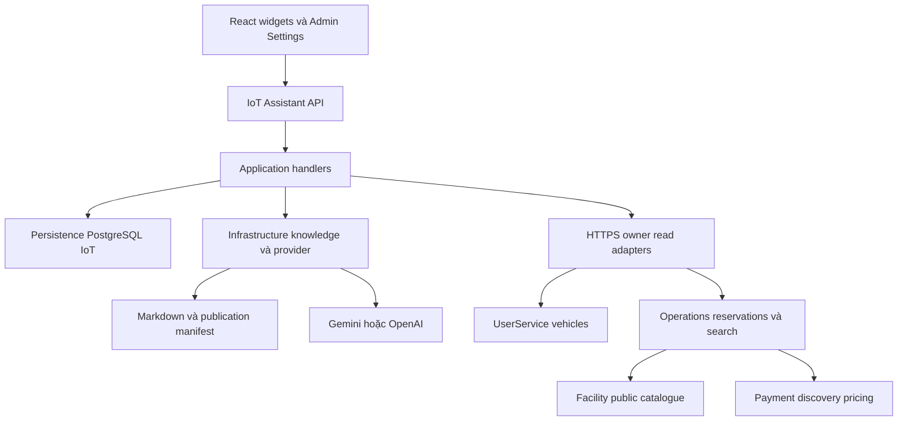

# AIChatbot — Thiết kế và vận hành

Cập nhật tổ chức tài liệu ngày **17/11/2026**. Tài liệu mô tả triển khai đang có trong checkout và ranh giới chức năng. Phạm vi nghiệm thu từng môi trường nằm trong [hướng dẫn tester](../../04-testing/assistant-handoff-testing.md), công việc còn mở nằm trong [roadmap](chatbot-roadmap.md).

## 1. Thành phần và quyền sở hữu

Assistant có bốn assembly trong `src/Services/IoTService`: API, Application, Infrastructure và Persistence. API chịu trách nhiệm host/DI/JWT/route, Application điều phối MediatR và vòng đời yêu cầu, Infrastructure thực hiện HTTP/knowledge/mã hóa, Persistence dùng Npgsql cho transaction và ledger. Python LPR/camera là runtime riêng, không tham gia trả lời FAQ.

UserService sở hữu Account và xe. Facility sở hữu bãi, cấu trúc và catalogue công bố. Operations sở hữu reservation/allocation/session và điều phối tìm bãi. Payment sở hữu bảng giá, tính phí và payment order. Assistant giữ cấu hình AI, credential mã hóa, receipt quản trị/test connection, conversation, message, request và tool-run ledger trong IoT DB.

Khóa Data Protection, PFX và mật khẩu phải được giữ cùng DB để đọc lại credential/cursor sau restart hoặc restore. Quy trình setup và các đường dẫn root-relative thuộc [handoff tester](../../04-testing/assistant-handoff-testing.md#2-chuẩn-bị-môi-trường).

## 2. Vai trò, xác thực và dữ liệu gửi provider

| Vai trò | Chức năng hiện có | Quyền dữ liệu |
| --- | --- | --- |
| Guest | FAQ công khai, hướng dẫn đăng nhập khi cần dữ liệu riêng | Không có lịch sử bền vững hoặc tool Account |
| Driver | FAQ, chat hiện tại, history/reset/recovery, read tool theo capability, bản nháp trong widget | Xe và lịch đặt của chính Account |
| Admin | FAQ và chat riêng, Admin Settings quản trị provider | Chat không có read tool Driver |
| Business/Owner | FAQ, chat riêng, history/reset | Chat chưa đọc doanh thu hay dữ liệu kinh doanh |
| Operator | Widget FAQ công khai khi khả dụng | API hội thoại bảo vệ trả 403 |

JWT RS256 được xác minh bằng public key tin cậy, issuer, audience, lifetime và claim bắt buộc. Account lấy từ `account_id`, role lấy từ token đã kiểm. Resource khác Account trả 404. TOKEN freshness giữ giới hạn stale-claim đã duyệt tới khi token hết hạn. Luồng owner có yêu cầu admission/freshness riêng theo [ADR authorization](../../02-architecture/architecture-decisions/authorization-freshness-and-current-access.md) và [operation classification](../../01-requirements/srs/authorization-operation-classification.md).

Provider FAQ nhận một article public đã duyệt và câu hỏi giới hạn. Driver/OpenAI dùng câu hỏi canonical hoặc title do backend tạo. Với Guest Gemini, một số câu public đã sàng lọc có thể được gửi, câu khác dùng title/câu cố định. Transcript, JWT, Account/User ID, dữ liệu xe và lịch đặt riêng không nằm trong context FAQ provider. Sau login, Guest chỉ chuyển ý định vào ô soạn để người dùng gửi, không nhập transcript vào lịch sử Account.

## 3. Knowledge và xử lý FAQ

Nguồn biên tập duy nhất là [smartpark-knowledge.md](p1/knowledge/smartpark-knowledge.md), phiên bản biên tập 0.4.1. Hai mục `vehicle-guide` và `booking-guide` có thêm bản tiếng Anh trong cùng tệp. Hash xuất bản bao phủ cả hai ngôn ngữ. Runtime đọc cặp `smartpark-knowledge.md` và `publication.json` riêng trong thư mục do `.env` cấu hình. Markdown trong Git đang là bản nháp. Admin duyệt đúng phiên bản, deployment operator xuất bản theo bản ghi duyệt bằng `scripts/setup-assistant-docker.ps1 -PublishKnowledge`.

Loader kiểm SHA-256 của bytes thực tế, version, `publication_state=published`, `review_status=approved`, audience có `public`, người duyệt, `role=admin`, thời gian công bố/hiệu lực và giới hạn cấu trúc. Manifest phải khớp version/hash/thời gian Markdown, không có timestamp tương lai hoặc hết hạn. `role` chỉ ghi metadata, quyền ghi thư mục triển khai cần được kiểm soát. Bộ file thiếu, draft, sai hash hoặc malformed làm nguồn unavailable. Việc sửa draft không tự cập nhật publication runtime.

Generation và citation lấy nội dung tiếng Việt dưới `### Nội dung` hoặc bản tiếng Anh dưới `### English: <title>` của cùng bài, tùy ngôn ngữ yêu cầu và bản đã xuất bản. Aliases, metadata và mục đối chiếu nội bộ phục vụ retrieval/review. Giới hạn loader gồm 256 KiB, 1–30 article có ID duy nhất, title tối đa 200 và nội dung tối đa 6.000 ký tự. Cache theo hash vẫn kiểm bytes, manifest và hiệu lực mỗi lượt đọc.

Luồng FAQ gồm kiểm quyền/readiness/intent → đọc snapshot hợp lệ → normalize/rank title, aliases và nội dung → chọn một article → generation hoặc fallback → kiểm output và kiểm lại Settings/publication trước giao kết quả. Retrieval hiện dùng lexical/rules, có phục hồi typo giới hạn cho alias ngắn duy nhất. Chưa dùng embeddings, vector database hoặc fine-tuning. Thiếu nguồn hay câu mơ hồ trả làm rõ/handoff.

`mode=ai` chứng minh model đã diễn đạt theo nguồn. `mode=knowledge` trả hướng dẫn gốc có nhãn khi không có candidate hoặc sau lỗi recoverable phù hợp. Cấu trúc/citation hợp lệ vẫn cần QA ngữ nghĩa. Nếu bài có bản tiếng Anh trong publication, cả nội dung fallback và citation dùng bản đó khi người dùng yêu cầu tiếng Anh. Bài chỉ có tiếng Việt vẫn ghi rõ giới hạn ngôn ngữ. Các câu wrong-source/unknown đã biết nằm trong handoff mục 4.7.

**Phần A QA — 17/11/2026:** Chỉ thị trả lời Việt/Anh độc lập ở đầu/cuối tin nhắn được nhận trước retrieval, hỗ trợ Unicode NFC và cách nói lịch sự. Chỉ thị rõ ưu tiên hơn locale; nếu không có chỉ thị, Guest giữ contract locale `vi`/`en`/`auto`, chat đăng nhập nhận diện ngôn ngữ câu hỏi rồi dùng locale hội thoại khi không xác định. Không tự đổi locale bền vững. `replyLocale` của Guest vẫn chỉ có với `locale=auto` theo contract.

Các câu hỏi công khai về loại xe và cách đặt chỗ được nhận bằng grammar toàn câu Việt–Anh, chọn nguồn `vehicle-guide`/`booking-guide` và câu hỏi canonical do backend tạo. Yêu cầu đặt chỗ theo bước, kể cả `Cách đặt chỗ?`, yêu cầu model đánh số các bước có trong nguồn. Fallback knowledge định dạng lại đoạn chuẩn bị đặt chỗ tiếng Việt của corpus 0.4.0 thành các bước, giữ nguyên các đoạn điều kiện còn lại và excerpt trích dẫn. Không thêm quy tắc hoặc bản dịch hardcode. Nếu nội dung đã công bố thay đổi cấu trúc đoạn chuẩn bị, cần retest định dạng; formatter trả nguyên nguồn khi không nhận cấu trúc, không tự suy ra bước mới. Provider không khả dụng và chưa có nguồn tiếng Anh thì tiếp tục ghi rõ giới hạn tiếng Việt.

Câu hỏi vị trí màn hình xe, như `Tôi có thể xem những xe đã đăng ký của mình ở đâu?`, trả hướng dẫn menu tài khoản → **My Vehicles** (`mode=system`, `outcome=answered`, không sources/cards). Đây là hướng dẫn UI đã có, không phải kết quả đọc dữ liệu hay câu trả lời model. Câu `Xe của tôi` vẫn đi tool đọc xe theo quyền Driver. Các câu chứa yêu cầu cá nhân, thông tin nhạy cảm hoặc nội dung không thuộc grammar tiếp tục qua guard hiện hữu; không mở quyền đọc và không gửi transcript ra provider. Tóm tắt hội thoại được xử lý trong mục 4. Tìm bãi gần đây phụ thuộc kết nối tra cứu backend.

### Provider và quản trị

Admin lưu cấu hình ở trạng thái disabled, discover model bằng key, Test connection, bật configuration, provider rồi System chatbot. Test connection có receipt riêng và không yêu cầu knowledge, nên có thể kiểm Gemini trước khi hoàn tất publication. Bật một provider chưa tự bật configuration bên trong. Handoff mục 2.5–2.7 hướng dẫn thao tác và xử lý lỗi.

Routing chọn configuration đã bật/chưa revoke theo thứ tự provider và key priority, tối đa ba candidate. Budget hiện tại là 7 giây mỗi attempt, AI-chain 18 giây trong tổng 20 giây, cooldown 60 giây. Lỗi upstream/network recoverable có thể chuyển candidate, output sai cấu trúc không retry mù. Kết quả hợp lệ kể cả no-answer kết thúc failover. HTTP client được tái sử dụng, credential gắn theo request, redirect/cookie mặc định tắt. Browser gọi Assistant, không giữ key provider.

Adapter trong checkout dùng OpenAI Responses với `store=false`, `stream=false` và Gemini `generateContent`, kiểm JSON `reply`/`sourceIds`, response size và nguồn được phép. Tắt hệ thống hoặc đổi publication/revision giữa request có thể ngăn giao câu trả lời. Request đã dispatch vẫn có thể phát sinh phí. Chi tiết mutation, receipts và lỗi nằm trong [contract S01](../api/assistant-s01-end-to-end-api-design.md).

## 4. Hội thoại, idempotency và recovery

Mỗi Account và role Driver/Admin/Owner có một chat hiện tại, giữ đến khi người dùng xác nhận reset. Reset ẩn chat ngay, hủy yêu cầu đang chạy và đặt hạn xóa sau bảy ngày, có ngoại lệ hold đã duyệt. Message đầu tiếp theo tạo chat thay thế. Legacy chat giữ expiry/hold ban đầu theo [migration current-chat](../../../scripts/database/migrations/20261110_iot_assistant_current_chat.sql).

FAQ loại xe trả nội dung đã xuất bản khi có bản đúng ngôn ngữ yêu cầu, giữ nguyên mức độ xác nhận hỗ trợ và citation. Bản legacy chỉ có tiếng Việt vẫn có thể dùng model dịch khi hỏi tiếng Anh.

Yêu cầu tóm tắt hội thoại đã đăng nhập được xử lý cục bộ theo Account, role và conversation hiện hành, liệt kê chủ đề từ tối đa sáu lượt hoàn tất trong ngân sách 12.000 ký tự. Trả tiếng Việt/Anh theo chỉ thị. Bản tóm tắt không gửi transcript ra provider, lược bỏ chi tiết nhạy cảm và ghi rõ phạm vi các lượt gần đây. Hội thoại mới chưa có lượt hoàn tất trả thông báo trống. Guest nhận giải thích cần bắt đầu hội thoại đăng nhập.

Context continuation FAQ giới hạn sáu lượt hoàn tất và 12.000 ký tự UTF-16, cùng version nguồn. Đây là context cục bộ chọn nguồn, chưa là booking draft nhiều lượt. Chat input tối đa 4.000, output tối đa 8.000 ký tự. Driver overall budget 25 giây, generation tối đa 20 giây. Recovery kiểm mỗi giây, generation kiểm cancel và Settings mỗi 100 ms.

FE lấy current conversation/history trước khi gửi. Admission ghi user message và request ledger trong transaction với `clientMessageId`, fingerprint và `expectedRevision`. Replay cùng yêu cầu tra lại kết quả, payload khác hoặc revision stale trả lỗi theo contract. POST có thể trả terminal 200 hoặc running 202. Mất kết nối sau admission cần lookup request, không tự tạo ID mới để gửi lại cùng thao tác. Cancel/finish cạnh tranh được transaction xử lý và lịch sử giữ kết quả thực tế.

Global off chặn nhận câu mới nhưng history và request recovery còn dùng được khi quyền hợp lệ. FE dùng Account generation guard để tránh hiển thị response cũ sau đổi tài khoản. Rate limits theo process gồm Driver hai generation đồng thời và 10 message/phút/Account, protected read/recovery 60/phút/Account. Guest hai POST đồng thời và 10 POST/phút/socket IP, status 60/phút/IP. Triển khai nhiều replica cần đánh giá quota/proxy riêng.

Các migration IoT cần backup/restore cùng keyring/PFX. Với DB cũ, dừng version cũ và review migration trước rollout. Rollback về app cũ sử dụng backup trước upgrade. Các scenario concurrency, kill/restart, replay, reset/retention và backup/restore có harness riêng, kết quả mỗi môi trường ghi vào handoff. Hướng dẫn SQL/rollout gốc ở [lịch sử thiết kế](archive/design-history.md#legacy-guide).

## 5. Read tool và ranh giới nghiệp vụ

Read capability phụ thuộc cấu hình, publication/readiness, HTTPS trust và nguồn owner. Driver private reads chuyển Bearer tới endpoint cố định theo allowlist. Search là public read, không chuyển Driver Bearer vào search. Lỗi nguồn được biểu diễn unavailable, không biến thành danh sách rỗng hoặc lấy dữ liệu fixture thay thế.

| Nguồn | API owner | Kết quả hiện có |
| --- | --- | --- |
| User | `/api/vehicles` | Xe của Driver hiện tại |
| Operations | `/api/me/reservations`, `/{id}` | Lịch đặt và chi tiết theo scope Account |
| Operations search | `/api/parking-search` | Catalogue/giá công khai qua Facility và Payment khi đủ cấu hình |

Assistant chuyển private results trực tiếp thành thẻ/phản hồi có cấu trúc. Tool đọc không cho model truy cập DB hoặc chọn URL tùy ý. Capabilities=true chỉ báo nhánh được mở, cần test câu hỏi thật và đối chiếu UI owner. Search không chứng minh positive capacity hoặc giữ chỗ được suốt khoảng thời gian. Site chưa được owner publish không là fixture tìm bãi hợp lệ. [Read integration](../api/assistant-s06-read-integration.md) và [availability authority](../api/assistant-s06-availability-authority.md) giữ contract chi tiết.

## 6. Draft và thao tác ghi

Widget Driver hiện parse bản nháp trong phiên gồm loại xe, site và giờ, có thể hỏi phần thiếu. Bản này chưa nối sang form xác nhận và chưa tạo reservation/payment. `prepareReservation=false` tiếp tục đúng. AI không tự đổi xe, hủy booking, đánh dấu thanh toán hoặc thực hiện thao tác quản trị bằng câu chat.

Đích mở rộng cần owner-authoritative capacity/policy, quote có hạn, snapshot giá được chấp nhận, xác nhận của người dùng, REQUEST admission và idempotency/result lookup của writer. Ghi reservation và thanh toán thuộc service owner. Các blocker A01–A06/G04–G07, owner và tiêu chí nghiệm thu được giữ trong [roadmap](chatbot-roadmap.md).

## 7. API và nguồn tham chiếu

| Nhóm | Entry point dưới `/api/assistant` |
| --- | --- |
| Guest | `GET /status`, `POST /guest/messages` |
| Chat Driver/Admin/Owner | `GET /capabilities`, `GET/POST /conversations`, `GET /conversations/{id}`, `GET/POST /conversations/{id}/messages` |
| Recovery/reset | `GET /conversations/{id}/requests/{clientMessageId}`, `POST` cùng route thêm `/cancel`, `POST /conversations/{id}/reset` |
| Admin | `/admin/settings`, `/admin/mutations`, `/admin/models/discover`, `/admin/configurations/{id}/test` theo verb contract |

Route/DTO/error, status replay và admission chi tiết thuộc [contract S01](../api/assistant-s01-end-to-end-api-design.md), đọc cùng [P0 auth contract](../api/iot-assistant-p0-api-design.md) và ADR hiện hành. Các khảo sát từng ghi missing/demo-only là bằng chứng tại ngày khảo sát, được giữ trong [archive](archive/design-history.md#legacy-guide).

## 8. Demo và setup phát triển

Docker normal dùng `AssistantGuestHost` và API `/api/assistant`. Chỉ environment `Demo` với flag riêng chọn `AssistantDemoHost` và `/api/demo/assistant`, dữ liệu demo luôn có nhãn. Các lớp mang tên `ManagedDemoGenerator` vẫn được normal host tái sử dụng. FE demo là entrypoint phát triển có guard, không thay widget dashboard.

Setup máy mới/add-on, .env, JWT cũ, knowledge, provider, seed, Postman và test case theo role nằm trong [handoff tester](../../04-testing/assistant-handoff-testing.md). Các lệnh demo độc lập và chi tiết khảo sát cũ được giữ trong [archive hướng dẫn](archive/design-history.md#legacy-guide). Chỉ dùng các lệnh của đúng environment và scope được bàn giao.
