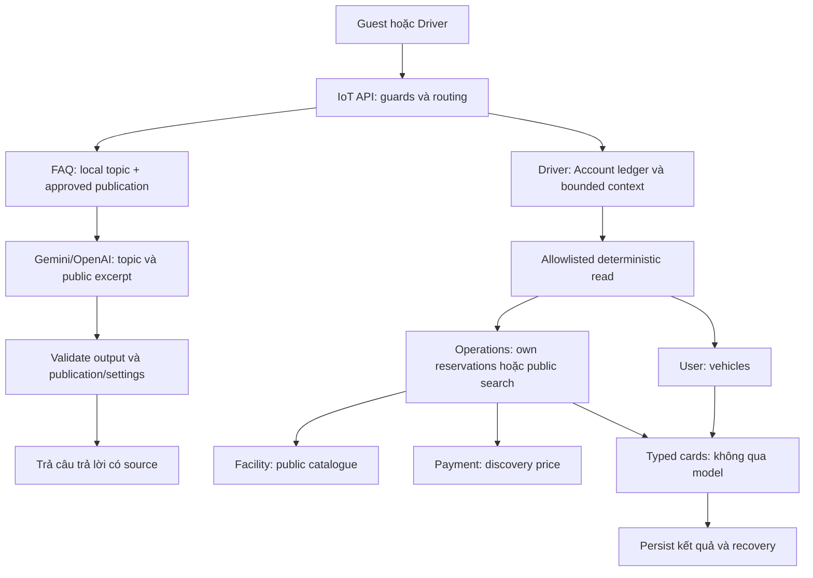

# Chatbot — Lịch sử thiết kế và kế hoạch

Lưu trữ theo yêu cầu gộp tài liệu ngày 08/11/2026. Nội dung dưới đây là lịch sử, không phải trạng thái hiện tại hoặc phê duyệt mới. Các công việc chưa xong vẫn theo dõi ở [nhật ký đang làm](../../../../ai/tasks/active/chatbot-development-progress.md).

- [assistant-overview-and-roadmap.md](#tai-lieu-1)
- [assistant-reintegration-plan.md](#tai-lieu-2)
- [assistant-r1-jwt-decision.md](#tai-lieu-3)
- [assistant-delivery-plan.md](#tai-lieu-4)
- [ASSISTANT-S01-S10-MASTER-REVIEW.md](#tai-lieu-5)
- [LEADER-REVIEW-DECISIONS.md](#tai-lieu-6)

<a id="tai-lieu-1"></a>

## Bản gốc: docs/03-design/ai/assistant-overview-and-roadmap.md

<a id="tai-lieu-1-ai-chatbot-smartpark--tổng-quan-hệ-thống-và-lộ-trình-hoàn-thiện"></a>

# AI Chatbot SmartPark — Tổng quan hệ thống và lộ trình hoàn thiện

**Cập nhật mục tiêu S01 — 05/11/2026:** mục tiêu đã được người dùng xác nhận gồm guest FAQ Việt/Anh, Driver tra xe/lịch đặt/chi tiết qua API thật, chuẩn bị và sửa draft qua hội thoại, rồi chuyển form thường để người dùng xác nhận. Settings gom provider/key/model, discovery/test, ưu tiên và failover; khách không thấy provider/model. Đây là phạm vi kế hoạch S01–S10, không còn chỉ FAQ đăng nhập. Xem [contract v0.4.1](../../api/assistant-s01-end-to-end-api-design.md), [ma trận API](../assistant-s01-api-matrix.md) và [delivery plan](../design-and-development-plan.md) để triển khai mới. Các mục recovery B dưới đây giữ làm lịch sử/nền tảng; hạn chế “FAQ đầu tiên” không thu hẹp mục tiêu mới. B chỉ là quyết định JWT của Assistant, không thay quyền hiện hành của domain services.

**Khảo sát lại sau develop (HEAD 3d3def76 + staged Assistant):** search/lịch đặt Driver vẫn localStorage; own vehicles có HTTP thật (ActiveBookings mới bổ sung metadata xe từ API). Facility đã chuyển routes sang controller, vẫn owner scope. Operations có checkout/gate và Payment có create order/cash, nhưng prepare route/DTO lệch nhau; còn mock authentication và thiếu resource checks/replay correctness. Driver quote/create/own list-detail vẫn chưa có. FE generic revocation hub chưa khớp route/event UserService (G08). Chưa nghiệm thu runtime trong S01.

Authorization ADR/matrix 04/11 đã chốt TOKEN cho reads/default, REQUEST Account-current Saga cho create reservation và SERVICE cho invocation không có user; không hỏi lại hướng này. D01 chỉ còn delegation/trust mapping; D02–D04 và wire/use-case details D05 vẫn IN REVIEW. Phần giải thích recovery B bên dưới là lịch sử; câu “mỗi domain request phải current-session” nếu gặp ở tài liệu cũ đã được ADR supersede. Xem matrix §6 và contract v0.4.1 trước S02–S08.

Cập nhật: 04/11/2026. Dành cho người triển khai và leader; đọc độc lập, không cần mở tài liệu khác. Đây là bản tổng hợp định hướng và trạng thái, không phải xác nhận mọi đề xuất đã được duyệt. Provider và knowledge đã được tái tích hợp cho demo FAQ; người dùng báo demo đã chạy được. Bộ knowledge một file được kiểm thử ngoại tuyến, chưa nghiệm thu bản dịch qua provider thật sau thay đổi này. Không yêu cầu chọn lại các quyết định đã có.

<a id="tai-lieu-1-1-mục-tiêu-cuối-cùng-là-gì"></a>

## 1. Mục tiêu cuối cùng là gì?

Xây chatbot trong SmartPark để người dùng hỏi bằng ngôn ngữ tự nhiên và nhận trợ giúp đúng phạm vi, đúng quyền, dựa trên nguồn được duyệt. Chatbot phải dùng được trong ứng dụng đang có, không phá đăng nhập, database hoặc chức năng của các thành viên khác.

**Đích hoàn thành đầu tiên: chatbot FAQ dành cho Driver, có đăng nhập, lưu hội thoại riêng theo tài khoản, trả lời bằng AI dựa trên tài liệu được duyệt, có nguồn và xử lý lỗi rõ ràng.** FAQ nghĩa là hỏi đáp hướng dẫn sử dụng và chính sách tĩnh. Đây là phạm vi khôi phục đầu tiên, chưa phải toàn bộ khả năng AI của SmartPark.

Ví dụ đạt mục tiêu: Driver đăng nhập, hỏi cách đặt chỗ; chatbot giải thích theo tài liệu hiện hành và hiển thị nguồn. Người dùng mở lại hội thoại sau khi tải lại trang. Tài khoản khác không đọc được hội thoại đó. Khi chưa có nguồn phù hợp, chatbot nói rõ giới hạn thay vì tự đoán.

Sau khi phần này ổn mới xét tìm bãi theo dữ liệu thật, đọc đặt chỗ của chính người dùng, chuẩn bị biểu mẫu đặt chỗ hoặc hỗ trợ tác vụ khác. Mỗi chức năng mở rộng có kiểm tra quyền và API nghiệp vụ riêng. AI không tự quyết giá, thu tiền, giữ chỗ hoặc cấp quyền.

<a id="tai-lieu-1-2-vì-sao-đang-có-cảm-giác-nhiều-phần-rời-nhau"></a>

## 2. Vì sao đang có cảm giác nhiều phần rời nhau?

Quá trình hiện tại có hai việc khác mục đích:

| Việc | Mục đích | Kết quả chứng minh được |
| --- | --- | --- |
| Khôi phục chatbot thật từ code cũ | Đưa chức năng vào baseline hiện tại, sửa phần lệch kiến trúc và bảo mật | Nền tảng xác thực/lỗi đã được triển khai một phần; chưa hoàn chỉnh |
| Làm demo bằng interface và mock theo yêu cầu leader | Kiểm tra giao diện có gửi đến backend, nhận phản hồi, xử lý chờ/lỗi hay không trước khi có cấu hình thật | Có chat mô phỏng chạy được, chưa có model hoặc dữ liệu nghiệp vụ |

Demo là một mốc kiểm tra kết nối, không thay thế phần xác thực, lưu trữ, tri thức hoặc provider còn thiếu. Docker chỉ là cách chạy chương trình; Docker chạy được không có nghĩa chatbot đã có AI thật.

**Không cần làm lại từ đầu.** Giữ code nền đã kiểm chứng, giữ demo làm công cụ thử, rồi quay lại hoàn thiện các phần còn thiếu theo thứ tự ở mục 7.

<a id="tai-lieu-1-3-phương-án-b-nghĩa-là-gì"></a>

## 3. Phương án B nghĩa là gì?

Phương án B chỉ quyết định **cách API chatbot kiểm tra đăng nhập**. Nó không chọn provider, không quyết định lưu hội thoại và không phải tên một loại AI.

Luồng đăng nhập và gọi chatbot thật:

1. UserService xác thực đăng nhập và cấp JWT, tức token có chữ ký và thời hạn.
2. Frontend gửi token đó khi gọi API chatbot tại IoTService.
3. IoTService tự kiểm tra chữ ký bằng public key tin cậy, bên phát hành, đối tượng nhận, thời hạn và các trường nhận diện bắt buộc.
4. IoT lấy AccountId và role từ token đã xác minh, kiểm quyền và chủ sở hữu hội thoại.
5. Chỉ sau đó mới xử lý câu hỏi.

IoT **không gọi lại UserService để hỏi tài khoản hiện tại ở mỗi request**, không đọc database của UserService và không giữ private key để cấp token. UserService vẫn phụ trách đăng nhập, refresh token và quản lý tài khoản.

| Khái niệm | Ý nghĩa và trách nhiệm |
| --- | --- |
| Public key | IoT dùng kiểm tra chữ ký; người vận hành cung cấp từ nguồn tin cậy |
| Private key | UserService dùng ký token; không chuyển sang IoT |
| Issuer / audience | Xác định bên phát hành và đối tượng nhận token; phải khớp cấu hình thực tế, không đoán từ token |
| AccountId | Chủ sở hữu hội thoại; các Account khác nhau không đọc chéo dù cùng một User |
| UserId | Nhận diện User để liên hệ ngữ cảnh; không thay AccountId làm chủ hội thoại |
| ICurrentActor | Interface nội bộ cung cấp danh tính đã xác minh cho Application; tên này không có nghĩa phải gọi UserService |
| Capabilities | API cho frontend biết chức năng nào thực sự sẵn sàng; không tự cấp quyền cho người dùng |

Cấu hình xác thực hiện triển khai yêu cầu JWT RS256, chữ ký RSA hợp lệ, thời hạn hợp lệ và claims bắt buộc. Access token baseline có thời hạn 15 phút. Người dùng đã xác nhận chấp nhận giới hạn của B: nếu tài khoản bị khóa, đổi role hoặc token bị thu hồi sau lúc cấp, IoT có thể vẫn nhận token cũ đến hết hạn. B hiện không bảo đảm thu hồi tức thời. Muốn thay đổi giới hạn này phải duyệt thêm cơ chế kiểm tra/đồng bộ; không tự lén bổ sung phụ thuộc UserService.

Việc tạm hoãn ICurrentActor trong demo nghĩa là demo không dùng tài khoản thật. Không có nghĩa chatbot production có thể bỏ kiểm tra danh tính.

<a id="tai-lieu-1-4-ai-được-dùng-và-chatbot-được-trả-lời-gì"></a>

## 4. Ai được dùng, và chatbot được trả lời gì?

| Người dùng / câu hỏi | Phạm vi đầu tiên | Vì sao |
| --- | --- | --- |
| Driver hỏi hướng dẫn sử dụng/chính sách | Có, khi FAQ thật hoàn thiện và nguồn được duyệt | Đúng phạm vi khôi phục hiện tại |
| Owner hỏi doanh thu tháng này | Chưa | Cần hợp đồng API doanh thu, quyền Owner và phạm vi bãi do Owner quản lý; không thể chỉ mở thêm role |
| Operator hoặc Admin dùng API Driver | Không mặc định; API hiện thiết kế chỉ nhận Driver | Role cao hơn không tự có quyền đọc hội thoại Driver |
| Driver hỏi số chỗ trống, giá, trạng thái thanh toán thực tế | Chưa trong FAQ đầu tiên | Phải lấy từ API nghiệp vụ có thẩm quyền; model/tài liệu tĩnh không biết trạng thái hiện tại |
| Người mở trang demo | Có thể thử câu trả lời mẫu công khai | Demo tách riêng, không chứng minh phân quyền của hệ thống thật |

JWT cho biết danh tính/role tại thời điểm cấp; không tự cung cấp số liệu doanh thu hoặc phạm vi dữ liệu được truy cập. Chức năng doanh thu và mở rộng role để sau, đúng yêu cầu đã thống nhất.

<a id="tai-lieu-1-5-cấu-trúc-hệ-thống-làm-ở-đâu-vì-sao-đặt-ở-đó"></a>

## 5. Cấu trúc hệ thống: làm ở đâu, vì sao đặt ở đó?

Luồng mục tiêu:

```text
Frontend SmartPark
  → API IoT: JWT, quyền, kiểm tra dữ liệu đầu vào
  → Application: điều phối nghiệp vụ qua IMediator
      → Kho hội thoại: kiểm tra Account, lưu/đọc trạng thái
      → Kho tri thức: lấy nội dung được phép sử dụng
      → Adapter provider: gọi model bằng cấu hình backend
  → Lưu kết quả, kiểm điều kiện trả dữ liệu
  → Frontend hiển thị câu trả lời, nguồn hoặc lỗi
```

| Thành phần | Làm gì / vì sao | Vị trí triển khai |
| --- | --- | --- |
| Frontend | Hiển thị chat, gửi yêu cầu, xử lý token theo luồng hiện có; không giữ provider key | `FE/src`, tích hợp hẹp vào ứng dụng hiện tại |
| API | Nhận HTTP, xác thực JWT, tạo actor tin cậy, trả lỗi thống nhất, health/readiness | `src/Services/IoTService/SmartParking.IoTService.API` |
| Application | Điều phối câu hỏi/hội thoại và định nghĩa interface; không phụ thuộc HttpContext hoặc SDK provider | `src/Services/IoTService/SmartParking.IoTService.Application` |
| Domain | Quy tắc sở hữu và vòng đời hội thoại khi triển khai dữ liệu thật | Trong IoTService; bổ sung theo kiến trúc đã review, chưa coi project Domain là đã tồn tại |
| Infrastructure | Adapter provider, nguồn tri thức và các tích hợp ngoài; mock hiện cũng nằm ở đây | `src/Services/IoTService/SmartParking.IoTService.Infrastructure` |
| Persistence | Truy cập kho hội thoại của IoT, lưu request/kết quả; không truy cập bảng service khác | Phần persistence cần khôi phục có chọn lọc và review schema trước khi thêm |
| UserService | Cấp/refresh JWT và quản lý tài khoản; cung cấp hợp đồng issuer/audience/public key | Service đang có của nhóm, không sao chép code sang IoT |
| Các service nghiệp vụ | Xác định dữ liệu và quyền thật khi có chức năng mở rộng | Gọi API của service sở hữu; không đọc trực tiếp DB của họ |
| Docker | Đóng gói/chạy các tiến trình | Tận dụng Dockerfile chung, demo dùng file Compose bổ sung riêng |

Hiện IoT có các project API, Application và Infrastructure cho phần này. Không tạo đủ mọi project/abstraction chỉ để sơ đồ đẹp; thêm Domain/Persistence khi phần hội thoại thực sự cần, theo quy chuẩn của repo.

<a id="tai-lieu-1-6-trạng-thái-thực-tế-đến-hiện-tại"></a>

## 6. Trạng thái thực tế đến hiện tại

| Phần | Đã có | Còn thiếu / giới hạn |
| --- | --- | --- |
| Chọn lọc recovery | Đã rà hướng khôi phục trên baseline hiện tại | Không merge nguyên nhánh recovery; mỗi phần tiếp theo vẫn phải đối chiếu code hiện tại |
| JWT phương án B | Code xác minh token và test HTTP bằng khóa RSA test | Chưa nối cấu hình thật vào host production và chưa nghiệm thu bằng token triển khai thật |
| Actor, lỗi, capabilities | Có code và kiểm thử riêng; capability thật chưa bật FAQ | Chưa tạo thành luồng chatbot production hoàn chỉnh |
| Host demo | Chạy opt-in ở môi trường Demo, có health/CORS | Không mở API production hoặc mô phỏng tài khoản thật |
| Chat demo | Frontend gọi API, hỗ trợ mock hoặc provider theo cấu hình và hiển thị nguồn | Chưa gọi live bằng key thật trong session; không có lịch sử server, reload mất hội thoại |
| Provider | Người dùng đã yêu cầu cả Google AI Studio/Gemini và OpenAI ngày 29/10; recovery có GeminiFaqModel và OpenAiFaqModel | Đã có adapter demo trong baseline hiện tại và test HTTP giả lập; chưa có nghiệm thu live. Model đã đối chiếu trang tài liệu chính thức ngày 03/11/2026: `gemini-3.8-flash` và `gpt-5.4-mini-2026-03-17`; quyền tài khoản/quota và kết quả live vẫn chưa xác minh |
| Tri thức FAQ | Ngày 04/11 người dùng duyệt gộp thành một file tiếng Việt smartpark-knowledge.md, giữ 10 chủ đề và mã nguồn; AI diễn đạt tiếng Anh theo câu hỏi | Bộ đọc mới tách mục và tìm từ khóa Việt/Anh, chỉ gửi phần Nội dung; mỗi câu hỏi đọc lại file. Cần cập nhật image Assistant một lần để nhận định dạng mới. 72 case recovery chưa được đánh giá đầy đủ; publication production và chất lượng model thật vẫn là việc riêng |
| Kho hội thoại | Có thiết kế đích | Chưa triển khai storage, ownership, chống trùng, phục hồi và retention hoàn chỉnh |
| Docker demo | Có overlay, kiểm tra cấu hình ghép và review tĩnh | Chưa có bằng chứng build/runtime Docker thành công trong session; từng bị chặn vì `.env` thiếu mật khẩu RabbitMQ |
| UI chatbot thật | Đã có trang demo tách riêng | Chưa tích hợp đầy đủ đăng nhập, lịch sử, nguồn và phục hồi vào UI chính |

Bằng chứng kiểm thử đã ghi nhận ở mốc code gần nhất: backend 500 pass, 68 skipped; 5 test transport frontend mới pass; build frontend và kiểm tra trình duyệt demo pass. Full frontend suite còn 31 lỗi harness ở phần không thay đổi, không được báo toàn bộ frontend xanh. Đây là kết quả lịch sử tại mốc đó, không thay cho kiểm tra các thay đổi sau này. Test mock/RSA test không chứng minh provider hoặc hệ thống triển khai thật đã chạy.

<a id="tai-lieu-1-7-một-lộ-trình-duy-nhất-từ-hiện-tại-đến-chatbot-faq-hoàn-chỉnh"></a>

## 7. Một lộ trình duy nhất từ hiện tại đến chatbot FAQ hoàn chỉnh

Không tiếp tục mở nhiều hướng đồng thời. Ưu tiên kế tiếp theo phản hồi mới nhất: **khôi phục knowledge/retrieval và hai adapter đã chọn → nối demo FAQ trả lời bằng model thật, có nguồn → hoàn thiện host JWT và storage → UI chính → nghiệm thu toàn luồng**. Các bước chi tiết bên dưới là các khối công việc; demo AI có thể thực hiện phần knowledge/provider trước host/storage, nhưng nghiệm thu production vẫn cần đủ các khối. Demo hiện có được giữ để kiểm tra độc lập, không cần viết lại.

<a id="tai-lieu-1-bước-1--chốt-đầu-vào-để-triển-khai-đúng"></a>

### Bước 1 — Chốt đầu vào để triển khai đúng

- **Làm gì:** xác nhận Driver FAQ là đích đầu tiên; ghi rõ các lựa chọn vận hành còn thiếu trong mục 8.
- **Vì sao:** tránh vừa viết code vừa thay phạm vi, hoặc coi khuyến nghị của agent là quyết định của leader.
- **Ở đâu / ai:** leader phối hợp người phụ trách UserService, IoT, nội dung và vận hành; người triển khai ghi lại lựa chọn và người duyệt trong cùng session.
- **Cần gì:** thông tin JWT, nguồn nội dung, mapping provider/model đã có trong recovery, giới hạn dữ liệu/chi phí, chính sách hội thoại.
- **Xong khi:** mỗi mục có trạng thái đã chốt hoặc để sau rõ ràng; phần nào chưa chốt chỉ chặn đúng công việc phụ thuộc nó.

<a id="tai-lieu-1-bước-2--nối-tri-thức-được-duyệt-và-ai-provider-thật"></a>

### Bước 2 — Nối tri thức được duyệt và AI provider thật

- **Làm gì:** rà nội dung FAQ, quản lý phiên bản/công bố, tìm đoạn liên quan, gửi ngữ cảnh giới hạn đến model, tạo câu trả lời và nguồn từ dữ liệu đã kiểm chứng.
- **Vì sao:** chỉ nối model thì có khả năng tạo văn bản, chưa bảo đảm trả lời đúng SmartPark. Model không tự có chính sách hiện hành của nhóm.
- **Ở đâu:** interface và điều phối trong Application; adapter model/tri thức trong Infrastructure; endpoint/model/key ở cấu hình backend.
- **Cần gì:** provider/model được duyệt, key và người quản lý, dữ liệu được phép gửi, ngân sách, corpus đã được người có thẩm quyền công bố, bộ câu hỏi đánh giá.
- **Cách làm:** khôi phục chọn lọc cả Gemini và OpenAI theo quyết định đã có. Ngày04/11 người dùng xác nhận dùng2–3key/API dự phòng: managed xét ưu tiên provider/key đang bật, tối đa3attempt trong20giây, không lặp cùng key; lỗi provider/model chung chuyển vendor thay vì thử hết key cùng model. Hết lựa chọn thì hiển thị hướng dẫn thật từ knowledge với nhãn riêng, không mock hoặc giả câu trả lời AI. Chế độ provider trực tiếp vẫn một attempt. Không tự đổi model hoặc retry vô hạn; nghiệm thu failover/cost/cancel bằng provider giả lập trước live test có kiểm soát.
- **Xong khi:** trả lời có nguồn đúng; thiếu nguồn thì nói giới hạn; không bịa dữ liệu động; nội dung gây nhiễu không vượt quyền; lỗi key/hết quota/timeout được xử lý an toàn; đo chất lượng và chi phí trên bộ test đã thống nhất.

Mốc demo tiếp theo phải có retrieval từ knowledge đã có, gọi provider thật và trả nguồn trên UI hiện có. Không coi câu trả lời hardcode là nghiệm thu demo AI. Có thể hoàn thiện mốc này trước storage/auth production với dữ liệu thử được phép; không tự coi metadata draft là publication production. Giữ mock cho test tự động, không tạo thêm ứng dụng demo.

<a id="tai-lieu-1-bước-3--hoàn-thiện-host-thật-và-xác-thực-phương-án-b"></a>

### Bước 3 — Hoàn thiện host thật và xác thực phương án B

- **Làm gì:** nối issuer/audience/public key từ cấu hình tin cậy; đăng ký actor và API được bảo vệ; xử lý cấu hình lỗi, thay key, health/readiness và CORS.
- **Vì sao:** có model trả lời được nhưng chưa xác thực/sở hữu đúng thì chưa thể phục vụ người dùng thật.
- **Ở đâu:** composition root và Authentication/Http của IoT API; dùng cơ chế token hiện tại của frontend/UserService.
- **Cần gì:** quyết định lỗi cấu hình/thay khóa và môi trường test token tích hợp. Chưa cần gọi provider để test auth.
- **Xong khi:** token đúng truy cập được; sai chữ ký/hết hạn bị chặn; role ngoài Driver bị từ chối; cấu hình lỗi không mở mock hoặc báo sẵn sàng sai; test thay key đúng chính sách. Hai reviewer kiểm tra và đóng finding.

<a id="tai-lieu-1-bước-4--lưu-hội-thoại-và-xử-lý-gửi-lại-an-toàn"></a>

### Bước 4 — Lưu hội thoại và xử lý gửi lại an toàn

- **Làm gì:** tạo/list/đọc hội thoại, đọc tin nhắn, gửi tin và tra trạng thái yêu cầu; gắn ownership theo AccountId; lưu trạng thái đang chạy/thành công/thất bại.
- **Vì sao:** reload không mất lịch sử; timeout có thể tra kết quả thay vì gửi một lượt mới; tài khoản khác không đọc được dữ liệu.
- **Ở đâu:** Application/Domain/Persistence của IoT và database thuộc IoT. SQL migration phải được review trước khi áp dụng.
- **Cần gì:** schema hiện tại, quyền môi trường DB test, chính sách hết hạn/xóa, xử lý token hết hạn giữa lượt, deadline và quy tắc chống trùng.
- **Thiết kế cần giữ:** client dùng mã ổn định cho cùng một lần gửi; backend không ghi/gọi model lại khi replay; revision phát hiện hội thoại đã đổi; chỉ một lượt đang xử lý trên một hội thoại. Không giữ transaction DB trong lúc chờ model.
- **Xong khi:** test PostgreSQL thật chứng minh isolation giữa Account, cạnh tranh đồng thời, gửi trùng, timeout/recovery và hết hạn dữ liệu. Chưa có DB test thì ghi chưa xác minh, không lấy mock thay bằng chứng concurrency.

<a id="tai-lieu-1-bước-5--tích-hợp-chatbot-thật-vào-frontend-hiện-tại"></a>

### Bước 5 — Tích hợp chatbot thật vào frontend hiện tại

- **Làm gì:** dùng token/session hiện có; hiển thị capabilities, lịch sử, nguồn, trạng thái gửi và lỗi; tra kết quả sau timeout thay vì gửi mới tùy tiện.
- **Vì sao:** trang demo hiện chưa kiểm tra logout, refresh token, đổi Account và lịch sử riêng tư.
- **Ở đâu:** transport/session/components chat của FE; thay đổi tối thiểu ở điểm gắn UI, không chép đè auth từ recovery.
- **Cần gì:** API ổn định, ownership và recovery backend đã kiểm chứng, quy tắc UI khi hết phiên/đổi Account.
- **Xong khi:** không lộ phản hồi cũ sau logout/đổi Account; “Hội thoại mới” không lẫn câu trả lời; reload phục hồi đúng lịch sử; mobile/desktop dùng được; lỗi provider không bị hiểu nhầm thành lỗi đăng nhập người dùng.

<a id="tai-lieu-1-bước-6--chạy-tích-hợp-nghiệm-thu-và-bàn-giao"></a>

### Bước 6 — Chạy tích hợp, nghiệm thu và bàn giao

- **Làm gì:** kiểm tra trên môi trường gần triển khai thật với JWT, kho hội thoại, corpus và provider thật; cấu hình host/Docker theo cách nhóm vận hành.
- **Vì sao:** test từng thành phần không chứng minh toàn hệ thống hoạt động cùng nhau.
- **Ở đâu:** môi trường test được nhóm cho phép; cấu hình/secret riêng từng môi trường, không dùng mock fallback.
- **Cần gì:** người vận hành, key/secret hợp lệ, log an toàn, giới hạn chi phí, kế hoạch thay key và xử lý sự cố, phương án rollback không xóa dữ liệu.
- **Xong khi:** toàn bộ tiêu chí ở mục 10 có bằng chứng; hai review độc lập không còn finding phải sửa; leader chấp thuận đưa vào sử dụng theo phạm vi đã chốt.

<a id="tai-lieu-1-8-quyết-định-nào-đã-có-quyết-định-nào-còn-cần-duyệt"></a>

## 8. Quyết định nào đã có, quyết định nào còn cần duyệt?

| Chủ đề | Trạng thái hiện tại | Đề xuất / lựa chọn cần chốt | Ai cần tham gia và chặn phần nào |
| --- | --- | --- | --- |
| JWT xác minh cục bộ | Đã chọn B; chấp nhận token cũ đến hết hạn | Giữ hướng này, không tự thêm gọi UserService mỗi request | User + IoT; làm nền xác thực |
| Phạm vi đầu tiên | Driver FAQ; demo riêng được duyệt | Chưa mở Owner/revenue hoặc hành động nghiệp vụ | Leader/BA; mở rộng cần yêu cầu riêng |
| Cấu hình JWT thiếu/sai | Chưa có bằng chứng phê duyệt cuối cùng | Đề xuất giữ liveness, readiness và API chatbot báo chưa sẵn sàng; lựa chọn khác là dừng khởi động | Leader + vận hành; chặn chốt host production |
| Phân phối/thay khóa JWT | Chưa chốt | Đề xuất ban đầu một public key qua cấu hình và restart; token ký key cũ bị từ chối sau đổi. Nếu cần chuyển tiếp không gián đoạn, phải thiết kế chấp nhận hai key trong thời gian giới hạn | User + IoT + vận hành; chặn nghiệm thu tích hợp auth |
| Token hết hạn trong lúc model chạy | Đề xuất, chưa duyệt | Lưu kết quả cuối rồi kiểm lại hạn token trước khi gửi; nếu hết hạn không trả dữ liệu riêng tư, cho tra bằng token mới của cùng Account | Leader/security; chặn chốt vòng đời request |
| Lưu và xóa hội thoại | Yêu cầu 90 ngày từ tin nhắn cuối đã có; chi tiết chưa đủ | Hội thoại rỗng đề xuất 90 ngày từ lúc tạo; chốt purge, backup, ngoại lệ lưu giữ và retention phía provider | Người phụ trách dữ liệu; chặn chốt storage/release |
| Hạn mức/deadline | Còn review | Chốt body/input/output, thời gian xử lý, số lượt, chi phí; không lấy thông số demo làm SLA production | FE + BE + QA + leader |
| Provider/model | Đã có lựa chọn hai provider trong recovery: Gemini và OpenAI; mapping model lịch sử `gemini-3.8-flash` / `gpt-5.4-mini-2026-03-17` | Tiếp tục lựa chọn đó; xác minh endpoint/model khả dụng khi tích hợp, chỉ hỏi khi có thay đổi thực sự cần quyết định | Người triển khai + người quản lý provider; không bắt chọn lại từ đầu |
| Key, dữ liệu gửi ra ngoài, ngân sách | Chưa chốt | Key chỉ ở backend; thử với dữ liệu tổng hợp trước; ngân sách và người chịu trách nhiệm rõ | Leader + vận hành/data owner; cần trước live call |
| Nội dung FAQ và công bố | Nội dung đã được người dùng duyệt ngày 28/10; ngày 04/11 duyệt một file tiếng Việt để bảo trì; metadata vẫn draft | Sửa mục tương ứng trong smartpark-knowledge.md và tăng version chung; không duy trì bản dịch chính sách riêng. Publication/effective date và evaluation production vẫn cần xác nhận riêng | BA/người có quyền công bố; không coi bản dịch AI là chính sách mới |
| Quản trị nội dung/key qua UI | Đã tích hợp tab Admin quản lý key mã hóa, provider/model/ưu tiên, bật/tắt và thông báo bảo trì; PostgreSQL IoT + phương án B cho Admin đã được duyệt | Cần provision DB/JWT/key ring và kiểm chứng restart/live; chưa có quản lý xuất bản knowledge | Leader + người vận hành; không coi UI có sẵn là đã chạy production |

Không cần một vòng duyệt mới cho từng hàm hoặc test trong phạm vi đã được giao. Cần duyệt khi quyết định làm thay đổi quyền, dữ liệu, chi phí, vận hành, dependency mới hoặc phạm vi service khác. Phần độc lập có thể tiếp tục trong lúc chờ.

<a id="tai-lieu-1-9-docker-rabbitmq-và-cách-tránh-ảnh-hưởng-nhóm"></a>

## 9. Docker, RabbitMQ và cách tránh ảnh hưởng nhóm

Chatbot FAQ hiện thiết kế gọi HTTP trực tiếp, không cần RabbitMQ cho một lượt hỏi–đáp. Docker Compose app chung có cấu hình RabbitMQ cho phần khác, nên vẫn yêu cầu biến `SMARTPARK_RABBITMQ_PASSWORD` khi đọc toàn bộ cấu hình, kể cả khi chỉ chọn build demo.

`setup.ps1` có logic sinh giá trị local còn thiếu; Docker Compose không tự chạy script đó. Việc bổ sung biến cấu hình không đồng nghĩa chatbot dùng broker. Không đổi mật khẩu broker đã có dữ liệu mà chưa đối chiếu cấu hình; không chạy tạo lại database để chữa lỗi demo.

Hiện phương án được triển khai vẫn là overlay `compose.assistant-demo.yml`, cùng project app, API cổng 5095 và frontend cổng 5173. Phương án tách demo sang cổng 5174 từng được trao đổi nhưng chưa được triển khai. Không cần đổi phương án chỉ vì thấy biến RabbitMQ còn thiếu.

Để giữ phần của nhóm ổn định:

- Chỉ lấy recovery theo từng chức năng; không merge nguyên nhánh hoặc ghi đè auth/Settings/Dockerfile chung.
- Demo opt-in riêng; không biến mock thành provider production bằng cách chỉ bỏ nhãn demo.
- Không sửa `.env` của người khác, không commit secret; mọi biến phải có đường đi rõ từ cấu hình đến tiến trình sử dụng.
- Thêm package hoặc migration chỉ khi cần và được duyệt; không tạo thêm report, script hoặc tầng trung gian không phục vụ yêu cầu cụ thể.
- Dọn demo bằng đúng tên container/image của demo và khôi phục riêng frontend; không xóa volume/database hay prune chung.
- Không cần database/RabbitMQ/JWT để chạy mock qua host. Chatbot FAQ thật cần kho hội thoại và JWT; provider thật cần key/model; broker chỉ thêm nếu tương lai có yêu cầu cụ thể.

<a id="tai-lieu-1-10-khi-nào-được-gọi-là-chatbot-faq-đã-hoàn-thành"></a>

## 10. Khi nào được gọi là chatbot FAQ đã hoàn thành?

| Tiêu chí | Bằng chứng cần có |
| --- | --- |
| Đúng danh tính/quyền | Token triển khai hợp lệ hoạt động; token sai/hết hạn và role ngoài phạm vi bị chặn |
| Riêng tư theo Account | Đọc/gửi/tra trạng thái đều kiểm ownership; thử truy cập chéo Account không lộ dữ liệu |
| Hội thoại bền vững | Reload/đăng nhập lại cùng Account đọc được lịch sử còn hạn; hết hạn/xóa theo policy |
| Gửi lại an toàn | Replay cùng mã không chủ động gọi model lại; admission/recovery không tạo lượt trùng hoặc ghi đè kết quả. Không cam kết provider chỉ tính phí một lần khi crash/mất mạng khiến kết quả gọi không xác định |
| Trả lời đáng tin | Bộ câu hỏi đã duyệt có kết quả đạt ngưỡng thống nhất; nguồn đúng phiên bản, thiếu nguồn không bịa |
| Provider thật | Có kiểm tra live được phép, timeout/quota/lỗi được xử lý; chi phí trong giới hạn |
| UI đầy đủ | Lịch sử/nguồn/pending/retry/logout/đổi Account/mobile được kiểm tra |
| Vận hành được | Liveness khác readiness, secret không lộ, có cách đổi key/tắt generation và xử lý sự cố |
| Không phá baseline | Build/test liên quan và regression phần dùng chung; lỗi có sẵn phải phân biệt rõ, không tuyên bố pass giả |
| Review và nghiệm thu | Hai reviewer độc lập kiểm tra; finding được sửa/xác minh lại; người có thẩm quyền duyệt đưa vào sử dụng |

Hoàn thành FAQ không đồng nghĩa đã hoàn thành doanh thu Owner, tìm bãi theo dữ liệu thật, đặt chỗ/thanh toán qua AI hoặc toàn bộ AI của SmartPark. Các chức năng đó tiếp tục theo phạm vi riêng sau khi FAQ ổn định.

<a id="tai-lieu-1-11-việc-tiếp-theo-cụ-thể"></a>

## 11. Việc tiếp theo cụ thể

1. Dùng tài liệu này thống nhất với leader: đích đầu tiên là Driver FAQ có nguồn và lịch sử riêng; demo hiện tại là mốc kiểm tra đã có.
2. Code demo knowledge/retrieval/provider đã có. Bổ sung key backend của provider đã chọn, rebuild/recreate demo rồi kiểm tra luồng live và chất lượng nguồn. Không coi test giả lập là nghiệm thu model, không hỏi lại lựa chọn đã chốt.
3. Tiếp tục hoàn thiện host JWT phương án B và kho hội thoại để đưa demo AI thành tính năng cho người dùng thật. Chốt các chính sách production còn thiếu; không mở thêm role/doanh thu hoặc viết lại UI demo.
4. Sau mỗi phần: chạy kiểm tra đúng phần thay đổi, hai subagent review chéo, sửa findings, cập nhật cùng session. Không tạo báo cáo Markdown cho từng reviewer.
5. Nghiệm thu model đã tích hợp cùng storage/UI và xác thực thật. Chỉ chuyển sang chức năng nghiệp vụ động sau khi phạm vi FAQ đã đạt tiêu chí.

Tài liệu này là một bản tổng hợp duy nhất được yêu cầu thêm để người dùng và leader theo dõi toàn cảnh. Các lựa chọn còn chờ vẫn là đề xuất; nếu leader quyết định khác, cập nhật đúng quyết định đó và triển khai phần phụ thuộc, không suy diễn từ việc demo chạy được.

<a id="tai-lieu-2"></a>

## Bản gốc: docs/03-design/ai/assistant-reintegration-plan.md

<a id="tai-lieu-2-kế-hoạch-đưa-assistant-từ-recovery-vào-baseline-hiện-tại"></a>

# Kế hoạch đưa Assistant từ recovery vào baseline hiện tại

| Metadata | Giá trị |
| --- | --- |
| Ngày / trạng thái | 2026-11-02 / R1 triển khai một phần, kiểm chứng qua TestServer; host production chờ leader duyệt B-02 |
| Baseline local | AI-ChatBot = develop = origin/develop tại 78336604fbe1adc3c3a685e0165a5253c3deca6c |
| Nguồn recovery | recovery/ai-chatbot-stash-20261030 tại a9b8c8ef3abe353044bfeafabc097c65639193b8 |
| Phạm vi | Khôi phục có chọn lọc Driver FAQ; phương án B: IoT validate JWT cục bộ |
| API duy nhất | [P0 API](../../api/iot-assistant-p0-api-design.md) |
| Tiến độ và bàn giao duy nhất | [Session](../../../../ai/tasks/archive/chatbot-implementation-history.md#nhat-ky-1) |

<a id="tai-lieu-2-1-quyết-định-và-giới-hạn"></a>

## 1. Quyết định và giới hạn

Người dùng xác nhận nhóm chọn B và đồng ý tiến trình chuyển đổi trong chat ngày 02/11/2026. Sau khi hỏi cách chia việc, người dùng giao lựa chọn cho agent: chat hiện tại hoàn tất kế hoạch/P0 và kiểm tra chéo; chat mới triển khai từng phần. Không coi việc đồng ý thực hiện là final approval cho mọi policy còn OPEN.

- Lấy baseline hiện tại làm nền. Không merge recovery toàn nhánh, không restore cả cây, không cherry-pick nguyên stash snapshot.
- Recovery chứa 130 file thay đổi so với merge-base, khoảng 15.477 dòng thêm. Đây không phải 130 file bắt buộc phải đưa lại.
- Không thay auth/UserService hoặc các service khác để phù hợp code chatbot cũ. Không chép User Infrastructure vào IoT.
- Không sửa global coding skill để hợp thức hóa local JWT. Quyết định B chỉ đổi cách xác thực Assistant; protected domain operations tiếp tục theo owner.
- Giữ ownership theo AccountId, fail closed, error envelope chung và IMediator. Dùng UseExceptionHandler + IExceptionHandler, không giữ custom catch-all.
- Phương án B không cung cấp trạng thái khóa/thu hồi/role mới trên từng request. Chính sách chấp nhận độ trễ và request đang chạy vẫn OPEN ở P0; không hứa thu hồi tức thời.
- Không thêm package/version khi chưa có phép rõ; kiểm kê package hiện có trước. Không commit/push/PR, Docker/app startup, migration DB, provider call hoặc publication trong giai đoạn kế hoạch.
- Remote freshness chưa được xác minh; origin/develop ở trên là local tracking ref. Kiểm tra lại HEAD/working tree ở đầu mỗi phần; nếu baseline thay đổi phải điều chỉnh delta.

<a id="tai-lieu-2-2-bảng-chuyển-đổi"></a>

## 2. Bảng chuyển đổi

Các đường dẫn dưới đây là đường dẫn trong Git recovery nếu chưa tồn tại tại baseline. Agent đọc bằng git show/ls-tree; không tạo file giả chỉ để làm link.

| Nhóm / đường dẫn | Quyết định | Việc phải làm khi đưa lại | Phần |
| --- | --- | --- | --- |
| docs/03-design/ai/p1/ | Tái sử dụng nội dung có review | Đối chiếu SRS/BR mới; user-approved P1 không bằng Admin publication; không khôi phục báo cáo pass cũ thành evidence mới | R3 |
| IoT Application/Assistant/Authorization/* | Sửa | Bỏ semantics HTTP current-actor và recheck trạng thái live; actor inward port nhận claims đã xác minh; không Application HttpContext | R1 |
| IoT Infrastructure/Assistant/UnconfiguredCurrentActorResolver.cs | Không dùng làm auth hoàn thiện | JWT validation tại API; cấu hình thiếu phải fail closed/readiness rõ; không giữ adapter giả thành production | R1 |
| IoT API/AssistantHost.cs, Program.cs, Controllers/* | Chọn lọc | Host/DI/auth/mapping theo nền mới; R1 chỉ capabilities, R2 mới conversation routes; Admin controller chưa lấy | R1/R2 |
| IoT API/Http/AssistantResponseMiddleware.cs | Viết lại phần trách nhiệm | Chuyển exception mapping sang IExceptionHandler; giữ header/body-budget concern riêng nếu cần; kiểm framework 401/403/404/405/415/413 | R1 |
| IoT Domain/Assistant/ConversationAccessScope.cs | Tái sử dụng có review | Owner AccountId + expiry; không UserId/token ID làm owner | R2 |
| IoT Application/Assistant/Conversations/* và Persistence/AssistantStore.cs | Tái sử dụng có sửa | Kiểm dependency quản lý spend/management trước khi chọn; giữ inward ports, dedupe/revision/retention; không đưa management vào chỉ để compile | R2 |
| IoT Infrastructure/Assistant/AssistantRuntime.cs, UnavailableAssistantStore.cs | Chọn lọc | Deadline/recovery, không unmanaged fire-and-forget; availability stub chỉ thể hiện chưa cấu hình | R2 |
| scripts/database/migrations/20261028_iot_assistant_p2b.sql | Review lại với schema hiện tại | Không giả định bảng đã có; legacy owner không suy từ UserId; SQL review/manual apply, không auto-migrate | R2 |
| IoT Infrastructure/Assistant/*Faq*, KnowledgeCorpusLoader.cs, OpenAiFaqModel.cs, GeminiFaqModel.cs | Tái sử dụng có review | Kiểm API/model/version bằng tài liệu chính thức khi triển khai; không tin model ID cũ; snapshot/citation/secrets/cancel | R3 |
| FE/src/lib/chatbotApi.ts, chatbotSession.ts; components/chat/* | Tích hợp có sửa | Dùng ensureAccessToken/sessionGeneration hiện tại; kiểm reload/logout/switch Account/New và timeout lookup | R4 |
| FE/src/lib/authApi.ts, DashboardNavbar.tsx | Giữ bản baseline, thêm delta tối thiểu | Không ghi đè auth/refresh hoặc Settings team; mọi thay đổi dùng chung phải có regression | R4 |
| SmartParking.slnx; IoT *.csproj; tests IoT *.csproj | Merge thủ công từng entry | Chỉ thêm project/reference cần phần hiện tại; đối chiếu version, không thay nguyên file | R1–R3 |
| .env.example, FE/.env.example, compose.app.yml, scripts/run-app-service.ps1, docker/*.dockerignore | Merge delta khi cần | Đọc env skill; không copy .env/secret; port/origin/URL theo config hiện tại, không bật runtime | Theo phần |
| package-lock.json | Không lấy mặc định | Chỉ đổi khi dependency change cụ thể đã được phép; không mang lockfile nhiễu từ recovery | Theo nhu cầu |
| tests/Services/SmartParking.IoTService.Tests/*, tests/frontend/chatbot.test.cjs | Tái sử dụng và đổi assertions | Test JWT thật qua HTTP tại R1; ownership/concurrency DB tại R2; bỏ kỳ vọng User introspection/revocation tức thời | Theo phần |
| Assistant/Management/*, AssistantManagementStore.cs, AssistantSpendReservations.cs, AssistantSettings.tsx, assistantAdminApi.ts, migration management | Tách khỏi FAQ trước mắt | Kiểm dependency ngược khi tách; không vô tình bỏ quota/readiness cần cho FAQ. Admin key/publication/spend auth cần contract riêng trước phục hồi | R5 riêng |
| ai/tasks/*, docs/04-testing/*, handoffs/chatbot/* từ recovery | Không phục hồi hàng loạt | Lịch sử vẫn truy xuất bằng recovery SHA; session mới ghi evidence mới. Không nhân bản báo cáo cũ | Không nhập |
| ai/architecture-reference.md, README chung | Sửa hẹp theo trạng thái thật | Không copy bản recovery đè mô tả service hiện tại | Khi milestone đổi trạng thái |

<a id="tai-lieu-2-3-các-phần-thực-hiện-và-cổng-kiểm-tra"></a>

## 3. Các phần thực hiện và cổng kiểm tra

| Phần | Đầu ra | Kiểm chứng trước bàn giao |
| --- | --- | --- |
| R0 — chat hiện tại | Kế hoạch này + P0 B + session; index links | Link/fence/diff checks; hai reviewer medium độc lập; sửa finding và review lại |
| R1 — host/auth/errors | API host, capabilities, authenticated actor, JWT/public key config, lỗi chung | HTTP tests token thực ký bằng key test: RS256, issuer/audience, exp/nbf, thiếu/invalid claims, sai role, challenge/forbid; DI + framework errors; solution build/test |
| R2 — conversation/storage | Sáu route còn lại, owner scope, request ledger, SQL review | Cross-Account kể cả cùng User, login mới cùng Account; idempotency/revision; PostgreSQL concurrency/recovery; retention. Không có DB phù hợp thì ghi UNVERIFIED, không coi doubles là DB pass |
| R3 — knowledge/model | Corpus P1 rà lại, retrieval/citation, adapters, readiness | Synthetic provider/error/cancel tests; retrieval evaluation; model/data/budget/publication vẫn gate trước live calls |
| R4 — FE/integration | Chat transport/session/UI vào FE hiện tại | FE auth regression, pending lookup/New/logout/account switch, browser responsive khi được chạy; backend build/test + FE checks |
| R5 — Admin management riêng | Chỉ lập phần triển khai khi phạm vi/auth/lifecycle được chốt | Admin authorization, secret lifecycle, spend concurrency, publication/revoke; không gộp ngầm vào FAQ |

Mỗi phần cần hai subagent reasoning medium kiểm tra độc lập: (A) architecture/auth/contracts và (B) behavior/tests/integration. Agent triển khai sửa findings, gửi reviewer xác nhận lại, rồi ghi kết quả vào session này. Không yêu cầu reviewer tạo file báo cáo riêng. Findings còn mở phải được ghi rõ cùng tác động; review không tự thay product approval.

Một phần chỉ là Implemented & Validated khi checks cần thiết chạy được và review không còn lỗi phải sửa. Phân biệt source complete, offline tests và live acceptance. Không khẳng định FAQ release-ready khi các gate ngoài môi trường chưa đóng.

<a id="tai-lieu-2-4-bàn-giao-giữa-các-chat"></a>

## 4. Bàn giao giữa các chat

Một chat cho một phần là đề xuất để giảm context nhiễu và dễ review; không bảo đảm an toàn nếu bỏ kiểm tra code thực tế. Không chạy hai chat cùng sửa một working tree đồng thời. Kết thúc mỗi phần phải ghi HEAD, diff/file list, test commands/outcomes, findings còn lại và next action vào cùng session.

Chat mới đọc theo thứ tự: ai/AGENTS.md → session → phần tương ứng ở kế hoạch/P0 → source liên quan. Không phải đọc tất cả lịch sử chat hoặc toàn bộ recovery.

Prompt dùng cho chat R1:

> Tiếp tục R1 của Assistant reintegration. Đọc ai/AGENTS.md và ai/tasks/active/SESSION-20261102-assistant-reintegration.md, sau đó kế hoạch và P0 được liên kết. Thực hiện host + JWT phương án B + actor + errors + capabilities trên baseline hiện tại; lấy recovery có chọn lọc. Giữ các quyết định OPEN, hỏi gộp những quyết định thực sự chặn implementation và tiếp tục phần độc lập. Sau mỗi phần dùng hai subagent medium check chéo, sửa findings và cập nhật cùng session. Không ghi đè auth/team files, không commit/push hoặc chạy DB/provider/app nếu chưa được cho phép. Không tạo báo cáo/handoff Markdown mới.

Phần sau thay R1 bằng R2/R3/R4 và đọc checkpoint mới nhất. Khi toàn bộ phạm vi đã hoàn thành và validation pass, chuyển session sang completed rồi cập nhật link; không tạo bản copy.

<a id="tai-lieu-2-5-phạm-vi-tài-liệu"></a>

## 5. Phạm vi tài liệu

- Kế hoạch này: thứ tự, file mapping, quy tắc chia chat.
- P0 API: contract/decision gaps duy nhất cho Driver FAQ.
- Session: tiến độ, review evidence, commands và next action duy nhất.
- Hai README hiện có: chỉ thêm liên kết; không chứa bản sao nội dung.
- Không xuất Desktop/Downloads, ZIP, báo cáo mỗi reviewer, hoặc khôi phục toàn bộ session cũ.
- Ngoại lệ được người dùng yêu cầu ở R1: một [phiếu quyết định JWT cho leader](#tai-lieu-3), ghi các lựa chọn B-02 chưa được duyệt; không phải báo cáo tiến độ hoặc bản sao session.

<a id="tai-lieu-3"></a>

## Bản gốc: docs/03-design/ai/assistant-r1-jwt-decision.md

<a id="tai-lieu-3-xác-thực-đăng-nhập-cho-chatbot--phương-án-cấu-hình-và-thay-khóa-cần-leader-duyệt"></a>

# Xác thực đăng nhập cho chatbot — Phương án cấu hình và thay khóa cần leader duyệt

| Thông tin | Nội dung |
| --- | --- |
| Ngày | 02/11/2026 |
| Trạng thái | **Đề xuất, chờ leader duyệt** phần cấu hình và thay khóa |
| Phạm vi | API chatbot dành cho Driver trong IoTService; không thay cơ chế bảo mật của các service khác |
| Tài liệu kỹ thuật | [Đặc tả API chatbot và xác thực đăng nhập](../../api/iot-assistant-p0-api-design.md) |
| Tiến độ thực hiện | [Session khôi phục Assistant](../../../../ai/tasks/archive/chatbot-implementation-history.md#nhat-ky-1) |

<a id="tai-lieu-3-1-việc-này-phục-vụ-nhiệm-vụ-gì"></a>

## 1. Việc này phục vụ nhiệm vụ gì?

Nhóm đang khôi phục chatbot vào code hiện tại. Trước khi chatbot có thể nhận câu hỏi hoặc đọc hội thoại, backend phải biết **ai đang gọi và tài khoản đó có được dùng chatbot hay không**.

Công việc hiện tại là xây phần tiếp nhận yêu cầu và kiểm tra đăng nhập cho chatbot. Việc tạo câu trả lời AI và lưu hội thoại sẽ được triển khai sau khi nền tảng này hoàn tất.

| Nhiệm vụ đang thực hiện | Đáp ứng nhu cầu gì? |
| --- | --- |
| Kiểm tra token đăng nhập do UserService cấp | Chặn request không có thông tin đăng nhập hợp lệ, token giả hoặc hết hạn |
| Xác định AccountId và role từ token đã kiểm tra | Biết đúng tài khoản gọi API; chỉ cho Driver dùng nhóm API này; tạo nền cho kiểm tra chủ sở hữu hội thoại khi triển khai lưu hội thoại |
| Trả lỗi có mã thống nhất | Frontend phân biệt cần đăng nhập, không có quyền và dịch vụ đang gặp sự cố |
| Trả capabilities — danh sách chức năng sẵn sàng | Frontend không hiển thị chatbot như đã hoạt động khi chưa có đủ dữ liệu, kho hội thoại hoặc dịch vụ AI |
| Hoàn thiện host — tiến trình chạy API | Có nơi tiếp nhận request, đọc cấu hình và báo tình trạng để vận hành |

**Hiện trạng:** phần xác thực, nhận diện tài khoản, lỗi API và capabilities đã có code và test độc lập. Phần chạy API trong môi trường thật còn chờ quyết định cấu hình bên dưới. Phần nền tảng API và xác thực đăng nhập vì vậy chưa hoàn tất.

<a id="tai-lieu-3-2-vì-sao-phải-bàn-về-jwt-và-public-key"></a>

## 2. Vì sao phải bàn về JWT và public key?

JWT có thể hiểu là **thẻ đăng nhập có chữ ký và thời hạn**. UserService cấp thẻ sau khi đăng nhập. Frontend gửi thẻ đó khi gọi chatbot. Nhóm đã chọn cách để IoTService tự kiểm tra thẻ đăng nhập, không hỏi lại UserService ở mỗi yêu cầu.

Để kiểm tra được, IoT cần ba thông tin do team cấu hình:

| Thông tin | Hiểu đơn giản | Dùng để làm gì? |
| --- | --- | --- |
| Public key — khóa công khai | Khóa dùng để kiểm tra chữ ký của UserService | Phát hiện token có chữ ký không hợp lệ; khóa này không dùng để cấp token |
| Issuer | Tên bên phát hành token | Kiểm tra token đến từ bên phát hành đã được tin cậy |
| Audience | Đối tượng mà token được cấp để sử dụng | Chặn token được cấp cho đối tượng khác; giá trị phải đối chiếu với UserService |

Private key — khóa dùng để ký/cấp token — vẫn thuộc UserService, không đưa sang IoT. IoT không lấy khóa do người gọi tự gửi lên và không bỏ qua xác thực khi cấu hình bị lỗi.

<a id="tai-lieu-3-cách-xác-thực-đã-chọn-chatbot-tự-kiểm-tra-token-đăng-nhập"></a>

### Cách xác thực đã chọn: chatbot tự kiểm tra token đăng nhập

Trong trao đổi triển khai, người yêu cầu đã xác nhận tiếp tục cách xác thực này sau khi được giải thích giới hạn: **token đã cấp có thể còn dùng được đến khi hết hạn, kể cả sau khi tài khoản bị khóa, đổi role hoặc token bị thu hồi tại UserService**. Thời hạn access token hiện tại là 15 phút; IoT không kéo dài thời hạn đó.

Ví dụ: token được cấp lúc 10:00, hết hạn lúc 10:15. Tài khoản bị khóa lúc 10:05 thì chatbot có thể vẫn chấp nhận token đó đến trước 10:15 vì không tra lại trạng thái tài khoản. Khi token hết hạn, request bị từ chối. Luồng cấp lại token vẫn do UserService quản lý.

Cách tự kiểm tra token đáp ứng việc xác minh thông tin đăng nhập ngay tại IoTService và giảm phụ thuộc vào một cuộc gọi UserService cho mỗi request. **Cách này không đáp ứng yêu cầu khóa tài khoản hoặc thu hồi token có hiệu lực tức thời tại chatbot.** Nếu sau này cần điều đó, nhóm phải duyệt thêm cơ chế kiểm tra hoặc đồng bộ thu hồi.

<a id="tai-lieu-3-3-leader-cần-quyết-định-gì-khi-cấu-hình-bị-thiếu-hoặc-sai"></a>

## 3. Leader cần quyết định gì khi cấu hình bị thiếu hoặc sai?

<a id="tai-lieu-3-lý-do-cần-quyết-định"></a>

### Lý do cần quyết định

Khi thiếu public key, key sai định dạng hoặc thiếu issuer/audience, IoT chưa đủ điều kiện xác thực người gọi. Cả hai phương án dưới đây đều chặn sử dụng chatbot. Điểm cần chọn là **dừng hẳn tiến trình hay giữ tiến trình để báo tình trạng lỗi**.

Lưu ý: kiểm tra cấu hình lúc khởi động chỉ phát hiện các lỗi có thể kiểm tra tại chỗ. Một public key đúng định dạng nhưng không khớp UserService vẫn cần kiểm thử tích hợp để phát hiện.

<a id="tai-lieu-3-so-sánh-hai-phương-án"></a>

### So sánh hai phương án

Hai lựa chọn dưới đây giải quyết cách dịch vụ phản ứng khi cấu hình lỗi. Cả hai đều giữ nguyên cách chatbot tự kiểm tra token đăng nhập.

| Nội dung | Dừng dịch vụ chatbot khi cấu hình lỗi | Giữ chức năng báo tình trạng, tạm chặn sử dụng chatbot |
| --- | --- | --- |
| Làm gì? | Kiểm tra cấu hình khi khởi động; phát hiện lỗi thì dừng, không mở API | Tiến trình vẫn chạy; endpoint kiểm tra tình trạng hoạt động, nhưng API chatbot trả lỗi dịch vụ chưa sẵn sàng |
| Đáp ứng gì? | Buộc người vận hành sửa lỗi cấu hình trước khi tiến trình chạy | Vẫn theo dõi được tiến trình và phân biệt lỗi cấu hình với lỗi đăng nhập |
| Vì sao có thể chọn? | Phù hợp khi team quản lý tốt lỗi khởi động và muốn dừng ngay | Phù hợp khi team muốn theo dõi tình trạng qua HTTP trong quá trình khôi phục/tích hợp |
| Hạn chế gì? | Không gọi được endpoint tình trạng; cần xem trạng thái tiến trình và log; có thể gặp restart lặp | Phải phân biệt “tiến trình còn chạy” với “dịch vụ sẵn sàng”; cấu hình giám sát sai có thể báo khỏe nhầm |
| Ai làm? | IoT triển khai kiểm tra lúc khởi động; người vận hành theo dõi lỗi và khởi động lại sau sửa | IoT triển khai health/readiness và chặn request; người vận hành dùng readiness để đánh giá có phục vụ được hay chưa |

<a id="tai-lieu-3-đề-xuất-giữ-chức-năng-báo-tình-trạng-tạm-chặn-sử-dụng-chatbot"></a>

### Đề xuất: giữ chức năng báo tình trạng, tạm chặn sử dụng chatbot

**Lý do:** giai đoạn khôi phục còn cần nối cấu hình giữa UserService và IoT. Việc giữ chức năng báo tình trạng giúp team nhìn thấy tiến trình đang chạy nhưng chưa sẵn sàng, đồng thời frontend không hiểu nhầm sự cố cấu hình thành việc người dùng cần đăng nhập lại.

Hành vi cụ thể đề xuất:

| Tình huống | Backend trả gì? | Ý nghĩa với người dùng/vận hành |
| --- | --- | --- |
| Tiến trình còn chạy | `/health/live` trả 204 | Tiến trình còn phản hồi; chưa có nghĩa chatbot dùng được |
| Cấu hình JWT thiếu/sai | `/health/ready` trả 503; mọi `/api/assistant` trả 503 `AUTH_CONFIGURATION_UNAVAILABLE` trước xử lý | Team sửa cấu hình; frontend thông báo dịch vụ tạm chưa sẵn sàng, không bắt đăng nhập lại vì lỗi này |
| Cấu hình dùng được nhưng token thiếu/sai chữ ký/hết hạn | 401 `INVALID_TOKEN` | Frontend xử lý bằng luồng đăng nhập/refresh hiện có |
| Token hợp lệ nhưng role không phải driver | 403 `ASSISTANT_FORBIDDEN` | Tài khoản không được dùng nhóm API này |
| Xác thực dùng được nhưng chưa có storage/corpus/provider | Capabilities vẫn báo chức năng FAQ chưa sẵn sàng | Không hứa chatbot đã có thể trả lời AI |

Endpoint tình trạng và lỗi không trả key, chi tiết cấu hình hay nội dung exception. **Cách giữ chức năng báo tình trạng và chặn chatbot mới là đề xuất, chưa được leader duyệt.**

<a id="tai-lieu-3-4-leader-cần-quyết-định-gì-khi-thay-public-key"></a>

## 4. Leader cần quyết định gì khi thay public key?

<a id="tai-lieu-3-lý-do-cần-quyết-định-1"></a>

### Lý do cần quyết định

Khi UserService đổi khóa ký token, IoT cũng phải nhận khóa kiểm tra tương ứng. Nếu hai bên đổi không đồng bộ, người dùng có token thật vẫn có thể bị chatbot từ chối. Vì vậy cần thống nhất cách thay khóa trước khi đưa vào môi trường dùng chung.

| Nội dung | Dùng một khóa công khai, cập nhật rồi khởi động lại | Chấp nhận đồng thời khóa cũ và mới trong thời gian chuyển đổi |
| --- | --- | --- |
| Làm gì? | IoT đọc một key từ cấu hình lúc khởi động; thay key cần cập nhật cấu hình và khởi động lại | IoT nhận một tập key tin cậy; trong thời gian chuyển đổi có thể xác minh token ký bằng key cũ hoặc mới |
| Đáp ứng gì? | Đơn giản hóa cấu hình trong đợt xây nền tảng xác thực chatbot | Hạn chế gián đoạn xác thực trong lần thay khóa có kế hoạch |
| Vì sao có thể chọn? | Phù hợp nếu nhóm chấp nhận phối hợp đổi key trong một khoảng bảo trì | Phù hợp nếu cần tiếp tục phục vụ token cũ trong khi UserService bắt đầu cấp token mới |
| Hạn chế gì? | Có thể gián đoạn; token ký bằng key cũ bị từ chối sau khi IoT chuyển sang key mới, dù chưa hết hạn | Cần thống nhất cách nhận diện key, lịch thêm/gỡ, thời gian chuyển tiếp và cách loại bỏ ngay key bị lộ |
| Nhiệm vụ bổ sung | User owner và người vận hành phối hợp thời điểm đổi, thông báo tác động và kiểm thử lại | User/IoT thống nhất contract nhiều key; vận hành quản lý lịch chuyển; QA test toàn bộ quá trình |

<a id="tai-lieu-3-đề-xuất-cho-đợt-triển-khai-hiện-tại-dùng-một-khóa-và-khởi-động-lại-khi-thay-khóa"></a>

### Đề xuất cho đợt triển khai hiện tại: dùng một khóa và khởi động lại khi thay khóa

**Lý do:** giảm phần quản lý key phải xây trong đợt khôi phục đầu tiên, dễ đối chiếu với UserService và kiểm thử. Chỉ chọn cách dùng một khóa nếu leader chấp nhận ảnh hưởng khi thay khóa. Nếu việc duy trì truy cập trong lúc thay key là yêu cầu bắt buộc, cần cho phép đồng thời khóa cũ và mới trong thời gian chuyển đổi, đồng thời thiết kế bổ sung trước khi triển khai.

Nếu chỉ dùng một khóa và thay bằng cách khởi động lại, cần hiểu rõ:

- UserService đổi trước: token mới có thể bị IoT từ chối đến khi IoT cập nhật key.
- IoT đổi trước: token cũ bị từ chối ngay tại IoT.
- Cả hai đã đổi: token cũ vẫn bị từ chối; frontend sử dụng luồng refresh hiện có, không thử refresh vô hạn.

**Cách dùng một khóa và khởi động lại không bảo đảm việc thay khóa diễn ra liên tục, không gián đoạn.** Cơ chế chỉ dùng key mới cũng không đồng nghĩa token cũ luôn còn được chấp nhận đủ 15 phút; việc đổi key có thể làm nó mất hiệu lực sớm tại IoT.

<a id="tai-lieu-3-5-sau-khi-leader-duyệt-ai-làm-nhiệm-vụ-gì"></a>

## 5. Sau khi leader duyệt, ai làm nhiệm vụ gì?

Các vai trò dưới đây là phân công đề xuất; chưa chỉ định cá nhân.

| Người/phần việc | Nhiệm vụ | Kết quả cần bàn giao |
| --- | --- | --- |
| Leader | Chọn cách xử lý cấu hình lỗi và cách thay khóa; xác nhận mức gián đoạn chấp nhận được và người phụ trách | Quyết định rõ để dev triển khai, không tự suy đoán policy |
| UserService owner | Cung cấp public key, issuer/audience đúng; thống nhất thời điểm thay khóa | Thông tin tin cậy để IoT xác minh token thật; private key vẫn ở UserService |
| Dev IoT | Hoàn thiện tiến trình chạy API, đọc cấu hình, health và lỗi theo lựa chọn được duyệt | Host chạy đúng quyết định, không cho truy cập khi không xác thực được |
| Người vận hành | Nạp cấu hình đúng môi trường, cấu hình giám sát, thực hiện restart/đổi key theo quy trình | Theo dõi đúng sẵn sàng/lỗi; có quy trình thay key được phối hợp |
| Dev/QA | Kiểm tra token thật từ UserService, cấu hình thiếu/sai, key không khớp, đổi key và các mã lỗi | Bằng chứng hoạt động giữa hai service; không chỉ dựa vào unit test |

Tên cấu hình dự kiến cho dev: `Assistant:Jwt:Issuer`, `Assistant:Jwt:Audience`, `Assistant:Jwt:PublicKeyPem`; biến môi trường dùng `__` thay cho `:`. Sau duyệt cần cập nhật template và cách nạp cấu hình thực tế. Sửa file `.env` không tự cập nhật tiến trình đang chạy. Không ghi key thật hay credential vào tài liệu này.

<a id="tai-lieu-3-6-leader-có-thể-duyệt-theo-mẫu-nào"></a>

## 6. Leader có thể duyệt theo mẫu nào?

| Nội dung cần chốt | Kết quả |
| --- | --- |
| Khi cấu hình lỗi: dừng dịch vụ, hay giữ báo tình trạng và tạm chặn chatbot? | **Chờ duyệt** — đề xuất giữ báo tình trạng và tạm chặn chatbot |
| Khi thay khóa: dùng một khóa và khởi động lại, hay chấp nhận đồng thời khóa cũ và mới trong thời gian chuyển đổi? | **Chờ duyệt** — đề xuất dùng một khóa và khởi động lại cho đợt triển khai hiện tại |
| Nếu dùng một khóa và khởi động lại: có chấp nhận gián đoạn khi thay khóa không, hai service phối hợp như thế nào? | Chờ xác nhận |
| Ai phụ trách phía UserService, IoT và vận hành? | Chưa chỉ định |
| Người duyệt / ngày / bằng chứng phê duyệt | Chưa có |

<a id="tai-lieu-3-7-trong-lúc-chờ-phần-nào-tiếp-tục-và-phần-nào-chưa-làm"></a>

## 7. Trong lúc chờ, phần nào tiếp tục và phần nào chưa làm?

Cập nhật ngày 03/11/2026: người dùng đã duyệt và đã triển khai host demo riêng để kiểm thử kết nối API trước. Demo có nhãn dữ liệu mẫu, không dùng tài khoản giả, chưa đọc doanh thu và không mở API thật. Xem [hướng dẫn chạy demo](../chatbot-scaffold.md). Việc này không thay đổi trạng thái chờ duyệt cấu hình production trong bảng trên.

Phần độc lập đã triển khai: xác minh JWT bằng cấu hình truyền rõ vào bộ đăng ký xác thực, actor theo AccountId, lỗi API thống nhất và capabilities chưa bật FAQ. Đã kiểm thử HTTP bằng RSA test keys. Kết quả test và review được lưu ở session, không thay thế việc leader duyệt cách vận hành.

Phần chờ quyết định: nối cấu hình môi trường vào host production, chọn dừng hay tiếp tục chạy khi cấu hình lỗi, triển khai health tương ứng và quy trình thay key. Chưa cấu hình key thật hoặc chạy triển khai. Sau khi hoàn thiện phần này vẫn phải kiểm thử và review trước khi xác nhận hoàn tất nền tảng API và xác thực đăng nhập cho chatbot.

<a id="tai-lieu-4"></a>

## Bản gốc: docs/03-design/ai/assistant-delivery-plan.md

<a id="tai-lieu-4-smartpark-assistant--kế-hoạch-giao-việc-theo-session"></a>

# SmartPark Assistant — Kế hoạch giao việc theo session

Cập nhật: 07/11/2026. Người dùng đã duyệt đợt bàn giao giới hạn dưới đây. Roadmap S01–S10 phía sau vẫn giữ phần tương lai; việc duyệt đợt bàn giao không phê duyệt mọi chi tiết kiến trúc hoặc cho phép triển khai S07.

Cập nhật phạm vi 08/11/2026. Tiếp tục phần Chatbot độc lập. Các hạng mục cần chỉnh service hoặc luồng của thành viên khác được gom theo S01–S10 để người dùng duyệt trước khi chuyển leader. [Ma trận trạng thái và bằng chứng hiện tại](../../../04-testing/assistant-handoff-testing.md).

<a id="tai-lieu-4-0-đợt-bàn-giao-được-duyệt-ngày-07112026"></a>

## 0. Đợt bàn giao được duyệt ngày 07/11/2026

Phạm vi: Admin Settings Gemini/OpenAI/model/priority/test connection; guest FAQ; chat đăng nhập/history/request recovery; đọc xe/lịch đặt/detail đúng Account; tìm bãi bằng dữ liệu owner thật. Đưa UI đọc dữ liệu cần thiết của S08 lên trước. Không soạn/xác nhận đặt chỗ S07. Availability thiếu nguồn tin cậy phải hiển thị chưa xác định; giữ evaluator để review, không thay nguồn bằng mock/counters.

<a id="tai-lieu-4-gate-bắt-buộc-và-quyền-thực-thi"></a>

### Gate bắt buộc và quyền thực thi

- Sau mỗi đợt fix, tạo subagent review độc lập, chỉ đọc, kiểm tra diff và đường chạy liên quan. Ghi findings và bằng chứng vào session. Có sửa theo findings thì yêu cầu rereview; không tự kết luận đã đóng finding. Review không thay test/runtime acceptance.
- Người dùng phải trực tiếp test local và xác nhận đạt trước khi chuyển từ chặng 3 sang chặng 4.
- Sau kiểm chứng bàn giao, người dùng phải duyệt thêm một lần trước khi tách/stage/commit theo nhóm logic và push. Phê duyệt kế hoạch này không phải phê duyệt Git write. Giữ nguyên index hiện có đến gate đó; không bịa Jira key.
- SQL phải trình rõ DB/schema/prerequisites/ảnh hưởng/backup/rollback và được duyệt trước thực thi. Không tự thay cấu hình cá nhân, chạy migration, gọi provider có phí, khởi động/dừng dịch vụ từ việc duyệt kế hoạch chung.
- Không dùng mock hoặc kết quả test lịch sử làm bằng chứng tích hợp thật. Thiếu môi trường ghi UNVERIFIED; không tự reset database/volume.

<a id="tai-lieu-4-năm-chặng-thực-hiện"></a>

### Năm chặng thực hiện

| Chặng | Vấn đề và phần dự kiến sửa | Phụ thuộc / kiểm chứng / điều kiện dừng | Rủi ro và khôi phục |
|---|---|---|---|
| 1. Khảo sát/chốt phạm vi | HEAD 3d3def76; baseline 77 staged, 30 unstaged, 79 untracked (có thể trùng file giữa hai nhóm đầu). Lập manifest candidate; đối chiếu UI → IoT → owner → persistence; cập nhật plan/master/contract. | Phạm vi đã duyệt. Mỗi chức năng phải có file/contract/config/test case; thay đổi chưa rõ nguồn hoặc xung đột authority phải xử lý trước phần phụ thuộc. | Bảo toàn staged/unstaged/untracked; không reset/clean/stash hoặc gom tất cả vào stage. |
| 2. Backend local | Program chọn GuestHost ngoài Demo; runners thiếu Assistant, migration runner thiếu SQL Assistant/publication; owner clients yêu cầu HTTPS. Mở rộng setup/runner, config wiring, schema/readiness và sửa lỗi tích hợp tái hiện được. | Duyệt SQL, corpus, TLS/JWT/service trust/bindings/freshness và provider acceptance. Test API/DB/auth thật: Settings, FAQ, Account isolation, ledger concurrency/restart/replay, owner reads/search. Thiếu điều kiện thì dừng tính năng phụ thuộc và ghi UNVERIFIED. | Backup IoT DB + keyring/certificate cùng nhau; dữ liệu test cách ly; không downgrade S02 mù, không reset DB. |
| 3. UI tự test | FloatingChatbot vẫn gọi Demo; driver data còn store. Nối transport thật, status, history/recovery, typed cards và fresh authorized detail; sửa Settings nếu có lỗi runtime. | Chặng 2; browser → API → DB thật. Test logout/Account switch/late response, timeout lookup cùng ID, global off vẫn có protected recovery, lỗi và responsive. Dừng ở gate người dùng tự test đạt. | Không lộ Account cũ hoặc retry bằng ID mới; không điều hướng sang mock và nhận đó là đơn thật. Tắt admission khi lỗi, giữ ledger/history. |
| 4. Setup/tài liệu | Tái sử dụng setup.ps1, run-schema-service.ps1, run-app-service.ps1, apply-workflow-migrations.ps1, test-setup.ps1; template/compose/LOCAL-SETUP/QUICK_START. Một entrypoint Assistant dự kiến, chưa phải lệnh có sẵn. | Local được người dùng xác nhận. Kiểm prerequisites, cấu hình tới đúng consumer, schema/auth/readiness; DB mới/có dữ liệu và lần chạy thứ hai. Dừng nếu legacy/drift/thiếu approval; không chữa bằng RecreateDb. | Không ghi đè secret/config cá nhân, đổi password seeded hoặc mất keyring; báo bước hoàn tất và bước cần xử lý, không rollback bằng reset toàn hệ thống. |
| 5. Candidate sạch/Git gate | Dựng candidate từ HEAD + manifest nội dung dự kiến commit trong thư mục cách ly; không copy toàn workspace/config/build artifacts. Rà candidate, stage dự kiến, secret, temp và chia nhóm logic sau duyệt cuối. | Setup/test với config/DB/keyring mới; build/test service và FE, PostgreSQL, browser/provider thật; công khai failures/skips. Candidate phải trùng nội dung đã test. Chỉ commit/push sau người dùng test và duyệt lại, với Jira key thật. | Không dùng user-secrets ẩn hoặc untracked ngoài manifest. Candidate lệch phải test lại. Clone remote của commit mới chỉ kiểm được sau khi commit/push được phép; không tuyên bố đã kiểm trước. |

<a id="tai-lieu-4-gói-migration-cần-duyệt-riêng"></a>

### Gói migration cần duyệt riêng

| SQL trong scripts/database/migrations | DB chuẩn (phải xác nhận datasource/schema thực tế) | Ảnh hưởng |
|---|---|---|
| 20261103_iot_assistant_management.sql | smartpark_iot | Tạo state/ciphertext credentials/mutation receipts; khởi tạo disabled khi chưa có. |
| 20261105_iot_assistant_s02.sql, sau management | smartpark_iot | Lock state; chuyển model vào từng key; thêm connection-test receipts/indexes. Abort provider không hợp lệ. Giữ backup/keyring; không downgrade mù sau chỉnh model. |
| 20261105_iot_assistant_s05.sql | smartpark_iot, cùng schema management | Account ownership/revision/expiry/message sequence/response/request ledger. Abort legacy chưa mapping hoặc còn session token; không suy Account từ UserId. |
| 20261106_facility_discovery_publication.sql | smartpark_facility | Publication/version/functions/triggers; thay đổi site/tenant có thể thu hồi publication. Không publish tất cả ACTIVE; script chưa chạy lặp trực tiếp an toàn. |

Runner phải kiểm phiên bản/cấu trúc thực, không chỉ sentinel devices hoặc IF NOT EXISTS. DB legacy cần conversion riêng được duyệt; không chạy lại base schema. Không có migration nào được áp trong bước duyệt kế hoạch.

<a id="tai-lieu-4-tài-liệu-và-quyết-định-còn-thiếu"></a>

### Tài liệu và quyết định còn thiếu

- Plan này là kế hoạch duy nhất; ASSISTANT-S01-S10-MASTER-REVIEW.md là tổng hợp độc lập cho leader. Một hướng dẫn tester dự kiến: docs/04-testing/assistant-handoff-testing.md. Contract thuộc docs/03-design/api; session thuộc ai/tasks.
- Đề xuất hợp nhất phần setup/test trong s04/s05/s06 README vào hướng dẫn tester; phần quyết định của s06/LEADER-REVIEW-DECISIONS.md vào master; overview/reintegration/scaffold giữ bối cảnh lịch sử hoặc entrypoint. Đối chiếu nội dung/liên kết trước khi di chuyển/xóa, không xóa lịch sử để làm đẹp trạng thái.
- Không di chuyển s04/public-faq.json hoặc p1/knowledge trước khi kiểm code consumers, mounts, packaging và tests. Publication.json phải theo phê duyệt corpus thực, không tạo approval giả.
- OPEN trước runtime: người duyệt corpus VI/EN; quyền gọi Gemini/OpenAI thật; topology/TLS/trust/bindings/freshness; duyệt SQL theo trạng thái DB. Đề xuất xem xét DB Docker + service host qua runner hiện hữu, chưa chốt topology bằng suy đoán. Jira key cần trước Git gate.
- Các giá trị secret không ghi vào tài liệu/log/Git. Cấu hình phải đi đủ template → loader/mapping → host hoặc compose → consumer, bao gồm JWT public trust, key protection, release/corpus/origins, read clients, Operations/Facility/Payment discovery và FE API base.

Trạng thái hiện tại: chặng 2 đang thực hiện; normal Assistant/User HTTPS chạy, Admin login/refresh/logout và quyền Settings200/Driver403 đã kiểm chứng. IoT S02/S05 và User auth compatibility đã backup/restore thử/review rồi áp chính. Driver/history/recovery, Facility/search, corpus/provider/UI và candidate sạch vẫn UNVERIFIED. Các số test và trạng thái SQL trong các mục S01–S06 phía dưới là lịch sử; checkpoint đợt bàn giao này là nguồn trạng thái hiện tại.

Checkpoint triển khai 07/11: chặng 2 đã thêm lựa chọn Assistant vào runner host hiện hữu và template cấu hình normal-host; test PS5.1 dùng fake dotnet PASS cho dispatch/config/guards. Subagent phát hiện kiểm tra absolute path chưa đủ trên Windows; đã sửa và thêm regression, rereview CLOSED, không có finding mới. Setup/migration/schema readiness/owner TLS provisioning chưa hoàn tất, backend thật vẫn UNVERIFIED. Chưa được dùng lệnh runner làm hướng dẫn một-lệnh bàn giao. Chi tiết tại session SESSION-20261107-assistant-delivery.

Checkpoint setup check: `setup.ps1 -AssistantCheck` có nhánh chỉ đọc, tùy chọn `-AssistantEnvPath` cho fixture/cấu hình được chọn. Không export env/tạo secret/đồng bộ user-secrets/chạy CLI, SQL hoặc dịch vụ. Test PS5.1 riêng PASS, subagent CLOSED. Đây chỉ là kiểm kê cấu hình tĩnh, schema/auth/TLS/provider/readiness vẫn UNVERIFIED. Full setup harness FAIL `Team URL not mapped`, tái hiện cả với HEAD setup.ps1 trong scratch; cần đối chiếu Services:Parking với kỳ vọng Services:Facility trước nghiệm thu bàn giao. Không coi setup hoàn tất.

Checkpoint tiếp theo: lỗi baseline trên đã xử lý bằng sửa ba kỳ vọng test sang Services:Parking đúng runtime UserService; toàn bộ setup harness scratch PASS, subagent review CLOSED. Hai Assistant harness rerun PASS. Đã chuẩn bị inventory SQL chỉ đọc tại scripts/database/test/inspect-assistant-schema.sql (subagent CLOSED, chưa chạy PostgreSQL) và một tester guide tại docs/04-testing/assistant-handoff-testing.md (subagent CLOSED, không có finding). Chặng 2 vẫn đang thực hiện: HTTPS/trust provisioning, schema/migration execution có duyệt, provider/corpus và runtime acceptance chưa hoàn tất.

Checkpoint owner/TLS và migration artifact: runner host đã nhận listener HTTP+HTTPS qua biến từng service, giữ HTTP mặc định; template có owner integration keys, không auto trust certificate. Existing migration runner có -PlanAssistant trả thứ tự/DB/SHA256, không export env hoặc áp SQL. Hai harness mới PASS, rerun setup/Assistant harness PASS; hai subagent độc lập CLOSED. Actual static local check: SDK10 có sẵn; cấu hình normal Assistant còn thiếu và release/reads disabled. DB schema/TLS/JWT/provider chưa kiểm chứng; chưa sửa .env hoặc chạy dịch vụ/migration.

Checkpoint kiểm kê DB đã được người dùng cho phép: preflight docker ps không kết nối được named pipe dockerDesktopLinuxEngine trong context desktop-linux; cổng IoT cấu hình 5446 không có listener, local psql không có. Chưa chạy SQL, không suy schema thiếu hay dữ liệu mất. Inventory vẫn UNVERIFIED; cần quyền bật Docker Desktop trước khi xác định container DB hiện có. Không có quyền reset/recreate/start DB hoặc migration từ việc duyệt kiểm kê chỉ đọc.

Checkpoint vận hành sau quyền mở rộng của người dùng: đã mở Docker Desktop và DB IoT cũ, không reset/recreate. Live inventory xác nhận management đã có; conversations/messages/tool_runs=0, credential version=1. Backup DB+keyring/cert trong ignored .cache, restore thử DB riêng và S02/S05 rehearsal PASS. Đã chứng minh decrypt credential cũ; production composition bổ sung explicit certificate trên Windows để giữ keyring cũ, review độc lập CLOSED. S02 thêm timeout khóa/statement, test tranh chấp khóa đạt hành vi timeout. Build solution PASS; IoT418/418 PASS. Đã áp S02/S05 lên DB IoT chính, inventory0 mismatch; Facility chưa áp, chatbot/provider/UI/runtime acceptance chưa đạt. Không stage/commit/push; local user test và duyệt cuối vẫn bắt buộc.

Checkpoint host thật: đã cấu hình local có backup, giữ certificate/keyring và signing key cũ. Phát hiện/sửa DI normal-host quét cả Demo handler; regression bật DI validation PASS và reviewer CLOSED. HTTPS health204/status200 disabled, anonymous401; restart giữ keyring. User DB container cũ có mount lỗi đã recreate riêng container giữ volume; migration tương thích User được backup/restore thử/review, verifier đạt trước/sau rollout chính. Không kéo dài idle session hoặc biến onboarding cũ thành approval. User tests271pass54skip; User token thật đọc Admin Settings200, Admin bị chặn Driver403, refresh200 và logout. Public/signing PEM file handling đã test/review, signing material không truyền vào Assistant. Driver/history/corpus/search/provider/UI còn thiếu; full IoT rerun đang chờ kết quả tại checkpoint này. Không commit/push.

Checkpoint transport S08 đọc dữ liệu: FE client thật status/guest/history/ledger/recovery/cancel đã thêm; shared auth vẫn mặc định10s, chat dùng budget30s riêng và abort, không retry POST. Guest không gửi token/cookie, private có generation guards. Test74/74 và FE buildPASS; independent review CLOSED. Full IoT rerun418/418PASS. Widget/renderer và Driver integration chưa hoàn tất; corpus vẫn DRAFT vì người dùng yêu cầu giải thích trước khi duyệt. Không lấy transport tests làm bằng chứng tích hợp UI thật.

<a id="tai-lieu-4-1-đích-sản-phẩm-người-dùng-đã-xác-nhận"></a>

## 1. Đích sản phẩm người dùng đã xác nhận

**Nguồn kiến thức được chốt 07/11:** dùng duy nhất file `p1/knowledge/smartpark-knowledge.md` để biên tập. Demo và FAQ/chat thật đã nối cùng Markdown/parser; không dùng JSON fallback/bản dịch EN riêng. Giữ đầy đủ đoạn≤6000 ký tự, loại editorial khỏi model, trích nguồn vi và điều khiển ngôn ngữ trả lời độc lập. Hash/version/approval/effective dates vẫn bắt buộc; source còn DRAFT. Hai reviewer CLOSED sau sửa findings; IoT429/429PASS và build solutionPASS. Host local đã trỏ trực tiếp thư mục Markdown, HTTPS204/status disabled. Chưa bật chatbot/call provider/commit/push.

- Guest hỏi thông tin chung SmartPark từ knowledge được duyệt; hỗ trợ Việt/Anh.
- Driver đăng nhập xem xe và lịch đặt của chính mình; có nút mở đúng chi tiết đơn.
- AI hiểu yêu cầu đặt xe, hỏi bổ sung, chuẩn bị và sửa bản nháp qua nhiều lượt; điền form thông thường. Khách xác nhận cuối; backend kiểm tra lại rồi thực hiện.
- Yêu cầu cá nhân khi chưa login có CTA đăng nhập; tiếp tục yêu cầu an toàn sau login, không tự giao dịch.
- Settings quản lý bật/tắt chatbot; Gemini/OpenAI theo cụm; key/model/ưu tiên kéo thả/test connection dễ theo dõi.
- Khách không thấy provider/model/debug/demo notice. Nguồn FAQ thu gọn thành “Thông tin tham khảo”; document fallback có nhãn trung thực.
- Ưu tiên tốc độ, giữ kiểm tra nguồn/quyền/xác nhận. Thanh toán, hủy/hoàn tiền và bảo mật đi luồng thường; chưa mở doanh thu Owner hoặc tác vụ Operator.

<a id="tai-lieu-4-2-baseline-và-bằng-chứng"></a>

## 2. Baseline và bằng chứng

Kiểm tra mã ngày 04/11: branch AI-ChatBot, HEAD 78336604fbe1adc3c3a685e0165a5253c3deca6c; working tree có nhiều thay đổi modified/untracked. Session mới phải đọc lại trạng thái, không reset hoặc mặc định HEAD chứa hết Assistant.

- FloatingChatbot gọi API demo ẩn danh, mỗi câu riêng; chưa có token/context/draft. Chưa đọc global enable để ẩn launcher; transport còn DEV/demo.
- Settings đã lưu cấu hình/key mã hóa, bật/tắt/revoke/priority; model nhập tay và chung provider. Chưa discovery/test/kéo thả.
- Managed failover có tối đa 3 ứng viên, 7 giây/attempt, 18 giây chuỗi AI, 20 giây tổng, cooldown 60 giây; document guidance khi phù hợp. Tái sử dụng nền này.
- Knowledge một file Việt có 10 chủ đề, metadata draft; cần bổ sung giới thiệu/phạm vi sản phẩm có căn cứ.
- Capabilities có bảo vệ hiện trả disabled và feature false. JWT management không chứng minh chat cá nhân hoàn tất.
- BookingFlow chưa nhận draft AI. driverData chuyển tiếp nhiều thao tác tới lib/store; phải truy vết nguồn cuối trước khi gọi là API nghiệp vụ thật.
- Test/runtime trong session recovery là bằng chứng lịch sử. Lượt lập kế hoạch chỉ đọc mã/tài liệu, chưa chạy test/app/provider.

Đọc đầu tiên: ai/AGENTS.md và các file router chỉ định; SRS modules/10-ai-assistance.md; business-rules/10-ai-assistance.md; ai/context/architecture-guardrails.md. Lịch sử: ai/tasks/active/SESSION-20261102-assistant-reintegration.md hoặc vị trí completed nếu đã chuyển.

<a id="tai-lieu-4-3-thứ-tự-thực-hiện"></a>

## 3. Thứ tự thực hiện

| Session | Đầu ra | Phụ thuộc |
|---|---|---|
| S01 | Contract và ma trận API thật/mock/thiếu | Bắt đầu |
| S02 | Backend Settings, model discovery, test, routing | S01 duyệt phần liên quan |
| S03 | Settings UI theo cụm provider | S02 |
| S04 | Knowledge và API guest FAQ | S01 |
| S05 | Authenticated chat, context, history, recovery | S01 |
| S06 | Search/xe/lịch đặt/chi tiết qua API thật | S05 + API owner |
| S07 | Chuẩn bị/sửa draft qua hội thoại | S06 |
| S08 | Chat UI và handoff vào form xác nhận | S04–S07 |
| S09 | Đo và tối ưu tốc độ/độ ổn định | S02, S08 |
| S10 | Nghiệm thu tích hợp và setup | S03, S09 |

Khuyến nghị giao tuần tự vì checkout nhiều thay đổi chưa commit. S02/S04/S05 có thể độc lập sau S01 nếu contract ổn định và checkout/ownership rõ ràng. Không để hai chat cùng sửa một file. Đọc handoff trước khi giao session kế tiếp.

<a id="tai-lieu-4-4-quy-tắc-áp-dụng-cho-mọi-prompt-bên-dưới"></a>

## 4. Quy tắc áp dụng cho mọi prompt bên dưới

1. Đọc ai/AGENTS.md trước; kiểm tra status/HEAD; bảo toàn thay đổi sẵn có. Tạo task record theo session skill, cập nhật checkpoint/handoff.
2. Chỉ làm session được giao; không tự tạo chat, commit/push, apply SQL vào DB dùng chung, đổi runtime/container hoặc chạy session tiếp.
3. Dùng contract đã duyệt; phần kiến trúc/auth/integration/schema/retention còn PROPOSED đi qua approval gate repo. Không hỏi lại các nhu cầu sản phẩm đã xác nhận ở mục 1.
4. Backend kiểm quyền mỗi action; Account từ session tin cậy, không từ userId do model/client chọn. Không đọc DB service khác. Không gửi token/key/credential tới model, frontend hoặc log.
5. Chạy kiểm thử phù hợp, build liên quan và visual/responsive khi sửa UI; ghi lệnh/kết quả thật. PostgreSQL concurrency không được chứng minh bằng mock. Chỉ gọi provider thật/thay dữ liệu/deploy trong quyền cụ thể đã có; nếu thiếu, chuẩn bị kịch bản review được và ghi chưa nghiệm thu live.
6. Handoff gồm: việc xong/chưa xong, files, contract/version, tests, migration chưa áp, blocker và bước tiếp theo. Cập nhật mục 7. Không nhận hoàn thành dữ liệu nghiệp vụ nếu chỉ có mock.

<a id="tai-lieu-4-5-chi-tiết-session-và-prompt-có-thể-sao-chép"></a>

## 5. Chi tiết session và prompt có thể sao chép

<a id="tai-lieu-4-s01--contract-và-phạm-vi-tích-hợp"></a>

### S01 — Contract và phạm vi tích hợp

**Làm:** truy vết UI → API → handler → nguồn dữ liệu cho search, xe, lịch đặt, chi tiết, quote/validation, tạo đơn, checkout. Lập ma trận API thật dùng được/cần sửa/thiếu/mock kèm owner và bằng chứng file. Không suy diễn từ tên file.

Đặc tả guest FAQ/Driver chat; capabilities và status công khai tối thiểu; request/response/thẻ UI; context/requestId/revision/cancel/recovery; model per configuration; provider priority rồi configuration priority; discovery/test. Chốt hoặc đánh dấu cần duyệt: service identity/authorization, retention guest/account, token hết hạn, dữ liệu đưa ra provider. Route mới là đề xuất tới khi duyệt.

Giữ backend domain quyết định giá/khả dụng/ranking; không có tool tự tạo đơn. Lập phần bổ sung API owner cụ thể cho S06/S07 nếu hiện thiếu. Không âm thầm biến session Assistant thành viết lại toàn bộ Reservations/Payment.

**Xong khi:** contract theo template repo, ma trận coverage, quyết định đã có/chờ duyệt, API gaps có phương án và phạm vi; cập nhật tổng quan để không còn giới hạn mục tiêu chỉ FAQ. Không sửa SRS thành đã triển khai.

```text
Thực hiện S01 trong docs/03-design/ai/assistant-delivery-plan.md, tuân thủ mục 4 và đọc ai/AGENTS.md trước. Đây là session khảo sát/thiết kế, chưa code tính năng. Lập ma trận API thật/mock/thiếu, service owner và contract đầy đủ cho các session sau. Phân biệt quyết định sản phẩm đã có với chi tiết kiến trúc cần duyệt; không hỏi lại mục 1. Bàn giao scope và blocker cụ thể cho S02–S08. Không tạo chat hoặc thay runtime/database.
```

<a id="tai-lieu-4-s02--backend-quản-trị-providerkeymodel"></a>

### S02 — Backend quản trị provider/key/model

**Làm:** model theo từng cấu hình key; migration tương thích giữ model, key và ưu tiên cũ. Provider/configuration đều enable/priority. Lưu thứ tự backend có revision, không chỉ sort browser. Discovery gọi bằng key từ backend, xử lý pagination/cache và lọc model tương thích adapter.

Test connection là generation ngắn bằng đúng key/model; báo trạng thái, latency, thời điểm và lỗi đã làm sạch. Model list thành công không đồng nghĩa generation thành công. Test không tự bật key/đổi routing; rate limit/quyền Admin đầy đủ. Secret chỉ ở backend. Giữ bounded failover/cancel; cập nhật cooldown theo cấu hình/model mới, không khóa nhầm toàn provider khi model khác còn dùng được.

**Xong khi:** test auth/revision/rotation/revoke, migration tương thích, routing/cooldown, discovery/test lỗi/quota/timeout bằng fake HTTP; SQL review được nếu cần, chưa tự áp DB dùng chung.

```text
Triển khai S02 trong docs/03-design/ai/assistant-delivery-plan.md theo S01 đã duyệt và mục 4. Chỉ backend quản trị, model discovery, test connection và routing. Tái sử dụng key mã hóa/failover, bảo toàn cấu hình cũ. Dùng fake HTTP để kiểm thử; không tự gọi key thật hoặc sửa key đang lưu. Bàn giao API ổn định và migration/setup cho S03.
```

<a id="tai-lieu-4-s03--settings-ui"></a>

### S03 — Settings UI

**Làm:** áp dụng skill UI phù hợp; công tắc tổng và trạng thái thực tế ở đầu; cụm Gemini/OpenAI chứa các cấu hình key/model. Mỗi dòng có label/trạng thái/model/priority/test/edit/revoke. Không lấy secret cũ về browser.

Kéo thả provider/configuration có nút lên/xuống dùng bàn phím/mobile. Form: provider → label/key → tải model → chọn model → lưu. Có loading/empty/error/refresh; cho lưu disabled theo contract khi provider tạm lỗi, không giả key đã được test. Test đúng cấu hình lưu hoặc contract unsaved rõ ràng; không giữ secret ngoài request cần thiết.

**Xong khi:** mọi control hoạt động, save/conflict/reload an toàn, desktop/mobile và bàn phím dùng được, có visual evidence nếu môi trường cho phép. Toggle launcher hoàn tất ở S08, chưa nhận đã nối ở session này.

```text
Triển khai S03 trong docs/03-design/ai/assistant-delivery-plan.md bằng API S02 và mục 4. Đọc scoped FE rules và skill UI thích hợp. Thiết kế/triển khai Settings theo hai cụm provider với key/model, kéo thả có nút lên/xuống, discovery và test qua backend. Tuân thủ bước review thiết kế của repo nếu áp dụng. Không sửa auth/booking ngoài phạm vi; kiểm tra responsive và bàn giao bằng chứng.
```

<a id="tai-lieu-4-s04--knowledge-và-guest-faq"></a>

### S04 — Knowledge và guest FAQ

**Làm:** bổ sung giới thiệu, nhu cầu phục vụ, loại xe, tìm bãi/đặt xe, thanh toán, hỗ trợ và giới hạn chatbot. Thông tin chưa có căn cứ ghi OPEN, không sáng tác địa chỉ/hotline/đối tác/tính năng đã triển khai. Corpus version/approval/publication đơn giản theo SRS, không xây CMS lớn.

FAQ tĩnh khác danh sách bãi/giá/khả dụng động; câu tìm bãi chuyển capability S06 khi sẵn sàng. API guest chạy ngoài DEV/demo, global off được enforce, có giới hạn abuse/input/output. Không chỉ bỏ nhãn demo rồi coi release. Guest không được dữ liệu cá nhân.

**Xong khi:** test Việt/Anh theo chủ đề, ngoài phạm vi/thiếu nguồn/nguồn sai/global off/fallback. Publication cần quyền đúng người; không coi draft là chính sách production.

```text
Triển khai S04 trong docs/03-design/ai/assistant-delivery-plan.md theo S01 và mục 4. Hoàn thiện knowledge có căn cứ và API guest FAQ ngoài DEV/demo; giữ source/version, giới hạn abuse và global off. Phân biệt thông tin tĩnh với dữ liệu động. Không tự công bố nội dung chưa được duyệt, không bịa thông tin SmartPark. Chưa tra cứu cá nhân hoặc tạo booking. Bàn giao nội dung cần xác nhận và kết quả kiểm thử.
```

<a id="tai-lieu-4-s05--auth-context-history-và-request-recovery"></a>

### S05 — Auth, context, history và request recovery

**Làm:** dùng token/session hiện tại, actor Account và capabilities thực tế. Lưu hội thoại/tin nhắn thuộc Account; context có giới hạn. Admission/request status/cancel/timeout/result lookup/replay/revision theo S01; không giữ transaction khi chờ model. Không hứa provider chỉ tính phí một lần khi kết quả gọi không xác định.

Guest retention theo contract; không tự nhập lịch sử guest vào Account. Backend kiểm ownership mọi API. Xác định event/logout/account switch cho FE hủy request/xóa state riêng tư; intent tiếp tục sau login không replay mutation. Chốt chính sách token hết hạn/retention trước phần phụ thuộc.

**Xong khi:** auth/isolation/reload/history/replay/recovery được chứng minh; PostgreSQL thật cho claim concurrency khi có môi trường được phép, thiếu ghi UNVERIFIED.

```text
Triển khai S05 trong docs/03-design/ai/assistant-delivery-plan.md theo S01 và mục 4. Làm backend authenticated chat, Account ownership, context/history và request recovery. Tái sử dụng auth; không tin userId do model chọn. Chuẩn bị SQL review được, không tự apply DB dùng chung. Chưa làm business tools/draft. Bàn giao API và bằng chứng isolation/replay cùng giới hạn chưa xác minh.
```

<a id="tai-lieu-4-s06--search-và-đọc-lịch-đặt-thật"></a>

### S06 — Search và đọc lịch đặt thật

**Làm:** allowlist search parking, my vehicles, my reservations theo khoảng ngày, reservation details. Dùng API owner S01; bổ sung API nhỏ đúng scope được duyệt nếu thiếu, hoặc báo blocker; không query DB chéo service/local store thay authority.

Ngày tương đối dùng timezone đã chốt (người dùng hiện Asia/Saigon), chuyển thành khoảng ngày rõ ràng; UTC theo contract. Định nghĩa booking giao với khoảng ngày, trạng thái hủy/hết hạn và paging. Điểm xuất phát thiếu/đa nghĩa hỏi lại; định vị cần quyền. Backend giữ ranking.

Trả thẻ có cấu trúc/action ID an toàn, không URL do model sáng tác. Render ID/giá từ backend, giảm dữ liệu cá nhân gửi model. Phân biệt login-required/no-results/forbidden/invalid/conflict/timeout/unavailable.

**Xong khi:** “ngày mai có lịch không”, nhiều/không có lịch, qua nửa đêm, Account khác, guest và lỗi API đúng; mở chi tiết vẫn kiểm quyền.

```text
Triển khai S06 trong docs/03-design/ai/assistant-delivery-plan.md theo S01/S05 và mục 4. Nối search, my vehicles, my reservations và details qua API authoritative. Đọc ma trận API; chỉ bổ sung API owner trong scope đã duyệt. Không mock/local store hoặc đọc DB service khác. Trả thẻ/action có cấu trúc, kiểm quyền mỗi call và xử lý timezone/lỗi đúng. Không có tool tạo đơn/thanh toán.
```

<a id="tai-lieu-4-s07--draft-đặt-chỗ-nhiều-lượt"></a>

### S07 — Draft đặt chỗ nhiều lượt

**Làm:** hiểu loại xe/ngày giờ/điểm xuất phát/bãi; hỏi thiếu/đa nghĩa. Draft có ID/version và trạng thái theo contract. Dùng S06 và validation/quote thật để chọn bãi, xe, hình thức, giá/điều khoản.

Sửa “đổi sang 14h”, “xe máy thay ô tô”, “chọn bãi thứ hai”; cập nhật đúng draft và vô hiệu hóa lựa chọn phụ thuộc. Kiểm tra quá khứ, giới hạn đặt trước, xe thuộc Account, tương thích bãi và quote. Gợi ý slot không đồng nghĩa giữ slot.

Không có tool tạo đơn; handoff draft sang form thường. Thay giá/điều khoản/khả dụng cần xem lại. Thiếu domain quote/validation phải xử lý theo S01 hoặc báo chưa sẵn sàng, không bịa.

**Xong khi:** nhiều lượt tạo/sửa draft đúng; không tự chọn khi nhiều xe/bãi chưa rõ; “đồng ý” trong chat chưa tạo đơn; đổi dữ liệu không giữ lựa chọn lỗi thời.

```text
Triển khai S07 trong docs/03-design/ai/assistant-delivery-plan.md theo S01/S05/S06 và mục 4. Làm backend hiểu yêu cầu, hỏi bổ sung, chuẩn bị/sửa draft nhiều lượt bằng dữ liệu thật. Không thêm tool tạo booking/thanh toán và không coi draft là giữ chỗ. Bàn giao draft/version/validation và contract điền form S08, cùng test thay xe/bãi/thời gian và stale data.
```

<a id="tai-lieu-4-s08--chat-ui-login-continuation-và-form-xác-nhận"></a>

### S08 — Chat UI, login continuation và form xác nhận

**Làm:** gắn guest FAQ và Driver chat với session hiện có. Launcher đọc global status; off ẩn nút/backend chặn; quy tắc refresh/cache/status outage theo S01. Không cache enabled vô hạn. Ẩn provider/model/debug/demo, Việt/Anh đồng bộ; nguồn thu gọn/fallback có nhãn/lỗi có lối đi tiếp.

Thẻ booking “Xem chi tiết”, bãi “Chọn bãi”, draft “Sửa”/“Xem và xác nhận”. Sau login tiếp tục intent an toàn; logout/Account switch và response muộn không lộ dữ liệu.

BookingFlow nhận draft đúng contract; không dùng resumeBooking của đơn cũ giả draft mới. Form sửa thì giữ dữ liệu mới nhất, response chat muộn không ghi đè. Xác nhận đúng snapshot, domain revalidate; conflict/terms changed phải xem lại. Chống double-submit theo contract tạo đơn; timeout tra kết quả, không retry mù. Chỉ báo thành công theo backend thật, payment đi checkout thông thường đã kiểm chứng.

**Xong khi:** chat → draft → sửa → form → xác nhận → đơn thật, CTA đúng đơn, reload/login/logout/mobile/global off đúng. Nếu flow vẫn local store/mock, hoàn thiện domain integration đã duyệt hoặc báo blocker, không nhận đặt chỗ thật.

```text
Triển khai S08 trong docs/03-design/ai/assistant-delivery-plan.md với S04–S07 và mục 4. Đọc scoped FE rules/skill UI phù hợp. Nối chat ngoài demo, global visibility, login continuation, history, thẻ và draft vào form thường. Ẩn metadata kỹ thuật. Không dùng mock/local store báo đặt thành công; domain xác nhận đúng snapshot, xử lý conflict/double-submit/unknown outcome. Kiểm tra toàn luồng và responsive, bàn giao bằng chứng cùng giới hạn.
```

<a id="tai-lieu-4-s09--tốc-độ-và-phục-hồi"></a>

### S09 — Tốc độ và phục hồi

**Làm:** đo retrieval/settings/auth/tool API/model/time-to-first-content/tổng; p50/p95 theo FAQ/read/draft và tải xác định. Chốt mục tiêu sau baseline, không lấy 20 giây failover làm SLA. Tối ưu bottleneck có chứng cứ: context/output ngắn, HTTP client reuse, cache corpus theo version/config metadata an toàn, tránh gọi model không cần thiết.

Streaming chỉ khi contract/validation cho phép; không stream JSON/nguồn/claim nghiệp vụ chưa kiểm chứng. Giữ bounded failover/cooldown/cancel; không cache dữ liệu riêng dùng chung Account. Không thêm Redis/broker/dependency theo suy đoán.

**Xong khi:** có baseline/after, load profile, fault injection và rủi ro; latency provider thật chưa đo ghi rõ. Không đánh đổi quyền/nguồn/xác nhận để báo nhanh.

```text
Thực hiện S09 trong docs/03-design/ai/assistant-delivery-plan.md và mục 4. Đo baseline trước, tối ưu bottleneck có bằng chứng, giữ correctness/auth/confirmation/failover. Streaming chỉ khi validation cho phép; không stream claim chưa xác minh. Không thêm dependency hoặc gọi provider thật ngoài quyền đã có. Bàn giao bảng số đo và giới hạn; không hứa SLA chưa kiểm chứng.
```

<a id="tai-lieu-4-s10--nghiệm-thu-và-setup"></a>

### S10 — Nghiệm thu và setup

**Làm:** ma trận mục 6 trên môi trường được phép, phân biệt unit/fake HTTP/PostgreSQL/browser/provider thật. Review theo quy tắc repo đang áp dụng, sửa finding. Kiểm tra migration/setup/rollback không mất dữ liệu, restart giữ key/config/history, key rotation/revoke, readiness/capabilities/global off.

Cập nhật hướng dẫn setup hiện có: biến môi trường tên/đặt ở đâu, JWT public key, DB/schema, key protection, knowledge, hai provider, discovery/test, bật chatbot và kiểm tra user. Không ghi secret. Phân biệt code-ready/environment-ready/live acceptance. Không tự chạy Docker/deploy/apply DB ngoài quyền đã có.

**Xong khi:** ma trận kết quả, finding còn mở, setup từng bước và xử lý lỗi, phần người vận hành cần làm. Không nhận production-ready bằng test giả lập.

```text
Thực hiện S10 trong docs/03-design/ai/assistant-delivery-plan.md và mục 4. Nghiệm thu tích hợp theo mục 6, review/sửa lỗi trong scope và cập nhật setup/runbook. Phân biệt fake HTTP, DB thật, browser và provider thật đã/chưa chạy. Chuẩn bị script/kịch bản review được trước bước cần quyền; không tự thay DB/container/runtime. Bàn giao trạng thái release và bước vận hành, không tuyên bố sẵn sàng khi thiếu bằng chứng.
```

<a id="tai-lieu-4-6-ma-trận-nghiệm-thu-tối-thiểu"></a>

## 6. Ma trận nghiệm thu tối thiểu

| Nhóm | Tình huống |
|---|---|
| FAQ | SmartPark là gì/xe nào, Việt/Anh, ngoài chủ đề/thiếu nguồn → trả đúng hoặc nói thiếu |
| Dynamic | Có bãi gần A → dữ liệu API, không bịa địa chỉ/giá/chỗ trống |
| Guest | FAQ được; lịch cá nhân yêu cầu login; tiếp tục an toàn sau login |
| Own data | Ngày mai, nhiều/không lịch, qua nửa đêm, Account khác, paging |
| Navigation | Đúng đơn; đổi ID không vượt quyền |
| Draft | Đủ/thiếu thông tin, sửa giờ/xe/bãi, nhiều xe, hỏi lại khi mơ hồ |
| Policy | Quá khứ, quá khoảng đặt trước, loại xe không hỗ trợ → domain quyết định |
| Confirm | “Đồng ý” không tạo đơn, form đúng snapshot, double-click không tạo hai đơn |
| Stale | Hết chỗ/giá/điều khoản đổi sau preview → xem lại/xác nhận lại |
| Timeout | Tạo đơn kết quả chưa rõ → lookup, không gọi tạo lại mù |
| Session | Reload history, logout/Account switch/response muộn không lộ dữ liệu |
| Settings | Add/edit/revoke/model/reorder, hai Admin đồng thời, discovery/test lỗi |
| Off | Global off ẩn launcher/chặn request; provider off không tắt provider khác |
| Recovery | 401/429/503/network/timeout/cancel/busy/invalid output/corpus lỗi |
| UI | Không lộ provider/model; nguồn/fallback rõ; desktop/mobile/bàn phím |
| Ops | Restart giữ dữ liệu, không lộ secret, readiness/setup tái hiện được |

Không dùng 15/11/2026 làm fixture “chắc chắn hợp lệ”: phụ thuộc ngày chạy và policy bãi. Test dùng clock cố định và policy fixture rõ ràng.

<a id="tai-lieu-4-7-theo-dõi-bàn-giao"></a>

## 7. Theo dõi bàn giao

| Session | Trạng thái | Task record / bằng chứng / blocker |
|---|---|---|
| S01 | REVALIDATED AFTER DEVELOP / IN REVIEW | HEAD 3d3def76 + staged Assistant. [Ma trận source/gaps](../assistant-s01-api-matrix.md), [contract v0.4.1](../../api/assistant-s01-end-to-end-api-design.md), [post-merge task record](../../../../ai/tasks/archive/chatbot-implementation-history.md#nhat-ky-5). Freshness đã duyệt; phần delegation/retention/egress/config/wire D01–D05 còn chờ. G07 partial route/DTO/auth mismatch, G08 realtime mismatch; chưa live acceptance |
| S02 | IMPLEMENTED / OFFLINE VERIFIED | D04 đã duyệt. [Bàn giao S03 và kết quả review](../../../../ai/tasks/archive/chatbot-implementation-history.md#nhat-ky-6). SQL chờ review, chưa chạy DB/provider thật. |
| S03 | IMPLEMENTED / OFFLINE VERIFIED | [Bàn giao S03](../../../../ai/tasks/archive/chatbot-implementation-history.md#nhat-ky-7). Settings v2, discovery/test/reorder, browser mock desktop/mobile và hai reviewer đã kiểm tra. Chờ nghiệm thu runtime sau setup S02. |
| S04 | IMPLEMENTED / OFFLINE VERIFIED | Guest §§2–3 + D02/D03 guest approved. [Task/reviews/tests](../../../../ai/tasks/archive/chatbot-implementation-history.md#nhat-ky-8), [knowledge/setup](../knowledge-and-faq.md). Đã rà thêm 13 câu Việt/Anh qua fallback trên bản sao Markdown, 160 test tập trung đạt. Corpus DRAFT; Admin publication/runtime pending. [Bằng chứng](../../../04-testing/assistant-handoff-testing.md) |
| S05 | IMPLEMENTED / OFFLINE VERIFIED | D02/D03 Account scoped + §§4–6/B03/B05 approved. [Task record](../../../../ai/tasks/archive/chatbot-implementation-history.md#nhat-ky-9), [API/SQL/S06–S08 handoff](../conversation-and-recovery.md). Three reviewers closed findings; IoT355 pass, solution build pass, four known Facility baseline failures. SQL unapplied, PostgreSQL concurrency/restart and runtime UNVERIFIED; corpus DRAFT. |
| S06 | PARTIAL — P01–P04 SOURCE/OFFLINE IMPLEMENTED | User authorized bounded implementation. Facility publication + finalized approval evidence, isolated Payment price read, Operations public search/filter/ranking/cursor, IoT typed cards connected. Three independent reviews and fixes; current verification in [task record](../../../../ai/tasks/archive/chatbot-implementation-history.md#nhat-ky-2). Positive availability authority missing: unknown retained; [authority packet](../../api/assistant-s06-availability-authority.md) records six source-evidence gaps; fixed-resource evaluator now connected and offline tested, production source explicitly unsupported. Search conditional in source, release false by default. Deployment trust/bindings/freshness OPEN; SQL S02/S05/P01 unapplied; S04 DRAFT; PostgreSQL/runtime UNVERIFIED. G04–G07 unresolved; draft và form xác nhận chờ owner. [Handoff](../business-data-integration.md). |
| S07 | DRAFT CHỜ OWNER/LEADER | Cần nguồn capacity được duyệt, G04 quote và G05 accepted snapshot. [Handoff và checklist](../booking-prerequisites.md) |
| S08 | UI ĐỌC ĐÃ KIỂM CHỨNG BẰNG FIXTURE | Chrome desktop/mobile kiểm launcher, đăng nhập từ FAQ, lịch sử, recovery và logout A → B. Browser tích hợp chờ môi trường. Form/xác nhận và checkout chờ S07/G06/G07. [Bằng chứng](../../../04-testing/assistant-handoff-testing.md) |
| S09 | BASELINE FIXTURE ĐÃ KIỂM CHỨNG | Đo histogram cho FAQ, Driver gửi tin và tra kết quả. Provider/owner/PostgreSQL thật chờ môi trường. [Số liệu](../../../04-testing/assistant-handoff-testing.md#baseline-s09--fixture-offline) |
| S10 | MA TRẬN BÀN GIAO ĐÃ CẬP NHẬT | Kết quả backend, FE, browser và setup fixture đã ghi. Nghiệm thu checkout sạch và release chờ QA/DevOps/owner. [Ma trận](../../../04-testing/assistant-handoff-testing.md) |

Mỗi session cập nhật dòng của mình kèm task record; không nhận xong phần khác dựa trên phỏng đoán. Tiến độ hiện tại được ghi ở từng dòng.

- 2026-11-07: Test connection Gemini báo PROVIDER_TIMEOUT tại 9988 ms. Tăng giới hạn probe lên 25 s, lưu kết quả 5 s, thời gian chờ receipt/UI 35 s. Subagent phát hiện receipt cũ hết hạn sau 15 s, đã đồng bộ và review lại đạt. Diagnostics 28/28, FE 17/17, Assistant local /health/live HTTP 204. Gemini live UNVERIFIED, chờ người dùng thử lại.

- 2026-11-07: Bổ sung cảnh báo HTTP upstream cho diagnostics, chỉ ghi provider, model, status và X-Correlation-ID. Đã sửa hai finding về tương quan và Activity dự phòng; subagent review lại đạt. Test diagnostics/DI 29/29, Assistant local health 204. Chờ Admin Test connection để xác minh log upstream thật.

- 2026-11-08: Gemini Admin Settings hỗ trợ danh mục động cho Gemini 3 Flash/Flash-Lite/Pro dạng text và nhập Model ID. Backend xác minh catalog của đúng key khi thêm hoặc đổi model. Subagent review lại đạt sau sửa mất ID khi cursor hết hạn và cập nhật HTTP test fixture. IoT 432/432, frontend API 23/23, frontend build đạt và Assistant local HTTP 204. Thử nhập/lưu qua Google thật còn UNVERIFIED, xem ADM-09.

- 2026-11-08: Dashboard ngoài Driver từng hiện launcher preview dù Demo tắt. FloatingChatbot ẩn khi không có Guest transport và Demo tắt. Driver vẫn dùng Trợ lý · Lịch sử, Guest giữ gate readiness. Frontend build đạt; chờ kiểm tra trình duyệt của người dùng.

- 2026-11-08: Dashboard đăng nhập ngoài Driver dùng lại transport FAQ công khai, giữ Driver chat riêng. Subagent review đạt, frontend build và 6 test transport đạt. Host local báo enabled=false và guestFaq=false, release FAQ/Driver đang false. FAQ-06 chưa chạy end-to-end, chờ duyệt phát hành Markdown riêng cho local.

- 2026-11-08: Bật FAQ và Driver chat cho Assistant local bằng bản sao runtime của Markdown đã chọn, manifest hash và .env backup nằm trong thư mục ignored. Markdown nguồn giữ trạng thái draft. Khởi động lại đúng host Assistant: health 204, enabled=true, guestFaq=true. Gửi FAQ thật “SmartPark là gì?” trả mode=ai, outcome=answered và nguồn smartpark-overview. Cần user test launcher trên dashboard/landing và Driver flow.

- 2026-11-08: Bỏ chọn EN/VI ở FAQ và Driver. FAQ web gửi locale=auto; backend nhận diện theo lượt, Driver dùng locale hội thoại khi không rõ, Markdown vẫn là nguồn. Review lại đạt sau bổ sung ca địa danh và câu FAQ ngắn. 135 test backend, 6 test transport và frontend build đạt. Host local 204; FAQ thật hai câu Việt/Anh trả đúng ngôn ngữ, mode ai, nguồn smartpark-overview. Driver qua trình duyệt chưa được người dùng xác nhận.

- 2026-11-08: Bổ sung biến thể hỏi tổng quan từ hai ảnh người dùng, sửa nhận diện do/who. Subagent review lại đạt; 66 test FAQ/ngôn ngữ đạt; host local 204. Ba câu how do smartpark, smartpark who và smartpark hỗ trợ gì đều trả mode ai, answered, nguồn smartpark-overview và đúng locale qua API thật. Bộ truy xuất hiện vẫn khớp cụm từ đã khai báo.

- 2026-11-08: S04 và FAQ trong chat Driver dùng tiêu đề, từ khóa và nội dung Markdown để tìm mục liên quan cho câu chưa khai báo, giữ các guard trước truy xuất và quy tắc provider chỉ nhận tiêu đề/mục đã duyệt. Subagent review lại đạt sau sửa giữ dấu và ngưỡng bao phủ. Backend 153/153, Assistant 204. Hai câu Việt trong ảnh và một câu Anh mới đều trả ai/answered, nguồn vehicle-guide qua Gemini thật. FAQ-07 chờ người dùng xác nhận trên UI.

- 2026-11-08: FAQ nhận câu ngắn một từ chủ đề nếu khớp tiêu đề và ít nhất hai cụm từ khóa Markdown; giữ giới hạn phạm vi, bổ sung guard xe tôi/xe mình. 79 test FAQ/corpus đạt, Assistant 204, hai câu ngắn về loại xe trả AI với nguồn vehicle-guide, câu hỏi sửa xe trả clarification.

- 2026-11-08: User approved sending screened public FAQ question to Gemini. Added scoped screening/fallback and Gemini-only dispatch, plus Markdown 0.3.1 vehicle aliases and bike distinction. Subagent rereview passed after name-context cases; screening is heuristic. 162 backend tests passed. Reused local runtime manifest with backup, restarted Assistant and existing IoT PostgreSQL container without volume reset; readiness 200. Gemini answered all three screenshot inputs with vehicle-guide in VI/EN, bike distinguished motorbike/bicycle. Semantic embeddings and held-out evaluation remain pending.

<a id="tai-lieu-5"></a>

## Bản gốc: docs/03-design/ai/ASSISTANT-S01-S10-MASTER-REVIEW.md

<a id="tai-lieu-5-ai-chatbot-smartpark-s01s10--kế-hoạch-tổng-thể-trạng-thái-và-các-quyết-định-còn-lại"></a>

# AI Chatbot SmartPark S01–S10 — Kế hoạch tổng thể, trạng thái và các quyết định còn lại

**Cập nhật bàn giao 08/11/2026.** S08 phần đọc đã qua browser fixture, S04 đã rà câu hỏi Việt/Anh trên bản sao Markdown và S09 đã có baseline histogram offline. Dùng [ma trận bàn giao S01–S10](../../../04-testing/assistant-handoff-testing.md) cho trạng thái hiện tại, owner, số đo và điều kiện mở lại. Các mô tả trạng thái trong bản review 06/11 bên dưới là mốc lịch sử.

**Cập nhật nguồn kiến thức 07/11/2026:** người dùng chọn file Markdown smartpark-knowledge.md hiện có làm nguồn nội dung duy nhất. Host FAQ thật và Demo dùng cùng nguồn/parser; thiết kế JSON song ngữ cũ bên dưới được thay thế, không còn runtime fallback. Nguồn Việt được model diễn đạt theo ngôn ngữ yêu cầu; fallback tiếng Anh ghi rõ gốc Việt. Giữ đầy đủ đoạn chính sách≤6000 ký tự, không gửi editorial/metadata tới model. Version/hash/approval/effective dates và release gates vẫn bắt buộc; source đang DRAFT, chưa tự công bố production. Build/test IoT429/429 và hai independent reviews CLOSED; chưa phải nghiệm thu toàn bộ UI/provider/chatbot.

**Ngày tổng hợp:** 06/11/2026. **Đối tượng:** leader, BA/product, backend, frontend, QA và vận hành.

**Tài liệu độc lập để gửi leader bằng đúng một file Markdown.** Nội dung dưới đây bao gồm bối cảnh, kiến trúc, công nghệ, kế hoạch S01–S10, trạng thái, vấn đề còn thiếu, phương án, tradeoff, câu hỏi nghiệp vụ/kỹ thuật và phiếu quyết định. Không cần đọc file khác hoặc các chat để hiểu và chọn hướng. Đây là đề xuất review, không phải phê duyệt thiết kế hoặc cho phép triển khai runtime.

<a id="tai-lieu-5-0-so-với-commit-gần-nhất-chính-xác-đang-có-gì"></a>

## 0. So với commit gần nhất: chính xác đang có gì?

Đã kiểm tra trực tiếp `git rev-parse HEAD`, `git ls-tree` và `git show HEAD:<path>`. Baseline checkout là **`3d3def763870f66f8da71386357a66f776fa61e5`**, commit message `Merge pull request #53 from Quangthm/docs/SPARK-329-align-authorization-guidance`.

Nói “commit gần nhất chưa có gì về chatbot” là chưa chính xác hoàn toàn: **HEAD đã có scaffold (khung tích hợp), UI và mock; chưa có bộ triển khai S01–S06 đang được mô tả ở đây.**

| Vị trí trong HEAD | Thực sự chứa gì? | Có nghĩa là chatbot đã chạy nghiệp vụ thật chưa? |
| --- | --- | --- |
| `FE/src/components/chat/FloatingChatbot.tsx`, `FE/src/lib/chatbotMockService.ts` | UI chat và mock service ban đầu | Không chứng minh API/provider/booking thật |
| `IoTService.Application/Assistant/ChatbotIntegration.cs` | Options, input/context, interface model/backend, coordinator; allowlist FAQ/PARKING_SEARCH và off mặc định | Chỉ là khung điều phối |
| `IoTService.Infrastructure/Assistant/ChatbotAdapters.cs` | `UnconfiguredChatModel`, `UnconfiguredChatBackend` trả trạng thái chưa cấu hình/pending | Chưa gọi model hoặc owner nghiệp vụ thực |
| `docs/03-design/ai/chatbot-scaffold.md` | Tài liệu ghi rõ scaffold, không có real provider/credentials/business data | Không phải production chatbot |

Các path rút gọn `IoTService.*` ở trên nằm dưới `src/Services/IoTService/SmartParking.IoTService.*`.

**Bộ S01–S06 mới đang ở working tree chưa commit**, gồm cả staged, unstaged và untracked; bảng trạng thái dưới nói về code/tài liệu đang làm này, không phải tất cả đã nằm trong HEAD. Đây là một work-in-progress cần review, tích hợp và triển khai theo quyền riêng. Không tự commit/push trong các lượt thực hiện này.

Ba lớp trạng thái cần leader đọc riêng:

1. **HEAD đã commit:** scaffold/mock như bảng trên.
2. **Working tree đang phát triển:** S01–S05 source/design/offline theo handoff; S06 PARTIAL; S07–S10 chưa triển khai.
3. **Môi trường chạy thật:** SQL chưa áp, corpus chưa publish, runtime/trust/provider thật chưa nghiệm thu. Không tuyên bố production-ready.

Việc scaffold cũ và code mới cùng tồn tại không có nghĩa có hai chatbot production. Các kiểu/adapter cũ cần được phân biệt với host/flow mới khi review; không mặc định `ChatbotCoordinator` cũ là đường chạy chính của S04–S06.

Bản này đã đối chiếu ý tưởng sản phẩm ban đầu, source checkout và kết quả kiểm chứng ghi nhận đến ngày tổng hợp. Ý tưởng sản phẩm khác với trạng thái đã triển khai. Không coi tiêu đề chat, route PROPOSED hay mock tests là bằng chứng API/runtime đã hoạt động.

<a id="tai-lieu-5-1-đích-sản-phẩm-và-phạm-vi"></a>

## 1. Đích sản phẩm và phạm vi

Người dùng có thể hỏi thông tin SmartPark bằng Việt/Anh; khi đăng nhập có thể xem xe/lịch đặt của mình; nhờ chatbot tìm bãi, hỏi bổ sung và chuẩn bị/sửa form đặt chỗ qua nhiều lượt. **Khách xác nhận cuối trong luồng thông thường, backend kiểm tra và thực hiện.** Chatbot không tự đặt chỗ, giữ chỗ, thanh toán, huỷ/hoàn tiền hoặc làm tác vụ bảo mật.

Admin quản lý bật/tắt chatbot, các cấu hình Gemini/OpenAI theo cụm, model theo từng cấu hình key, thứ tự ưu tiên và test connection. Khách không thấy provider/model/debug; nguồn FAQ hiển thị dễ hiểu và fallback phải trung thực. Ưu tiên tốc độ nhưng không bỏ kiểm tra quyền, dữ liệu hoặc xác nhận.

Phân biệt bốn mức: **có thiết kế → có source → đã test offline → đã nghiệm thu runtime**. Hiện hệ thống chưa đạt mức cuối. SQL S02/S05/P01 chưa áp; corpus S04 DRAFT; runtime/PostgreSQL UNVERIFIED.

<a id="tai-lieu-5-2-toàn-bộ-kế-hoạch-s01s10"></a>

## 2. Toàn bộ kế hoạch S01–S10

| Session | Nghiệp vụ / đầu ra | Cấu trúc kỹ thuật chính | Trạng thái theo handoff hiện tại | Điều kiện đi tiếp |
| --- | --- | --- | --- | --- |
| S01 | Chốt phạm vi, hợp đồng toàn luồng, phân biệt API thật/mock/thiếu | Ma trận API, ownership, DTO/error/auth/ledger/draft/action contracts | Đã khảo sát/revalidate; không phải mọi D-item và owner contract đều approved | Duyệt đúng phần session sau tiêu thụ; không duyệt gộp các endpoint chưa có |
| S02 | Quản lý provider/key/model, discovery, connection test và failover | IoT quản trị; secret mã hóa, revision, mỗi credential configuration một model; adapter provider | IMPLEMENTED / OFFLINE VERIFIED; D04 approved | SQL/keyring/trust/cấu hình thật và provider acceptance chưa kiểm chứng |
| S03 | Settings dễ quản lý theo cụm Gemini/OpenAI | FE Settings v2, drag/drop + nút lên/xuống, discovery/test/save/revoke | IMPLEMENTED / OFFLINE VERIFIED; browser mock đã kiểm tra | Kết nối runtime S02; launcher ngoài chat là việc S08 |
| S04 | Guest FAQ từ knowledge được duyệt | Public status/guest endpoint, bilingual corpus/publication snapshot, deterministic classification và grounded generation | IMPLEMENTED / OFFLINE VERIFIED; corpus còn DRAFT | Admin duyệt/publish nội dung, runtime và provider processing terms |
| S05 | Driver chat, history, context và phục hồi request | Account ownership, request ledger, revision/idempotency/result lookup/cancel/recovery/purge | IMPLEMENTED / OFFLINE VERIFIED | PostgreSQL concurrency/restart/retention/backup/keyring và runtime |
| S06 | Tìm bãi; đọc xe, own reservations và detail | Owner HTTP, allowlist, local parsing, typed cards, timezone/paging; P01–P04 và evaluator | **PARTIAL**; source/offline nối được, producer availability thật còn thiếu | A01–A06, producer/adapters/trust, SQL/runtime/source acceptance |
| S07 | Hiểu yêu cầu đặt chỗ, tạo/sửa bản nháp nhiều lượt | Draft có ID/version, slot filling, dependency invalidation, owner validation/quote | **NOT STARTED** | Hướng NLU/privacy, quote G04, snapshot G05 và wire/lifecycle draft |
| S08 | Chat UI, tiếp tục sau login, thẻ và điền form xác nhận | FE transport/history/recovery, action resolver, draft/form handoff, normal booking/checkout | **NOT STARTED** | S04–S07 và owner create/result lookup/payment G06/G07 cho flow hoàn chỉnh |
| S09 | Đo và tối ưu tốc độ/ổn định | Instrumentation, baseline p50/p95, load/fault tests, bounded budgets/caches; streaming nếu được duyệt | **NOT STARTED** | Luồng tích hợp đủ để đo; workload/SLO/cost/privacy observability được chốt |
| S10 | Nghiệm thu toàn luồng và setup/runbook | Matrix offline/DB/browser/provider, migrations/restart/rotation/rollback/release gates | **NOT STARTED** | Môi trường và quyền test, acceptance/evidence/owner release rõ ràng |

Thứ tự chính: S01 → S02/S04/S05; S02 → S03; S05 + owner API → S06 → S07; S04–S07 → S08; S02/S08 → S09; S03/S09 → S10. Có thể chuẩn bị thiết kế/test plan phần sau, nhưng không lấy việc chuẩn bị đó để coi prerequisite đã xong. Không tự triển khai S07/S08 trong scope hiện tại.

<a id="tai-lieu-5-3-cấu-trúc-ai-chatbot"></a>

## 3. Cấu trúc AI Chatbot

<a id="tai-lieu-5-30-nói-đơn-giản-xây-như-thế-nào-và-sử-dụng-gì"></a>

### 3.0 Nói đơn giản: xây như thế nào và sử dụng gì?

Chatbot là **một tính năng điều phối trong IoTService**, dùng lại backend nghiệp vụ của SmartPark. Nó không phải một chương trình model tự đọc mọi database rồi tự quyết định. FE gửi yêu cầu; IoT xác thực/phân loại/điều phối; service sở hữu dữ liệu trả kết quả; model chỉ hỗ trợ phần được cho phép.

| Công nghệ / cách xây | Dùng cho việc gì? | Trạng thái / lý do chọn |
| --- | --- | --- |
| React + TypeScript trong FE hiện có | Settings, chat, thẻ kết quả và form xác nhận | S03 Settings đã làm offline; Chat UI đầy đủ S08 chưa làm. Dùng cùng app/session, không tạo frontend riêng |
| C# / ASP.NET Core .NET 10 | HTTP API chatbot và owner endpoints | Tích hợp cùng microservice hiện có, dùng pipeline auth/error/DI |
| Phân tách trách nhiệm Clean Architecture + CQRS/MediatR | Tách tiếp nhận HTTP, use case, quy tắc, DB và I/O ngoài service | Giữ ownership, dễ fake ports/test và tránh controller tự quyết nghiệp vụ. IoT hiện có 4 project .NET hoạt động: API/Application/Infrastructure/Persistence; chưa có Domain project hoạt động |
| PostgreSQL + Npgsql cho Assistant persistence | Cấu hình, ciphertext key, conversations/messages và request ledger | Source adapter có sẵn; SQL/manual migration chưa áp. Operations dùng persistence/EF Core của owner, không nhập DbContext đó vào IoT |
| ASP.NET Core Data Protection | Bảo vệ secret/cursor theo purpose, hỗ trợ integrity/confidentiality | Cần persistent keyring thực khi restart/scale-out; không hardcode key hoặc trả secret cũ về browser |
| HttpClient với HTTPS cố định | Gọi Gemini/OpenAI và các owner API allowlisted | Named clients cho owner reads/diagnostics; generation dùng adapter provider hiện có với HttpClient riêng và endpoint cố định. Giới hạn timeout/body, bỏ redirect/cookie/log nhạy cảm, không dùng URL do model sinh |
| Gemini và OpenAI qua HTTP adapter | Sinh câu FAQ từ topic và approved public excerpt | Không huấn luyện model riêng, không đưa raw history/private records vào provider; model selection/key do Admin quản lý |
| Corpus JSON song ngữ có version/publication | Nguồn FAQ được Admin phê duyệt | Đơn giản, ít vận hành. Chưa dùng vector DB/embedding hoặc CMS lớn; không gọi đây là semantic/vector RAG đã triển khai |
| Local deterministic parsing | Nhận FAQ topic, explicit-origin search, own-read intents và continuation giới hạn | Đổi lại phạm vi ngôn ngữ hẹp; “hiểu tự nhiên mọi câu đặt chỗ” là hướng S07 còn phải chốt |
| Typed cards/actions | Trả bãi, xe, reservation và metadata theo schema | Backend đã trả dữ liệu/ID có cấu trúc; FE renderer/action allowlist đầy đủ là mục tiêu S08 chưa triển khai. Model không sáng tác link/giá/status |
| Request ledger + revision + result lookup | Giữ trạng thái request, chống xử lý trùng và phục hồi sau mất kết nối | Nằm trong DB Assistant; không hứa provider billing exactly-once hoặc booking exactly-once chỉ nhờ ledger chat |
| xUnit/TestHost/fake HTTP + clock kiểm soát | Kiểm thử auth, DI/HTTP, lỗi, thời gian và recovery | Test synthetic không thay DB/concurrency/browser/provider thật |

Không thêm LangChain/agent framework, Redis, vector database, Search service hoặc broker mới cho chatbot trong scope hiện tại. Nếu owner create-reservation cần REQUEST Saga/outbox thì đó là workflow nghiệp vụ được thiết kế theo ADR, không phải vì mọi câu chat cần một broker.

**Ví dụ dễ hiểu:**

- “SmartPark hỗ trợ xe gì?” → chọn FAQ topic ở server → lấy excerpt đã duyệt → có thể gọi model viết câu trả lời → kiểm output/source trước khi trả.
- “Ngày mai tôi có lịch đặt không?” → kiểm Driver/Account → tính khoảng ngày theo timezone → gọi Operations own reservations → trả thẻ; không gửi lịch/plate lên model.
- “Tìm bãi ô tô gần 10.77,106.70” → local parser → Operations search → Facility cung cấp bãi public, Payment cung cấp giá, Operations quyết filter/rank/availability → trả thẻ. Availability hiện có thể unknown.
- “Đặt xe từ 12h tới 13h” → là mục tiêu S07/S08: hỏi thiếu, lập draft, quote thật, đưa form để khách xác nhận. **Hiện chưa có luồng này hoàn chỉnh**, không được dùng demo/mock để báo đã đặt.

<a id="tai-lieu-5-301-thư-mục-và-trách-nhiệm-lớp-khi-phát-triển"></a>

### 3.0.1 Thư mục và trách nhiệm lớp khi phát triển

```text
FE/src/
  components/chat/                 UI chat hiện có; tích hợp đầy đủ thuộc S08
  roles/admin/setting/             Settings provider đã phát triển ở S03
  lib/                            HTTP clients; không chứa API key provider

src/Services/IoTService/
  SmartParking.IoTService.API/            endpoints, auth adapter, errors, hosting/DI
  SmartParking.IoTService.Application/
    Assistant/Management/                provider/model/discovery/test/routing
    Assistant/Guest/                     public FAQ use cases
    Assistant/Chat/                      ledger flow, context, read tools
    Assistant/Authorization/             inward actor/access contracts
  SmartParking.IoTService.Infrastructure/
    Assistant/                           owner/provider HTTP, knowledge, protection
  SmartParking.IoTService.Persistence/    Assistant stores và PostgreSQL

src/Services/UserService/                 vehicles và identity authority
src/Services/FacilityService/             publication/config/location/restrictions
src/Services/OperationService/            discovery/claims/reservations/evaluator
src/Services/PaymentService/              tariff/estimate và financial workflows
```

Sơ đồ trên là vị trí code/đầu việc trong repo, không khẳng định mọi phần đã hoàn tất hoặc đã deploy. S07 draft modules và S08 chat/form integration chưa triển khai. **Đúng hiện trạng:** IoT chưa có Domain `.csproj` hoặc Domain source hoạt động; thư mục tên Domain chỉ còn build artifacts không chứng minh có layer. Application hiện không reference một IoT Domain project. Bảng trách nhiệm 5 lớp là quy ước chung/đích phân tách, không phải khẳng định IoT đã có đủ 5 project. Evaluator capacity thuộc Domain của **OperationService**, nơi Domain project thực sự tồn tại. Chỉ tách IoT Domain khi có invariant/aggregate cần thiết và hướng được duyệt, không tự thêm project cho đủ sơ đồ. Không yêu cầu dồn mọi logic vào Domain cho đủ “5 lớp”: use case orchestration nằm Application; Domain chỉ giữ invariant thuần; SQL trong Persistence và HTTP ngoài service trong Infrastructure.

**Cách xây một tính năng cụ thể:** chốt requirement + owner contract → API bind/validate request → dispatch MediatR use case → Application gọi interface/port → Infrastructure/Persistence thực hiện I/O và trả facts → Application chuyển facts đã resolve cho Domain nếu có invariant thuần cần đánh giá → lưu ledger/state qua persistence port khi cần → map DTO/card tối thiểu → kiểm guards trước lưu/trả → test HTTP/DI → review chéo → kiểm chứng runtime theo quyền riêng. Model không đứng ở vị trí cấp quyền hoặc quyết định business state.

<a id="tai-lieu-5-31-vị-trí-trong-hệ-thống-và-ownership"></a>

### 3.1 Vị trí trong hệ thống và ownership

Chatbot backend hiện thuộc **ASP.NET Core IoTService**, không phải một Search service mới. IoT còn có phần Python AI/LPR; cùng tên service không làm chatbot có quyền điều khiển thiết bị hoặc xác nhận departure. Kết quả nhận diện thô không tự trở thành trạng thái Operations đã chấp nhận.

| Thành phần | Trách nhiệm | Không được làm |
| --- | --- | --- |
| FE Settings / Chat UI | Hiển thị, nhập liệu, lựa chọn, đăng nhập, điều hướng và form xác nhận | Tự tính giá/availability, dùng localStorage/mock làm bằng chứng đặt thành công |
| IoT API | Auth ingress, HTTP binding/envelope, giới hạn/rate limit, capabilities và composition | Tin Account/model-supplied IDs làm quyền; trực tiếp query DB owner |
| IoT Application | Orchestrate FAQ/read/context/ledger, allowlisted tools, deterministic typed output; draft là phần tương lai | Tự quyết capacity/tariff, arbitrary tool/URL, mutation booking/payment |
| Domain (vai trò kiến trúc, IoT chưa có project hoạt động) | Quy tắc thuần nếu sau này cần tách; invariant capacity hiện thuộc Operations Domain | Fetch HTTP/DB, nhận provider instruction như authorization |
| IoT Persistence | Settings/secret ciphertext, conversation/message/request ledger và lifecycle | Lưu JWT để recovery; tạo bản sao authority booking/financial/capacity |
| IoT Infrastructure | Fixed owner HTTP, provider adapters, key protection và knowledge adapter | Redirect credential, phát tán history/raw private text ra provider |
| User | Account/auth/current authority theo operation; danh sách vehicles được phép | Chatbot không tự suy membership từ plate hoặc client userId |
| Facility | Publication, identity/location/category/config và dated restrictions thuộc owner | ACTIVE không thay final approval, publication không tự chứng minh chỗ trống |
| Operations | Discovery/filter/rank, accepted occupancy/claims, own reservations; quote/create là owner backlog | Không đọc DB Facility/Payment; không tự coi raw telemetry là accepted fact |
| Payment | Effective tariff/estimate và financial workflow | Chat/model/FE không tự chọn số tiền hoặc coi search estimate là quote/paid order |

Các project IoT đang có API/Application/Infrastructure/Persistence giữ dependency hướng vào trong; vai trò Domain trong quy ước chung không đồng nghĩa IoT đã có project Domain hoạt động. Application orchestrate facts, Domain đánh giá facts đã resolve, Persistence bảo vệ coherence/concurrency, Infrastructure làm I/O ngoài service. Không thêm broker/Redis/vector DB/agent framework chỉ để mở rộng chatbot.

<a id="tai-lieu-5-32-hai-luồng-đã-có"></a>

### 3.2 Hai luồng đã có



Search và private reads hiện dùng local grammar, không phải model đang hiểu mọi câu hỏi. Các ID/plate/giá/status/location lấy từ owner và render có cấu trúc. Provider chỉ nhận FAQ topic do server chọn và excerpt công khai đã publish. Search source capability có thể sẵn trong code nhưng deployment flag mặc định tắt; từng lỗi owner vẫn quyết định kết quả request.

<a id="tai-lieu-5-33-state-http-và-recovery"></a>

### 3.3 State, HTTP và recovery

| State / interface | Hiện có | Phần cần chốt/kiểm chứng |
| --- | --- | --- |
| Public status và guest FAQ | `GET /api/assistant/status`, `POST /api/assistant/guest/messages`; guest không durable transcript/ledger | S08 cache/status outage/launcher; không tự import history guest |
| Driver capability | `GET /api/assistant/capabilities`, readiness + feature gates | Có flag không chứng minh owner/live health |
| Conversations/messages | Create/list/detail/messages; ownership theo Account, revision, protected paging | FE S08 refresh/switch/logout/race integration |
| Request ledger | Client message key + fingerprint, running/completed/failed/cancelled; lookup/cancel, không auto redispatch | Real DB concurrent writers/restart/unknown commit |
| Local context | Tối đa 6 completed turns/12.000 UTF-16 chars; không phải toàn history ra model | S07 draft state độc lập cần thiết kế, không chỉ dựa transcript |
| Retention | Conversation 30 ngày tuyệt đối từ creation, expired hidden, purge theo lịch; holds nội bộ không cấp Driver quyền đọc | Backup deletion SLA, real purge/restore/hold và deployment privacy terms |
| S06 owner adapters | User vehicles; Operations own list/detail/search; Facility/Payment qua Operations | Authoritative capacity producer và integration trust thực |
| Draft | Chưa implement. Draft GET trong S01 là PROPOSED | DTO, create/edit mechanism, version, expiry, history, quote references và form exchange |

S05 có overall budget 25 giây, bounded generation/persistence; S06 search owner path có tổng budget 5 giây. Đây là timeout bảo vệ, **không phải SLA**. Cancel/off là cooperative sau dispatch; không bảo đảm provider không chạy/không tính phí. Sau POST unknown outcome phải lookup cùng key, không tạo ID mới rồi gọi lại mù.

<a id="tai-lieu-5-34-luồng-đích-s07s08-chưa-triển-khai"></a>

### 3.4 Luồng đích S07–S08, chưa triển khai

```mermaid
flowchart LR
    I[Yêu cầu đặt xe] --> X[Extract intent theo hướng được duyệt]
    X --> Q[Hỏi thiếu hoặc đa nghĩa]
    Q --> D[Draft server-owned: ID và version]
    D --> O[Owner validation và quote thật]
    O --> F[Form thường: xem và sửa]
    F --> CONF[Người dùng xác nhận đúng snapshot]
    CONF --> B[Operations create REQUEST workflow]
    B --> LOOK[Theo dõi kết quả bằng key]
    LOOK --> PAY[Checkout thường qua Payment nếu áp dụng]
```



Các mũi tên create/checkout là **luồng UI/domain thông thường**, không phải tool mutation của model. “Đồng ý” trong chat không tạo đơn. Draft/quote/search card không phải hold, reservation hoặc payment result.

<a id="tai-lieu-5-4-s06-đang-vướng-chính-xác-điều-gì"></a>

## 4. S06 đang vướng chính xác điều gì?

<a id="tai-lieu-5-41-blocker-chính-chưa-có-producer-đủ-authority-cho-count"></a>

### 4.1 Blocker chính: chưa có producer đủ authority cho count

Evaluator fixed-resource đã có code và test: hợp nhất block theo resource, đếm resource trống toàn interval, kiểm scope/config/coverage/freshness/bounds/cancel. **Nhưng production source hiện là `UnsupportedDiscoveryCapacity`, không trả evidence.** Test positive là synthetic DI, không phải chỗ trống thật.

| Bằng chứng đang có | Vì sao chưa đủ | Hậu quả nếu dùng nhầm |
| --- | --- | --- |
| Pool total/counters + updatedAt | Chưa có full coverage/watermark/correlation; parent/child có thể trùng | Báo nhiều chỗ hơn thực tế |
| Reservation, allocation, session | Có thể cùng mô tả một xe/space; còn claim độc lập khác | Trừ trùng hoặc bỏ sót protection |
| Checkout ghi ExitTime/RELEASED | Chưa chứng minh xe đã đi qua cổng | Báo trống khi xe còn đỗ |
| Walk-in không có slot | Không thể bỏ qua chỉ vì không gắn resource | Fixed-slot count không bao phủ site |
| Facility ACTIVE/open/no serviceWindow | Không đủ full opening/restriction coverage | Báo available cho interval có hạn chế |

Fresh authoritative closure có thể chứng minh count 0. Phần khác thiếu bằng chứng trả unknown, không available/zero/free. Outage là lỗi, không unknown/empty fallback. Available-only empty nghĩa chưa có bãi được chứng minh khớp filter, không phải tất cả bãi đã đầy.

<a id="tai-lieu-5-42-a01a06-cần-owner-cung-cấp-gì"></a>

### 4.2 A01–A06 cần owner cung cấp gì?

| ID | Câu hỏi cần trả lời cụ thể | Owner | Khuyên chọn / giải quyết |
| --- | --- | --- | --- |
| A01 | Count là thêm bao nhiêu xe đúng category? Resource/pool nào thuộc universe? Unlocated occupants xử lý thế nào? | Operations + product + Facility config owner | Fixed-resource trước, mỗi resource một xe; phạm vi chưa đầy đủ giữ unknown; tránh đếm chồng |
| A02 | Trạng thái nào giữ claim, ai release và transaction nào commit? Reservation/allocation/session liên kết ra sao? | Operations | Coherent lifecycle read, union resource, giữ independent claims; không release theo giờ danh nghĩa |
| A03 | Producer vật lý nào xác nhận passage/departure, auth/version/order/dedupe/coverage gì? | Operations + physical evidence owner | Producer gate/sensor đã xác thực nếu có thật; chưa có giữ unknown. Operator attestation cần workflow riêng |
| A04 | Giờ mở cửa/đóng/resource restriction/category compatibility effective từ nguồn nào? | Facility + Operations | Owner read contract nhỏ có version/coverage; không suy ACTIVE là open |
| A05 | Effective buffer/protection/occupancy horizon từ policy nào? MaxAge/skew từng source bao nhiêu, đo bằng gì? | Operations + product | Versioned policy và ngưỡng dựa latency đo thực; không hardcode từ requirement defaults |
| A06 | Tất cả writer có tham gia coherent revision/fencing không? External version invalidate ra sao? | Operations + owner nguồn ngoài | Local coherent read + external coverage/version validation, test concurrent DB thật; không lock xuyên HTTP |

Leader có thể duyệt hướng, nhưng vẫn phải giao owner tạo/cung cấp các artifact này. Không thể đóng G01 chỉ bằng lựa chọn A01-F hoặc chữ ký phê duyệt.

<a id="tai-lieu-5-43-các-blocker-tích-hợptriển-khai-liên-quan"></a>

### 4.3 Các blocker tích hợp/triển khai liên quan

- Publication binding: chỉ site onboarding ban đầu chứng minh được approval; additional site cần binding riêng hoặc hoãn phạm vi.
- Price: chỉ policy/terms supported mới có tariff/estimate; owner chốt extension nếu cần loại khác. Giá search không thay quote.
- Trust: Facility→User dùng scoped owner Bearer trong request; Operations→Payment service key riêng có expiry và site–tenant binding. Không tráo trust giữa hai hop.
- SQL S02/S05/P01, persistent keyring, owner JWT config, service origins/bindings, freshness và actual deployment chưa nghiệm thu.
- S04 corpus phải Admin duyệt/publish; global/release/readiness gates vẫn phải đúng.
- Bốn lỗi Facility baseline và 67 skipped tests cần owner triage; tổng pass không chứng minh vùng skip.

Khuyến nghị S06: **pilot giới hạn trên môi trường được phép → producer fixed-resource thật cho phạm vi đủ coverage → runtime acceptance → xét release.** Pilot giữ PARTIAL. Các lựa chọn và điều kiện cụ thể được trình bày ngay dưới đây.

<a id="tai-lieu-5-44-lựa-chọn-s06-leader-có-thể-chọn-trực-tiếp"></a>

### 4.4 Lựa chọn S06: leader có thể chọn trực tiếp

| Gói | Làm gì? | Ưu điểm | Giới hạn / chi phí | Khuyến nghị |
| --- | --- | --- | --- | --- |
| P — pilot giới hạn | Kiểm chứng catalogue, giá supported và own reads trên môi trường test được phép; availability chưa có nguồn giữ unknown | Ít thay đổi, xác minh được từng boundary | S06 vẫn PARTIAL; không quảng bá chắc chắn còn chỗ | Làm trước để phát hiện lỗi tích hợp |
| F — producer fixed-resource | Tạo nguồn Operations thật đủ resource/claims/occupancy/restrictions và coherent coverage; dùng evaluator hiện có | Phạm vi rõ, tận dụng code đã test, ít thành phần mới | Phải có producer vật lý/policy và test concurrent thật; ngoài phạm vi giữ unknown | **Đích hoàn thiện khuyên dùng sau P** |
| E — mở rộng mọi pool/projection ngay | Fixed slots, capacity-only pools và materialized/event projection | Bao phủ nhiều mô hình bãi | Nhiều policy, lag/replay/reconciliation và state vận hành mới; cần thiết kế riêng | Hoãn tới khi có yêu cầu thực và bằng chứng tải |

Chi tiết lựa chọn cho A01–A06:

| Quyết định | Phương án khuyên dùng | Phương án khác và đánh đổi | Artifact owner phải cung cấp |
| --- | --- | --- | --- |
| A01 count unit | Mỗi fixed resource nhận một xe đúng category và trống toàn interval | Pool admission bao phủ rộng hơn nhưng cần quota/buffer và cách chống chồng parent/child riêng | Universe/version, category, cách xử lý unlocated occupants; không bỏ occupant khỏi tổng |
| A02 claims | Coherent lifecycle read, correlation và union resource bị chặn | Ledger/projection mới đọc nhanh hơn nhưng phải đồng bộ mọi writer, duplicate/replay/lag | State mapping, claim identity, effective block intervals, committed release/expiry writer |
| A03 vật lý | Nguồn gate/sensor đã xác thực nếu thực sự có; chưa có thì unknown | Operator xác nhận có thể phù hợp bãi thiếu sensor nhưng cần workflow riêng có quyền/audit và chống replay; checkout/ảnh/mở barrier chưa đủ | Producer owner, trust/auth, event/observation ID, resource/session mapping, sequence/version, coverage/disconnected/contradiction handling |
| A04 restrictions | Facility read contract nhỏ cho dữ liệu thật có effective interval/version/coverage | Event replication giảm dependency đọc nhưng thêm outbox/inbox/lag/replay | Source và scope category/resource, invalidation khi cấu hình đổi; internal read nếu cần có trust riêng |
| A05 policy | Policy version/effective time từ owner; age/skew từng source dựa độ trễ đo được | Hardcode nhanh hơn nhưng dễ lệch booking và che dữ liệu cũ; không chọn | Nguồn effective policy, threshold và test equality/one-tick; không chọn một con số chung khi chưa đo |
| A06 consistency | Coherent local read và kiểm external version/coverage, writer revision/fencing | Materialized projection phù hợp tải cao nhưng có nghĩa vụ duy trì watermark/replay/lag | Danh sách competing writers, protocol và test DB thật; không giữ lock trong HTTP |

<a id="tai-lieu-5-45-các-việc-s06-cần-duyệtgiao-owner-ngoài-count"></a>

### 4.5 Các việc S06 cần duyệt/giao owner ngoài count

| ID | Phải chọn/cung cấp gì? | Vì sao cần, giải quyết vấn đề nào? | Khuyên dùng / owner |
| --- | --- | --- | --- |
| R01 publication | Chỉ site onboarding có approval binding hay mở thêm additional sites? | Không công khai site chưa chứng minh đủ điều kiện | Pilot subset có binding; additional site cần receipt/binding thật. User + Facility + product |
| R02 giá | Policy shapes, estimate terms và grace/minimum nào hỗ trợ? | Không default20k, free giả hoặc so giá khác đơn vị | Strict supported SITE revisions trước; ngoài phạm vi null/not_supported. Payment |
| R03 trust | Credential expiry/rotation, site–tenant binding và origins | Chặn nhầm tenant/mục đích và rò token | Giữ service key riêng Operations→Payment; Facility→User dùng owner Bearer trong request. Secret provisioning ngoài repo. Security + owners + DevOps |
| R04 SQL/keyring | Cho phép áp migration nào, ở DB/schema/môi trường nào? Keyring persist thế nào? | Schema thiếu làm code không chạy; restart/key loss làm mất giải mã/key continuity | Review/manual apply S02→S05 theo dependency IoT; P01 ở Facility riêng, không gộp DB; backup/restore rehearsal trước enable. DBA/DevOps |
| R05 corpus/release | Ai duyệt nội dung Việt/Anh, publish và quyết bật? | Source code không thay nội dung được duyệt hoặc readiness | Admin publication có evidence; default off; mở từng gate sau acceptance. Product/content + IoT |
| R06 integration | Môi trường synthetic nào và thao tác runtime nào được phép? | Fake HTTP không chứng minh SQL/locking/concurrency | DB/runtime cách ly, phạm vi quyền riêng; paid provider test cần quyền riêng. Lead/QA/DevOps |
| R07 baseline/skip | Ai triage bốn lỗi Facility và 67 skip? Case nào bắt buộc phải chạy? | Tổng pass không chứng minh vùng skip hoặc baseline đã đúng | Phân loại lỗi/skip, xử lý acceptance bắt buộc; không sửa test để khớp source sai. QA + Facility |

<a id="tai-lieu-5-46-điều-kiện-thay-source-unsupported-bằng-producer-thật"></a>

### 4.6 Điều kiện thay source unsupported bằng producer thật

1. Leader chọn hướng và owner cung cấp A01–A06 thật; thiếu một phần thì site/category đó chưa được khẳng định count.
2. Adapter xác minh trusted site–tenant attribution, configuration/policy version và coverage; không nhận cờ Complete từ client/model.
3. Evidence đầy đủ gồm fixed resources không chồng, block occupancy/claim độc lập đã resolve, restriction coverage và watermark cũ nhất của nguồn bắt buộc. Evaluator không tự chứng minh provenance.
4. Expected outage phải503, timeout504; malformed/missing batch row/sai scope/contradictory data không biến thành unknown/empty. Unknown chỉ cho nguồn thực sự unsupported/incomplete sau đánh giá thành công.
5. Source code/HTTP-DI tests và ba review độc lập phải đóng; sau đó còn PostgreSQL/concurrency/trust/runtime acceptance trước release.

<a id="tai-lieu-5-5-những-gì-đã-chốt--không-hỏi-lại-như-quyết-định-mới"></a>

## 5. Những gì đã chốt — không hỏi lại như quyết định mới

| Quyết định | Đã chốt trong phạm vi nào? | Không được suy rộng |
| --- | --- | --- |
| TOKEN/REQUEST/SERVICE | Theo ADR/operation matrix; create reservation thuộc REQUEST | Không thay bằng đồng bộ User check hoặc tool tự ghi DB |
| D01 scoped delegation | Bearer trong bộ nhớ request cho vehicles/own-reservation reads đã duyệt | Không phải quyền tự gọi owner API khác, giữ token durable hoặc trust telemetry |
| D02 scoped S05 | Account isolation, context bounds, 30 ngày absolute retention và recovery | Không nhập guest transcript, không cấp quyền đọc nội bộ do retention hold |
| D03 conservative egress | Server FAQ topic + public published excerpt | Chưa cho raw text/history/location/plate/private records/IDs/token ra model |
| D04 S02/S03 | Per-configuration model, key encryption/revisions, discovery/test/routing đã chọn | Không tự gọi paid provider/đổi key/deploy |
| D05 minimal own reads | DTO nhỏ lấy dữ liệu Operations thực | Không phải quote/create/payment lifecycle approval |

Các nhãn PROPOSED/OPEN lịch sử không thay đổi các scoped approvals được tóm tắt trong bảng trên. Không mở lại toàn bộ D01–D05 hoặc coi mọi owner API đều đã duyệt. Quyết định mới cần ghi rõ actor/owner, phạm vi, evidence và ngày hiệu lực ngay trong phiếu phản hồi của bản này.

<a id="tai-lieu-5-6-s07--các-câu-hỏi-nghiệp-vụ-bắt-buộc-trước-draft-nhiều-lượt"></a>

## 6. S07 — Các câu hỏi nghiệp vụ bắt buộc trước draft nhiều lượt

| ID | Cần hỏi gì? | Vì sao / đầu ra cần có | Khuyến nghị |
| --- | --- | --- | --- |
| B07-01 | Bản nháp cần field nào: xe, category, site, interval/timezone, hình thức, requested slot? Field bắt buộc cho mỗi flow? | BA chốt required/optional/missing semantics; không tự chọn xe/bãi khi nhiều kết quả | Server draft typed, references tới owner IDs, mọi field có trạng thái thiếu/đã chọn/invalid |
| B07-02 | Cụm “12h–13h”, “ngày mai”, “bãi thứ hai”, “đổi xe” hiểu trong timezone và kết quả nào? | Tránh chọn sai ngày hoặc item từ page khác | Hỏi lại khi đa nghĩa; selection reference gắn đúng result/page/version; không suy từ IP |
| B07-03 | Validation đặt trước/quá khứ/category/ownership/booking form mode lấy từ API/policy nào? | Discovery 7 ngày/24 giờ không phải policy booking | Operations/User owner validate; missing policy/API thì báo chưa sẵn sàng |
| B07-04 / G04 | Quote endpoint nào implement, auth nào, binding actor/vehicle/site/interval/terms, version/expiry/currency? | Search estimate không đủ xác nhận giá/điều khoản | Quote owner Operations orchestrate Payment; no hold; hết hạn/thay field phải quote lại |
| B07-05 / G05 | Accepted snapshot là gì, ai phát hành, schema/version/failure semantics? Có thật sự cần dependency đó không? | Không giả accepted terms từ chat hoặc client amount | Owner chọn snapshot contract hoặc loại dependency qua quyết định rõ ràng |
| B07-06 | Sửa giờ/xe/bãi làm invalid field nào? Draft expired/reset/cancel thế nào? Một conversation có mấy draft? | Tránh giữ requested slot, quote, terms cũ sau thay đổi | Dependency invalidation server-side, version conflict409, khuyến nghị một active draft/conversation ở lượt đầu; đây là PROPOSED |
| B07-07 | Khi hết chỗ/đổi giá/terms/vehicle ownership sau draft thì UX và state nào? | Không biến preview thành cam kết | Lưu lý do invalid, yêu cầu review/requote; không tự xác nhận giá mới |

<a id="tai-lieu-5-61-s07--quyết-định-cấu-trúcnluprivacy-còn-mở"></a>

### 6.1 S07 — Quyết định cấu trúc/NLU/privacy còn mở

| ID | Lựa chọn và tradeoff | Khuyên dùng / điều kiện |
| --- | --- | --- |
| T07-01 — hiểu ngôn ngữ | Local grammar/form slots: ít egress, dễ kiểm soát nhưng hạn chế cách nói. Model extraction: linh hoạt hơn nhưng raw text có thể chứa PII, không phù hợp D03 hiện tại. Hybrid: local sensitive resolution + bounded extraction qua contract mới | Giữ local structured input trước. Nếu muốn natural-language rộng như ý tưởng gốc, đề xuất hybrid và duyệt riêng input/output allowlist, sanitizer, consent/disclosure, retention, failure cases trước code egress |
| T07-02 — draft storage | Chỉ transcript khó kiểm version/recovery. Server draft record typed có lifecycle dễ kiểm soát nhưng cần schema/SQL và retention | Server-owned state, Account+conversation ownership; concrete schema/endpoints/TTL phải duyệt. Không tự coi draft GET proposed là đã có |
| T07-03 — model output | Free text tool/URL khó kiểm soát; typed extraction schema chỉ là đề xuất thay đổi field | Validate schema/size/enums/reference, không executable code/SQL/arbitrary URL, backend resolve và authorize mọi selection |
| T07-04 — concurrency | Chat update, UI edit và response muộn có thể ghi đè nhau | Draft ID/version + compare-and-set; form nhận version/snapshot; response cũ không ghi đè mới |
| T07-05 — expiry và privacy | S0530 ngày không tự quyết quote/draft TTL hoặc raw extraction logging | TTL từng object do owner/BA chốt; quote dùng owner expiry; không log free text/private tool payload |
| T07-06 — failover | Extract lần hai có thể trả lựa chọn khác, budget và output không hợp lệ cần luật rõ | Bounded existing routing; invalid output không được thực thi; clarification/structured form fallback; không tự đưa raw history vào retry |

**Gate S07:** chốt NLU/privacy, draft wire/lifecycle, G04/G05 owner contract và missing-policy behavior. Có thể thiết kế trước; không tuyên bố natural-language booking ready chỉ vì local grammar parse được một ví dụ.

<a id="tai-lieu-5-7-s08--câu-hỏi-nghiệp-vụ-và-cấu-trúc-uihandoff"></a>

## 7. S08 — Câu hỏi nghiệp vụ và cấu trúc UI/handoff

| ID | Cần hỏi/chốt | Vấn đề giải quyết / khuyến nghị |
| --- | --- | --- |
| B08-01 | Guest được xem search ở chatbot chưa, hay chỉ FAQ/login CTA? | Public owner endpoint không tự cấp capability guest chat. Hiện search tool là Driver path; extension guest cần scope/abuse/privacy review |
| B08-02 | Sau login tiếp tục thông tin nào và có cần người dùng chọn lại? | Chỉ khôi phục intent an toàn; không import guest transcript hoặc replay mutation; rõ TTL/locale/origin handling |
| B08-03 | Action “Xem chi tiết”, “Chọn bãi”, “Xem và xác nhận” resolve route/ID nào? | UI allowlist action, fresh owner auth/detail; không URL model. Phân biệt reservation ID và payment order ID |
| B08-04 | Form có thể sửa field nào? Ai thắng khi chat trả muộn sau người dùng sửa form? | Một nguồn draft/version server; giữ edit mới nhất, explicit review merge thay silent overwrite |
| B08-05 / G06 | Domain create endpoint/wire đã implement chưa? REQUEST admission/Saga/status/idempotency là gì? | Normal form submit, durable pending + authorization join, attempt/fencing, reconciliation/compensation theo ADR; không create tool trong chat |
| B08-06 / G07 | Reservation→Payment order link, authoritative amount, auth/resource scope, route/DTO, dedupe/reconcile đã khớp chưa? | Backend phát hành actual order, FE đi checkout thường. Không dùng mock booking ID làm order hoặc tự nhập amount |
| B08-07 | Double-click/timeout/unknown result/pending UI ra sao? | Giữ stable key/fingerprint; lookup kết quả, không submit key mới/retry mù; chỉ báo success từ owner |
| T08-01 | Cache status/capability TTL và outage UI? | Không cache enabled vô hạn; global off ẩn launcher/chặn admission và delivery mới; status lỗi fail closed theo contract. Vẫn giữ authenticated history/result lookup/identical replay và một đường recovery được bảo vệ khi launcher ẩn theo S05; không redispatch generation hoặc mutation. Backend guards độc lập launcher |
| T08-02 | Logout/Account switch/401/reload và G08 realtime mismatch xử lý thế nào? | Abort/clear private state, generation fence cho late response, fresh lookup cùng Account. Không hứa live revocation nếu server counterpart chưa có |
| T08-03 | Card renderer/history/paging/stale/unknown có schema nào? | Typed rendering, timestamp/unknown labels; history là snapshot, action mở detail phải đọc lại |
| T08-04 | Mobile/keyboard/VI–EN/accessibility và sources/fallback? | Không lộ provider/model/debug, nguồn thu gọn, fallback ghi đúng nguồn; test thật browser ngoài mock khi được phép |

**Gate S08 full flow:** S07 draft usable, G06 create/result lookup và G07 payment linking/auth sẵn sàng. Có thể làm từng phần UI read-only riêng nếu được giao; phần đó không chứng minh “chat → đơn thật → payment” đã hoàn tất.

<a id="tai-lieu-5-8-s09--câu-hỏi-về-tốc-độ-độ-ổn-định-và-chi-phí"></a>

## 8. S09 — Câu hỏi về tốc độ, độ ổn định và chi phí

| ID | Cần hỏi/chốt | Khuyên dùng |
| --- | --- | --- |
| P09-01 | Đo FAQ/read/draft ở workload nào: concurrent users, arrival rate, page size, corpus/context size, network? | Baseline theo nhóm và tải cụ thể trước khi chọn SLO |
| P09-02 | Mục tiêu p50/p95/time-to-first-content/timeout và error rate là bao nhiêu? | Leader/product chốt sau baseline; timeout25s không phải latency promise |
| P09-03 | Ngân sách provider theo request/ngày, quota và cost alert ai sở hữu? | Giữ bounded routing/failover hiện có; không gọi key thật/paid test chưa được phép |
| P09-04 | Log/metrics/traces chứa field nào và giữ bao lâu? | Metadata allowlist: stage, outcome/code, duration, counts/config revision phù hợp; không token/plate/raw text/origin/private URL |
| P09-05 | Cần streaming thật không? Validate trước hay sau token stream? | Nonstream JSON trước; chỉ stream sau contract riêng, không phát giá/claim/structured output chưa validate |
| P09-06 | Cache nào an toàn và version invalidation ra sao? | Corpus/config metadata theo version; không shared cache private Account data hoặc stale availability như live fact |
| P09-07 | Fault/load/recovery nào là acceptance bắt buộc? | Owner429/5xx, timeout/cancel, key revoke, global off, corpus withdrawal, DB contention/outage/restart, slow provider; không bỏ auth để giảm latency |

Streaming, Redis, broker hoặc projection mới chỉ xem xét khi bottleneck đo được và có quyết định riêng. Không chọn model/provider mới chỉ từ tên hoặc hứa tốc độ chưa đo.

<a id="tai-lieu-5-9-s10--câu-hỏi-nghiệm-thu-và-vận-hành"></a>

## 9. S10 — Câu hỏi nghiệm thu và vận hành

| ID | Cần hỏi/chốt | Sản phẩm đầu ra cần có |
| --- | --- | --- |
| O10-01 | Môi trường nào được phép? DB/schema nào? Có được chạy app/container/migration/provider thật không? | Approval phạm vi cụ thể, synthetic data, quyền tối thiểu; không dùng approval thiết kế thay runtime authorization |
| O10-02 | SQL S02/S05/P01 apply order, legacy mapping, backup/restore/rollback do ai thực hiện? | Reviewed runbook, schema preflight, restorable backup/keyring; không phá legacy hoặc tự infer Account |
| O10-03 | Secret/keyring/JWT/service bindings/rotation và access controls ai quản lý? | Deployment configuration inventory không chứa secret, credential purpose isolation và restart/scale-out test |
| O10-04 | Ai duyệt corpus hai ngôn ngữ và provider processing/retention terms? | Admin publication evidence, file/hash/version, privacy disclosure; no stale proposal in knowledge |
| O10-05 | Retention purge/backup deletion/legal holds/support response terms đã chốt chưa? | Policy owner và verify lifecycle; hold không mở quyền Driver; không tự hứa SLA support |
| O10-06 | Test nào chứng minh bằng mock, DB thật, browser, provider thật? Baseline fail/skip xử lý thế nào? | Matrix có kết quả và evidence từng mức; 4 fail/67skip được triage, không che bằng total pass |
| O10-07 | Release/rollback/incident criteria là gì, ai quyết bật và ai trực? | Default off, rollout có giới hạn, kill switch, observation và rollback giữ dữ liệu/recovery; secret-safe alerts |
| O10-08 | Khi nào ký code-ready, environment-ready và live-accepted? | Ba trạng thái riêng; thiếu authority/runtime thì không ký production-ready |

<a id="tai-lieu-5-10-thứ-tự-quyết-định-và-phương-án-tổng-thể-khuyên-dùng"></a>

## 10. Thứ tự quyết định và phương án tổng thể khuyên dùng

1. **Ngay hiện tại:** leader chọn gói S06 P → F, giao owner A01–A06 và xác nhận phạm vi site/category. Đây là chọn hướng, chưa làm xuất hiện producer.
2. **Song song tài liệu:** chốt G04/G05 quote/snapshot và T07-01 NLU/privacy; không bắt đầu egress hoặc draft implementation trước contract cần thiết.
3. **Sau nguồn S06 được cung cấp:** viết adapter nhỏ, kiểm chứng evidence, review chéo và runtime acceptance theo quyền riêng.
4. **S07:** typed server draft, incremental updates/version/invalidation, owner quote; structured/local input trước, hybrid extraction chỉ sau duyệt privacy.
5. **S08:** nối read cards/history/login và form theo từng milestone; full create/payment chỉ khi G06/G07 thực sự nghiệm thu.
6. **S09:** đo rồi tối ưu; nonstream và reuse hạ tầng sẵn có trước.
7. **S10:** chốt setup/restore/security/QA matrix và release từng gate. Không hứa thời gian hoàn thành khi owner inputs/môi trường chưa có.

Đây là lựa chọn thiên về ổn định vì giảm state/transport/authority mới và làm từng boundary kiểm chứng được; vẫn cần thực nghiệm, không phải bảo đảm tuyệt đối không lỗi.

<a id="tai-lieu-5-11-phiếu-leaderowner-phản-hồi"></a>

## 11. Phiếu leader/owner phản hồi

Tất cả câu hỏi mới trong tài liệu này đang **OPEN/PROPOSED**, không tự đổi requirement. Điền bằng chứng/owner/deadline, không điền credentials.

| Nhóm | Leader/owner cần trả lời | Lựa chọn khuyên dùng | Owner / evidence / deadline |
| --- | --- | --- | --- |
| S06 scope | Chọn P/F/E, site/category nào? | P → F; missing authority giữ PARTIAL | … |
| A01–A06 | Ai cung cấp từng nguồn và policy/coverage? | Coherent fixed-resource owner evidence | … |
| G04/G05 | Quote/snapshot contract và implementation owner? | Operations orchestrate Payment; no hold | … |
| T07-01 | Local structured hay hybrid extraction? Egress nào được phép? | Local trước; hybrid cần privacy contract mới | … |
| Draft wire | Field/lifecycle/TTL/version/multiple drafts? | Server typed/versioned; một active draft là đề xuất cần chọn | … |
| G06 | Create REQUEST Saga/status/idempotency wire và acceptance? | Normal UI, durable authorization-gated workflow | … |
| G07 | Reservation–order linking và auth/amount/reconcile? | Owner-issued actual order, checkout thường | … |
| S08 | Guest scope/login continuation/status cache/actions/form races? | Explicit scope, Account fences, allowlisted actions | … |
| S09 | Workload/SLO/cost/logging/streaming? | Baseline trước, bounded nonstream trước | … |
| S10 | Môi trường/quyền/backup/SQL/keyring/provider test? | Isolated synthetic acceptance theo quyền riêng | … |
| Release | Ai duyệt corpus, privacy terms, baseline/skip và bật release? | Gates độc lập; code-ready không đồng nghĩa live-accepted | … |

<a id="tai-lieu-5-12-thông-tin-triển-khai-và-nghiệm-thu-cần-có-ngay-trong-bản-này"></a>

## 12. Thông tin triển khai và nghiệm thu cần có ngay trong bản này

<a id="tai-lieu-5-121-http-surface-và-nguyên-tắc-lỗi"></a>

### 12.1 HTTP surface và nguyên tắc lỗi

| Nhóm | API đang có trong working tree | Ý nghĩa / giới hạn |
| --- | --- | --- |
| Guest | GET status, POST guest/messages dưới `/api/assistant` | FAQ công khai, không history guest durable; không tự retry POST |
| Driver | GET capabilities; POST/GET conversations; GET conversation và messages; POST message; GET request result; POST cancel | JWT hợp lệ và đúng Driver; mọi resource theo Account; sau khi UserService refresh, dùng access token mới của cùng Account để lookup request cũ; không gửi refresh credential cho IoT |
| S06 User | `GET /api/vehicles` | Owner quyết tập xe được phép; Assistant không suy vehicle ID từ plate |
| S06 Operations | `GET /api/me/reservations`, `GET /api/me/reservations/{id}`, `GET /api/parking-search` | Own records theo Account; search là public owner read. Public route không tự mở guest-chat scope |
| S06 Facility | `GET /api/public/parking-sites`, owner PUT/DELETE publication theo site | Publication yêu cầu owner scope và finalized User approval; invalidation khi eligibility/profile đổi |
| S06 Payment | `POST /internal/discovery/prices:read` | Restricted Operations machine key, không human Bearer; Payment tự quyết tariff/estimate |
| Tương lai | Quote/create-reservation/result lookup/draft và UI checkout linking | Còn cần contract/owner implementation; không coi route đề xuất là đang hoạt động |

HTTP400 invalid input;401 invalid/expired JWT;403 valid actor thiếu quyền;404 foreign/missing own resource có cùng phản hồi;409 version/idempotency/busy/search-changed;429 throttling;503 unavailable;504 deadline;500 safe unexpected error. Owner auth failure ở public search là dependency failure, không yêu cầu khách login. Owner404/409 trong search adapter hiện map409 SEARCH_CHANGED. Error không có raw URL/body/header/secret. Envelope hiện dùng success/code/message/errors/traceId tùy context; IoT giữ errors dạng array theo formatter hiện có, chuẩn hóa object/null xuyên service vẫn là việc cần phối hợp, không đổi âm thầm.

<a id="tai-lieu-5-122-điều-kiện-vận-hành-trước-enable"></a>

### 12.2 Điều kiện vận hành trước enable

- **Cấu hình:** fixed HTTPS origins; User JWT issuer/audience/public verification key; Operations discovery machine trust/site binding; age/skew; release/global flags; persistent data-protection keyring. Chỉ ghi tên/mục đích trong tài liệu, không chứa giá trị secret.
- **SQL:** S02 quản trị và S05 chat ở IoT DB; P01 publication ở Facility DB. Dùng migration principal riêng; runtime principal không cần DDL hoặc cross-service DB access. Không auto migration khi startup.
- **Legacy S05:** không infer Account từ UserId; dữ liệu cũ thiếu explicit mapping phải dừng và có kế hoạch chuyển đổi/quarantine được review. Không xoá data để migration pass.
- **Backup/rollback:** backup kiểm chứng restore được và bảo toàn keyring; dừng writers/workers khi cần. Roll application back giữ tables/history/ledger mới; không dùng destructive down migration. Restore bản cũ không đảo được chi phí provider đã phát sinh. SLA xoá backup còn phải owner chốt.
- **Knowledge:** Admin duyệt cả hai ngôn ngữ, source/version và operational wording; publication gắn đúng content hash; metadata “approved” không tự là authentication. Source thiếu address/hotline/support hours thì hỏi owner, không bịa.
- **Recovery:** không auto redispatch model khi restart hoặc lookup. Expired conversation invisible ngay; purge theo lịch không cấp quyền Driver qua internal hold. Global off vẫn giữ authenticated recovery/history/replay theo scope cũ.

<a id="tai-lieu-5-123-ma-trận-nghiệm-thu-leaderqa-phải-yêu-cầu"></a>

### 12.3 Ma trận nghiệm thu leader/QA phải yêu cầu

| Tình huống | Phải chứng minh |
| --- | --- |
| FAQ Việt/Anh, thiếu nguồn, ngoài chủ đề, corpus withdrawn | Nội dung đúng nguồn; hỏi lại/label fallback; không lộ provider/model |
| Account A/B, cùng User khác Account, JWT expiry/role | Owner scope chính xác, không leak; same-Account refresh lookup không generation mới |
| Ngày mai/qua nửa đêm/paging | Timezone và overlap đúng; cursor không đổi Account/filter tùy ý |
| Search thiếu/đa nghĩa origin, radius/filter/interval | Hỏi rõ hoặc400, không IP/GPS/geocoder tự thêm; backend rank trước paging |
| Capacity correlated claims, unlocated occupant, departure chưa xác minh | Không đếm trùng/bỏ sót; checkout hoặc timer không tự tạo chỗ trống |
| Source missing/stale/future/outage | Unknown khác zero; stale không freshen timestamp; outage không empty |
| Quote/draft đổi xe/giờ/bãi/terms | Invalidate dependencies, owner requote; không dùng estimate như quote hoặc draft như hold |
| Form confirm/double-click/unknown POST outcome | Backend revalidate đúng snapshot; stable key và lookup, không retry tạo đơn mù |
| Model invalid output/provider429/timeout/key revoke | Safe bounded fallback/error; không gọi arbitrary URL/tool hoặc leak input |
| Cancel/off/logout/switch Account/late response | Chặn generation/delivery mới đúng boundary, giữ recovery hợp lệ, không overwrite/lộ data |
| Concurrent DB writers/restart/lost commit | Ledger và owner lifecycle nhất quán, không duplicated terminal effect; watermark và keyring thật |
| UI desktop/mobile/keyboard | Typed renderer, source/freshness/unknown rõ, action/detail fresh auth, không debug metadata |

Mỗi dòng phải ghi mức đã chạy: unit/synthetic HTTP, PostgreSQL thật, browser thật, provider thật; môi trường, ngày, kết quả và người chịu trách nhiệm. Phải test edge equality và vượt một tick ở expiry/age/skew/interval boundaries. Không dùng ngày cố định ngoài đời như một ngày booking “luôn hợp lệ”; clock/policy fixture phải rõ.

<a id="tai-lieu-5-124-thuật-ngữ-dùng-trong-file"></a>

### 12.4 Thuật ngữ dùng trong file

| Từ | Nghĩa dễ hiểu |
| --- | --- |
| Owner / authoritative | Service/người chịu trách nhiệm xác nhận dữ liệu đó; không phải bất kỳ nơi nào đang giữ bản copy |
| DTO / typed card | Dữ liệu có các field xác định để backend/FE kiểm tra và hiển thị, thay vì đọc tự do từ câu model |
| Draft / quote / hold | Bản nháp nhập liệu / báo giá có binding và expiry / giữ tài nguyên. Ba thứ khác nhau; scope hiện tại không tạo hold |
| Context / history | Phần ngữ cảnh giới hạn dùng cho lượt tiếp theo / lịch sử đã lưu; lưu history không nghĩa gửi history cho model |
| Ledger / idempotency / revision | Sổ trạng thái request / nhận biết cùng thao tác để không làm lại mù / phiên bản để không ghi đè dữ liệu mới |
| Producer / coverage / watermark | Nguồn phát observation thật / phần resource và thời gian được bảo đảm đủ dữ liệu / mốc dữ liệu đã được xử lý đủ |
| Scope / trust | Phạm vi được phép / cơ chế xác minh nguồn gọi và mục đích; approval một hop không cấp quyền hop khác |
| TOKEN / REQUEST / SERVICE | Quyền theo token và local scope / workflow durable phải qua authorization gate / lời gọi máy với machine trust. Không chế human actor cho service |
| Saga / outbox / fencing | Workflow nhiều bước / lưu ý định gửi cùng transaction / ngăn kết quả cũ hoặc attempt cũ tác động state mới |
| Offline verified / runtime UNVERIFIED | Đã kiểm bằng source và test có fake / chưa chứng minh trên môi trường chạy thật |

<a id="tai-lieu-5-13-giới-hạn-bằng-chứng"></a>

## 13. Giới hạn bằng chứng

Các trạng thái trong tài liệu được đối chiếu từ source checkout và kết quả kiểm chứng đã ghi nhận, không chỉ từ ý tưởng trong chat. Lượt kiểm chứng source/offline gần nhất: build pass; aggregate **905 pass, 67 skip, 4 Facility baseline fail**. Không chạy lại build/test khi chỉ tổng hợp tài liệu này. Không có bằng chứng mới về SQL, provider thật, phần cứng hoặc production; không đọc/thay credentials, apply migration, đổi runtime/container, thêm dependency hoặc commit/push.

<a id="tai-lieu-6"></a>

## Bản gốc: docs/03-design/ai/s06/LEADER-REVIEW-DECISIONS.md

<a id="tai-lieu-6-s06-ai-chatbot--các-phần-còn-thiếu-và-quyết-định-trình-leader"></a>

# S06 AI Chatbot — Các phần còn thiếu và quyết định trình leader

**Ngày:** 06/11/2026 · **Trạng thái:** ĐỀ XUẤT ĐỂ CHỌN, chưa phải biên bản duyệt hoặc cho phép triển khai runtime.

Tài liệu này tổng hợp trạng thái S06 hiện tại và các lựa chọn còn lại. Mục tiêu là chọn phương án có ít thành phần vận hành, giữ đúng nguồn dữ liệu và kiểm chứng được tính đúng. Không phương án nào có thể biến việc chưa có dữ liệu thành bằng chứng bãi còn chỗ.

<a id="tai-lieu-6-1-leader-cần-nắm-trước"></a>

## 1. Leader cần nắm trước

**S06 đã có code kết nối, nhưng chưa đủ điều kiện nghiệm thu hoàn chỉnh hoặc bật production.**

| Hạng mục | Đã có | Còn thiếu / giới hạn |
| --- | --- | --- |
| Vehicles, own reservations/list/detail | Owner HTTP, DTO tối thiểu, authorization, paging/ngày theo timezone, S05 ledger/recovery | Chưa kiểm chứng DB/trust/runtime thật |
| P01 Facility | Catalogue công khai có publication rõ ràng, tọa độ/category, version và cursor; kiểm tra final approval từ User | SQL chưa áp; chỉ site onboarding ban đầu có binding approval chứng minh được; site bổ sung chưa có binding thì bị chặn |
| P02 Payment | Price read riêng cho Operations, credential riêng có expiry, strict effective SITE tariff/estimate | Chưa provisioning trust/site–tenant binding thật; một số dạng policy/estimate chưa hỗ trợ, trả unknown/not_supported |
| P03 Operations | Search HTTP, filter/rank backend, cursor, asOf, phân biệt empty/outage | Nguồn khả dụng authoritative đầy đủ còn thiếu |
| Bộ tính khả dụng | Evaluator fixed-resource và source port đã nối; test positive bằng synthetic evidence | Production đăng ký `UnsupportedDiscoveryCapacity`: luôn không cung cấp evidence; không có số chỗ trống dương thật |
| P04 Chatbot | Local explicit-origin parsing, typed parking cards, context giới hạn theo Account/conversation | Không phải hiểu mọi cách nói tự nhiên; chưa có UI S08; capability mặc định tắt và phụ thuộc release gates |
| Kiểm chứng | Lượt gần nhất: build pass; tổng hợp 905 pass, 67 skip, 4 lỗi Facility baseline | Là bằng chứng offline trước tài liệu này; không chứng minh SQL, concurrency, thiết bị, deployment hoặc runtime |

SQL S02/S05/P01 **chưa áp**; corpus S04 **DRAFT**; PostgreSQL/runtime **UNVERIFIED**. Không commit/push hoặc triển khai S07/S08.

**Ba loại việc khác nhau:**

1. **Quyết định cần leader/owner chốt:** semantics, nguồn tin cậy, phạm vi và tiêu chí release.
2. **Implementation còn thiếu:** producer/adapters, lifecycle mapping, coverage/invalidation theo quyết định đã chọn.
3. **Bằng chứng phải thực hiện:** kiểm thử DB/runtime/concurrency. Phê duyệt thiết kế không thay thế được bước này.

<a id="tai-lieu-6-2-khuyến-nghị-chọn-gói-nào"></a>

## 2. Khuyến nghị chọn gói nào?

| Gói | Phạm vi | Điểm mạnh | Đổi lại | Khuyến nghị |
| --- | --- | --- | --- | --- |
| P — Pilot giới hạn | Giữ availability unknown; kiểm chứng catalogue, giá được hỗ trợ và own reads trên môi trường test | Ít thay đổi nhất, kiểm chứng được từng hop; không cần giả lập chỗ trống | S06 vẫn PARTIAL; không quảng bá là tìm được bãi chắc chắn còn chỗ | **Chọn ngay cho giai đoạn kiểm chứng tích hợp**, sau khi cho phép SQL/runtime test riêng |
| F — Hoàn thiện có giới hạn | Producer Operations thực + fixed-resource cho các site/category đủ coverage; nơi khác unknown | Tận dụng evaluator có sẵn, giữ ownership, phạm vi đếm rõ ràng | Phải xây nguồn physical/claims/restrictions và kiểm chứng concurrency | **Khuyên dùng làm đích hoàn thiện S06**, theo các quyết định bên dưới |
| E — Bao phủ rộng ngay | Fixed slots + capacity pools + projection/event pipeline mới | Có thể đáp ứng nhiều loại bãi hơn | Nhiều policy và trạng thái cần vận hành; tăng rủi ro đếm sai, lag/replay và scope | Hoãn; chỉ chọn khi có yêu cầu business cụ thể và thiết kế riêng |

**Lựa chọn khuyên dùng: P → F.** Pilot không được coi là hoàn tất S06. Khi F chỉ bao phủ một phần loại bãi, leader/product phải xác nhận phạm vi nghiệm thu; không tự giảm requirement để đổi trạng thái DONE.

<a id="tai-lieu-6-3-sáu-quyết-định-cho-nguồn-khả-dụng-a01a06"></a>

## 3. Sáu quyết định cho nguồn khả dụng (A01–A06)

<a id="tai-lieu-6-a01--đếm-cái-gì-resource-nào-thuộc-tổng-sức-chứa"></a>

### A01 — Đếm cái gì, resource nào thuộc tổng sức chứa?

**Vì sao cần duyệt:** bãi có thể dùng slot cố định hoặc capacity pool; pool cấp bãi và pool cấp zone có thể chồng nhau. Một walk-in chưa gắn slot vẫn chiếm sức chứa. Tự cộng các con số sẽ dễ báo thừa chỗ.

**Giải quyết:** xác định ý nghĩa count, phạm vi hỗ trợ và cách chứng minh tổng resource đầy đủ.

| Phương án | Ưu / nhược | Chọn |
| --- | --- | --- |
| A01-F: chỉ fixed-resource, mỗi resource nhận một xe đúng category; resource phải trống suốt interval | Khớp evaluator hiện có, dễ giải thích và kiểm thử. Pool/unlocated occupant chưa giải quyết thì trả unknown cho site/category đó | **Khuyên dùng cho F** |
| A01-P: thêm capacity-only pool có quota/protection/buffer | Phủ nhiều bãi hơn, nhưng cần mô hình admission và chống đếm chồng riêng | Hoãn sang extension được duyệt |

**Owner cần cung cấp:** danh sách site/category được hỗ trợ, nguồn resource chuẩn, version cấu hình, chứng minh không chồng lặp và cách xử lý unlocated occupants. Không loại bỏ người đang đỗ chỉ vì chưa gắn slot.

<a id="tai-lieu-6-a02--claim-nào-đang-chặn-chỗ-và-khi-nào-thật-sự-được-giải-phóng"></a>

### A02 — Claim nào đang chặn chỗ và khi nào thật sự được giải phóng?

**Vì sao cần duyệt:** reservation, allocation và session có thể là ba bản ghi cho cùng một xe; đồng thời một slot có thể còn protection của người khác. Nominal expiry không chứng minh transaction release đã commit.

**Giải quyết:** tránh trừ trùng, tránh giải phóng nhầm và xử lý đúng payment/expiry/cancel đang cạnh tranh.

| Phương án | Ưu / nhược | Chọn |
| --- | --- | --- |
| A02-L: đọc lifecycle/claim owner đã commit; liên kết reservation–allocation–session, giữ claim độc lập và union resource bị chặn | Giữ một nguồn sự thật, không thêm cache/projection sớm; cần owner mapping rõ trạng thái và competing writers | **Khuyên dùng** |
| A02-C: tạo ledger/projection count mới | Đọc nhanh nhưng phải đồng bộ mọi writer, chống duplicate, replay và giải quyết lag | Chưa dùng ở giai đoạn này |

**Owner cần cung cấp:** bảng trạng thái PENDING_PAYMENT/CONFIRMED/ALLOCATED/PARKING/cancel/expired, ID liên kết, effective block intervals, release writer và policy revision. Search chỉ đọc; không thêm mutation booking/payment vào chatbot.

<a id="tai-lieu-6-a03--nguồn-nào-xác-nhận-xe-đã-rời-bãi"></a>

### A03 — Nguồn nào xác nhận xe đã rời bãi?

**Vì sao cần duyệt:** code checkout tự ghi `ExitTime` và RELEASED; thanh toán xong, mở barrier hoặc có ảnh không tự chứng minh xe đã đi qua cổng. Nguồn xác nhận vật lý có trust và vòng đời riêng.

**Giải quyết:** ngăn báo thêm chỗ trong lúc xe vẫn ở bãi; xử lý đúng mất kết nối, duplicate hoặc sự kiện đến sai thứ tự.

| Phương án | Ưu / nhược | Chọn |
| --- | --- | --- |
| A03-S: dùng producer gate/sensor đã được xác thực, owner Operations xác nhận passage và liên kết session/resource | Có thể tự động hóa và kiểm chứng provenance/sequence; chỉ dùng khi producer thực sự tồn tại và được nghiệm thu | **Khuyên dùng làm nguồn tự động**, cần owner xác nhận khả năng đáp ứng |
| A03-O: operator xác nhận vật lý qua workflow riêng, có quyền, audit và chống replay | Có thể phù hợp bãi chưa có sensor; độ trễ và sai sót thao tác cần đánh giá; hiện chưa có contract này | Phương án dự phòng có điều kiện, cần thiết kế/duyệt riêng |
| A03-U: chưa có nguồn thì giữ unknown | Không phát sinh giả định về phần cứng hoặc workflow | **Bắt buộc dùng hiện tại cho phần chưa chứng minh được** |

**Owner cần cung cấp:** tên producer thực tế, owner vận hành, trust/auth ingress, observation/event ID, site/resource/session mapping, thời điểm quan sát, thứ tự/version, dedupe và quy tắc disconnected/contradictory evidence. Không duyệt bằng câu “dùng IoT” nếu chưa chỉ ra đường gọi và dữ liệu thật.

<a id="tai-lieu-6-a04--giờ-mở-cửa-đóng-bãi-và-hạn-chế-resource-lấy-từ-đâu"></a>

### A04 — Giờ mở cửa, đóng bãi và hạn chế resource lấy từ đâu?

**Vì sao cần duyệt:** ACTIVE/publication không đồng nghĩa đang mở cửa và không có hạn chế. `serviceWindow` P01 chỉ chứng minh đúng khoảng đã công bố; không có window không phải mở 24/7.

**Giải quyết:** tránh trả available cho bãi đóng cửa, resource bị khoá hoặc interval thiếu coverage.

| Phương án | Ưu / nhược | Chọn |
| --- | --- | --- |
| A04-R: Facility cung cấp read contract nhỏ cho restriction đã có hiệu lực, version và coverage; Operations kết hợp với facts cục bộ | Giữ đúng owner, bổ sung nhỏ theo dữ liệu có thật; cần duyệt DTO/route/auth nếu mở thêm hop | **Khuyên dùng** |
| A04-E: replicate restrictions bằng events | Giảm read dependency sau khi đồng bộ tốt; cần outbox/inbox, lag detection, replay | Hoãn nếu chưa có producer/integration sẵn |

**Owner cần cung cấp:** lịch/restriction có hiệu lực, category/resource scope, version, observedAt/coverage và cơ chế invalidate khi cấu hình thay đổi. Public DTO không chứa thông tin vận hành nhạy cảm; nếu cần internal read phải có trust riêng được duyệt.

<a id="tai-lieu-6-a05--freshness-protection-và-occupancy-horizon-dùng-policy-nào"></a>

### A05 — Freshness, protection và occupancy horizon dùng policy nào?

**Vì sao cần duyệt:** dữ liệu mới đọc không có nghĩa mới được quan sát. Horizon dự báo occupancy khác tuổi telemetry; hết horizon không làm xe biến mất.

**Giải quyết:** xác định khi nào kết quả còn dùng được, khi nào chuyển stale/unknown và xử lý đúng các boundary thời gian.

| Phương án | Ưu / nhược | Chọn |
| --- | --- | --- |
| A05-V: dùng policy owner có version/effective time; freshness cấu hình riêng từng source và kiểm chứng bằng latency thực | Dễ truy vết, thay đổi có kiểm soát; cần inventory nguồn policy và số đo thực | **Khuyên dùng** |
| A05-H: hardcode các số mặc định trong chat/evaluator | Ít bước cấu hình nhưng dễ lệch booking policy và che dữ liệu chậm | Không chọn |

**Không đề xuất một con số chung để leader duyệt mù.** Owner ghi rõ maxAge/skew từng source và chứng minh độ trễ đáp ứng; test tại đúng ngưỡng và vượt một tick. Các default 4 giờ trong requirement không tự chứng minh đã có effective policy producer. Giữ giới hạn discovery đang có: interval tối đa 24 giờ, start tối đa 7 ngày, cursor 5 phút; đây không phải policy booking hoặc hold.

<a id="tai-lieu-6-a06--đảm-bảo-dữ-liệu-không-lệch-khi-nhiều-writer-chạy-đồng-thời"></a>

### A06 — Đảm bảo dữ liệu không lệch khi nhiều writer chạy đồng thời

**Vì sao cần duyệt:** đọc counters trước check-in và allocations sau check-in có thể ghép hai thời điểm không nhất quán. Read transaction đơn lẻ cũng không biến nguồn ngoài service thành snapshot toàn cục.

**Giải quyết:** ngăn sai count do race, cấu hình/restriction đổi hoặc fact vật lý đến trễ.

| Phương án | Ưu / nhược | Chọn |
| --- | --- | --- |
| A06-R: coherent local read + kiểm tra version/coverage của nguồn ngoài; mọi writer tham gia revision/fencing cần thiết | Ít thành phần mới hơn projection; kiểm chứng rõ nguồn local và external | **Khuyên dùng trước** |
| A06-M: materialized projection có watermark, lag bound và replay | Phù hợp tải cao đã đo được; vận hành và phục hồi phức tạp hơn | Chỉ chọn sau khi có nhu cầu và thiết kế riêng |

**Owner cần cung cấp:** danh sách competing writers, consistency model, revision/fencing protocol, giới hạn công việc và test concurrent thực trên PostgreSQL. Không giữ DB lock trong lúc HTTP. Search pagination vẫn live, không hứa count bất biến giữa các trang.

<a id="tai-lieu-6-4-các-phần-còn-thiếu-ngoài-evaluator"></a>

## 4. Các phần còn thiếu ngoài evaluator

| ID / phần thiếu | Cần chốt hoặc cho phép gì? | Vì sao cần / vấn đề giải quyết | Phương án khuyên dùng | Owner |
| --- | --- | --- | --- | --- |
| R01 — Publication cho site bổ sung | Chốt phạm vi chỉ site onboarding hay thiết kế binding approval riêng cho additional site | Không công khai bãi chưa chứng minh đủ điều kiện | Pilot chỉ site có binding; mở thêm khi có receipt/binding chuẩn, không suy ACTIVE là approved | User + Facility + product |
| R02 — Price coverage | Chọn policy shapes/estimate terms được hỗ trợ; xử lý thiếu grace/minimum/billing terms | Không báo giá mặc định, miễn phí giả hoặc so giá khác đơn vị | Giữ strict supported SITE revision; loại khác null/not_supported, bổ sung có test theo nhu cầu thật | Payment |
| R03 — Trust và site–tenant binding | Xác nhận Operations→Payment credential riêng, rotation/expiry và nguồn mapping; Facility→User publication evidence bằng scoped owner Bearer trong bộ nhớ request, tách khỏi service key Operations→Payment | Chặn credential nhầm mục đích, nhầm tenant, leak Bearer | Pilot giữ cơ chế service-key riêng đã implement; quản lý bằng deployment secret store, không chép vào tài liệu/repo. Identity-platform migration chỉ cân nhắc qua ADR riêng | Backend/security + DevOps |
| R04 — Persistence và cursor keyring | Cho phép áp SQL S02/S05/P01 ở môi trường test chỉ định; persist keyring theo owner/purpose | Code chưa chạy nếu schema thiếu; restart/scale-out có thể mất khả năng giải cursor | Migration thủ công có review, backup và rollout/rollback; persistent keyring được kiểm chứng, purpose isolation giữ nguyên | DBA/DevOps + owners |
| R05 — Corpus và release readiness | Owner nội dung duyệt/publish corpus S04; kiểm tra S05 readiness/global off | Search code tồn tại không chứng minh toàn chatbot đã sẵn sàng | Release theo từng gate, mặc định tắt, mở sau acceptance và có rollback | Product/content + IoT |
| R06 — Kiểm chứng thật | Cho phép test synthetic trên DB/runtime cách ly, chỉ rõ môi trường và phạm vi thao tác | Fake HTTP không chứng minh SQL/locking/concurrency/deployment | Test integration cách ly trước, pilot có quan sát sau; không dùng credentials hoặc dữ liệu production để test | Lead + QA + DevOps |
| R07 — Baseline và skipped tests | Giao owner xử lý/triage 4 lỗi Facility và xác định 67 skip che phủ điều gì | Không lấy tổng pass làm cớ bỏ qua chỗ chưa kiểm chứng | Ghi rõ từng lỗi/skip; kiểm tra case bắt buộc trước nghiệm thu; không sửa fixture để khớp sai source | Facility + QA |

R03 không mở lại quyết định TOKEN/REQUEST/SERVICE, không mở rộng D01/D05 sang endpoint khác. D03 vẫn chỉ cho FAQ topic và public published excerpt; không đưa origin, history, private records hoặc token vào model.

<a id="tai-lieu-6-5-cách-triển-khai-sau-khi-chọn--ít-rủi-ro-nhất"></a>

## 5. Cách triển khai sau khi chọn — ít rủi ro nhất

1. **Chọn P → F và phạm vi site/category.** Ghi owner, sản phẩm đầu ra và tiêu chí nghiệm thu; chưa tuyên bố S06 DONE.
2. **Lập inventory producer A01–A06.** Có nguồn thật thì xác minh route/auth/handler/store hoặc adapter; chưa có thì tạo owner proposal nhỏ cho đúng nguồn đó. Không viết lại toàn Facility/Operations/Payment.
3. **Bổ sung read adapter cho evidence hoàn chỉnh.** Chỉ thay `UnsupportedDiscoveryCapacity` cho phạm vi được chứng minh; nguồn khác vẫn unknown. Expected outage phải lỗi dependency, không biến thành unknown/empty.
4. **Test HTTP/DI synthetic và review chéo.** Contract/auth/service; orchestration/context/privacy; tests/error/recovery. Fix và rereview trước khi chuyển gate.
5. **Xin phạm vi runtime riêng rồi kiểm chứng PostgreSQL.** Concurrent entry/departure/expiry/payment/restriction/configuration; schema thiếu/outage; restart/keyring; cancellation và global off; publication revoke và scope isolation.
6. **Nghiệm thu và quyết định release.** Bật capability chỉ sau cấu hình hợp lệ và readiness/trust/acceptance pass. Trạng thái dependency từng request vẫn là authority; flag không phải health probe.

**Điều kiện hoàn tất theo scope hiện tại:** G01 có producer thật đủ authority/coverage cho phạm vi bắt buộc, các requirement bắt buộc được đáp ứng, DB/runtime/trust được kiểm chứng, corpus và release gates hợp lệ. Khi G01 còn thiếu authority thì S06 vẫn PARTIAL, kể cả leader đồng ý chạy pilot. Nếu product muốn đổi requirement/phạm vi, phải có quyết định thay đổi riêng và traceability; chữ ký không phải bằng chứng dữ liệu hoặc runtime. Không coi bằng chứng mock là completion.

<a id="tai-lieu-6-6-phần-chưa-thuộc-lần-duyệt-s06-này"></a>

## 6. Phần chưa thuộc lần duyệt S06 này

| Gap | Công việc sau này | Vì sao không tự làm cùng S06? |
| --- | --- | --- |
| G04 | Quote gắn owner/vehicle/site/interval/terms, expiry và fresh validation | Search price/card không phải quote; S07 cần contract riêng |
| G05 | Accepted snapshot và failure semantics Operations/Payment | Không tạo snapshot giả từ chat hoặc dùng approval scoped read thay trust contract |
| G06 | Create reservation REQUEST/Saga, idempotency/result lookup và concurrency | Mutation có admission/authorization/finalization riêng; không thêm create tool |
| G07 | Order/checkout authoritative amount, resource auth, route/DTO và reconcile/dedupe | API tồn tại không chứng minh payment đã nghiệm thu |
| S08 | UI typed-card renderer, fresh detail resolver, confirm form và account/logout guards | Đọc card không xác nhận booking/payment; chưa triển khai UI |

Tài liệu này không đề nghị duyệt booking, hold, quote/create/payment mutation, provider egress rộng hơn hoặc S07/S08.

<a id="tai-lieu-6-7-phiếu-lựa-chọn-để-leader-phản-hồi"></a>

## 7. Phiếu lựa chọn để leader phản hồi

**Tất cả dòng dưới đang OPEN.** Đánh dấu/chọn là ghi nhận quyết định thiết kế; các dòng triển khai môi trường phải được duyệt riêng, với môi trường cụ thể. Không gửi secret qua file này.

| Mục | Lựa chọn khuyên dùng | Leader chọn / điều kiện | Owner / hạn hoàn thành | Evidence hoặc văn bản duyệt |
| --- | --- | --- | --- | --- |
| Gói thực hiện | P → F | … | … | … |
| A01 resource model | A01-F | … | … | … |
| A02 lifecycle/claims | A02-L | … | … | … |
| A03 physical evidence | A03-S nếu producer đủ điều kiện; A03-U trong lúc thiếu; A03-O chỉ khi duyệt workflow riêng | … | … | … |
| A04 restrictions | A04-R | … | … | … |
| A05 policy/freshness | A05-V; đính kèm nguồn effective policy và ngưỡng có đo đạc | … | … | … |
| A06 consistency | A06-R | … | … | … |
| R01–R02 phạm vi publication/price | Giới hạn supported subset rõ ràng | … | … | … |
| R03 trust/bindings | Cơ chế hiện có, secret provisioning riêng | … | … | … |
| R04 SQL/keyring | Review xong mới áp ở môi trường test được chỉ định | … | … | … |
| R05 corpus/release | Duyệt nội dung, release gates; chưa bật production | … | … | … |
| R06 runtime test | Môi trường cách ly + synthetic, liệt kê thao tác được phép | … | … | … |
| R07 baseline/skip | Triage và xác định acceptance bắt buộc | … | … | … |

<a id="tai-lieu-6-8-bằng-chứng-và-tài-liệu-gốc"></a>

## 8. Bằng chứng và tài liệu gốc

- [Handoff S06](../business-data-integration.md) — trạng thái hiện tại; các đoạn có ngày cũ là lịch sử.
- [Authority packet A01–A06](../../api/assistant-s06-availability-authority.md) — source evidence, contract, planned/executed acceptance.
- [Owner proposal P01–P04](../../api/assistant-s06-search-owner-proposal.md) — route, ownership và các quyết định trước.
- [S01 API matrix và G01–G07](../assistant-s01-api-matrix.md).
- [Session S06](../../../../ai/tasks/archive/chatbot-implementation-history.md#nhat-ky-2) — lệnh và kết quả kiểm chứng gần nhất.
- [Discovery requirements](../../../01-requirements/srs/modules/03-discovery-visualization.md), [reservations/allocation](../../../01-requirements/srs/modules/04-reservations-allocation.md).
- [Manual P01 SQL/runbook](../../../../scripts/database/migrations/20261106_facility_discovery_publication.sql) — chưa áp.

Không chạy build/test mới khi soạn tài liệu này; các số liệu kiểm chứng ở trên dẫn từ session gần nhất. Không đọc/thay credential, áp SQL, thay runtime/container hoặc commit/push.
