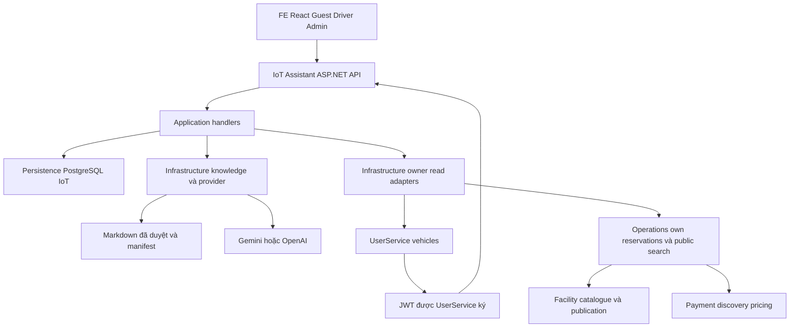
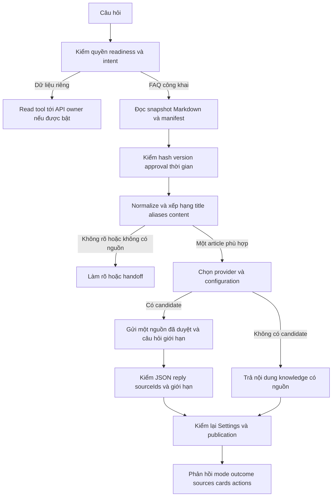
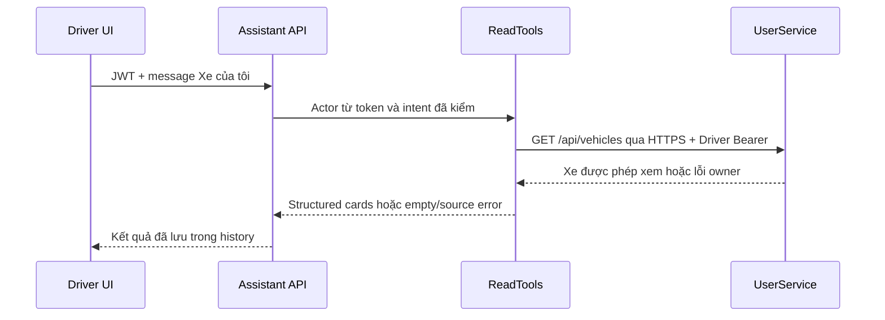

# AI Chatbot — Tổng quan hệ thống và phạm vi đề nghị leader duyệt

Cập nhật 12/11/2026 cho leader, mentor, BA/Product, owner service, frontend và QA. Dùng SHA trong PR để ghi nhận bản bàn giao. [Hướng dẫn click từng bước, Docker và demo 13/11](../../04-testing/assistant-leader-demo-checklist.md) dành cho tester; [ma trận QA đầy đủ](../../04-testing/assistant-handoff-testing.md) giữ tiêu chí nghiệm thu sâu.

**Đọc nhanh trước vấn đáp:** mục 13 mô tả runtime và RAG thực tế, mục 14 lần theo API/hội thoại, mục 15 giải thích Docker/bảo mật, mục 16 là câu hỏi mentor. Các mục 1–12 giữ bối cảnh và dependency. Bằng chứng mới ở mục 17 thay cho suy luận từ các con số lịch sử trong mục 9.

## 1. Quyết định cần leader xem trước

Có thể bàn giao review và test phần **Settings, FAQ, hội thoại Driver/Admin/Owner, lịch sử, reset, hủy/phục hồi và Docker Assistant**. Phần **tra cứu xe/lịch đặt/tìm bãi có source nhưng còn nghiệm thu tích hợp**. Phần **hiểu yêu cầu đặt chỗ → điền sẵn form → khách xác nhận → tạo đơn/thanh toán** chưa triển khai đầy đủ.

| Câu hỏi | Trả lời hiện tại |
| --- | --- |
| What — hệ thống làm gì? | Trả lời hướng dẫn công khai từ knowledge đã duyệt, quản trị provider và giữ hội thoại theo Account. Khi cấu hình đúng, đọc dữ liệu từ API owner và hiển thị thẻ |
| Why — cần chatbot để làm gì? | Giảm bước tìm hướng dẫn và tra dữ liệu cho người dùng, chuẩn bị tiến tới hỗ trợ đặt chỗ có xác nhận. Backend nghiệp vụ vẫn quyết định quyền, khả dụng và giao dịch |
| Who — ai chịu trách nhiệm? | IoT/chatbot owner làm orchestration, knowledge adapter và persistence chatbot. User/Facility/Operations/Payment giữ dữ liệu nghiệp vụ. FE owner giữ trải nghiệm UI. QA nghiệm thu. Leader/BA chốt các contract và phạm vi mở |
| When — khi nào coi là xong? | Đóng phạm vi cốt lõi sau khi candidate nguồn được đóng gói và QA nghiệm thu môi trường thật theo mục 10. Đóng luồng booking sau khi owner cung cấp contract, producer và toàn luồng xác nhận được test. Ngày cụ thể cần leader phân công |
| Bản này có thể merge/release ngay chưa? | Đủ để review, chưa có biên bản phê duyệt release. Cần rà candidate Git và kết quả QA của bản commit được giao |

Repo chưa xác nhận tên cá nhân cho các owner còn mở. Cột người phụ trách bên dưới ghi theo service/nhóm. Leader cần điền người thực hiện và ngày dự kiến, tránh giao toàn bộ phần phụ thuộc cho người làm chatbot.

## 2. Người dùng và nhiệm vụ

| Vai trò | Nhiệm vụ được hỗ trợ hiện tại | Giới hạn liên quan |
| --- | --- | --- |
| Guest | Hỏi SmartPark, loại xe, cách đặt chỗ/thanh toán/hỗ trợ theo tài liệu công khai | Yêu cầu đọc dữ liệu riêng dẫn tới đăng nhập. Guest không có lịch sử bền vững |
| Driver | FAQ, hội thoại theo Account, lịch sử, hủy/tra lại kết quả. Đọc xe/lịch đặt/tìm bãi khi được bật. Nhập và chỉnh bản nháp đặt chỗ trong widget | Tra cứu và nhập bản nháp dùng các mẫu câu được hỗ trợ. Bản nháp chờ tích hợp form và dữ liệu owner |
| Admin | Quản lý provider và dùng FAQ trong chat riêng | Admin API riêng. Khóa được mã hóa. Chat Admin không dùng các tool dữ liệu Driver |
| Business/Owner | FAQ, lịch sử và reset chat riêng | Chat Owner không dùng các tool dữ liệu Driver |
| Operator hoặc role khác | Hướng dẫn công khai nếu widget khả dụng | Các endpoint hội thoại riêng chỉ hỗ trợ Driver, Admin và Owner |
| Người xuất bản knowledge | Duyệt và triển khai bản Markdown cùng manifest | Việc chọn source hoặc có file trong repo không tự phê duyệt nội dung phục vụ |

Câu hỏi “Đặt cho tôi ô tô từ 14h đến 16h ngày mai” thuộc đích S07/S08. Trải nghiệm đích là hỏi thêm ngày/vị trí/xe nếu thiếu, lấy dữ kiện từ owner, cho khách xem form đã điền và xác nhận. Bản hiện tại chưa có đường nối chat sang form điền sẵn. Nút mở màn hình tìm bãi thủ công đã có trong widget không chứng minh luồng này hoàn tất.

## 3. Cấu trúc hệ thống

### 3.1. Thành phần và ranh giới dữ liệu



Sơ đồ thể hiện đường gọi logic. Các đường owner read chỉ chạy khi được cấu hình, có trust và owner sẵn sàng. Private results đi thẳng thành thẻ/phản hồi có cấu trúc. Provider FAQ nhận dữ liệu công khai đã giới hạn.

| Thành phần | Đường dẫn trong repo | Trách nhiệm |
| --- | --- | --- |
| API | `src/Services/IoTService/SmartParking.IoTService.API` | Host, route, JWT, actor, envelope lỗi, CORS, rate limit, background recovery và DI |
| Application | `src/Services/IoTService/SmartParking.IoTService.Application/Assistant` | MediatR handlers, phân loại câu, chọn nguồn, quản trị cấu hình, provider failover, vòng đời chat và gọi port owner |
| Infrastructure | `src/Services/IoTService/SmartParking.IoTService.Infrastructure/Assistant` | HTTP Gemini/OpenAI, đọc/kiểm publication, mã hóa secret bằng Data Protection, HTTP đọc owner |
| Persistence | `src/Services/IoTService/SmartParking.IoTService.Persistence` | Npgsql, transaction/lock, receipt quản trị, request ledger, history, recovery và retention |
| Frontend | `FE/src/components/chat`, `FE/src/roles/admin/setting`, `FE/src/lib/assistantApi.ts` | Widget Guest, panel Driver, Settings, transport, Account generation guard và thẻ tra cứu |
| Knowledge | `docs/03-design/ai/p1/knowledge/smartpark-knowledge.md` | Nguồn biên tập tiếng Việt 0.4.0, 21 mục. Runtime dùng bản triển khai đã duyệt, không duy trì bản policy tiếng Anh thứ hai |
| Docker/setup | `compose.assistant.yml`, `docker/Dockerfile.assistant`, `scripts/setup-assistant-docker.ps1`, `setup.ps1` | Image/container Assistant, bootstrap IoT trống, kiểm đầu vào và nối URL FE |

Chatbot .NET hiện có **bốn assembly** API/Application/Infrastructure/Persistence. Chưa có project Domain riêng cho chatbot trong IoTService. Python LPR/camera là runtime riêng trong cùng thư mục service, chạy bằng tùy chọn khác. Việc build Assistant không yêu cầu model nhận diện biển số.

### 3.2. Dữ liệu được giữ ở đâu

UserService sở hữu User/Account, đăng nhập và xe. Facility sở hữu site/cấu trúc/category và catalogue công bố. Operations sở hữu reservation/allocation/session và điều phối tìm bãi. Payment sở hữu tariff, tính phí và payment order. Assistant chỉ giữ dữ liệu của chính cuộc hội thoại và quản trị AI trong IoT DB.

Các bảng Assistant gồm management state, protected credentials, mutation receipts, connection-test receipts, conversations, messages, requests và tool runs. Ledger là bản ghi trạng thái mỗi yêu cầu, giúp tra lại kết quả sau mất kết nối. Khóa Data Protection/PFX phải được giữ cùng DB để đọc lại credential và cursor đã mã hóa.

### 3.3. Các đường xử lý chính

1. **Guest FAQ** đi từ GuestChatbot → `POST /api/assistant/guest/messages` → GuestHandlers → kiểm Settings/publication → phân loại và chọn một bài → managed generation hoặc knowledge fallback → kiểm lại cấu hình/nguồn trước trả lời.
2. **Driver chat** đi từ DriverChatbot → conversation/message API → JWT actor → Account ownership → admission ghi user message + ledger → xử lý local FAQ hoặc read tool → terminal write → history/recovery. Socket ngắt không tự xóa công việc đã nhận.
3. **Settings** đi từ Admin UI → admin API → ManagementHandlers → transaction cập nhật state/credential/receipt → refresh runtime. Test connection có receipt riêng, không đồng nghĩa FAQ generation đã đạt.
4. **Owner reads** dùng câu allowlist, lấy đúng Account từ JWT, gọi fixed HTTPS API. Vehicles/reservations chuyển Driver Bearer tới owner. Parking search là public read, không chuyển Bearer người dùng sang search. Lỗi nguồn khác kết quả rỗng.
5. **Booking đích** sẽ cần draft có revision, dữ kiện xe/site/giờ, quote còn hạn và form xác nhận. Chỉ owner thực hiện ghi reservation/payment sau xác nhận theo contract đã chốt.

### 3.4. Các API để reviewer lần theo

| Nhóm | Entry point hiện có |
| --- | --- |
| Guest | GET `/api/assistant/status`, POST `/api/assistant/guest/messages` |
| Driver capability | GET `/api/assistant/capabilities` |
| Driver conversation | POST/GET `/api/assistant/conversations`, GET `/{id}`, GET/POST `/{id}/messages` dưới route conversation |
| Driver recovery | GET `/api/assistant/conversations/{id}/requests/{clientMessageId}`, POST cùng route thêm `/cancel` |
| Admin | GET `/api/assistant/admin/settings`, POST `/api/assistant/admin/mutations`, POST `/models/discover`, POST `/configurations/{id}/test` dưới nhóm admin |
| Owner đã có source | User `/api/vehicles`, Operations `/api/me/reservations`, `/api/me/reservations/{id}`, `/api/parking-search`, cùng catalogue Facility/discovery price Payment |

Reviewer đọc route/DTO/error đầy đủ ở [contract S01](../api/assistant-s01-end-to-end-api-design.md) và [ma trận source API](assistant-s01-api-matrix.md). Các bảng khảo sát đầu trong matrix có nhãn lịch sử, hiện trạng cần đọc cùng delta.

## 4. Quyền truy cập, dữ liệu gửi model và giới hạn

- JWT RS256 được kiểm local theo public key tin cậy, issuer, audience, lifetime và claim bắt buộc. Account lấy từ `account_id`, không lấy từ body hoặc model. Resource khác Account trả 404. TOKEN freshness chấp nhận độ cũ tới khi access token hết hạn theo chính sách đã duyệt.
- FAQ Guest Gemini có thể nhận câu hỏi công khai đã qua sàng lọc cùng bài được duyệt. Sàng lọc thất bại dùng tiêu đề backend. OpenAI và Driver dùng tiêu đề backend hoặc câu hỏi cố định về đỗ quá giờ. Transcript, JWT, Account/User ID và dữ liệu xe/lịch đặt riêng không đưa vào context FAQ provider.
- Guest không nhập transcript vào lịch sử Driver sau login. Chỉ giữ câu đang muốn hỏi trong bộ nhớ UI để người dùng chủ động đưa vào ô soạn và gửi.
- Driver có context hẹp để tiếp tục FAQ, tối đa sáu lượt hoàn tất và 12.000 ký tự UTF-16. Đây chưa phải bộ nhớ booking nhiều lượt hoặc khả năng hiểu mọi cách diễn đạt tự do.
- Input chat tối đa 4.000 ký tự, output tối đa 8.000. Guest request có giới hạn 20 giây. Driver có overall budget 25 giây và generation tối đa 20 giây. Managed routing mặc định tối đa ba candidate, mỗi attempt 7 giây, AI chain 18 giây trong tổng 20 giây, cooldown 60 giây.
- Các hạn mức theo process. Hai generation Driver đồng thời, 10 message/phút/Account; Guest hai POST đồng thời và 10 POST/phút/socket IP; protected read/recovery limiter 60/phút/Account. Đây là giới hạn xử lý và tài nguyên, chưa là latency SLO hoặc quota phân tán.
- Mỗi Account và role có một chat hiện tại, giữ đến khi xác nhận reset. Reset ẩn chat ngay, hủy yêu cầu đang chạy và đặt hạn xóa sau 7 ngày, có ngoại lệ hold đã duyệt. Recovery kiểm tra mỗi giây. Trong lúc generation, kiểm tra cancel và Settings mỗi 100 ms. Cancel/off có thể không ngăn được request đã gửi provider hoặc chi phí đã phát sinh.
- Global off khóa nhận câu mới, bảo toàn history và tra ledger khi còn quyền. Tắt/rotate/revoke được kiểm lại theo snapshot. Test đúng phần đã dispatch và kết quả terminal, không hứa exactly-once billing.

Nguồn quyết định quyền là [ADR authorization](../../02-architecture/architecture-decisions/authorization-freshness-and-current-access.md) và [operation classification](../../01-requirements/srs/authorization-operation-classification.md). Thay policy freshness hoặc egress cần phê duyệt tương ứng.

## 5. Tiến độ S01–S10

Trạng thái “đã có” nói về implementation đã đối chiếu. “Chờ nghiệm thu” là chưa đủ bằng chứng trên môi trường đích. “Chờ owner” là còn contract, dữ liệu hoặc producer thuộc ranh giới dịch vụ khác. Không dùng một tỷ lệ phần trăm để gộp ba trạng thái này.

| Mốc / nhiệm vụ | Đã có | Chưa xong | Ai làm tiếp và khi nào đóng |
| --- | --- | --- | --- |
| S01 — Khảo sát và contract | Ma trận source, quyền và dependency register | Tên owner cá nhân, G04–G08/A01–A06 cần chốt phần còn mở | Leader phân công, owner cung cấp contract và evidence trước tích hợp tương ứng |
| S02 — Backend Settings | Model theo key, discovery, thứ tự, bật/tắt, encrypted key, rotate/revoke, receipt, Test connection và failover | Nghiệm thu provider thật từng cấu hình, rotation/revocation dưới tải, chẩn đoán upstream chi tiết còn là cải tiến | IoT/Admin/QA đóng sau live acceptance của provider dự kiến bật |
| S03 — UI Settings | UI group provider, chỉnh model/key, reorder, discovery và test có source, browser fixture đã kiểm | Full UI với UserService/backend thật trên candidate bàn giao | FE + QA đóng khi nhóm TC-ADM đạt với backend thật |
| S04 — Knowledge/FAQ | Parser Markdown, publication hash/version/time gate, lexical và lỗi gõ giới hạn, 21 câu eval, Việt/Anh/fallback | Corpus deployment được duyệt từng phiên bản, chất lượng model thật và câu diễn đạt ngoài tập eval | Admin nội dung + IoT + QA đóng sau test/citation trên corpus cụ thể |
| S05 — Driver/history/recovery | Account isolation, ledger, replay, cancel, history, crash recovery, retention đã có test PG | Lost commit ACK, deadline dưới lock, backlog/outage và tích hợp JWT thật/tải đại diện còn cần kiểm | IoT/DevOps/QA thực hiện trên fixture/môi trường đích |
| S06 — Owner reads | Adapter vehicles, own reservations/list/detail, search, read cards và cấu hình Docker | Nghiệm thu HTTPS, JWT và dữ liệu thật. Nguồn số chỗ theo khung giờ còn thiếu | IoT/FE/QA tích hợp API đã có, owner xử lý dữ kiện còn thiếu ở mục 7 |
| S07 — Draft đặt chỗ | Widget Driver nhận và chỉnh xe, bãi và giờ qua các mẫu câu tiếng Việt. Bản nháp lưu trong phiên widget | Xác minh xe/bãi, lưu trữ và thời hạn bản nháp, quote và dữ liệu chuyển sang form | IoT/FE phối hợp sau khi Operations/Payment/BA chốt contract và validation |
| S08 — UI chat/thẻ/form | Guest, Driver, intent login, history/recovery, thẻ read/detail và Account-switch guard | Chat → form điền sẵn, xác nhận và create/payment chưa nối | FE + IoT sau S07 và API ghi owner, QA chạy toàn luồng |
| S09 — Hiệu năng/vận hành | HTTP pooling, parse reuse vẫn kiểm fresh bytes/manifest, stage metrics và fixture baseline | Representative workload, SLO, p95/error/abort với DB/provider thật, collector đích | Leader/QA/DevOps chốt tải/budget và đo trước release |
| S10 — Setup/nghiệm thu | Docker opt-in, bootstrap an toàn, smoke PG/crash/retention, schema replay, DB restore/keyring tests | Toàn stack trên máy thành viên, UserService/provider thật và rollout/rollback đích | QA/DevOps + owner release đóng theo mục 10 |

`GetAssistantCapabilitiesHandler` hiện giữ `readMySession`, `readMyMoney`, `prepareReservation`, `createSupportTicket` bằng false. Các feature xe/lịch đặt/search chỉ được quảng bá khi cấu hình và readiness cho phép. FAQ về hỗ trợ/thanh toán không chứng minh đã có tool tạo support ticket hoặc đọc tiền cá nhân.

## 6. Việc còn có thể làm trong phần chatbot

| Việc / What | Lý do / Why | Người làm / Who | Khi làm và điều kiện xong / When |
| --- | --- | --- | --- |
| Đóng gói candidate Git và rerun gate liên quan | Working tree có staged/unstaged/untracked, push HEAD cũ chưa gửi được implementation mới | Developer chatbot + reviewer | Trước giao tester, rà đủ file/secret, ghi commit và lệnh test của candidate |
| QA User/Admin/Driver + provider thật | TestServer/synthetic JWT không chứng minh cấu hình UserService/provider ở máy nhận | QA + IoT + Admin, User owner hỗ trợ trust | Có môi trường và quota test, TC-ADM/FAQ/DRV áp dụng đều đạt |
| Nghiệm thu Docker owner reads | Compose đã truyền `Assistant:Reads:*`. Môi trường QA cần HTTPS origin và dữ liệu owner | IoT/DevOps + FE khi cần UI đọc | Cấu hình HTTPS/trust, rồi kiểm capability và các ca đọc với API thật |
| Ca mất ACK, deadline dưới lock, backlog/outage | Kiểm chứng hành vi khi network/DB lỗi, độ đúng của ledger trong các interleaving chưa đo | IoT + QA kỹ thuật | Trước chốt vận hành theo workload, có fixture cưỡng bức tình huống và kết quả rõ |
| Đánh giá model thật và retrieval rộng hơn | Tập 21 câu cố định chưa đại diện toàn bộ câu người dùng | IoT + QA + Admin nội dung | Có tập giữ riêng, đo sai nguồn/từ chối nhầm/citation. Mở egress/semantic cần duyệt phương án trước |
| Metrics collector, SLO và kế hoạch backup/restore | Fixture timing không đo DB/TLS/provider thật, backup deletion SLA và rollout đích còn mở | Leader + DevOps + QA | Trước release môi trường đích, có tải/budget, backup DB+keyring+PFX và diễn tập khôi phục |

Những mục này không nên ghi là “đợi người khác làm hết”. Đa số là kiểm chứng hoặc tích hợp trong phạm vi chatbot, cần môi trường và sự phối hợp cụ thể. Cải tiến chẩn đoán lỗi provider có thể đề xuất riêng, không tự đổi public error contract/FE khi chưa thống nhất.

## 7. Phụ thuộc liên service cần leader giao owner

Các API vehicles, own reservations, catalogue và discovery pricing đã có source. Phần còn chờ là từng contract/nguồn dữ liệu/độ đúng cụ thể bên dưới. Tên cá nhân và ngày hoàn thành chưa được xác lập trong repo.

| ID / What còn thiếu | Who theo ownership | Why cần | Chặn phần nào | When có thể coi đã gỡ |
| --- | --- | --- | --- | --- |
| A01 — Inventory đầy đủ, mapping slot/pool/category/version/quota, xe chưa gán slot | Operations + Facility | Tránh thiếu/đếm trùng tài nguyên khi tính số chỗ | Positive availability S06 và validation S07 | Có producer, phạm vi coverage, mapping được duyệt và test trên fixture |
| A02 — Hiệu lực reservation/allocation/session, correlation/release/expiry/buffer | Operations | Trừ đúng claim còn hiệu lực và cộng lại đúng lúc | Capacity theo thời gian | State/effect table, khóa correlation và evidence cập nhật của writers được chốt |
| A03 — Xác nhận xe vào/ra vật lý, provenance/dedup/ordering/coverage | Operations + IoT thiết bị | LPR event thô chưa chứng minh xe đã rời chỗ | Occupancy tin cậy | Có producer xác thực và test replay/outage/site binding |
| A04 — Lịch, ngoại lệ, restrictions, compatibility và revision | Facility + Operations | Có bãi hoạt động không đồng nghĩa hợp lệ suốt giờ đặt | Availability cả interval | API/version/hiệu lực và ca ngoại lệ được nghiệm thu |
| A05 — Effective policy, horizon/buffer, age/skew | Operations + BA/Product | Chọn đúng chính sách và giới hạn độ cũ từng nguồn | Policy đúng ở search/quote | Policy được duyệt, version/clock/threshold có fixture |
| A06 — Writers, watermark, tenant/site trust và concurrency | Operations cùng các writer | Chống snapshot tươi từng mảnh nhưng mâu thuẫn tổng thể | Capacity đúng tại quyết định | Các writer dùng protocol rõ và có test tranh chấp |
| G04 — Booking quote gắn Account/vehicle/site/interval/terms/expiry | Operations + Payment | Giá tham khảo và FAQ không đủ để đưa khách xác nhận giao dịch | S07 draft có thể review | Route/DTO, quyền, TTL, binding, validation và refresh được duyệt + provider trả dữ liệu |
| G05 — Accepted pricing snapshot bất biến và producer/writer | Operations + Payment | Tính theo điều khoản khách đã chấp nhận, có thể đối soát | S07/S08 và tiền của reservation | Persist/resolve lifecycle, SERVICE trust, lỗi missing/corrupt, binding và test đạt |
| G06 — Driver create với REQUEST admission, idempotency/result lookup | Operations + User | Câu đồng ý trong chat chưa tạo ra quyền hay một đơn bền vững | Tạo booking thật S08 | API ghi được duyệt, current-access flow/fencing, retry/unknown outcome được nghiệm thu |
| G07 — Booking/order/payment linkage và reconcile | Operations + Payment + FE | Tránh sai số tiền, tạo order trùng hoặc mất liên kết sau timeout | Booking → thanh toán | Route/DTO/quyền/amount/keys khớp và test success/timeout/replay đạt |
| G08 — Generic access hub/event cho Driver | User + FE | Bổ sung UX thu hồi quyền tức thời khi có server counterpart | Realtime revocation UX | Route/event/role và target connection được owner xác nhận. FAQ và HTTP recovery tiếp tục theo policy JWT hiện tại |

Bằng chứng source cần leader chú ý khi chốt.

- Operations hiện đăng ký `UnsupportedDiscoveryCapacity`, nên số chỗ dương chưa có authority. Có thể hiển thị unknown. Không dùng mock count làm bằng chứng đủ chỗ.
- Payment có tariff calculator và discovery estimate. Chưa thấy route booking quote đủ G04 trong call chain khảo sát.
- `ReservationSnapshotHttpAdapter` của Payment gọi `internal/reservations/{id}/pricing-snapshot`, chưa tìm thấy counterpart producer route ở Operations trong checkout này.
- Payment có `POST /api/v1/payments/orders/prepare` cho checkout cước của phiên gửi xe. Liên kết booking với đơn thanh toán vẫn chờ hợp đồng và tích hợp của owner.
- API staff/gate/check-in/out hiện có của Operations chưa chứng minh tồn tại Driver create reservation cho chatbot.

Các nhận định trên là khảo sát source, chưa kết luận môi trường hoặc nhánh riêng của thành viên không có implementation. Leader yêu cầu owner trả lời bằng contract, branch/commit và test evidence. Chi tiết ở [phiếu dependency](service-dependencies-and-decisions.md) và [điều kiện đặt chỗ](booking-prerequisites.md).

## 8. Setup Docker và điều kiện bàn giao cho người khác

`setup.ps1 -WithAssistant` gọi preflight trước setup nền rồi bổ sung Assistant. `scripts/setup-assistant-docker.ps1` dùng riêng khi stack DB local đã chạy. Luồng default setup tiếp tục theo quy trình cũ. Image Assistant build từ bốn project .NET, dùng context giới hạn và Dockerfile riêng. Docker port loopback mặc định 5076, khác host runner HTTPS 5075.

Script cần public PEM, issuer/audience đúng UserService, PFX RSA/keyring bền vững và bản knowledge đã duyệt. Chỉ bootstrap ba migration trong một transaction nếu phần Assistant của IoT DB còn trống. Schema có dữ liệu legacy hoặc dở dang bị chặn. DB đã có credential/history cần operator chọn dùng lại bộ keyring gốc. Việc dùng Windows DPAPI trên host rồi chuyển sang Linux/PFX cần kế hoạch chuyển đổi riêng.

Admin nhập provider key/model, bật cấu hình và công tắc chung để nghiệm thu FAQ trên môi trường đích. FE URL chỉ được thêm khi trống. Compose truyền cấu hình owner reads, mặc định tắt cho tới khi QA có HTTPS origin tin cậy và dữ liệu test.

[Hướng dẫn setup chi tiết](../../../LOCAL-SETUP.md#ai-chatbot-bằng-docker) và [tài liệu tester](../../04-testing/assistant-handoff-testing.md) ghi lệnh, fixture và expected result. Bản full setup với UserService thực, SMTP cho đăng ký Driver và provider quota cần được kiểm trên máy người nhận. Khi dùng tài khoản test đã được chuẩn bị, FAQ/history không cần mở API owner reads.

## 9. Bằng chứng và các khoảng kiểm chứng

| Bằng chứng đã ghi 08/11/2026 | Chứng minh được | Giới hạn cần đọc cùng |
| --- | --- | --- |
| Build Release, 473 IoT tests pass | Compile và regression trong suite đã chạy | Sáu skip ở suite mặc định là năm PG opt-in và worker con |
| 5/5 PostgreSQL + replay/restore checks | Store thật, concurrency đã có trong fixture, keyring, crash worker, retention và dữ liệu backup fixture | Chưa test mọi lock interleaving/lost commit ACK/load/role deployment |
| Docker smoke qua Windows PS5.1 | Image và Assistant container thật, PG16 mới, password/keyring guards, JWT role, FAQ/history và rerun | JWT/corpus fixture, FAQ fallback. UserService thật và paid provider không nằm trong ca này |
| Setup fixtures và preflight flow | Đường default và opt-in dispatch, env preservation, error guards | External commands dùng doubles trong top-level harness |
| Browser Settings/read fixtures | UI với API fixture trên desktop/mobile | Backend/JWT/provider/DB thật cần QA đợt bàn giao |
| 21 câu eval | Expected article/classification trên corpus fixture, ca typo/locale/negative | Chưa là đo chất lượng tổng quát của model thật |
| User tự thử local Admin/Driver/chat | Smoke tương tác được người dùng báo tạm ổn | Chưa có biên bản từng case với commit, trace, provider và environment |
| Full solution trước lượt cuối PG | 962 pass, 4 fail, 70 skip, build đạt | Bốn fail baseline operational-layout của Facility, không gọi full suite xanh |

Các lượt trước có ghi Gemini FAQ thật trên deployment corpus riêng. Bằng chứng cũ không tự áp cho model, key, corpus hoặc máy mới. Đợt cập nhật 12/11 có kiểm runtime riêng ở mục 17; không dùng bằng chứng provider cũ để kết luận model hiện tại đã được nghiệm thu.

Hạn chế vận hành còn mở gồm SLO/tải/chi phí, backup deletion SLA, rollout và rollback môi trường đích, bằng chứng lost commit ACK/deadline dưới lock, generic revocation UX, privacy/deployment terms được owner chốt. Khả năng keyword/typo hiện có vẫn có thể từ chối câu ngoài tập đã đánh giá. Mở rộng semantic/egress cần phương án riêng, tránh coi fine-tuning là cách sửa mặc định.

## 10. Kế hoạch hoàn tất và tiêu chí duyệt

| Chặng | Việc bắt buộc | Người quyết định | Điều kiện qua chặng |
| --- | --- | --- | --- |
| R1 — Review candidate cốt lõi | Rà source/test/script/docs/secret, gom đúng commit, gắn Jira thật khi tạo commit/PR theo quy ước repo | Developer + leader/reviewer | Reviewer tái hiện build và test cần thiết, không còn lỗi chặn trong phạm vi giao |
| R2 — QA Settings/FAQ/history | Setup máy nhận, Admin và A/B thực, provider riêng, replay/cancel/restart/Account isolation | QA + IoT + Admin | Các ca P0/P1 áp dụng trong tài liệu tester PASS, ca thiếu môi trường ghi BLOCKED rõ |
| R3 — QA owner reads | Cấu hình container/host, HTTPS/trust/data, capabilities, source failures và unknown availability | IoT + FE + owner + QA | Xe/lịch/search đúng API thật. Giới hạn availability được hiển thị rõ và được chấp nhận |
| R4 — Thực hiện booking | Chốt A01–A06/G04–G07, implement draft/extraction/edit/quote/form/create/payment | Leader/BA giao owner, IoT/FE triển khai phần mình | Khách review đúng revision/giá/giờ/xe/bãi và chỉ tạo đơn sau xác nhận, revalidation/retry đạt |
| R5 — Release theo phạm vi | Workload/SLO, backup DB+PFX+keyring, rollout/rollback, privacy/provider terms | Leader + DevOps/QA | Biên bản nghiệm thu và chấp thuận release cho đúng phần được mở |

Điểm kết thúc của R2 là **bàn giao chatbot hỏi đáp và hội thoại chạy được trên môi trường test**. R4 là đích **chat hỗ trợ đặt chỗ và tạo giao dịch thật**. Có thể duyệt R1/R2 trước, đồng thời giao dependency của R3/R4 cho đúng owner. Ngày dự kiến phải do leader xác nhận theo năng lực từng người.

## 11. Phiếu leader cần điền

| Quyết định | Kết quả leader điền |
| --- | --- |
| Commit/PR được review | Chưa đóng gói |
| Phạm vi duyệt đợt này | Settings / FAQ / history / Docker / owner reads, đánh dấu phần chọn |
| Người nhận task IoT, FE, QA, DevOps | OPEN — leader chỉ định |
| Owner cá nhân cho A01–A06 và G04–G08 | OPEN — tham chiếu bảng mục 7 |
| Mốc setup và QA R2 | OPEN — ngày/giờ, người chuẩn bị |
| Corpus version và biên bản Admin duyệt | OPEN — điền theo môi trường test |
| Provider/model/quota cần nghiệm thu | OPEN — Admin và QA điền |
| Mốc contract, producer và tích hợp booking | OPEN — theo từng dependency |
| Lỗi/rủi ro chấp nhận tạm thời | OPEN — ghi ticket và người chịu trách nhiệm |
| Quyết định merge/release | OPEN — reviewer/leader xác nhận sau kiểm |

## 12. Nguồn để truy tiếp

- [Tester setup/test cases và bằng chứng chi tiết](../../04-testing/assistant-handoff-testing.md).
- [Kế hoạch phát triển](design-and-development-plan.md), [phiếu dependency](service-dependencies-and-decisions.md), [điều kiện draft](booking-prerequisites.md).
- [Knowledge/publication](knowledge-and-faq.md), [conversation/recovery](conversation-and-recovery.md), [owner reads](business-data-integration.md).
- [API S01](../api/assistant-s01-end-to-end-api-design.md), [availability authority](../api/assistant-s06-availability-authority.md), [read integration](../api/assistant-s06-read-integration.md).
- [Nhật ký backend](../../../ai/tasks/active/chatbot-development-progress.md), [lịch sử triển khai](../../../ai/tasks/archive/chatbot-implementation-history.md).

## 13. Kiến trúc hiện tại và RAG — nội dung chuẩn bị vấn đáp

### 13.1. Bốn tầng hiện có, nhiệm vụ và cách lần source

| Tầng | Nhận gì, làm gì, trả gì | File tiêu biểu |
| --- | --- | --- |
| API | Nhận HTTP/JSON, xác thực JWT/role, tạo actor từ claims, kiểm content type/payload, rate limit, gọi MediatR, bọc envelope/traceId. Không quyết định giá/booking | `API/Program.cs`, `AssistantGuestHost.cs`, `Authentication/AssistantAuthentication.cs`, `Http/ChatHosting.cs`, `Management/AssistantManagementHosting.cs` |
| Application | Điều phối use case: trạng thái Settings, phân loại intent, truy xuất FAQ, chọn cấu hình provider, admission/terminal chat, gọi port đọc owner. Không chứa câu SQL hay tự mở DB owner | `Application/Assistant/Guest/GuestHandlers.cs`, `Guest/PublicFaqRetrieval.cs`, `Chat/ChatHandlers.cs`, `Chat/ReadTools.cs`, `Management/ManagedDemoGenerator.cs` |
| Infrastructure | Hiện thực I/O ngoài: đọc publication Markdown/manifest, HTTP OpenAI/Gemini, HTTP User/Operations/Search, Data Protection cho credential | `Infrastructure/Assistant/Guest/PublicKnowledgeFile.cs`, `Knowledge/DemoGroundedGenerator.cs`, `OwnerReadClient.cs`, `ParkingSearchClient.cs`, `Management/AssistantSecretProtector.cs` |
| Persistence | Npgsql với DB IoT: state/credential/receipts, hội thoại/tin nhắn/request ledger, transaction/lock/replay, reset/recovery/purge | `Persistence/AssistantManagementStore.cs`, `AssistantChatStore.cs` |

Các đường dẫn trong bảng tính từ `src/Services/IoTService/SmartParking.IoTService.<Tầng>/`; tên thư mục rút gọn để dễ đọc. FE là một thành phần riêng: `assistantApi.ts`/`assistantAdminApi.ts` xử lý transport; `DriverChatbot.tsx`/`GuestChatbot.tsx` xử lý UI; `assistantBookingPreview.ts` xử lý bản nháp cục bộ.

Chatbot chưa có project Domain riêng; không mô tả thành 5 tầng chỉ vì một số service khác dùng 5 tầng. Port/interface nằm phía Application; adapter nằm Infrastructure/Persistence và được nối ở DI của API. MediatR là gọi trong process, không phải RabbitMQ. Không có luồng broker bắt buộc cho mỗi câu FAQ.

Normal Docker chạy host bình thường (`AssistantGuestHost`), không phải `/api/demo/assistant`. Chỉ environment `Demo` chọn `AssistantDemoHost`. Class có chữ `Demo` như `ManagedDemoGenerator`/`DemoGroundedGenerator` vẫn được normal host tái sử dụng; tên class không chứng minh dữ liệu giả. Python LPR/camera không tham gia xử lý câu hỏi FAQ.

### 13.2. RAG đang dùng: retrieval lexical + generation bị giới hạn nguồn

RAG là lấy kiến thức phù hợp trước rồi bổ sung vào đầu vào model để sinh câu trả lời. Bản này thực hiện retrieval theo từ khóa/quy tắc; **chưa dùng embeddings, vector index, semantic similarity hay vector database**. Cũng không fine-tune model bằng tài liệu dự án.



**Bước 1 — Xuất bản nguồn.** Nguồn biên tập là Markdown tiếng Việt trong repo. Admin duyệt nội dung; deployment operator tạo bản runtime cùng `publication.json`. Loader kiểm SHA-256 của bytes thực tế, version, metadata duyệt, audience public, trạng thái published/approved, thời điểm hiệu lực. `role=admin` trong manifest là metadata, không thay thế xác thực người duyệt. Hash phát hiện nội dung đổi sau duyệt, không chống được một quản trị viên filesystem có toàn quyền.

**Bước 2 — Parse.** Tách article có ID/title/aliases và nội dung. Chỉ `### Nội dung` đi vào generation/citation; phần đối chiếu nội bộ không gửi model. Loader có giới hạn số bài/kích thước và cache fingerprint, nhưng vẫn kiểm phiên bản/bytes/thời gian công bố. DRAFT, hash lệch, hết hiệu lực hoặc manifest thiếu thì fail closed. Không tự lấy một JSON cũ thay thế nguồn không hợp lệ.

**Bước 3 — Phân loại trước retrieval.** Câu muốn dữ liệu cá nhân, live availability/giá/giao dịch không được coi là FAQ để model tự đoán. Guest được handoff đăng nhập khi cần. Driver dùng read tool đúng allowlist nếu capability bật. FAQ chung như cách thanh toán chỉ giải thích tài liệu, không đọc tài khoản hoặc tạo payment.

**Bước 4 — Truy xuất.** `PublicFaqRetrieval` normalize chữ/thanh điệu theo câu, loại stop words, so title + alias + nội dung. Điểm xét cụm alias, anchors và độ bao phủ; bằng điểm có thể không chọn. Có phục hồi một typo rất giới hạn cho alias ngắn 2–4 từ; không phải sửa mọi lỗi ngôn ngữ. Normal flow chọn **một article**, không top-k nhiều vector chunks. Không đủ bằng chứng thì làm rõ/handoff.

**Bước 5 — Augment.** Provider nhận article đã duyệt cùng câu hỏi giới hạn. Intent cụ thể dùng câu hỏi cố định do backend tạo. Driver chat dùng canonical question hoặc title; không gửi nguyên transcript. Guest có `PublicFaqQuestion.Screen`: một số câu công khai sau sàng lọc có thể được gửi; còn lại dùng title/câu cố định. Không khẳng định mọi raw question đều bị gửi hoặc đều bị chặn.

**Bước 6 — Generate hoặc fallback.** Nếu có cấu hình provider đủ điều kiện, model diễn đạt theo nguồn (`mode=ai`). Nếu không có candidate hoặc các lỗi recoverable khiến hết budget, có thể trả hướng dẫn gốc (`mode=knowledge`). Câu hỏi tiếng Anh có thể được model diễn đạt tiếng Anh từ nguồn Việt; fallback phải ghi rõ đang dùng nội dung Việt, không duy trì một bản chính sách Anh không đồng bộ.

**Bước 7 — Validate và recheck.** Kiểm cấu trúc JSON, reply length, nguồn được phép, sourceIds lạ/trùng, response size. Không có sourceIds thì no-answer. Kiểm lại Settings/publication để tránh trả kết quả theo nguồn/cấu hình đã thu hồi giữa request. Citation hợp lệ **không chứng minh mọi câu do model sinh đều đúng ngữ nghĩa**; vẫn cần QA nội dung và eval ngoài tập câu mẫu.

### 13.3. Provider thật được gọi như thế nào?

| Provider | Adapter gọi | Đầu vào/đầu ra quan trọng |
| --- | --- | --- |
| OpenAI | `POST https://api.openai.com/v1/responses` | `store=false`, `stream=false`, `max_output_tokens=2048`, JSON schema cho `reply`/`sourceIds` |
| Gemini | `POST https://generativelanguage.googleapis.com/v1beta/models/{model}:generateContent` | Model từ cấu hình đã kiểm, key ở header, JSON output có reply/sourceIds |

Đây là mô tả adapter trong checkout, không phải hướng dẫn phiên bản API mới nhất của hãng. Browser không gọi trực tiếp provider và không giữ provider secret. Prompt giới hạn FAQ công khai, không cho model khẳng định đã booking/thanh toán/chỗ trống. Adapter có redaction một số pattern secret nhưng không phải DLP toàn diện; không đưa dữ liệu riêng vào prompt rồi trông cậy redaction.

`ManagedDemoGenerator` chọn provider/config theo thứ tự đã bật, không tự dùng AI để tìm model tối ưu. Budget hiện tại: tối đa 3 attempts, tổng 20 giây, AI 18 giây, từng attempt 7 giây, cooldown 60 giây theo cấu hình/rules. Lỗi mạng/timeout/upstream recoverable có thể thử candidate tiếp; output sai cấu trúc không được retry mù. Một kết quả hợp lệ, kể cả no-answer, dừng failover. History bền vững không có nghĩa LLM nhớ cuộc trò chuyện: follow-up chọn nguồn cục bộ từ tối đa 6 turns/12.000 ký tự và cùng version nguồn.

## 14. Lần theo API và quy trình từng chức năng

### 14.1. Guest FAQ

1. `GuestChatbot` lấy `GET /api/assistant/status`, chỉ mở theo readiness.
2. Người dùng nhập câu, FE gọi `POST /api/assistant/guest/messages` với `requestId`, `message`, `locale`.
3. Handler đọc Settings/publication, phân loại, truy xuất và gọi generation/fallback như mục 13.
4. Envelope trả `success`, `data`, `traceId`; `data` có mode/outcome/content/sources/cards/actions.
5. Guest UI hiển thị; câu riêng có action login. Không có durable guest history và không tự nhập toàn bộ guest transcript sang Account sau đăng nhập.

Ví dụ request (ID minh hoạ, không dùng lại cho nhiều lần gửi thật):

```json
{"requestId":"11111111-1111-4111-8111-111111111111","message":"SmartPark là gì?","locale":"vi"}
```

### 14.2. Hội thoại đăng nhập, idempotency và recovery

| Bước | API dưới `/api/assistant` | FE/backend làm gì |
| --- | --- | --- |
| Kiểm capability | GET `/capabilities` | Driver xem feature được mở; không đồng nghĩa owner thật đã được nghiệm thu |
| Mở chat hiện tại | GET `/conversations`, GET `/{id}` dưới conversations | Scope Account + role; không chọn Account từ một body do client tự khai |
| Tạo | POST `/conversations` với `{clientConversationId, locale}` | 201 mới, 200 replay theo contract |
| Lịch sử | GET `/conversations/{id}/messages` với cursor/limit hợp lệ | Cursor được bảo vệ; trả dữ liệu thuộc conversation được phép |
| Gửi | POST `/conversations/{id}/messages` với `{clientMessageId, expectedRevision, message}` | Admission ghi user message + request running trong transaction; revision/fingerprint chống replay sai nội dung |
| Nhận kết quả | POST trả 200 terminal hoặc 202 running | Nếu chưa xong, dùng Location/request lookup, không đoán đã thất bại |
| Phục hồi | GET `/conversations/{id}/requests/{clientMessageId}` | Hỏi cùng request; không tự chạy model/ghi lại như request mới |
| Hủy | POST cùng request thêm `/cancel`, body `{}` | Trả trạng thái thật; nếu hoàn tất trước hủy thì không giả cancelled |
| Reset | POST `/conversations/{id}/reset`, body `{}` | Ẩn chat, hủy running, đến hạn purge sau 168 giờ nếu không retention hold |

Scope bảo vệ gồm **AccountId và role**, không chỉ UserId. Một người có nhiều Account/role không được trộn history. FE dùng auth generation guard để bỏ response cũ khi logout/switch Account; server vẫn kiểm quyền riêng, không tin FE là lớp bảo vệ duy nhất.

Admission và terminal write được tách: ghi nhận request trước, chạy công việc với host lifetime, sau đó commit kết quả. Client mất socket không tự xoá việc đã nhận. Client tra result bằng cùng ID; replay đúng fingerprint trả kết quả đã lưu, không tạo tin nhắn đôi. Recovery sweep đánh request quá deadline còn running thành `REQUEST_INTERRUPTED`, không tự redispatch giao dịch. Transaction/lock ở Persistence bảo vệ cạnh tranh, không giữ transaction DB mở suốt một HTTP call provider theo cách tùy tiện.

Current runtime có giới hạn hoạt động và rate limit; ví dụ `ChatExecution` có 2 slots trong process và 10 admission/Account/phút. Đây là cấu hình code hiện tại, không phải cam kết capacity production. 429 là backpressure; tester không spam POST để cố qua.

### 14.3. Read tool xe và dữ liệu live



Assistant không query User DB trực tiếp. UserService xác định xe Account được phép xem. Client owner bị giới hạn fixed HTTPS origin, response size/time/shape; không lấy URL tuỳ ý do câu chat cung cấp. Dữ liệu xe riêng được dựng thành card, không cần đưa vào LLM FAQ. Danh sách rỗng là kết quả hợp lệ; timeout/TLS/403 là lỗi nguồn, không được biến thành “không có xe”. Card trong history là snapshot trả lời lúc đó; hỏi câu mới để refresh.

Own reservations dùng `/api/me/reservations` và detail; private reads chuyển Bearer Driver đến owner. Parking search dùng public read, không forward Bearer người dùng như private read. Các nguồn này cần contract/HTTPS/data và test owner thực tế. Không có API nguồn sẵn sàng thì capability để tắt, không mock chỗ trống/giá để demo.

### 14.4. Settings và secret lifecycle

Admin UI gọi GET `/api/assistant/admin/settings`; thay đổi qua POST `/admin/mutations` với action, mutationId và expectedRevision. Revision tránh ghi đè thay đổi Admin khác; receipt giúp retry đúng mutation không thực thi lặp. UI nhận metadata/model/priority/trạng thái, không nhận lại plaintext key đã lưu. Infrastructure dùng Data Protection, Persistence giữ protected secret và state/receipt.

Model discovery và Test connection có route riêng: `/admin/models/discover`, `/admin/configurations/{id}/test`. Thêm configuration lưu disabled để Admin chủ động bật. Runtime có ba mức bật: hệ thống, provider, configuration. Reorder ảnh hưởng thứ tự failover; rotate thay key, revoke loại key khỏi request mới. Test connection chỉ chứng minh phép test đó, chưa chứng minh mọi câu FAQ hoặc corpus đều tốt.

### 14.5. Parser và ranh giới với booking

`DriverChatbot` chỉ bật preview ở dashboard Driver. `interpretBookingTurn` nhận câu giống yêu cầu booking, tách loại xe/nhãn xe/nhãn bãi/ngày giờ, hỏi field thiếu và cho chỉnh. Nhánh này xử lý tại FE, không phải LLM đã quyết định booking. Thời gian theo Việt Nam; từ “ngày mai” tính theo ngày lúc nhập.

Ba câu đã thêm hồi quy: `Đặt chỗ cho ô tô tại Bitexco ngày mai từ 14h đến 16h`, `Đặt chỗ ô tô ở Bitexco ngày mai từ 14h đến 16h`, `Tôi muốn đặt chỗ tại bãi Bitexco ngày mai từ 14h đến 16h`. Hai câu đầu CAR; câu cuối không nói loại xe nên phải hỏi, không gán CAR.

Bản nháp trong bộ nhớ widget; chưa có persistent draft/TTL/revision chuẩn owner, chưa resolve vehicle/site ID, chưa kiểm availability/quote/terms, chưa handoff sang `BookingFlow`. Bấm xác nhận trong intake không tạo reservation/payment. `BookingFlow` tồn tại riêng không chứng minh chatbot đã nối vào đó. Đây là phần đã làm được để hỗ trợ nhập liệu, không gọi là booking end-to-end.

## 15. Docker, dữ liệu và bảo mật để giải thích cho mentor

### 15.1. Ba địa chỉ dễ nhầm

| Địa chỉ mặc định | Ai dùng | Ý nghĩa |
| --- | --- | --- |
| `http://localhost:5173` | Browser cùng máy Docker | FE |
| `http://localhost:5076` | Browser/QA cùng máy Docker | Assistant container published port |
| `https://user-service:8443` | Assistant trong Docker network | User private-read origin với TLS; không phải URL browser localhost |

User HTTP mặc định publish `5035` cho login; host Assistant runner HTTPS `5075` khác Docker `5076`. `localhost` trong container trỏ về container đó, không phải UserService. Vì vậy origin loopback cho owner read trong Docker bị preflight chặn.

### 15.2. Ba loại key không được đánh đồng

1. **JWT signing key của User:** private chỉ ở issuer UserService; Assistant nhận public key để kiểm token, không dùng private key để giả đăng nhập.
2. **PFX/keyring của Assistant:** bảo vệ provider secret/cursor. DB có credential mà mất keyring/PFX có thể không giải mã được. Backup DB + keyring + PFX phải đi cùng và giữ bí mật.
3. **TLS PFX của User + public CA:** mã hoá/xác thực kết nối Assistant → User. SAN đúng `user-service`, CA được tin trong Assistant; không tắt xác thực TLS.

`compose.user-tls.yml` bổ sung listener/mount PFX cho User. `compose.assistant-trust.yml` mount public CA, cài trust khi container khởi động. Runner kiểm path/private key/expiry/SAN, setup Assistant kiểm CA và origin/flags. Preflight là kiểm đầu vào, không thay thế HTTP request thực tế. Kiểm SAN hiện dùng nhãn format chứng chỉ của runtime; Windows locale khác chưa nghiệm thu.

### 15.3. Máy mới và máy có dữ liệu khác nhau

Máy mới cần source đầy đủ, `.env`, keys/certs, publication và provider credential; Docker không tự biết khóa/approval của nhóm. Fresh DB init canonical schema; DB cũ phải được kiểm tương thích và nâng cấp theo migration có kiểm soát. `binding_revision` thiếu thì setup dừng và chỉ ra migration; không tự reset volume.

Build image và migrate DB là hai việc riêng. `-NoBuild` chỉ dùng khi image đúng source đã có; pull code rồi chạy image cũ không phải nghiệm thu code mới. Secret và `.cache` không nằm trong commit. File untracked chưa commit sẽ thiếu trên máy tester dù máy tác giả chạy được.

## 16. Câu hỏi mentor thường hỏi và câu trả lời có căn cứ

| Câu hỏi | Trả lời ngắn cần hiểu |
| --- | --- |
| Em làm gì trong hệ thống? | Orchestration chatbot, Settings provider, FAQ có nguồn, chat/history/recovery, adapters đọc owner, UI/draft và setup/test liên quan. Owner khác giữ booking/payment authority |
| RAG của em là vector hay keyword? | Lexical/rule-based trên Markdown đã duyệt, chọn một article rồi generation/fallback. Chưa có embedding/vector DB |
| Tại sao không đưa toàn bộ tài liệu vào prompt? | Chọn nguồn phù hợp, giới hạn payload/phạm vi công khai và citation; tránh gửi dữ liệu không cần thiết. Trade-off là câu diễn đạt lạ có thể bị từ chối/làm rõ |
| Không có API key thì có trả lời không? | Có thể trả knowledge khi global/release/publication sẵn sàng; mode nói rõ fallback. Không được tuyên bố model đã trả lời |
| Lưu history có nghĩa model nhớ hết không? | Không. History để UX/recovery/audit; context chọn nguồn được giới hạn cục bộ, không gửi toàn transcript |
| Chống hallucination hoàn toàn chưa? | Chưa. Nguồn duyệt, prompt/JSON/source validation giảm rủi ro; citation đúng không tự chứng minh ngữ nghĩa đúng. Cần QA corpus/model |
| Người dùng hỏi xe, LLM có vào DB không? | Không. Intent allowlist → adapter HTTPS → User API kiểm quyền → card có cấu trúc; không query DB owner và không gửi xe riêng sang FAQ model |
| Tại sao có expectedRevision và clientMessageId? | Revision bảo vệ cạnh tranh; ID/fingerprint hỗ trợ idempotency và lookup khi timeout. Không double-send bằng ID mới khi kết quả chưa biết |
| Reload lúc đang trả lời thì sao? | Request đã admission vẫn gắn host, FE tra request ledger; sweep đóng request quá hạn. Không hứa mọi lỗi mạng đều tự phục hồi hoàn hảo nếu chưa test tình huống đó |
| Reset có xoá ngay không? | Ẩn ngay; đến hạn 7 ngày mới purge nếu không retention hold |
| Tại sao Admin không gọi tool xe của Driver? | Role/tool boundary riêng; chat Admin/Owner hỗ trợ FAQ/history, không tự nâng quyền thành Driver |
| Có phải health xanh là demo được? | Không. Cần readiness, publication, Settings, auth và positive functional test. Test connection cũng không bằng generation/content acceptance |
| Booking em xong đến đâu? | Xong nhập/chỉnh bản nháp theo mẫu FE; chưa xác minh owner/quote/form/create/payment. Không giả kết quả để lấp phần thành viên khác |
| Phần nào chờ ai? | User: Account/xe/trust; Facility: site/structure/publication; Operations: availability/reservation/admission; Payment: quote/accepted pricing/payment linkage; FE/Product: wire form/UX sau contract; QA/DevOps: runtime/load/deployment. Tên cá nhân chưa được xác nhận |
| Ngày mai demo gì? | Theo checklist GO từng phân đoạn: FAQ có nguồn, Settings đã rehearsal, Driver history đã test, parser. Xe chỉ khi positive card pass; không demo Operations/Payment chưa nghiệm thu |

## 17. Snapshot nghiệm thu 12/11/2026 và phần chưa đóng

| Hạng mục | Kết quả trên máy hiện tại | Phạm vi bằng chứng |
| --- | --- | --- |
| Setup runtime | PASS, tạo/chạy lại Assistant healthy | Dữ liệu dev/cấu hình hiện tại, chưa phải máy leader sạch |
| Docker User/Assistant | Healthy tại lượt kiểm mới | Liveness, không tự chứng minh A/B hoặc owner card |
| Frontend Docker | Container Up; HTTP 200 | Trang tải được, chưa smoke lại toàn bộ click UI |
| Guest status | enabled=true, guestFaq=true, contractVersion 0.4.1 | Runtime GET status |
| Guest FAQ `SmartPark là gì?` | answered, mode knowledge, nguồn smartpark-overview 0.4.0 | FAQ fallback thật; chưa xác nhận generation provider ở lượt này |
| Backend IoT suite | 502 PASS, 7 SKIP, 0 FAIL | Suite mặc định; các PG opt-in/worker skip không là pass |
| FE suite/build | 282/282 PASS; build PASS | Có cảnh báo bundle; parser subset 14/14 |
| Setup fixture | PASS Windows PowerShell 5.1 | Doubles, khác runtime; PS7 empty-env khác PS5 nên không dùng kết quả sai host để suy ra lộ key |
| SAN/binding preflight sửa mới | Review độc lập không thấy blocker; binding fixture PASS | SAN tương tự hostname bị chặn, thiếu binding dừng trước feature write |
| Login API scripted | BOT_VERIFICATION_REQUIRED | Turnstile cần luồng UI; chưa phải chatbot bug |
| UI, Driver card/history/A-B | UNVERIFIED trong lượt mới | Công cụ browser bị chặn vì không xác định URL đủ tin cậy; lịch sử smoke cũ không thay nghiệm thu candidate mới |

**Kết luận:** có thể giao tester kiểm phần cốt lõi theo checklist; chỉ chốt demo sau các ca P0 tương ứng PASS trên UI và máy sẽ trình diễn. Không tuyên bố toàn hệ thống hoàn tất hoặc full-stack clean-machine acceptance. Bộ source đang có thay đổi chưa commit; cần SHA candidate sau khi người dùng commit. Ghi kết quả mới vào biên bản, giữ booking/payment/availability ngoài demo hiện tại theo đúng phân công.
