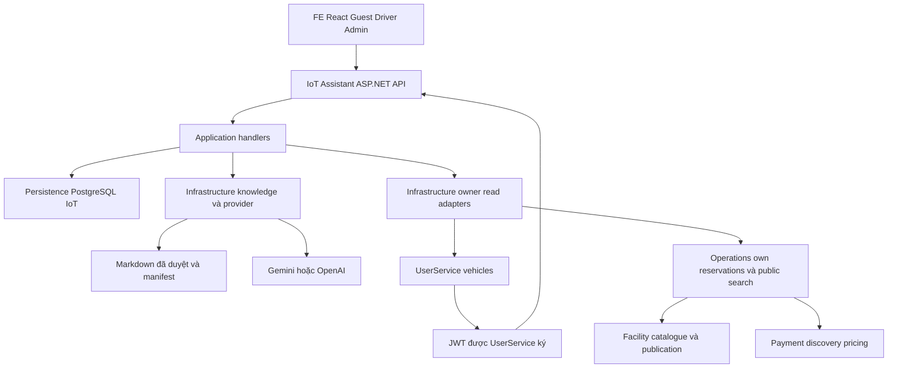

# AI Chatbot — Tổng quan hệ thống và phạm vi đề nghị leader duyệt

Cập nhật 08/11/2026. Dành cho leader, BA/Product, owner service, frontend và QA. Đối chiếu source trên nhánh `AI-ChatBot`, HEAD nền `3d3def76` cùng thay đổi working tree chưa đóng gói. Khi mở PR, điền commit bản bàn giao vào biên bản. Bản này mô tả hiện trạng, đề nghị phạm vi review và các điều kiện để hoàn tất.

## 1. Quyết định cần leader xem trước

Có thể bàn giao review và test phần **Settings, FAQ, hội thoại Driver, lịch sử, hủy/phục hồi và Docker Assistant**. Phần **tra cứu xe/lịch đặt/tìm bãi có source nhưng còn nghiệm thu tích hợp**. Phần **hiểu yêu cầu đặt chỗ → điền sẵn form → khách xác nhận → tạo đơn/thanh toán** chưa triển khai đầy đủ.

| Câu hỏi | Trả lời hiện tại |
| --- | --- |
| What — hệ thống làm gì? | Trả lời hướng dẫn công khai từ knowledge đã duyệt, quản trị provider và giữ hội thoại theo Account. Khi cấu hình đúng, đọc dữ liệu từ API owner và hiển thị thẻ |
| Why — cần chatbot để làm gì? | Giảm bước tìm hướng dẫn và tra dữ liệu cho người dùng, chuẩn bị tiến tới hỗ trợ đặt chỗ có xác nhận. Backend nghiệp vụ vẫn quyết định quyền, khả dụng và giao dịch |
| Who — ai chịu trách nhiệm? | IoT/chatbot owner làm orchestration, knowledge adapter và persistence chatbot. User/Facility/Operations/Payment giữ dữ liệu nghiệp vụ. FE owner giữ trải nghiệm UI. QA nghiệm thu. Leader/BA chốt các contract và phạm vi mở |
| When — khi nào coi là xong? | Đóng phạm vi cốt lõi sau khi candidate nguồn được đóng gói và QA nghiệm thu môi trường thật theo mục 10. Đóng luồng booking sau khi owner cung cấp contract, producer và toàn luồng xác nhận được test. Ngày cụ thể cần leader phân công |
| Bản này có thể merge/release ngay chưa? | Đủ để review, chưa có biên bản phê duyệt release. Cần rà candidate Git và kết quả QA của bản commit được giao |

Repo chưa xác nhận tên cá nhân cho các owner còn mở. Cột người phụ trách bên dưới ghi theo service/nhóm. Leader cần điền người thực hiện và ngày dự kiến, tránh giao toàn bộ phần phụ thuộc cho người làm chatbot.

## 2. Người dùng và nhiệm vụ

| Vai trò | Nhiệm vụ được hỗ trợ hiện tại | Giới hạn liên quan |
| --- | --- | --- |
| Guest | Hỏi SmartPark, loại xe, cách đặt chỗ/thanh toán/hỗ trợ theo tài liệu công khai | Yêu cầu đọc dữ liệu riêng dẫn tới đăng nhập. Guest không có lịch sử bền vững |
| Driver | FAQ, hội thoại theo Account, lịch sử, hủy/tra lại kết quả. Đọc xe/lịch đặt/tìm bãi khi được bật | Các câu tra cứu dùng nhóm câu được hỗ trợ cục bộ. Chưa trích xuất yêu cầu booking tự do thành draft |
| Admin | Quản lý Gemini/OpenAI, key/model, thứ tự, bật/tắt, discovery, Test connection, rotate/revoke | Admin API riêng. Khóa được mã hóa, bản trả Settings không có plaintext secret |
| Owner/Operator hoặc role khác | Có thể dùng hướng dẫn công khai theo UI hiện hành | Driver chat API yêu cầu đúng role Driver. Không lấy dữ liệu Driver chỉ vì người gọi đã đăng nhập |
| Người xuất bản knowledge | Duyệt và triển khai bản Markdown cùng manifest | Việc chọn source hoặc có file trong repo không tự phê duyệt nội dung phục vụ |

Câu hỏi “Đặt cho tôi ô tô từ 14h đến 16h ngày mai” thuộc đích S07/S08. Trải nghiệm đích là hỏi thêm ngày/vị trí/xe nếu thiếu, lấy dữ kiện từ owner, cho khách xem form đã điền và xác nhận. Bản hiện tại chưa có đường nối chat sang form điền sẵn. Nút mở màn hình tìm bãi thủ công đã có trong widget không chứng minh luồng này hoàn tất.

## 3. Cấu trúc hệ thống

### 3.1. Thành phần và ranh giới dữ liệu

Sơ đồ thể hiện đường gọi logic. Các đường owner read chỉ chạy khi được cấu hình, có trust và owner sẵn sàng. Private results đi thẳng thành thẻ/phản hồi có cấu trúc. Provider FAQ nhận dữ liệu công khai đã giới hạn.

| Thành phần | Đường dẫn trong repo | Trách nhiệm |
| --- | --- | --- |
| API | `src/Services/IoTService/SmartParking.IoTService.API` | Host, route, JWT, actor, envelope lỗi, CORS, rate limit, background recovery và DI |
| Application | `src/Services/IoTService/SmartParking.IoTService.Application/Assistant` | MediatR handlers, phân loại câu, chọn nguồn, quản trị cấu hình, provider failover, vòng đời chat và gọi port owner |
| Infrastructure | `src/Services/IoTService/SmartParking.IoTService.Infrastructure/Assistant` | HTTP Gemini/OpenAI, đọc/kiểm publication, mã hóa secret bằng Data Protection, HTTP đọc owner |
| Persistence | `src/Services/IoTService/SmartParking.IoTService.Persistence` | Npgsql, transaction/lock, receipt quản trị, request ledger, history, recovery và retention |
| Frontend | `FE/src/components/chat`, `FE/src/roles/admin/setting`, `FE/src/lib/assistantApi.ts` | Widget Guest, panel Driver, Settings, transport, Account generation guard và thẻ tra cứu |
| Knowledge | `docs/03-design/ai/p1/knowledge/smartpark-knowledge.md` | Nguồn biên tập tiếng Việt, 12 mục. Runtime dùng bản triển khai đã duyệt, không duy trì bản policy tiếng Anh thứ hai |
| Docker/setup | `compose.assistant.yml`, `docker/Dockerfile.assistant`, `scripts/setup-assistant-docker.ps1`, `setup.ps1` | Image/container Assistant, bootstrap IoT trống, kiểm đầu vào và nối URL FE |

Chatbot .NET hiện có **bốn assembly** API/Application/Infrastructure/Persistence. Chưa có project Domain riêng cho chatbot trong IoTService. Python LPR/camera là runtime riêng trong cùng thư mục service, chạy bằng tùy chọn khác. Việc build Assistant không yêu cầu model nhận diện biển số.

### 3.2. Dữ liệu được giữ ở đâu

UserService sở hữu User/Account, đăng nhập và xe. Facility sở hữu site/cấu trúc/category và catalogue công bố. Operations sở hữu reservation/allocation/session và điều phối tìm bãi. Payment sở hữu tariff, tính phí và payment order. Assistant chỉ giữ dữ liệu của chính cuộc hội thoại và quản trị AI trong IoT DB.

Các bảng Assistant gồm management state, protected credentials, mutation receipts, connection-test receipts, conversations, messages, requests và tool runs. Ledger là bản ghi trạng thái mỗi yêu cầu, giúp tra lại kết quả sau mất kết nối. Khóa Data Protection/PFX phải được giữ cùng DB để đọc lại credential và cursor đã mã hóa.

### 3.3. Các đường xử lý chính

1. **Guest FAQ** đi từ GuestChatbot → `POST /api/assistant/guest/messages` → GuestHandlers → kiểm Settings/publication → phân loại và chọn một bài → managed generation hoặc knowledge fallback → kiểm lại cấu hình/nguồn trước trả lời.
2. **Driver chat** đi từ DriverChatbot → conversation/message API → JWT actor → Account ownership → admission ghi user message + ledger → xử lý local FAQ hoặc read tool → terminal write → history/recovery. Socket ngắt không tự xóa công việc đã nhận.
3. **Settings** đi từ Admin UI → admin API → ManagementHandlers → transaction cập nhật state/credential/receipt → refresh runtime. Test connection có receipt riêng, không đồng nghĩa FAQ generation đã đạt.
4. **Owner reads** dùng câu allowlist, lấy đúng Account từ JWT, gọi fixed HTTPS API. Vehicles/reservations chuyển Driver Bearer tới owner. Parking search là public read, không chuyển Bearer người dùng sang search. Lỗi nguồn khác kết quả rỗng.
5. **Booking đích** sẽ cần draft có revision, dữ kiện xe/site/giờ, quote còn hạn và form xác nhận. Chỉ owner thực hiện ghi reservation/payment sau xác nhận theo contract đã chốt.

### 3.4. Các API để reviewer lần theo

| Nhóm | Entry point hiện có |
| --- | --- |
| Guest | GET `/api/assistant/status`, POST `/api/assistant/guest/messages` |
| Driver capability | GET `/api/assistant/capabilities` |
| Driver conversation | POST/GET `/api/assistant/conversations`, GET `/{id}`, GET/POST `/{id}/messages` dưới route conversation |
| Driver recovery | GET `/api/assistant/conversations/{id}/requests/{clientMessageId}`, POST cùng route thêm `/cancel` |
| Admin | GET `/api/assistant/admin/settings`, POST `/api/assistant/admin/mutations`, POST `/models/discover`, POST `/configurations/{id}/test` dưới nhóm admin |
| Owner đã có source | User `/api/vehicles`, Operations `/api/me/reservations`, `/api/me/reservations/{id}`, `/api/parking-search`, cùng catalogue Facility/discovery price Payment |

Reviewer đọc route/DTO/error đầy đủ ở [contract S01](../api/assistant-s01-end-to-end-api-design.md) và [ma trận source API](assistant-s01-api-matrix.md). Các bảng khảo sát đầu trong matrix có nhãn lịch sử, hiện trạng cần đọc cùng delta.

## 4. Quyền truy cập, dữ liệu gửi model và giới hạn

- JWT RS256 được kiểm local theo public key tin cậy, issuer, audience, lifetime và claim bắt buộc. Account lấy từ `account_id`, không lấy từ body hoặc model. Resource khác Account trả 404. TOKEN freshness chấp nhận độ cũ tới khi access token hết hạn theo chính sách đã duyệt.
- FAQ Guest Gemini có thể nhận câu hỏi công khai đã qua sàng lọc cùng bài được duyệt. Sàng lọc thất bại dùng tiêu đề backend. OpenAI và Driver dùng tiêu đề backend hoặc câu hỏi cố định về đỗ quá giờ. Transcript, JWT, Account/User ID và dữ liệu xe/lịch đặt riêng không đưa vào context FAQ provider.
- Guest không nhập transcript vào lịch sử Driver sau login. Chỉ giữ câu đang muốn hỏi trong bộ nhớ UI để người dùng chủ động đưa vào ô soạn và gửi.
- Driver có context hẹp để tiếp tục FAQ, tối đa sáu lượt hoàn tất và 12.000 ký tự UTF-16. Đây chưa phải bộ nhớ booking nhiều lượt hoặc khả năng hiểu mọi cách diễn đạt tự do.
- Input chat tối đa 4.000 ký tự, output tối đa 8.000. Guest request có giới hạn 20 giây. Driver có overall budget 25 giây và generation tối đa 20 giây. Managed routing mặc định tối đa ba candidate, mỗi attempt 7 giây, AI chain 18 giây trong tổng 20 giây, cooldown 60 giây.
- Các hạn mức theo process. Hai generation Driver đồng thời, 10 message/phút/Account; Guest hai POST đồng thời và 10 POST/phút/socket IP; protected read/recovery limiter 60/phút/Account. Đây là giới hạn xử lý và tài nguyên, chưa là latency SLO hoặc quota phân tán.
- Conversation hết hạn tuyệt đối sau 30 ngày từ tạo. Hết hạn ẩn ngay, purge chạy hàng ngày, hold nội bộ giữ dữ liệu nhưng không cấp lại quyền Driver. Poll recovery 1 giây, cancel/settings poll trong generation 100 ms. Cancel/off có thể không ngăn được request provider đã qua dispatch boundary hoặc chi phí đã phát sinh.
- Global off khóa nhận câu mới, bảo toàn history và tra ledger khi còn quyền. Tắt/rotate/revoke được kiểm lại theo snapshot. Test đúng phần đã dispatch và kết quả terminal, không hứa exactly-once billing.

Nguồn quyết định quyền là [ADR authorization](../../02-architecture/architecture-decisions/authorization-freshness-and-current-access.md) và [operation classification](../../01-requirements/srs/authorization-operation-classification.md). Thay policy freshness hoặc egress cần phê duyệt tương ứng.

## 5. Tiến độ S01–S10

Trạng thái “đã có” nói về implementation đã đối chiếu. “Chờ nghiệm thu” là chưa đủ bằng chứng trên môi trường đích. “Chờ owner” là còn contract, dữ liệu hoặc producer thuộc ranh giới dịch vụ khác. Không dùng một tỷ lệ phần trăm để gộp ba trạng thái này.

| Mốc / nhiệm vụ | Đã có | Chưa xong | Ai làm tiếp và khi nào đóng |
| --- | --- | --- | --- |
| S01 — Khảo sát và contract | Ma trận source, quyền và dependency register | Tên owner cá nhân, G04–G08/A01–A06 cần chốt phần còn mở | Leader phân công, owner cung cấp contract và evidence trước tích hợp tương ứng |
| S02 — Backend Settings | Model theo key, discovery, thứ tự, bật/tắt, encrypted key, rotate/revoke, receipt, Test connection và failover | Nghiệm thu provider thật từng cấu hình, rotation/revocation dưới tải, chẩn đoán upstream chi tiết còn là cải tiến | IoT/Admin/QA đóng sau live acceptance của provider dự kiến bật |
| S03 — UI Settings | UI group provider, chỉnh model/key, reorder, discovery và test có source, browser fixture đã kiểm | Full UI với UserService/backend thật trên candidate bàn giao | FE + QA đóng khi nhóm TC-ADM đạt với backend thật |
| S04 — Knowledge/FAQ | Parser Markdown, publication hash/version/time gate, lexical và lỗi gõ giới hạn, 21 câu eval, Việt/Anh/fallback | Corpus deployment được duyệt từng phiên bản, chất lượng model thật và câu diễn đạt ngoài tập eval | Admin nội dung + IoT + QA đóng sau test/citation trên corpus cụ thể |
| S05 — Driver/history/recovery | Account isolation, ledger, replay, cancel, history, crash recovery, retention đã có test PG | Lost commit ACK, deadline dưới lock, backlog/outage và tích hợp JWT thật/tải đại diện còn cần kiểm | IoT/DevOps/QA thực hiện trên fixture/môi trường đích |
| S06 — Owner reads | Adapter vehicles, own reservations/list/detail, search và read cards | Live trust/HTTPS/fixtures, Docker read config, positive availability | IoT/FE/QA tích hợp API đã có, owner xử lý dữ kiện còn thiếu ở mục 7 |
| S07 — Draft đặt chỗ | Contract/checklist về revision, quote, expiry và câu hỏi cần chốt | NLU/extraction, draft store/lifecycle/edit/quote chưa triển khai | IoT triển khai sau khi Operations/Payment/BA chốt contract và validation |
| S08 — UI chat/thẻ/form | Guest, Driver, intent login, history/recovery, thẻ read/detail và Account-switch guard | Chat → form điền sẵn, xác nhận và create/payment chưa nối | FE + IoT sau S07 và API ghi owner, QA chạy toàn luồng |
| S09 — Hiệu năng/vận hành | HTTP pooling, parse reuse vẫn kiểm fresh bytes/manifest, stage metrics và fixture baseline | Representative workload, SLO, p95/error/abort với DB/provider thật, collector đích | Leader/QA/DevOps chốt tải/budget và đo trước release |
| S10 — Setup/nghiệm thu | Docker opt-in, bootstrap an toàn, smoke PG/crash/retention, schema replay, DB restore/keyring tests | Toàn stack trên máy thành viên, UserService/provider thật và rollout/rollback đích | QA/DevOps + owner release đóng theo mục 10 |

`GetAssistantCapabilitiesHandler` hiện giữ `readMySession`, `readMyMoney`, `prepareReservation`, `createSupportTicket` bằng false. Các feature xe/lịch đặt/search chỉ được quảng bá khi cấu hình và readiness cho phép. FAQ về hỗ trợ/thanh toán không chứng minh đã có tool tạo support ticket hoặc đọc tiền cá nhân.

## 6. Việc còn có thể làm trong phần chatbot

| Việc / What | Lý do / Why | Người làm / Who | Khi làm và điều kiện xong / When |
| --- | --- | --- | --- |
| Đóng gói candidate Git và rerun gate liên quan | Working tree có staged/unstaged/untracked, push HEAD cũ chưa gửi được implementation mới | Developer chatbot + reviewer | Trước giao tester, rà đủ file/secret, ghi commit và lệnh test của candidate |
| QA User/Admin/Driver + provider thật | TestServer/synthetic JWT không chứng minh cấu hình UserService/provider ở máy nhận | QA + IoT + Admin, User owner hỗ trợ trust | Có môi trường và quota test, TC-ADM/FAQ/DRV áp dụng đều đạt |
| Hoàn thiện cấu hình Docker owner reads | `compose.assistant.yml` hiện chưa export `Assistant:Reads:*` | IoT/DevOps + FE khi cần UI đọc | Khi muốn bật S06 bằng container, cần cấu hình HTTPS/trust rồi kiểm capability và owner thực |
| Ca mất ACK, deadline dưới lock, backlog/outage | Kiểm chứng hành vi khi network/DB lỗi, độ đúng của ledger trong các interleaving chưa đo | IoT + QA kỹ thuật | Trước chốt vận hành theo workload, có fixture cưỡng bức tình huống và kết quả rõ |
| Đánh giá model thật và retrieval rộng hơn | Tập 21 câu cố định chưa đại diện toàn bộ câu người dùng | IoT + QA + Admin nội dung | Có tập giữ riêng, đo sai nguồn/từ chối nhầm/citation. Mở egress/semantic cần duyệt phương án trước |
| Metrics collector, SLO và kế hoạch backup/restore | Fixture timing không đo DB/TLS/provider thật, backup deletion SLA và rollout đích còn mở | Leader + DevOps + QA | Trước release môi trường đích, có tải/budget, backup DB+keyring+PFX và diễn tập khôi phục |

Những mục này không nên ghi là “đợi người khác làm hết”. Đa số là kiểm chứng hoặc tích hợp trong phạm vi chatbot, cần môi trường và sự phối hợp cụ thể. Cải tiến chẩn đoán lỗi provider có thể đề xuất riêng, không tự đổi public error contract/FE khi chưa thống nhất.

## 7. Phụ thuộc liên service cần leader giao owner

Các API vehicles, own reservations, catalogue và discovery pricing đã có source. Phần còn chờ là từng contract/nguồn dữ liệu/độ đúng cụ thể bên dưới. Tên cá nhân và ngày hoàn thành chưa được xác lập trong repo.

| ID / What còn thiếu | Who theo ownership | Why cần | Chặn phần nào | When có thể coi đã gỡ |
| --- | --- | --- | --- | --- |
| A01 — Inventory đầy đủ, mapping slot/pool/category/version/quota, xe chưa gán slot | Operations + Facility | Tránh thiếu/đếm trùng tài nguyên khi tính số chỗ | Positive availability S06 và validation S07 | Có producer, phạm vi coverage, mapping được duyệt và test trên fixture |
| A02 — Hiệu lực reservation/allocation/session, correlation/release/expiry/buffer | Operations | Trừ đúng claim còn hiệu lực và cộng lại đúng lúc | Capacity theo thời gian | State/effect table, khóa correlation và evidence cập nhật của writers được chốt |
| A03 — Xác nhận xe vào/ra vật lý, provenance/dedup/ordering/coverage | Operations + IoT thiết bị | LPR event thô chưa chứng minh xe đã rời chỗ | Occupancy tin cậy | Có producer xác thực và test replay/outage/site binding |
| A04 — Lịch, ngoại lệ, restrictions, compatibility và revision | Facility + Operations | Có bãi hoạt động không đồng nghĩa hợp lệ suốt giờ đặt | Availability cả interval | API/version/hiệu lực và ca ngoại lệ được nghiệm thu |
| A05 — Effective policy, horizon/buffer, age/skew | Operations + BA/Product | Chọn đúng chính sách và giới hạn độ cũ từng nguồn | Policy đúng ở search/quote | Policy được duyệt, version/clock/threshold có fixture |
| A06 — Writers, watermark, tenant/site trust và concurrency | Operations cùng các writer | Chống snapshot tươi từng mảnh nhưng mâu thuẫn tổng thể | Capacity đúng tại quyết định | Các writer dùng protocol rõ và có test tranh chấp |
| G04 — Booking quote gắn Account/vehicle/site/interval/terms/expiry | Operations + Payment | Giá tham khảo và FAQ không đủ để đưa khách xác nhận giao dịch | S07 draft có thể review | Route/DTO, quyền, TTL, binding, validation và refresh được duyệt + provider trả dữ liệu |
| G05 — Accepted pricing snapshot bất biến và producer/writer | Operations + Payment | Tính theo điều khoản khách đã chấp nhận, có thể đối soát | S07/S08 và tiền của reservation | Persist/resolve lifecycle, SERVICE trust, lỗi missing/corrupt, binding và test đạt |
| G06 — Driver create với REQUEST admission, idempotency/result lookup | Operations + User | Câu đồng ý trong chat chưa tạo ra quyền hay một đơn bền vững | Tạo booking thật S08 | API ghi được duyệt, current-access flow/fencing, retry/unknown outcome được nghiệm thu |
| G07 — Booking/order/payment linkage và reconcile | Operations + Payment + FE | Tránh sai số tiền, tạo order trùng hoặc mất liên kết sau timeout | Booking → thanh toán | Route/DTO/quyền/amount/keys khớp và test success/timeout/replay đạt |
| G08 — Generic access hub/event cho Driver | User + FE | Bổ sung UX thu hồi quyền tức thời khi có server counterpart | Realtime revocation UX | Route/event/role và target connection được owner xác nhận. FAQ và HTTP recovery tiếp tục theo policy JWT hiện tại |

Bằng chứng source cần leader chú ý khi chốt.

- Operations hiện đăng ký `UnsupportedDiscoveryCapacity`, nên số chỗ dương chưa có authority. Có thể hiển thị unknown. Không dùng mock count làm bằng chứng đủ chỗ.
- Payment có tariff calculator và discovery estimate. Chưa thấy route booking quote đủ G04 trong call chain khảo sát.
- `ReservationSnapshotHttpAdapter` của Payment gọi `internal/reservations/{id}/pricing-snapshot`, chưa tìm thấy counterpart producer route ở Operations trong checkout này.
- `CheckoutPaymentClient` gọi `/api/v1/payments/orders/prepare`, Payment đang expose `POST /api/v1/payments/orders` với DTO khác. Chốt wire ở owner, không chỉ sửa URL để đi tiếp.
- API staff/gate/check-in/out hiện có của Operations chưa chứng minh tồn tại Driver create reservation cho chatbot.

Các nhận định trên là khảo sát source, chưa kết luận môi trường hoặc nhánh riêng của thành viên không có implementation. Leader yêu cầu owner trả lời bằng contract, branch/commit và test evidence. Chi tiết ở [phiếu dependency](service-dependencies-and-decisions.md) và [điều kiện đặt chỗ](booking-prerequisites.md).

## 8. Setup Docker và điều kiện bàn giao cho người khác

`setup.ps1 -WithAssistant` gọi preflight trước setup nền rồi bổ sung Assistant. `scripts/setup-assistant-docker.ps1` dùng riêng khi stack DB local đã chạy. Luồng default setup tiếp tục theo quy trình cũ. Image Assistant build từ bốn project .NET, dùng context giới hạn và Dockerfile riêng. Docker port loopback mặc định 5076, khác host runner HTTPS 5075.

Script cần public PEM, issuer/audience đúng UserService, PFX RSA/keyring bền vững và bản knowledge đã duyệt. Chỉ bootstrap ba migration trong một transaction nếu phần Assistant của IoT DB còn trống. Schema có dữ liệu legacy hoặc dở dang bị chặn. DB đã có credential/history cần operator chọn dùng lại bộ keyring gốc. Việc dùng Windows DPAPI trên host rồi chuyển sang Linux/PFX cần kế hoạch chuyển đổi riêng.

Container liveness đạt chưa chứng minh FAQ/provider/owner sẵn sàng. Admin vẫn nhập provider key/model và bật cấu hình cùng công tắc chung. FE URL chỉ được thêm khi trống, giá trị đã có được giữ. Owner reads chưa được truyền qua overlay Docker hiện tại. Các default read flags vì vậy giữ false.

[Hướng dẫn setup chi tiết](../../../LOCAL-SETUP.md#ai-chatbot-bằng-docker) và [tài liệu tester](../../04-testing/assistant-handoff-testing.md) ghi lệnh, fixture và expected result. Bản full setup với UserService thực, SMTP cho đăng ký Driver và provider quota cần được kiểm trên máy người nhận. Khi dùng tài khoản test đã được chuẩn bị, FAQ/history không cần mở API owner reads.

## 9. Bằng chứng và các khoảng kiểm chứng

| Bằng chứng đã ghi 08/11/2026 | Chứng minh được | Giới hạn cần đọc cùng |
| --- | --- | --- |
| Build Release, 473 IoT tests pass | Compile và regression trong suite đã chạy | Sáu skip ở suite mặc định là năm PG opt-in và worker con |
| 5/5 PostgreSQL + replay/restore checks | Store thật, concurrency đã có trong fixture, keyring, crash worker, retention và dữ liệu backup fixture | Chưa test mọi lock interleaving/lost commit ACK/load/role deployment |
| Docker smoke qua Windows PS5.1 | Image và Assistant container thật, PG16 mới, password/keyring guards, JWT role, FAQ/history và rerun | JWT/corpus fixture, FAQ fallback. UserService thật và paid provider không nằm trong ca này |
| Setup fixtures và preflight flow | Đường default và opt-in dispatch, env preservation, error guards | External commands dùng doubles trong top-level harness |
| Browser Settings/read fixtures | UI với API fixture trên desktop/mobile | Backend/JWT/provider/DB thật cần QA đợt bàn giao |
| 21 câu eval | Expected article/classification trên corpus fixture, ca typo/locale/negative | Chưa là đo chất lượng tổng quát của model thật |
| User tự thử local Admin/Driver/chat | Smoke tương tác được người dùng báo tạm ổn | Chưa có biên bản từng case với commit, trace, provider và environment |
| Full solution trước lượt cuối PG | 962 pass, 4 fail, 70 skip, build đạt | Bốn fail baseline operational-layout của Facility, không gọi full suite xanh |

Các lượt trước có ghi Gemini FAQ thật trên deployment corpus riêng. Bằng chứng cũ không tự áp cho model, key, corpus hoặc máy mới. Đợt viết tài liệu này chỉ đối chiếu source và hồ sơ, không gọi lại provider/DB.

Hạn chế vận hành còn mở gồm SLO/tải/chi phí, backup deletion SLA, rollout và rollback môi trường đích, bằng chứng lost commit ACK/deadline dưới lock, generic revocation UX, privacy/deployment terms được owner chốt. Khả năng keyword/typo hiện có vẫn có thể từ chối câu ngoài tập đã đánh giá. Mở rộng semantic/egress cần phương án riêng, tránh coi fine-tuning là cách sửa mặc định.

## 10. Kế hoạch hoàn tất và tiêu chí duyệt

| Chặng | Việc bắt buộc | Người quyết định | Điều kiện qua chặng |
| --- | --- | --- | --- |
| R1 — Review candidate cốt lõi | Rà source/test/script/docs/secret, gom đúng commit, gắn Jira thật khi tạo commit/PR theo quy ước repo | Developer + leader/reviewer | Reviewer tái hiện build và test cần thiết, không còn lỗi chặn trong phạm vi giao |
| R2 — QA Settings/FAQ/history | Setup máy nhận, Admin và A/B thực, provider riêng, replay/cancel/restart/Account isolation | QA + IoT + Admin | Các ca P0/P1 áp dụng trong tài liệu tester PASS, ca thiếu môi trường ghi BLOCKED rõ |
| R3 — QA owner reads | Cấu hình container/host, HTTPS/trust/data, capabilities, source failures và unknown availability | IoT + FE + owner + QA | Xe/lịch/search đúng API thật. Giới hạn availability được hiển thị rõ và được chấp nhận |
| R4 — Thực hiện booking | Chốt A01–A06/G04–G07, implement draft/extraction/edit/quote/form/create/payment | Leader/BA giao owner, IoT/FE triển khai phần mình | Khách review đúng revision/giá/giờ/xe/bãi và chỉ tạo đơn sau xác nhận, revalidation/retry đạt |
| R5 — Release theo phạm vi | Workload/SLO, backup DB+PFX+keyring, rollout/rollback, privacy/provider terms | Leader + DevOps/QA | Biên bản nghiệm thu và chấp thuận release cho đúng phần được mở |

Điểm kết thúc của R2 là **bàn giao chatbot hỏi đáp và hội thoại chạy được trên môi trường test**. R4 là đích **chat hỗ trợ đặt chỗ và tạo giao dịch thật**. Có thể duyệt R1/R2 trước, đồng thời giao dependency của R3/R4 cho đúng owner. Ngày dự kiến phải do leader xác nhận theo năng lực từng người.

## 11. Phiếu leader cần điền

| Quyết định | Kết quả leader điền |
| --- | --- |
| Commit/PR được review | Chưa đóng gói |
| Phạm vi duyệt đợt này | Settings / FAQ / history / Docker / owner reads, đánh dấu phần chọn |
| Người nhận task IoT, FE, QA, DevOps | OPEN — leader chỉ định |
| Owner cá nhân cho A01–A06 và G04–G08 | OPEN — tham chiếu bảng mục 7 |
| Mốc setup và QA R2 | OPEN — ngày/giờ, người chuẩn bị |
| Corpus version và biên bản Admin duyệt | OPEN — điền theo môi trường test |
| Provider/model/quota cần nghiệm thu | OPEN — Admin và QA điền |
| Mốc contract, producer và tích hợp booking | OPEN — theo từng dependency |
| Lỗi/rủi ro chấp nhận tạm thời | OPEN — ghi ticket và người chịu trách nhiệm |
| Quyết định merge/release | OPEN — reviewer/leader xác nhận sau kiểm |

## 12. Nguồn để truy tiếp

- [Tester setup/test cases và bằng chứng chi tiết](../../04-testing/assistant-handoff-testing.md).
- [Kế hoạch phát triển](design-and-development-plan.md), [phiếu dependency](service-dependencies-and-decisions.md), [điều kiện draft](booking-prerequisites.md).
- [Knowledge/publication](knowledge-and-faq.md), [conversation/recovery](conversation-and-recovery.md), [owner reads](business-data-integration.md).
- [API S01](../api/assistant-s01-end-to-end-api-design.md), [availability authority](../api/assistant-s06-availability-authority.md), [read integration](../api/assistant-s06-read-integration.md).
- [Nhật ký backend](../../../ai/tasks/active/chatbot-development-progress.md), [lịch sử triển khai](../../../ai/tasks/archive/chatbot-implementation-history.md).
