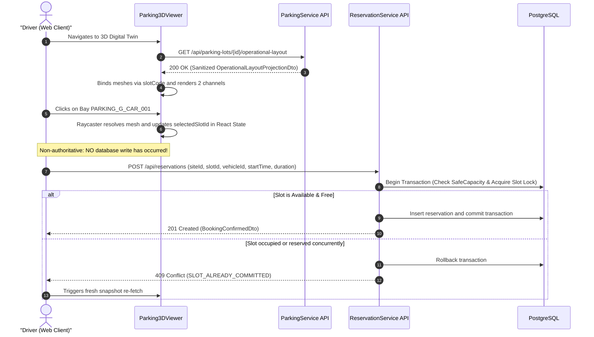

# SmartPark — 3D Digital Twin API Design & Integration Specification

| Metadata | Value |
| :--- | :--- |
| **Document ID** | `SPARK-API-3D-TWIN` |
| **Status** | **READY WITH CONDITIONS — PENDING PM SIGN-OFF (SCOPE: SPARK-228 ONLY)** |
| **Contract Version** | `v1.2.0` |
| **Effective Date** | 2026-10-25 |
| **Owning Service** | `ParkingService` (Target: `Facility & Visualization Service`) |
| **Author** | Principal Backend Architect & AI Agent Specification Reviewer |
| **Target Jira Issues** | SPARK-228, SPARK-244, SPARK-186, SPARK-188, SPARK-189, SPARK-296 |
| **Authoritative Baselines** | SRS v1.1 (§02 Facility & Capacity, §03 Discovery & Visualization), Solution Architecture v1.1 |
| **Companion Documents** | `docs/03-design/3d-digital-twin/3D_BACKEND_SLOT_STATE_BINDING.md`, `parking-structure-api-design.md`, `ai/architecture-reference.md` |

---

## Document Set

This document is the **hub** for the 3D Digital Twin contract. It stays normative for the definitions the individual task scopes share:

| Document | Scope | Status |
| :--- | :--- | :--- |
| `3d-digital-twin-api-design.md` (this file) | Hub - shared state model (3.2), slot identity (3.3), error catalogue (7), full register | Normative baseline |
| [`3d-digital-twin-spark-228-api-design.md`](3d-digital-twin-spark-228-api-design.md) | SPARK-228 - Sprint 2 read-path + Three.js state binding | Ready with conditions (pending PM sign-off) |
| [`3d-digital-twin-spark-244-api-design.md`](3d-digital-twin-spark-244-api-design.md) | SPARK-244 - Sprint 3 operator monitoring (US-O03) | Requires delta design pass |

Section 6 (batch structure ingestion) and Test Suite 2 describe work **deferred to a dedicated backlog epic**; it is not part of Sprint 2 or Sprint 3 scope.

---

## 1. Executive Summary & Scope

This specification provides the refined, implementation-ready architectural contracts, Data Transfer Objects (DTOs), database transaction mechanics, cross-service concurrency controls, authorization policies, and frontend adapter rules for the **SmartPark 3D Digital Twin Subsystem**, covering both the Sprint 2 backend binding prototype (**SPARK-228**) and the Sprint 3 Operator monitoring vertical slice (**SPARK-244 / US-O03**).

### Core Objectives
1. **API-01: Operational Layout Projection (`GET /api/parking-lots/{id}/operational-layout`)**: Provide a unified, high-performance, non-authoritative visualization projection exposing the orthogonal 2-axis state model (`physicalState` $\times$ `reservationState`) with explicit freshness semantics, decoupled from internal domain aggregates. Supports scoped Operator lot monitoring (SPARK-244 / US-O03) with distinct requested vs. allocated reservation context and zone-only precision integrity (FR-MAP-03).
2. **API-02: Driver Discovery & Slot Selection Workflow**: Allow Drivers to interact with the 3D digital twin during booking discovery without exposing sensitive operator or operational data, ensuring client mesh selections act purely as booking request context rather than unverified state mutations.
3. **API-03: Batch Structure Ingestion (`POST /api/parking-lots/{id}/structure`)**: Provide an atomic manifest-ingestion pipeline for pre-built archetypes (*Outdoor*, *Indoor/Parking House*, *Underground*) and custom enterprise GLB models. Enforces the canonical `SafeChange` invariant, outdoor ground-unit hierarchy, discrete entity lifecycle generation (see DEC-3D-07 in §6.5.1), and motorcycle scalar capacity decoupling (BR-CAP-01) with SLA benchmark $< 3.0\text{s}$ for $\le 200$ slots.
4. **Cross-Service Concurrency & Read/Write Separation**: Differentiate non-blocking read-path snapshot queries (`POST internal/structure/{siteId}/snapshot`) and real-time push streaming (`/ws/parking-lots/{id}/layout`) from exclusive write-path edit holds (`PUT internal/structure/{siteId}/{token}`), guaranteeing zero lock contention during Driver layout queries and real-time telemetry updates.
5. **Crash Recovery & Hold-Release Resilience**: Ground edit hold management in `StructureSynchronizationService.cs` (`preparing` $\rightarrow$ `ready` $\rightarrow$ `completed`), ensuring that process crashes or downstream communication failures are automatically healed by background reconciliation workers.
6. **Fail-Safe Presentation & Strict Authentication**: Eliminate default-to-available vulnerabilities by guaranteeing that `UNKNOWN` physical telemetry maps strictly to non-bookable (`disabled` / `maintenance`) states, and ensuring invalid/expired JWTs return HTTP `401 Unauthorized` instead of silently degrading to anonymous guest access.

### Implementation Readiness Verdict: `READY WITH CONDITIONS — PENDING PM SIGN-OFF (SCOPE: SPARK-228 ONLY)`
* **Verdict & Scope Boundary**:
  * **SPARK-228 (Sprint 2 Prototype — Frontend Data Binding)**: **APPROVED FOR IMPLEMENTATION**. Covers 1:1 raw mesh mapping convention (`slotCode === mesh.name`), Three.js visual state binding layer, 20-state visual presentation, fail-safe `UNKNOWN`/stale degradation, and deterministic test fixtures (`slots-operational-fixture.json`).
  * **SPARK-244 (Sprint 3 Operator Monitoring Vertical Slice)**: **REQUIRES DELTA DESIGN PASS**. Prior to Sprint 3 development, a dedicated design pass must finalize SignalR live transition event envelopes (`eventId`, `sequenceNumber`), assigned operator scope filtering (`FR-LOT-05/07`), and real-time state machine triggers.
  * **Facility Structure Batch Ingestion (`POST /structure`)**: **DEFERRED TO DEDICATED BACKLOG EPIC**. Independent facility creation story; excluded from both SPARK-228 and SPARK-244 to avoid scope bloat.
* **Prerequisites & Conditions for Backend Infrastructure Implementation**:
  1. **Inter-Service Latency SLA**: Measure network latency between `ParkingService` and `ReservationService` (`http://localhost:5055/internal/structure/*`) under concurrent load to confirm the $\le 150\text{ms}$ hold acquisition budget.
  2. **Storage Bucket Provisioning for Custom CAD (Phase 2)**: For Phase 1, `modelFileName` references statically hosted archetype GLBs. For Phase 2 custom GLBs, provision an S3/MinIO bucket with pre-signed upload URLs.
  3. **Database Baseline Preserved**: No schema change required. Uniqueness is enforced today by three existing constraints (§6.5.1): `UNIQUE (tenant_id, site_id, slot_code)` at `02-facility-service-db.sql:84` (non-partial, case-sensitive), `uq_site_slot_code_ci` at `scripts/database/overlay/parking-slot-constraints.sql:12` (non-partial, `upper(slot_code)`), and `uq_active_slot_code_ci` at `02-facility-service-db.sql:88` (partial `WHERE deleted_at IS NULL`, scoped to `spatial_unit_id`). Converting the *site-level* index to partial (Option C) is cataloged as an open architectural decision (DEC-3D-07), not a Sprint 2 action.

---

## 2. Evidence-Backed Repository Verification Matrix

All statements and design choices in this document are strictly classified according to the following evidence taxonomy:
* `[VERIFIED]`: Confirmed directly by inspecting active code, database schema, or tests.
* `[APPROVED REQUIREMENT]`: Mandated by approved SRS v1.1 or architecture decision records.
* `[PROPOSED]`: Recommended design solution engineered to resolve verified repository gaps.
* `[OPEN DECISION]`: Explicit decision point documented for technical leadership sign-off.

### 2.1. Repository Reality vs. Design Requirements

| Item / Domain | Current Repository Reality (`develop` / `feat/SPARK-228-3D_Model_BE`) | Design Contract Requirement | Classification | Primary Evidence & Location |
| :--- | :--- | :--- | :---: | :--- |
| **Service Placement** | Active project is `src/Services/ParkingService/` with namespace `SmartParking.ParkingService.*`. Service rename to `FacilityService` is documented in Fix2FA roadmap but not yet merged. | Keep implementation strictly inside `SmartParking.ParkingService.*` without premature namespace renaming. | `[VERIFIED]` | [`ParkingHost.cs`](../../../src/Services/ParkingService/SmartParking.ParkingService.API/Program.cs#L9-L46) |
| **Read-Path Separation** | `ParkingStructureService.ReadAsync` currently calls `commitments.AcquireAsync`, which acquires an exclusive edit hold in `StructureEditHolds`. | For read projections (API-01 / API-02), call non-blocking `commitments.ReadSnapshotAsync` (`POST internal/structure/{siteId}/snapshot`). Exclusively reserve `AcquireAsync` for structural edits (API-03). | `[VERIFIED]` / `[PROPOSED]` | [`ParkingStructureService.cs`](../../../src/Services/ParkingService/SmartParking.ParkingService.Application/ParkingStructureService.cs#L71), [`StructureSafetyStore.cs`](../../../src/Services/ReservationService/SmartParking.ReservationService.Persistence/StructureSafetyStore.cs#L74-L81) |
| **Crash Recovery State Machine** | `StructureSynchronizationService.cs` manages persistent rows in `structure_synchronizations` (`preparing`, `ready`, `completed`). | In API-03, write-path edits synchronize with this recovery worker. Crashes before commit release with null outcome; crashes after commit replay outcome to release hold. | `[VERIFIED]` | [`StructureSynchronizationService.cs`](../../../src/Services/ParkingService/SmartParking.ParkingService.Application/StructureSynchronizationService.cs#L10-L39) |
| **Layout Authorization** | Endpoint is guarded exclusively by `SlotOperatorClient.ScopeAsync()` (`SLOT_OVERRIDE` or assigned operator). Drivers calling this endpoint receive `403 Forbidden`. | Support dual-mode projection: Anonymous callers receive sanitized layout; invalid/expired JWTs return 401; valid Operators receive operational telemetry. | `[VERIFIED]` / `[PROPOSED]` | [`SlotOperatorClient.cs`](../../../src/Services/ParkingService/SmartParking.ParkingService.Infrastructure/SlotOperatorClient.cs#L12-L23) |
| **Batch Structure Ingestion** | No `POST /api/parking-lots/{id}/structure` exists. Only individual `POST /units`, `POST /slots`, and single-action `PATCH /structure` exist. | Implement `POST /api/parking-lots/{id}/structure` executing atomic manifest ingestion of floors and slots. | `[VERIFIED]` / `[APPROVED REQUIREMENT]` | [`Program.cs`](../../../src/Services/ParkingService/SmartParking.ParkingService.API/Program.cs#L151-L163) |
| **Physical vs. Reservation State** | Database table `parking_slots` has separate columns `physical_state` and `reservation_state`, but repo mapper collapses `physical_state` into `operationalStatus`. | Maintain two completely orthogonal dimensions in API DTOs and domain queries. | `[VERIFIED]` / `[APPROVED REQUIREMENT]` | [`PostgresParkingStructureRepository.cs`](../../../src/Services/ParkingService/SmartParking.ParkingService.Persistence/PostgresParkingStructureRepository.cs#L205-L208) |
| **Database Nullability of Reservation** | Database table `parking_slots.reservation_state` is nullable VARCHAR(20) (`CHECK (reservation_state IS NULL OR reservation_state IN ('PROTECTED','RESERVED','BACKUP'))`). | In DTO, `reservationState` is explicit enum `UNRESERVED` \| `RESERVED` \| `PROTECTED` \| `BACKUP`. Map SQL `NULL` $\leftrightarrow$ DTO `"UNRESERVED"`. | `[VERIFIED]` | [`02-facility-service-db.sql`](../../../scripts/database/microservices/02-facility-service-db.sql#L80) |
| **Canonical SafeChange Invariant** | Domain contains `SafeChange(affected)` checking `!hasLiveCommitments` and rejecting occupied, unknown, allocated, or protected slots with `STRUCTURE_IN_USE` (`409`). | Enforce unified canonical formula: reject if any slot is occupied, has unknown physical status, has reservation state, or if live commitments exist. | `[VERIFIED]` | [`ParkingStructure.cs`](../../../src/Services/ParkingService/SmartParking.ParkingService.Domain/ParkingStructure.cs#L61-L66) |
| **Idempotency Persistence** | Table `structure_operations` has `(site_id, idempotency_key)` unique index and columns `request JSONB`, `status TEXT`, `physical_committed BOOLEAN`. | Store client `Idempotency-Key` and request hash. Replay exact matches with cached 200/201; reject payload mismatches with 422; handle in-flight with 409. | `[VERIFIED]` | [`02-facility-service-db.sql`](../../../scripts/database/microservices/02-facility-service-db.sql#L124-L138) |
| **Outdoor Hierarchy** | `spatial_units.unit_type` check constraint is `('ZONE', 'FLOOR', 'BLOCK')`. Slots require `spatial_unit_id NOT NULL`. | For outdoor lots, ensure an authoritative ground floor unit (`Floor_G`) exists to root all slots. | `[VERIFIED]` / `[PROPOSED]` | [`02-facility-service-db.sql`](../../../scripts/database/microservices/02-facility-service-db.sql#L37-L73) |
| **Motorcycle Capacity** | Bounded by BR-CAP-01. Motorcycles are tracked via scalar capacity pools, not individual `parking_slots` rows. | Ingestion parser counts motorcycle spaces into `max_capacity` pool; zero individual motorcycle slot rows created. | `[VERIFIED]` / `[APPROVED REQUIREMENT]` | [`02-facility-service-db.sql`](../../../scripts/database/microservices/02-facility-service-db.sql#L52-L65) |
| **Slot Code Uniqueness & Soft Deletion** | Baseline non-partial unique index enforces `(spatial_unit_id, upper(slot_code))` per `parking-slot-constraints.sql:12`. Option C (`WHERE deleted_at IS NULL`) is cataloged under DEC-3D-07. | In-place update for currently active codes; soft-delete (terminal lifecycle event) for omitted codes. Discrete entity lifecycle generation (Option C) is an open decision for a dedicated migration PR. | `[VERIFIED]` / `[OPEN DECISION]` | [`05.6-Parking-Structure.sql`](../../../scripts/database/05.6-Parking-Structure.sql#L4), [`parking-slot-constraints.sql`](../../../scripts/database/overlay/parking-slot-constraints.sql#L12) |
| **Frontend Material Overwrite** | [`slotMaterialManager.ts`](../../../FE/src/lib/3d/slotMaterialManager.ts#L85) overwrites `mat.color` with status colors, destroying source PBR decals. | Frontend adapter isolates Channel A (proxy vehicle) from Channel B (emissive halo without touching base map color). | `[VERIFIED]` / `[PROPOSED]` | [`slotMaterialManager.ts`](../../../FE/src/lib/3d/slotMaterialManager.ts#L85-L93) |

---

## 3. Confirmed Architecture & Invariant Specifications

### 3.1. Non-Authoritative Presentation Boundary (FR-MAP-02) `[APPROVED REQUIREMENT]`
* The WebGL/Three.js viewport is strictly a read-only presentation channel.
* Hovering, clicking, or camera navigation inside the 3D scene **must never directly mutate transactional state** (no automatic bookings, check-ins, or gate triggers).
* Selecting a slot inside the 3D canvas populates client-side request context (`selectedSlotId`). The booking process executes through authoritative backend reservation workflows (target contract: `POST /api/reservations` in `ReservationService`) which independently re-validate availability, tariffs, and permissions.

### 3.2. Orthogonal 2-Axis State Model `[APPROVED REQUIREMENT]`
State visualization must preserve two independent dimensions:

```text
┌────────────────────────────────────────────────────────────────────────┐
│                        ORTHOGONAL STATE SPACE                          │
├────────────────────────────────┬───────────────────────────────────────┤
│ CHANNEL A: Physical Condition  │ CHANNEL B: Reservation Protection     │
│ (Operations / Sensor Telemetry)│ (Operations / Allocation Engine)      │
├────────────────────────────────┼───────────────────────────────────────┤
│ • AVAILABLE                    │ • UNRESERVED (SQL NULL)               │
│ • OCCUPIED                     │ • RESERVED                            │
│ • UNKNOWN (Fail-Safe Closed)   │ • PROTECTED                           │
│ • MAINTENANCE                  │ • BACKUP                              │
│ • UNAVAILABLE                  │                                       │
└────────────────────────────────┴───────────────────────────────────────┘
```

#### Coexistence & Fail-Safe Rules Matrix (20 Canonical State Combinations)

The system maintains strict decoupling between physical sensor telemetry (**Channel A**) and reservation/allocation logic (**Channel B**), adhering strictly to **RA-01, RA-02, and RA-06** (Decision 2026-10-25). The Cartesian product of **5 Physical States** (`AVAILABLE`, `OCCUPIED`, `UNKNOWN`, `MAINTENANCE`, `UNAVAILABLE`) and **4 Reservation States** (`UNRESERVED`, `RESERVED`, `PROTECTED`, `BACKUP`) yields exactly **20 canonical distinct state combinations**, categorized below:

> **Axis Decoupling Invariant**: Concepts such as `OVERSTAY` (session status in `ReservationService` / `parking_sessions.session_status`) and `DISABLED` (legacy single-axis frontend enum) **do NOT exist on the authoritative API projection axes**.

| STT | Trạng thái vật lý (PhysicalState) | Trạng thái đặt chỗ (ReservationState) | Diễn giải ý nghĩa nghiệp vụ & Quy tắc hệ thống (Chuẩn RA-02 & RA-06) | `isBookable` | Hiển thị 3D (Channel A & B) |
| :---: | :--- | :--- | :--- | :---: | :--- |
| **1** | `AVAILABLE` | `UNRESERVED` | **Trống hoàn toàn**: Ô đỗ không có xe và chưa có ai đặt trước. Sẵn sàng cho đặt chỗ online hoặc xe vãng lai. | `true` | Mặt sàn trống; không có hào quang halo. |
| **2** | `AVAILABLE` | `RESERVED` | **Chờ xe đặt đến**: Khách B đã được phân bổ ô đỗ (`allocation_point` đã qua) nhưng chưa đến bãi. Khóa không cho xe khác đặt/vào. | `false` | Mặt sàn trống; Halo màu Hổ phách chớp nháy (`#F59E0B`). |
| **3** | `AVAILABLE` | `PROTECTED` | **Bảo vệ đặt trước / VIP**: Ô đỗ đang trong cửa sổ bảo vệ tương lai (`effective RESERVATION_PROTECTION_WINDOW`, mặc định 4h) hoặc bảo lưu sự kiện/VIP. | `false` | Mặt sàn trống; Halo màu Cyan sáng liên tục (`#06B6D4`). |
| **4** | `AVAILABLE` | `BACKUP` | **Ô đỗ dự phòng vận hành**: Khóa ẩn với Driver; dùng giải cứu khi xảy ra xung đột quá giờ hoặc hỏng cảm biến. | `false` | Mặt sàn trống; Halo màu Tím (`#8B5CF6`). (Operator điều phối giải cứu nội bộ qua lệnh override riêng). |
| **5** | `OCCUPIED` | `UNRESERVED` | **Xe vãng lai đang đỗ**: Khách không đặt trước đi thẳng qua cổng Barrier (nhận diện LPR) và vào đỗ. | `false` | Xuất hiện mô hình xe 3D (màu xanh Navy `#1E3A8A`); không có halo. |
| **6** | `OCCUPIED` | `RESERVED` | **Xe đỗ và có lịch đặt trước**: Có thể là cùng Khách B đã vào đỗ đúng chỗ (xác nhận qua Operations session linkage); HOẶC Xe A phiên trước vẫn đang đỗ trong khi Xe B có lịch hẹn đã đến giờ phân bổ. | `false` | Xuất hiện xe 3D; Halo Hổ phách sáng cố định (nếu đã link session) hoặc chớp nháy cảnh báo. |
| **7** | `OCCUPIED` | `PROTECTED` | **Xe đỗ kèm bảo vệ tương lai**: Xe A đang đỗ phiên trước, đồng thời ô đỗ đang nằm trong cửa sổ bảo vệ (`effective RESERVATION_PROTECTION_WINDOW`) cho Xe B tương lai; HOẶC xe hợp đồng dài hạn đang đỗ. | `false` | Xuất hiện xe 3D; Halo Cyan sáng cố định. |
| **8** | `OCCUPIED` | `BACKUP` | **Ô dự phòng đang được sử dụng**: Hệ thống hoặc Operator đã điều phối 1 xe khẩn cấp vào ô backup này. | `false` | Xuất hiện xe 3D; Halo Tím sáng cố định. |
| **9** | `UNKNOWN` | `UNRESERVED` | **Mất tín hiệu cảm biến / Bị che khuất**: IoT sensor mất kết nối gateway. Áp dụng **Fail-Closed: Khóa đặt chỗ**. | `false` | Mặt sàn làm mờ (opacity 0.4); nhãn cảnh báo Sensor Stale. |
| **10** | `UNKNOWN` | `RESERVED` | **Có đặt chỗ nhưng mất tín hiệu IoT**: Khách đã book nhưng camera/sensor không xác thực được vật lý. | `false` | Halo Hổ phách + icon cảnh báo unverified telemetry. |
| **11** | `UNKNOWN` | `PROTECTED` | **Ô VIP mất tín hiệu cảm biến**: Hợp đồng bảo lưu nhưng cảm biến offline. Ưu tiên bảo vệ quyền VIP. | `false` | Halo Cyan + icon cảnh báo unverified telemetry. |
| **12** | `UNKNOWN` | `BACKUP` | **Ô dự phòng mất tín hiệu cảm biến**: Loại khỏi pool tự động re-allocation cho đến khi sensor online trở lại. | `false` | Icon xám mờ; loại khỏi pool dự phòng khả dụng. |
| **13** | `MAINTENANCE` | `UNRESERVED` | **Bảo trì cơ sở hạ tầng**: Sơn sửa vạch kẻ, sửa trụ sạc EV, nắp cống. Không có lịch đặt trước. | `false` | Mô hình rào chắn/nón bảo hộ công trình 3D màu cam. |
| **14** | `MAINTENANCE` | `RESERVED` | **Mất năng lực phục vụ đột xuất (Lost Capacity)**: Ô đỗ phát sinh hỏng hóc sau khi khách đã book. Kích hoạt tự động Re-allocation sang ô tương đương. | `false` | Rào chắn bảo trì 3D kèm viền đỏ nhấp nháy; bắn event cho ReservationService. |
| **15** | `MAINTENANCE` | `PROTECTED` | **Ô VIP/Hợp đồng gặp sự cố bảo trì**: Bắn thông báo ngay cho Operator để xếp chuyển khách VIP sang vị trí tương đương. | `false` | Rào chắn bảo trì 3D + thông báo điều phối VIP. |
| **16** | `MAINTENANCE` | `BACKUP` | **Ô dự phòng đang sửa chữa**: Tạm thời vô hiệu hóa trong thuật toán cân bằng tải bãi đỗ. | `false` | Rào chắn bảo trì 3D mờ. |
| **17** | `UNAVAILABLE` | `UNRESERVED` | **Tạm ngừng khai thác vật lý**: Chặn barrier vật lý, sự kiện, đóng làn. | `false` | Mặt sàn xám tối + rào cản vật lý. |
| **18** | `UNAVAILABLE` | `RESERVED` | **Ô bị đóng có lịch hẹn**: Kích hoạt re-allocation khẩn cấp sang ô khác. | `false` | Mặt sàn xám tối kèm viền đỏ nhấp nháy cảnh báo. |
| **19** | `UNAVAILABLE` | `PROTECTED` | **Ô bị đóng có bảo vệ tương lai**: Thông báo Operator xếp chuyển trước khi mở khung giờ. | `false` | Mặt sàn xám tối + icon thông báo điều chuyển. |
| **20** | `UNAVAILABLE` | `BACKUP` | **Ô dự phòng bị khóa ngoài vận hành**: Không tham gia giải cứu. | `false` | Mặt sàn xám tối toàn phần. |

#### Chuyên Sâu Kịch Bản: Xe A Đang Đỗ (Occupied) + Xe B Đặt Trước & Xử Lý Overstay (Chuẩn RA-01 & RA-02)

Một trường hợp phức tạp xảy ra khi: Xe A đang đỗ tại Slot X (phiên hiện tại) và Xe B có lịch hẹn đã đặt trước cho Slot X bắt đầu lúc $T_{\text{start}}$.

1. **Nguyên Tắc Bất Biến (RA-02 — Occupant/Claimant Non-Inference)**:
   * `physicalState = OCCUPIED` chỉ xác nhận có xe vật lý hiện diện, **không bao giờ tự định danh người đỗ**.
   * Mối quan hệ giữa người đang đỗ và người đặt chỗ phải được thiết lập dựa trên bản ghi nghiệp vụ chính thức (`authoritative Operations linkage: accepted session + allocation + reservation`), không được suy diễn từ trạng thái hiển thị.
   * Xe A và Xe B có thể là **hai tài xế hoàn toàn khác nhau**.
2. **Quy Trình Thời Gian & Chính Sách Cấu Hình Linh Hoạt (RA-01 & RA-06)**:
   * Các mốc thời gian không phải hằng số cứng mà là các giá trị mặc định có thể cấu hình (*configurable defaults*):
     * `RESERVATION_PROTECTION_WINDOW`: Mặc định 4 giờ ($T_{\text{start}} - 4\text{h}$).
     * `ALLOCATION_LEAD_TIME`: Mặc định 1 giờ ($T_{\text{start}} - 1\text{h}$).
   * **Giai đoạn 1 ($T_{\text{start}} - \text{effective RESERVATION\_PROTECTION\_WINDOW}$)**:
     * Cửa sổ bảo vệ mở ra $\implies$ Slot X chuyển sang trạng thái `OCCUPIED + PROTECTED` (Halo màu Cyan).
     * Trạng thái này báo hiệu: Xe A đang đỗ và Xe B có yêu cầu tương lai được bảo vệ, ngăn không cho khách vãng lai mới xí chỗ.
    * **Giai đoạn 2 ($T_{\text{start}} - \text{effective ALLOCATION\_LEAD\_TIME}$)**:
      * Scheduler kích hoạt phân bổ. Slot X **giữ nguyên `OCCUPIED + PROTECTED`** (Halo Cyan) — **không** chuyển sang `RESERVED` khi Xe A còn đỗ, vì tài nguyên vẫn đang bị một lượt đỗ hiện hữu chiếm giữ.
      * **Trường hợp 1 — tìm được slot thay thế phù hợp**: hệ thống **khoá ngay** slot đó bằng một dòng `slot_allocations` mới với `allocation_status = 'RESERVED'` và `tstzrange(allocated_start_time, allocated_end_time)` theo khung giờ của Xe B. Đây là *hold* thật trong DB — không phải cờ tạm trên FE/BE và không phải giá trị enum mới. Reservation chuyển `CONFIRMED → ALLOCATED`; projection của Slot X không đổi.
      * **Trường hợp 2 — chưa tìm được slot**: reservation ở lại `CONFIRMED` (chưa có hold). Bộ quét đối soát ở giai đoạn 3 tiếp tục thử lại.
    * **Giai đoạn 3 (Vùng đệm giải tỏa $T_{\text{start}} - 15\text{m}$ đến $T_{\text{start}} - 5\text{m}$)**:
      * **Reservation Reconciliation Worker chạy mỗi 5 phút** trong cửa sổ này (đúng 3 lần: $T-15$, $T-10$, $T-5$) — giữ nguyên cadence 5 phút theo quyết định PM 2026-10-27, không hạ xuống 1 phút.
      * **Sự kiện đẩy (event-driven)**: ngoài nhịp 5 phút, mỗi khi có **bất kỳ lượt checkout/exit nào trong lot**, worker chạy thêm một lần ngay lập tức cho các reservation còn thiếu hold. Nhờ vậy slot vừa trống được khoá trong vài giây thay vì chờ tới tick kế tiếp.
      * Mỗi lần chạy đều **idempotent**: reservation đã có hold còn hiệu lực thì không tạo thêm; hold bị mất (structure change, xung đột) thì tìm lại; thao tác khoá dùng `SELECT ... FROM slot_allocations WHERE slot_id = ... FOR UPDATE`.
      * **Xe A checkout trước hạn chót**: nếu reservation **chưa** có hold, Slot X chuyển `AVAILABLE + RESERVED` — đây là **thời điểm duy nhất** reservation state của Slot X đi từ `PROTECTED` sang `RESERVED`. Nếu reservation **đã** có hold ở slot khác thì giữ nguyên hold đó: không di chuyển lần hai, tránh đổi chỗ hai lần cho cùng một tài xế.
      * **Hạn chót $T_{\text{start}} - 5\text{m}$**: vẫn chưa có hold $\implies$ phân bổ vào slot dự phòng (`BACKUP`) của lot và thông báo Driver B; **không còn slot `BACKUP` khả dụng** $\implies$ reservation bị **huỷ**, kích hoạt luồng hoàn trả theo chính sách hoàn tiền hiện hành (không tự đặt mức hoàn mới), và thông báo cho Driver B. Reservation không được treo vô hạn.
    * **Vòng đời một dòng `slot_allocations` (đúng 3 giá trị chuẩn, không thêm giá trị thứ tư)**:
      * `RESERVED` — slot đã được khoá cho khung giờ của Xe B nhưng xe chưa vào. Đây chính là "ứng viên" mà giai đoạn 2 dùng.
      * `OCCUPIED` — xe đã vào đúng slot đó (check-in), chuyển từ `RESERVED`.
      * `RELEASED` — xe đã rời slot (checkout) hoặc hold được trả lại; dòng này không còn tham gia ràng buộc chồng lấn.
      * Ràng buộc `EXCLUDE USING gist (slot_id WITH =, tstzrange(allocated_start_time, allocated_end_time) WITH &&) WHERE (allocation_status IN ('RESERVED','OCCUPIED'))` bảo đảm một slot không thể bị hai reservation khoá trùng khung giờ; dòng `RELEASED` được miễn trừ nên lịch sử vẫn giữ được.
3. **Quy Tắc Xử Lý Khi Có Xung Đột (No Displacement & Automated Re-allocation)**:
   * **Tuyệt đối không cưỡng chế di dời (No Displacement)**: Hệ thống không đuổi Xe A đang đỗ và không đánh dấu Xe B là đã check-in thành công.
   * **Automated Re-allocation (điều chuyển tự động)**:
     * ReservationService tự động tìm kiếm ô đỗ trống tương đương (Slot Y cùng tầng, cùng loại phương tiện).
     * Mở transaction khóa dòng trong PostgreSQL: `SELECT * FROM slot_allocations WHERE slot_id = 'Slot_X' FOR UPDATE`.
      * Slot Y đã được khoá bằng `RESERVED` từ giai đoạn 2; giai đoạn 3 chỉ xác nhận hold đó là hold chính thức của Xe B (không tạo thêm dòng mới nếu đã có).
     * Slot X được trả về phản ánh đúng thực tế: Xe A đang đỗ (`OCCUPIED + UNRESERVED` hoặc `OVERSTAY`).
     * Đẩy sự kiện WebSocket đến App của Khách B thông báo đổi vị trí đỗ thuận tiện hơn.
   * **Kích hoạt ô đỗ dự phòng (`BACKUP`)**:
     * Nếu bãi đỗ đầy 100% không còn ô trống tương đương **và còn slot `BACKUP` khả dụng**: hệ thống tự động kích hoạt ô dự phòng đã chuẩn bị sẵn để đón Xe B.
     * Nếu **không còn slot `BACKUP` khả dụng** tại hạn chót $T_{\text{start}} - 5\text{m}$: huỷ reservation, hoàn trả theo chính sách hiện hành, thông báo Driver B (xem giai đoạn 3).
     * Xe A bị chuyển sang trạng thái `OVERSTAY` $\implies$ bật **thông báo quá hạn (overstay notice)** và báo Operator hiện trường hỗ trợ. **Không** bật phí quá hạn: `OVERSTAY_PENALTY` / `LOST_TICKET_FEE` vẫn ở trạng thái inactive theo `policy-catalogue.md:89`.

#### Quy Tắc Cốt Lõi Về Trạng Thái Không Xác Định (`UNKNOWN`)
* **Fail-Closed Rule (P0-01 Hardening)**: Khi cảm biến trả về `UNKNOWN`, hệ thống **tuyệt đối không bao giờ mặc định là có thể đặt chỗ (`isBookable = false`)**.
* Frontend adapter chuyển đổi `UNKNOWN` thành `disabled` hoặc `maintenance` trên giao diện, ngăn chặn mọi rủi ro tài xế đặt phải ô đỗ đang có xe hoặc đang gặp lỗi phần cứng.

### 3.3. Stable Slot Identity & Mapping Invariants `[APPROVED REQUIREMENT]`
* **Database Identity**: `parking_slots.id` (UUID v4) is the immutable primary key for transactions, foreign keys, and audit records.
* **Model Binding Identity**: `parking_slots.slot_code` (constrained to max 32 characters in the API per GUIDE §18.2; fits within database column `parking_slots.slot_code VARCHAR(50)` per `02-facility-service-db.sql:74`) is the canonical human/mesh integration identifier (e.g., `CarParkingSpace_001`, `PARKING_G_CAR_001`, `PARKING_G_EV_CAR_002 2`, `B1_Car_001`).
* **Canonical Mapping Rule (Raw Case-Preserving Mesh Name)**:
  * To guarantee $1:1$ physical fidelity across heterogeneous Blender archetypes (`CarParkingSpace_*` in Outdoor, `PARKING_*` in House, `B1_Car_*` in Underground), `slot_code` stores the **exact raw mesh name** as authored in the 3D model.
  * **Authoritative Override**: This rule strictly supersedes and overrides all legacy prototype drafts:
    1. `3D_BACKEND_SLOT_STATE_BINDING.md` (§3.3 & §7 mapping matrix suggesting `PARKING_G_CAR_001 -> G-CAR-001` or `normalizeSlotIdentifier`).
    2. `3D_ENTERPRISE_MODEL_INGESTION_RULES.md §9.2` (recommending stripping `PARKING_` prefix).
    3. Any legacy uppercase or `.001` stripping mutations.
    *In all cases, the raw mesh name from the GLB scene graph is preserved as the authoritative `slot_code`.*
  * **Case-Insensitive Uniqueness**: Database enforces uniqueness case-insensitively via `upper(slot_code)` in `uq_site_slot_code_ci` (`scripts/database/overlay/parking-slot-constraints.sql:12`) and `uq_active_slot_code_ci` (`02-facility-service-db.sql:88`, partial on `deleted_at IS NULL`), layered on top of the case-sensitive `UNIQUE (tenant_id, site_id, slot_code)` (`02-facility-service-db.sql:84`). Raw casing is preserved for 3D mesh matching, while uniqueness is verified case-insensitively.
  * **Strict Validation Regex**: Validated against `^[A-Za-z0-9_-]+( [A-Za-z0-9_-]+)?$` ($1 \le \text{length} \le 32$). This allows exactly one internal space to accommodate Blender duplicate suffixes like `" 2"` or `" 5"`, while strictly preventing leading/trailing whitespace or multiple spaces.
* **Three.js Performance & Fast Lookup**:
  * The frontend 3D viewport builds an in-memory `Map<string, THREE.Object3D>` index once upon initial scene graph load.
  * State updates from REST snapshots or SignalR delta events execute instant $O(1)$ dictionary lookups (`meshMap.get(slot.slotCode)`), strictly avoiding recursive scene-graph traversals (`scene.getObjectByName()`, which is $O(n)$).
* **No Array Index Fallback**: Matching 3D meshes to backend slots by array index or spatial proximity is **strictly prohibited**.
* **No Fabricated Slots**: Unmapped 3D meshes must be classified as `UNMAPPED` and rendered as inert objects; the system **must never invent synthetic slots** (`slot-auto-*`) or default unmapped meshes to `AVAILABLE`.

### 3.4. Canonical SafeChange Structure Protection Invariant `[VERIFIED]`
Before any destructive structure modification, bulk replacement, or slot reduction commits, the backend executes the canonical `SafeChange` evaluation:

$$\text{SafeChange}(\text{site}) \iff (\neg \text{hasLiveCommitments}) \land \forall s \in \text{slots}: \left( \neg s.\text{IsOccupied} \land s.\text{physicalState} \neq \text{UNKNOWN} \land s.\text{reservationState} \in (\text{UNRESERVED}, \text{null}) \land s.\text{Id} \notin \text{ProtectedSlots} \right)$$

#### Enforcement Semantics
1. **Live Commitments**: Evaluated via downstream `ReservationService` (`IStructureCommitments.AcquireAsync`). If any unexpired reservations, pending payment holds, or active parking sessions exist for the facility $\implies$ `hasLiveCommitments = true`.
2. **Occupied Slots**: Any slot where `physical_state == 'OCCUPIED'` (or `is_physically_occupied = true`) violates SafeChange.
3. **Unknown Slots**: Any slot where sensor telemetry is `UNKNOWN` violates SafeChange (cannot safely remove unverified stalls).
4. **Active Allocations**: Any slot where `reservation_state IN ('RESERVED', 'PROTECTED', 'BACKUP')` violates SafeChange.
5. **Violation Response**: Transaction aborts immediately; returns HTTP `409 Conflict` with error code `STRUCTURE_IN_USE`.
6. **Downstream Failure**: If `ReservationService` cannot be contacted to verify commitments $\implies$ Fail closed; return HTTP `503 Service Unavailable` with error code `COMMITMENTS_UNAVAILABLE`.

### 3.5. Read-Path vs. Write-Path Concurrency Separation `[VERIFIED]`

To prevent high-frequency Driver snapshot queries and real-time push synchronization on API-01 from taking exclusive locks or blocking structure edits, the system strictly separates read transactions from mutation holds:

1. **Read Projection Path (API-01 / API-02)**:
   * Calls `commitments.ReadSnapshotAsync(tenantId, siteId, ct)` $\rightarrow$ `POST internal/structure/{siteId}/snapshot`.
   * **Zero Lock Contention**: Acquires **NO** edit hold in `StructureEditHolds`. Runs a non-blocking PostgreSQL transaction under `REPEATABLE READ`.
   * Multiple concurrent Drivers can read the operational layout simultaneously without interfering with each other or with incoming bookings.
2. **Batch Ingestion Write Path (API-03)**:
   * Acquires local site gate lock: `LockSiteAsync(siteId)`.
   * Runs recovery check: `synchronization.RecoverSiteAsync(siteId)`.
   * Prepares durable token: `PrepareAsync(...)`.
   * Calls `commitments.AcquireAsync(...)` $\rightarrow$ `PUT internal/structure/{siteId}/{token}`.
   * Acquires exclusive lease in `StructureEditHolds`. If another hold exists, returns `409 Conflict` (`STRUCTURE_BUSY`).
   * Opens local transaction under `REPEATABLE READ`: `SELECT 1 FROM parking_sites WHERE id = siteId FOR UPDATE`.
   * Serializes with database trigger `guard_parking_structure_commitment()` which blocks new reservation writes until release.

```mermaid
flowchart TD
    subgraph ReadPath ["API-01: Operational Read Path (Non-Blocking)"]
        R1["Driver / Operator GET Layout"] --> R2["POST internal/structure/siteId/snapshot"]
        R2 --> R3["PostgreSQL Read-Only REPEATABLE READ"]
        R3 --> R4["Return 200 OK Projection DTO"]
    end

    subgraph WritePath ["API-03: Structure Ingestion Write Path (Exclusive Lock)"]
        W1["Owner POST /structure"] --> W2["Acquire Local Site Gate Lock"]
        W2 --> W3["PUT internal/structure/siteId/token: AcquireAsync"]
        W3 --> W4{"Active Hold or Live Bookings?"}
        W4 -- Yes --> W5["409 STRUCTURE_BUSY / STRUCTURE_IN_USE"]
        W4 -- No --> W6["Insert StructureEditHold lease"]
        W6 --> W7["Begin Local Tx + SELECT FOR UPDATE parking_sites"]
        W7 --> W8["In-Place Reconciliation & Commit Local Tx"]
        W8 --> W9["POST internal/structure/siteId/token/release"]
        W9 --> W10["Delete Hold & Insert Release Receipt"]
        W10 --> W11["Return 201 Created"]
    end
```



### 3.6. Crash Recovery & Resilience State Machine `[VERIFIED]`

The system integrates with `StructureSynchronizationService.cs` to ensure that unexpected server crashes or network failures between `ParkingService` and `ReservationService` never leave orphaned holds:

```text
┌─────────────────┐       Local Commit Success        ┌───────────────┐
│                 │ ────────────────────────────────> │               │
│    PREPARING    │                                   │     READY     │
│  (Token Issued) │ ──┐                           ┌── │ (Local Done)  │
└─────────────────┘   │                           │   └───────────────┘
                      │ Crash / Abandon           │           │
                      │                           │           │ Release Hold Acknowledged
                      ▼                           ▼           ▼
             ┌────────────────────────────────────────────────────────┐
             │                       COMPLETED                        │
             │           (Receipt Stored / Hold Cleared)              │
             └────────────────────────────────────────────────────────┘
```

1. **Crash During `preparing` State** (before local transaction commits):
   * Local changes were never committed to PostgreSQL.
   * Background worker (`StructureSynchronizationWorker`) calls `store.FencePreparationAsync(token)` and releases the downstream hold with `outcome = null`.
2. **Crash During `ready` State** (local transaction committed, but `ReleaseAsync` network call failed):
   * Local changes are safely committed in PostgreSQL.
   * Background worker reads `synchronization.Outcome`, re-calls `commitments.ReleaseAsync(siteId, token, outcome)`, and marks the synchronization as `completed`.
   * Guarantees eventual consistency and zero permanent hold locks.

---

## 4. API-01: Operational Layout Projection Specification

### 4.1. Endpoint Definition
* **Method & Path**: `GET /api/parking-lots/{id}/operational-layout`
* **Owning Service**: `SmartParking.ParkingService`
* **Transport**: HTTP/1.1 and HTTP/2 JSON over TLS
* **Caching**: `Cache-Control: no-store, no-cache, must-revalidate`
* **Route Migration Strategy & Coexistence**:
  * **Legacy Route**: `GET /api/parking-lots/{id}/operator-layout` (registered in `Program.cs:142`) remains active with its legacy structural payload to guarantee zero regression for existing components (`OperatorBackupPanel.tsx`).
  * **Canonical 3D Digital Twin Route**: `GET /api/parking-lots/{id}/operational-layout` (registered in `Program.cs:165`) is the authoritative specification for 3D Digital Twin visualization. It serves both anonymous/authenticated Drivers (Sanitized Projection) and authorized Site Operators / Owners (Full Operational Telemetry) via role-based projection.
  * `OperatorBackupPanel.tsx` will be migrated to this clean dual-mode endpoint in a subsequent sprint task.

### 4.2. Request Specification
* **Path Parameters**:
  * `id` (UUID, Required): Authoritative unique identifier of the target parking site (`parking_sites.id`).
* **Query Parameters**:
  * `vehicleType` (String, Optional): Filter slots by vehicle capability (`CAR`, `MOTORCYCLE`, `OVERSIZED`).
  * `floor` (String, Optional): Filter slots by floor level code (e.g., `Floor_G`, `Floor_L1`, `Floor_B1`).
  * `zone` (String, Optional): Filter slots by operational zone code (e.g., `Zone_A`, `Zone_VIP`).
  * `row` (String, Optional): Filter slots by aisle/row designation (e.g., `Row_01`, `Row_02`).
* **Headers**:
  * `Authorization: Bearer <JWT>` (Optional for public discovery; required for operator telemetry).

> **Database Hierarchy Note**: Floor and Zone units are managed via the `spatial_units` table (`unit_type IN ('FLOOR', 'ZONE', 'BLOCK')`). In multi-story buildings, each floor is persisted as an independent row (`parent_id = site_id`), allowing the 3D client to fetch and render specific floors in isolation (Floor Slicing / Level Isolation Mode) to optimize WebGL memory and rendering performance.

### 4.3. Dual-Mode Authentication & Authorization Rules `[PROPOSED]`
1. **Case A: Header Absent (`Authorization` omitted)**:
   * Recognized as **Anonymous Public Driver**.
   * Returns HTTP `200 OK` with **Sanitized Projection** (no operational notes, no session identifiers; `isBookable` is never `true` for `BACKUP` or `UNKNOWN`).
   * **Read-only guarantee (PM decision 2026-10-27)**: an absent `Authorization` header authorizes **read-only projection only**. There is no anonymous write path: every mutating operation in this contract and in the parking-structure API returns `401 UNAUTHENTICATED` when the header is absent. Anonymous callers can never create, update, delete, reserve, allocate or check in — there is no "guest booking", and no caller identity is ever inferred from an omitted header.
2. **Case B: Header Present but Invalid / Expired**:
   * If caller supplies an `Authorization` header that is malformed, has an invalid signature, or is expired:
   * Returns HTTP **`401 Unauthorized`** (`UNAUTHENTICATED`).
   * **Security Rule**: The system **must NEVER silently degrade an invalid token to anonymous**. Silent degradation masks expired sessions from operators and owners, creating security blind spots.
3. **Case C: Header Present and Valid**:
   * Decodes JWT claims:
     * If role is `Driver` $\implies$ returns HTTP `200 OK` with Sanitized Projection.
     * If role is `Operator` with active assignment or `SLOT_OVERRIDE` $\implies$ returns HTTP `200 OK` with Full Operational Telemetry.
     * If role is `Operator` without site assignment $\implies$ returns HTTP `200 OK` with Sanitized Projection (cannot view internal telemetry of unauthorized lots).
     * If role is `Owner` (matching site tenant) $\implies$ returns HTTP `200 OK` with Full Structural Metrics.
     * If role is `Admin` $\implies$ returns HTTP `200 OK` with Full Telemetry.

### 4.4. Response DTO Specification (`OperationalLayoutProjectionDto`)

```json
{
  "success": true,
  "data": {
    "siteId": "f7d3a2b1-5e8c-4a3d-9f1e-2c8b7a6d5e4f",
    "siteCode": "SITE_CENTRAL_01",
    "siteName": "Central Plaza Garage",
    "contractVersion": "1.2.0",
    "generatedAt": "2026-10-24T10:15:30.125Z",
    "isFresh": true,
    "stalenessThresholdSeconds": 30,
    "metrics": {
      "totalPhysicalCapacity": 48,
      "occupiedCount": 18,
      "reservedCount": 6,
      "availableCarSlots": 24,
      "motorcycleCapacity": {
        "maxCapacity": 40,
        "occupiedCount": 15,
        "availableCount": 25
      },
      "zoneCapacities": [
        {
          "zoneId": "7a8b9c0d-1e2f-3a4b-5c6d-7e8f9a0b1c2d",
          "zoneCode": "Zone_A",
          "floorCode": "Floor_G",
          "name": "Ground Outdoor North",
          "maxCapacity": 24,
          "occupiedCount": 10,
          "allocatedSlotCount": 3,
          "zoneOnlyReservedCount": 2
        }
      ]
    },
    "floors": [
      {
        "floorId": "3fa85f64-5717-4562-b3fc-2c963f66afa6",
        "floorCode": "Floor_G",
        "name": "Ground Level",
        "level": 1,
        "maxCapacity": 48
      }
    ],
    "slots": [
      {
        "slotId": "b8a1c2d3-4e5f-6a7b-8c9d-0e1f2a3b4c5d",
        "slotCode": "PARKING_G_CAR_001",
        "floorId": "3fa85f64-5717-4562-b3fc-2c963f66afa6",
        "floorCode": "Floor_G",
        "zoneCode": "Zone_A",
        "rowCode": "Row_01",
        "supportedVehicleType": "CAR",
        "slotType": "STANDARD",
        "physicalState": "AVAILABLE",
        "reservationState": "RESERVED",
        "sessionType": null,
        "isEvCharging": false,
        "isBookable": false,
        "coordinates3d": {
          "x": 12.45,
          "y": 0.00,
          "z": -5.30
        },
        "features": {
          "covered": true,
          "hasCharger": false
        },
        "operatorContext": {
          "activeSessionId": null,
          "maskedPlate": "30A-*****.89",
          "approachingReservation": {
            "reservationId": "d1e2f3a4-b5c6-7a8b-9c0d-1e2f3a4b5c6d",
            "requestedSlotCode": "PARKING_G_CAR_002",
            "allocatedSlotCode": "PARKING_G_CAR_001",
            "isReallocated": true,
            "reallocationReason": "OCCUPIED_OVERSTAY_DISPLACEMENT",
            "expectedArrivalTime": "2026-10-24T10:30:00.000Z",
            "gracePeriodExpiresAt": "2026-10-24T10:45:00.000Z"
          }
        },
        "updatedAt": "2026-10-24T10:14:55.000Z"
      },
      {
        "slotId": "c9b2d3e4-5f6a-7b8c-9d0e-1f2a3b4c5d6e",
        "slotCode": "PARKING_G_EV_001",
        "floorId": "3fa85f64-5717-4562-b3fc-2c963f66afa6",
        "floorCode": "Floor_G",
        "zoneCode": "Zone_EV",
        "rowCode": "Row_01",
        "supportedVehicleType": "CAR",
        "slotType": "EV",
        "physicalState": "OCCUPIED",
        "reservationState": "RESERVED",
        "sessionType": "EV_CHARGING",
        "isEvCharging": true,
        "isBookable": false,
        "coordinates3d": {
          "x": 15.20,
          "y": 0.00,
          "z": -5.30
        },
        "features": {
          "covered": true,
          "hasCharger": true,
          "chargerPowerKw": 22.0
        },
        "operatorContext": {
          "activeSessionId": "e5f6a7b8-c9d0-1e2f-3a4b-5c6d7e8f9a0b",
          "maskedPlate": "29B-*****.12",
          "approachingReservation": null
        },
        "updatedAt": "2026-10-24T10:15:10.000Z"
      }
    ]
  }
}
```

> **Phase 1 vs Phase 2 Session Classification Invariant**:
> * `sessionType` (`string | null`) determines the vehicle proxy PBR chassis color in Channel A.
> * **Phase 1 (Derived Heuristic)**: Because `parking_sessions` in `03b-reservation-operations-service-db.sql` does not possess a `session_type` column, `ParkingService` derives this value heuristically: if `slotType == 'EV' && physicalState == 'OCCUPIED'` $\implies$ `'EV_CHARGING'`, otherwise `null` (or `'STANDARD'`).
> * **Phase 2 (Authoritative Linkage)**: Authoritative operational session classification will be populated via asynchronous domain events from `ReservationService`.
> * **Privacy Redaction**: For anonymous drivers and authenticated `Driver` callers, `sessionType` is strictly redacted to `null`.

### 4.5. Telemetry Freshness & Distributed Heartbeat Semantics `[PROPOSED ARCHITECTURE / SPRINT 3 PREREQUISITE]`
* `generatedAt` (ISO 8601 UTC): The precise timestamp when the API gateway constructed and serialized this JSON response.
* `stalenessThresholdSeconds` (Integer): Fixed threshold of **30 seconds** (`stalenessThresholdSeconds = 30`).
* `isFresh` (Boolean): Telemetry health boolean evaluated as:
  $$\text{isFresh} \iff (\text{DateTimeOffset.UtcNow} - \text{site\_telemetry\_heartbeat}) \le \text{TimeSpan.FromSeconds}(30)$$
* **Sprint 2 Prototype Implementation vs Sprint 3 Target Architecture**:
  * **Sprint 2 Prototype Reality (SPARK-228)**: The repository currently does not include a Redis container in `docker-compose.yml`, and no telemetry heartbeat writer endpoint exists in `IoTService` (which is a Flask service handling CCTV streams). Furthermore, quiet nighttime conditions or structure-only updates mean database record timestamps do not reliably reflect sensor gateway health. Therefore, in the Sprint 2 prototype, `isFresh` returns `true` by default from deterministic fixtures/endpoints (`slots-operational-fixture.json`) as an explicit **prototype approximation, not gateway liveness**, pending Sprint 3 Redis heartbeat infrastructure.
    * **Required test vector**: `slots-operational-fixture.json` must ship an `isFresh: false` variant so the FR-MAP-04 degradation path (30% dim + stale banner, TC-API01-04) is executable in Sprint 2. The fixture value — not any timestamp heuristic — is the source of truth for the prototype.
  * **Sprint 3 Target Architecture (Prerequisite Backlog)**:
    1. **Redis Infrastructure**: Add Redis service to `docker-compose.yml` and add `Microsoft.Extensions.Caching.StackExchangeRedis` dependency to `ParkingService`.
    2. **Heartbeat Ingestion Endpoint**: Construct new internal endpoint `POST /internal/telemetry/{siteId}/heartbeat` in `ParkingService` with internal service secret/JWT authentication.
    3. **IoT Gateway Dispatcher**: Configure `IoTService` / Camera Gateway worker to dispatch periodic pings ($10\text{s}$ interval) to this heartbeat endpoint.
    4. **Distributed Cache Key**: Sourced via `IDistributedCache` using Redis key `site:{siteId}:heartbeat` with 30s TTL. Per-instance `IMemoryCache` is strictly prohibited in production to prevent split-brain evaluation across load-balanced pods.
* **Fail-Closed Semantics & UI Handling**:
  * If Redis is unreachable, times out, or the heartbeat has elapsed ($> 30\text{s}$), the API gateway fails closed: `isFresh = false`.
  * **Client Visual Presentation (FR-MAP-04)**: When `isFresh: false`, the 3D client dims the entire parking lot rendering by 30% and displays a floating warning banner: *"Telemetry Stale — Live sensor gateway is offline; occupancy data may not reflect current physical status."*

### 4.6. Operator Operational Monitoring & Precision Integrity Specification (SPARK-244 / US-O03 / FR-MAP-03)

To fulfill the Sprint 3 vertical slice requirements for Operator lot monitoring ([`US-O03`](../../01-requirements/use-cases/user-stories/catalogue.md#L16)), the API establishes explicit contract rules for operational context, location precision, and event transitions:

#### 4.6.1. Requested vs. Allocated Position Distinct Display (FR-MAP-02, SPARK-244 AC-2)
* **Reallocation Scenario**: If a driver initially requested a specific slot (`requestedSlotCode = "PARKING_G_CAR_002"`) but that bay is currently occupied by an overstaying vehicle, the backend `ReservationService` reallocates the reservation to an available equivalent slot (`allocatedSlotCode = "PARKING_G_CAR_001"`).
* **Distinct Visual Projection**:
  * **Allocated Bay (`PARKING_G_CAR_001`)**: Renders with Channel B Pulsing Amber Halo (`reservationState = "RESERVED"`), indicating it is held for the incoming vehicle.
  * **Requested Bay (`PARKING_G_CAR_002`)**: Remains rendered with its true physical state (`physicalState = "OCCUPIED"` with overstay alert indicator).
  * **Operator HUD Context**: The `operatorContext.approachingReservation` payload provides `requestedSlotCode`, `allocatedSlotCode`, `isReallocated: true`, and `reallocationReason: "OCCUPIED_OVERSTAY_DISPLACEMENT"`, enabling the Operator UI drawer to explicitly display both positions and explain why the vehicle is being routed to slot 001 instead of 002.

#### 4.6.2. Zone-Only / Area-Only Precision Integrity Invariant (FR-MAP-03, SPARK-244 AC-7)
* **Canonical Invariant**: *"Show vehicle location only to the precision actually recorded for its session; do not invent a slot where only a zone is known."* (FR-MAP-03).
* **Execution Contract**:
  * For floating reservations or open-bay zones where a driver booked capacity in `Zone_A` but has not been allocated an exact physical stall (`target_unit_id` is Zone, `target_slot_id IS NULL`):
    * The reservation increments `metrics.zoneCapacities[].zoneOnlyReservedCount`.
    * All individual stall meshes (`slots[]`) within `Zone_A` remain in their actual slot-level state (`reservationState = "UNRESERVED"` unless individually allocated).
    * **Strict UI Constraint**: The 3D Three.js renderer highlights the aggregate `Zone_A` perimeter boundary / badge and **MUST NEVER invent or randomly place a 3D proxy vehicle or slot-level glowing halo on an unallocated stall mesh**.

#### 4.6.3. Operations Lifecycle Authority & State Deduplication (SPARK-244 AC-4, AC-5, AC-6, AC-9)
1. **Accepted Check-In (`POST /internal/gate/check-in`)**: Transitions projection to `physicalState = "OCCUPIED"` solely from authoritative gate/sensor confirmation. The 3D UI has zero authority to create occupancy.
2. **Accepted Checkout / Payment (`POST /api/payments`)**: Payment settlement alone updates financial ledgers (`payment_status = "PAID"`). It **DOES NOT** release the 3D projected occupancy; the slot remains `physicalState = "OCCUPIED"` until actual physical departure.
3. **Actual Departure (`POST /internal/gate/check-out`)**: Vehicle passing the exit gate barrier triggers `SlotStateChanged(physicalState = "AVAILABLE")` exactly once.
4. **Duplicate / Replayed Event Deduplication**: All event handlers on the 3D client key updates by immutable primary key `slotId`. Replayed or duplicated network messages overwrite the same slot node idempotently with zero duplicate visual side-effects.

---

## 5. API-02: Driver Discovery & 3D Slot Selection Specification

### 5.1. Role-Based Access Control (RBAC) Redaction Matrix

| Layout Field / Capability | Anonymous Guest | Authenticated Driver | Site Operator | Facility Owner | System Admin |
| :--- | :---: | :---: | :---: | :---: | :---: |
| `siteId`, `siteCode`, `siteName` | Included | Included | Included | Included | Included |
| `metrics.totalPhysicalCapacity` | Included | Included | Included | Included | Included |
| `metrics.motorcycleCapacity` | Included | Included | Included | Included | Included |
| `metrics.zoneCapacities` | Aggregate Counts | Aggregate Counts | Full Zone Details | Full Zone Details | Full Zone Details |
| `slots[].slotCode`, `coordinates3d` | Included | Included | Included | Included | Included |
| `slots[].physicalState` | Included | Included | Included | Included | Included |
| `slots[].reservationState` (`RESERVED`) | Included | Included | Included | Included | Included |
| `slots[].reservationState` (`BACKUP`) | Masked (`RESERVED`) | Masked (`RESERVED`) | Explicit (`BACKUP`) | Explicit (`BACKUP`) | Explicit (`BACKUP`) |
| `slots[].sessionType` | `null` | `null` | Full session code | Full session code | Full session code |
| `slots[].features.internalNotes` | Redacted | Redacted | Included | Included | Included |
| `slots[].operatorContext` | Redacted (`null`) | Redacted (`null`) | **Included (Assigned Lot)** | **Included (Owned Site)**| **Included** |
| `licensePlate` / Driver Identity | **NEVER** | **NEVER** | Masked (Operator) | Masked (Owner) | Audit Only |
| **Batch Structure Ingestion** | Forbidden (403) | Forbidden (403) | Forbidden (403) | **Allowed (Owned Site)** | Forbidden (403) |
| **Mark Operational Backup Slot** | Forbidden (403) | Forbidden (403) | **Allowed (`SLOT_OVERRIDE`)** | **Allowed (`BACKUP_MARK`)** | Forbidden (403) |

> **Admin 3D Twin Access Policy (Direction A - Verified Contract Workflow)**:
> System Admin retains view permissions (`Included` in table above) for all 3D digital twins. Under the B2B enterprise onboarding workflow, Facility Owners submit registration contracts and 3D models (archetypes or custom GLBs). Admins inspect the 3D layout, slot coordinates, and egress paths to verify compliance before publishing the facility to the live mobile app. Admins cannot perform ad-hoc structure mutations (which belong strictly to the authenticated `Owner`).

### 5.2. Driver Booking Selection Lifecycle



> **Downstream Reservation Service Boundary Note**: The endpoint `POST /api/reservations` represents the target reservation creation contract assigned to `ReservationService` (Sprint 3 scope). The current prototype in `ReservationsController.cs` exposes check-in/out and lookup queries; creation commands are scheduled for downstream implementation. The 3D Digital Twin client triggers this call externally and strictly maintains read-only decoupling.

---

## 6. API-03: Batch Structure Ingestion Specification

### 6.1. Endpoint Definition & Manifest Scope
* **Method & Path**: `POST /api/parking-lots/{id}/structure`
* **Owning Service**: `SmartParking.ParkingService`
* **Authentication**: Bearer JWT (`Owner` role required)
* **Resource Scope**: Scoped strictly to caller's owned tenant (`tenant_id == owner.TenantId`)
* **Payload Scope**: **Manifest Ingestion Only**. Accepts JSON metadata, coordinates, and floor layout. Does NOT accept raw binary `.glb` files.
* **Headers**:
  * `Content-Type: application/json`
  * `Idempotency-Key: <UUID>` (Mandatory; prevents duplicate execution on network retry)
  * `X-Service-Contract: 1.2.0` (Optional; client-supplied contract version declaration, defaults to `1.2.0` if omitted)

### 6.2. Request Schema (`BatchStructureIngestDto`)

```json
{
  "archetype": "OUTDOOR",
  "modelFileName": "outdoor_parking_lot_blender.glb",
  "modelAssetUrl": "https://cdn.smartpark.example.com/models/archetypes/outdoor_v1.glb",
  "contractVersion": "1.2.0",
  "reason": "Batch structure manifest update",
  "floors": [
    {
      "floorCode": "Floor_G",
      "name": "Ground Level",
      "level": 1,
      "maxCapacity": 48
    }
  ],
  "slots": [
    {
      "slotCode": "PARKING_G_CAR_001",
      "floorCode": "Floor_G",
      "supportedVehicleType": "CAR",
      "slotType": "STANDARD",
      "coordinates3d": {
        "x": 10.50,
        "y": 0.00,
        "z": -4.20
      },
      "features": {
        "covered": false,
        "hasCharger": false
      }
    },
    {
      "slotCode": "PARKING_G_EV_001",
      "floorCode": "Floor_G",
      "supportedVehicleType": "CAR",
      "slotType": "EV",
      "coordinates3d": {
        "x": 13.20,
        "y": 0.00,
        "z": -4.20
      },
      "features": {
        "covered": false,
        "hasCharger": true,
        "chargerPowerKw": 22.0
      }
    }
  ],
  "motorcycleCapacity": {
    "maxCapacity": 30,
    "assignedFloorCode": "Floor_G"
  }
}
```

### 6.2.1. Manifest Field Ownership

The manifest fields carry three different owners. Do not read the payload as one team's contract.

| Group | Fields | Owning scope | Consumed by SPARK-228 |
| :--- | :--- | :--- | :--- |
| Structure | `floors[]`, `slots[].slotCode`, `slots[].floorCode`, `slots[].supportedVehicleType`, `slots[].slotType`, paths, parent units, multi-value compatibility | Facility creation epic (US-OW01 / FR-LOT-02, SPARK-238) | No - the read path serves whatever structure already exists |
| 3D binding | `archetype`, `modelFileName`, `modelAssetUrl`, `slots[].coordinates3d`, `slots[].features` | SPARK-228, authored once per archetype | Yes |
| Capacity policy | `floors[].maxCapacity`, `motorcycleCapacity` | BR-CAP policy, deferred | No |

Consequences:

* `coordinates3d` is never an Owner-entered field. US-OW01 defers coordinate editing; coordinates come from the fixed GLB and from the `slotCode` = mesh-name convention.
* SPARK-228 writes nothing. It projects state for a structure that already exists.
* Anything outside the 3D binding group is out of scope for both sprints.

### 6.3. Asset Ingestion Security Rules (P1-03 Hardening)
1. **Filename Sanitization**: `modelFileName` must match regex `^[a-zA-Z0-9_\-\.]+\.glb$`. Directory traversal elements (`..`, `/`, `\`) are strictly prohibited $\implies$ HTTP `422 Unprocessable Content` (`INVALID_MODEL_FILE_NAME`).
2. **SSRF & Domain Whitelisting**: If `modelAssetUrl` is provided, it must be an absolute `https://` URI matching the configured CDN/storage domain allowlist (e.g. `*.smartpark.example.com` or internal storage gateway). Untrusted domains are rejected $\implies$ HTTP `422 Unprocessable Content` (`INVALID_ASSET_URL`).
3. **Payload Size Limit**: Request JSON body is capped at **$5.0\text{ MB}$** to prevent memory exhaustion attacks.

### 6.4. Validation Rules Catalog

| Rule ID | Target Property | Validation Constraint | Error Code | HTTP Status |
| :--- | :--- | :--- | :--- | :---: |
| `VAL-ING-01` | `id` (Path) | Must be valid non-empty UUID matching an existing site in caller's tenant. | `SITE_NOT_FOUND` | 404 |
| `VAL-ING-02` | `Idempotency-Key` | Must be a valid non-empty UUID v4 header. | `INVALID_IDEMPOTENCY_KEY` | 400 |
| `VAL-ING-03` | `archetype` | Must be one of: `OUTDOOR`, `INDOOR`, `UNDERGROUND`, `CUSTOM`. | `INVALID_ARCHETYPE` | 422 |
| `VAL-ING-04` | `floors` | Must contain at least 1 floor definition ($\ge 1$). | `EMPTY_STRUCTURE_FLOORS` | 422 |
| `VAL-ING-05` | `floors[].floorCode`| 1–50 alphanumeric characters; matching regex `^[A-Za-z0-9_-]+$`. Unique across request. | `DUPLICATE_FLOOR_CODE` | 422 |
| `VAL-ING-06` | `Outdoor Ground Floor` | Maps `floorCode` to `spatial_units.name` (`unit_type = 'FLOOR'`). For `archetype == 'OUTDOOR'`, `floors[]` must authoritatively declare `Floor_G` (`name: "Ground Level"`). Because outdoor Blender assets lack a floor group node, this must be authored in the manifest and not inferred from scene graph. | `MISSING_OUTDOOR_GROUND` | 422 |
| `VAL-ING-07` | `slots` | Must contain between 1 and 200 slot items ($1 \le \text{Count} \le 200$). Aligned strictly with SLA benchmark of $\le 3.0\text{s}$ for $\le 200$ slots (§6.8). | `SLOT_COUNT_OUT_OF_BOUNDS`| 422 |
| `VAL-ING-08` | `slots[].slotCode` | 1–32 chars (API max 32 chars per GUIDE §18.2; DB column is `parking_slots.slot_code VARCHAR(50)` in `02-facility-service-db.sql:74`); matching regex `^[A-Za-z0-9_-]+( [A-Za-z0-9_-]+)?$` allowing exactly one internal space for Blender duplicate suffixes. Unique across request payload (case-insensitive). Overrides legacy prefix stripping or uppercase mutations. | `DUPLICATE_SLOT_CODE` | 422 |
| `VAL-ING-09` | `slots[].floorCode`| Must cleanly resolve to an existing `floorCode` in the `floors` array. | `ORPHAN_SLOT_FLOOR` | 422 |
| `VAL-ING-10` | `supportedVehicleType`| Must be valid enum string (`CAR`, `OVERSIZED`). | `INVALID_VEHICLE_TYPE` | 422 |
| `VAL-ING-11` | `slotType` | Must be valid enum string (`STANDARD`, `EV`, `DISABLED`, `VIP`). Satisfies `02:75 CHECK(slot_type IN ('STANDARD','EV','DISABLED','VIP'))` representing accessible parking stalls. | `INVALID_SLOT_TYPE` | 422 |
| `VAL-ING-12` | `BR-CAP-01 Moto` | Motorcycle slots **must not be submitted as individual items in `slots[]`**. Must use `motorcycleCapacity`. | `INVALID_MOTORCYCLE_SLOT` | 422 |
| `VAL-ING-13` | `motorcycleCapacity`| `maxCapacity` must be a non-negative integer ($\ge 0$). | `INVALID_CAPACITY_VALUE` | 422 |
| `VAL-ING-14` | `coordinates3d` | Serialized JSON must be $\le 65,536$ characters and parse cleanly into numeric floats. | `INVALID_COORDINATES` | 422 |
| `VAL-ING-15` | `SafeChange` | Reject replacement if site contains occupied bays, unknown states, active holds, or live commitments. | `STRUCTURE_IN_USE` | 409 |
| `VAL-ING-16` | `Idempotency Payload`| If `Idempotency-Key` matches existing operation in `structure_operations`, application compares incoming payload against stored `request` JSONB; mismatch triggers rejection. | `IDEMPOTENCY_PAYLOAD_MISMATCH` | 422 |
| `VAL-ING-17` | `modelFileName` | Sanitized filename: `^[a-zA-Z0-9_\-\.]+\.glb$`. No directory traversal. | `INVALID_MODEL_FILE_NAME` | 422 |
| `VAL-ING-18` | `modelAssetUrl` | Absolute HTTPS URL from allowed storage CDN domains. | `INVALID_ASSET_URL` | 422 |
| `VAL-ING-19` | `Hierarchical SafeChange` | Deleting a Floor or Zone (omitted from batch manifest) requires all child slots under that container to be free of active reservations (`RESERVED`, `BOOKED`) and physical occupancy (`OCCUPIED`). Child units must be cleared first. | `CANNOT_DELETE_ACTIVE_CONTAINER` | 409 |
| `VAL-ING-20` | `reason` (Audit) | Optional string $\le 500$ chars (default: `"Batch structure manifest update"`). Satisfies PostgreSQL `structure_slot_audit.reason NOT NULL` (`02-facility-service-db.sql:149`). | `INVALID_AUDIT_REASON` | 422 |

### 6.5. Entity Lifecycle Architecture & Re-Provisioning Options `[OPEN ARCHITECTURAL DECISION]`

The system enforces a clear distinction between **physical 3D model geometry** and **authoritative database entity lifecycles**:

#### Core Domain Invariants:
1. **3D Mesh Existence $\neq$ Database Entity Existence**:
   * A 3D model archetype providing up to 48 slot meshes (e.g., `outdoor_parking_lot_blender.glb`) represents an architectural template.
   * If an Owner initially configures 30 parking stalls (`A01` through `A30`), the database creates **exactly 30 rows in `parking_slots`**.
   * The remaining 18 meshes (`A31` through `A48`) are unconfigured positions (`no parking_slots row yet`). The system **must never pre-create fake rows with `deleted_at = NOW()`**, preventing false lifecycle history.
2. **Operational Inactivation vs. Lifecycle Deletion**:
   * Temporary non-use (routine maintenance, repainting, temporary gate/charger closure, or short-term capacity reduction) is strictly an **Operational State**, reflected via:
     * `physical_state = 'MAINTENANCE'` or `physical_state = 'UNAVAILABLE'`.
   * The column `deleted_at` is strictly reserved for the **terminal lifecycle de-provisioning** of a slot from the facility's active structure.
3. **Deletion is a Terminal Lifecycle Event**:
   * When an existing active slot is omitted from a new batch structure manifest, it is soft-deleted: `deleted_at = NOW()`.
   * This timestamp records the immutable de-provisioning of that specific database entity instance (`GUID-1`).
4. **Hierarchical Container Deletion Protection (`VAL-ING-19`)**:
   * If an entire Floor or Zone is omitted from the batch payload, all child slots under that container are inspected. If any child slot has active reservations (`RESERVED`, `BOOKED`) or is physically occupied (`OCCUPIED`), the deletion is rejected with HTTP `409 Conflict` (`CANNOT_DELETE_ACTIVE_CONTAINER`).

#### 6.5.1. Baseline Repository Constraint vs. Proposed Option C (DEC-3D-07)

* **Current Baseline (Preserved in Repository)**:
  * In the active base schema (`02-facility-service-db.sql:84`) and database overlay (`scripts/database/overlay/parking-slot-constraints.sql:12`), the site-level unique index is **non-partial**:
    ```sql
    -- Keep identifier history reserved, consistently with the base schema's non-partial UNIQUE constraints.
    CREATE UNIQUE INDEX IF NOT EXISTS uq_site_slot_code_ci ON parking_slots(tenant_id, site_id, upper(slot_code));
    ```
  * Under this baseline, a retired `slot_code` remains reserved in history. Re-adding the exact same `slot_code` in-place requires clearing `deleted_at` via in-place update rather than inserting a second row with a new GUID.
  * The base schema additionally ships a **partial** index `uq_active_slot_code_ci ON parking_slots(spatial_unit_id, upper(slot_code)) WHERE deleted_at IS NULL` (`02:88`). DEC-3D-07/Option C therefore only concerns whether the *site-level* index becomes partial; the per-`spatial_unit_id` partial index already exists and is unchanged.
* **Proposed Option C (Discrete Lifecycle Generation via Partial Index)**:
  * If PM and Solution Architects approve discrete lifecycle generation, the non-partial constraint would be replaced by:
    ```sql
    -- PROPOSED ENHANCEMENT (Requires dedicated Migration PR & PM Approval)
    CREATE UNIQUE INDEX IF NOT EXISTS uq_site_slot_code_ci 
        ON parking_slots (tenant_id, site_id, upper(slot_code)) 
        WHERE deleted_at IS NULL;
    ```
  * **Scope Note**: This architectural enhancement is cataloged under **DEC-3D-07** as an `[OPEN DECISION]`. It is not executed in current migrations and does **NOT** block the Sprint 2 3D state-binding prototype (`SPARK-228`) or the Sprint 3 Operator monitoring view (`SPARK-244`).

### 6.6. Idempotency & In-Flight Concurrency Controls (P1-04 Hardening)

Enforced via the PostgreSQL table `structure_operations` (`UNIQUE(site_id, idempotency_key)`):
* **Payload Comparison (Zero Schema Migration)**: The table `structure_operations` stores `request JSONB NOT NULL` (without a separate `payload_hash` column in `02-facility-service-db.sql:125-138`).
* **Mismatch Detection**: When an `Idempotency-Key` matches an existing operation, the backend deserializes the stored `request` JSONB and executes a canonical JSON comparison against the incoming request payload. If a payload discrepancy is detected, the endpoint aborts immediately and returns HTTP `422 Unprocessable Content` with code `IDEMPOTENCY_PAYLOAD_MISMATCH`.

```text
Incoming Request (siteId, Idempotency-Key, Payload)
       │
       ▼
Query structure_operations WHERE site_id = $1 AND idempotency_key = $2 FOR UPDATE
       │
       ├─► Record Found: status == 'completed'
       │       ├─► Stored Request Matches ──► Return Cached 200/201 Outcome
       │       └─► Stored Request Differs  ──► Return 422 IDEMPOTENCY_PAYLOAD_MISMATCH
       │
       ├─► Record Found: status == 'pending'
       │       └─► In-Flight Execution     ──► Return 409 STRUCTURE_BUSY (Retry-After: 2)
       │
       └─► Record NOT Found: New Operation
               └─► Insert row (status='pending', request=JSONB, created_at=NOW())
                   Proceed with 2-Phase Hold & Local Transaction
```

### 6.7. Success Response (`201 Created`)

```json
{
  "success": true,
  "data": {
    "siteId": "f7d3a2b1-5e8c-4a3d-9f1e-2c8b7a6d5e4f",
    "archetype": "OUTDOOR",
    "totalFloorsIngested": 1,
    "totalCarSlotsIngested": 48,
    "totalMotorcycleCapacity": 30,
    "physicalCapacity": 48,
    "ingestedAt": "2026-10-24T10:16:00.000Z"
  }
}
```

### 6.8. Performance SLA & Resource Budgets (P2-01 Hardening)
* **End-to-End SLA Benchmark Target**: $p95 \le 3.0\text{ seconds}$ for $\le 200$ slots and $\le 3$ floors.
* **Component Resource Budgets**:
  * Network Transfer & Auth Gateway validation: $\le 100\text{ ms}$
  * Downstream Hold Acquisition (`AcquireAsync`): $\le 150\text{ ms}$
  * Local PostgreSQL Batch Transaction (Multi-row bulk insert/update): $\le 150\text{ ms}$
  * Downstream Hold Release (`ReleaseAsync`): $\le 100\text{ ms}$
  * Payload deserialization, normalization & validation: $\le 100\text{ ms}$
  * Remaining headroom: $\sim 2.4\text{ seconds}$ for network latency and client rendering initiation.

### 6.9. Structure Audit Logging Architecture & Notification Integration

The system enforces comprehensive audit trails for all structural mutations across two distinct architectural scopes:

1. **Transactional Structure Auditing (Persistence in `ParkingService` DB)**:
   * **Target Tables**: `structure_slot_audit` and `structure_change_audit` are physically persisted in the `SmartParking.ParkingService` database (`parking_db`).
   * **Architectural Rationale**: These tables maintain strict relational foreign key constraints (`site_id REFERENCES parking_sites(id)`, `slot_id REFERENCES parking_slots(id)`). They execute **within the local ACID transaction** of API-03 to record atomic snapshots of every slot code, coordinate modification, and capacity reconciliation. Moving these tables to an external service would introduce distributed 2PC anti-patterns and degrade batch ingestion latency.
2. **Cross-Service Notification & Centralized Audit Trail (Event-Driven)**:
   * Upon successful commit of API-03, `ParkingService` publishes an integration event: `ParkingStructureUpdatedIntegrationEvent(siteId, tenantId, changeReceipt, timestamp)` to RabbitMQ.
   * The **Notification / Central Audit Service** consumes this event asynchronously to:
     * Persist high-level tenant business logs into the platform-wide audit log store.
     * Dispatch notification emails/webhooks to subscribed Facility Owners and System Admins.

---

## 7. HTTP Status Codes & Unified Error Handling

### 7.1. Error Response Catalog

| HTTP Status | Application Error Code | Trigger Condition | Response Schema / Example | Client Recovery Action |
| :--- | :--- | :--- | :--- | :--- |
| **`400 Bad Request`** | `MALFORMED_JSON` | Body cannot be parsed as valid JSON. | `{"success": false, "code": "MALFORMED_JSON", "message": "Malformed request body."}` | Correct JSON syntax and retry. |
| **`400 Bad Request`** | `INVALID_IDEMPOTENCY_KEY` | Missing or non-UUID `Idempotency-Key` header. | `{"success": false, "code": "INVALID_IDEMPOTENCY_KEY", "message": "Idempotency-Key must be a valid UUID v4."}` | Provide a valid UUID v4 header. |
| **`401 Unauthorized`** | `UNAUTHENTICATED` | Missing, expired, or invalid JWT Bearer token. | `{"success": false, "code": "UNAUTHENTICATED", "message": "Authentication required."}` | Refresh authentication tokens and re-login. |
| **`403 Forbidden`** | `FORBIDDEN` | Caller lacks ownership of tenant or site scope. | `{"success": false, "code": "FORBIDDEN", "message": "Access to target facility denied."}` | Request appropriate role permissions. |
| **`404 Not Found`** | `SITE_NOT_FOUND` | Site UUID does not exist or is soft-deleted. | `{"success": false, "code": "SITE_NOT_FOUND", "message": "Parking site was not found."}` | Verify target parking lot ID. |
| **`409 Conflict`** | `STRUCTURE_IN_USE` | SafeChange invariant failed (occupied bays, unknown states, or active reservations exist). | `{"success": false, "code": "STRUCTURE_IN_USE", "message": "Cannot modify structure: 3 active reservations and 2 occupied slots exist."}` | Await vehicle departure and commitment expiry before replacing structure. |
| **`409 Conflict`** | `STRUCTURE_BUSY` | Another structure edit hold is currently active on target site. | `{"success": false, "code": "STRUCTURE_BUSY", "message": "Another structure edit has a pending hold."}` | Await completion of concurrent edit and retry. |
| **`409 Conflict`** | `CANNOT_DELETE_ACTIVE_CONTAINER` | An omitted Floor/Zone still contains active reservations or parked vehicles. | `{"success": false, "code": "CANNOT_DELETE_ACTIVE_CONTAINER", "message": "Cannot delete floor Floor_L2: 2 active reservations exist in child slots."}` | Clear or reassign all reservations in child slots before deleting container. |
| **`409 Conflict`** | `DUPLICATE_ACTIVE_SLOT_CODE` | Concurrent transaction or payload collision on an active unique index (`uq_site_slot_code_ci` or `uq_active_slot_code_ci`). | `{"success": false, "code": "DUPLICATE_ACTIVE_SLOT_CODE", "message": "An active slot with code 'PARKING_G_CAR_001' already exists in this unit."}` | Ensure slot codes are unique across active inventory. |
| **`422 Unprocessable Content`** | `INVALID_MOTORCYCLE_SLOT` | Individual motorcycle slots submitted in `slots[]` array. | `{"success": false, "code": "INVALID_MOTORCYCLE_SLOT", "message": "Motorcycles must be submitted via motorcycleCapacity, not individual slots."}` | Move motorcycle spaces into `motorcycleCapacity`. |
| **`422 Unprocessable Content`** | `IDEMPOTENCY_PAYLOAD_MISMATCH`| Reusing an idempotency key with altered payload content. | `{"success": false, "code": "IDEMPOTENCY_PAYLOAD_MISMATCH", "message": "Idempotency key was previously used with a different request payload."}` | Generate a fresh UUID v4 idempotency key. |
| **`422 Unprocessable Content`** | `INVALID_MODEL_FILE_NAME` | Model filename contains directory traversal or invalid extension. | `{"success": false, "code": "INVALID_MODEL_FILE_NAME", "message": "File name must match ^[a-zA-Z0-9_\\-\\.]+\\.glb$."}` | Supply a clean GLB filename. |
| **`422 Unprocessable Content`** | `INVALID_ASSET_URL` | Model asset URL is not HTTPS or not in approved storage domains. | `{"success": false, "code": "INVALID_ASSET_URL", "message": "Asset URL must belong to approved storage CDN."}` | Point to an authorized CDN URL. |
| **`422 Unprocessable Content`** | `VALIDATION_FAILED` | Request failed schema or domain validation rules. | `{"success": false, "code": "VALIDATION_FAILED", "message": "Validation failed.", "errors": [{"field": "slots[0].slotCode", "code": "DUPLICATE_CODE"}]}` | Fix invalid payload fields as detailed in error list. |
| **`503 Service Unavailable`** | `COMMITMENTS_UNAVAILABLE`| Downstream `ReservationService` is unreachable during commitment check. | `{"success": false, "code": "COMMITMENTS_UNAVAILABLE", "message": "Reservation synchronization is pending; retry after recovery."}` | Retry request with exponential backoff. |

---

## 8. Database and Domain Entity Mapping

| Proposed API DTO Property | Existing Domain Entity & Property | PostgreSQL Column & Type | Authoritative Source | Mapping & Derivation Rule |
| :--- | :--- | :--- | :--- | :--- |
| `siteId` | `SiteProfile.Id` `[VERIFIED]` | `parking_sites.id` (UUID) | Facility Domain | 1:1 direct mapping |
| `totalPhysicalCapacity` | `SiteProfile.TotalPhysicalCapacity` | `parking_sites.total_physical_capacity` (INT) | Facility Domain | Sum of active car slots (`slots.Count`). Never includes motorcycles. |
| `floors[].floorId` | `SpatialUnit.Id` `[VERIFIED]` | `spatial_units.id` (UUID) | Facility Domain | `spatial_units` where `unit_type = 'FLOOR'` |
| `floors[].floorCode` | `SpatialUnit.Name` `[VERIFIED]` | `spatial_units.name` (VARCHAR) | Facility Domain | Normalized floor identifier |
| `floors[].level` | Derived Property | Derived from floor sequence / display order | Facility Domain | Integer sort index (e.g. `Floor_G` $\rightarrow 1$) |
| `slots[].slotId` | `ParkingSlot.Id` `[VERIFIED]` | `parking_slots.id` (UUID) | Facility Domain | 1:1 primary key |
| `slots[].slotCode` | `ParkingSlot.Code` `[VERIFIED]` | `parking_slots.slot_code` (VARCHAR) | Facility Domain | Normalized mesh matching key |
| `slots[].supportedVehicleType` | `ParkingSlot.VehicleType` `[VERIFIED]` | `parking_slots.supported_vehicle_type` (VARCHAR) | Facility Domain | Enum string (`CAR`, `OVERSIZED`) |
| `slots[].slotType` | `ParkingSlot.Type` `[VERIFIED]` | `parking_slots.slot_type` (VARCHAR) | Facility Domain | Enum string (`STANDARD`, `EV`, `VIP`, `DISABLED`) |
| `slots[].physicalState` | `ParkingSlot.OperationalStatus` | `parking_slots.physical_state` (VARCHAR 50) `[VERIFIED]` | Operations Domain | Direct read of `physical_state` column |
| `slots[].reservationState` | `ParkingSlot.ReservationState` | `parking_slots.reservation_state` (VARCHAR 20) `[VERIFIED]` | Operations Domain | DB `NULL` $\implies$ DTO `"UNRESERVED"`. DTO `"UNRESERVED"` $\implies$ DB `NULL`. |
| `slots[].sessionType` | Active Session Classification | None (Derived in Phase 1) | Operations Domain | Phase 1: Derived heuristically (`slotType == 'EV' && physicalState == 'OCCUPIED' => 'EV_CHARGING'`, otherwise `null` or `'STANDARD'`). Phase 2: Authoritative session classification via `ReservationService` events. Redacted to `null` for Driver. |
| `slots[].coordinates3d` | `ParkingSlot.Coordinates3D` `[VERIFIED]` | `parking_slots.coordinates_3d` (JSONB) `[VERIFIED]` | Facility Domain | Parsed JSON object `{"x": float, "y": float, "z": float}` |
| `slots[].features` | `ParkingSlot.Features` `[VERIFIED]` | `parking_slots.features` (JSONB) `[VERIFIED]` | Facility Domain | Parsed JSON object |
| `slots[].updatedAt` | Timestamp | `parking_slots.updated_at` (TIMESTAMPTZ) `[VERIFIED]` | Facility Domain | 1:1 ISO 8601 UTC timestamp |

---

## 9. Frontend Integration & Backward Compatibility

### 9.1. Frontend Compatibility Adapter (`SlotStateAdapter`) (P0-01 Hardening) `[PROPOSED]`

```typescript
// FE/src/services/3d/SlotStateAdapter.ts
import type { ParkingSlot, SlotStatus } from "../../lib/types";

export interface CanonicalSlotDto {
  slotId: string;
  slotCode: string;
  floorCode: string;
  physicalState: "AVAILABLE" | "OCCUPIED" | "UNKNOWN" | "MAINTENANCE" | "UNAVAILABLE";
  reservationState: "UNRESERVED" | "RESERVED" | "PROTECTED" | "BACKUP";
  sessionType?: string | null;
  isBookable: boolean;
}

export class SlotStateAdapter {
  /**
   * Adapts canonical 2-axis DTO to legacy single-axis ParkingSlot interface.
   * HARDENED: UNKNOWN state strictly fails closed to 'disabled' / non-bookable.
   */
  public static toLegacySlot(dto: CanonicalSlotDto, floorNumber: number): ParkingSlot {
    let status: SlotStatus;

    if (dto.physicalState === "OCCUPIED") {
      status = "occupied";
    } else if (dto.physicalState === "MAINTENANCE") {
      status = "maintenance";
    } else if (dto.physicalState === "UNAVAILABLE" || dto.physicalState === "UNKNOWN") {
      // P0-01 Hardening: Unknown or unverified telemetry MUST NEVER default to available
      status = "disabled";
    } else if (dto.reservationState === "RESERVED" || dto.reservationState === "PROTECTED" || dto.reservationState === "BACKUP") {
      status = "reserved";
    } else if (dto.physicalState === "AVAILABLE" && dto.reservationState === "UNRESERVED") {
      status = "available";
    } else {
      // Fail-safe fallthrough: default closed
      status = "disabled";
    }

    return {
      id: dto.slotId,
      number: dto.slotCode,
      floor: floorNumber,
      status,
    };
  }
}
```

### 9.2. Dual-Track Visual Presentation Rules
1. **Channel A — Physical Vehicle Proxy**:
   * If `physicalState === 'OCCUPIED'`: Spawns vehicle proxy using `InstancedVehicleRenderer` with chassis color determined by `sessionType` (`#1E3A8A` Navy, `#00E5FF` Cyan, `#F59E0B` Amber, `#7C3AED` Purple, `#EF4444` Red).
   * If `physicalState !== 'OCCUPIED'`: Removes vehicle proxy; displays 100% intact native floor texture and EV decal markings.
2. **Channel B — Reservation Perimeter Halo (Non-Destructive Material Blending)**:
   * Modulates **ONLY** `material.emissive` and `material.emissiveIntensity` around the bay border. Does **NOT** overwrite `material.color` (preventing destruction of base PBR textures):
     * `UNRESERVED`: `emissiveIntensity = 0.0`.
     * `RESERVED`: Pulsing Amber (`#F59E0B`, pulse $0.65$, period $1.5\text{s}$).
     * `PROTECTED`: Steady Cyan (`#06B6D4`, intensity $0.85$).
     * `BACKUP`: Steady Purple (`#8B5CF6`, intensity $0.70$).

---

## 10. Traceability Matrix

| Requirement ID | Canonical Source | Specification Section | Proposed Endpoint / DTO Field | Verification Evidence |
| :--- | :--- | :--- | :--- | :--- |
| **SPARK-228** | Sprint 2 Backlog | §3.1–§3.3, §9 | 3D backend slot state binding; 2-axis presentation | [`3D_BACKEND_SLOT_STATE_BINDING.md`](../3d-digital-twin/3D_BACKEND_SLOT_STATE_BINDING.md) |
| **SPARK-244** | Sprint 3 Backlog | §4.3, §4.4, §4.6 | `US-O03` Operator lot monitor; approaching context | §3.2 staging and reallocation cadence |
| **FR-MAP-01** | SRS v1.1 §03 | §4.4 | `operational-layout` -> `floors[]`, `slots[]` | [`ParkingStructureService.cs`](../../../src/Services/ParkingService/SmartParking.ParkingService.Application/ParkingStructureService.cs#L60) |
| **FR-MAP-02** | SRS v1.1 §03 | §3.1, §4.6.1 | Non-authoritative 3D Canvas; requested vs allocated display | [`3D_BACKEND_SLOT_STATE_BINDING.md`](../3d-digital-twin/3D_BACKEND_SLOT_STATE_BINDING.md#L29-L34) |
| **FR-MAP-03** | SRS v1.1 §03 | §3.3, §4.6.2 | Precision Integrity: map by stable `slotCode`; no invented slot for zone | [`slotMatcher.ts`](../../../FE/src/lib/3d/slotMatcher.ts#L15-L36) |
| **FR-MAP-04** | SRS v1.1 §03 | §9.2 | Reconnect Snapshot Recovery Protocol | [`3D_MODEL_IMPLEMENTATION_GUIDE.md`](../3d-digital-twin/3D_MODEL_IMPLEMENTATION_GUIDE.md#L1342-L1348) |
| **FR-LOT-02** (US-OW01) | SRS v1.1 §02 | §6.2 — manifest subset only | **Out of scope for SPARK-228.** Whole-lot structure ingestion (`POST /structure`) is deferred to the facility-creation epic. This contract only reads the existing structure (`GET operational-layout`); the implemented single-action routes are `GET /structure`, `POST /units`, `POST /slots`, `POST /paths`, `PATCH /structure`. | [`parking-structure-api-design.md`](parking-structure-api-design.md#L40-L51), [`uc-lot-01.md`](../../../docs/01-requirements/use-cases/uc-lot-01.md) |
| **FR-LOT-04** | SRS v1.1 §02 | §3.4, §6.4 | SafeChange invariant; 409 `STRUCTURE_IN_USE` | [`ParkingStructure.cs`](../../../src/Services/ParkingService/SmartParking.ParkingService.Domain/ParkingStructure.cs#L61-L66) |
| **BR-CAP-01** | SRS v1.1 §02 | §6.2, §6.4 | Motorcycle aggregate capacity decoupling | [`02-facility-service-db.sql`](../../../scripts/database/microservices/02-facility-service-db.sql#L52-L65) |
| **DEC-LOT-01**| Arch Decision | §6.4 | Outdoor root zone / `Floor_G` convention | [`parking-structure-api-design.md`](parking-structure-api-design.md#L94) |

### Sprint 3 Traceability Boundary (Deferred to SPARK-244 Delta Pass)
The following requirements are explicitly classified under **Sprint 3 (SPARK-244 / US-O03 / Real-Time Operations)** and are deferred to the dedicated SPARK-244 Delta Design Pass prior to backend/frontend Sprint 3 implementation:

| Requirement ID | Requirement Scope | Current Design Status | Target Sprint 3 Deliverable |
| :--- | :--- | :--- | :--- |
| **FR-LOT-05 / FR-LOT-07** | Operator Assigned Site Scope Authorization | Scoped token defined; site assignment check unmodeled | Add `AssignedLots` claims check returning HTTP 403 `OPERATOR_LOT_UNASSIGNED` |
| **FR-CAP-02 / FR-CAP-06** | Real-Time Dynamic Capacity Broadcast & Alerts | Scalar metrics defined in DTO | Live SignalR capacity threshold events & push notifications |
| **FR-GATE-04** | Check-in / Check-out Barrier Event Triggers | Telemetry heartbeat documented | Barrier transition events (`GATE_CHECKIN_OCCUPIED`, `GATE_DEPARTURE_RELEASED`) |
| **BR-CAP-02 / BR-CAP-05** | Dynamic Pricing Surge & Reservation Hold Release | Static pricing DTOs | Automated hold release on timeout; surge multiplier overlays |
| **BR-EMERG-01** | Emergency Evacuation Override | Not covered in prototype | Facility emergency mode broadcast opening all gates and rendering hazard states |
| **UC-RPT-01** | Incident & Occupancy Reporting Integration | Historical reporting out of scope | Operator incident logging and export integration |
| **UC-MAP-01** | Interactive 3D Incident Pin Overlay | Basic 3D canvas interaction | Spatial pin annotations for maintenance/incidents on 3D mesh |

---

## 11. Decision and Risk Register

| Decision ID | Topic | Options Considered | Recommended Decision | Architectural Rationale | Risk of Deferral |
| :--- | :--- | :--- | :--- | :--- | :--- |
| **DEC-3D-01** | **Layout Route Structure & Migration** | A) 2 separate routes (`/operational-layout` & `/layout-view`).<br>B) Single route with role-based redaction while maintaining legacy `/operator-layout` compatibility. | **Option B: Single shared route with role redaction & phased migration** | Avoids route fragmentation; ensures 3D viewer components share identical network binding hooks; keeps legacy `/operator-layout` alive temporarily for `OperatorBackupPanel.tsx` until migrated. | High: Parallel code paths in frontend and duplicate caching logic. |
| **DEC-3D-02** | **Real-Time Push Transport** | A) Short-polling 5s (MVP).<br>B) Dedicated WebSocket / SignalR Hub (`/ws/parking-lots/{id}/layout`). | **Option B: Dedicated WebSocket / SignalR Hub** | Direct bidirectional push transport eliminates client polling storms on busy lots, minimizes slot occupancy sync latency (<200ms vs 5s), and satisfies real-time 3D Digital Twin responsiveness requirements. | High: High HTTP polling concurrency degrades backend API gateways if Option A is kept. |
| **DEC-3D-03** | **Outdoor Structure Hierarchy** | A) Null parent ID for outdoor slots.<br>B) Auto-create default `Floor_G` root unit. | **Option B: Auto-create `Floor_G` root floor** | Preserves database non-null `spatial_unit_id` constraint and simplifies floor pagination in UI. | Critical: Schema violation (`spatial_unit_id NOT NULL`) if Option A is chosen. |
| **DEC-3D-04** | **Motorcycle Slot Persistence** | A) Create numbered rows in `parking_slots`.<br>B) Track strictly as scalar capacity pool. | **Option B: Scalar capacity pool (BR-CAP-01)** | Aligns strictly with business rule BR-CAP-01; avoids phantom slot allocations for pooled spaces. | High: Inaccurate capacity accounting and violation of acceptance criteria. |
| **DEC-3D-05** | **SafeChange Enforcement Rule** | A) Check occupied bays only.<br>B) Canonical unified SafeChange invariant. | **Option B: Unified Canonical SafeChange** | Prevents deleting slots that have pending payment holds, active reservations, unverified telemetry, or VIP guarantees. | Critical: Active vehicles could be deleted from database while parked in facility. |
| **DEC-3D-06** | **Read-Path Concurrency Separation** | A) Acquire hold on read.<br>B) Non-blocking read snapshot via `POST /snapshot`. | **Option B: Non-blocking read snapshot** | Prevents Driver layout reads and WebSocket subscriptions from causing lock storms or blocking structure updates in ReservationService. | Critical: System deadlocks and degraded throughput if Option A is kept. |
| **DEC-3D-07** | **Entity Reconciliation & Re-Provisioning** | A) Truncate and re-insert all slots.<br>B) In-place update / restore existing row (Current Baseline in `parking-slot-constraints.sql`).<br>C) Proposed discrete lifecycle generation (new GUID) via partial index `WHERE deleted_at IS NULL`. | **Option B (Current Baseline) / Option C Proposed [OPEN DECISION]** | Baseline overlay preserves identifier history reserved under non-partial UNIQUE constraint without destructive schema changes. Option C is documented as an open architectural enhancement for future sprint review. Neither option blocks Sprint 2 prototype binding. | Low: Handled safely in application reconciliation without breaking changes. |
| **DEC-3D-08** | **Custom CAD Upload Storage (Phase 2)**| A) S3/MinIO signed upload URL.<br>B) Direct multipart upload to ParkingService. | **Option A: S3/MinIO signed upload URL (Follow-Up Sign-Off)** | Keeps large 3D binary assets out of microservice memory; keeps API-03 focused on metadata manifest ingestion. | Medium: Requires provisioning storage bucket credentials before Phase 2 custom GLB rollout. |
| **DEC-3D-09** | **Anonymous Access vs Invalid JWT** | A) Degrade all failed auth to anonymous.<br>B) Return 401 for invalid JWT, anonymous only for absent header. | **Option B: Return 401 for invalid JWT** | Prevents security blind spots where operators or owners whose session expired silently lose operational privileges. | High: Operator error confusion if tokens expire silently. |

---

## 12. Comprehensive Acceptance Test Verification Suite (P2-02 Hardening)

### Test Suite 1: Operational Layout Projection (API-01 — SPARK-228 Prototype Scope)
* **TC-API01-01 (Clean Mapping)**: Calling `GET /api/parking-lots/{id}/operational-layout` for a valid site returns HTTP 200 with all car slots mapped to their respective `floorCode` and stable `slotCode`.
* **TC-API01-02 (2-Axis Separation)**: Verify a slot with `physicalState: OCCUPIED` and `reservationState: RESERVED` serializes both fields independently without collision.
* **TC-API01-03 (Driver Redaction)**: An unauthenticated or Driver request to `/operational-layout` returns `isBookable: false` for `BACKUP` slots and masks internal operational notes and driver identities.
* **TC-API01-04 (Freshness Guarantee)**: Response contains `generatedAt` timestamp and `isFresh: true` when server telemetry heartbeat is within 30 seconds of current UTC.
* **TC-API01-05 (Fail-Safe UNKNOWN State)**: When a slot has `physicalState: UNKNOWN`, `SlotStateAdapter` returns `status: "disabled"` and `isBookable: false`. It must NEVER evaluate to `"available"`.
* **TC-API01-06 (Auth Rigor: Anonymous vs Expired Token)**:
  * Calling `/operational-layout` with NO `Authorization` header returns HTTP 200 (Sanitized).
  * Calling `/operational-layout` with an expired or malformed Bearer token returns HTTP 401 `UNAUTHENTICATED`.

### Test Suite 1B: Sprint 3 Operator Monitoring Vertical Slice (SPARK-244 Delta Coverage)
> **Traceability & Audit Note for SPARK-244 Acceptance Criteria (10 ACs Total)**:
> * **SPARK-244 AC-3 (3 Distinct Concepts: Allocation/Claim State vs Physical Occupancy vs Visualization State)**: Verified by `TC-API01-02` in Test Suite 1.
> * **SPARK-244 AC-10 (Read-Only Presentation / Zero Client Mutation Privilege)**: Partially covered by SPARK-228 AC-6 — the layout contract exposes no mutating operation. **Gap:** no test yet asserts that a mutation attempt originating from the 3D client is rejected; add it during this delta pass. (`TC-API01-03` covers Driver redaction only and does not verify mutation authority.)

* **TC-244-01 (Assigned Operator Scope Authorization — SPARK-244 AC-1 / FR-LOT-05)**:
  * Calling `/operational-layout` with an Operator Bearer token whose `AssignedLots` claim does not include `{id}` returns HTTP 403 Forbidden with error code `OPERATOR_LOT_UNASSIGNED`.
* **TC-244-02 (Requested vs Allocated Position Distinction — SPARK-244 AC-2)**:
  * Calling `/operational-layout` with an Operator Bearer token for an assigned lot where an approaching reservation was reallocated returns `operatorContext.approachingReservation` containing distinct `requestedSlotCode` and `allocatedSlotCode`, with `isReallocated: true`.
* **TC-244-03 (Check-in to Occupied Live Transition — SPARK-244 AC-4 / FR-GATE-04)**:
  * An entry gate check-in barrier event for an active reservation triggers a SignalR push update transitioning the assigned slot to `physicalState: "OCCUPIED"` and `reservationState: "UNRESERVED"` without requiring full polling refresh.
* **TC-244-04 (Departure Release-Once Event Semantics — SPARK-244 AC-6 / FR-GATE-04)**:
  * When a parked vehicle departs through the exit barrier, an authoritative departure event transitions `physicalState: "AVAILABLE"` and resets session tracking. Re-firing duplicate departure triggers executes as a no-op (releases exactly once).
* **TC-244-05 (Payment Checkout Occupancy Persistence — SPARK-244 AC-5)**:
  * Completing a checkout payment transaction for an active parking session sets payment state to settled but leaves `/operational-layout` with `physicalState: "OCCUPIED"`. The slot only transitions to `AVAILABLE` upon the authoritative exit barrier departure event.
* **TC-244-06 (Stale Stream Degradation & Reconnect Recovery — SPARK-244 AC-8 / FR-MAP-04)**:
  * When telemetry heartbeat is lost for $> 30\text{s}$, client applies 30% canvas dim and displays stale warning banner. Upon WebSocket/SignalR reconnection, client executes atomic snapshot fetch via `/operational-layout` to restore synchronized state.
* **TC-244-07 (Zone-Only Reservation Precision Integrity — SPARK-244 AC-7 / FR-MAP-03)**:
  * When reservations exist at Zone level without specific slot assignment, `/operational-layout` increments `metrics.zoneCapacities[].zoneOnlyReservedCount` while ensuring all individual `slots[]` in that zone have `reservationState: "UNRESERVED"`, preventing invented 3D mesh bindings.
* **TC-244-08 (Duplicate & Replay Event Idempotency — SPARK-244 AC-9)**:
  * Replaying or receiving duplicate SignalR delta events with identical `eventId` or an older `sequenceNumber` produces zero redundant state transitions or visual flicker on the 3D client canvas.

### Test Suite 2: Batch Structure Ingestion (API-03)
* **TC-API03-01 (Successful Ingestion)**: Owner submits valid 48-slot structure with 1 floor and motorcycle capacity pool $\rightarrow$ Returns HTTP 201 Created with correct physical capacity count.
* **TC-API03-02 (SafeChange Enforcement)**: Submitting structure replacement when 1 slot is `physical_state: OCCUPIED` $\rightarrow$ Returns HTTP 409 Conflict with error code `STRUCTURE_IN_USE`.
* **TC-API03-03 (BR-CAP-01 Enforcement)**: Submitting request with individual motorcycle slot records $\rightarrow$ Returns HTTP 422 Unprocessable Content with code `INVALID_MOTORCYCLE_SLOT`.
* **TC-API03-04 (Atomic Rollback)**: If a database error occurs halfway through bulk slot insertion $\rightarrow$ Entire transaction rolls back; existing structure remains 100% intact.
* **TC-API03-05 (SLA Latency Benchmark)**: Batch ingestion of 200 slots completes end-to-end within $\le 3.0\text{ seconds}$ ($p95$).
* **TC-API03-06 (Idempotency Replay & Mismatch)**:
  * Replaying identical payload with same `Idempotency-Key` returns cached 201 Created without duplicating database rows.
  * Replaying modified payload with same `Idempotency-Key` returns HTTP 422 Unprocessable Content with code `IDEMPOTENCY_PAYLOAD_MISMATCH`.
* **TC-API03-07 (Downstream Failure Fail-Closed)**: When `ReservationService` is unreachable or times out during `AcquireAsync`, the endpoint fails closed and returns HTTP 503 `COMMITMENTS_UNAVAILABLE`.
* **TC-API03-08 (Concurrent Hold Race)**: When two Owners submit batch edits for the same site simultaneously, the second caller receives HTTP 409 `STRUCTURE_BUSY`.
* **TC-API03-09 (Soft-Delete Terminal Event & Discrete Lifecycle Generation — DEC-3D-07 Option C)**: Omitting 5 existing slots in a replacement payload soft-deletes them with `deleted_at = NOW()`. Under DEC-3D-07 Option C, submitting a subsequent payload re-introducing those 5 slot codes creates 5 **brand-new entity instances (new GUIDs, `deleted_at = NULL`)** while preserving historical rows with their original `deleted_at` timestamps intact, satisfying target partial unique index `uq_site_slot_code_ci` (`WHERE deleted_at IS NULL`).
* **TC-API03-10 (Asset Path Traversal Protection)**: Submitting `modelFileName: "../../etc/shadow.glb"` triggers HTTP 422 `INVALID_MODEL_FILE_NAME`.
* **TC-API03-11 (Asset SSRF Domain Protection)**: Submitting `modelAssetUrl: "https://malicious-site.com/model.glb"` triggers HTTP 422 `INVALID_ASSET_URL`.
* **TC-API03-12 (Crash Recovery Verification)**: Simulating a process crash after local commit triggers `StructureSynchronizationWorker` to automatically replay the release receipt with outcome to `ReservationService`.
* **TC-API03-13 (Hierarchical Container Deletion Protection)**: Submitting a structure manifest that omits an existing Floor or Zone while child slots contain active reservations or parked vehicles $\rightarrow$ Returns HTTP 409 Conflict with error code `CANNOT_DELETE_ACTIVE_CONTAINER`.
