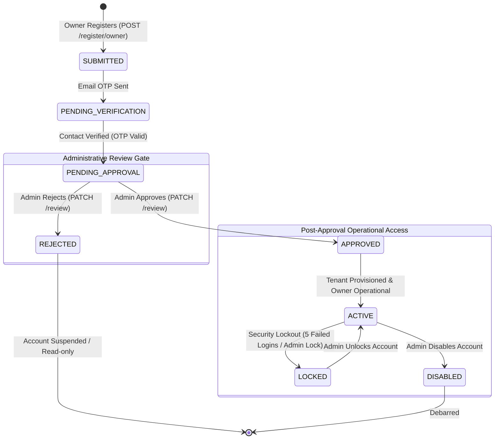
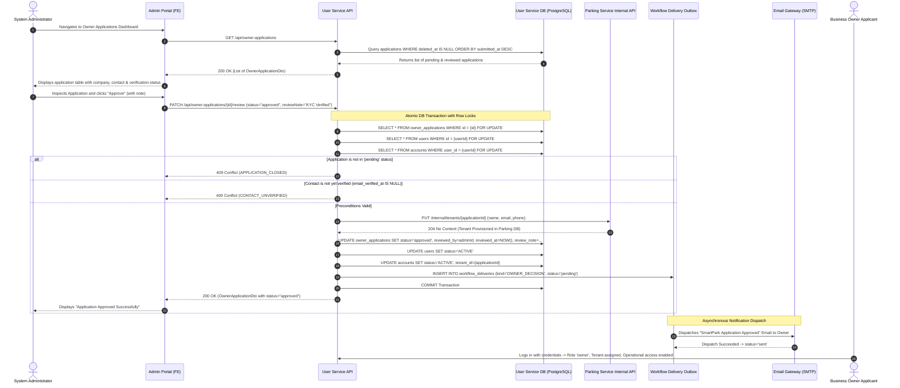

# SmartPark - Admin Approve Owner Account API Design Specification

**Issue ID:** SPARK-196 (BE Implementation) · SPARK-195 (FE Integration) · SPARK-197 (API Testing & UAT) · SPARK-202 (Permission Matrix) · SPARK-178 (Owner Register Design Link)  
**Sprint:** Sprint 2  
**Estimate:** 1 SP  
**Author:** Architecture Lead / Team Lead  
**Status:** Approved Specification Baseline  
**Date:** 2026-10-13  
**Target Release:** SmartPark v0.9 Baseline  

---

## 1. Overview & Business Objectives

### 1.1 Objective
This document defines the normative REST API contract for **Admin Approving Owner Registration Applications** (`GET /api/owner-applications`, `GET /api/owner-applications/{id}`, and `PATCH /api/owner-applications/{id}/review`) for SmartPark Sprint 2. It bridges requirement specifications (SRS §3.1.1, §3.7.4, §2.3.1; FR-AUTH-05/06; UC-AUTH-02; US-A01; BR-AUTH-01/02/03; BR-PRIV-03) with the persistence layer (`owner_applications`, `users`, `accounts`, `tenants`, `workflow_deliveries`) defined in `scripts/database/05.1-Database-Scripts.sql` and `05.5-Owner-Registration-Approval.sql`.

### 1.2 Core Scope & Business Rules

1. **Restricted Administrative Authority:**
   - Only an authenticated user with active `PLATFORM_ADMIN` / `admin` role and current `ACCOUNT_ADMIN` authority can view, inspect, approve, or reject Owner applications.
   - Non-administrators (Drivers, Operators, unapproved Owners) receive `403 Forbidden` (`FORBIDDEN`).

2. **Required Onboarding Information & Scope (FR-AUTH-05, BR-PRIV-03):**
   - Applications must contain company/business name (`businessName`), normalized email (`email`), phone (`phone`), and facility type (`lotType`: `outdoor`, `basement`, `multi-storey`).
   - **Public Email Domains Permitted:** Ordinary email domains (e.g. `@gmail.com`, `@yahoo.com`) are explicitly accepted per confirmed 2026-10-06 decisions.
   - **No Document Over-Collection (BR-PRIV-03):** Identity cards (CCCD) or driver's licenses (GPLX) are **strictly excluded** from Owner onboarding.

3. **Two-Gate Security Separation (Gate 1 vs. Gate 2):**
   - **Gate 1 (Contact Verification):** Contact ownership must be verified via OTP prior to administrative review (`users.email_verified_at IS NOT NULL`). If an Admin attempts to approve an application whose contact is unverified, the API rejects the request with `409 Conflict` (`CONTACT_UNVERIFIED`).
   - **Gate 2 (Admin Decision):** Administrative review decides whether to grant operational privileges. An unapproved Owner cannot perform Owner operations even if authenticated.

4. **Distinct Access States (Approval vs. Lock vs. Disable):**
   - Approval transitions `owner_applications.status = 'approved'`, `users.status = 'ACTIVE'`, and `accounts.status = 'ACTIVE'`.
   - **Separation from Blocked States:** If the underlying user account was separately locked or disabled by an administrator (or due to security incidents), **approval NEVER overrides or clears a lock or disablement**. The account remains unusable until explicitly unlocked or re-enabled through Admin User Management ([SPARK-206](https://mangamanagement.atlassian.net/browse/SPARK-206)).

5. **Deterministic Cross-Service Tenant Provisioning:**
   - Upon successful approval, the User Service provisions the Business Owner's tenant record in the Parking Service database via internal API (`PUT /internal/tenants/{id}`).
   - The tenant ID is deterministically set to the application ID (`tenantId = application.id`), ensuring idempotent retries without creating duplicate tenants.

6. **Auditability & Traceable Decision Records:**
   - Every review decision atomically records the reviewing Admin ID (`reviewed_by = adminId`), decision timestamp (`reviewed_at = NOW()`), and an optional review note (`review_note`, max 2000 chars).
   - A completed review is **final and immutable**. Re-reviewing or re-approving a closed application is rejected with `409 Conflict` (`APPLICATION_CLOSED`).

7. **Decoupled Notification Delivery Outbox:**
   - The Owner is notified of the approval or rejection decision via the configured email channel (`workflow_deliveries`, `kind = 'OWNER_DECISION'`).
   - The notification is queued in an independent outbox. If the email gateway fails, the database approval **remains committed**; delivery failure does not roll back approval.

---

## 2. Endpoint & Permission Matrix

| Endpoint | Method | Required Role | Required Scope / State | Description |
| :--- | :---: | :---: | :--- | :--- |
| `/api/owner-applications` | `GET` | `admin` | `ACCOUNT_ADMIN` | Lists all Owner registration applications (ordered newest first). |
| `/api/owner-applications/{id}` | `GET` | `admin` | `ACCOUNT_ADMIN` | Retrieves detailed information, contact verification status, and decision audit for an application. |
| `/api/owner-applications/{id}/review` | `PATCH` | `admin` | `ACCOUNT_ADMIN` | Submits an approval or rejection decision with mandatory status and optional review note. |

---

## 3. State & Sequence Models

### 3.1 Owner Application & Account Lifecycle State Diagram



### 3.2 Admin Review & Approval Sequence Diagram



---

## 4. Requirement ↔ Data Schema ↔ DTO Field Mapping

| Requirement Identifier | API DTO Field Name (camelCase) | Data Type & Nullability | Validation & Business Constraints | DB Table & Column (snake_case) | DB Column Type |
| :--- | :--- | :--- | :--- | :--- | :--- |
| **FR-AUTH-05** | `id` | `UUID` (System Generated) | Primary key of the application (also becomes `tenant_id`). | `owner_applications.id` | `UUID PK` |
| **FR-AUTH-05** | `ownerId` | `UUID` (System Generated) | Foreign key pointing to the user identity. | `owner_applications.user_id` | `UUID NOT NULL` |
| **FR-AUTH-05** | `ownerName` | `string` (Required) | Full name of the applicant. | `users.full_name` | `VARCHAR(255) NOT NULL` |
| **FR-AUTH-05** | `businessName` | `string` (Required) | Enterprise or business trading name. | `owner_applications.business_name` | `VARCHAR(255) NOT NULL` |
| **FR-AUTH-05** | `email` | `string` (Required) | Contact email (public domains permitted). | `users.email` | `VARCHAR(255) UNIQUE` |
| **FR-AUTH-05** | `phone` | `string` (Required) | E.164 / local contact phone number. | `users.phone` | `VARCHAR(20) NULL` |
| **FR-AUTH-05** | `lotType` | `enum` (Required) | Enum: `'outdoor'`, `'basement'`, `'multi-storey'`. | `owner_applications.lot_type` | `VARCHAR(30) NOT NULL` |
| **FR-AUTH-05** | `status` | `enum` (System State) | Enum: `'pending'`, `'approved'`, `'rejected'`. | `owner_applications.status` | `VARCHAR(20) NOT NULL` |
| **FR-AUTH-05** | `submittedAt` | `ISO 8601 Timestamp` | Application submission timestamp. | `owner_applications.submitted_at` | `TIMESTAMPTZ NOT NULL` |
| **US-A01** | `reviewedAt` | `ISO 8601 Timestamp?` | Timestamp of administrative review decision. | `owner_applications.reviewed_at` | `TIMESTAMPTZ NULL` |
| **US-A01** | `reviewedBy` | `UUID?` (System Assigned) | User ID of the reviewing Administrator. | `owner_applications.reviewed_by` | `UUID REFERENCES users` |
| **US-A01** | `reviewNote` | `string?` (Optional) | Administrative justification / review note (max 2000 chars). | `owner_applications.review_note` | `TEXT NULL` |
| **UC-AUTH-02** | `contactVerified` | `boolean` (Read-only) | True if applicant completed OTP contact verification. | Calculated from `users.email_verified_at` | `BOOLEAN` |
| **BR-AUTH-02** | `deliveryId` | `UUID?` (System Generated) | Tracking key for the decision notification email. | `workflow_deliveries.id` | `UUID NULL` |
| **BR-AUTH-02** | `deliveryStatus` | `string?` (Read-only) | Notification status: `'pending'`, `'sent'`, `'failed'`. | `workflow_deliveries.status` | `TEXT NULL` |

---

## 5. API Technical Specifications & Contract Payloads

### 5.1 List Owner Applications (`GET /api/owner-applications`)

#### Request Headers
```http
Authorization: Bearer <admin_jwt_token>
```

#### Sample Success Response (`200 OK`)
```json
{
  "success": true,
  "data": [
    {
      "id": "a1b2c3d4-e5f6-7890-abcd-111122223333",
      "ownerId": "98765432-10ab-cdef-0123-456789abcdef",
      "ownerName": "Nguyen Van A",
      "businessName": "Saigon Central Parking Co., Ltd",
      "email": "owner.contact@gmail.com",
      "phone": "0901234567",
      "lotType": "basement",
      "status": "pending",
      "submittedAt": "2026-10-12T09:30:00Z",
      "reviewedAt": null,
      "reviewedBy": null,
      "reviewNote": null,
      "contactVerified": true,
      "deliveryId": null,
      "deliveryStatus": null
    },
    {
      "id": "b2c3d4e5-f6a7-8901-bcde-222233334444",
      "ownerId": "87654321-01ab-cdef-0123-56789abcdef0",
      "ownerName": "Tran Thi B",
      "businessName": "East Gate Parking Lot",
      "email": "eastgate.parking@yahoo.com",
      "phone": "0912345678",
      "lotType": "outdoor",
      "status": "approved",
      "submittedAt": "2026-10-10T14:15:00Z",
      "reviewedAt": "2026-10-11T08:00:00Z",
      "reviewedBy": "00000000-0000-0000-0000-000000000001",
      "reviewNote": "Business license verified via national portal.",
      "contactVerified": true,
      "deliveryId": "c3d4e5f6-a7b8-9012-cdef-333344445555",
      "deliveryStatus": "sent"
    }
  ]
}
```

---

### 5.2 Get Application Detail (`GET /api/owner-applications/{id}`)

#### Request Headers
```http
Authorization: Bearer <admin_jwt_token>
```

#### Sample Success Response (`200 OK`)
```json
{
  "success": true,
  "data": {
    "id": "a1b2c3d4-e5f6-7890-abcd-111122223333",
    "ownerId": "98765432-10ab-cdef-0123-456789abcdef",
    "ownerName": "Nguyen Van A",
    "businessName": "Saigon Central Parking Co., Ltd",
    "email": "owner.contact@gmail.com",
    "phone": "0901234567",
    "lotType": "basement",
    "status": "pending",
    "submittedAt": "2026-10-12T09:30:00Z",
    "reviewedAt": null,
    "reviewedBy": null,
    "reviewNote": null,
    "contactVerified": true,
    "deliveryId": null,
    "deliveryStatus": null
  }
}
```

---

### 5.3 Review Owner Application (`PATCH /api/owner-applications/{id}/review`)

#### Request Headers
```http
Authorization: Bearer <admin_jwt_token>
Content-Type: application/json
```

#### Request Body Schema
```json
{
  "$schema": "http://json-schema.org/draft-07/schema#",
  "type": "object",
  "required": ["status"],
  "additionalProperties": false,
  "properties": {
    "status": {
      "type": "string",
      "enum": ["approved", "rejected"],
      "description": "Administrative decision. 'approved' activates owner account and provisions tenant; 'rejected' suspends access."
    },
    "reviewNote": {
      "type": "string",
      "maxLength": 2000,
      "description": "Optional administrative audit note explaining the decision.",
      "example": "Company registry and contact phone confirmed."
    }
  }
}
```

#### Sample Success Response (`200 OK`)
```json
{
  "success": true,
  "data": {
    "id": "a1b2c3d4-e5f6-7890-abcd-111122223333",
    "ownerId": "98765432-10ab-cdef-0123-456789abcdef",
    "ownerName": "Nguyen Van A",
    "businessName": "Saigon Central Parking Co., Ltd",
    "email": "owner.contact@gmail.com",
    "phone": "0901234567",
    "lotType": "basement",
    "status": "approved",
    "submittedAt": "2026-10-12T09:30:00Z",
    "reviewedAt": "2026-10-13T10:30:00Z",
    "reviewedBy": "00000000-0000-0000-0000-000000000001",
    "reviewNote": "Company registry and contact phone confirmed.",
    "contactVerified": true,
    "deliveryId": "d4e5f6a7-b8c9-0123-def0-444455556666",
    "deliveryStatus": "pending"
  }
}
```

---

## 6. Error Catalogue & RFC 7807 Machine-Readable Errors

All error responses strictly follow the SmartPark RFC 7807 standard:

```json
{
  "type": "https://api.smartpark.com/errors/CONTACT_UNVERIFIED",
  "title": "Contact Unverified",
  "status": 409,
  "code": "CONTACT_UNVERIFIED",
  "detail": "Cannot approve application: The applicant has not completed email OTP verification.",
  "instance": "/api/owner-applications/a1b2c3d4-e5f6-7890-abcd-111122223333/review",
  "timestamp": "2026-10-13T10:30:00Z"
}
```

### Complete Error Code Inventory Table

| HTTP Status | Error Code | Description / Root Cause | Actionable FE Guidance |
| :---: | :--- | :--- | :--- |
| `400` | `VALIDATION_FAILED` | `status` is not `'approved'` or `'rejected'`, or `reviewNote` exceeds 2000 chars. | Highlight input errors in form. |
| `401` | `UNAUTHENTICATED` | Missing, expired, or revoked Admin Bearer token. | Redirect actor to Login screen. |
| `403` | `FORBIDDEN` | Actor lacks active `PLATFORM_ADMIN` / `admin` role or `ACCOUNT_ADMIN` authority. | Display permission denied alert banner. |
| `404` | `APPLICATION_NOT_FOUND` | Specified application ID does not exist or was deleted. | Navigate back to Application list. |
| `409` | `APPLICATION_CLOSED` | Application is no longer in `pending` status (already approved or rejected by another Admin). | Refresh view and display current finalized decision. |
| `409` | `CONTACT_UNVERIFIED` | Applicant has not verified contact via OTP (`email_verified_at IS NULL`). | Inform Admin: "Applicant must complete email verification first." |
| `502` | `TENANT_PROVISIONING_FAILED` | Internal call to Parking Service (`/internal/tenants/{id}`) failed during approval. | Show retryable error: "Tenant provisioning failed. Please retry." |

---

## 7. Edge Case Inventory & Technical Controls

### 7.1 Concurrency & Competing Admin Decisions
- **Database Row Lock:** When an Admin opens `/review`, the service executes:
  ```sql
  SELECT * FROM owner_applications WHERE id = @id FOR UPDATE;
  SELECT * FROM users WHERE id = @userId FOR UPDATE;
  SELECT * FROM accounts WHERE user_id = @userId ORDER BY id FOR UPDATE;
  ```
- If Admin A and Admin B click Approve/Reject simultaneously, Admin A's transaction commits first. Admin B's transaction wakes up, reads `application.status != 'pending'`, and immediately aborts with `409 Conflict` (`APPLICATION_CLOSED`).

### 7.2 Unverified Contact Approval Guard
- Even if an Admin attempts to force an approval via API directly, the service checks:
  ```csharp
  if (user.EmailVerifiedAt is null)
      throw Error("CONTACT_UNVERIFIED", "Verify required contact before approval.", 409);
  ```
- This guarantees Gate 1 cannot be bypassed by Gate 2.

### 7.3 Approval Racing with Account Lock / Disable
- If an Admin separately locks or disables the Owner user record via Admin User Management ([SPARK-206](https://mangamanagement.atlassian.net/browse/SPARK-206)), `user.Status` becomes `LOCKED` or `DISABLED`.
- If `user.Status != PendingApproval`, the approval endpoint aborts with `409 Conflict` (`APPLICATION_CLOSED`).
- If an account is locked *after* approval, the lock remains authoritative and prevents login/operations.

### 7.4 Idempotent Tenant Provisioning
- The tenant ID passed to the Parking Service is identical to the application ID (`tenantId = application.id`).
- In the Parking Service database, `INSERT INTO tenants(id, ...) ON CONFLICT(id) DO NOTHING` guarantees that repeated or retried provisioning attempts are completely idempotent and do not corrupt data.

---

## 8. Unresolved Decision & Conflict Log

| Issue Key | Topic | Description & Decision Context | Status |
| :--- | :--- | :--- | :--- |
| **DEC-APP-01** | Two-Gate Security Separation | **Confirmed (2026-10-06 Baseline):** Gate 1 (Contact verification OTP) and Gate 2 (Admin approval) are strictly separate. Approval cannot bypass unverified email. | **Resolved** |
| **DEC-APP-02** | Public Email Domain Acceptance | **Confirmed (SRS §3.1.1):** Commercial/public email domains (`@gmail.com`, `@yahoo.com`) are fully acceptable for Owner registration. | **Resolved** |
| **DEC-APP-03** | Exclusion of Identity Documents | **Confirmed (BR-PRIV-03):** CCCD and GPLX collection are strictly excluded from Owner registration. | **Resolved** |
| **DEC-APP-04** | Deterministic Tenant ID | **Confirmed Architecture:** `tenants.id` matches `owner_applications.id` upon approval, ensuring idempotent cross-service provisioning. | **Resolved** |
| **DEC-APP-05** | Manual Rejection Discretion & Resubmission | **Confirmed Product Boundary:** Rejection criteria remain manual Admin discretion (recorded via `reviewNote`). Resubmission of rejected applications is deferred to future backlog. | **Resolved** |

---

## 9. Verification & Acceptance Checklist

- [x] Versioned REST API technical specification documented for all Owner Application endpoints (`GET /api/owner-applications`, `GET /api/owner-applications/{id}`, `PATCH /api/owner-applications/{id}/review`).
- [x] Endpoint Permission Matrix defined covering `ACCOUNT_ADMIN` role and platform scope.
- [x] Mermaid State Diagram and Sequence Diagram covering two-gate review and cross-service tenant provisioning embedded.
- [x] Full Traceability Table mapping SRS requirements (FR-AUTH-05/06, UC-AUTH-02, US-A01, BR-AUTH-01/02/03, BR-PRIV-03) ↔ DB schema columns ↔ DTO attributes.
- [x] Sample payloads for Request, Success Response, and RFC 7807 Machine-Readable Errors included.
- [x] Edge-case inventory (concurrency row lock, unverified contact guard, race conditions with account lock, idempotent tenant provisioning) complete.
