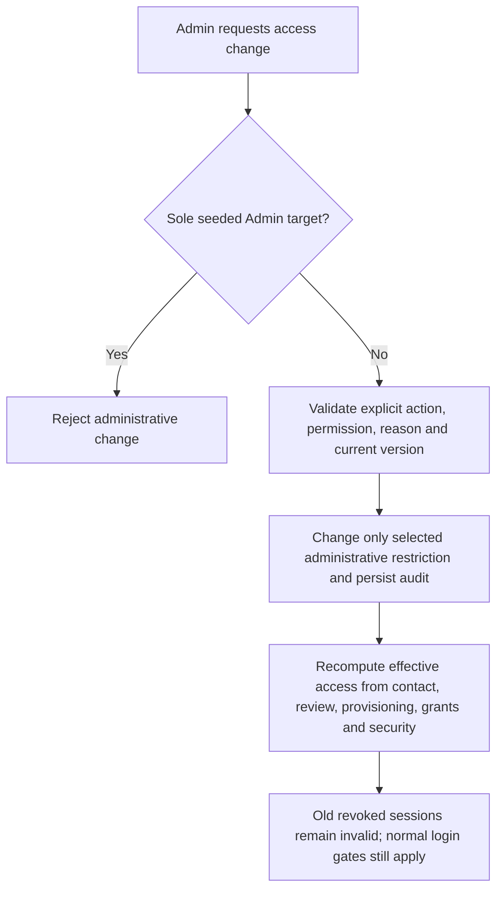

# Admin user directory and access changes API design

SPARK-206 / SPARK-207 / SPARK-208 / SPARK-202 · SPARK-296 update, 21 October 2026. **v1.1 documentation review candidate based on approved decisions**; API alignment and implementation pending.

Canonical behavior: [FR-AUTH-05/06](../../01-requirements/srs/modules/01-identity-access.md), [permissions](../../01-requirements/srs/permissions.md), [state transitions](../../01-requirements/srs/state-transitions.md), [authentication/recovery](../../01-requirements/srs/authentication-recovery.md), [maintainer recovery](../../02-architecture/service-boundaries/admin-recovery-runbook.md). D01–D05 govern the following contract; no MVP role-management API exists.

## Directory and actor contract

Current Admin session and `ACCOUNT_ADMIN` are required. Recheck persistent access at mutation and return no password/OTP/hash/token/secret. Admin authority does not imply parking/financial operational permissions.

| Method/path | Input | Retained result contract |
|---|---|---|
| `GET /api/users` | Optional `search` up to 200; `role`; `status`; `page` default 1; `pageSize` default 20, max 100 | `data: {items,total,page,pageSize}`; name/email case-insensitive and phone search; AND filters; deterministic name then ID order. |
| `GET /api/users/{id}` | Authorized target ID | `data: {user,loginActivity}`; at most 50 recent session metadata records, not a complete activity/audit history. |
| `PATCH /api/users/{id}/status` | Existing status transition entry; explicit action/reason contract pending V11-DES-11 | Result of the authorized restriction change and safe current state; never an implicit approval, role grant or session restoration. |

`ManagedUser` retains ID, name, nullable email/phone, role memberships, status, creation time and nullable lock deadline. Membership visibility is not permission. `loginActivity` retains `createdAt`, `expiresAt`, `isRevoked`, with no raw tokens or hashes. Deleted identities remain outside active directory results; history remains under retention. Role filters include driver/owner/operator/admin; status filter additions must represent separate access/review/security facts honestly, not imply a universal state enum.

## Protected Admin and access changes

MVP has exactly **one seeded Admin** and no Admin registration route. Deny application-level administrative lock, disable, deletion, self-escalation and role/authority changes targeting that account (D02–D04). This is the operative last-eligible-Admin safeguard and must be atomic where relevant. Ordinary own profile/security changes remain allowed through their normal APIs. Authentication lockouts still apply; recovery uses the controlled maintainer procedure. Do not introduce a second Admin or public bypass as recovery.

| Action | Required effect | Forbidden side effect |
|---|---|---|
| Administrative lock | Record restriction/audit and revoke sessions; current requests enforce it. | Clear separate disable/review/security/booking restrictions. |
| Unlock administrative restriction | Remove the authorized lock restriction; require new login if sessions were revoked. | Restore revoked sessions or clear an independent disable/security restriction. |
| Disable | Record administrative restriction and audit; revoke current sessions atomically. | Erase historical visits/financial/vehicle/audit records. |
| Explicit re-enable (D01) | Authorized Admin action, **mandatory reason**, remove only administrative disable restriction. | Verify contacts, approve pending/rejected Owner, restore roles/grants, clear independent authentication/security/booking restrictions or revive sessions. |

An existing `status: active` request must not silently mean broad reactivation. V11-DES-11 must agree an explicit action discriminator or separate wire operation, reason and concurrency contract. The business choice is settled; exact path/schema is pending. Re-enabling a rejected Partner does not reverse rejection or permit same-email re-registration. No role elevation/demotion endpoint is part of MVP; fixed assignment during approved registration/activation remains server-owned.

## Concurrency, errors and session enforcement

Serialize administrative changes against current target/security version, login issuance and other restrictions; audit actor/target/action/reason/time/outcome. Current session/security checks reject subsequent protected actions after lock/disable; revocation is not delayed until refresh. Preserve **15-minute access**, **7-day absolute refresh**, **24-hour inactivity**, **three OTP failures/fifteen-minute lock** and optional staged TOTP. Do not copy the former five-failure or 24-hour-access examples.

Retain safe validation/authentication, `FORBIDDEN`, `USER_NOT_FOUND`, `ADMIN_ACCOUNT_PROTECTED`, `INVALID_STATUS_TRANSITION` and concurrency outcomes; final restriction/re-enable error payloads are V11-DES-03/V11-DES-11. Repeating the same authorized request cannot repeat grants or revive a session. Notifications retry independently of the committed change.

| Existing decision reference | v1.1 disposition |
|---|---|
| DEC-ADM-01 | Lock and disable are distinct restrictions; disable is reversible only by explicit authorized re-enable. |
| DEC-ADM-02 | Sole seeded Admin protected; own ordinary profile/security allowed; maintainer recovery. |
| DEC-ADM-03 | No implicit parking/financial authority. |
| DEC-ADM-04 | Review/provisioning remain separate from administrative access changes. |
| DEC-ADM-05 | Re-enable requires reason and removes only administrative disable (D01). |

[Pending actions](../../02-architecture/api/v1.1-contracts.md#design-pending-owneraction-register): V11-DES-03/V11-DES-11. [New acceptance scenarios](../../04-testing/requirements-traceability/acceptance-scenarios.md) are NOT RUN.
