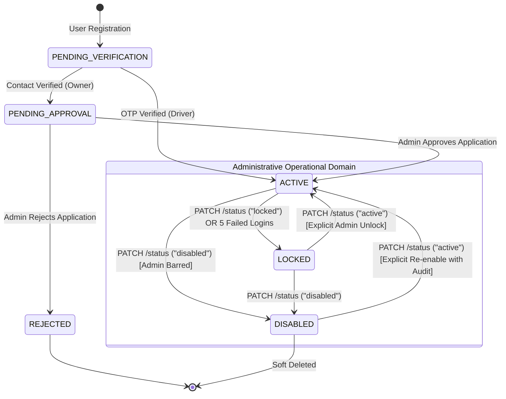
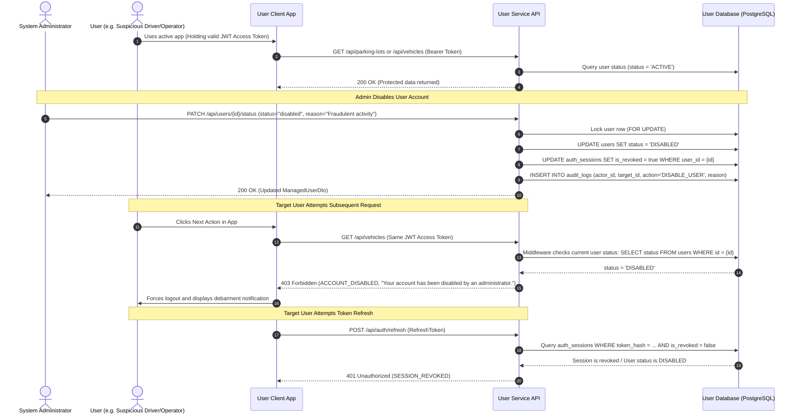

# SmartPark - Admin Manage Users (Search, Lock/Unlock, Disable & Access) API Design Specification

**Issue ID:** SPARK-206 (BE Implementation) · SPARK-207 (FE Integration) · SPARK-208 (API Testing & UAT) · SPARK-202 (Permission Matrix)  
**Sprint:** Sprint 2  
**Estimate:** 1 SP  
**Author:** Architecture Lead / Team Lead  
**Status:** Approved Specification Baseline  
**Date:** 2026-10-13  
**Target Release:** SmartPark v0.9 Baseline  

---

## 1. Overview & Business Objectives

### 1.1 Objective
This document defines the normative REST API contract for **Admin User Management** (`GET /api/users`, `GET /api/users/{id}`, `PATCH /api/users/{id}/status`, and `PATCH /api/users/{id}/roles`) for SmartPark Sprint 2. It bridges requirement specifications (SRS §3.7.4, §2.3.1, §3.1.4; FR-AUTH-05/06; UC-AUTH-02; US-A01; BR-AUTH-01/03) with the PostgreSQL persistence layer (`users`, `accounts`, `account_roles`, `user_refresh_tokens`, `auth_sessions`) defined in `scripts/database/05.1-Database-Scripts.sql` and `scripts/database/microservices/01-user-service-db.sql`.

### 1.2 Core Scope & Business Rules

1. **Scoped & Paginated User Directory (FR-AUTH-05, US-A01):**
   - System Administrators holding the `PLATFORM_ADMIN` / `admin` role can perform server-side paginated searches across all registered human identities.
   - Multi-criteria filters: Case-insensitive substring matching on `fullName`, normalized `email`, and `phone`; exact filter on `role` (`driver`, `owner`, `operator`, `admin`); exact filter on `status` (`active`, `locked`, `disabled`, `pendingVerification`, `pendingApproval`, `rejected`).
   - Results are ordered deterministically by `fullName ASC, id ASC`. One-based pagination with a default `pageSize = 20` and hard ceiling `pageSize = 100`.

2. **Tri-State Administrative Access Model (Active vs. Locked vs. Disabled):**
   - **`ACTIVE` (`active`):** Unrestricted access permitted according to granted roles and permissions.
   - **`LOCKED` (`locked`):** Temporary or security lockout. Can be triggered automatically by consecutive failed login attempts (e.g. 5 failures $\rightarrow$ 15-minute lock) or imposed administratively by an Admin (`lockedUntil = null`, indefinite until explicit unlock).
   - **`DISABLED` (`disabled`):** Administrative debarment and permanent deactivation.
   - **Disable vs. Lock Precedence & Non-Interference:**
     - `DISABLED` is strictly distinct from `LOCKED`.
     - **Unlocking or expiration of a timed lock NEVER makes a disabled account usable.**
     - A disabled account cannot transition to `ACTIVE` through login attempts, password resets, token refreshes, or standard unlock actions.

3. **Current-State Enforcement & Immediate Session Revocation (FR-AUTH-06, SRS §3.1.4):**
   - When an account transitions to `LOCKED` or `DISABLED`, the server **atomically revokes all active refresh tokens and active sessions** in the database (`auth_sessions` / `user_refresh_tokens` set `is_revoked = true`).
   - For all subsequent protected requests, authorization middleware re-verifies the user's current database state (`status == 'ACTIVE'`). A valid, unexpired JWT Bearer token **is immediately rejected with `403 Forbidden` (`ACCOUNT_LOCKED` or `ACCOUNT_DISABLED`)** if the underlying user has been locked or disabled mid-session.
   - Subsequent calls to `/api/auth/login` and `/api/auth/refresh` are rejected immediately.

4. **Constrained Role & Permission Changes (BR-AUTH-01, BR-AUTH-03):**
   - Role and permission modifications are audited with actor ID, timestamp, prior state, and updated state.
   - **No Implicit Privilege Inheritance:** An actor possessing `ACCOUNT_ADMIN` / `PLATFORM_ADMIN` does **NOT** implicitly inherit operational parking rights (e.g. slot creation, gate overrides) or financial rights (e.g. collecting cash, initiating refunds).

5. **Self-Target & Last-Administrator Safeguards:**
   - An Admin **cannot lock, disable, or alter their own account** (`adminId == targetUserId` $\rightarrow$ `409 Conflict: ADMIN_ACCOUNT_PROTECTED`).
   - Standard user management endpoints **cannot target other Administrator accounts**, preventing accidental or malicious lockout of the administrative authority.

6. **Historical Preservation & Anti-Erasure Invariant:**
   - User accounts are **never hard-deleted**.
   - Locking or disabling an account preserves all past parking sessions (`parking_sessions`), financial transactions, vehicle records, and audit logs. Deleted users retain a soft-delete timestamp (`deleted_at = NOW()`) if soft-deleted, but are excluded from active user directory searches.

7. **Decoupling of Owner Approval:**
   - Initial onboarding approval of Business Owners is handled by the dedicated Owner Approval feature ([SPARK-179](https://mangamanagement.atlassian.net/browse/SPARK-179) / [SPARK-196](https://mangamanagement.atlassian.net/browse/SPARK-196)).
   - Unapproved or pending accounts (`PENDING_VERIFICATION`, `PENDING_APPROVAL`, `REJECTED`) **cannot** be prematurely activated through this endpoint (`409 Conflict: INVALID_STATUS_TRANSITION`).

---

## 2. Endpoint & Permission Matrix

| Endpoint | Method | Required Role | Required Scope / Condition | Description |
| :--- | :---: | :---: | :--- | :--- |
| `/api/users` | `GET` | `admin` | `ACCOUNT_ADMIN` (Platform Scope) | Searches and lists user accounts with pagination, role, and status filters. |
| `/api/users/{id}` | `GET` | `admin` | `ACCOUNT_ADMIN` (Platform Scope) | Retrieves detailed profile, account memberships, and the latest 50 login sessions. |
| `/api/users/{id}/status` | `PATCH` | `admin` | `ACCOUNT_ADMIN` (Non-Self, Non-Admin Target) | Executes administrative state transition (`active`, `locked`, `disabled`) with reason. |
| `/api/users/{id}/roles` | `PATCH` | `admin` | `ACCOUNT_ADMIN` (Non-Self, Non-Admin Target) | Modifies account role assignments with strict constraint validation and audit trail. |

---

## 3. Administrative State-Transition Models

### 3.1 State-Transition Decision Matrix

| Current State | Requested Status | Allowed? | Resulting DB State | Side Effects & Invariants |
| :--- | :---: | :---: | :--- | :--- |
| `ACTIVE` | `locked` | ✅ Yes | `status = 'LOCKED'`, `locked_until = NULL` | Atomic revocation of all active sessions; failure counter reset. Indefinite lock. |
| `ACTIVE` | `disabled` | ✅ Yes | `status = 'DISABLED'`, `locked_until = NULL` | Atomic revocation of all active sessions; account permanently barred. |
| `LOCKED` | `active` | ✅ Yes | `status = 'ACTIVE'`, `locked_until = NULL` | Clears lockout timer & failure counter. Old tokens remain revoked; user must re-login. |
| `LOCKED` | `locked` | ✅ Yes | `status = 'LOCKED'`, `locked_until = NULL` | Idempotent. Converts any temporary timed lock into an indefinite Admin lock. |
| `LOCKED` | `disabled` | ✅ Yes | `status = 'DISABLED'`, `locked_until = NULL` | Transition to permanent debarment; revokes any remaining tokens. |
| `DISABLED` | `active` | ⚠️ Restricted | `status = 'ACTIVE'` | Requires explicit re-enable permission/audit; cannot be triggered by simple unlock. |
| `DISABLED` | `locked` | ❌ No | Rejected with `409 Conflict` | Cannot transition a disabled account to locked (Lock is a weaker restriction than Disabled). |
| `PENDING_*` | Any | ❌ No | Rejected with `409 Conflict` | Registration verification and Admin Owner approval must complete first. |
| `REJECTED` | Any | ❌ No | Rejected with `409 Conflict` | Inactive application cannot be managed via user status endpoint. |

### 3.2 User Account Administrative Lifecycle State Diagram



### 3.3 Mid-Session Enforcement & Revocation Sequence Diagram



---

## 4. Requirement ↔ Data Schema ↔ DTO Field Mapping

| Requirement Identifier | API DTO Field Name (camelCase) | Data Type & Nullability | Validation & Business Constraints | DB Table & Column (snake_case) | DB Column Type |
| :--- | :--- | :--- | :--- | :--- | :--- |
| **US-A01** | `id` / `userId` | `UUID` (System Generated) | Primary identifier of the user. | `users.id` | `UUID PK` |
| **US-A01** | `fullName` | `string` (Required) | Length 1–255 characters. | `users.full_name` | `VARCHAR(255) NOT NULL` |
| **US-A01** | `email` | `string?` (Nullable) | Normalized email address. | `users.email` | `VARCHAR(255) NULL` |
| **US-A01** | `phone` | `string?` (Nullable) | Normalized phone number. | `users.phone` | `VARCHAR(20) NULL` |
| **BR-AUTH-01** | `roles` | `string[]` (Read-only System) | Distinct role names derived from active account memberships (`admin`, `owner`, `operator`, `driver`). | `account_roles.role_code` | `VARCHAR(50) NOT NULL` |
| **FR-AUTH-05** | `status` | `enum` (Required) | Enum: `active`, `locked`, `disabled`, `pendingVerification`, `pendingApproval`, `rejected`. | `users.status` | `VARCHAR(50) NOT NULL` |
| **FR-AUTH-05** | `reason` | `string?` (Required on update)| Administrative justification, length 5–500 characters. | `audit_logs.reason` / `users.status_reason` | `TEXT NOT NULL` |
| **FR-AUTH-06** | `lockedUntil` | `ISO 8601 Timestamp?` | Null if locked indefinitely by Admin; populated if timed lock. | `users.locked_until` | `TIMESTAMPTZ NULL` |
| **US-A01** | `createdAt` | `ISO 8601 Timestamp` | Identity registration timestamp. | `users.created_at` | `TIMESTAMPTZ NOT NULL` |
| **US-A01** | `page`, `pageSize` | `integer` (Query Parameters) | `page >= 1`, `1 <= pageSize <= 100`. | SQL `LIMIT ... OFFSET ...` | `INT` |
| **US-A01** | `total` | `integer` (Response Meta) | Total count of records matching search filter. | SQL `COUNT(*)` | `BIGINT` |
| **SRS §3.7.4** | `loginActivity` | `array` (Detail Response) | At most 50 recent login sessions (`createdAt`, `expiresAt`, `isRevoked`). | `user_refresh_tokens` / `auth_sessions` | Multi-row record |

---

## 5. API Technical Specifications & Contract Payloads

### 5.1 Search & Filter Users (`GET /api/users`)

#### Request Headers
```http
Authorization: Bearer <admin_jwt_token>
```

#### Query Parameters
- `search` (`string`, Optional, max 200 chars): Substring match on `fullName`, `email`, or `phone`.
- `role` (`string`, Optional): Enum: `driver`, `owner`, `operator`, `admin`.
- `status` (`string`, Optional): Enum: `active`, `locked`, `disabled`, `pendingVerification`, `pendingApproval`, `rejected`.
- `page` (`integer`, Optional, default: 1): 1-based page number.
- `pageSize` (`integer`, Optional, default: 20, max: 100): Page size.

#### Sample Success Response (`200 OK`)
```json
{
  "success": true,
  "data": {
    "items": [
      {
        "id": "e3f4a5b6-c7d8-9012-3456-7890abcdef12",
        "fullName": "Nguyen Van Binh",
        "email": "attendant.binh@saigonparking.com",
        "phone": "0901234567",
        "roles": ["operator"],
        "status": "active",
        "createdAt": "2026-10-13T10:00:00Z",
        "lockedUntil": null
      },
      {
        "id": "f4a5b6c7-d8e9-0123-4567-890abcdef123",
        "fullName": "Tran Thi Thu",
        "email": "driver.thu@gmail.com",
        "phone": "0912345678",
        "roles": ["driver"],
        "status": "locked",
        "createdAt": "2026-10-12T08:30:00Z",
        "lockedUntil": null
      }
    ],
    "total": 42,
    "page": 1,
    "pageSize": 20
  }
}
```

---

### 5.2 Get User Detail & Login Activity (`GET /api/users/{id}`)

#### Request Headers
```http
Authorization: Bearer <admin_jwt_token>
```

#### Sample Success Response (`200 OK`)
```json
{
  "success": true,
  "data": {
    "user": {
      "id": "f4a5b6c7-d8e9-0123-4567-890abcdef123",
      "fullName": "Tran Thi Thu",
      "email": "driver.thu@gmail.com",
      "phone": "0912345678",
      "roles": ["driver"],
      "status": "locked",
      "createdAt": "2026-10-12T08:30:00Z",
      "lockedUntil": null
    },
    "loginActivity": [
      {
        "createdAt": "2026-10-13T06:12:45Z",
        "expiresAt": "2026-10-20T06:12:45Z",
        "isRevoked": true
      },
      {
        "createdAt": "2026-10-11T14:20:10Z",
        "expiresAt": "2026-10-18T14:20:10Z",
        "isRevoked": false
      }
    ]
  }
}
```

---

### 5.3 Administrative Status Transition (`PATCH /api/users/{id}/status`)

#### Request Headers
```http
Authorization: Bearer <admin_jwt_token>
Content-Type: application/json
```

#### Request Body Schema
```json
{
  "$schema": "http://json-schema.org/draft-07/schema#",
  "type": "object",
  "required": ["status"],
  "additionalProperties": false,
  "properties": {
    "status": {
      "type": "string",
      "enum": ["active", "locked", "disabled"],
      "description": "Target status transition. 'locked' invokes security lockout; 'disabled' invokes administrative debarment; 'active' unlocks."
    },
    "reason": {
      "type": "string",
      "minLength": 5,
      "maxLength": 500,
      "example": "Detected multiple credential stuffing attempts from foreign IP."
    }
  }
}
```

#### Sample Success Response (`200 OK`)
```json
{
  "success": true,
  "data": {
    "id": "f4a5b6c7-d8e9-0123-4567-890abcdef123",
    "fullName": "Tran Thi Thu",
    "email": "driver.thu@gmail.com",
    "phone": "0912345678",
    "roles": ["driver"],
    "status": "locked",
    "createdAt": "2026-10-12T08:30:00Z",
    "lockedUntil": null
  }
}
```

---

### 5.4 Modify User Roles & Grants (`PATCH /api/users/{id}/roles`)

#### Request Body Schema
```json
{
  "$schema": "http://json-schema.org/draft-07/schema#",
  "type": "object",
  "required": ["roles", "reason"],
  "additionalProperties": false,
  "properties": {
    "roles": {
      "type": "array",
      "minItems": 1,
      "uniqueItems": true,
      "items": {
        "type": "string",
        "enum": ["driver", "operator"]
      },
      "example": ["driver", "operator"]
    },
    "reason": {
      "type": "string",
      "minLength": 5,
      "maxLength": 500,
      "example": "Promoted driver to site operator role upon employment contract signing."
    }
  }
}
```

#### Sample Success Response (`200 OK`)
```json
{
  "success": true,
  "data": {
    "id": "f4a5b6c7-d8e9-0123-4567-890abcdef123",
    "fullName": "Tran Thi Thu",
    "roles": ["driver", "operator"],
    "status": "active"
  }
}
```

---

## 6. Error Catalogue & RFC 7807 Machine-Readable Errors

All error responses strictly follow the SmartPark RFC 7807 problem details specification:

```json
{
  "type": "https://api.smartpark.com/errors/ADMIN_ACCOUNT_PROTECTED",
  "title": "Admin Account Protected",
  "status": 409,
  "code": "ADMIN_ACCOUNT_PROTECTED",
  "detail": "Administrator accounts cannot be locked, disabled, or modified through standard user management.",
  "instance": "/api/users/98765432-10ab-cdef-0123-456789abcdef/status",
  "timestamp": "2026-10-13T10:20:00Z"
}
```

### Complete Error Code Inventory Table

| HTTP Status | Error Code | Description / Root Cause | Actionable FE Guidance |
| :---: | :--- | :--- | :--- |
| `400` | `VALIDATION_FAILED` | Search query or status body contains invalid characters or unsupported status enum. | Highlight input field and display valid enum choices. |
| `401` | `UNAUTHENTICATED` | Missing, expired, or revoked Admin Bearer token. | Redirect actor to Login screen. |
| `403` | `FORBIDDEN` | Actor lacks `PLATFORM_ADMIN` / `admin` role or active status. | Display access denied alert banner. |
| `404` | `USER_NOT_FOUND` | Specified user ID does not exist or has been soft-deleted. | Return to user directory list. |
| `409` | `ADMIN_ACCOUNT_PROTECTED`| Attempted to lock, disable, or alter roles on self or another Administrator account. | Show "Admin accounts cannot be modified via this interface." |
| `409` | `INVALID_STATUS_TRANSITION`| Attempted to transition an account in `PENDING_APPROVAL`, `PENDING_VERIFICATION`, or `REJECTED` state. | Direct actor to use the Owner Application Approval screen instead. |
| `409` | `CONCURRENT_MODIFICATION`| Database row lock contention detected; user modified concurrently. | Prompt actor to reload user details and retry. |

---

## 7. Edge Case Inventory & Technical Controls

### 7.1 Concurrency & Row Locking
- Status and role updates execute within an explicit database transaction taking an exclusive row lock on the target user record:
  ```sql
  SELECT * FROM users WHERE id = @id FOR UPDATE;
  ```
- This prevents race conditions between simultaneous Admin actions, concurrent login attempts, and ongoing registration/approval workflows.

### 7.2 Self-Target & Last-Admin Defense
- The service inspects `adminId` from the authenticated JWT token:
  ```csharp
  if (id == adminId || user.Accounts.Any(a => a.AccountRoles.Any(r => r.RoleCode == "PLATFORM_ADMIN")))
      throw Error("ADMIN_ACCOUNT_PROTECTED", "Admin accounts cannot be changed through user management.", 409);
  ```
- An Admin cannot lock or disable themselves, avoiding catastrophic total platform lockout.

### 7.3 Mid-Session Enforcement on Protected Endpoints
- Standard JWT access tokens have a 24-hour lifetime. To prevent a locked/disabled user from continuing operations using an existing token:
  - Authentication middleware or operational services query current user status on every state-changing endpoint.
  - If `user.status != 'ACTIVE'`, the request is aborted immediately with `403 Forbidden` (`ACCOUNT_LOCKED` or `ACCOUNT_DISABLED`).

### 7.4 Security Sanitization & Zero Credential Exposure
- `GET /api/users` and `GET /api/users/{id}` **never serialize** `password_hash`, OTP codes, MFA secret keys, or raw refresh token values.
- `loginActivity` exposes only session timestamps and revocation flags (`createdAt`, `expiresAt`, `isRevoked`), ensuring auditability without leaking token hashes.

---

## 8. Unresolved Decision & Conflict Log

| Issue Key | Topic | Description & Decision Context | Status |
| :--- | :--- | :--- | :--- |
| **DEC-ADM-01** | Tri-State Access Model | **Confirmed (2026-10-06 Team Lead Decision):** `LOCKED` (temporary/security lockout, reversible) is distinct from `DISABLED` (administrative debarment). Unlocking a locked account does not bypass disabled state. | **Resolved** |
| **DEC-ADM-02** | Admin Target Guardrail | **Confirmed Architecture:** Admin accounts cannot be managed through `/api/users/*`. Dedicated root/multi-signature administration is deferred to future enterprise hardening. | **Resolved** |
| **DEC-ADM-03** | No Implicit Privilege Inheritance | **Confirmed (BR-AUTH-01):** Administrators do NOT inherit parking operations or financial permissions simply by holding `ACCOUNT_ADMIN`. | **Resolved** |
| **DEC-ADM-04** | Separation of Owner Approval | **Confirmed:** Pending registration approval is strictly decoupled to [SPARK-179](https://mangamanagement.atlassian.net/browse/SPARK-179) / [SPARK-196](https://mangamanagement.atlassian.net/browse/SPARK-196) and cannot be activated via `/api/users/{id}/status`. | **Resolved** |
| **DEC-ADM-05** | Re-enable Disabled Account Policy | **Confirmed:** An Admin can re-enable a disabled account by explicitly sending `status: "active"` accompanied by a mandatory audit reason. | **Resolved** |

---

## 9. Verification & Acceptance Checklist

- [x] Versioned REST API technical specification documented for all Admin User Management endpoints (`GET /api/users`, `GET /api/users/{id}`, `PATCH /api/users/{id}/status`, `PATCH /api/users/{id}/roles`).
- [x] Endpoint Permission Matrix defined covering `ACCOUNT_ADMIN` role and platform scope.
- [x] Administrative State-Transition Decision Matrix and Mermaid State Diagram embedded.
- [x] Full Traceability Table mapping SRS requirements (FR-AUTH-05/06, US-A01, BR-AUTH-01/03) ↔ DB schema columns ↔ DTO attributes.
- [x] Sample payloads for Request, Success Response, and RFC 7807 Machine-Readable Errors included.
- [x] Edge-case inventory (tri-state distinction, self-target protection, mid-session revocation, row locks, credential sanitization) complete.
