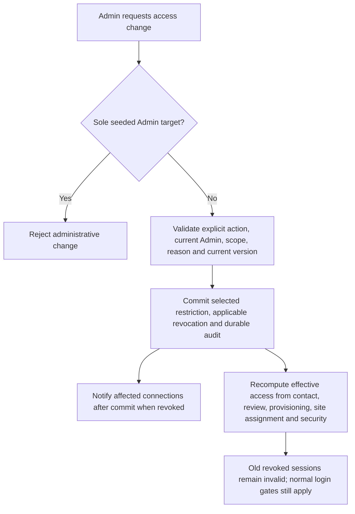

# Admin user directory and access changes API design

SPARK-237 · 28 November 2026 amendment to the SPARK-206 / SPARK-207 / SPARK-208 / SPARK-202 and SPARK-296 review design. **Approved target behavior.** Current transport and runtime adoption remain separate.

Canonical behavior: [FR-AUTH-05/06](../../01-requirements/srs/modules/01-identity-access.md), [permissions](../../01-requirements/srs/permissions.md), [state transitions](../../01-requirements/srs/state-transitions.md), [authentication/recovery](../../01-requirements/srs/authentication-recovery.md), [maintainer recovery](../../02-architecture/service-boundaries/admin-recovery-runbook.md). D01–D05 govern the following contract; no MVP role-management API exists.

## Directory and actor contract

Require a current fixed-role Admin Account and valid session. Recheck locally authoritative access for sensitive reads and mutations. Scope authority to the documented platform function and keep password, OTP, hash, token and secret material out of responses.

| Method/path | Input | Retained result contract |
|---|---|---|
| `GET /api/users` | Optional `search` up to 200; `role`; `status`; `page` default 1; `pageSize` default 20, max 100 | `data: {items,total,page,pageSize}`; name/email case-insensitive and phone search; AND filters; deterministic name then ID order. |
| `GET /api/users/{id}` | Authorized target ID | `data: {user,loginActivity}`; at most 50 recent session metadata records, not a complete activity/audit history. |
| `PATCH /api/users/{id}/status` | Existing User status entry. Transport for the six scoped actions, including any Account-targeted route, remains V11-DES-11. | Approved business target is a reasoned restriction change with safe resulting state. |

`ManagedUser` retains ID, name, nullable email/phone, role memberships, status, creation time and nullable lock deadline. Membership visibility is not permission. `loginActivity` retains `createdAt`, `expiresAt`, `isRevoked`, with no raw tokens or hashes. Deleted identities remain outside active directory results; history remains under retention. Role filters include driver/owner/operator/admin; status filter additions must represent separate access/review/security facts honestly, not imply a universal state enum.

## Protected Admin and access changes

MVP has exactly **one seeded Admin** and no Admin registration route. Deny application-level administrative lock, disable, deletion, self-escalation and role/authority changes targeting that account (D02–D04). This is the operative last-eligible-Admin safeguard and must be atomic where relevant. Ordinary own profile/security changes remain allowed through their normal APIs. Authentication lockouts still apply; recovery uses the controlled maintainer procedure. Do not introduce a second Admin or public bypass as recovery.

All six actions require reason, exact User or Account scope and a valid transition. See the [28 November amendment](../../05-project-management/decision-log/2026-11-28-mvp-decisions-amendment.md#b-admin-access-restrictions).

| Action | Required effect | Forbidden side effect |
|---|---|---|
| Lock User | Record User restriction and durable audit, revoke all applicable User sessions atomically. | Independent Account and business restrictions remain. |
| Unlock User | Remove the User lock and audit the action. | Revoked sessions and other restrictions remain. |
| Disable User | Record User disable and durable audit, revoke all applicable User sessions atomically. | Preserve all business records. |
| Re-enable User | Remove only User disable and audit the action. | Preserve all other restrictions and eligibility gates. |
| Disable Account | Record selected Account disable and durable audit, revoke only its sessions atomically. | Other Accounts retain their independent state. |
| Re-enable Account (D01) | Remove only the selected Account disable and audit the action. | Preserve review/provisioning, contact verification, MFA, removed assignments and revoked sessions. |

An existing `status: active` request must not silently mean broad reactivation. V11-DES-11 must agree an explicit action discriminator or separate wire operation, reason and concurrency contract. The business choice is settled; exact path/schema is pending. Re-enabling a rejected Partner does not reverse rejection or permit same-email re-registration. No role elevation/demotion endpoint is part of MVP; fixed assignment during approved registration/activation remains server-owned.

## Concurrency, errors and session enforcement

Serialize administrative changes against current target/security version, login issuance and other restrictions; audit actor/target/action/reason/time/outcome. UserService retains authoritative local current-admin/target/session checks for its security writes. Other resource APIs follow the [freshness matrix](../../01-requirements/srs/authorization-operation-classification.md), including TOKEN stale claims until expiry and async Account-current REQUEST. Do not promise immediate invalidation of every protected resource request. Preserve **15-minute access**, **7-day absolute refresh**, **24-hour inactivity**, **three OTP failures/fifteen-minute lock** and optional staged TOTP. Do not copy the former five-failure or 24-hour-access examples.

Retain safe validation/authentication, `FORBIDDEN`, `USER_NOT_FOUND`, `ADMIN_ACCOUNT_PROTECTED`, `INVALID_STATUS_TRANSITION` and concurrency outcomes; final restriction/re-enable error payloads are V11-DES-03/V11-DES-11. Repeating the same authorized request cannot repeat grants or revive a session. SignalR uses best-effort `/hubs/access` `AccessRevoked` after commit, scoped to all User connections for User lock/disable and to the selected Account for Account disable. The affected frontend clears authentication state. Notification & Audit projects the durable audit evidence independently. Browser acknowledgement and audit projection success are unnecessary for enforcement.

| Existing decision reference | v1.1 disposition |
|---|---|
| DEC-ADM-01 | Lock and disable are distinct restrictions; disable is reversible only by explicit authorized re-enable. |
| DEC-ADM-02 | Sole seeded Admin protected; own ordinary profile/security allowed; maintainer recovery. |
| DEC-ADM-03 | No implicit parking/financial authority. |
| DEC-ADM-04 | Review/provisioning remain separate from administrative access changes. |
| DEC-ADM-05 | Re-enable requires reason and removes only administrative disable (D01). |

[Pending actions](../../02-architecture/api/v1.1-contracts.md#design-pending-owneraction-register): V11-DES-03/V11-DES-11. [New acceptance scenarios](../../04-testing/requirements-traceability/acceptance-scenarios.md) are NOT RUN.
