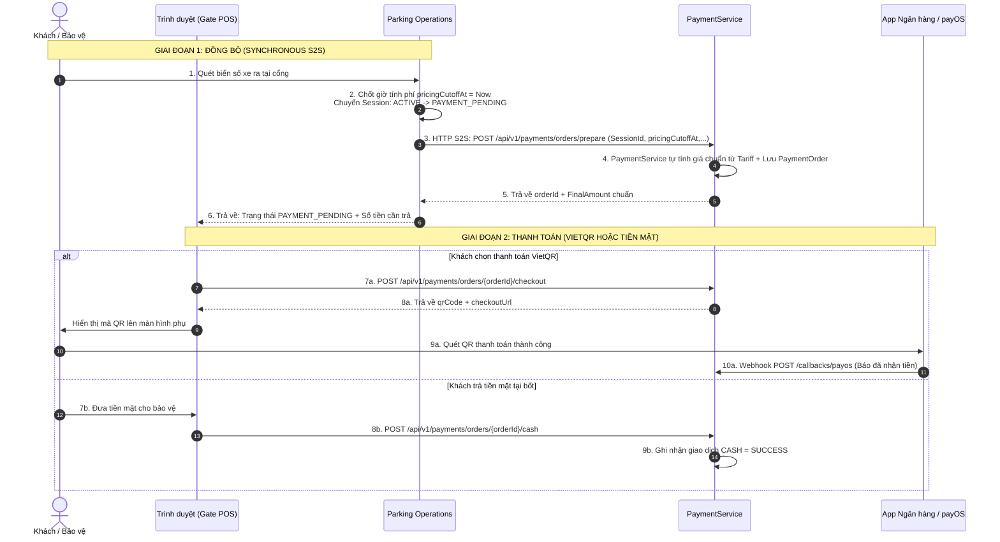
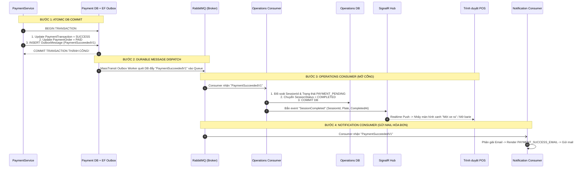

# Checkout, Payment Settlement & Outbox Notification Integration — API Design & Architecture Contract

| Metadata | Value |
| --- | --- |
| Status | DRAFT (Architecture-Aligned with 2026-10-28 Blueprint) |
| Contract version / date | v1.1 / 2026-11-02 |
| Owning service / author | PaymentService, Parking Operations (ReservationService), UserService, NotificationAuditService |
| Architecture Baseline | Blueprint `SmartPark-Checkout-Payment-RabbitMQ-Outbox-Design-2026-10-28.md`, Decision PAY-01, SB-01 |
| Jira design / verification | SPARK-229 (Pricing), SPARK-247/249/250 (Payment Gateway & Settlement), SPARK-296 (v1.1 Architecture Alignment) |
| Requirements baseline | SRS v1.1 (Modules 05, 06, 08) |
| Implementation target | `SmartParking.PaymentService`, `SmartParking.OperationService`, `SmartParking.NotificationAuditService` |

---

## 1. Overview & Core Architectural Invariants

Tài liệu này là **đặc tả kỹ thuật chuẩn hóa (Target Specification)** quy định luồng giao tiếp, cấu trúc bản tin Message Bus và hợp đồng HTTP giữa 4 Microservices: **Parking Operations**, **PaymentService**, **UserService**, và **NotificationAuditService**.

### 1.1 Nguyên lý Kiến trúc Bất biến (Core Invariants)

Theo quyết định thiết kế ngày 28/10/2026:

> 1. **Giai đoạn Chuẩn bị (Interactive / Synchronous):**  
>    Nhận diện biển số $\rightarrow$ phân giải phiên đỗ xe $\rightarrow$ chốt mốc thời gian tính phí (`pricingCutoffAt`) $\rightarrow$ tạo đơn thanh toán được thực hiện **đồng bộ qua HTTP Server-to-Server (S2S)**.  
>    **Tuyệt đối không để Trình duyệt (FE) tự tính giá hoặc gửi số tiền cần thu sang PaymentService**.
>
> 2. **Giai đoạn Xác nhận Tiền & Mở cổng (Durable / Asynchronous):**  
>    Sau khi cổng thanh toán (payOS) xác nhận dòng tiền $\rightarrow$ việc mở barie, hoàn tất phiên đỗ xe (`COMPLETED`) và gửi hóa đơn email được thực hiện **bất đồng bộ qua RabbitMQ + MassTransit**, được bảo vệ bằng **EF Core Transactional Outbox** tại `PaymentService`.
>
> 3. **Tín hiệu Mở cổng Realtime (SignalR):**  
>    SignalR chỉ đóng vai trò đẩy thông báo hiển thị lên màn hình POS bốt trực sau khi DB của Operations đã commit `COMPLETED`. **SignalR không phải là nguồn sự thật (Source of Truth)** và không thay thế RabbitMQ.

### 1.2 Vòng đời Trạng thái Phiên đỗ xe (`ParkingSession State Model`)

Chấm dứt việc đổi trạng thái thẳng từ `ACTIVE` sang `COMPLETED` tại cổng. Phiên đỗ xe bắt buộc trải qua trạng thái trung gian được lưu bền vững (persisted state):

```text
ACTIVE (Đang đỗ)
  │
  │ [Bảo vệ quét biển số ra] Chốt pricingCutoffAt = Now
  ▼
PAYMENT_PENDING (Chờ khách thanh toán - Khóa thời gian tính tiền)
  │
  ├─► [Nhận sự kiện PaymentSucceededV1 từ RabbitMQ]
  │     └─► COMPLETED (Đã thu tiền, giải phóng slot, mở barie)
  │
  └─► [Thanh toán thất bại / Hủy / Timeout]
        └─► Giữ nguyên hoặc tái tạo phiên chờ thanh toán (Không được COMPLETED)
```

### 1.3 Ma trận truy vết yêu cầu (Traceability Matrix)

| Mã yêu cầu | Phân loại | Nội dung nghiệp vụ | Mục hiện thực trong tài liệu |
| :--- | :---: | :--- | :--- |
| **PAY-01** | Architecture | Triển khai payOS VietQR MVP; Event-driven qua RabbitMQ Outbox. | Mục 1.1, Mục 2, Mục 3 |
| **FR-PAY-03** | Functional | Hỗ trợ thanh toán điện tử cho khách gửi xe (VietQR / Cổng số). | Mục 2.2, Mục 2.3 |
| **FR-PAY-04** | Functional | Tiếp nhận và xác thực tự động kết quả thanh toán qua Webhook IPN. | Mục 2.4 |
| **FR-PAY-05** | Functional | Đối soát và tra cứu trạng thái giao dịch từ cổng thanh toán. | Mục 2.5 |
| **FR-PAY-07** | Functional | Phát hành hóa đơn PDF điện tử và lịch sử thanh toán. | Mục 5.2 |
| **BR-PAY-04** | Business Rule | Phát hành hóa đơn PDF an toàn Idempotent cho các nghĩa vụ tài chính đã hoàn tất. | Mục 5.2 |
| **FR-RPT-01** | Functional | Gửi thông báo theo sự kiện nghiệp vụ (Email, In-App). Thất bại gửi không rollback tiền. | Mục 3.2, Mục 4.2 |
| **FR-BAS-06** | Functional | Kênh Email gửi hóa đơn/biên lai VAT, In-app gửi thông báo tức thời. | Mục 4.2 |
| **FR-GATE-02** | Functional | Xe vãng lai không bắt buộc tài khoản nhưng hỗ trợ tra cứu chủ xe qua biển số. | Mục 5.1 |

---

## 2. API Specification: Chu kỳ Khởi tạo Check-out & Thanh toán



---

### 2.1 API S2S Chuẩn bị Đơn thanh toán (Prepare Parking Fee Order)

- **Method / URL:** `POST /api/v1/payments/orders/prepare` *(hoặc `POST /api/v1/payments/orders` gọi nội bộ S2S)*
- **Caller (Consumer):** `Parking Operations` (Dịch vụ vận hành cổng).
- **Service Owner:** `PaymentService`.
- **Authentication:** Service Identity (S2S JWT hoặc Internal Mutual Token). Trình duyệt (FE) không được phép gọi trực tiếp endpoint này để tự điền số tiền.
- **Quy tắc an toàn tài chính:** `PaymentService` nhận mốc thời gian `pricingCutoffAt` do Operations cung cấp, tự nạp Tariff hiệu lực và tự tính toán số tiền chính thức.

#### Request Body Schema (`PrepareParkingFeeOrderRequestDto`)

| Field | Type | Required | Constraints | Meaning | Example |
| :--- | :--- | :---: | :--- | :--- | :--- |
| `tenantId` | UUID | Có | Format UUID v4 | Đơn vị vận hành bãi đỗ | `"3fa85f64-5717-4562-b3fc-2c963f66afa6"` |
| `siteId` | UUID | Có | Format UUID v4 | Bãi đỗ xe diễn ra check-out | `"8a123456-5717-4562-b3fc-2c963f66afa6"` |
| `sessionId` | UUID | Có | Mã phiên đỗ xe | `ReferenceId` của đơn hàng | `"b920cd2b-5717-4562-b3fc-2c963f66afa6"` |
| `vehicleType`| String | Có | `"CAR"` hoặc `"MOTORCYCLE"` | Phân loại phương tiện | `"CAR"` |
| `entryTime` | ISO-8601 | Có | Thời gian xe vào bãi | Mốc bắt đầu tính cước | `"2026-11-02T08:00:00Z"` |
| `pricingCutoffAt` | ISO-8601 | Có | Mốc xe tới cổng ra | Thời điểm chốt cước (cố định) | `"2026-11-02T11:30:00Z"` |
| `plateNumber`| String | Có | Biển số xe quét được | Lưu vết phục vụ đối soát | `"51A-123.45"` |
| `accountId` | UUID | Không | Nullable | Tài khoản tài xế (nếu có) | `null` |
| `penaltyAmount` | Decimal | Không | Mặc định 0 | Phí phạt vi phạm từ Operations | `20000` |
| `penaltyReason` | String | Không | Nullable | Lý do phạt (VD: Đỗ quá giờ) | `"Đỗ quá hạn đặt chỗ 45 phút"` |
| `idempotencyKey`| String | Có | Unique per session checkout | Khóa chống tạo trùng đơn | `"checkout:session:b920cd2b"` |

#### Response Sample (HTTP 200 OK / 201 Created)

```json
{
  "success": true,
  "data": {
    "orderId": "d7a12345-5e8c-4a3d-9c2b-1a2b3c4d5e6f",
    "orderCode": "1730534400123",
    "parkingFee": 45000,
    "penaltyFee": 20000,
    "finalAmount": 65000,
    "currency": "VND",
    "status": "PENDING",
    "expiresAt": "2026-11-02T11:45:00Z"
  }
}
```

---

### 2.2 API Khởi tạo Thanh toán payOS VietQR (Initiate Checkout)

- **Method / URL:** `POST /api/v1/payments/orders/{orderId}/checkout`
- **Caller:** Trình duyệt POS cổng ra hoặc ứng dụng Driver.
- **Headers:** `Idempotency-Key: <UUID>` *(Bắt buộc)*.
- **Quy tắc Idempotency:** Nếu đơn hàng đã khởi tạo link trước đó và đang `PENDING`, trả về nguyên bản `qrCode` và `checkoutUrl` đã lưu trong DB (hoặc truy vấn payOS), **tuyệt đối không bịa đặt dữ liệu tĩnh**.

#### Request Body Schema (`PaymentCheckoutRequestDto`)

```json
{
  "paymentMethod": "PAYOS",
  "returnUrl": "https://smartparking.vn/checkout/success",
  "cancelUrl": "https://smartparking.vn/checkout/cancel"
}
```

#### Response Sample (HTTP 200 OK)

```json
{
  "success": true,
  "data": {
    "paymentTransactionId": "f7d3a2b1-5e8c-4a3d-9c2b-1a2b3c4d5e6f",
    "orderCode": 1730534400123,
    "amount": 65000,
    "checkoutUrl": "https://pay.payos.vn/web/c7a8b9e0f1a2b3c4",
    "qrCode": "00020101021238540010A00000072701240006970422011001234567890208QRIBFTTA5303704540650005802VN62230819Thanh toan do xe 20266304ABCD",
    "accountNumber": "0123456789",
    "accountName": "SMARTPARKING CORP",
    "bin": "970422",
    "status": "PENDING",
    "expiresAt": "2026-11-02T11:45:00Z",
    "isReplayed": false
  }
}
```

---

### 2.3 API Thu tiền mặt tại Bốt (Confirm Cash Payment)

- **Method / URL:** `POST /api/v1/payments/orders/{orderId}/cash`
- **Caller:** Bảo vệ trực bốt (Yêu cầu vai trò `OPERATOR` hoặc `ADMIN`).
- **Xử lý nghiệp vụ:** Chuyển trạng thái Order sang `PAID`, tạo Transaction `CASH` thành công, lưu bản ghi hóa đơn và **ghi nhận sự kiện `PaymentSucceededV1` vào Transactional Outbox**.

#### Request Body Schema (`CashPaymentRequestDto`)

```json
{
  "idempotencyKey": "cash:order:d7a12345"
}
```

#### Response Sample (HTTP 200 OK)

```json
{
  "success": true,
  "data": {
    "transactionId": "91a2b3c4-5e8c-4a3d-9c2b-1a2b3c4d5e6f",
    "orderId": "d7a12345-5e8c-4a3d-9c2b-1a2b3c4d5e6f",
    "orderCode": 1730534400123,
    "amount": 65000,
    "paymentMethod": "CASH",
    "status": "SUCCESS",
    "paidAt": "2026-11-02T11:32:10Z",
    "isAuthoritative": true
  }
}
```

---

### 2.4 API Webhook Tiếp nhận IPN từ payOS

- **Method / URL:** `POST /api/v1/payments/callbacks/payos`
- **Bảo mật:** `[AllowAnonymous]`, xác thực chữ ký số HMAC-SHA256 (`signature`) dựa trên `checksumKey`.
- **Yêu cầu Transactional Outbox (BẮT BUỘC):**
  Cập nhật trạng thái `PaymentTransaction = SUCCESS` và **lưu bản tin `PaymentSucceededV1` vào bảng Outbox trong cùng 1 Transaction DB nguyên tử**. Sau đó lập tức trả về HTTP `200 OK` cho payOS.

```json
{
  "code": "00",
  "desc": "success",
  "data": {
    "orderCode": 1730534400123,
    "amount": 65000,
    "description": "Thanh toan 1730534400123",
    "accountNumber": "0123456789",
    "reference": "FT26307999812",
    "transactionDateTime": "2026-11-02 11:32:00",
    "paymentLinkId": "c7a8b9e0f1a2b3c4"
  },
  "signature": "3c9d...hmac_sha256_hash..."
}
```

---

### 2.5 API Tra cứu trạng thái Đơn hàng & Giao dịch (Fallback Polling)

- **Method / URL:** `GET /api/v1/payments/transactions/{transactionId}/status`
- **Caller:** Màn hình POS (khi kết nối websocket SignalR bị gián đoạn).
- **Lưu ý nghiệp vụ:** Khi tra cứu trực tiếp từ payOS phát hiện giao dịch thành công (Reconciliation path), PaymentService phải gọi cùng service transition chung để kích hoạt Outbox đẩy `PaymentSucceededV1`, không được cập nhật âm thầm.

---

## 3. Asynchronous Event-Driven Architecture (RabbitMQ + Outbox)



---

### 3.1 Cấu trúc Hợp đồng Sự kiện: `PaymentSucceededV1`

Sự kiện được đặt tên chuẩn là **`PaymentSucceededV1`**, kế thừa và mở rộng đầy đủ các trường phục vụ cả `OperationService` (mở cổng) và `NotificationAuditService` (gửi mail):

```csharp
namespace SmartParking.Contracts.Events.Payment;

public sealed record PaymentSucceededV1
{
    // Định danh & mốc thời gian sự kiện
    public Guid EventId { get; init; } = Guid.NewGuid();
    public DateTimeOffset OccurredAt { get; init; } = DateTimeOffset.UtcNow;
    public string CorrelationId { get; init; } = string.Empty;

    // Định danh thanh toán (Payment Boundary)
    public Guid PaymentOrderId { get; init; }
    public Guid PaymentTransactionId { get; init; }
    public string PaymentMethod { get; init; } = "PAYOS"; // "PAYOS" | "CASH"
    public string? GatewayReference { get; init; }

    // Ranh giới tài nguyên & Phiên đỗ xe (Operations Boundary)
    public Guid TenantId { get; init; }
    public Guid SiteId { get; init; }
    public string ReferenceType { get; init; } = "PARKING_SESSION"; // "PARKING_SESSION" | "RESERVATION"
    public Guid ReferenceId { get; init; }       // Chính là ParkingSessionId hoặc ReservationId
    public string? PlateNumber { get; init; }    // Biển số xe thực tế
    public Guid? AccountId { get; init; }        // DriverAccountId (nếu có tài khoản)

    // Dữ liệu dòng tiền & Chi tiết chi phí (Financial Breakdown)
    public decimal Amount { get; init; }         // Tổng tiền thực trả (FinalAmount)
    public decimal ParkingFee { get; init; }     // Cước đỗ xe gốc
    public decimal? PenaltyFee { get; init; }    // Tiền phạt phát sinh (nếu có)
    public string? PenaltyReason { get; init; } // Lý do phạt vi phạm
    public string Currency { get; init; } = "VND";
}
```

---

### 3.2 Đặc tả Consumer phía `OperationService` (`PaymentSucceededConsumer`)

* **Nhiệm vụ:** Hoàn tất phiên đỗ xe và ra lệnh mở barie.
* **Cơ chế Idempotent Consumer:**
  1. Đọc `ReferenceId` (tương ứng `ParkingSession.Id`).
  2. Truy vấn khóa dòng (Row lock / Concurrency check) kiểm tra trạng thái hiện tại của `ParkingSession`:
     - Nếu `SessionStatus == "COMPLETED"` và đã lưu cùng `PaymentOrderId`: Bỏ qua (Duplicate delivery an toàn).
     - Nếu `SessionStatus != "PAYMENT_PENDING"`: Ghi log cảnh báo trạng thái xung đột (`INVALID_SESSION_STATE`).
  3. Cập nhật thuộc tính phiên đỗ xe:
     - `SessionStatus = "COMPLETED"`
     - `ExitTime = OccurredAt`
     - `PaymentTransactionId = context.Message.PaymentTransactionId`
  4. Commit giao dịch xuống `OperationsDb`.
  5. Sau khi commit thành công, kích hoạt SignalR thông báo cho cổng ra.

---

### 3.3 Đặc tả Consumer phía `NotificationAuditService` (`PaymentNotificationConsumer`)

* **Nhiệm vụ:** Tiếp nhận thông tin dòng tiền, xác định người nhận và gửi Hóa đơn điện tử.
* **Idempotency Key:** `PAY_{EventId}_{PaymentOrderId}`.
* **Quy trình phân giải người nhận (Recipient Resolution):**
  1. Nếu `AccountId` có giá trị $\rightarrow$ gọi `UserService` lấy email của Driver.
  2. Nếu `AccountId == null` (xe vãng lai) nhưng có `PlateNumber` $\rightarrow$ gọi endpoint S2S `GET /api/v1/vehicles/lookup-by-plate?plateNumber=...` bên `UserService`:
     - Tìm thấy tài khoản liên kết biển số $\rightarrow$ lấy Email người nhận.
     - Trả về `404` (chưa từng đăng ký tài khoản) $\rightarrow$ Ghi nhận Audit Log đã thu tiền tại cổng, không gửi mail.
  3. Render nội dung template `PAYMENT_SUCCESS_EMAIL` (bao gồm chi tiết cước đỗ + tiền phạt) và chuyển cho `INotificationDispatcher`.

---

## 4. SignalR & Real-time UI Notification Contract

### 4.1 Hợp đồng Kênh SignalR tại Cổng ra (`GateHub`)

SignalR được kích hoạt **sau khi** `OperationService` commit `COMPLETED`.

- **Hub Endpoint:** `/hubs/gate`
- **Topic / Group:** `site_{siteId}_gate` hoặc `session_{sessionId}`
- **Event Name:** `SessionCheckoutCompleted`

#### Payload Schema

```json
{
  "sessionId": "b920cd2b-5717-4562-b3fc-2c963f66afa6",
  "plateNumber": "51A-123.45",
  "orderId": "d7a12345-5e8c-4a3d-9c2b-1a2b3c4d5e6f",
  "paymentMethod": "PAYOS",
  "amount": 65000,
  "status": "COMPLETED",
  "completedAt": "2026-11-02T11:32:15Z",
  "action": "OPEN_BARRIER"
}
```

#### Phản ứng của Giao diện POS / Màn hình Cổng:
- Trình duyệt nhận sự kiện qua websocket $\rightarrow$ Đổi giao diện sang trạng thái **Màu Xanh: "Thanh toán thành công — Mời xe rời bãi"**.
- Bật còi/đèn tín hiệu hoặc gửi lệnh phần cứng nâng barie cổng ra.

---

### 4.2 Đặc tả Mẫu Email Hóa đơn & Biên nhận (`PAYMENT_SUCCESS_EMAIL`)

* **Kênh gửi:** `NotificationChannel.EMAIL`
* **Tiêu đề (Subject):** `[SmartParking] Biên lai thanh toán phí đỗ xe — Biển số {{plateNumber}}`
* **Template Placeholders:**
  - `{{plateNumber}}`: Biển số xe thanh toán.
  - `{{siteName}}`: Tên bãi đỗ xe.
  - `{{paymentOrderId}}`: Mã đơn hàng.
  - `{{transactionId}}`: Mã giao dịch ngân hàng/payOS.
  - `{{paymentMethod}}`: VietQR payOS hoặc Tiền mặt.
  - `{{parkingFee}}`: Tiền cước đỗ xe (VND).
  - `{{penaltyFee}}`: Tiền phạt vi phạm (VND).
  - `{{penaltyReason}}`: Lý do phạt (nếu có).
  - `{{amount}}`: Tổng số tiền thanh toán (VND).
  - `{{invoiceUrl}}`: Đường link xem và tải bản thể hiện hóa đơn PDF điện tử.

---

## 5. Dịch vụ Hỗ trợ (Supporting S2S & Invoices)

### 5.1 API S2S Tra cứu Chủ xe theo Biển số (`UserService`)

- **Method / URL:** `GET /api/v1/vehicles/lookup-by-plate`
- **Owning Service:** `UserService`.
- **Query Parameter:** `plateNumber` (string, required).

#### Response Sample (HTTP 200 OK — Tìm thấy xe gắn tài khoản)

```json
{
  "success": true,
  "data": {
    "plateNumber": "51A-123.45",
    "accountId": "e5f6a1b2-5717-4562-b3fc-2c963f66afa6",
    "fullName": "Nguyễn Văn A",
    "email": "driver.nguyenvana@gmail.com",
    "phoneNumber": "0912345678",
    "vehicleType": "CAR",
    "isVerified": true
  }
}
```

*Nếu không tìm thấy, trả về HTTP `404 Not Found` với mã lỗi `VEHICLE_NOT_BOUND`.*

---

### 5.2 API Hóa đơn Điện tử Replay-Safe (`PaymentService`)

- **Method / URL:** `GET /api/v1/payments/invoices/{invoiceId}`
- **Owning Service:** `PaymentService`.
- **Đặc tả nghiệp vụ:** Trả về thông tin hóa đơn và link tải file PDF được sinh bất biến (Replay-safe PDF) khớp với bảng `invoices` trong `04-payment-pricing-service-db.sql`.

#### Response Sample (HTTP 200 OK)

```json
{
  "success": true,
  "data": {
    "invoiceId": "a1b2c3d4-5e8c-4a3d-9c2b-1a2b3c4d5e6f",
    "invoiceNumber": "INV-20261102-0042",
    "orderId": "d7a12345-5e8c-4a3d-9c2b-1a2b3c4d5e6f",
    "sessionId": "b920cd2b-5717-4562-b3fc-2c963f66afa6",
    "plateNumber": "51A-123.45",
    "totalAmount": 65000,
    "breakdown": {
      "parkingFee": 45000,
      "penaltyFee": 20000,
      "penaltyReason": "Đỗ quá giờ quy định 45 phút"
    },
    "issuedAt": "2026-11-02T11:32:05Z",
    "pdfUrl": "https://api.smartparking.vn/api/v1/payments/invoices/a1b2c3d4-5e8c-4a3d-9c2b-1a2b3c4d5e6f/download"
  }
}
```

---

## 6. Sơ đồ Tuần tự Chi tiết Toàn trình (19 Bước Chuẩn Kiến trúc)

```mermaid
sequenceDiagram
    autonumber
    actor Driver as Khách / Bảo vệ
    participant FE as Trình duyệt (FE / Gate POS)
    participant OPS as Parking Operations
    participant PAY as PaymentService
    participant PayOS as App Ngân hàng / payOS
    participant MQ as RabbitMQ (Queue)
    participant SignalR as SignalR Hub
    participant Notif as NotificationService

    %% Giai đoạn 1: Chuẩn bị
    Driver->>OPS: 1. Quét biển số xe ra
    OPS->>OPS: 2. Chốt giờ tính phí pricingCutoffAt = Now<br/>Chuyển Session: ACTIVE -> PAYMENT_PENDING
    OPS->>PAY: 3. HTTP Server-to-Server: Chuẩn bị đơn (SessionId, cutoffAt,...)
    PAY->>PAY: 4. PaymentService tự tính giá chuẩn + Lưu PaymentOrder
    PAY-->>OPS: 5. Trả về orderId + số tiền chuẩn
    OPS-->>FE: 6. Trả về: Trạng thái PAYMENT_PENDING + Số tiền cần trả

    %% Giai đoạn 2: Thanh toán
    FE->>PAY: 7. Lấy mã QR payOS cho orderId
    PAY-->>FE: 8. Hiển thị mã QR cho khách
    Driver->>PayOS: 9. Khách quét QR chuyển khoản
    PayOS->>PAY: 10. Webhook báo: Đã nhận tiền thành công!

    %% Atomic Transaction & Outbox
    rect rgb(40, 45, 50)
        Note over PAY: GIAO DỊCH NGUYÊN TỬ (ATOMIC DB TRANSACTION)
        PAY->>PAY: 11. Update Payment = SUCCESS
        PAY->>PAY: 12. Ghi sự kiện "PaymentSucceededV1" vào bảng Outbox
        PAY-->>PayOS: 13. Phản hồi 200 OK cho payOS ngay
    end

    %% Giai đoạn 3: Asynchronous Event Propagation
    PAY-)MQ: 14. MassTransit Worker tự động đẩy "PaymentSucceededV1" vào Queue
    
    rect rgb(30, 40, 50)
        Note over MQ,OPS: THÔNG ĐIỆP BẢO HIỂM 100% CHO OPERATIONS
        MQ-)OPS: 15. Consumer nhận "PaymentSucceededV1" từ RabbitMQ
        OPS->>OPS: 16. Domain đối soát OrderId -> Chuyển Session: PAYMENT_PENDING -> COMPLETED
        OPS->>OPS: 17. Commit DB Operations
    end

    OPS->>SignalR: 18. Bắn thông báo qua SignalR: "Session X đã COMPLETED"
    SignalR-->>FE: 19. FE nhận realtime -> Nhảy màn hình xanh "Mời xe ra"

    %% Giai đoạn 4: Notification (Gửi Mail)
    MQ-)Notif: 20. Consumer nhận "PaymentSucceededV1"
    Notif->>Notif: 21. Phân giải email người nhận (qua biển số nếu xe vãng lai)
    Notif->>Driver: 22. Gửi Email Hóa đơn & Biên nhận (kèm breakdown tiền phạt)
```



---

## 7. Ma trận Xử lý Sự cố & Tính chịu lỗi (Fault-Tolerance Matrix)

| Kịch bản sự cố | Hành vi của hệ thống | Cơ chế phục hồi tự động |
|---|---|---|
| **payOS Webhook gọi nhiều lần (Duplicate Webhook)** | Handler kiểm tra trạng thái Order: nếu đã `PAID`, bỏ qua cập nhật DB và không ghi thêm event vào Outbox. | Trả ngay HTTP 200 OK cho payOS, không phát sinh trùng sự kiện. |
| **RabbitMQ bị gián đoạn/mất kết nối khi Webhook về** | Giao dịch DB của Payment đã commit thành công cùng bản ghi trong bảng Outbox. | Khi RabbitMQ hoạt động trở lại, MassTransit Outbox Worker tự động đọc Outbox và đẩy message lên Queue. Không mất giao dịch. |
| **Operations Service bị chết / khởi động lại lúc nhận tiền** | Message `PaymentSucceededV1` được lưu bền vững trên hàng đợi RabbitMQ. | Khi Operations online trở lại, Consumer tiêu thụ message, cập nhật Session thành `COMPLETED`. |
| **Mất kết nối websocket SignalR tại cổng ra** | Barie chưa nhận được lệnh tự động qua websocket. | Màn hình POS cổng tự động kích hoạt polling `GET /transactions/{id}/status` hoặc quét lại biển số $\rightarrow$ nhận trạng thái `COMPLETED` để mở cổng. |
| **Xe vãng lai chưa từng đăng ký tài khoản** | `UserService` trả về `404 VEHICLE_NOT_BOUND` khi tra cứu biển số. | `NotificationService` ghi nhận biên lai nội bộ vào Audit Log, không ném exception làm tắc nghẽn hàng đợi tin nhắn. |

---

## 8. Review Checks

- [x] Đã đồng bộ 100% với tài liệu thiết kế kiến trúc `SmartPark-Checkout-Payment-RabbitMQ-Outbox-Design-2026-10-28.md`.
- [x] Khóa chặt nguyên tắc: FE không được tự tính giá; việc chuẩn bị đơn checkout thực hiện qua HTTP S2S giữa Operations và PaymentService.
- [x] Áp dụng chuẩn tên sự kiện **`PaymentSucceededV1`** dùng chung cho toàn bộ hệ thống.
- [x] Đặc tả chi tiết cơ chế Transactional Outbox (EF Core) đảm bảo 100% không mất thông điệp.
- [x] Tách bạch rõ vai trò của RabbitMQ (bền bỉ giữa các Backend) và SignalR (thông báo realtime lên Trình duyệt).
- [x] Đầy đủ kịch bản cho cả khách đặt trước, xe vãng lai có tài khoản liên kết, và xe vãng lai không có tài khoản.
