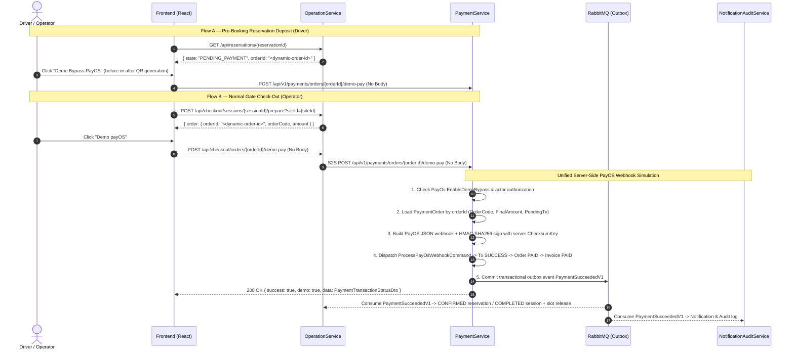

# Demo PayOS Payment Bypass — API Design

| Metadata | Value |
| --- | --- |
| Status | DRAFT |
| Contract version / date | v1.0 / 2026-11-27 |
| Owning service / author | `PaymentService` (direct endpoint) & `OperationService` (operator checkout proxy) |
| Jira design / implementation / verification | Demo / Payment Bypass |
| Requirements baseline | SRS v1.1 (Modules 05, 06, 08) & `checkout-payment-notification-integration-api-design.md` |
| Implementation | `PaymentService` (`PaymentsController.DemoPay`, `SimulateDemoPayOsPaymentCommandHandler`) |

## Overview

When external banking rails or PayOS are under maintenance during a live demonstration, the Demo PayOS Payment Bypass allows Frontend (FE) callers to simulate a completed PayOS payment for **both** SmartParking payment flows (**Driver pre-booking reservation deposit** and **Operator gate check-out**) without transferring real money and **without hardcoding any order metadata** (`orderCode`, `amount`, `signature`, or `reference`) in the request.

FE passes only the dynamic `orderId` returned by the preceding order-creation / preparation step. `PaymentService` looks up the authoritative `PaymentOrder` and any active `PENDING` `PaymentTransaction` from its database, constructs and HMAC-SHA256-signs a PayOS-compatible webhook payload on the server using `PayOs:ChecksumKey`, and dispatches it through the real `ProcessPayOsWebhookCommand` pipeline (signature verification → `ProviderWebhook` idempotency → `PaymentTransaction = SUCCESS` → `PaymentOrder = PAID` → `Invoice` settlement for PDF download → atomic `PaymentSucceededV1` RabbitMQ outbox → `OperationService` & `NotificationAuditService` downstream completion).

| Traceability | Reference |
| --- | --- |
| Applicable FR / BR / UC | `FR-PAY-03`, `FR-PAY-04`, `FR-PAY-07`, `BR-PAY-04`, `PAY-01` |
| Service ownership | `PaymentService` (`docs/02-architecture/service-boundaries/`), `OperationService` checkout proxy |
| Related contracts | [Checkout & Payment Integration](checkout-payment-notification-integration-api-design.md), [Driver Payment History & PDF Invoice](driver-payment-history-and-pdf-invoice-api-design.md) |

---

## Sequence Diagram (Both Flows, Dynamic `orderId`)



---

## API Specification

### 1. Direct Demo PayOS Bypass (`PaymentService`)

Used directly by the **Driver** flow (reservation deposit) and internally via S2S by `OperationService` for the **Operator** gate check-out flow.

| Item | Contract |
| --- | --- |
| Method / URL | `POST /api/v1/payments/orders/{orderId}/demo-pay` |
| Base URL (Local) | `http://localhost:5065` (`VITE_PAYMENT_API_BASE_URL`) |
| Availability | Enabled when `PayOs:EnableDemoBypass == true`, or when `PayOs:EnableDemoBypass == null` and `ASPNETCORE_ENVIRONMENT == Development`. Fails closed with `404 Not Found` in Staging/Production unless explicitly enabled. |
| Authentication | `Authorization: Bearer <accessToken>` (or `X-Internal-Service-Key` for S2S) |
| Freshness / invocation origin | `TOKEN` (for authenticated users) / `SERVICE` (for S2S `OperationService`) |
| Permission / account state | Order owner (`actor.AccountId == order.AccountId`), `OPERATOR`, `ADMIN`, or `INTERNAL_SERVICE` |
| Resource scope | Target `PaymentOrder` identified by `{orderId}` |
| Content type | Request: No body required / Response: `application/json` |
| Headers | `Authorization: Bearer <token>` |

#### Request sample

No request body is sent. All order details (`orderCode`, `finalAmount`, `gatewayTransactionId`, `referenceType`, `referenceId`) are resolved dynamically on the server from `{orderId}`.

```http
POST /api/v1/payments/orders/9c1b7e42-6a12-4d9c-9c45-12a34b56c789/demo-pay HTTP/1.1
Host: localhost:5065
Authorization: Bearer <driver-or-operator-access-token>
```

| Field | Location | Type / format | Required / nullable | Constraints and meaning | Example |
| --- | --- | --- | --- | --- | --- |
| `orderId` | `path` | `uuid` | Required, non-empty | Dynamic `PaymentOrder.Id` returned by booking/checkout preparation (`booking.orderId` or `prepared.order.orderId`). | `9c1b7e42-6a12-4d9c-9c45-12a34b56c789` |

#### Response sample

`200 OK`

```json
{
  "success": true,
  "demo": true,
  "data": {
    "transactionId": "5a94c2e1-2d84-4b27-b6c1-8f5d7a3c9e10",
    "orderId": "9c1b7e42-6a12-4d9c-9c45-12a34b56c789",
    "orderCode": 1795664800123456,
    "amount": 25000,
    "paymentMethod": "PAYOS",
    "gatewayTransactionId": "DEMO-LINK-9c1b7e426a124d9c9c4512a34b56c789",
    "status": "SUCCESS",
    "paidAt": "2026-11-27T04:10:00Z",
    "isAuthoritative": true
  }
}
```

| Field | Type / format | Nullable / optional | Meaning | Example |
| --- | --- | --- | --- | --- |
| `success` | `boolean` | Required | `true` when demo bypass succeeded or replayed idempotently | `true` |
| `demo` | `boolean` | Required | Always `true` to distinguish simulated bypass responses | `true` |
| `data.transactionId` | `uuid` | Required | Settled `PaymentTransaction.Id` (reuses existing `PENDING` transaction ID if QR was already created) | `5a94c2e1-2d84-4b27-b6c1-8f5d7a3c9e10` |
| `data.orderId` | `uuid` | Required | `PaymentOrder.Id` | `9c1b7e42-6a12-4d9c-9c45-12a34b56c789` |
| `data.orderCode` | `int64` | Required | Dynamic numeric PayOS `orderCode` resolved from the order | `1795664800123456` |
| `data.amount` | `int64` | Required | Settled amount in VND (`order.FinalAmount`) | `25000` |
| `data.paymentMethod` | `string` | Required | `"PAYOS"` | `"PAYOS"` |
| `data.gatewayTransactionId` | `string` | Nullable | Existing `paymentLinkId` if QR was initiated, or `DEMO-LINK-{orderId:N}` | `"DEMO-LINK-9c1b7e426a124d9c9c4512a34b56c789"` |
| `data.status` | `string` | Required | `"SUCCESS"` | `"SUCCESS"` |
| `data.paidAt` | `ISO-8601 datetime` | Nullable | UTC settlement timestamp | `"2026-11-27T04:10:00Z"` |
| `data.isAuthoritative` | `boolean` | Required | `true` — FE can mark payment UI as confirmed immediately | `true` |

#### Validation and error responses

All `4xx` domain errors follow the `PaymentService` error envelope:

```json
{
  "success": false,
  "errorCode": "ORDER_EXPIRED",
  "message": "This payment order has expired.",
  "traceId": "00-...",
  "errors": [],
  "timestamp": "2026-11-27T04:10:00Z"
}
```

| HTTP status | Machine code | Trigger | Client recovery |
| --- | --- | --- | --- |
| `400` | `VALIDATION_ERROR` | Empty `orderId` (`00000000-0000-0000-0000-000000000000`) | Supply the valid `orderId` returned by reservation/checkout preparation. |
| `400` | `ZERO_AMOUNT_ORDER` | `order.FinalAmount <= 0` | Zero-amount orders do not use PayOS; refresh booking/session state. |
| `400` | `INVALID_ORDER_CODE` | `order.OrderCode` is not a positive `int64` | Surface error; do not retry automatically. |
| `401` | `UNAUTHORIZED` | Missing or invalid bearer token | Re-authenticate and retry. |
| `403` | `FORBIDDEN_ORDER_ACCESS` | Driver calls bypass for another account's order or a walk-in order (`AccountId == null`) | Abort; do not retry. |
| `404` | `ORDER_NOT_FOUND` (or empty `404`) | `orderId` does not exist, **or** `PayOs:EnableDemoBypass` is disabled (e.g. Production) | Hide demo button when disabled; verify `orderId` if missing. |
| `409` | `ORDER_CANCELLED` | `order.Status == CANCELLED` | Create a new order / reservation instead. |
| `422` | `ORDER_EXPIRED` | `order.ExpiresAt < UtcNow` | Refresh reservation/checkout status to start a new order. |

#### Retry and state outcomes

| Case | Observable contract |
| --- | --- |
| Repeated request / double-click after `PAID` | Returns `200 OK` with the existing settled `PaymentTransactionStatusDto` (`IsAuthoritative: true`). Does **not** create duplicate transactions or emit duplicate `PaymentSucceededV1` events. |
| Existing `PENDING` QR transaction | Reuses and transitions that exact `PENDING` transaction (preserving `transactionId` and `gatewayTransactionId`) to `SUCCESS`, so any active FE status polling (`GET /api/v1/payments/transactions/{transactionId}/status`) observes `SUCCESS` cleanly. |
| Concurrent webhook vs demo-pay | Deterministic `ProviderEventId` (`DEMO-{orderId:N}`) and `ProcessPayOsWebhookCommandHandler` idempotency prevent double settlement. |

---

### 2. Operator Checkout Proxy (`OperationService`)

Used by the Operator Gate Check-Out screen (`FE/src/roles/operator/check-in-out/CheckInOut.tsx`).

| Item | Contract |
| --- | --- |
| Method / URL | `POST /api/checkout/orders/{orderId}/demo-pay` |
| Base URL (Local) | `http://localhost:5055` (`VITE_RESERVATION_API_BASE_URL`) |
| Availability | Follows `PaymentService` `PayOs:EnableDemoBypass` availability (returns `404` when `PaymentService` disables demo bypass) |
| Authentication | Authenticated Operator / Admin session (forwarded to `PaymentService` together with S2S `X-Internal-Service-Key`) |
| Content type | Request: No body / Response: `application/json` |

#### Request sample

```http
POST /api/checkout/orders/9c1b7e42-6a12-4d9c-9c45-12a34b56c789/demo-pay HTTP/1.1
Host: localhost:5055
Authorization: Bearer <operator-access-token>
```

#### Response sample (`200 OK`)

```json
{
  "success": true,
  "data": {
    "transactionId": "5a94c2e1-2d84-4b27-b6c1-8f5d7a3c9e10",
    "orderId": "9c1b7e42-6a12-4d9c-9c45-12a34b56c789",
    "amount": 25000,
    "status": "SUCCESS",
    "paidAt": "2026-11-27T04:10:00Z",
    "isAuthoritative": true
  }
}
```

---

## Frontend Integration Guide

1. **Zero Hardcoding Rule:** Never hardcode `orderCode`, `amount`, `signature`, or `orderId` in FE code. Always pass the `orderId` received dynamically from the server:
   - **Driver Reservation Flow (`ReservationCheckout.tsx` → `PaymentCheckout.tsx`):** Read `booking.orderId` returned by `GET /api/reservations/{reservationId}` when `booking.state === "PENDING_PAYMENT"`. Call `POST ${VITE_PAYMENT_API_BASE_URL}/api/v1/payments/orders/${orderId}/demo-pay` with the user's bearer token and **no body**.
   - **Operator Gate Check-Out Flow (`CheckInOut.tsx`):** Read `prepared.order.orderId` returned by `POST /api/checkout/sessions/{sessionId}/prepare` or `POST /api/checkout/reservations/{reservationId}/prepare`. Call `POST ${VITE_RESERVATION_API_BASE_URL}/api/checkout/orders/${orderId}/demo-pay` with **no body** (already wired to the `Demo payOS` button).
2. **Allow Click Before or After QR Creation:** In the Driver reservation checkout screen, enable the Demo Bypass button as soon as `orderId` is available — even **before** clicking *"Generate payment QR"*. That guarantees demos succeed even if PayOS checkout-link creation is completely unreachable.
3. **UI State Transition on `200 OK`:**
   - When `data.status === "SUCCESS" && data.isAuthoritative === true`, immediately update payment status UI to confirmed (`"success"`).
   - Continue/trigger reservation or session status refresh against `OperationService` (`GET /api/reservations/{reservationId}` or parking session refresh) until `PaymentSucceededV1` is consumed asynchronously (`CONFIRMED` / `COMPLETED`).
4. **Environment Gate on FE:** Show the Driver Demo Bypass button only when demo mode is enabled on FE (for example `import.meta.env.DEV || import.meta.env.VITE_ENABLE_DEMO_PAYMENT === "true"`).

---

## Configuration & Security Notes

- **Backend Toggle (`PayOs:EnableDemoBypass` / `SMARTPARK_PAYOS_ENABLE_DEMO_BYPASS`):**
  - Unset (`null`): enabled automatically when `ASPNETCORE_ENVIRONMENT=Development`; disabled (`404 Not Found`) in `Staging`/`Production`.
  - `true`: explicitly enabled (e.g., controlled staging demo).
  - `false`: explicitly disabled everywhere, including `Development`.
- **Development Auth Note:** In `ASPNETCORE_ENVIRONMENT=Development`, `PaymentService` uses `DevAuthenticationHandler`, which defaults `account_id` to `11111111-1111-1111-1111-111111111111` unless `X-Actor-UserId` is supplied or JWT bearer authentication is active. Driver orders created with a different `AccountId` must match the authenticated actor's `AccountId` (matching `InitiateCheckout` ownership rules).
