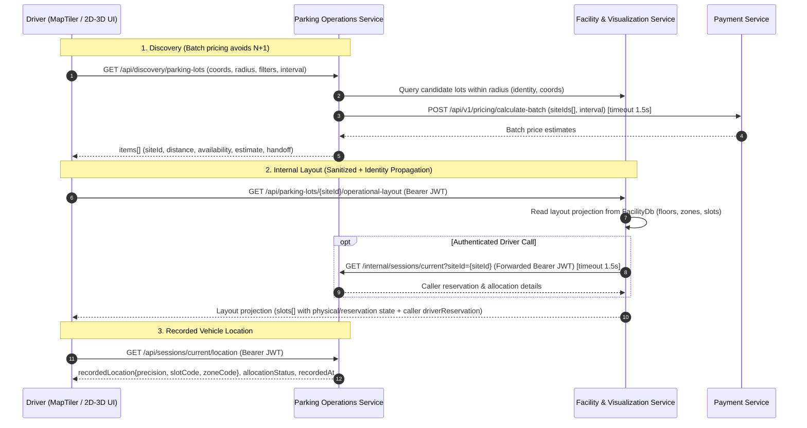

# Driver Maps & Recorded Vehicle Location — API Design

| Metadata | Value |
| --- | --- |
| Doc ID | SPARK-API-DRIVER-MAP |
| Status | READY WITH REQUIRED REVISIONS / DRAFT — PENDING PM / V11-DES-08 SIGN-OFF (PROPOSED CONTRACT) |
| Contract version / date | v1.1 (draft) / 2026-11-02 |
| Document revision | Rev 4 (technical resolution pass: P0/P1 gaps resolved from independent reviews). See Revision history. |
| Owning service / author | Parking Operations Service (code: `OperationService`) for EP-01/EP-02/EP-04; Facility & Visualization Service (code: `FacilityService`) for EP-03. Author: SPARK-246 design session |
| Jira design / implementation / verification | Design: SPARK-246 (this document). Implementation: NOT IMPLEMENTED. Verification: NOT RUN. |
| Requirements baseline | SRS v1.1 (pinned v1.1 baseline); `docs/01-requirements/srs/modules/03-discovery-visualization.md` |
| Implementation | NOT IMPLEMENTED (design only; no source changed) |

## Overview

Defines the Driver-facing read contracts that let a Driver discover a facility on a geographic map, hand the *same* lot identity into the internal 2D/3D booking page, and view their recorded vehicle location at the precision the backend actually recorded. Every operation is read-only: a displayed marker or slot is informational and never grants capacity or entitlement, and no operation in this document allocates or frees a resource.

| Traceability | Reference |
| --- | --- |
| Applicable FR / BR / UC / US | FR-MAP-01, FR-MAP-02, FR-MAP-03, FR-MAP-04 (`srs/modules/03-discovery-visualization.md`); US-D16 (`use-cases/user-stories/catalogue.md:39`); UC-MAP-01 (`use-cases/uc-map-01.md`); UC-SEARCH-01 (`use-cases/uc-search-01.md`); AC-108 / V11-12 |
| Acceptance-criteria source | The 10 acceptance criteria mapped below are the **Jira SPARK-246 (US-D16) v1.1 acceptance criteria** as stated on the ticket. The nearest in-repo traceability set is `docs/04-testing/requirements-traceability/acceptance-scenarios.md` **AC-103–AC-108** (all `NOT RUN`). No in-repo document enumerates all 10; completeness is therefore Jira-sourced. |
| Permission / service ownership | Operations owns discovery/availability and session facts (`service-boundaries/ownership-and-events.md:50`); Facility supplies lot identity/location/configuration and the non-authoritative layout projection (`GET /api/parking-lots/{id}/operational-layout` is implemented in FacilityService); Payment supplies tariff/estimate facts |
| Approved decisions | None committing a new wire contract. Geographic discovery contract: `ownership-and-events.md` §"Geographic discovery and model handoff". Deferred: V11-DES-08 (Driver-facing projection/route), DB32 |
| Companion designs | `3d-digital-twin-api-design.md`, `3d-digital-twin-spark-228-api-design.md`, `3d-digital-twin-spark-244-api-design.md`, `parking-structure-api-design.md` |
| Revision traceability | Section titles are topic-based; each maps to the SPARK-246 work-order items and technical resolutions across revisions Rev 0 through Rev 4. |

> **Approval boundary.** This document does **not** approve a new route, cache lifetime or schema. `v1.1-contracts.md:53,81` and `parking-structure-api-design.md:76` explicitly defer a Driver-facing discovery/model projection to V11-DES-08. Routes and DTOs below are **PROPOSED**; `v1.1-contracts.md:9` requires the established `/api/parking-lots` retrieval family to remain structurally unchanged.

> **Serialization convention.** Fields documented as "present only when …" are **omitted** when absent; fields documented as **nullable** are always serialized and carry `null` when absent. Error bodies follow the v1.1 envelope `{"success":false,"code":"…","message":"…"}` (`v1.1-contracts.md:11`).

## Acceptance Criteria Mapping (v1.1)

The 10 Jira SPARK-246 (US-D16) acceptance criteria map to concrete operations/DTO fields below.

| AC | Acceptance criterion (Jira SPARK-246 v1.1) | Operation(s) / DTO field(s) | Contract note |
| --- | --- | --- | --- |
| AC1 | Driver can navigate to the selected facility using approved map/location data or manual fallback where applicable | `GET /api/discovery/parking-lots` → `items[].coordinates{latitude,longitude}`; origin via `originSource=CURRENT_GPS\|NETWORK\|MANUAL`; `directions.handoff="EXTERNAL_MAP"` | External-map directions only; embedded routing/turn-by-turn excluded (FR-MAP-01). Denied GPS is a client condition → `originSource=MANUAL` |
| AC2 | Selecting a discovery lot preserves the same lot identity when handing off to internal 2D/3D booking/review | `items[].siteId` returned by discovery is the exact `{siteId}` path segment of `GET /api/parking-lots/{siteId}/operational-layout`; `handoff{siteId,vehicleType,intervalStart,intervalEnd}` | Same `siteId`; no identity re-derivation |
| AC3 | Requested reservation position and actual allocated position are shown distinctly | Encapsulated in caller-private `driverReservation.requestedPosition` vs `driverReservation.allocatedPosition` (carries `zoneId`/`allocationId`); public `slots[]` carries only slot-level physical and reservation states | Two separate field groups; never merged (FR-MAP-02). Per-slot public rows do not expose individual caller reservation/allocation identifiers to preserve privacy and prevent intent leakage |
| AC4 | Vehicle/session location is shown only to the precision actually recorded by backend state | `GET /api/sessions/current/location` → `recordedLocation.precision` (`SLOT\|ZONE\|UNKNOWN`) | Precision is a first-class discriminator (FR-MAP-03). Removed from layout `slots[]` because physical slots are inherently at slot precision |
| AC5 | Zone-only/area-only data is never presented as an invented exact slot | Zone-only reservations are represented **only** via own `driverReservation` (scope `ZONE`); `requestedPosition.scope=ZONE ⇒ slotId=null`; recorded `precision=ZONE` omits `slotId`; `metrics.zoneCapacities[].zoneOnlyReservedCount` is marked deprecated in favor of `zoneReservedSlotsCount` | No synthesized `slots[]` row for a zone-only reservation; renderer MUST NOT fabricate a slot-level halo (FR-MAP-03; twin §4.6.2). Coordinated renaming to `zoneReservedSlotsCount` aligned with SPARK-244 |
| AC6 | Marker/slot selection in the UI does not reserve or guarantee capacity; booking backend revalidates current availability | All operations here are `GET` (no selection write); `layout.slots[].isBookable` is informational; booking/revalidation is a separate reservation operation (out of scope) | `v1.1-contracts.md:61`; `ownership-and-events.md:50,52` |
| AC7 | Allocated → occupied → released state follows authoritative backend lifecycle changes | `GET /api/sessions/current/location` → `allocationStatus` (`RESERVED\|OCCUPIED` during active session lifecycle) | Server-sourced; client never transitions state. When actual departure occurs, the session terminates (`COMPLETED`), allocation becomes `RELEASED`, and subsequent `/current/location` calls return `404 SESSION_NOT_FOUND` (no active session). Historical states are read via session history APIs |
| AC8 | Accepted checkout/payment alone does not release the occupied location; authoritative actual departure does | Documented `allocationStatus` lifecycle: `RELEASED` is published only from authoritative actual departure; no endpoint in this design releases | `business-rules/05-sessions-operations.md:17`; `ownership-and-events.md:68`. **Implementation gap:** Current code (`ReservationGateStore.cs:120-137,218-229`) sets `session_status=COMPLETED` and `exit_time` together on checkout. For v1.1 compliance, Operations must decouple `PaymentCompleted` from `VehiclePhysicallyExited` (gate barie/sensor event) |
| AC9 | Stale/disconnected state is clearly indicated and reconnect reloads current authorized state | EP-01/EP-02/EP-04: `freshness.isStale`; EP-03: `isFresh` (twin shape); reconnect = full snapshot reload of the same `GET` | FR-MAP-04; when `isFresh=false`, `isBookable` is forced to `false` and UI renders degraded state |
| AC10 | Map/3D UI has no authority to allocate/free resources | No write operations exist in this design; every route is read-only `GET`; RBAC is read-scope only | `ownership-and-events.md:56`; `parking-structure-api-design.md:50` |

## API Specification

Four read operations. Naming presumes authenticated Driver sessions for EP-01/EP-02/EP-04; EP-03 read scope supports dual-mode (anonymous sanitized read + authenticated Driver read).

---

### Operation EP-01 — Driver geographic discovery

| Item | Contract |
| --- | --- |
| Method / URL | `GET /api/discovery/parking-lots` |
| Availability | Proposed — pending V11-DES-08 approval |
| Authentication | Normal Driver session (Bearer JWT) |
| Permission / account state | Active Driver account; no write scope |
| Resource scope | Platform-wide discovery; results are Facility lots the Driver may book |
| Content type | No body (query only) / `application/json` |
| Headers | Standard `Authorization`; no idempotency header (read-only) |

#### Request sample

`GET /api/discovery/parking-lots?originSource=CURRENT_GPS&latitude=10.7769&longitude=106.7009&radiusKm=5&vehicleType=CAR&lotType=MULTI_STOREY&intervalStart=2026-11-03T08:00:00Z&intervalEnd=2026-11-03T12:00:00Z&minPrice=0&maxPrice=30000&currency=VND&availabilityOnly=true&sort=PRICE&limit=20&offset=0`

| Field | Location | Type / format | Required / nullable | Constraints and meaning | Example |
| --- | --- | --- | --- | --- | --- |
| originSource | query | enum | required | `CURRENT_GPS`, `NETWORK`, `MANUAL`; denied GPS is a client condition and maps to `MANUAL`, not a server code | CURRENT_GPS |
| latitude | query | number | required (for `MANUAL`, supply the geocoded coordinates) | `[-90,90]` decimal degrees (WGS84) | 10.7769 |
| longitude | query | number | required (for `MANUAL`, supply the geocoded coordinates) | `[-180,180]` decimal degrees (WGS84) | 106.7009 |
| manualOrigin | query | string | required when originSource=MANUAL | Free-text origin (1–255 chars); geocoded by FE via MapTiler before sending | "Ben Thanh Market" |
| radiusKm | query | integer | optional | Default **5**; max 50; offered expansion when empty (OQ-4) | 5 |
| vehicleType | query | enum | optional | `CAR`, `MOTORCYCLE`, `OVERSIZED`; independent of `lotType`; scopes availability/tariff | CAR |
| lotType | query | enum | optional | `OUTDOOR`, `BASEMENT`, `MULTI_STOREY` | MULTI_STOREY |
| minPrice / maxPrice | query | integer | optional | Price band compared against the Payment-sourced interval estimated total (`estimate.estimatedTotalMinor`) in `currency`; requires `intervalStart`/`intervalEnd` | 0 / 30000 |
| currency | query | string | required with min/maxPrice | ISO-4217 code | VND |
| availabilityOnly | query | boolean | optional | Excludes full lots only when explicitly requested; default false keeps them labelled | true |
| intervalStart / intervalEnd | query | datetime | optional pair | When absent, current backend time + current tariff is used (no invented total) | 2026-11-03T08:00:00Z |
| sort | query | enum | optional | `DISTANCE` (Haversine, default), `PRICE`, `AVAILABILITY`. `PRICE` requires intervalStart/intervalEnd and `currency` (evaluated via Payment batch calculation) | DISTANCE |
| limit | query | integer | optional | Page size for map infinite scroll; default 20; max 100; stable ordering required | 20 |
| offset | query | integer | optional | Zero-based offset; default 0 | 0 |

Server-controlled: distance is always **Haversine straight-line**, never road distance or ETA. Cached/local markers are never authority (SRS `modules/03-discovery-visualization.md:37`; `ownership-and-events.md:50`).

EP-01 aggregates Facility + Operations + Payment. To prevent N+1 cross-service calls when sorting or filtering by price, Operations relies on Payment's batch pricing calculation (`POST /api/v1/pricing/calculate-batch`).

Aggregate freshness rule: `isStale=true` if any **mandatory** source (Facility identity or Operations availability) is stale/unavailable; an optional source (Payment tariff) that is stale or times out is surfaced as `tariff=null` (fail-fast within 1.5s) rather than failing the whole read.

#### Response sample

`200 OK`

```json
{
  "success": true,
  "data": {
    "items": [
      {
        "siteId": "8f2c7b10-1c4a-4e9a-9b2f-2d3e4f5a6b70",
        "siteCode": "LOT-BT-01",
        "siteName": "Ben Thanh Tower Parking",
        "addressLine": "1 Le Loi, District 1",
        "coordinates": { "latitude": 10.7721, "longitude": 106.6980 },
        "lotType": "MULTI_STOREY",
        "distanceMeters": 1420,
        "availability": { "status": "AVAILABLE", "availableCount": 12, "vehicleType": "CAR" },
        "tariff": { "tariffRef": "TAR-2026-11", "billingUnit": "HOUR", "currentAmountMinor": 20000, "currency": "VND" },
        "directions": { "handoff": "EXTERNAL_MAP" },
        "handoff": {
          "siteId": "8f2c7b10-1c4a-4e9a-9b2f-2d3e4f5a6b70",
          "layoutApiPath": "/api/parking-lots/8f2c7b10-1c4a-4e9a-9b2f-2d3e4f5a6b70/operational-layout"
        },
        "freshness": { "generatedAt": "2026-11-02T09:14:03Z", "isStale": false, "stalenessThresholdSeconds": 30, "source": "OPERATIONS" }
      }
    ],
    "page": { "limit": 20, "offset": 0, "returned": 1, "total": 1, "hasMore": false }
  }
}
```

| Field | Type / format | Nullable / optional | Meaning | Example |
| --- | --- | --- | --- | --- |
| items[].siteId | uuid | not null | Canonical lot identity; the value carried into EP-03 (AC2) | `8f2c7b10-…` |
| items[].siteCode | string | not null | Human-readable lot code | LOT-BT-01 |
| items[].siteName | string | not null | Lot display name | Ben Thanh Tower Parking |
| items[].addressLine | string | not null | Facility address from Facility-owned data | 1 Le Loi, District 1 |
| items[].coordinates | object | not null | `{latitude, longitude}` WGS84 from Facility data | 10.7721, 106.6980 |
| items[].lotType | enum | not null | `OUTDOOR\|BASEMENT\|MULTI_STOREY` | MULTI_STOREY |
| items[].distanceMeters | integer | not null | Haversine straight-line distance; **not** road distance/ETA | 1420 |
| items[].availability | object | not null | `{status, availableCount, vehicleType}`; status `AVAILABLE\|FULL\|UNKNOWN` | {…} |
| items[].availability.availableCount | integer | nullable | Informational only; **no** capacity guarantee | 12 |
| items[].tariff | object | nullable | `{tariffRef, billingUnit, currentAmountMinor, currency}`; never a normalized cross-unit total. Amount is minor units | {…} |
| items[].estimate | object | nullable | Present only when an interval is supplied: `{intervalStart, intervalEnd, estimatedTotalMinor, currency, billingBasis, source}` | (omitted) |
| items[].directions | object | not null | `{handoff}` where `handoff` is always `EXTERNAL_MAP` | {…} |
| items[].handoff | object | optional | Inlined handoff context enabling direct transition to 2D/3D layout without calling EP-02 | {…} |
| items[].freshness | object | not null | `{generatedAt, isStale, stalenessThresholdSeconds, source}` (AC9) | {…} |
| page | object | not null | `{limit, offset, returned, total, hasMore}` | {…} |

#### Validation and error responses

| HTTP status | Machine code | Trigger | Response example / schema | Client recovery |
| --- | --- | --- | --- | --- |
| 400 | `INVALID_ORIGIN` | Missing/invalid latitude or longitude | `{"success":false,"code":"INVALID_ORIGIN","message":"Coordinates are required"}` | Supply valid coordinates |
| 400 | `INVALID_INTERVAL` | Only one of intervalStart/intervalEnd supplied, start ≥ end, or past interval | `{"success":false,"code":"INVALID_INTERVAL","message":"Invalid interval"}` | Correct the interval pair |
| 422 | `PRICE_FILTER_REQUIRES_INTERVAL` | `minPrice`/`maxPrice` or `sort=PRICE` supplied without `intervalStart`/`intervalEnd` | `{"success":false,"code":"PRICE_FILTER_REQUIRES_INTERVAL","message":"Price filtering and PRICE sort require a selected interval"}` | Add interval pair |
| 401 | `UNAUTHENTICATED` | Missing/expired bearer token | `{"success":false,"code":"UNAUTHENTICATED","message":"Authentication required"}` | Re-authenticate |
| 403 | `FORBIDDEN` | Account not eligible as Driver | `{"success":false,"code":"FORBIDDEN","message":"Driver access required"}` | Use an eligible account |
| 422 | `VALIDATION_FAILED` | `radiusKm`/`price`/`currency` invalid, or `currency` missing when `sort=PRICE` | `{"success":false,"code":"VALIDATION_FAILED","message":"Invalid query","errors":[…]}` | Correct query parameters |
| 503 | `DISCOVERY_PROVIDER_UNAVAILABLE` | Critical backend dependency (Facility/Operations) unavailable | `{"success":false,"code":"DISCOVERY_PROVIDER_UNAVAILABLE","message":"Discovery dependency unavailable"}` | Retry; do not mask as empty |
| 200 | (none) | Backend facts stale/disconnected | `data.items[].freshness.isStale=true` | Keep last-known labelled; reload on reconnect |

---

### Operation EP-02 — Discovery lot detail (handoff context)

| Item | Contract |
| --- | --- |
| Method / URL | `GET /api/discovery/parking-lots/{siteId}` |
| Availability | Proposed — pending V11-DES-08 approval (Retained as lightweight revalidation endpoint; OQ-10) |
| Authentication | Normal Driver session |
| Permission / account state | Active Driver account; read scope |
| Resource scope | A single discoverable lot |
| Content type | No body / `application/json` |
| Headers | Standard `Authorization` |

#### Request sample

`GET /api/discovery/parking-lots/8f2c7b10-1c4a-4e9a-9b2f-2d3e4f5a6b70?vehicleType=CAR&intervalStart=2026-11-03T08:00:00Z&intervalEnd=2026-11-03T12:00:00Z`

| Field | Location | Type / format | Required / nullable | Constraints and meaning | Example |
| --- | --- | --- | --- | --- | --- |
| siteId | path | uuid | required | Must be a valid UUID of a discoverable parking lot | `8f2c7b10-…` |
| vehicleType | query | enum | optional | `CAR\|MOTORCYCLE\|OVERSIZED`; preserved into handoff context | CAR |
| intervalStart / intervalEnd | query | datetime | optional pair | Preserved into handoff context | 2026-11-03T08:00:00Z |

#### Response sample

`200 OK`

```json
{
  "success": true,
  "data": {
    "siteId": "8f2c7b10-1c4a-4e9a-9b2f-2d3e4f5a6b70",
    "siteCode": "LOT-BT-01",
    "siteName": "Ben Thanh Tower Parking",
    "addressLine": "1 Le Loi, District 1",
    "coordinates": { "latitude": 10.7721, "longitude": 106.6980 },
    "lotType": "MULTI_STOREY",
    "handoff": {
      "siteId": "8f2c7b10-1c4a-4e9a-9b2f-2d3e4f5a6b70",
      "vehicleType": "CAR",
      "intervalStart": "2026-11-03T08:00:00Z",
      "intervalEnd": "2026-11-03T12:00:00Z",
      "layoutApiPath": "/api/parking-lots/8f2c7b10-1c4a-4e9a-9b2f-2d3e4f5a6b70/operational-layout"
    },
    "freshness": { "generatedAt": "2026-11-02T09:14:03Z", "isStale": false, "stalenessThresholdSeconds": 30, "source": "FACILITY" }
  }
}
```

---

### Operation EP-03 — Driver internal 2D/3D layout projection

| Item | Contract |
| --- | --- |
| Method / URL | `GET /api/parking-lots/{siteId}/operational-layout` |
| Availability | Route exists in **FacilityService** as an Operator projection (`contractVersion: "1.2.0"`); the Driver-facing projection with `driverReservation` is **Proposed v1.3.0** (pending V11-DES-08 / SPARK-244 coordination) |
| Authentication | Anonymous (absent `Authorization` header) **or** Normal Driver session (Bearer JWT). Anonymous callers receive sanitized projection with `driverReservation=null`. Authenticated Driver callers receive sanitized projection plus their own `driverReservation`. Invalid/expired token returns `401 UNAUTHENTICATED` (never silently treated as anonymous) |
| Permission / account state | Anonymous sanitized read OR active Driver account; read-only |
| Resource scope | One lot; sanitized Driver view (no other Driver's identity or allocation) |
| Content type | No body / `application/json` |
| Headers | Standard `Authorization`; `Cache-Control: no-store` and `Vary: Authorization` |

> **Contract version.** Route currently returns `contractVersion: "1.2.0"`. Proposed additions (`driverReservation`, `telemetryHeartbeatAt`, and deprecation alias `zoneReservedSlotsCount`) bump the contract to `1.3.0` coordinated with SPARK-244.

#### Response sample

`200 OK` (Fresh Driver-sanitized projection)

```json
{
  "success": true,
  "data": {
    "siteId": "8f2c7b10-1c4a-4e9a-9b2f-2d3e4f5a6b70",
    "siteCode": "LOT-BT-01",
    "contractVersion": "1.2.0",
    "generatedAt": "2026-11-02T09:14:03Z",
    "telemetryHeartbeatAt": "2026-11-02T09:13:50Z",
    "isFresh": true,
    "stalenessThresholdSeconds": 30,
    "metrics": {
      "totalPhysicalCapacity": 120,
      "availableCarSlots": 12,
      "zoneCapacities": [
        {
          "zoneId": "7a8b9c0d-1e2f-3a4b-5c6d-7e8f9a0b1c2d",
          "zoneCode": "Zone_A",
          "maxCapacity": 40,
          "occupiedCount": 28,
          "zoneOnlyReservedCount": 2
        }
      ]
    },
    "floors": [
      {
        "floorId": "6d5e4f3a-2b1c-4d5e-8f9a-0b1c2d3e4f50",
        "floorCode": "Floor_B1",
        "name": "Basement 1",
        "level": -1,
        "maxCapacity": 60
      }
    ],
    "slots": [
      {
        "slotId": "3fa85f64-5717-4562-b3fc-2c963f66afa6",
        "slotCode": "B1-A-101",
        "floorId": "6d5e4f3a-2b1c-4d5e-8f9a-0b1c2d3e4f50",
        "floorCode": "Floor_B1",
        "zoneCode": "Zone_A",
        "supportedVehicleType": "CAR",
        "slotType": "STANDARD",
        "physicalState": "OCCUPIED",
        "reservationState": "RESERVED",
        "isBookable": false,
        "updatedAt": "2026-11-02T09:13:58Z"
      }
    ],
    "driverReservation": {
      "reservationId": "1b2c3d4e-5f60-4a7b-8c9d-0e1f2a3b4c5d",
      "isReallocated": false,
      "requestedPosition": { "scope": "SLOT", "slotId": "3fa85f64-5717-4562-b3fc-2c963f66afa6", "zoneId": null },
      "allocatedPosition": { "scope": "SLOT", "slotId": "3fa85f64-5717-4562-b3fc-2c963f66afa6", "allocationId": "5f6a7b8c-9d0e-4f1a-2b3c-4d5e6f7a8b90", "allocationStatus": "OCCUPIED" }
    }
  }
}
```

**Stale variant behavior (AC9).** When telemetry heartbeat is older than `stalenessThresholdSeconds`, the response carries `isFresh: false`. In this case, **`isBookable` is forced to `false` for all slots**, preventing stale data from being booked. The UI must label the layout stale/disconnected and render slots in a degraded/UNKNOWN warning style:

```json
{
  "success": true,
  "data": {
    "siteId": "8f2c7b10-1c4a-4e9a-9b2f-2d3e4f5a6b70",
    "siteCode": "LOT-BT-01",
    "contractVersion": "1.2.0",
    "generatedAt": "2026-11-02T09:14:03Z",
    "telemetryHeartbeatAt": "2026-11-02T09:13:10Z",
    "isFresh": false,
    "stalenessThresholdSeconds": 30,
    "metrics": { "totalPhysicalCapacity": 120, "availableCarSlots": 12, "zoneCapacities": [] },
    "floors": [],
    "slots": [
      {
        "slotId": "3fa85f64-5717-4562-b3fc-2c963f66afa6",
        "slotCode": "B1-A-101",
        "floorId": "6d5e4f3a-2b1c-4d5e-8f9a-0b1c2d3e4f50",
        "floorCode": "Floor_B1",
        "zoneCode": "Zone_A",
        "supportedVehicleType": "CAR",
        "slotType": "STANDARD",
        "physicalState": "AVAILABLE",
        "reservationState": "UNRESERVED",
        "isBookable": false,
        "updatedAt": "2026-11-02T09:13:10Z"
      }
    ],
    "driverReservation": null
  }
}
```

Zone-only reservation fragment:
```json
"driverReservation": {
  "reservationId": "1b2c3d4e-5f60-4a7b-8c9d-0e1f2a3b4c5d",
  "isReallocated": false,
  "requestedPosition": { "scope": "ZONE", "slotId": null, "zoneId": "7a8b9c0d-1e2f-3a4b-5c6d-7e8f9a0b1c2d" },
  "allocatedPosition": null
}
```

| Field | Type / format | Nullable / optional | Meaning | Example |
| --- | --- | --- | --- | --- |
| contractVersion | string | not null | Route contract version | 1.2.0 |
| generatedAt | datetime (UTC) | not null | Projection generation time | 2026-11-02T09:14:03Z |
| telemetryHeartbeatAt **[proposed]** | datetime (UTC) | nullable | Last verified site telemetry heartbeat | 2026-11-02T09:13:50Z |
| isFresh | boolean | not null | `false` = stale/disconnected (AC9); forces `isBookable=false` | true |
| stalenessThresholdSeconds | integer | not null | Freshness window; twin default 30 | 30 |
| metrics.totalPhysicalCapacity | integer | not null | Configured physical capacity (Facility) | 120 |
| metrics.availableCarSlots | integer | not null | Available car slots computed from current slot state | 12 |
| metrics.zoneCapacities[].zoneOnlyReservedCount | integer | not null | **[Deprecated in v1.3.0]** Counts slots in this zone whose `reservationState` is `RESERVED` or `BACKUP`. Succeeded by `zoneReservedSlotsCount` | 2 |
| floors[].{floorId,floorCode,name,level,maxCapacity} | mixed | not null | Floor metadata | Floor_B1 |
| slots[].slotId | uuid | not null | Stable slot identity | `3fa85f64-…` |
| slots[].slotCode | string | not null | Human-readable slot code | B1-A-101 |
| slots[].floorId / floorCode / zoneCode | uuid / string | not null | Slot location codes | Floor_B1 / Zone_A |
| slots[].supportedVehicleType | enum | not null | `CAR\|MOTORCYCLE\|OVERSIZED` | CAR |
| slots[].slotType | enum | not null | `STANDARD\|EV\|DISABLED\|VIP` | STANDARD |
| slots[].physicalState | enum | not null | `AVAILABLE\|OCCUPIED\|UNKNOWN\|MAINTENANCE\|UNAVAILABLE` | OCCUPIED |
| slots[].reservationState | enum | not null | `UNRESERVED\|RESERVED\|PROTECTED\|BACKUP` | RESERVED |
| slots[].isBookable | boolean | not null | Derived: `isFresh && physicalState==AVAILABLE && reservationState==UNRESERVED`. Informational only (AC6) | false |
| slots[].updatedAt | datetime (UTC) | not null | Last authoritative state change | 2026-11-02T09:13:58Z |
| driverReservation **[proposed]** | object | nullable | Populated only for caller's own active reservation on this site. Other Drivers' identities never exposed | {…} |

> **Privacy and Separation of Concerns:**
> 1. Individual public `slots[]` rows carry **only** physical, reservation, and bookability states. To prevent intent leakage and keep `FacilityDb` projection clean, public slots do NOT contain `requestedPosition` or `allocatedPosition`.
> 2. `slots[].locationPrecision` is removed: physical slots in layout projections are inherently at `SLOT` precision. Precision discriminator belongs exclusively to `recordedLocation` in EP-04.
> 3. Identity Propagation: When an authenticated Driver calls EP-03, `FacilityService` forwards the caller's verified `Authorization: Bearer <DriverJWT>` to Operations (`GET /internal/sessions/current?siteId={siteId}`). **Raw `accountId` query parameters over service keys are prohibited** to eliminate confused deputy / identity spoofing risks.

---

### Operation EP-04 — Driver recorded vehicle location

| Item | Contract |
| --- | --- |
| Method / URL | `GET /api/sessions/current/location` |
| Availability | Proposed — pending V11-DES-08 approval |
| Authentication | Normal Driver session |
| Permission / account state | Active Driver account eligible to read its own session |
| Resource scope | The caller's own current active session (`account_id IS NOT NULL`) |
| Content type | No body / `application/json` |
| Headers | Standard `Authorization` |

#### Request sample

`GET /api/sessions/current/location` — No body.

#### Response sample

`200 OK` (SLOT precision)

```json
{
  "success": true,
  "data": {
    "sessionId": "9d8c7b6a-5f4e-4d3c-2b1a-0f9e8d7c6b5a",
    "siteId": "8f2c7b10-1c4a-4e9a-9b2f-2d3e4f5a6b70",
    "siteCode": "LOT-BT-01",
    "allocationStatus": "OCCUPIED",
    "recordedLocation": {
      "precision": "SLOT",
      "slotId": "3fa85f64-5717-4562-b3fc-2c963f66afa6",
      "slotCode": "B1-A-101",
      "zoneId": "7a8b9c0d-1e2f-3a4b-5c6d-7e8f9a0b1c2d",
      "zoneCode": "Zone_A",
      "floorCode": "Floor_B1"
    },
    "recordedAt": "2026-11-02T09:13:58Z",
    "freshness": { "generatedAt": "2026-11-02T09:14:03Z", "isStale": false, "stalenessThresholdSeconds": 30, "source": "OPERATIONS" }
  }
}
```

Zone-only variant (Option B enabled; AC5):

```json
{
  "success": true,
  "data": {
    "sessionId": "9d8c7b6a-5f4e-4d3c-2b1a-0f9e8d7c6b5a",
    "siteId": "8f2c7b10-1c4a-4e9a-9b2f-2d3e4f5a6b70",
    "siteCode": "LOT-BT-01",
    "allocationStatus": "OCCUPIED",
    "recordedLocation": {
      "precision": "ZONE",
      "slotId": null,
      "slotCode": null,
      "zoneId": "7a8b9c0d-1e2f-3a4b-5c6d-7e8f9a0b1c2d",
      "zoneCode": "Zone_A",
      "floorCode": "Floor_B1"
    },
    "recordedAt": "2026-11-02T09:13:58Z",
    "freshness": { "generatedAt": "2026-11-02T09:14:03Z", "isStale": false, "stalenessThresholdSeconds": 30, "source": "OPERATIONS" }
  }
}
```

Unknown-precision variant (`precision=UNKNOWN`; session exists but location unrecorded):

```json
{
  "success": true,
  "data": {
    "sessionId": "9d8c7b6a-5f4e-4d3c-2b1a-0f9e8d7c6b5a",
    "siteId": "8f2c7b10-1c4a-4e9a-9b2f-2d3e4f5a6b70",
    "siteCode": "LOT-BT-01",
    "allocationStatus": null,
    "recordedLocation": {
      "precision": "UNKNOWN",
      "slotId": null,
      "slotCode": null,
      "zoneId": null,
      "zoneCode": null,
      "floorCode": null
    },
    "recordedAt": null,
    "freshness": { "generatedAt": "2026-11-02T09:14:03Z", "isStale": false, "stalenessThresholdSeconds": 30, "source": "OPERATIONS" }
  }
}
```

| Field | Type / format | Nullable / optional | Meaning | Example |
| --- | --- | --- | --- | --- |
| sessionId | uuid | not null | The caller's session | `9d8c7b6a-…` |
| siteId | uuid | not null | Lot of the session | `8f2c7b10-…` |
| siteCode | string | not null | Lot code | LOT-BT-01 |
| allocationStatus | enum | nullable | `RESERVED\|OCCUPIED` for an active session; `null` when unallocated; never `RELEASED` | OCCUPIED |
| recordedLocation.precision | enum | not null | `SLOT\|ZONE\|UNKNOWN`; actual recorded precision (AC4) | SLOT |
| recordedLocation.slotId / slotCode | uuid / string | nullable | `null` unless `precision=SLOT` (AC5) | `3fa85f64-…` / B1-A-101 |
| recordedLocation.zoneId / zoneCode | uuid / string | nullable | Present at `SLOT` or `ZONE` precision | `7a8b9c0d-…` / Zone_A |
| recordedLocation.floorCode | string | nullable | Present when floor is known | Floor_B1 |
| recordedAt | datetime (UTC) | nullable | Timestamp when location was recorded. **Must be `null` when `precision=UNKNOWN`** | 2026-11-02T09:13:58Z |
| freshness | object | not null | Staleness indicator (AC9) | {…} |

#### Session Lifecycle and Boundary Rules
1. **Scope Boundary for v1.1:** EP-04 strictly resolves active sessions for authenticated Drivers (`account_id IS NOT NULL`). Walk-in sessions (`account_id = null`) cannot be safely attributed to the calling bearer token and return `404 SESSION_NOT_FOUND`.
2. **Deterministic Selection:** If multiple active sessions exist for an account, the backend selects the most recent `ACTIVE` session ordered deterministically by `entry_time DESC, created_at DESC`.
3. **Release Semantics:** Accepted checkout/payment alone does not release occupancy (`business-rules/05-sessions-operations.md:17`). Authoritative actual departure marks the session `COMPLETED`, transitions allocation to `RELEASED`, and terminates the active session. Subsequent `/current/location` calls return `404 SESSION_NOT_FOUND`.

---

## Service ownership & dependency mapping

| Operation | Owning service | Dependencies | Cached snapshot allowed? |
| --- | --- | --- | --- |
| EP-01 discovery | Parking Operations Service (OperationService) | Facility: lot identity/coordinates/address (FacilityDb); Payment: current tariff + interval estimate (`calculate-batch`); Operations: availability + search projection (`search_facility_projections`) | Facility identity/coords: yes, via `search_facility_projections` (`last_synced_at`). Availability: backend-confirmed; UNKNOWN must never become AVAILABLE |
| EP-02 detail | Parking Operations Service (OperationService) | Facility: lot identity/coordinates/configuration | Yes, cached Facility snapshot |
| EP-03 layout | Facility & Visualization Service (FacilityService) | FacilityDb: slots/units (local read); User & Access: identity via `GET api/auth/me`; Operations: caller private reservation via forwarded JWT | No: read path reads `FacilityDb` projection directly; caller reservation populated via internal Operations call (timeout 1.5s) |
| EP-04 recorded location | Parking Operations Service (OperationService) | Facility: site code/zone lookup; OperationsDb: `parking_sessions` + `slot_allocations` | No: reports authoritative live recorded state |

### Cross-service client behavior & Timeout Budget
- **Driver Read Timeout Budget:** To prevent cascading latency on driver-facing queries, auxiliary calls have strict budgets:
  - EP-01 → Payment batch calculate: **1.5s timeout**; fails fast to `tariff=null` on timeout.
  - EP-03 → Operations internal session lookup: **1.5s timeout**; fails fast to `driverReservation=null` on timeout.
  - Facility → User identity: 2s timeout.
- **Batch Pricing Calculation:** To avoid N+1 HTTP calls in EP-01 when evaluating price filters (`minPrice`/`maxPrice`) or sorting by price (`sort=PRICE`), PaymentService must expose `POST /api/v1/pricing/calculate-batch`, calculating estimates for all matching lot IDs within the radius in a single request.

---

## Database-to-DTO mapping

| DTO field | Source table/column | Status | Notes |
| --- | --- | --- | --- |
| EP-01/02 `items[].siteId`, `siteCode`, `siteName`, `addressLine`, `coordinates` | FacilityDb `parking_sites` | Existing (schema) | Logical ref; no cross-DB FK |
| EP-01 `items[].availability.*` | OperationsDb `search_facility_projections.cached_available_spaces` | Existing schema / sync pending | DB32 pending |
| EP-01 `items[].tariff.*` | PaymentDb `tariffs` | Existing (code+schema) | Hourly block rates projection |
| EP-01 `items[].estimate` | Payment `POST /api/v1/pricing/calculate-batch` | **Proposed Batch API** | Solves N+1 query problem |
| EP-03 `siteId`, `siteCode`, `metrics`, `floors`, `slots[]` | FacilityDb `parking_sites` + `spatial_units` + `parking_slots` | Existing (code v1.2.0) | Direct projection read |
| EP-03 `telemetryHeartbeatAt`, `isFresh` | Redis / site telemetry heartbeat | **Proposed (v1.3.0)** | Sourced from heartbeat |
| EP-03 `driverReservation` | OperationsDb `reservations` + `slot_allocations` | **Proposed (v1.3.0)** | Populated via internal authenticated call |
| EP-04 `sessionId`, `siteId`, `allocationStatus`, `recordedLocation` | OperationsDb `parking_sessions` + `slot_allocations` | **Option B Adopted** | Requires `current_spatial_unit_id` |

### EP-04 DB compatibility — ZONE-only recorded location (Option B Adopted)

- **Code/schema fact:** `parking_sessions.current_slot_id UUID` is currently the only recorded-location field (`scripts/database/microservices/03b-reservation-operations-service-db.sql:93`). No zone/spatial-unit column exists in the baseline schema.
- **Decision:** **Adopt Option B**. Add nullable `current_spatial_unit_id UUID` to `parking_sessions` (OperationsDb), creating a logical reference to Facility `spatial_units.id` without cross-DB foreign keys. Add `Guid? CurrentSpatialUnitId` to `ParkingSessionRow`.
- **Precision mapping rule:**
  - `SLOT`: `current_slot_id IS NOT NULL`.
  - `ZONE`: `current_slot_id IS NULL AND current_spatial_unit_id IS NOT NULL`.
  - `UNKNOWN`: Both columns are `NULL`.
- Option A is rejected as it violates FR-MAP-03 and AC5 by discarding zone information.

---

## State consistency & `isBookable`

- `isBookable` is **derived, never persisted**: `isFresh && physicalState == AVAILABLE && reservationState == UNRESERVED`.
- When `isFresh == false`, `isBookable` evaluates to `false` across all slots.
- Informational only: selection does not reserve capacity (AC6). Booking endpoints must revalidate capacity independently.

---

## Pagination

- Unlike internal admin/management endpoints which use `page` (1-based) and `PageSize` (`UserSearchDto`), the Driver Discovery API standardizes on `limit` (default 20, max 100) and `offset` (default 0) to align with mobile and map infinite-scroll patterns.
- Response envelope provides `page{limit, offset, returned, total, hasMore}`.
- Stable sort: `DISTANCE` ASC then `siteId` ASC (tie-breaker); `AVAILABILITY` then `siteId`; `PRICE` then `siteId`.

---

## Sequence Diagram

Cross-service read path for geographic discovery, handoff, 2D/3D layout projection, and recorded vehicle location:



---

## Open questions and deferred items

### Category A: Product & PM Decisions

| Question ID | Description | Impact | Responsible | Recommended Option |
| --- | --- | --- | --- | --- |
| OQ-1 | Approval of Driver discovery route, query schema, cache lifetime and DTO | Blocks v1.1 discovery release | PM / Architecture (V11-DES-08) | Approve as proposed in Rev 4 |
| OQ-2 | Anonymous vs Driver-session-only access for EP-01 / EP-03 | Determines discovery onboarding UX | PM / Product | Keep dual-mode for EP-03; authenticated Driver for EP-01 |
| OQ-4 | Operational bounds: max radius (50km), default radius (5km), max page size (100) | Sets validation constraints | PM / Operations | Adopt recommended defaults |
| OQ-6 | Vehicle category catalogue vs enum | Schema extensibility | PM / Facility | Retain `CAR\|MOTORCYCLE\|OVERSIZED` enum for v1.1 |
| OQ-8 | Behavior of `sort=PRICE` without interval | Prevents ambiguous sorting | PM / Operations | Reject with `422 PRICE_FILTER_REQUIRES_INTERVAL` |
| OQ-10 | Retention of EP-02 vs direct transition from EP-01 `handoff` | Route maintenance | PM / Architecture | Retain EP-02 for standalone refresh; allow direct EP-01 handoff |

### Category B: Architecture & Engineering Decisions

| Question ID | Description | Impact | Responsible | Recommended Option |
| --- | --- | --- | --- | --- |
| OQ-DB-01 | ZONE-only persistence schema overlay | Enables zone-level precision (FR-MAP-03) | Operations / DB Lead | **Adopt Option B**: Add `current_spatial_unit_id` |
| OQ-3 | Real-time reconnect and stale updates via SignalR | Push vs polling liveness | Architecture (SPARK-244) | Snapshot reload for v1.1; SignalR in SPARK-244 |
| OQ-5 | Booking revalidation endpoint design | Separate reservation creation path | Operations Engineering | Implement `POST /api/reservations` with revalidation |
| OQ-7 | Manual-origin geocoding handling | Boundary between FE and BE | Frontend / Operations | FE resolves via MapTiler; BE validates coordinates |
| OQ-9 | Contract version v1.3.0 bump coordination | Release management | Architecture | Coordinate single v1.3.0 release with SPARK-244 |
| OQ-11 | Walk-in caller scope boundary for EP-04 | Prevents incorrect session attribution | Operations / Security | Scope EP-04 to `account_id IS NOT NULL`; return 404 for walk-in |
| OQ-12 | Exposing telemetry heartbeat timestamp | Enables client-side verification of `isFresh` | Facility Engineering | Expose proposed `telemetryHeartbeatAt` field in v1.3.0 |

---

## Revision history

| Revision | Date | Change | Gate |
| --- | --- | --- | --- |
| Rev 0 | 2026-11-02 | Initial design v1.0: four read-only operations, AC1-AC10 mapping | Draft |
| Rev 1 | 2026-11-02 | v1.1: Revision-1 work-order items (EP-04 DB compatibility, state authority, cross-service failures, contract version, state consistency, price filtering, pagination, manual origin, freshness, session lifecycle, interval validation, rate limits) | Draft |
| Rev 2 | 2026-11-02 | Revision-2 checklist: public/private/internal privacy split, source-of-truth table, `zoneOnlyReservedCount` semantics, EP-01 interval + PRICE rule, EP-03 freshness, MapTiler split, aggregate freshness, `isBookable`, `recordedAt`, EP-03 authentication | Ready with required revisions |
| Rev 3 | 2026-11-02 | Final improvement pass: aligned error codes, added stale variant, OQ-12 added | PM review pending |
| Rev 4 | 2026-11-02 | Technical resolution pass (Revision 4): Decoupled AC8 from code checkout gap, implemented Identity Propagation for EP-03 internal call, cleaned public `slots[]` allocation fields, fixed `recordedAt=null` on UNKNOWN precision, defined `isFresh=false` behavior, added Batch Pricing dependency to EP-01, updated Sequence Diagram with authenticated path, locked DB Option B and authenticated scope for EP-04, removed `slots[].locationPrecision`, split OQs into PM vs Technical, and corrected UTF-8 encoding | PM review pending |

**Final approval gate.** This document MUST NOT be marked `APPROVED` or `READY FOR IMPLEMENTATION` until every PM decision in Category A of the Open Questions table is formally approved. Current assessment: `READY WITH REQUIRED REVISIONS — PM REVIEW PENDING`.

## Review checks

- [x] Jira acceptance criteria covered or linked/deferred explicitly (AC1–AC10).
- [x] Requirements and ownership linked; no copied FR/BR/UC narratives.
- [x] Routes, fields, nullability, examples and errors are consistent.
- [x] Implemented and proposed contracts clearly distinguished (v1.2.0 baseline vs v1.3.0 proposed).
- [x] Current account state, permissions and resource scope are explicit.
- [x] Examples match schemas; boundary/negative examples included (zone-only, unknown precision, stale, provider failure).
- [x] Retry, concurrency and time boundaries specified (Timeout budget 1.5s–2s, UTC timestamps).
- [x] Required state/schema mappings linked (Option B schema overlay, Batch Pricing API).
- [x] Version and revision history updated; UTF-8 encoding normalized.
- [ ] PM sign-off on Category A Open Questions (review pending).
