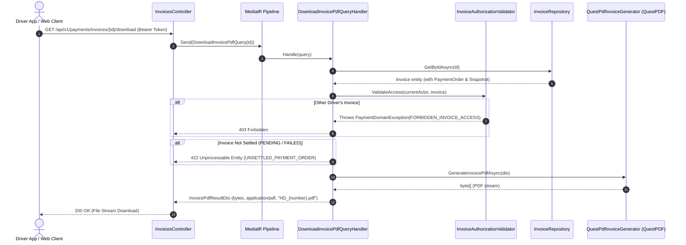

# Driver Payment History & Server-Side PDF Invoices — API Design

| Metadata | Value |
| --- | --- |
| Status | APPROVED |
| Contract version / date | v1.0 / 2026-11-10 |
| Owning service / author | PaymentService / AI Pair Programming & Teamwork Swarm |
| Jira design / implementation / verification | [SPARK-337](https://smartpark.atlassian.net/browse/SPARK-337) |
| Requirements baseline | SRS v1.1 ([FR-PAY-07](file:///d:/A-Van/Project/ojt/Mock-Project-Smart-Parking/docs/01-requirements/srs/modules/06-pricing-payments.md)), [UC-PAY-02](file:///d:/A-Van/Project/ojt/Mock-Project-Smart-Parking/docs/01-requirements/use-cases/uc-pay-02.md), [05-driver-payment-history-and-pdf-invoice.contract.md](file:///d:/A-Van/Project/ojt/Mock-Project-Smart-Parking/docs/02-architecture/api/payment-service/05-driver-payment-history-and-pdf-invoice.contract.md) |
| Implementation | Implemented & Verified in `SmartParking.PaymentService` (204/204 tests pass) |

---

## Overview

Provides authoritative driver payment and refund history inspection with multi-parameter filtering (`status`, `fromDate`, `toDate`) and server-side pagination (`pageNumber`, `pageSize`), along with replay-safe server-side PDF invoice generation and download for settled transactions using QuestPDF.

| Traceability | Reference |
| --- | --- |
| Applicable FR / BR / UC / US | FR-PAY-07, BR-PAY-03, BR-PAY-04, BR-AUTH-03, UC-PAY-02, US-D06 |
| Permission / service ownership | PaymentService owns financial invoices & PDF layout; UserService owns identity tokens |
| Approved decisions | QuestPDF (Community License, A4 Portrait, GMT+7 ICT), Replay-safe PDF, Strict 422 for unsettled invoices |

---

## API Specification

### Endpoint 1: Download Official Invoice PDF

| Item | Contract |
| --- | --- |
| Method / URL | `GET /api/v1/payments/invoices/{invoiceId}/download` |
| Availability | Implemented (PaymentService API) |
| Authentication | Bearer JWT |
| Permission / account state | `DRIVER`, `CUSTOMER`, `OPERATOR`, `ADMIN` |
| Resource scope | Own account (Drivers/Customers) or assigned tenant/system (Operators/Admins) |
| Content type | Response: `application/pdf` |
| Headers | `Authorization: Bearer <token>` |

#### Request Sample
`GET /api/v1/payments/invoices/b3e4f5a6-7c8d-4e9f-0a1b-2c3d4e5f6a7b/download`  
*State: No body.*

| Field | Location | Type / format | Required / nullable | Constraints and meaning | Example |
| :--- | :---: | :---: | :---: | :--- | :--- |
| `invoiceId` | `path` | `UUID` | Required | Unique invoice identifier | `b3e4f5a6-7c8d-4e9f-0a1b-2c3d4e5f6a7b` |

#### Response Sample (HTTP 200 OK)
* Binary PDF stream starting with `%PDF-1.4...`
* **Response Header:** `Content-Disposition: attachment; filename="HD_INV-20261110-0001.pdf"`
* **Response Header:** `Content-Type: application/pdf`

#### Validation and error responses

| HTTP status | Machine code | Trigger | Response example / schema | Client recovery |
| :---: | :--- | :--- | :--- | :--- |
| **`401`** | `UNAUTHORIZED` | Missing or invalid token | `{"success": false, "errorCode": "UNAUTHORIZED", "message": "Thiếu token..."}` | Re-authenticate. |
| **`403`** | `FORBIDDEN_INVOICE_ACCESS` | Driver requests invoice belonging to another account | `{"success": false, "errorCode": "FORBIDDEN_INVOICE_ACCESS", "message": "Bạn không có quyền..."}` | Denied; access only own invoices. |
| **`404`** | `INVOICE_NOT_FOUND` | `invoiceId` not found | `{"success": false, "errorCode": "INVOICE_NOT_FOUND", "message": "Không tìm thấy hóa đơn..."}` | Check invoice ID. |
| **`422`** | `UNSETTLED_PAYMENT_ORDER` | Invoice is in `PENDING` or `FAILED` state | `{"success": false, "errorCode": "UNSETTLED_PAYMENT_ORDER", "message": "Hóa đơn chưa hoàn tất thanh toán..."}` | Complete payment settlement first. |

---

### Endpoint 2: Get Driver Invoice & Payment History (Paged & Filtered)

| Item | Contract |
| --- | --- |
| Method / URL | `GET /api/v1/payments/invoices/my-history` |
| Availability | Implemented (PaymentService API) |
| Authentication | Bearer JWT |
| Permission / account state | `DRIVER`, `CUSTOMER` |
| Resource scope | Own account (automatically scoped to `CurrentActor.UserId`) |
| Content type | Response: `application/json` |
| Headers | `Authorization: Bearer <token>` |

#### Request Sample
`GET /api/v1/payments/invoices/my-history?status=PAID&fromDate=2026-11-01T00:00:00Z&pageNumber=1&pageSize=10`  
*State: No body.*

| Field | Location | Type / format | Required / nullable | Constraints and meaning | Example |
| :--- | :---: | :---: | :---: | :--- | :--- |
| `status` | `query` | `string` | Optional | Filter by status: `PAID`, `PENDING`, `CANCELLED`, `REFUNDED` | `PAID` |
| `fromDate` | `query` | `ISO-8601` | Optional | Filter created on or after timestamp | `2026-11-01T00:00:00Z` |
| `toDate` | `query` | `ISO-8601` | Optional | Filter created on or before timestamp | `2026-11-10T23:59:59Z` |
| `pageNumber` | `query` | `int` | Optional (default: 1) | 1-based page index ($\ge 1$) | `1` |
| `pageSize` | `query` | `int` | Optional (default: 10) | Records per page ($1 \le \text{pageSize} \le 100$) | `10` |

#### Response Sample (HTTP 200 OK)

```json
{
  "success": true,
  "data": {
    "items": [
      {
        "invoiceIdentity": {
          "invoiceId": "b3e4f5a6-7c8d-4e9f-0a1b-2c3d4e5f6a7b",
          "invoiceNumber": "INV-20261110-0001",
          "paymentOrderId": "c2d3e4f5-6a7b-8c9d-0e1f-2a3b4c5d6e7f",
          "orderCode": "ORD-20261110-001",
          "issuedAt": "2026-11-10T09:30:00Z",
          "pdfUrl": "http://localhost:5065/api/v1/payments/invoices/b3e4f5a6-7c8d-4e9f-0a1b-2c3d4e5f6a7b/download"
        },
        "customerReference": {
          "accountId": "a1b2c3d4-e5f6-7a8b-9c0d-1e2f3a4b5c6d",
          "customerType": "REGISTERED_DRIVER",
          "displayName": "Nguyễn Văn A"
        },
        "parkingSessionReference": {
          "sessionId": "e5f6a1b2-c3d4-4e5f-6a7b-8c9d0e1f2a3b",
          "referenceType": "PARKING_SESSION",
          "siteId": "f7a8b9c0-1d2e-3f4a-5b6c-7d8e9f0a1b2c",
          "siteName": "Bãi đỗ xe Landmark 81",
          "vehicleType": "CAR",
          "plateNumber": "51A-123.45"
        },
        "timing": {
          "entryTime": "2026-11-10T07:00:00Z",
          "pricingCutoffAt": "2026-11-10T09:30:00Z",
          "totalDurationMinutes": 150,
          "billableDurationMinutes": 150
        },
        "tariffPolicy": {
          "tariffId": "8a123456-5717-4562-b3fc-2c963f66afa6",
          "tariffVersion": 1,
          "policyName": "Biểu giá tiêu chuẩn Ô tô",
          "freeParkingGraceMinutes": 15
        },
        "financialSummary": {
          "subtotalParkingFee": 60000.0,
          "totalPenaltyFee": 0.0,
          "discountAmount": 0.0,
          "finalTotalAmount": 60000.0,
          "currency": "VND",
          "depositDeducted": 0.0,
          "surplusRefund": 0.0
        },
        "financialStatus": {
          "status": "PAID",
          "isSettled": true,
          "paidAt": "2026-11-10T09:31:00Z",
          "paymentMethod": "PAYOS",
          "transactionReference": "TX-1731231060",
          "gatewayTransactionId": "PAYOS-987654321"
        },
        "lineItems": [
          {
            "itemType": "DAY_HOURLY",
            "description": "Cước đỗ xe ban ngày (07:00 - 09:30)",
            "startTime": "2026-11-10T07:00:00Z",
            "endTime": "2026-11-10T09:30:00Z",
            "durationMinutes": 150,
            "coveredMinutes": 0,
            "chargeableMinutes": 150,
            "unitRate": 25000.0,
            "unit": "HOURLY_BLOCK",
            "amount": 60000.0
          }
        ],
        "pdfUrl": "http://localhost:5065/api/v1/payments/invoices/b3e4f5a6-7c8d-4e9f-0a1b-2c3d4e5f6a7b/download"
      }
    ],
    "totalCount": 1,
    "pageNumber": 1,
    "pageSize": 10,
    "totalPages": 1
  }
}
```

---

## Sequence Diagram


