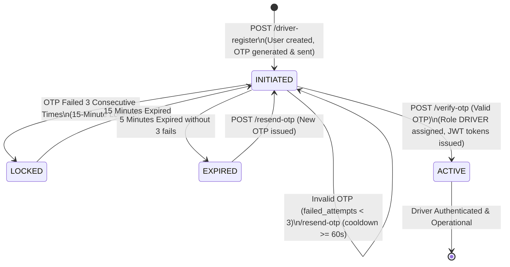
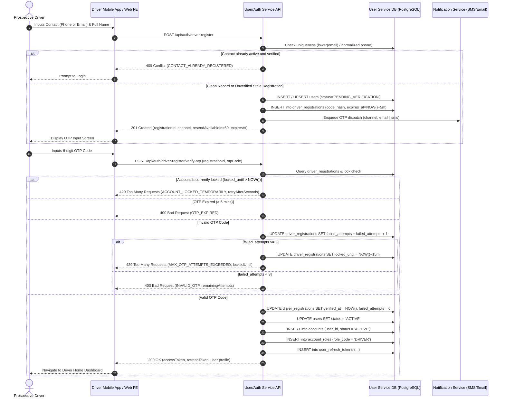

# SmartPark - Driver Register API Design Specification

**Issue ID:** SPARK-174 (Design) / SPARK-176 (BE Implementation) / SPARK-177 (FE) / SPARK-182 (Verification)  
**Sprint:** Sprint 2  
**Estimate:** 1 SP  
**Author:** Architecture Lead / Team Lead  
**Status:** Approved Specification Baseline  
**Date:** 2026-10-12  
**Target Release:** SmartPark v0.9 Baseline  

---

## 1. Overview & Business Objectives

### 1.1 Objective
This document defines the normative API design specification for **Driver Registration & Verification** (`POST /api/auth/driver-register`, `POST /api/auth/driver-register/verify-otp`, `POST /api/auth/driver-register/resend-otp`, and `GET /api/auth/driver-register/status`) for SmartPark Sprint 2. It bridges requirement specifications (SRS §3.1.1, §3.1.4, §4.3; FR-AUTH-01/02/06; FR-BAS-08; UC-AUTH-01; US-D08; BR-AUTH-01/02/03) with relational persistence models (`User Service DB` schema integration baseline `scripts/database/05.4-Driver-Registration-OTP.sql` and `scripts/database/microservices/01-user-service-db.sql`).

### 1.2 Core Scope & Business Rules
1. **Contact Identification Channel:** Driver registration initiates with either `email` OR `phone` (with optional `fullName`). The registration pipeline automatically assigns the notification channel (`email` or `sms`) based on the provided identifier.
2. **OTP Validity & Rate Limiting:**
   - OTP lifetime is strictly **5 minutes** (`expires_at = NOW() + INTERVAL '5 minutes'`).
   - OTP resend has a minimum throttling cooldown of **60 seconds** (`resend_available_at = NOW() + INTERVAL '60 seconds'`).
   - After **3 consecutive failed OTP attempts**, the account transitions to `LOCKED` status for **15 minutes** (`locked_until = NOW() + INTERVAL '15 minutes'`).
3. **Password Reconciliation (SRS OTP vs. Password Policy):**
   - Per UC-AUTH-01 baseline, initial driver onboarding is **passwordless OTP-first**.
   - Optional `password` may be submitted upon initial registration or set later via the dedicated password-management security flow (`/api/auth/password/set`).
   - If no password is provided during initial registration, `password_hash` is initialized with a secure cryptographically random placeholder hash that prevents password login until an explicit password setup flow is completed.
4. **Strict Server-Controlled Privileges:**
   - Clients cannot inject `role`, `status`, `permissions`, or `tenantId`.
   - On successful OTP verification, the system automatically assigns role `DRIVER` in `account_roles` with `accounts.status = 'ACTIVE'` and `users.status = 'ACTIVE'`.
   - Any client-submitted privilege fields are rejected or discarded via strict schema validation (`additionalProperties: false`).
5. **Session Separation (Verification vs. Authenticated Session):**
   - The initial registration endpoint returns a short-lived `verificationToken` / `registrationId` scoped strictly to the `/verify-otp` and `/resend-otp` endpoints.
   - Only upon **successful OTP verification** does the API issue the full authenticated Driver session JWT (`accessToken` + `refreshToken`).
6. **No Admin Approval Gate for Drivers:** Unlike Owner registration (which requires Admin approval), Driver registration transitions directly to operational `ACTIVE` state upon OTP verification.

---

## 2. Endpoint & Permission Matrix

| Endpoint | Method | Auth Required | Allowed Roles / States | Description |
| :--- | :---: | :---: | :--- | :--- |
| `/api/auth/driver-register` | `POST` | Anonymous | `Public` | Submits Driver registration with contact (`phone` or `email`), generates and dispatches 6-digit OTP. |
| `/api/auth/driver-register/verify-otp` | `POST` | Anonymous / Reg Token | `Public` (Pending OTP) | Validates OTP hash; activates user account, provisions Driver account & role, issues JWT session tokens. |
| `/api/auth/driver-register/resend-otp` | `POST` | Anonymous / Reg Token | `Public` (Pending OTP) | Resends OTP after 60s cooldown, subject to 15-minute lock constraints. |
| `/api/auth/driver-register/status` | `GET` | Anonymous / Reg Token | `Public` (Pending OTP) | Queries registration progress and remaining lock/retry duration without revealing sensitive tokens. |

---

## 3. State & Sequence Models

### 3.1 Driver Account & OTP Lifecycle State Diagram



### 3.2 Registration & Verification Sequence Diagram



---

## 4. Requirement ↔ Data Schema ↔ DTO Mapping

| Requirement Identifier | API DTO Field Name (camelCase) | Data Type & Nullability | Validation & Business Constraints | DB Table & Column (snake_case) | DB Column Type |
| :--- | :--- | :--- | :--- | :--- | :--- |
| **FR-AUTH-01** | `contact` (or `phone` / `email`) | `string` (Required) | Normalized RFC 5322 email OR E.164 phone. | `users.email` / `users.phone` | `VARCHAR(255)` / `VARCHAR(20)` |
| **FR-AUTH-01** | `fullName` | `string` (Optional) | Length: 2–100 characters. Default: `"Driver"`. | `users.full_name` | `VARCHAR(255) NOT NULL` |
| **FR-AUTH-01** | `password` | `string` (Optional) | Min 8 chars, uppercase, lowercase, digit, special char. | `users.password_hash` | `VARCHAR(255) NOT NULL` |
| **FR-AUTH-01** | `channel` | `enum` (Calculated/Optional) | Enum: `email`, `sms`. Auto-detected from contact format. | `driver_registrations.channel` | `VARCHAR(10) NOT NULL` |
| **BR-AUTH-01** | `registrationId` | `UUID` (System Generated) | Unique registration session tracking token. | `driver_registrations.id` | `UUID PK` |
| **BR-AUTH-02** | `otpCode` | `string` (Request input) | Exactly 6 numeric digits (`^[0-9]{6}$`). | `driver_registrations.code_hash` | `TEXT NOT NULL (BCrypt/Argon2)` |
| **BR-AUTH-02** | `expiresAt` | `ISO 8601 Timestamp` | Expiration time: strictly 5 minutes from issuance. | `driver_registrations.expires_at` | `TIMESTAMPTZ NOT NULL` |
| **BR-AUTH-02** | `resendAvailableAt` | `ISO 8601 Timestamp` | Throttling boundary: 60 seconds from issuance. | `driver_registrations.resend_available_at` | `TIMESTAMPTZ NOT NULL` |
| **BR-AUTH-02** | `failedAttempts` | `integer` (Read-only System State)| Range: 0 to 3. | `driver_registrations.failed_attempts` | `INTEGER NOT NULL DEFAULT 0` |
| **BR-AUTH-02** | `lockedUntil` | `ISO 8601 Timestamp` (Nullable) | Populated with NOW() + 15m when failed_attempts reach 3. | `driver_registrations.locked_until` | `TIMESTAMPTZ NULLABLE` |
| **FR-AUTH-02** | `roleCode` | `string` (System Assigned) | Strictly server-set to `'DRIVER'`. | `account_roles.role_code` | `VARCHAR(50) NOT NULL` |
| **FR-AUTH-02** | `status` | `enum` (System Assigned) | Initially `'PENDING_VERIFICATION'`, transitions to `'ACTIVE'`. | `users.status` | `VARCHAR(50) NOT NULL` |

---

## 5. API Technical Specifications & Contract Payloads

### 5.1 Registration Request (`POST /api/auth/driver-register`)

#### Request Headers
```http
Content-Type: application/json
X-Client-Version: 1.0.0
```

#### Request Body Schema
```json
{
  "$schema": "http://json-schema.org/draft-07/schema#",
  "type": "object",
  "required": ["contact"],
  "additionalProperties": false,
  "properties": {
    "contact": {
      "type": "string",
      "description": "Driver phone number (E.164 / local 10-digit) or valid email address",
      "example": "+84901234567"
    },
    "fullName": {
      "type": "string",
      "minLength": 2,
      "maxLength": 100,
      "example": "Nguyen Van A"
    },
    "password": {
      "type": "string",
      "minLength": 8,
      "maxLength": 64,
      "description": "Optional initial password. If omitted, account uses passwordless OTP-first authentication.",
      "example": "P@ssword2026!"
    }
  }
}
```

#### Sample Success Response (`201 Created`)
```json
{
  "success": true,
  "code": "DRIVER_REGISTRATION_OTP_SENT",
  "message": "OTP verification code sent successfully.",
  "data": {
    "registrationId": "b2c3d4e5-f6a7-8901-bcde-2345678901bc",
    "channel": "sms",
    "maskedContact": "+84****34567",
    "expiresAt": "2026-10-12T11:35:00Z",
    "resendAvailableIn": 60,
    "createdAt": "2026-10-12T11:30:00Z"
  }
}
```

---

### 5.2 OTP Verification (`POST /api/auth/driver-register/verify-otp`)

#### Request Body Schema
```json
{
  "$schema": "http://json-schema.org/draft-07/schema#",
  "type": "object",
  "required": ["registrationId", "otpCode"],
  "additionalProperties": false,
  "properties": {
    "registrationId": {
      "type": "string",
      "format": "uuid",
      "example": "b2c3d4e5-f6a7-8901-bcde-2345678901bc"
    },
    "otpCode": {
      "type": "string",
      "pattern": "^[0-9]{6}$",
      "example": "123456"
    }
  }
}
```

#### Sample Success Response (`200 OK`)
```json
{
  "success": true,
  "code": "DRIVER_REGISTRATION_VERIFIED",
  "message": "Driver account verified and activated successfully.",
  "data": {
    "user": {
      "id": "e4f5a6b7-c8d9-0123-ef01-3456789012cd",
      "fullName": "Nguyen Van A",
      "phone": "+84901234567",
      "email": null,
      "status": "ACTIVE",
      "role": "DRIVER"
    },
    "tokens": {
      "tokenType": "Bearer",
      "accessToken": "eyJhbGciOiJIUzI1NiIsInR5cCI6IkpXVCJ9...",
      "expiresIn": 3600,
      "refreshToken": "d8e9f0a1-b2c3-4567-8901-23456789abcd",
      "refreshExpiresIn": 604800
    }
  }
}
```

---

### 5.3 Resend OTP (`POST /api/auth/driver-register/resend-otp`)

#### Request Body Schema
```json
{
  "$schema": "http://json-schema.org/draft-07/schema#",
  "type": "object",
  "required": ["registrationId"],
  "additionalProperties": false,
  "properties": {
    "registrationId": {
      "type": "string",
      "format": "uuid",
      "example": "b2c3d4e5-f6a7-8901-bcde-2345678901bc"
    }
  }
}
```

#### Sample Success Response (`200 OK`)
```json
{
  "success": true,
  "code": "DRIVER_OTP_RESENT",
  "message": "A new OTP code has been dispatched.",
  "data": {
    "registrationId": "b2c3d4e5-f6a7-8901-bcde-2345678901bc",
    "channel": "sms",
    "maskedContact": "+84****34567",
    "expiresAt": "2026-10-12T11:36:15Z",
    "resendAvailableIn": 60
  }
}
```

---

### 5.4 Registration Status Lookup (`GET /api/auth/driver-register/status?registrationId={id}`)

#### Sample Success Response (`200 OK`)
```json
{
  "success": true,
  "code": "DRIVER_REGISTRATION_STATUS_RETRIEVED",
  "data": {
    "registrationId": "b2c3d4e5-f6a7-8901-bcde-2345678901bc",
    "channel": "sms",
    "maskedContact": "+84****34567",
    "isLocked": false,
    "lockRemainingSeconds": 0,
    "failedAttempts": 1,
    "maxAttemptsAllowed": 3,
    "otpExpired": false,
    "canResend": true
  }
}
```

---

## 6. Error Catalogue & Machine-Readable RFC 7807 Errors

All validation and business violations return RFC 7807 compliant error payloads:

```json
{
  "type": "https://api.smartpark.com/errors/INVALID_OTP",
  "title": "Invalid Verification Code",
  "status": 400,
  "code": "INVALID_OTP",
  "detail": "The provided 6-digit OTP code does not match. You have 2 attempts remaining.",
  "instance": "/api/auth/driver-register/verify-otp",
  "timestamp": "2026-10-12T11:32:10Z",
  "invalidParams": [
    {
      "name": "otpCode",
      "reason": "Mismatched verification code."
    }
  ]
}
```

### Complete Error Code Inventory Table

| HTTP Status | Error Code | Description / Root Cause | Actionable FE Guidance |
| :---: | :--- | :--- | :--- |
| `400` | `INVALID_CONTACT_FORMAT` | Contact is neither a valid email nor valid phone format. | Highlight contact input with format error message. |
| `400` | `INVALID_OTP` | Submitted OTP code does not match stored hash. | Show invalid code alert and display remaining attempts. |
| `400` | `OTP_EXPIRED` | OTP submitted after 5-minute validity window. | Prompt user to click "Resend OTP". |
| `400` | `INVALID_PASSWORD_COMPLEXITY` | Provided optional password does not meet security rules. | Display password rule requirements (min 8 chars, 1 upper, 1 lower, 1 digit, 1 special). |
| `409` | `CONTACT_ALREADY_REGISTERED` | Email or phone is already registered and in `ACTIVE` status. | Prompt user with "Account already exists. Please log in." |
| `429` | `OTP_RESEND_COOLDOWN` | Attempted to resend OTP before 60-second cooldown elapsed. | Disable resend button and display countdown timer. |
| `429` | `MAX_OTP_ATTEMPTS_EXCEEDED` | 3 failed OTP attempts triggered temporary 15-minute lock. | Lock input form; display countdown timer for 15 minutes. |
| `429` | `ACCOUNT_LOCKED_TEMPORARILY` | Request received while account is still within 15-min lock. | Display lockout message with remaining wait time. |
| `502` | `NOTIFICATION_DISPATCH_FAILED` | SMS gateway or Email SMTP provider returned delivery failure. | Inform user: "Delivery failed. Please try resending or choose alternative contact." |

---

## 7. Edge Cases & Concurrency Controls

### 7.1 Contact Normalization & Uniqueness
- **Email Normalization:** Cleaned of leading/trailing spaces and lowercased (`trim(lower(email))`). Matched against unique index `uq_active_user_email_normalized`.
- **Phone Normalization:** Stripped of spaces, hyphens, and brackets. Converted to E.164 canonical format (`+84...`). Matched against `uq_active_user_phone`.

### 7.2 Concurrent Registrations & Race Condition Defense
- **Database Level:** PostgreSQL `uq_active_user_phone` and `uq_active_user_email_normalized` with `WHERE deleted_at IS NULL` prevent double-insertion.
- **Handling Race Conditions:** In concurrent POST requests with the same contact, the losing thread catches PostgreSQL unique violation `23505` and returns `409 Conflict` (`CONTACT_ALREADY_REGISTERED`).
- **Unverified Resubmissions:** If a user re-submits registration before completing verification of an earlier pending attempt, the system looks up the existing pending user and regenerates `driver_registrations` with a new OTP (invalidating previous OTP), avoiding duplicate user rows.

### 7.3 Privilege Injection Mitigation
- Strict JSON Schema deserialization ensures client payloads cannot pass `role`, `status`, `account_roles`, or `tenant_id`.
- The domain service hardcodes role attachment to `'DRIVER'` and target tenant to default customer scope.

### 7.4 Notification Dispatch Failure Recovery
- If the notification provider fails to dispatch the OTP, the registration transaction is either rolled back, or marked with a recoverable delivery failure state allowing the user to trigger `/resend-otp` without needing to re-enter registration information.

---

## 8. Unresolved Decision & Conflict Log

| Issue Key | Topic | Description & Decision Context | Status |
| :--- | :--- | :--- | :--- |
| **DEC-DRV-01** | OTP vs. Password Reconciliation | **Confirmed (2026-10-06 BA Decision):** Driver registration is OTP-first. Password is fully optional during registration. If omitted, drivers authenticate via OTP or set password later. | **Resolved** |
| **DEC-DRV-02** | OTP Expiry & Lockout Thresholds | **Confirmed (SRS §3.1.1 & UC-AUTH-01):** OTP validity is strictly 5 minutes. 3 consecutive failed attempts lock the account for exactly 15 minutes. Resend cooldown is 60 seconds. | **Resolved** |
| **DEC-DRV-03** | Default Verification Channel | **Confirmed:** If phone provided -> SMS channel; if email provided -> Email channel. | **Resolved** |
| **DEC-DRV-04** | Admin Approval Requirement | **Confirmed:** Drivers do NOT require Admin approval. Activation is immediate upon successful OTP verification. | **Resolved** |

---

## 9. Verification & Acceptance Checklist

- [x] OpenAPI / REST API technical specification documented for all 4 endpoints (`driver-register`, `verify-otp`, `resend-otp`, `status`).
- [x] Endpoint Permission Matrix defined for all states and actions.
- [x] Mermaid State Diagram and Sequence Diagram embedded.
- [x] Full Traceability Table mapping SRS ↔ DB Schema (`users`, `driver_registrations`, `accounts`, `account_roles`) ↔ DTO fields.
- [x] Sample payloads for Request, Success Response, and RFC 7807 Machine-Readable Errors included.
- [x] Edge-case inventory (concurrency, rate-limiting, 3-attempt lock, 5-minute expiry, privilege injection) fully specified.
