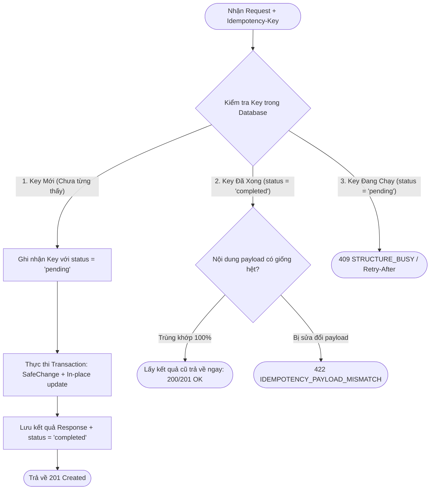

# SmartPark — Hướng Dẫn Kỹ Thuật: Cơ Chế Idempotency-Key & Tác Dụng Trong API 3D Digital Twin

| Thông tin tài liệu | Chi tiết |
| :--- | :--- |
| **Mã tài liệu** | `SPARK-DOC-IDEMPOTENCY-PM` |
| **Phiên bản** | `v1.0.0` |
| **Ngày lập** | 2026-10-24 |
| **Người lập** | Đội ngũ Kiến trúc Backend (Backend Architecture Team) |
| **Đối tượng tiếp nhận** | Project Manager (PM), Product Owner (PO), Technical Lead, QA Lead |
| **Phạm vi tính năng** | Facility structure ingestion (**SPARK-238** — US-OW01 / FR-LOT-02) — `POST /api/parking-lots/{id}/structure`. Not SPARK-228: that contract is read-only and never mutates structure. |
| **Tài liệu liên quan** | [`3d-digital-twin-api-design.md`](3d-digital-twin-api-design.md), [`3d-digital-twin-openapi.yaml`](3d-digital-twin-openapi.yaml) |

---

## 1. Tóm Tắt Nhanh Dành Cho Quản Trị Dự Án (TL;DR for PM)

* **Idempotency-Key (Khóa lũy đẳng)** là một mã định danh duy nhất (chuẩn UUID v4, đóng vai trò như **Mã giao dịch / Transaction Reference ID**) do phía Frontend tự sinh và gắn vào HTTP Header của mỗi lần người dùng bấm nút thực hiện tác vụ quan trọng.
* **Bài toán nó giải quyết:** Ngăn chặn việc nhân đôi dữ liệu, kẹt giao dịch hoặc phát sinh lỗi vô lý khi **người dùng click đúp (Double-Click)** hoặc khi **mạng chập chờn / rớt mạng giữa chừng (Network Timeout & Retry)**.
* **Quy tắc cốt lõi:** Bất kể mạng lag khiến lệnh gửi lại 1 lần, 5 lần hay 10 lần, hệ thống Backend **chỉ xử lý nghiệp vụ ghi Database đúng 1 lần duy nhất**, các lần gửi sau lập tức trả về kết quả thành công trước đó trong $< 10\text{ms}$.
* **Hiện trạng dự án:** Cơ sở dữ liệu của SmartPark **đã có sẵn bảng lưu trữ `structure_operations`**, việc kích hoạt cơ chế này hoàn toàn khả thi ngay mà không cần phát sinh chi phí hạ tầng mới.

---

## 2. Vấn Đề Nghiệp Vụ: Rủi Ro Khi KHÔNG Có Idempotency-Key

Trong tính năng **3D Digital Twin**, khi Chủ bãi xe (Owner) bấm **"Lưu sơ đồ bãi đỗ 3D"** (từ 50 đến 200 ô đỗ), hệ thống phải thực hiện một chuỗi thao tác nặng và có rủi ro cao:
1. Giao tiếp liên dịch vụ: Gọi sang `ReservationService` để xin khóa tạm thời (*Edit Hold*).
2. Khóa dòng bãi đỗ trong PostgreSQL (`SELECT ... FOR UPDATE`).
3. Kiểm tra tính an toàn (*SafeChange Invariant*): Xác minh không có xe đậu và không có đơn đặt chỗ trước.
4. Cập nhật hàng trăm dòng dữ liệu trong bảng `parking_slots` và `spatial_units`.

### Kịch bản rủi ro điển hình ngoài thực tế (Network Timeout):

```text
[Trình duyệt Web (FE)]                                      [Hệ thống Backend (BE)]
          │                                                            │
          │──── 1. Gửi lệnh Lưu sơ đồ 3D ─────────────────────────────>│
          │                                                            │ 2. Backend xử lý xong xuôi:
          │                                                            │    - Cập nhật 200 slot vào DB
          │                                                            │    - Trừ quota / tạo audit log
          │                                                            │    - Commit Database thành công!
          │                                                            │
          │     X X X SỰ CỐ MẠNG: Response bị thất lạc X X X           │
          │<─── [Không nhận được phản hồi HTTP 201 Created] ───────────│
          │
3. Trình duyệt báo lỗi "Network Timeout".
   Chủ bãi xe tưởng chưa lưu được nên BẤM LƯU LẠI (Retry lần 2)!
          │
          │──── 4. Gửi lại chính xác lệnh Lưu sơ đồ lần 2 ────────────>│
          │                                                            │ 5. HỆ THỐNG GẶP XUNG ĐỘT:
          │                                                            │    Backend coi đây là lệnh mới.
          │<─── BÁO LỖI: "409 Conflict: Cấu trúc bãi xe đang bị kẹt!" ─│    SafeChange thấy 200 slot
                                                                            đã có sẵn ở lần 1 nên từ chối!
```

### Hậu quả tiêu cực đối với Sản phẩm:
* **Trải nghiệm khách hàng cực xấu (Poor UX):** Người dùng rõ ràng thao tác đúng nhưng bị báo lỗi đỏ gây hoang mang, nghi ngờ chất lượng phần mềm.
* **Gia tăng Ticket khiếu nại (Support Overhead):** Khách hàng sẽ gọi điện hoặc tạo ticket phản ánh: *"Tôi sửa bãi xe bị đơ, bấm lại thì hệ thống bảo bãi xe bị lỗi xung đột"*.
* **Rủi ro kẹt tài nguyên (Resource Leak):** Phiên chỉnh sửa của bãi đỗ có thể bị treo ở trạng thái dở dang, cản trở việc tài xế vào đặt chỗ.

---

## 3. Cơ Chế Hoạt Động Của Idempotency-Key

Mỗi khi người dùng bấm nút "Lưu sơ đồ", ứng dụng Frontend (React) tự động sinh một mã ngẫu nhiên duy nhất (UUID v4) và truyền kèm trong HTTP Header:

```http
POST /api/parking-lots/f7d3a2b1-5e8c-4a3d-9f1e-2c8b7a6d5e4f/structure HTTP/1.1
Host: api.smartpark.example.com
Authorization: Bearer <Owner_JWT_Token>
Idempotency-Key: e7a1c2d3-4e5f-6a7b-8c9d-0e1f2a3b4c5d
Content-Type: application/json

{
  "archetype": "OUTDOOR",
  "modelFileName": "outdoor_parking_lot_blender.glb",
  "floors": [ ... ],
  "slots": [ ... ],
  "motorcycleCapacity": { "maxCapacity": 30 }
}
```

### Sơ đồ quy trình xử lý thông minh tại Backend:



### 4 Kịch bản xử lý cụ thể:

1. **Lần đầu gửi (First Execution):**
   * Backend nhận Key mới $\rightarrow$ ghi nhận vào bảng quản lý trạng thái với `status = 'pending'`.
   * Thực hiện nạp 200 slot và commit Database.
   * Cập nhật `status = 'completed'` và lưu trữ bản sao kết quả (Outcome DTO).
   * Trả về HTTP `201 Created` cho người dùng.
2. **Gửi lại an toàn khi rớt mạng (Safe Retry):**
   * Nếu người dùng bấm lưu lại do mạng lag (cùng `Idempotency-Key`, cùng dữ liệu).
   * Backend tra DB thấy Key này đã xử lý thành công (`completed`).
   * **Backend KHÔNG ghi Database lần nào nữa.**
   * Backend lập tức lấy kết quả lưu trong cache/DB trả về ngay lập tức ($< 10\text{ms}$).
   * $\implies$ Phía người dùng hiển thị thông báo **"Lưu thành công!"** mượt mà, không sinh slot trùng lặp.
3. **Ngăn chặn click dồn dập (Double-Click Protection):**
   * Người dùng nhấn chuột liên tục 2 lần trong vòng $0.1$ giây.
   * Lệnh thứ nhất đang xử lý (`status = 'pending'`).
   * Lệnh thứ hai bay vào thấy ngay `pending` $\implies$ Backend trả về HTTP `409 Conflict` (hoặc `202 Accepted` kèm `Retry-After: 2`), loại bỏ hoàn toàn nguy cơ 2 luồng ghi đè dữ liệu lên nhau (*Race Condition*).
4. **Phát hiện sửa đổi dữ liệu bất thường (Payload Tampering Check):**
   * Nếu Client dùng lại Key cũ nhưng sửa đổi nội dung (ví dụ: đổi từ 48 slot thành 50 slot).
   * Backend băm (hash) SHA-256 nội dung và phát hiện không trùng khớp với lần trước.
   * Backend từ chối ngay lập tức với HTTP `422 Unprocessable Content` (`IDEMPOTENCY_PAYLOAD_MISMATCH`).

---

## 4. Tác Dụng Trực Tiếp Trong Dự Án SmartPark

| Khía cạnh | Tác dụng cụ thể | Lợi ích đối với Dự án / Sản phẩm |
| :--- | :--- | :--- |
| **Bảo vệ toàn vẹn quy tắc SafeChange** | SafeChange chỉ cho phép thay đổi khi bãi trống hoàn toàn. Idempotency giúp việc retry không bao giờ bị hiểu nhầm là "sửa đổi đè lên bãi đang có dữ liệu". | Đảm bảo tính nhất quán tuyệt đối của dữ liệu ô đỗ và trạng thái đặt chỗ. |
| **Đồng bộ liên Service (Cross-Service Hold)** | API nạp sơ đồ cần xin *Edit Hold* từ `ReservationService`. Nhờ Idempotency-Key, hệ thống tránh được tình trạng giữ lock 2 lần gây tắc nghẽn dịch vụ đặt chỗ của tài xế. | Giữ vững thông lượng (Throughput) đặt chỗ cho toàn bộ ứng dụng mobile của Driver. |
| **Tối ưu hóa hiệu năng Database** | Khi retry, hệ thống không phải chạy lại giao dịch phức tạp (tính toán tải, phân bổ tầng, xóa/insert 200 dòng), mà trả về kết quả trong vài mili-giây. | Giảm tải áp lực lên máy chủ PostgreSQL. |
| **Bảo toàn định danh ô đỗ (Stable Identity)** | Tránh tình trạng người dùng bấm 2 lần sinh ra các UUID mới cho cùng một ô đỗ trên mô hình 3D. | Đảm bảo liên kết ổn định giữa mô hình 3D (Blender/Three.js) và Backend. |

---

## 5. Bằng Chứng Codebase Hiện Tại (Không Tốn Thêm Chi Phí Hạ Tầng)

Một điểm rất thuận lợi cho dự án: **Cơ chế này đã được chuẩn bị sẵn trong Database của SmartPark**.

Tại tệp [`02-facility-service-db.sql` (Dòng 124–138)](../../../scripts/database/microservices/02-facility-service-db.sql#L124-L138):

```sql
CREATE TABLE structure_operations (
    id UUID PRIMARY KEY DEFAULT uuid_generate_v4(),
    site_id UUID NOT NULL REFERENCES parking_sites(id) ON DELETE RESTRICT,
    tenant_id UUID NOT NULL,
    actor_id UUID NOT NULL,
    idempotency_key UUID NOT NULL,       -- << Lưu chính Idempotency-Key từ Client
    request JSONB NOT NULL,              -- << Lưu toàn bộ payload JSON để kiểm tra tính toàn vẹn
    status TEXT NOT NULL CHECK(status IN ('pending','failed','completed')),
    physical_committed BOOLEAN NOT NULL DEFAULT FALSE,
    impact JSONB,
    reason TEXT,
    created_at TIMESTAMPTZ NOT NULL DEFAULT CURRENT_TIMESTAMP,
    updated_at TIMESTAMPTZ NOT NULL DEFAULT CURRENT_TIMESTAMP,
    UNIQUE(site_id, idempotency_key)     -- << Ràng buộc duy nhất: Mỗi bãi đỗ chỉ có 1 key tại 1 thời điểm
);
```

> [!TIP]
> **Nhận xét chuyên môn:**  
> Đội ngũ phát triển Backend không cần phải xin cấp thêm cụm Redis, không cần cài đặt thư viện bên ngoài phức tạp. Việc triển khai chỉ đơn thuần là kết nối API Endpoint vào bảng `structure_operations` đã được thiết kế sẵn.

---

## 6. Trách Nhiệm Của Các Đội Ngũ (RACI Matrix)

* **Frontend Team (Web):**
  * Mỗi khi người dùng mở form "Sửa sơ đồ bãi đỗ" hoặc bấm "Lưu", sinh một mã `crypto.randomUUID()` duy nhất.
  * Truyền mã này vào HTTP Header `Idempotency-Key`.
  * Nếu gặp lỗi mạng (Network Error / Timeout), tự tin kích hoạt cơ chế retry tự động với **chính xác Key đó**.
* **Backend Team:**
  * Tiếp nhận Header, tra cứu trong bảng `structure_operations`.
  * Trả về kết quả cached nếu key đã hoàn tất, hoặc từ chối nếu phát hiện xung đột (`409` / `422`).
* **QA / QC Team:**
  * Bổ sung kịch bản kiểm thử: Bấm nút lưu 2 lần liên tiếp, ngắt mạng khi đang lưu và bấm gửi lại để xác nhận không bị sinh trùng ô đỗ.

---

## 7. Kết Luận Dành Cho PM

Cơ chế **`Idempotency-Key`** là tiêu chuẩn bắt buộc của các hệ thống phần mềm chuyên nghiệp cấp doanh nghiệp (tương tự chuẩn của Stripe, AWS, PayPal). Việc áp dụng cơ chế này trong tính năng **3D Digital Twin** sẽ:
1. Đảm bảo trải nghiệm Chủ bãi xe mượt mà, không gặp lỗi vô lý.
2. Bảo vệ dữ liệu bãi đỗ không bị sai lệch, rác database.
3. Không làm tăng thời gian (timeline) dự án vì cơ sở dữ liệu đã hỗ trợ 100%.
