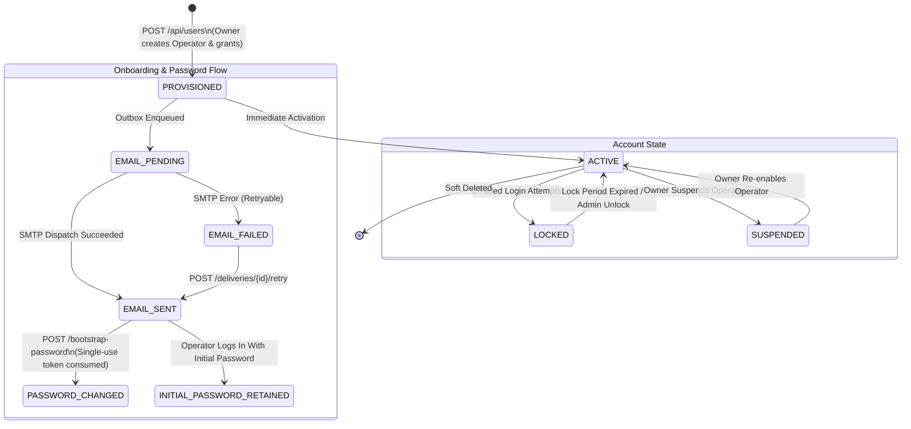
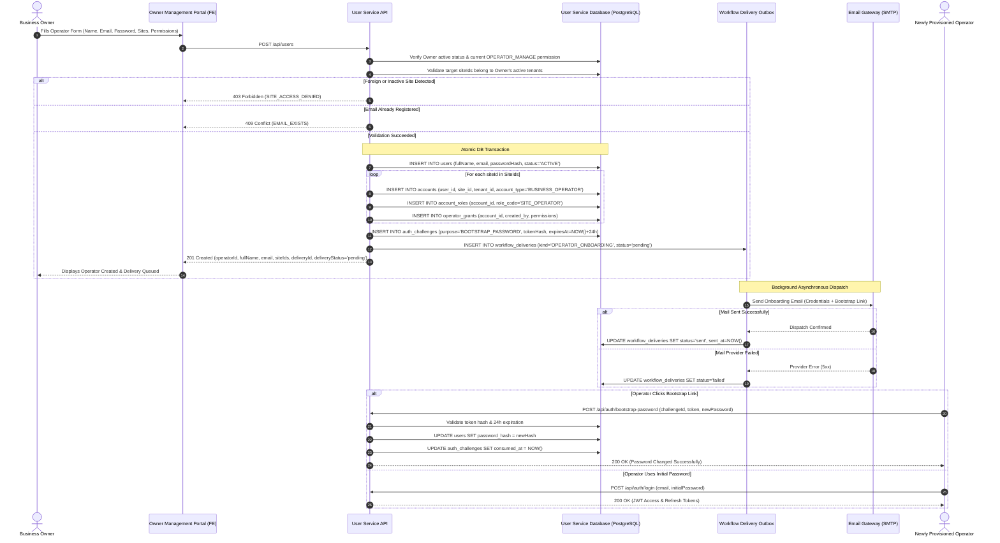

# SmartPark - Owner Create Operator Account API Design Specification

**Issue ID:** SPARK-192 (BE Implementation) · SPARK-191 (FE Integration) · SPARK-193 (API Testing & UAT) · SPARK-202 (Permission Matrix)  
**Sprint:** Sprint 2  
**Estimate:** 1 SP  
**Author:** Architecture Lead / Team Lead  
**Status:** Approved Specification Baseline  
**Date:** 2026-10-13  
**Target Release:** SmartPark v0.9 Baseline  

---

## 1. Overview & Business Objectives

### 1.1 Objective
This document defines the normative API design contract for **Owner Creating Operator Account** (`POST /api/users`, `GET /api/operators`, `GET /api/operators/me`, `GET /api/operators/slot-scope`, `POST /api/auth/bootstrap-password`, and `GET/POST /api/auth/deliveries/*`) for SmartPark Sprint 2. It bridges requirement specifications (SRS §3.7.5, §2.3.1, §3.1.4; FR-AUTH-04/06; UC-AUTH-03; US-OW03; BR-AUTH-01/02/03) with the PostgreSQL persistence layer (`users`, `accounts`, `account_roles`, `operator_grants`, `auth_challenges`, `workflow_deliveries`) defined in `scripts/database/05.1-Database-Scripts.sql`, `05.7-Operator-Provisioning.sql`, and `05.8-Account-Workflow-Vehicles.sql`.

### 1.2 Core Scope & Business Rules

1. **Closed Provisioning Workflow:**
   - Operator accounts are created strictly by an authorized Business Owner (`role = 'owner'`, with active `OPERATOR_MANAGE` permission).
   - Operator self-registration and public approval queues are **strictly excluded**.
   - Foreign Owners cannot create, view, or manage Operators across tenant boundaries.

2. **Ownership & Lot Grant Boundaries:**
   - At creation time, the Owner assigns one or more owned lots (`siteIds`: 1–100 distinct UUIDs).
   - Every target site must exist, be active (`is_active = true`, `deleted_at IS NULL`), and belong to an active tenant where the caller holds an active `BUSINESS_OWNER` account. Any foreign, nonexistent, or inactive site causes the entire transaction to abort with `403 Forbidden` (`SITE_ACCESS_DENIED`).
   - The system creates **one `BUSINESS_OPERATOR` account per assigned site** (`accounts.site_id = siteId`, `accounts.tenant_id = tenantId`), assigning the role `SITE_OPERATOR` in `account_roles`.

3. **Delegable Permission Allowlist:**
   - Owners can only delegate a strictly bounded set of lot-scoped operational permissions (`permissions`: 1–5 distinct values):
     - `DEVICE_MANAGE`: Configure and maintain gate barriers, LPR cameras, and IoT sensors.
     - `DEVICE_STATUS_VIEW`: View device operational telemetry and health status.
     - `CASH_COLLECT`: Collect manual walk-in parking fees and handle cash registers.
     - `APPEAL_REVIEW`: Review driver entry/exit penalty appeals and ticket disputes.
     - `SLOT_OVERRIDE`: Flag physical slots as emergency operational backup (`BACKUP`) or manual maintenance.
   - Arbitrary administrative, financial (tariffs, refunds, bank accounts), or lot layout management powers **cannot** be delegated. Any unauthorized permission string is rejected with `400 Bad Request`.

4. **Credential Provisioning & Password Bootstrap Workflow:**
   - The Owner provides an initial secure password meeting the system password complexity policy (8–15 characters, uppercase, lowercase, digit, special character).
   - Passwords, plaintext credentials, and hashes are **never returned** in API responses.
   - An onboarding notification email is enqueued in `workflow_deliveries` (`kind = 'OPERATOR_ONBOARDING'`).
   - The onboarding email contains:
     1. The initial login credentials (email and initial password communicated securely).
     2. A dedicated password bootstrap link containing a single-use token (`challengeId` and secret token).
   - **Optional First-Login Password Change:** The Operator may use the link to set a new password via `POST /api/auth/bootstrap-password`. If left unchanged, the Operator logs in normally with the Owner-supplied initial password. First-login password change is **NOT mandatory**.

5. **Token Security, Validity & Anti-Replay Rules:**
   - The bootstrap password token is separate from OTP logic:
     - Validity: **Strictly 24 hours** (`expires_at = NOW() + INTERVAL '24 hours'`).
     - Token Storage: Cryptographically hashed via SHA-256 (`auth_challenges.code_hash`).
     - Single-Use: Consumed immediately upon successful password update (`consumed_at = NOW()`). Replay attempts are rejected with `401 Unauthorized` (`INVALID_CHALLENGE`).
     - Session Revocation: Changing the password immediately revokes all prior active sessions for that account.

6. **Independent Delivery Outbox & Idempotent Retry:**
   - Notification delivery is tracked independently via `workflow_deliveries`.
   - If the SMTP/email provider fails, the Operator account creation **remains committed** (`deliveryStatus = 'failed'`).
   - The Owner can query delivery status (`GET /api/auth/deliveries/{id}`) and trigger a retry (`POST /api/auth/deliveries/{id}/retry`) without creating duplicate accounts or duplicate lot grants.

7. **Separation of Concerns:**
   - Later modifications to an Operator's site assignments or permissions (suspension, revocation, adding lots) are a separate follow-up feature domain and must not be folded into the creation contract.

---

## 2. Endpoint & Permission Matrix

| Endpoint | Method | Required Role | Required Permission / Scope | Description |
| :--- | :---: | :---: | :--- | :--- |
| `/api/users` | `POST` | `owner` | `OPERATOR_MANAGE` (Owned Tenant) | Creates an Operator identity, site accounts, and grants; dispatches onboarding email. |
| `/api/operators` | `GET` | `owner` | `OPERATOR_MANAGE` (Owned Tenant) | Lists all Operator accounts provisioned by the authenticated Owner. |
| `/api/operators/me` | `GET` | `operator` | Self (Authenticated Operator) | Returns current active site assignments and delegated permissions for the caller. |
| `/api/operators/slot-scope` | `GET` | `operator` | `SLOT_OVERRIDE` (Target Site) | Validates caller's slot override authority on a target site (internal service adapter). |
| `/api/auth/bootstrap-password` | `POST` | Anonymous | Valid Bootstrap Challenge Token | Allows an Operator to set a new password using the 24-hour single-use onboarding link. |
| `/api/auth/deliveries/{id}` | `GET` | `owner` / `admin`| Original Actor or Action Permission | Inspects the delivery status of an onboarding email without revealing payload secrets. |
| `/api/auth/deliveries/{id}/retry` | `POST` | `owner` / `admin`| Original Actor or Action Permission | Retries a failed onboarding email delivery without duplicating account rows. |

---

## 3. State & Sequence Models

### 3.1 Operator Account & Onboarding Lifecycle State Diagram



### 3.2 Operator Provisioning Sequence Diagram



---

## 4. Requirement ↔ Data Schema ↔ DTO Field Mapping

| Requirement Identifier | API DTO Field Name (camelCase) | Data Type & Nullability | Validation & Business Constraints | DB Table & Column (snake_case) | DB Column Type |
| :--- | :--- | :--- | :--- | :--- | :--- |
| **FR-AUTH-04** | `fullName` | `string` (Required) | Length 1–255 characters. Trimmed. | `users.full_name` | `VARCHAR(255) NOT NULL` |
| **FR-AUTH-04** | `email` | `string` (Required) | RFC 5322 format. Lowercase normalized. Unique across active users. | `users.email` | `VARCHAR(255) UNIQUE` |
| **FR-AUTH-04** | `password` | `string` (Required) | Length 8–15 chars. 1 uppercase, 1 lowercase, 1 digit, 1 special char. | `users.password_hash` | `VARCHAR(255) NOT NULL` |
| **FR-AUTH-04** | `siteIds` | `UUID[]` (Required) | 1–100 distinct non-empty UUIDs. Owned by caller. | `accounts.site_id` | `UUID NOT NULL` |
| **FR-AUTH-04** | `permissions` | `string[]` (Required) | 1–5 distinct values from allowlist (`DEVICE_MANAGE`, `DEVICE_STATUS_VIEW`, `CASH_COLLECT`, `APPEAL_REVIEW`, `SLOT_OVERRIDE`). | `operator_grants.permissions` | `TEXT[] NOT NULL` |
| **BR-AUTH-01** | `id` / `operatorId` | `UUID` (System Generated) | Unique Operator identity ID. | `users.id` | `UUID PK` |
| **BR-AUTH-01** | `role` | `string` (System Assigned) | Strictly server-assigned to `'operator'`. | `account_roles.role_code` | `VARCHAR(50) NOT NULL` |
| **BR-AUTH-01** | `status` | `string` (System Assigned) | Initial state: `'active'`. | `users.status` | `VARCHAR(50) NOT NULL` |
| **BR-AUTH-01** | `createdBy` | `UUID` (System Assigned) | Authenticated Owner user ID. | `operator_grants.created_by` | `UUID NOT NULL` |
| **BR-AUTH-02** | `deliveryId` | `UUID` (System Generated) | Unique tracking key for onboarding email. | `workflow_deliveries.id` | `UUID PK` |
| **BR-AUTH-02** | `deliveryStatus` | `enum` (Read-only System) | Enum: `'pending'`, `'sent'`, `'failed'`, `'cancelled'`. | `workflow_deliveries.status` | `TEXT NOT NULL` |
| **BR-AUTH-02** | `challengeId` | `UUID` (System Generated) | Primary key for password bootstrap token. | `auth_challenges.id` | `UUID PK` |
| **BR-AUTH-02** | `token` | `string` (Transport Secret) | Cryptographic hex/base64 secret string (min 32 bytes). | `auth_challenges.code_hash` | `TEXT NOT NULL (SHA-256)` |
| **BR-AUTH-02** | `expiresAt` | `ISO 8601 Timestamp` | Token validity: strictly 24 hours. | `auth_challenges.expires_at` | `TIMESTAMPTZ NOT NULL` |

---

## 5. API Technical Specifications & Contract Payloads

### 5.1 Create Operator Account (`POST /api/users`)

#### Request Headers
```http
Authorization: Bearer <owner_jwt_token>
Content-Type: application/json
```

#### Request Body Schema
```json
{
  "$schema": "http://json-schema.org/draft-07/schema#",
  "type": "object",
  "required": ["fullName", "email", "password", "siteIds", "permissions"],
  "additionalProperties": false,
  "properties": {
    "fullName": {
      "type": "string",
      "minLength": 1,
      "maxLength": 255,
      "example": "Nguyen Van Binh"
    },
    "email": {
      "type": "string",
      "format": "email",
      "maxLength": 255,
      "example": "attendant.binh@saigonparking.com"
    },
    "password": {
      "type": "string",
      "minLength": 8,
      "maxLength": 15,
      "pattern": "^(?=.*[a-z])(?=.*[A-Z])(?=.*[0-9])(?=.*[^A-Za-z0-9]).+$",
      "example": "P@ssword2026!"
    },
    "siteIds": {
      "type": "array",
      "minItems": 1,
      "maxItems": 100,
      "uniqueItems": true,
      "items": {
        "type": "string",
        "format": "uuid"
      },
      "example": ["c1a2b3c4-d5e6-7890-abcd-111122223333"]
    },
    "permissions": {
      "type": "array",
      "minItems": 1,
      "maxItems": 5,
      "uniqueItems": true,
      "items": {
        "type": "string",
        "enum": ["DEVICE_MANAGE", "DEVICE_STATUS_VIEW", "CASH_COLLECT", "APPEAL_REVIEW", "SLOT_OVERRIDE"]
      },
      "example": ["DEVICE_STATUS_VIEW", "SLOT_OVERRIDE"]
    }
  }
}
```

#### Sample Success Response (`201 Created`)
```json
{
  "success": true,
  "data": {
    "id": "e3f4a5b6-c7d8-9012-3456-7890abcdef12",
    "fullName": "Nguyen Van Binh",
    "email": "attendant.binh@saigonparking.com",
    "role": "operator",
    "status": "active",
    "createdBy": "a1b2c3d4-e5f6-7890-abcd-1234567890ab",
    "siteIds": [
      "c1a2b3c4-d5e6-7890-abcd-111122223333"
    ],
    "permissions": [
      "DEVICE_STATUS_VIEW",
      "SLOT_OVERRIDE"
    ],
    "deliveryId": "f4a5b6c7-d8e9-0123-4567-890abcdef123",
    "deliveryStatus": "pending"
  }
}
```

---

### 5.2 List Operators Created by Owner (`GET /api/operators`)

#### Request Headers
```http
Authorization: Bearer <owner_jwt_token>
```

#### Sample Success Response (`200 OK`)
```json
{
  "success": true,
  "data": [
    {
      "id": "e3f4a5b6-c7d8-9012-3456-7890abcdef12",
      "fullName": "Nguyen Van Binh",
      "email": "attendant.binh@saigonparking.com",
      "role": "operator",
      "status": "active",
      "createdBy": "a1b2c3d4-e5f6-7890-abcd-1234567890ab",
      "siteIds": [
        "c1a2b3c4-d5e6-7890-abcd-111122223333"
      ],
      "permissions": [
        "DEVICE_STATUS_VIEW",
        "SLOT_OVERRIDE"
      ],
      "deliveryId": "f4a5b6c7-d8e9-0123-4567-890abcdef123",
      "deliveryStatus": "sent"
    }
  ]
}
```

---

### 5.3 Operator Current Site Assignments (`GET /api/operators/me`)

#### Request Headers
```http
Authorization: Bearer <operator_jwt_token>
```

#### Sample Success Response (`200 OK`)
```json
{
  "success": true,
  "data": [
    {
      "siteId": "c1a2b3c4-d5e6-7890-abcd-111122223333",
      "tenantId": "f0000000-0000-0000-0000-000000000001",
      "permissions": [
        "DEVICE_STATUS_VIEW",
        "SLOT_OVERRIDE"
      ]
    }
  ]
}
```

---

### 5.4 Operator Slot Override Scope Lookup (`GET /api/operators/slot-scope?siteId={id}`)

Used by the Parking Service HTTP adapter to verify that an Operator caller has `SLOT_OVERRIDE` authority on the target site.

#### Query Parameters
- `siteId` (`UUID`, Required): Target parking site ID.

#### Sample Success Response (`200 OK`)
```json
{
  "userId": "e3f4a5b6-c7d8-9012-3456-7890abcdef12",
  "tenantIds": [
    "f0000000-0000-0000-0000-000000000001"
  ]
}
```

---

### 5.5 Optional Bootstrap Password Change (`POST /api/auth/bootstrap-password`)

Executed anonymously by an Operator clicking the onboarding email link.

#### Request Body Schema
```json
{
  "$schema": "http://json-schema.org/draft-07/schema#",
  "type": "object",
  "required": ["challengeId", "token", "password"],
  "additionalProperties": false,
  "properties": {
    "challengeId": {
      "type": "string",
      "format": "uuid",
      "example": "98765432-10ab-cdef-0123-456789abcdef"
    },
    "token": {
      "type": "string",
      "minLength": 32,
      "example": "d4e5f6a7b8c9d0e1f2a3b4c5d6e7f8a9b0c1d2e3f4a5b6c7d8e9f0a1b2c3d4e5"
    },
    "password": {
      "type": "string",
      "minLength": 8,
      "maxLength": 15,
      "pattern": "^(?=.*[a-z])(?=.*[A-Z])(?=.*[0-9])(?=.*[^A-Za-z0-9]).+$",
      "example": "MyNewSecret@2026"
    }
  }
}
```

#### Sample Success Response (`200 OK`)
```json
{
  "success": true
}
```

---

### 5.6 Delivery Status Lookup & Retry (`GET / POST /api/auth/deliveries/{id}`)

#### GET `/api/auth/deliveries/{id}`
Returns delivery metadata without exposing email text, passwords, or tokens.

```json
{
  "success": true,
  "data": {
    "id": "f4a5b6c7-d8e9-0123-4567-890abcdef123",
    "kind": "OPERATOR_ONBOARDING",
    "status": "failed",
    "attempts": 3,
    "createdAt": "2026-10-13T10:00:00Z",
    "retryAt": "2026-10-13T10:15:00Z",
    "expiresAt": "2026-10-14T10:00:00Z"
  }
}
```

#### POST `/api/auth/deliveries/{id}/retry`
Triggers an immediate delivery attempt for a failed notification.

```json
{
  "success": true,
  "data": {
    "id": "f4a5b6c7-d8e9-0123-4567-890abcdef123",
    "status": "pending",
    "attempts": 4
  }
}
```

---

## 6. Error Catalogue & RFC 7807 Machine-Readable Errors

All error responses strictly adhere to the SmartPark RFC 7807 standard:

```json
{
  "type": "https://api.smartpark.com/errors/SITE_ACCESS_DENIED",
  "title": "Site Access Denied",
  "status": 403,
  "code": "SITE_ACCESS_DENIED",
  "detail": "One or more requested parking sites do not belong to the caller's active tenant or are inactive.",
  "instance": "/api/users",
  "timestamp": "2026-10-13T10:00:00Z",
  "invalidParams": [
    {
      "name": "siteIds",
      "reason": "Site ID c1a2b3c4-d5e6-7890-abcd-999999999999 is outside your authorized tenant scope."
    }
  ]
}
```

### Complete Error Code Inventory Table

| HTTP Status | Error Code | Description / Root Cause | Actionable FE Guidance |
| :---: | :--- | :--- | :--- |
| `400` | `VALIDATION_FAILED` | Missing fields, malformed email, or password complexity violation. | Highlight invalid input fields inline. |
| `400` | `INVALID_PERMISSIONS` | Submitted permissions contain unapproved strings or duplicates. | Display allowed permission checkboxes. |
| `401` | `UNAUTHENTICATED` | Missing, expired, or malformed Owner JWT token. | Redirect caller to Login screen. |
| `401` | `INVALID_CHALLENGE` | Bootstrap password token expired (>24h), already consumed, or invalid. | Display "This password setup link is expired or invalid. Please contact your manager." |
| `403` | `FORBIDDEN` | Caller lacks `owner` role or `OPERATOR_MANAGE` permission. | Display unauthorized action alert banner. |
| `403` | `SITE_ACCESS_DENIED` | One or more `siteIds` are inactive, deleted, or belong to another Owner. | Highlight unowned sites and prevent form submission. |
| `409` | `EMAIL_EXISTS` | An active account with the provided email already exists. | Show "An account with this email already exists." |
| `429` | `RATE_LIMIT_EXCEEDED` | Exceeded 10 requests/minute on bootstrap password endpoint. | Show rate limit warning and wait timer. |
| `502` | `NOTIFICATION_SERVICE_ERROR`| SMTP or notification provider failed during immediate dispatch. | Display: "Operator account created, but email delivery failed. Click Retry Delivery." |

---

## 7. Edge Cases & Concurrency Controls

### 7.1 Cross-Tenant Isolation & Ownership Validation
- **Server Authority:** The API extracts the caller's user identity from the validated JWT token (`sub` claim). Request bodies **cannot** supply `ownerId`, `tenantId`, `role`, or `status`.
- **Site Ownership Verification:** In a single database check, the server validates:
  $$\forall s \in \text{siteIds}: \exists t \in \text{tenants}: s.\text{tenant\_id} = t.\text{id} \land \text{IsOwnerOf}(t.\text{id}, \text{callerUserId})$$
  If any site fails this condition, the request is aborted immediately with `403 Forbidden` (`SITE_ACCESS_DENIED`).

### 7.2 Concurrency & Race Condition Defense
- **Concurrent Duplicate Email Submission:**
  - Database enforcement: PostgreSQL unique index `uq_active_user_email_normalized` on `lower(email)` with `WHERE deleted_at IS NULL`.
  - When concurrent threads attempt to create an Operator with the same email, the losing thread catches PostgreSQL error `23505` (`unique_violation`) and returns `409 Conflict` (`EMAIL_EXISTS`).
- **Atomic Multi-Table Transaction:** The Operator user row, multiple `accounts` rows, multiple `account_roles` rows, and multiple `operator_grants` rows are committed in **one atomic database transaction**. If any step fails, the entire transaction rolls back cleanly, leaving zero orphaned accounts or partial grants.

### 7.3 Bootstrap Link Anti-Replay & Session Revocation
- **Single-Use Enforcement:** When `POST /api/auth/bootstrap-password` succeeds, `consumed_at` is set to `NOW()`. Any subsequent submission with the same `challengeId` finds `consumed_at IS NOT NULL` and is rejected with `401 Unauthorized` (`INVALID_CHALLENGE`).
- **Token Invalidation on Revocation:** If an Owner locks, suspends, or deletes the Operator account before the bootstrap link is clicked, the challenge resolution query rejects the attempt because `users.status != 'ACTIVE'`.

### 7.4 Safe Logging & Secret Sanitization
- Passwords (both initial and changed) are never written to application logs, audit tables, or HTTP responses.
- Bootstrap challenge secret tokens are stored as SHA-256 hashes in `auth_challenges.code_hash`. The raw secret exists only in the generated URL sent to the email recipient.

---

## 8. Unresolved Decision & Conflict Log

| Issue Key | Topic | Description & Decision Context | Status |
| :--- | :--- | :--- | :--- |
| **DEC-OPR-01** | Mandatory First-Login Password Change | **Confirmed (2026-10-06 Team Lead Decision):** Password change is **optional**. Operator can log in with initial credentials or changed password. Mandatory change is deferred to future enterprise policies. | **Resolved** |
| **DEC-OPR-02** | Bootstrap Token Expiry Duration | **Confirmed Architecture:** Token expires in **24 hours** (`expires_at = NOW() + INTERVAL '24 hours'`). Does not borrow short-lived 5-minute OTP expiry. | **Resolved** |
| **DEC-OPR-03** | Delegable Permission Set | **Confirmed (SPARK-202 & 05.8 SQL):** Allowlist consists of 5 explicit permissions: `DEVICE_MANAGE`, `DEVICE_STATUS_VIEW`, `CASH_COLLECT`, `APPEAL_REVIEW`, and `SLOT_OVERRIDE`. Financial/tariff configuration is strictly non-delegable. | **Resolved** |
| **DEC-OPR-04** | Email Delivery Failure Decoupling | **Confirmed:** Notification delivery failure does NOT roll back account creation. Outbox records delivery failure as retryable (`status = 'failed'`). | **Resolved** |
| **DEC-OPR-05** | Later Lot Access Modification | **Confirmed Scope Boundary:** Modifying an existing Operator's site assignments and permissions is a distinct follow-up feature, not folded into creation. | **Resolved** |

---

## 9. Verification & Acceptance Checklist

- [x] Versioned REST API technical specification documented for all Operator provisioning endpoints (`POST /api/users`, `GET /api/operators`, `GET /api/operators/me`, `GET /api/operators/slot-scope`, `POST /api/auth/bootstrap-password`, `GET/POST /api/auth/deliveries/*`).
- [x] Endpoint Permission Matrix defined covering Owner requirements (`OPERATOR_MANAGE`), Operator self-endpoints, and anonymous bootstrap password reset.
- [x] Mermaid State Diagram and Sequence Diagram covering creation, outbox delivery, and password bootstrap flow embedded.
- [x] Full Traceability Table mapping SRS requirements ↔ DB schema columns ↔ DTO attributes.
- [x] Sample payloads for Request, Success Response, and RFC 7807 Machine-Readable Errors included.
- [x] Edge-case inventory (foreign site rejection, duplicate email, atomic transactions, 24-hour token expiry, anti-replay, and safe secret sanitization) fully specified.
