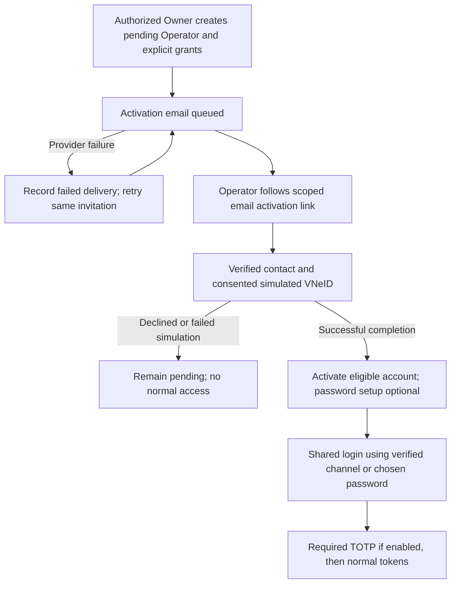

# Operator invitation and activation API design

SPARK-192 / SPARK-191 / SPARK-193 / SPARK-202 · SPARK-296 update, 21 October 2026. **v1.1 documentation review candidate based on approved decisions**; API extensions and implementation pending.

Canonical behavior: [FR-AUTH-04/06](../../01-requirements/srs/modules/01-identity-access.md), [UC-AUTH-03](../../01-requirements/use-cases/uc-auth-03.md), [permissions](../../01-requirements/srs/permissions.md), [shared API/auth contract](../../02-architecture/api/v1.1-contracts.md). There is no public Operator self-registration or per-hire Admin review.

## Actor, routes and scopes

| Operation | Established method/path | Required scope and result |
|---|---|---|
| Create invitation | `POST /api/users` | Current approved/provisioned Owner with `OPERATOR_MANAGE`, owned active tenant and explicit eligible lot IDs. Create a pending Operator identity and grants plus email activation delivery. |
| Owner list | `GET /api/operators` | Current Owner action/tenant scope; safe Operator identity, assignments, activation and delivery state. |
| Self assignments | `GET /api/operators/me` | Activated Operator full session; current active lot grants only. |
| Slot-scope lookup | `GET /api/operators/slot-scope?siteId={id}` | Current Operator with explicit `SLOT_OVERRIDE` at the site. Role alone grants no scope. |
| Activate | Method/path and schema pending V11-DES-02 | Purpose-bound email activation credential, verified contact and mandatory consented simulation. No ordinary session before completion. |
| Optional password setup | Existing `POST /api/auth/bootstrap-password` is a compatibility reference | Optional password choice during/after activation; final scoped token/activation composition pending V11-DES-02. Password setup cannot substitute for verified contact/simulation. |
| Delivery lookup/retry | `GET /api/auth/deliveries/{id}`, `POST /api/auth/deliveries/{id}/retry` | Original authorized actor plus current action/resource scope; metadata only, retry same delivery. |

Retain `fullName` (1–255), valid normalized `email` (up to 255), `siteIds` (1–100 distinct nonempty IDs), and distinct allowlisted `permissions`. Reject foreign/nonexistent/ineligible lots atomically, arbitrary role/status/owner injection, wildcard access and duplicate identity races. Server derives Owner and tenant membership; Facility validates site configuration/existence via service contract, not a cross-service database query. Existing per-site differences must follow the separate grant-management contract; new lots are never implicitly added.

The prior Owner-supplied mandatory initial password and credentials-in-email requirement are superseded. The Operator chooses whether to set a password; verified-contact OTP login remains eligible after activation. No plaintext password or activation secret is returned to the inviting Owner.

Illustrative retained invitation fields; final activation metadata is V11-DES-02:

```json
{
  "fullName": "Operator Example",
  "email": "operator@example.test",
  "siteIds": ["22222222-2222-4222-8222-222222222222"],
  "permissions": ["DEVICE_STATUS_VIEW", "SLOT_OVERRIDE"]
}
```

The created result contains identity, explicit site grants and separate activation/delivery state. Its account is **pending activation**, never `active` immediately. Exact enum/response additions are design-pending; an invitation `201` is not verified email, completed simulation, delivery or normal login.

Existing delegated codes remain `DEVICE_MANAGE`, `DEVICE_STATUS_VIEW`, `CASH_COLLECT`, `APPEAL_REVIEW`, `SLOT_OVERRIDE`, subject to the canonical permission matrix and current lot/action checks. No Owner tariff/refund/financial configuration or Admin authority is inherited. `SLOT_OVERRIDE` marks eligible operational backup with reason/audit; it does not turn a physical observation into accepted occupancy or bypass dependencies.

## Activation sequence

During mandatory simulation, the fake API returns a GUID substitute tied to the Operator's user identity and User & Access persists the binding, per the [21 October V11-06 clarification](../../05-project-management/decision-log/2026-10-21-vneid-simulation-guid.md). It is a mock identifier, not a government identity number or activation/login credential. API path/property name, other mock fields and repeated-call GUID behavior remain V11-DES-02 design work; verified-contact activation and explicit consent still apply.



Expired/consumed/mismatched activation credentials cannot authorize another identity. Retry/activation races produce one logical activation; revoked/disabled invitations cannot be revived by replay. Token hashing, lifetime, storage and renewal are V11-DES-02 security design work; the historical 24-hour password-bootstrap token is not automatically the approved activation TTL.

## Errors and retained history

Preserve validation, authentication, `FORBIDDEN`, `SITE_ACCESS_DENIED`, `EMAIL_EXISTS`, invalid/expired challenge and delivery-not-found outcomes as applicable. New activation/simulation codes and HTTP/envelope details require V11-DES-03/V11-DES-02 agreement. Do not disclose foreign-site details. User-local identity/grants/audit commit atomically; notification failure preserves these records and retry never creates duplicate accounts or grants (D10). Required current-state and scoped-grant checks still apply after activation, including revocation of protected actions/subscriptions.

| Existing decision reference | v1.1 disposition |
|---|---|
| DEC-OPR-01 | Optional password setup retained; no immediate access with an Owner-provided password. |
| DEC-OPR-02 | Historical bootstrap lifetime remains historical evidence; new activation-token contract design-pending. |
| DEC-OPR-03 | Bounded explicit lot permissions retained, no financial/admin inheritance. |
| DEC-OPR-04 | Delivery failure never rolls back committed invitation/account/grants. |
| DEC-OPR-05 | Later assignment/revocation follows its separate scoped contract, not public role management. |

[Pending actions](../../02-architecture/api/v1.1-contracts.md#design-pending-owneraction-register): V11-DES-03/V11-DES-02/V11-DES-04. [New acceptance scenarios](../../04-testing/requirements-traceability/acceptance-scenarios.md) are NOT RUN.
