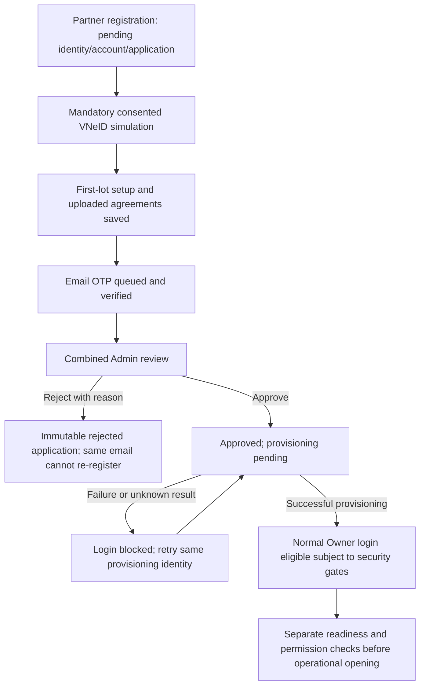

# Partner Registration and first-lot setup API design

SPARK-175 / SPARK-179 / SPARK-180 / SPARK-181 · updated by SPARK-296, 21 October 2026. **v1.1 documentation review candidate based on approved decisions**; API additions and implementation remain pending.

Canonical behavior: [identity SRS](../../01-requirements/srs/modules/01-identity-access.md), [UC-AUTH-02](../../01-requirements/use-cases/uc-auth-02.md), [permissions](../../01-requirements/srs/permissions.md), [shared API/auth contracts](../../02-architecture/api/v1.1-contracts.md). Partner is the business process name; the existing **Owner** role remains. This concise contract replaces the competing `/owner-register` proposals and duplicated BR narratives.

## Registration and setup contract

| Operation | Method/path and actor | Request, result and validation |
|---|---|---|
| Register | `POST /api/auth/register/owner`, public registration context | Retain `fullName`, `businessName`, `email`, `phone`, `lotType`, `agreedToPolicy`, optional `password`. Server creates one pending identity/account/application immediately; no normal Owner tokens and no email OTP yet. |
| Simulated identity step | Registration context, route/schema pending V11-DES-02 | Explicit sharing consent and successful mandatory simulated VNeID completion. Fake API returns a GUID substitute tied to the user; User & Access persists the binding. This is not government verification or a login credential. |
| Save first-lot setup | Proposed `POST /api/auth/register/owner/lot-setup`, scoped application credential; final path/schema pending V11-DES-03 | Save the first-lot proposal into the same initial application; return setup result, then issue/queue email OTP. A retry cannot create another application/site. |
| Verify email | `POST /api/auth/register/owner/verify`, scoped verification context | Retain `challengeId`, six-digit `code`; server rejects verification before saved setup and required simulation. No normal session is issued. |
| Resend | `POST /api/auth/register/owner/resend`, scoped context | Existing `registrationId` carries the issued email challenge ID; preserve purpose, cooldown and lock. Final credential transport pending V11-DES-03. |
| Recover setup | `POST /api/auth/register/owner/recover`, protected recovery flow | Existing `contact` may initiate recovery; unverified email or application ID alone cannot disclose a setup credential. V11-DES-03 defines verified recovery and safe resume metadata. |

Company name, email and phone are required; public email domains are allowed. Preserve bounded/validated name/contact/password inputs, normalized contact uniqueness, and rejection of client role/status/tenant/permission injection. Existing integration bounds are name/business/email 255, phone optional `+` and 9–15 digits, password when provided 8–15 characters with upper/lower/digit/special. Competing phone normalization spellings require V11-DES-03 compatibility agreement; do not make pending or rejected identities bypass uniqueness. An initial rejected Partner email **cannot register again in MVP** (D09).

The setup request retains the FE proposal shape below as a **design-pending integration candidate**, not an approved complete schema:

```json
{
  "registrationId": "<application-id>",
  "setupToken": "<scoped-setup-credential>",
  "lot": {
    "name": "<submitted-lot-name>",
    "address": "<submitted-address>",
    "lotType": "outdoor"
  }
}
```

The complete lot proposal includes facility capacity/layout/device/model selections, explicit monthly/yearly product enablement, proposed tariffs/financial terms and agreement attachments. Field mappings are in the [FE/BE handoff](../../05-project-management/handoffs/OWNER_ONBOARDING_BE_HANDOFF.md). Upload actual agreement/policy bytes through the owning media API; a filename, acceptance boolean or arbitrary URL is not an uploaded agreement. V11-DES-01 defines protected versioned asset references and approved formats/limits.

Registration response requirements: stable application identity, safe setup progress and a scoped credential delivered only to its authorized registering context; no OTP before setup. Setup response requirements: same application identity, persisted proposal/version, setup-complete evidence and queued email challenge metadata. Exact property additions/envelopes are V11-DES-03. Admin views never contain setup secrets. A `201`/queued result is not email-delivery confirmation.

## State and access gates

The [21 October V11-06 clarification](../../05-project-management/decision-log/2026-10-21-vneid-simulation-guid.md) settles the fake API's GUID substitute and persisted user binding. Its path/property name, other fields and repeated-call GUID behavior remain design-pending V11-DES-02; the mock identifier does not authorize setup, login or review.



Contact verification, account restrictions, application decision, provisioning and lot open state are separate facts. Required email verification precedes approval. The supplied phone need not be verified for approval; independently verify it before phone OTP login. Neither verified contact nor approval bypasses an independent security restriction or MFA.

## Errors, retries and review handoff

Preserve safe validation, duplicate contact, invalid/expired scoped credential, prerequisite, OTP-invalid/expired/locked/cooldown and closed-application errors. Existing names include `VALIDATION_FAILED`, `CONTACT_EXISTS`, `OTP_INVALID`, `OTP_EXPIRED`, `OTP_LOCKED`, `OTP_COOLDOWN`; exact new prerequisite/error schema is V11-DES-03. OTP policy is five minutes, three failures/fifteen-minute lock and sixty-second resend. Retrying setup/OTP delivery reuses the authorized business identity; lost acknowledgement must be resolved before creating another record. Delivery failure never removes the created identity/application (D10).

[Admin review](admin-approve-owner-api-design.md) binds the combined application and exact agreement versions, then coordinates durable provisioning. Initial pending/failed provisioning blocks normal login with a safe reason; no restricted normal Owner session and no repeated first-lot creation after sign-in. No duplicate applicant status endpoint or in-app corrections/re-acceptance workflow is required.

## Retained decision references and pending work

| Existing reference | v1.1 disposition |
|---|---|
| DEC-AUTH-01 | Public email domains retained. |
| DEC-AUTH-02 | Email verification required before review; phone independently verified before phone OTP login (D08). |
| DEC-AUTH-03 | User owns organization/membership; approval precedes durable first-lot provisioning across authoritative services (V11-07/09). Legacy Parking tenant authority is superseded. |
| DEC-AUTH-04 | No routine real CCCD/GPLX collection; mandatory simulated information-sharing and actual agreement uploads are explicit v1.1 scope. |

V11-DES-03/V11-DES-02/V11-DES-01/V11-DES-04 in the [pending register](../../02-architecture/api/v1.1-contracts.md#design-pending-owneraction-register) track credential, simulation, media and provisioning details. Schema/seed/reset work is backlog, not executed. Acceptance scenarios are [maintained centrally](../../04-testing/requirements-traceability/acceptance-scenarios.md); new v1.1 scenarios are NOT RUN.
