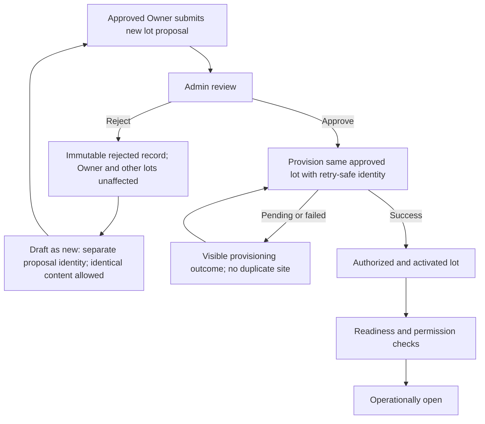
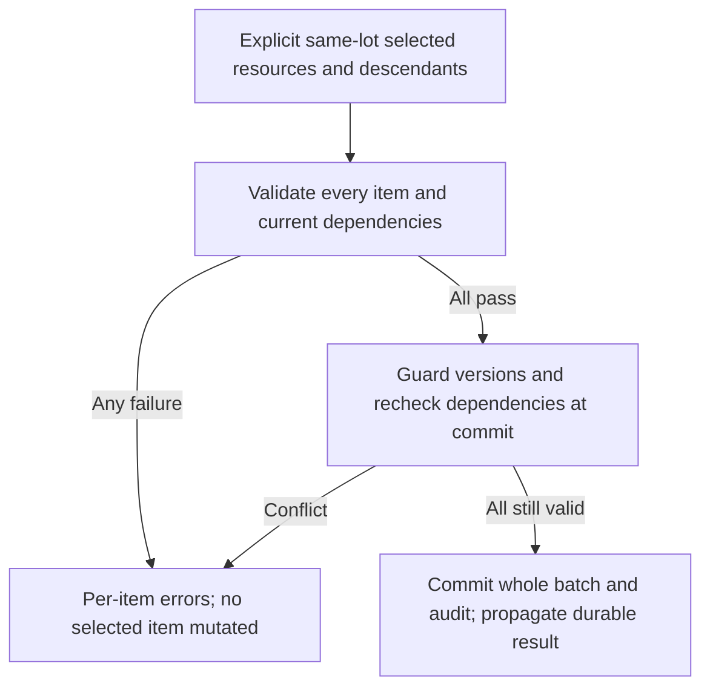

# Facility applications, structure and safe deactivation API design

SPARK-22 / SPARK-25 / SPARK-37 / SPARK-188 / SPARK-189 / SPARK-182 · SPARK-296 update, 21 October 2026 · **SPARK-238 implementation contract, 28 October 2026 · v1.3 approved 29 October 2026 after PM review**. Implementation and wire extensions remain pending.

| Metadata | Value |
|---|---|
| Status | **APPROVED** — v1.3, 2026-10-29 |
| Owning service | Facility (implemented today inside `ParkingService`) |
| Jira design / implementation / verification | SPARK-238 / **NOT IMPLEMENTED** / **NOT RUN** |
| Requirements baseline | FR-LOT-02 (CONFIRMED), FR-LOT-04, UC-LOT-01, US-OW01 |
| Approved decisions | SPARK-238 planning §13 Q1, Q2, Q3, Q4 (2026-10-28); DE-1…DE-11 and the `structure_maintenance_windows` resource (PM, 2026-10-29); DEC-LOT-01…06 |
| Review evidence | PM review `SmartPark-SPARK-238-API-Session-Review-2026-10-29`; dispositions in the session log §4.1 |
| Change from v1.2 | Resolves review findings F01–F16: explicit restore intent instead of automatic resurrection, typed read projection instead of computed-property serialization, non-multiplying compatibility pools, maintenance enforcement acknowledgement, half-open window boundaries, atomic same-lot batch deactivation, and the slot-code uniqueness correction |
| Change from v1.1 | Adds the SPARK-238 structure-configuration contract; resolves selective slot registration from *open design input* to *accepted* |

**Review note (F01).** The PM review was written against a v1.1 export that predates this contract section; findings that reference missing sections or an unapproved "Selective slot registration" paragraph are resolved by v1.2/v1.3. Each finding's disposition, including the ones that identified genuine defects, is recorded in the session log §4.1 so nothing is closed by assertion alone.

Canonical behavior: [facility SRS](../../01-requirements/srs/modules/02-facility-capacity.md), [capacity rules](../../01-requirements/business-rules/02-facility-capacity.md), [UC-LOT-01](../../01-requirements/use-cases/uc-lot-01.md), [permissions](../../01-requirements/srs/permissions.md), [service ownership](../../02-architecture/service-boundaries/ownership-and-events.md), [state transitions](../../01-requirements/srs/state-transitions.md). These links replace duplicated BR narratives; existing reservation, reallocation and settlement/refund invariants remain applicable.

## First lot and additional-lot applications

The first lot is saved inside [Partner Registration](owner-register-api-design.md), before email OTP/verification and combined Admin review. No post-login first-lot creation is required. Approved Owners submit each additional lot as a **separate application**; an Owner's existing approval does not automatically approve a new lot.

| Application operation | Actor/auth | Required request/result and guard |
|---|---|---|
| Create/edit own draft | Current approved Owner, owned organization scope | New proposal identity and submitted facility/product/financial/integration evidence; route/schema pending V11-DES-04. |
| Submit additional lot | Current Owner and draft scope | Stable submission identity/version; server validates proposal. Retry returns the same proposal/result, not another application/site. |
| Review additional lot | Current Admin review permission | Approve/reject with actor/time/reason and inspected version; no Admin editing of pending additional-lot documents or other fields. |
| Draft as new | Owner authorized to read their immutable rejected proposal | Create a distinct draft/proposal referencing source history; identical content is allowed. Never reopen/overwrite rejected record. A retry of this command creates only one new draft. |

Rejection leaves Owner access and other approved lots unchanged. Approved/rejected proposals remain immutable. Final review, provisioning/activation and operational opening are separate; failed/unknown provisioning is visible and retry-safe. No in-app corrections workflow is introduced. V11-DES-04 must finalize paths, DTOs, version/idempotency transport and service ownership mapping; the legacy direct `POST /api/parking-lots` creation cannot bypass additional-lot review.



Before opening, Facility checks approved/provisioned configuration, supported category/layout/capacity and service/open-state configuration; Operations validates accepted occupancy/claims, readiness for admission and safe capacity; Payment provides valid financial terms where sales require them. Current Owner/lot permissions apply. Unmet/unknown readiness blocks opening. Approval or an `isActive` value cannot stand in for all those checks (V11-DES-04).

## Existing structure route references

Retain these integration paths with canonical service ownership; they do not prove the legacy FacilityService implementation meets the target. Normal Owner session and current owned-lot action scope are required, with Operator endpoints separately scoped. A supplied `tenantId` selects an authorized tenant, never grants it.

| Method/path | Request and response contract retained |
|---|---|
| `GET /api/parking-lots` | Owner-only listing, optional authorized `tenantId`; site identity/profile/configuration. **It includes inactive and maintenance lots** with their `status` and derived `serviceState`, because an Owner needs the row to reactivate it (Q4, DE-2 approved 2026-10-29). Optional `status` filter; no implicit active-only filter. It is not public discovery — Driver discovery eligibility is a separate contract. |
| `GET /api/parking-lots/{id}/structure` | Site, units, slots, access paths and configuration; operational capacity is an Operations-sourced projection with source/freshness. |
| `POST /api/parking-lots/{id}/units` | `type`, `name`, `parentId`, `capacity`; generated unit ID. Same-lot hierarchy, no cycles, case-insensitive sibling uniqueness, outdoor root zone permitted. |
| `POST /api/parking-lots/{id}/slots` | `unitId`, `code`, `vehicleType`, `type`; generated ID. Same-lot unit, site-unique code and category/capacity guards. |
| `POST /api/parking-lots/{id}/paths` | `code`, `from`, `to`, `mapData`; generated ID. Same-lot endpoints and validated JSON; these are internal access paths, not geographic routing. |
| `PATCH /api/parking-lots/{id}/structure` | Existing action discriminator: profile, active, renameUnit, capacity, removeUnit, removeSlot, moveSlot, configureSlot, removePath, backup, markBackup. Action-specific authorization and dependency checks. |
| `POST /api/parking-lots/{id}/operations` | Existing `idempotencyKey`, `edit`, optional authorized `tenantId`; operation ID/status/reason/impact. Completed, pending and failed are distinct outcomes. |
| `GET /api/parking-lots/{id}/operations/{operationId}` | Authorized operation scope; read success does not mean operation completed. |
| `GET /api/parking-lots/{id}/operational-layout` | Operator holding explicit `SLOT_OVERRIDE` at that lot (UserService `api/operators/slot-scope?siteId=`, `SlotOperatorClient`). Returns the operational projection, not Owner layout CRUD authority. Read path owned by SPARK-228. |
| `GET /api/parking-lots/{id}/operator-layout` | **A different route with different authority.** Assigned-lot Operator (UserService `api/operators/site-scope?siteId=`, `OperatorSiteClient`) reading the structural aggregate through `OperatorLayoutService`; it never takes an edit hold. It is not anonymous and not a Driver route. |
| `POST /api/parking-lots/{id}/slots/{slotId}/backup` | Operator current lot `SLOT_OVERRIDE`, `reason`; eligible unoccupied/unprotected operational slot, audit and projection. Owner marking uses its explicit `BACKUP_MARK` action, not inherited authority. |

**Route-reconciliation note (F10).** Both Operator read routes exist in `Program.cs` today and are authorized differently: `/operational-layout` by lot-scoped `SLOT_OVERRIDE`, `/operator-layout` by assigned-lot operator scope. `3d-digital-twin-api-design.md`, `3d-digital-twin-spark-228-api-design.md` and `3d-digital-twin-spark-244-api-design.md` assert that the legacy route is `/operator-layout` at `Program.cs:142` and the canonical one is `/operational-layout` at `Program.cs:165`; the source has these line references **swapped** (`:142` is `/operational-layout`, `:165` is `/operator-layout`). That inversion is a SPARK-228/SPARK-244 documentation defect and is not corrected here. No route is added, renamed or removed by SPARK-238, and the Driver-facing discovery read remains unapproved (V11-DES-08).

Retain applicable profile bounds: code 1–50, name 1–255, address 1–2000; paired latitude/longitude within [-90,90]/[-180,180]. Unit names 1–100, layout capacity nonnegative with existing `0` unbounded-layout semantics; never interpret that as unlimited bookable capacity. Slot codes 1–50. Existing coordinate/features/map JSON serialization and 65,536-character bound are compatibility details, not permission to upload new 3D assets. The conflicting historic spatial enum sets (`FLOOR/ZONE/BLOCK` versus a longer hierarchy) and legacy OVERSIZED/EV enum values require Facility wire compatibility review under V11-DES-04; they do not approve extra vehicle products or EV charging. Fixed deployment models remain unchanged.

### Selective slot registration (ACCEPTED — SPARK-238 Q1)

Registering a slot is already a single-slot operation (`POST /api/parking-lots/{id}/slots`), so "the Owner selects which meshes to manage" needs no new endpoint. What changed is the **default**: a lot is no longer expected to register every mesh at creation time.

- **Why replace-all ingestion is not adopted (F08 correction):** batching is not the problem — a batch of identity-preserving upserts is technically possible. What is rejected is **destructive replace-all semantics**: a flow that re-derives the whole slot set from a manifest deletes and re-creates rows on every edit, which mints new slot UUIDs and orphans allocation history. Also relevant: `removeSlot` is a soft delete and any structure edit is refused while the site has a live commitment (the Reservation snapshot plus `structure_edit_holds`, re-checked by the `guard_structure_edit` triggers), so a replace-all flow would also fight the commitment guard. The objection is to the replace-all contract, not to the HTTP verb or to the number of items in one request.
- **Constraint that fixes the shape:** `parking_slots` has a table-level `UNIQUE (tenant_id, site_id, slot_code)` while the per-unit index `uq_active_slot_code_ci` is partial on `deleted_at IS NULL` (`02-facility-service-db.sql:84`, `:88`, `integration/02-parking-service-alignment.sql:11`). A site-wide case-insensitive index `uq_site_slot_code_ci ON (tenant_id, site_id, upper(slot_code))` is also created and is **not** partial (`overlay/parking-slot-constraints.sql:12`), so a removed code stays reserved under every case variant and cannot be inserted again. Re-registering the same mesh therefore reuses the existing row (`deleted_at = NULL`) instead of inserting a new one.
- **Accepted behaviour:** register only the slots the Owner explicitly selects; registration is idempotent on the natural key `(site, upper(code))`; never delete a slot merely because a later request omits it. Restoring a removed slot is a **separate explicit action** (`restoreSlot`), never a side effect of registration — a delayed retry of an old create must not silently undo a deliberate removal (F06; see [Deletion and resurrection](#deletion-and-resurrection)).
- **Accepted consequence:** capacity counts **registered** slots only, so an unregistered mesh is neither bookable nor counted, and any capacity figure shown to the Owner must state that basis.
- **Client-side consequence (A12):** the 3D viewer parses the fixed model asset in the browser, so the mapping `mesh name → slot code` must render an unregistered mesh **inert** — no hover, no click, no capacity contribution. The current greedy matcher is not the contract.

This is **not** part of SPARK-228, which only reads the resulting projection. The normative wire contract is [§SPARK-238 structure configuration contract](#spark-238-structure-configuration-contract).

Existing action example for an unrelated valid rename:

```json
{
  "action": "renameUnit",
  "resourceId": "11111111-1111-4111-8111-111111111111",
  "name": "Zone A"
}
```

The Operator-only operational-layout route above does not satisfy the Driver's discovery-to-model read requirement. V11-DES-08 must agree a Driver-facing authorized model/availability projection and read scope, preserving the selected lot/vehicle/interval and redacting private operational data. Backend revalidation remains mandatory for booking; no new public route is approved here.

## SPARK-238 structure configuration contract

Normative for the Owner-facing structure configuration in Sprint 2 of US-OW01 (US-OW01 / FR-LOT-02 / UC-LOT-01). It extends the retained route table above; it does not replace the first/additional-lot application flow and does not change the Operator routes except where stated.

Tags: **CURRENT** = implemented behaviour at `e3a47fe1`; **PROPOSED** = wire change requiring the approval recorded in [Open items](#open-items-and-deferred-decisions).

### Traceability

| Requirement | Anchor | Operation(s) | Acceptance |
|---|---|---|---|
| FR-LOT-02 | [facility SRS:50-56](../../01-requirements/srs/modules/02-facility-capacity.md) | units, slots, paths, structure read | A1, A2, A6, A7, A9 |
| FR-LOT-04 | [facility SRS:66-74](../../01-requirements/srs/modules/02-facility-capacity.md) | `active`, maintenance windows | A4, A10, A11 |
| UC-LOT-01 | [main flow 4–5](../../01-requirements/use-cases/uc-lot-01.md) | all | A1–A11 |
| SPARK-238 Q1/Q2/Q3 | planning decision record, 2026-10-28 | slots, deactivation | A5, A6, A10–A12 |
| A12 (FE) | `FE/src/.../slotMatcher.ts` | structure read + client viewer | A12 |

### Common rules

| Rule | Contract |
|---|---|
| Authentication | Owner bearer session on every `GET/POST/PATCH/DELETE /api/parking-lots…` route. Missing/invalid → `401 UNAUTHENTICATED`. |
| Permission | `PARKING_MANAGE` for all structure operations. `backup` requires `BACKUP_CONFIGURE`; `markBackup` requires `BACKUP_MARK`. Operator routes use `api/operators/site-scope?siteId=` instead. |
| Tenant selection (**CURRENT**) | Optional `tenantId` (body or query). The value **selects** an authorized tenant and never grants one. Absent + exactly one authorized tenant → that tenant. Absent + several → `403 FORBIDDEN`. Value outside the caller's scope → `403 FORBIDDEN`. |
| Site resolution (**CURRENT**) | The site must be live (`deleted_at IS NULL`) **and** owned by the selected tenant, otherwise `404 SITE_NOT_FOUND`. A foreign site id is indistinguishable from a missing one — no existence leak (A3). |
| Child resolution (**CURRENT**) | Every `unitId` / `slotId` / `pathId` is resolved inside the already-loaded site. Ids from another site or tenant → `404 UNIT_NOT_FOUND` / `SLOT_NOT_FOUND` / `PATH_NOT_FOUND`. |
| Envelope (**CURRENT**) | Success `{ "success": true, "data": … }`; failure `{ "success": false, "code": "…", "message": "…" }`. This is the shape this service returns today; it is not a project-wide standard. |
| Content type | `application/json; charset=utf-8`, UTF-8 body. Bodies reject unmapped members where the current record is annotated. |
| Mutation gate (**CURRENT**) | Every mutation takes the site advisory gate, recovers pending synchronizations, prepares a hold in Reservation and only then opens the local transaction. `503 COMMITMENTS_UNAVAILABLE` ⇒ nothing changed locally. |
| Audit | Every mutation writes `structure_change_audit` (before/after) in the same transaction. Operational backup marking additionally writes `structure_slot_audit` with the reason. |

### Hierarchy and identifiers

| Aspect | Contract | State |
|---|---|---|
| Unit types | `FLOOR`, `ZONE`, `BLOCK`; a child type must strictly follow its parent in that order. Maximum depth 3 below the lot. | CURRENT |
| `ROW` | Not supported on the wire. FR-LOT-02 names lot→floor→zone→**row**→space; the wire enum stops at `BLOCK`. A `ROW` value requires an additive enum + schema change under the V11-DES-04 compatibility review. | PROPOSED (DE-1) |
| Outdoor lot | A root-level `ZONE` with no `FLOOR` above it. Nothing prevents a root `FLOOR`; the lot template is not persisted. | CURRENT |
| Lot template | No archetype/template column exists on `parking_sites`. Binding a lot to one of the three fixed 3D templates is **SPARK-228** scope, not this contract. | OUT OF SCOPE |
| Unit path | Server-generated opaque string (`/{siteId}/…/{unitId}/`), stable for the life of the row, never client-supplied and never parsed by clients. | CURRENT |
| Sibling names | Case-insensitive unique within `(site, parent)`, enforced in the domain and by `uq_active_unit_name_ci`. | CURRENT |
| Slot code | 1–50 characters, trimmed, upper-cased. **Contract (F09 correction): site-wide case-insensitive uniqueness.** The database enforces `UNIQUE (tenant_id, site_id, slot_code)` (case-sensitive), the partial per-unit `uq_active_slot_code_ci` on `(spatial_unit_id, upper(slot_code)) WHERE deleted_at IS NULL`, and the **non-partial** site-wide `uq_site_slot_code_ci` on `(tenant_id, site_id, upper(slot_code))` created by `overlay/parking-slot-constraints.sql:12`. The site-wide CI index exists and reserves codes across soft deletes; the per-unit partial index is narrower than the contract and is redundant for collision purposes. Normalization is `trim + upper` before any comparison in the API layer. | CURRENT (both indexes) / DE-7 resolved |
| Slot placement | A slot always belongs to exactly one live spatial unit. There is no site-level slot and no `floorId`/`zoneId` on a slot. | CURRENT |
| Deletion of a non-empty unit | Rejected `UNIT_NOT_EMPTY` → children, slots and access paths must be removed explicitly. No silent cascade (FR-LOT-04). | CURRENT |

### Operation: `POST /api/parking-lots/{id}/units`

| Row | Value |
|---|---|
| Availability | CURRENT |
| Authentication / permission | Owner bearer; `PARKING_MANAGE` |
| Resource scope | Site of the selected tenant; `parentId` must be in the same site |
| Request | `{ "type": "FLOOR\|ZONE\|BLOCK", "name": "string", "parentId": "uuid\|null", "capacity": 0, "tenantId": "uuid\|null" }` |
| Response 200 | `{ "success": true, "data": "<unitId>" }` — the created or resurrected unit id |
| Notes | `capacity` is a layout limit, `0` = no layout limit (never unlimited bookable capacity). Name 1–100 characters. |

| Field | Location | Type | Required | Constraints |
|---|---|---|---|---|
| `type` | body | enum | yes | `FLOOR`, `ZONE`, `BLOCK`; must follow the parent order |
| `name` | body | string | yes | trimmed, 1–100; case-insensitive unique among live siblings |
| `parentId` | body | uuid \| null | no | same site; `null` = lot root |
| `capacity` | body | int | yes (0 allowed) | ≥ 0; cannot be lower than the live slot count in the subtree |
| `tenantId` | body | uuid \| null | no | must be an authorized tenant |

**PROPOSED** — natural-key idempotency: a repeat of the same `(parentId, name)` on a **live** unit returns the existing id (`created:false`), so a multi-select replay is safe. A **soft-deleted** sibling with the same name is **never resurrected implicitly** — `POST /units` returns `409 IDENTIFIER_RELEASED` with the released `unitId`, and the Owner must issue the explicit `restoreUnit` action (F06). This prevents a delayed retry of an old create from undoing a deliberate removal.

### Operation: `POST /api/parking-lots/{id}/slots` (slot registration)

| Row | Value |
|---|---|
| Availability | CURRENT (single value) / **PROPOSED** (`vehicleTypes`) |
| Authentication / permission | Owner bearer; `PARKING_MANAGE` |
| Resource scope | `unitId` must be a live unit of this site |
| Headers | `Content-Type: application/json` |
| Request | `{ "unitId": "uuid", "code": "A-01", "vehicleTypes": ["CAR","MOTORCYCLE"], "vehicleType": "CAR", "type": "STANDARD", "tenantId": "uuid\|null" }` |
| Response 201 (**PROPOSED**) | `{ "success": true, "data": { "slotId": "uuid", "code": "A-01", "created": true, "released": false } }` |
| Response 200 (**PROPOSED**) | Same body with `created:false` for an idempotent replay of the identical live registration |
| Response 409 (**PROPOSED**) | `IDENTIFIER_RELEASED` when a soft-deleted slot holds this code: `{ "success": false, "code": "IDENTIFIER_RELEASED", "message": "This slot code belongs to a released slot; restore it explicitly.", "released": { "slotId": "uuid", "code": "A-01", "deletedAt": "…" } }` — nothing is written |
| Response 200 (CURRENT) | `{ "success": true, "data": "<slotId>" }` — no creation flags |

| Field | Location | Type | Required | Constraints |
|---|---|---|---|---|
| `unitId` | body | uuid | yes | live unit of this site |
| `code` | body | string | yes | trimmed, 1–50, upper-cased, unique site-wide case-insensitively against **live and released** slots |
| `vehicleTypes` | body | enum[] | one of | 1–3 distinct values from `CAR`, `MOTORCYCLE`, `OVERSIZED` (**PROPOSED**) |
| `primaryVehicleType` | body | enum | required when `vehicleTypes` has ≥2 | must be a member of `vehicleTypes`; the value written to the projection column (**PROPOSED**) |
| `vehicleType` | body | enum | one of | legacy single value; rejected when it contradicts `vehicleTypes`. Treated as `vehicleTypes: [x]` and as the primary when `vehicleTypes` is absent |
| `type` | body | enum | no | `STANDARD` (default), `VIP`, `EV`, `DISABLED` |
| `tenantId` | body | uuid \| null | no | must be an authorized tenant |

Behaviour:

1. The slot is registered for exactly one unit; there is no bulk registration endpoint (Q1). A multi-select in the Owner UI issues one request per mesh and reports one outcome per mesh (see [Per-item registration outcomes](#per-item-registration-outcomes-f02f06)).
2. Registration is an **idempotent create against the natural key** `(site, upper(code))`, evaluated over live **and released** rows. It never restores anything by itself (F06):
   - live row, same unit + same compatibility set + same type → `200`, `created:false`, no write (safe replay);
   - live row, different attributes → `409 DUPLICATE_IDENTIFIER` (updating a slot is `configureSlot`, not re-registration);
   - released (soft-deleted) row, target unit live → **`409 IDENTIFIER_RELEASED`** with the released `slotId`; nothing is written. The Owner must call `restoreSlot` explicitly, because an automatic restore would let a delayed retry of an old create undo a deliberate deletion;
   - released row whose target unit is also released → `409 IDENTIFIER_RELEASED` as well (the caller must restore the unit first, then the slot);
   - no row for this code → insert → `201`, `created:true`.
3. A later request that omits a slot never deletes it. Removal is an explicit `removeSlot` action.
4. `RemoveUnit` on a unit that still has live slots is rejected; a slot is not implicitly deleted by its unit.
5. Restoration keeps the row id, so allocation and audit history stay attached. It is idempotent: repeating `restoreSlot` on an already-live slot returns `200` with no write.

### Per-item registration outcomes (F02/F06)

Registration is one call per mesh, so a multi-select can partially complete. The contract is per item, not per batch:

| Situation | Owner-visible outcome | Resume rule |
|---|---|---|
| Item succeeds | `201`/`200` with `slotId` | Do not re-send; it is already applied |
| Item fails validation | Per-item `4xx` with `code`/`message` | Fix that mesh only |
| Response lost, item applied | Re-sending is safe: same natural key → `200 created:false`, no second row | Re-send the same payload, never a new code |
| Item was released deliberately, then an old create is retried | `409 IDENTIFIER_RELEASED` | Requires an explicit user restore decision; a "retry all" button must not restore |
| Item fails because the unit was removed meanwhile | `404 UNIT_NOT_FOUND` / `409` | Re-read the structure, then re-issue |

There is no server-side batch identity for registration: the natural key is the retry identity. A UI "retry failed items" action re-issues only the items that failed and must present the `IDENTIFIER_RELEASED` case as a user decision, never as an automatic retry.

### Slot compatibility (Q2)

| Aspect | Contract |
|---|---|
| Source of truth | `slot_compatibilities(slot_id, vehicle_type)` — the set of vehicle types a slot **may be allocated to**. |
| Projection column | `parking_slots.supported_vehicle_type` keeps exactly one value so legacy code paths stay valid. It stores the **primary category** — the category the slot is *counted in*. It is **never inferred**: with two or more `vehicleTypes` the caller must supply `primaryVehicleType` (F05). Picking "the first" or "the lowest enum value" is not deterministic product meaning and is rejected. |
| Read | `vehicleTypes` is read from the table. With table rows, `compatibilitySource` is `"compatibility-table"`; with no table rows but a non-null column, the column is returned as a one-element set with `"projection"`; with neither, the slot is `"unclassified"` (see Legacy NULL). |
| Disagreement | The table wins for **eligibility**. The column is rewritten to match on the next successful mutation of that slot; a read never fails because they disagree. |
| Write | Both are written in the **same transaction** as the slot row. Removing compatibility values deletes the surplus `slot_compatibilities` rows rather than leaving stale ones. |
| **Allocation consumer (F05)** | The single existing reader of the projection is the gate claim query: `OperatorGateSlotStore.cs:28` filters `AND ($3 = 'ANY' OR supported_vehicle_type = $3)`. That predicate **must** become table-aware — `EXISTS (SELECT 1 FROM slot_compatibilities c WHERE c.slot_id = s.id AND c.vehicle_type = $3)`, falling back to the column only when the slot has no compatibility rows. Until it does, a dual-compatible slot is invisible to a claim for its secondary category, and the table-first model is contradicted at the exact point where allocation is authorized. This is P2 work, not a documentation-only change. |
| **Non-multiplication (F05)** | Compatibility is a *predicate*, never stock. One physical slot compatible with `CAR` and `MOTORCYCLE` still supplies **one** allocatable slot. Category pools count each slot exactly once, by primary category, so `sum(category pool totals) == registeredPhysicalCount` always holds. Never sum category eligibility as independent capacity. |
| Pools | Category pools are counted by the **primary category**. `vehicleTypes` states what a slot may be *assigned to*; it does not add the slot to a second pool. This keeps A7 arithmetic exact and avoids double counting. |
| Empty set | Invalid: every live slot declares at least one vehicle type. `vehicleTypes: []` → `400 INVALID_STRUCTURE`. |
| Legacy NULL | `supported_vehicle_type` is nullable and `ParkingSlot.VehicleType` is not, so a NULL row currently throws inside `Enum.Parse` and breaks the whole structure read. Required migration: backfill from `slot_compatibilities`; if no rows exist either, the slot is reported as `compatibilitySource: "unclassified"` with `vehicleTypes: []` **and is not counted in any category pool**, and the site's projection reports `projectionState: "inconsistent"`. Never invent a category. Edits to that site return `409 STRUCTURE_CONFLICT` until every slot is classified (DE-6). |
| Migration tests | Required before P2 is accepted: backfill of legacy NULL rows, deletion of surplus compatibility rows, restore after soft delete, and a dual-compatible slot being claimable by both categories while still counting once. |

### Operation: `POST /api/parking-lots/{id}/paths`

Unchanged shape: `{ "code", "from", "to", "mapData", "tenantId" }` → `{ "success": true, "data": "<pathId>" }`. Both endpoints must be live units of the same site and must differ; `mapData` is validated JSON with a 65,536-character bound. Access paths are internal topology, not geographic routing. **PROPOSED** — the same natural-key idempotency on `(site, upper(code))` applies to paths, with the same F06 rule: a live duplicate returns the existing id, a **released** code returns `409 IDENTIFIER_RELEASED` and requires the explicit `restorePath` action.

### Operation: `PATCH /api/parking-lots/{id}/structure`

Discriminated by `action`. Only the actions that SPARK-238 changes are listed; the rest keep the CURRENT contract.

| Action | Request fields used | Change |
|---|---|---|
| `profile` | `code`, `name`, `address`, `latitude`, `longitude` | unchanged (1–50 / 1–255 / 1–2000; paired coordinates in range) |
| `active` | `active`, and now `windowId` | **PROPOSED** — see [Deactivation](#deactivation-and-maintenance-windows) |
| `renameUnit` | `resourceId`, `name` | unchanged |
| `capacity` | `resourceId`, `capacity` | unchanged (`0` = no layout limit) |
| `removeUnit` | `resourceId` | unchanged; `409 UNIT_NOT_EMPTY` when it has children, slots or paths |
| `removeSlot` | `resourceId` | unchanged; soft delete, and only while the site has no live commitment |
| `moveSlot` | `resourceId`, `unitId`, `code` | unchanged |
| `configureSlot` | `resourceId`, `vehicleType`, `vehicleTypes`, `primaryVehicleType`, `slotType`, `coordinates3D`, `features` | **PROPOSED** — `vehicleTypes`/`primaryVehicleType` replace `vehicleType`; `coordinates3D` and `features` become server-owned and non-null values are rejected |
| `restoreSlot` | `resourceId` | **PROPOSED** (F06) — explicit restoration of a released slot; idempotent; keeps the row id. Eligible for `POST /operations` idempotency |
| `restoreUnit` | `resourceId` | **PROPOSED** (F06) — explicit restoration of a released unit; rejected `409 UNIT_NOT_EMPTY`-style if the parent or the lot is inactive, and refused when a live sibling now holds the same name (`409 DUPLICATE_IDENTIFIER`) |
| `restorePath` | `resourceId` | **PROPOSED** (F06) — explicit restoration of a released path; both endpoints must be live |
| `removePath` | `resourceId` | unchanged |
| `backup` / `markBackup` | see Operator/backup rows above | unchanged; explicit permissions |

`configureSlot` — Owner input restriction (A9, corrected per F13):

| Field | CURRENT | PROPOSED | Ownership |
|---|---|---|---|
| `vehicleType` | accepted, single value | superseded by `vehicleTypes`; when both are present they must agree | Owner |
| `vehicleTypes` / `primaryVehicleType` | not accepted | accepted, with the same rules as `POST /slots` | Owner |
| `slotType` | accepted | unchanged | Owner |
| `coordinates3D` | accepted and persisted | **rejected** when non-null: `400 INVALID_STRUCTURE` "Slot geometry comes from the lot's fixed 3D template." Returned read-only | **Server/3D template** |
| `features` | open JSON persisted as supplied | **rejected** when non-null: the whole column is server-owned in this contract (see below). Returned read-only | **Server** |

Why `features` is rejected wholesale rather than by allow-list (F13 response): no canonical requirement currently defines an Owner-settable non-geometric slot attribute. FR-LOT-02 excludes EV charging from MVP, and every other slot attribute the Owner controls already has a named field (`type`, `vehicleTypes`, the owning unit). An open JSON bag cannot be validated, so the correct shape for future Owner attributes is a **named, typed field added by a later contract**, not an allow-list invented here. If a non-geometric attribute does become required, it is added explicitly with its own approval row; `features` stays server-owned until then.

Rationale: the 3D template is a deployment asset and slot geometry is derived from its mesh, so the Owner must have no route that writes coordinates (A9).

**Wire-change impact (F13).** This rejects inputs the current service accepts and persists, so it is a wire change rather than a validation tightening:

- No current client sends either field: the Owner client's `configureSlot` path (`FE/src/lib/parkingApi.ts:121-130`) forwards only the action payload it is given, and neither `coordinates3D` nor `features` appears anywhere in `FE/src`. Client migration is therefore a no-op today, but it must be re-checked before P2 if FE work lands first.
- Rows already holding a non-null `coordinates3D` or `features` are **not rewritten or cleared**. They stay readable and are preserved verbatim; only new writes are refused.
- Unknown JSON members are still rejected per-record (`JsonUnmappedMemberHandling.Disallow`) as today. This rule is about these two fields' content, not a global rejection of unknown members.

Rationale: the 3D template is a deployment asset and slot geometry is derived from its mesh, so the Owner must have no route that writes coordinates.

### Operation: `GET /api/parking-lots/{id}/structure`

Response `data` is the structure projection. **PROPOSED shape change (F07):** the route returns a **typed read DTO**, not the serialized domain aggregate. Today `ParkingStructure.CapacityViews` is a computed property that throws `CAPACITY_CONFLICT` while JSON is being written, so a data problem turns into a 500 on a read. A read must never fail because arithmetic does not add up, and must never fabricate a number to look consistent.

```json
{
  "success": true,
  "data": {
    "site": {
      "id": "…", "tenantId": "…", "code": "S-MF", "name": "Multifloor Lot",
      "address": "456 Deep St", "latitude": 10.77, "longitude": 106.70,
      "isActive": true, "status": "ACTIVE"
    },
    "units": [
      { "id": "…", "parentId": null, "path": "/…/…/", "type": "FLOOR", "name": "Basement 1", "maxCapacity": 150 }
    ],
    "slots": [
      { "id": "…", "unitId": "…", "code": "B1-01", "type": "STANDARD",
        "vehicleTypes": ["CAR", "MOTORCYCLE"], "primaryVehicleType": "CAR",
        "compatibilitySource": "compatibility-table",
        "operationalStatus": "OPERATIONAL", "isPhysicallyOccupied": false,
        "coordinates3D": null, "features": null, "reservationState": null }
    ],
    "paths": [ { "id": "…", "code": "P1", "fromUnitId": "…", "toUnitId": "…", "mapData": "{}" } ],
    "backupPolicies": [ { "unitId": null, "vehicleType": "CAR", "count": 2 } ],
    "capacityViews": [ { "unitId": null, "vehicleType": "CAR", "total": 3, "occupied": 0, "protected": 0,
                         "pendingPayment": 0, "configuredBackup": 2, "markedBackup": 0, "effectiveBackup": 2,
                         "unavailable": 0, "available": 1, "inheritedBackup": false,
                         "projectionState": "consistent", "reason": null } ],
    "serviceState": { "state": "ACTIVE", "closedUntil": null, "windows": [] },
    "capacity": {
      "registeredPhysicalCount": 3,
      "configuredLimit": null,
      "operationalAvailable": 1,
      "basis": "registered-slots",
      "projectionState": "consistent",
      "reason": null
    }
  }
}
```

| Field | Type | Notes |
|---|---|---|
| `slots[].vehicleTypes` | enum[] | from `slot_compatibilities`, fallback to the projection (PROPOSED) |
| `slots[].primaryVehicleType` | enum \| null | the projection column; drives pool counting. `null` when the slot is unclassified (PROPOSED) |
| `slots[].compatibilitySource` | string | `compatibility-table` \| `projection` \| `unclassified` (PROPOSED) |
| `slots[].coordinates3D` / `features` | string \| null | read-only, server-owned (PROPOSED statement of intent) |
| `capacityViews[].available` | int \| null | `null` when the arithmetic cannot be trusted; never a negative or invented value |
| `capacityViews[].projectionState` | string | `consistent` \| `inconsistent` \| `unavailable` (PROPOSED, DE-8) |
| `capacityViews[].reason` | string \| null | human-readable explanation when not `consistent` |
| `serviceState.state` | string | `ACTIVE` \| `SCHEDULED` \| `MAINTENANCE` \| `MAINTENANCE_UNCERTAIN` \| `INACTIVE` (PROPOSED, see below) |
| `serviceState.closedUntil` | timestamp \| null | end of the latest window covering *now*; `null` outside a window |
| `serviceState.windows` | array | non-cancelled windows with `id`, `start`, `end`, `enforcementState`, `reason` |
| `capacity.registeredPhysicalCount` | int | live registered slots — a **derived count**, not a configured limit |
| `capacity.configuredLimit` | int \| null | declared limit from `spatial_unit_capacities`/unit `maxCapacity` when configured; a limit, never a count and never bookable capacity |
| `capacity.operationalAvailable` | int \| null | Operations-sourced availability; `null` when unknown |
| `capacity.basis` | string | constant `registered-slots`; states that unregistered meshes are excluded (A7) |
| `capacity.projectionState` | string | `consistent` \| `inconsistent` \| `unavailable`; aggregates slot-level classification |
| `capacity.reason` | string \| null | e.g. "2 slots have no vehicle classification." |

Three numbers that must never be merged (F07): the **derived registered count** (physical reality, recomputed), the **configured limit** (an Owner-declared ceiling, preserved as written), and the **operational availability** (Operations' fact, possibly unknown). Writing a mutation may recompute the derived count; it must never silently overwrite an independent configured limit with it.

Reading a structure whose capacity arithmetic is inconsistent must return `available: null` with `projectionState`/`reason` instead of throwing (DE-8). This applies to both read routes that share the projection.

### Capacity projection (A7, F05, F07)

| Rule | Contract |
|---|---|
| Three separate numbers | **Registered physical count** = live registered slots (derived, recomputed). **Configured limit** = an Owner-declared ceiling (`spatial_unit_capacities.vehicle_type`, unit `max_capacity`), preserved exactly as written. **Operational availability** = Operations' fact, possibly `null` when unknown. They are reported separately and never collapsed into one "capacity" number. |
| Basis | `registeredPhysicalCount` = number of live registered slots. Unregistered meshes are not bookable, not counted and not rendered as interactive (A7, A12). |
| Derivation | Recomputed in the same transaction as every structural mutation. Recomputation writes only the derived count (`parking_sites.total_physical_capacity`); it never overwrites a configured limit. |
| Edit precondition | The current hard failure `STRUCTURE_CONFLICT` "Reconcile declared physical capacity before editing" when `totalPhysicalCapacity != slots.Count` is **replaced by reconciliation**: the derived value is corrected on write instead of blocking the edit. Legacy/seeded rows must not become permanently un-editable. The seed defect behind this (`sprint2-seed.sql` declares 100 and 300 with zero slots) is fixed at source: both slot-less sites become `0`. |
| Configured limit | Reported as `configuredLimit`; when set it must be ≥ the registered count, otherwise the projection reports `projectionState: "inconsistent"` and `available: null`. It never raises bookable capacity and never blocks a read. |
| Category pools | Counted by primary category, per vehicle type, per unit subtree. `CAR` and `MOTORCYCLE` are never interchangeable. **A slot belongs to exactly one pool** even when compatible with several categories, so `sum(pool totals) == registeredPhysicalCount` is an invariant (F05). |
| Unclassified slots | A slot with no vehicle classification joins **no** pool and makes the site projection `inconsistent`; it is never assigned a default category (F07). |
| Display | Any capacity number returned to the Owner carries `basis: "registered-slots"` and its `projectionState`, so the Owner can tell "3 slots" from "limit 100" from "availability unknown". |
| Read safety | No capacity rule may throw during response serialization; failures degrade to `available: null` + `reason` (DE-8). |

### Deactivation and maintenance windows (Q3, A4, A10, A11)

Two distinct concepts that must not be conflated (F03). **Lifecycle status** is what the Owner decided about the lot (`ACTIVE` / `INACTIVE`). **Scheduled service availability** is when the lot is closed for use, expressed as windows. A future window never changes `status`, and deactivating the lot is not a way to schedule maintenance.

| Flow | Request | Behaviour |
|---|---|---|
| Immediate deactivation (A4) | `PATCH` `{ "action": "active", "active": false }` | Changes **lifecycle status only**: allowed only when the site has no live commitment; otherwise `409 STRUCTURE_IN_USE` with the commitment list below. Soft data is untouched — nothing is deleted, `status` becomes `INACTIVE`, and the lot stops accepting new commitments. Does not create, cancel or imply a window. |
| Scheduled closure (A10/A11) | `POST` a window, optionally followed by `PATCH { "action": "active", "active": false, "windowId": "…" }` to tie the deactivation to a known closure | Changes **service availability**: validated against commitments, recorded as a maintenance window, and the structure returns to serving automatically when the window ends. It does not flip lifecycle status. |

Validation rule — **half-open `[start, end)` intervals** (confirming F03's recommendation as the approved boundary convention):

```
latestCommitmentEnd(scope) = max(end of every live reservation and session in scope)
window.start >= latestCommitmentEnd(scope)          // otherwise 409
no commitment overlaps [window.start, window.end)   // otherwise 409
window.start < window.end
```

- **Boundary semantics:** a commitment ending exactly at `window.start` does not overlap (the slot is free at that instant); a commitment starting exactly at `window.end` does not overlap either. A window that also ends at `window.start` is empty and rejected.
- A session with `exitTime = null` has **no** end. Unknown is not "no overlap": an open session in scope blocks every window that starts before it is closed, so a window cannot start while an open session exists in scope (unless the scope excludes that slot).
- **Late exit:** a session still open when `window.start` arrives is a conflict reported at activation, not a reason to auto-extend the window. The Owner closes the window or handles the vehicle; nothing is cancelled automatically.
- **Overlap inspection is not authorization to cancel.** A passed overlap check means "no known commitment is destroyed by accepting this window"; it never authorizes cancelling, moving or refunding a reservation (see DE-13).
- On rejection: `409 STRUCTURE_IN_USE` and **nothing** is cancelled, moved or rescheduled.

```json
{
  "success": false,
  "code": "STRUCTURE_IN_USE",
  "message": "2 commitments overlap the requested maintenance window.",
  "commitments": [
    { "id": "…", "type": "RESERVATION", "start": "2026-10-28T09:00:00Z", "end": "2026-10-28T12:00:00Z",
      "unitId": "…", "slotId": "…" },
    { "id": "…", "type": "SESSION", "start": "2026-10-28T08:10:00Z", "end": null,
      "unitId": null, "slotId": "…" }
  ]
}
```

`commitments` is an **extension** of the current error envelope and is only present on `STRUCTURE_IN_USE` from a window or deactivation request. The list is limited to commitments that overlap the requested window and never reveals resources outside the caller's site.

New resource — `structure_maintenance_windows` (**APPROVED** by PM 2026-10-29; not present in any schema yet):

```sql
CREATE TABLE structure_maintenance_windows (
    id UUID PRIMARY KEY DEFAULT uuid_generate_v4(),
    tenant_id UUID NOT NULL,
    site_id UUID NOT NULL REFERENCES parking_sites(id) ON DELETE CASCADE,
    unit_id UUID NULL REFERENCES spatial_units(id) ON DELETE CASCADE,
    slot_id UUID NULL REFERENCES parking_slots(id) ON DELETE CASCADE,
    service_window TSTZRANGE NOT NULL,
    reason TEXT NOT NULL,
    created_by UUID NOT NULL,
    created_at TIMESTAMPTZ NOT NULL DEFAULT CURRENT_TIMESTAMP,
    cancelled_at TIMESTAMPTZ NULL,
    -- F04: a window is not "in force" until admission enforcement acknowledges it
    enforcement_state TEXT NOT NULL DEFAULT 'pending'
        CHECK (enforcement_state IN ('pending','acknowledged','failed')),
    enforcement_ref UUID NULL,
    acknowledged_at TIMESTAMPTZ NULL,
    CONSTRAINT ck_window_nonempty CHECK (NOT isempty(service_window)),
    CONSTRAINT ck_window_scope CHECK (slot_id IS NULL OR unit_id IS NOT NULL)
);
CREATE INDEX idx_maintenance_windows_site_time ON structure_maintenance_windows USING gist (site_id, service_window);
-- Same-DB concurrency guard: two site-wide live windows can never overlap, whatever the
-- application read just before insert. Requires the btree_gist extension.
ALTER TABLE structure_maintenance_windows
    ADD CONSTRAINT ex_maintenance_windows_site_overlap
    EXCLUDE USING gist (site_id WITH =, service_window WITH &&)
    WHERE (cancelled_at IS NULL AND unit_id IS NULL AND slot_id IS NULL);
```

**Column naming.** The wire field stays `window`, but the database column is `service_window`: `WINDOW` is a reserved keyword in PostgreSQL and `CREATE TABLE … (window tstzrange)` is a syntax error (verified against the running database). Quoting the identifier would force every query and migration to double-quote it, so the column is renamed and the mapping is stated here.

The DDL lives in `scripts/database/overlay/parking-structure-maintenance.sql` (idempotent; creates `uuid-ossp`/`btree_gist` if absent). It is deliberately **not** yet listed in `scripts/apply-workflow-migrations.ps1`, because that file is shared with the SPARK-228 lane — the ordering entry is added at merge time.

A table rather than two columns on `parking_sites` because several windows must coexist, scope can narrow to a unit or slot, and the history must survive.

**Enforcement protocol (F04).** The exclusion constraint protects Facility against itself; it cannot serialize a booking accepted in Reservation. Therefore:

1. A window row is created as `enforcement_state = 'pending'` and is **not** claimed to be in force.
2. Facility asks the authoritative service (Reservation/Operations) to apply the closure and waits for an explicit acknowledgement naming the window and the scope it applied. The acknowledgement is stored in `enforcement_ref` + `acknowledged_at`, and only then does the row become `acknowledged`.
3. If the call fails, times out, or returns an unrecognized answer, the row stays `pending` (or becomes `failed`) and the API reports it as such — **never as effective**. Reading such a site yields `serviceState: "MAINTENANCE_UNCERTAIN"`, which is deliberately not the same as `MAINTENANCE`.
4. Facility never holds a database transaction open across that remote call: local insert and remote acknowledgement are separate steps coordinated by the window's own state, exactly like the structure-edit hold/release pattern.
5. A booking and an activation can therefore both be in flight; the rule is that whichever reaches the authoritative service first wins, and the loser receives a conflict rather than a silently inconsistent state. Proving that requires the other service's acknowledgement — not an overlap count read by Facility.
6. The same acknowledgement is what lets a reopened lot be checked against *other* still-active closures (see state semantics).

Which service owns the acknowledgement endpoint, and the wire shape of the closure notice, is **DE-13** — approved in principle, not yet specified. Until it exists, windows are created `pending` and `serviceState` reports `MAINTENANCE_UNCERTAIN`, not `MAINTENANCE`.

| Operation | Contract |
|---|---|
| `GET /api/parking-lots/{id}/maintenance-windows` | List non-cancelled windows of the site, ordered by `lower(window)`, each with `enforcementState`. **APPROVED 2026-10-29** |
| `POST /api/parking-lots/{id}/maintenance-windows` | Create a window: `{ "start", "end", "unitId"?, "slotId"?, "reason" }` → `201` with the window and `enforcementState: "pending"`. Runs the overlap rule, then the enforcement protocol. **APPROVED 2026-10-29** |
| `PATCH /api/parking-lots/{id}/maintenance-windows/{windowId}` | **Extend only** while `now < upper(window)`: `{ "end" }` with a later `end`, re-running the overlap rule and re-requesting acknowledgement for the added interval. Never shortens — shortening is a cancellation of the remaining interval plus a new window. **APPROVED 2026-10-29** |
| `DELETE /api/parking-lots/{id}/maintenance-windows/{windowId}` | Cancel. Allowed before `start`, or after `start` to reopen early **only if** the cancellation does not expose the site to another live window: the response is `409 STRUCTURE_IN_USE` when another active closure still covers `now`, so reopening can never bypass a second closure. **APPROVED 2026-10-29** |

State semantics (F03):

- Creating a window does **not** change `status`. The lot keeps serving until `start`, and its lifecycle status stays exactly what the Owner last set.
- `serviceState` is derived at read time and has five values:
  - `INACTIVE` — lifecycle `status` is `INACTIVE`/`SUSPENDED` (a permanent Owner decision);
  - `SCHEDULED` — lifecycle `ACTIVE` and a non-cancelled window starts in the future;
  - `MAINTENANCE` — *now* is inside a non-cancelled window **and** enforcement is `acknowledged`;
  - `MAINTENANCE_UNCERTAIN` — *now* is inside a window whose enforcement is `pending`/`failed`; the Owner must not be told the lot is closed, because admission may still accept bookings;
  - `ACTIVE` — no window and lifecycle `ACTIVE`.
- After `end` the structure serves again **automatically** — expiry is not an extension and requires no job. Extension is always an explicit request. Reopening early is an explicit cancellation and is guarded by the other-window check above.
- Activation is not a lifecycle transition: a window becoming current must never be reported as `status: "MAINTENANCE"` in the listing while `isActive` stays `true`, and `status` in the `parking_sites` lifecycle column is never written by the window lifecycle.
- Unit-scoped and slot-scoped windows are accepted by the schema and the contract, but **enforcement is DEFERRED** (DE-3): the first implementation validates and stores site-scoped windows only and rejects a scoped request with `400 INVALID_STRUCTURE` rather than storing something it cannot enforce.
- Propagating the window to admission is the DE-13 acknowledgement; without it the window is authoritative for Facility and advisory for admission, and the read state is `MAINTENANCE_UNCERTAIN` rather than `MAINTENANCE`.

### Deletion and resurrection

| Resource | Delete | Re-register |
|---|---|---|
| Slot | `removeSlot` → `deleted_at`; allowed only while the site has no live commitment | **`restoreSlot`** (explicit) reuses the same row id (A5, F06). `POST /slots` never restores; it returns `409 IDENTIFIER_RELEASED` |
| Unit | `removeUnit` → only when empty; `deleted_at` | **`restoreUnit`** (explicit); refused when a live sibling holds the name (`409 DUPLICATE_IDENTIFIER`) or the parent is not live |
| Path | `removePath` → `deleted_at` | **`restorePath`** (explicit); both endpoints must be live |
| Lot | No delete route. Deactivation only (A4) | Not applicable |
| Lot | No delete route. Deactivation only (A4) | Not applicable |

Soft-deleted rows are excluded from reads and from capacity. Their ids and history remain. `slot_compatibilities` rows survive a slot soft delete (`ON DELETE CASCADE` only fires on a physical delete) and are reused on resurrection.

Because a removal requires zero live commitments for the site, no consumer can hold a live reference to a removed resource id, so `smartpark_reservation` no longer records removal tombstones: `structure_removed_resources` was dropped and the `guard_structure_edit` triggers now enforce only the inactive-site and in-progress-edit rules. Accepted residual risk: a claim response that is still in flight when the slot is removed could open its session afterwards. No current code path carries a claimed slot id into a session insert (`TargetSlotId` is never assigned), so the window is not observable today.

Additionally, every structural removal is currently blocked whenever *any* commitment exists anywhere in the site (`SafeChange` checks `hasLiveCommitments` site-wide, before looking at the affected resources). The targeted rule is: block only when a commitment references the removed/moved resource. A6/A10 depend on this narrowing. **PROPOSED**.

**Guard scope (F03 clarification).** This narrowing applies to the *site-wide blanket* check only. The per-resource safety guards stay exactly as they are and are **not** relaxed because maintenance uses interval overlap: a slot that is physically occupied, `UNKNOWN`, `PROTECTED`/`RESERVED`/`BACKUP`-marked or protected by the Reservation snapshot still blocks removal, movement or geometry changes. Maintenance windows answer "when may the lot serve"; they never answer "may this occupied slot be destroyed".

### Validation and error responses

Current status mapping is produced by the API middleware; the target column is what this contract asks implementers to reach. Where they differ, the current value is what a client sees today.

| HTTP (current → target) | Machine code | Trigger | Client recovery |
|---|---|---|---|
| 400 | `INVALID_STRUCTURE` | Missing/blank text, out-of-range number, unknown enum, malformed JSON, non-null `coordinates3D`/`features`, action not recognised | Fix the payload; do not retry unchanged |
| 400 → 409 | `CAPACITY_CONFLICT` | Capacity dimensions overlap or exceed physical capacity | Re-read the structure, reduce the requested change |
| 400 → 409 | `CAPACITY_EXCEEDED` | A unit's layout capacity would be exceeded | Raise `capacity` (`0` = no limit) or remove slots |
| 400 → 404 | `PATH_NOT_FOUND` | `resourceId` is not a live path of this site | Re-read the structure |
| 400 → 409 | `UNIT_NOT_EMPTY` | `removeUnit` on a unit with children, slots or paths | Remove the children explicitly |
| 401 | `UNAUTHENTICATED` | Missing, invalid or revoked session | Sign in again |
| 403 | `FORBIDDEN` | Tenant outside the caller's scope; missing `BACKUP_CONFIGURE`/`BACKUP_MARK`; not the site's assigned Operator | Select an authorized tenant / request the permission |
| 404 | `SITE_NOT_FOUND` | Site missing, soft-deleted or owned by another tenant | Do not retry; re-list own lots |
| 404 | `UNIT_NOT_FOUND` / `SLOT_NOT_FOUND` | Child id not in this site | Re-read the structure |
| 409 | `DUPLICATE_IDENTIFIER` | Live slot code, unit name, path code or site code already exists; idempotency key reused with a different request; restoring an identifier that a live sibling now holds | Use a distinct identifier; reuse the key only with the identical body |
| 409 | `IDENTIFIER_RELEASED` | A create names a code/name that belongs to a **soft-deleted** resource. Body carries `released{slotId\|unitId\|pathId, code, deletedAt}` | Decide explicitly: choose another code, or call `restoreSlot`/`restoreUnit`/`restorePath` (F06). Never retried automatically |
| 409 | `STRUCTURE_IN_USE` | Live commitment blocks the change; a commitment overlaps the requested window; cancelling a window would expose the site to another live window | Resolve/cancel the commitment, pick a later `start`, or keep the window |
| 409 | `STRUCTURE_BUSY` | Another edit holds the site | Retry after a short delay |
| 409 | `STRUCTURE_CONFLICT` | Stale/invalid synchronization, already-committed operation, unclassified slot, soft-deleted target unit, a maintenance-window id that is not live in this site (unknown, foreign or already cancelled), or a batch item whose `expectedUpdatedAt` no longer matches | Re-read, reconcile, retry |
| 503 | `IDENTITY_UNAVAILABLE` | UserService unavailable while resolving scope | Retry later; no change applied |
| 503 | `COMMITMENTS_UNAVAILABLE` | Reservation hold/snapshot/release unavailable | Retry later; no change applied |

### Retry and state outcomes

| Situation | Contract |
|---|---|
| Repeated `POST /slots` with the same body | 200, `created:false`, no duplicate row, same `slotId` (A8, A5) |
| Repeated `POST /slots` naming a **released** code | `409 IDENTIFIER_RELEASED` every time; nothing is written. A retry is never an implicit restore (F06) |
| Repeated `restoreSlot` / `restoreUnit` / `restorePath` on an already-live resource | 200, no write, same id |
| Delayed retry of a create whose target was deliberately released in between | `409 IDENTIFIER_RELEASED`; the UI must surface it as a decision, never auto-restore |
| Repeated `POST /units` / `POST /paths` with the same natural key | 200, same id for a live resource; `409 IDENTIFIER_RELEASED` when released (PROPOSED) |
| Repeated `POST /operations` with the same `idempotencyKey` and identical `edit` | Returns the stored operation (`completed` 200 / `pending` 202); never a second record (A8) |
| Same `idempotencyKey`, different `edit` | 409 `DUPLICATE_IDENTIFIER` "Idempotency key belongs to a different request." |
| Repeated maintenance-window creation with an identical body | 201 is not re-issued for an existing overlapping window: `409 DUPLICATE_IDENTIFIER` naming the existing window id |
| Window created but enforcement not yet acknowledged | Row stays `pending`; the API reports `enforcementState: "pending"` and the site reads `MAINTENANCE_UNCERTAIN`. Never reported as closed (F04) |
| Enforcement call timed out / unknown outcome | Re-read the window; a `pending` window is retried by the reconciliation path, and it is never assumed effective. Facility has not changed admission state itself |
| Timeout with unknown outcome | Re-read `GET /operations/{operationId}` or `GET /structure`; never re-apply blindly. A lost acknowledgement is reconciled by the synchronization worker and republished with the identical outcome |
| Concurrent mutation of the same site | One wins the gate; the other gets 409 `STRUCTURE_BUSY` |
| Reservation unavailable during the edit | 503, local transaction never opened, no partial write |
| Requested window start moves after the last commitment | Accepted; re-read `serviceState`/windows |
| Window expires | Structure serves again; no job, no write required (PROPOSED) |

### Open items and deferred decisions

| ID | Item | Decision / gap | Affected operation | Owner | Approval |
|---|---|---|---|---|---|
| DE-1 | `ROW` unit type absent from the wire and schema | Deferred to V11-DES-04/F14; Sprint 2 ships FLOOR→ZONE→BLOCK and rejects `type: "ROW"` explicitly | `POST /units` | Facility + architecture review | Approved 2026-10-29 (deferral) |
| DE-2 | A4 says a deactivated lot "disappears from the Owner's list", but the list has no status filter and an Owner needs the row to reactivate it | **Q4 resolved (F12)**: the management list includes inactive/maintenance lots with `status`/`serviceState` and an optional filter. "Disappears" applies to Driver discovery, never to the Owner's management surface | `GET /api/parking-lots` | PM | Approved 2026-10-29 |
| DE-3 | Unit/slot-scoped maintenance windows | Schema and contract accept the scope; enforcement deferred. Unenforceable scopes are **rejected at the boundary** rather than stored | windows | PM | Approved 2026-10-29 (deferral) |
| DE-4 | Reservation impact projection has no commitment end time | Blocks A10's `(id, type, start, end)` list; requires an additive Reservation change (`expectedEnd`, `type`) | windows, deactivation | Reservation owner | Approved 2026-10-29 (additive change); **implementation not started** — window creation currently validates only against other windows (`ex_maintenance_windows_site_overlap`), never against live commitments, so the `commitments[]` error extension is not emitted yet |
| DE-5 | No maintenance-window table exists | DDL above; approved as part of the SPARK-238 scope | windows | PM + DBA | Approved 2026-10-29 |
| DE-6 | Legacy slots with `supported_vehicle_type = NULL` | Read must not fail on `Enum.Parse`; report `unclassified`, exclude from pools, block edits until classified; backfill from `slot_compatibilities` | `GET /structure`, all mutations | Facility | Approved 2026-10-29 |
| DE-7 | Doc/schema drift on slot-code uniqueness | **Resolved (F09)**: both a non-partial site-wide CI index and a partial per-unit CI index exist; the contract specifies site-wide CI with `trim+upper` normalization | `POST /slots` | Facility + DBA | Approved 2026-10-29 |
| DE-8 | A capacity-inconsistent read throws `CAPACITY_CONFLICT` | A read must not fail on projection arithmetic: typed read DTO, `available: null`, `projectionState`/`reason`, repair on write | `GET /structure` | Facility | Approved 2026-10-29 |
| DE-9 | Batch `POST /structure` | Rejected (Q1). Any future batch must not re-derive the slot set | — | PM | Rejected |
| DE-10 | Window is not propagated to admission | Superseded by DE-13 | windows | Operations/Reservation | Approved 2026-10-29 (superseded) |
| DE-11 | 3D binding (`archetype`/`modelFileName`) per lot | Not in this contract; owned by SPARK-228 | — | SPARK-228 | Out of scope |
| DE-12 | **Reassigned.** The former tombstone item is closed: `structure_removed_resources` was dropped and resurrection is no longer blocked by it | — | — | Facility | Closed 2026-10-29 |
| DE-13 | Maintenance windows are recorded in Facility but admission is enforced by another service | **F04**: requires an acknowledgement contract (window id + applied scope + version) from Reservation/Operations, plus the additive `expectedEnd`/`type` projection (DE-4). Until it exists a window stays `pending` and reads as `MAINTENANCE_UNCERTAIN`; Facility never claims effectiveness it cannot prove | windows, deactivation | Reservation/Operations owner | Approved in principle 2026-10-29; **wire contract OPEN**; `pending` is the only `enforcement_state` the service writes today — no acknowledgement route exists, and extending a window resets it to `pending` |
| DE-14 | The gate claim query is the only consumer of the projection column and ignores `slot_compatibilities` | **F05**: claim must become table-aware with a projection fallback, otherwise a dual-compatible slot is unclaimable in its secondary category. P2 work, not a doc fix | internal gate claim | Facility | Approved 2026-10-29 (implementation required) |
| DE-15 | Automatic resurrection on create allowed a delayed retry to undo a deliberate delete | **F06 resolved**: registration never restores; `IDENTIFIER_RELEASED` plus explicit `restoreSlot`/`restoreUnit`/`restorePath` | `POST /slots`, `POST /units`, `POST /paths`, PATCH | Facility | Approved 2026-10-29 |
| DE-16 | Capacity is exposed by serializing a domain aggregate with throwing computed properties | **F07 resolved**: typed read DTO; three separate numbers (registered count, configured limit, operational availability); no fabricated or merged value | `GET /structure`, `GET /operational-layout` | Facility + SPARK-228 (shared read path) | Approved 2026-10-29; shared-file ownership to confirm with SPARK-228 |
| DE-17 | `features` has no canonical Owner-settable attribute | **F13 resolved as written**: the column stays server-owned; future Owner attributes arrive as named typed fields in a later contract, never as an open JSON bag or an invented allow-list | `PATCH configureSlot` | Facility + PM | Approved 2026-10-29 |

### Review checks

- [ ] Every retained route above is either marked CURRENT or has a PROPOSED delta with the owning Jira and approval row.
- [ ] A1–A12 each map to at least one operation and one P4 test.
- [ ] Fields, nullability and examples agree with the schemas; no invented field appears in a sample.
- [ ] `coordinates3D` / `features` appear nowhere as Owner-writable input (A9, F13).
- [ ] Unregistered meshes are excluded from capacity and interaction (A7, A12).
- [ ] Duplicate/released-identifier behaviour is stated for units, slots and paths, and restore is always an explicit action (A5, F06).
- [ ] Retry, concurrency and time-boundary rows exist for every mutating operation (A8, A10, A11).
- [ ] Batch deactivation is described as atomic with per-item errors, and no per-item call sequence is offered as an equivalent (F02).
- [ ] Maintenance closure is never claimed effective without an enforcement acknowledgement (F04).
- [ ] Compatibility is never summed as capacity, and the allocation consumer is named (F05).
- [ ] Capacity exposes registered count, configured limit and operational availability separately; no read throws on projection arithmetic (F07).
- [ ] No requirement narrative is duplicated here; anchors point to the SRS/UC source.
- [ ] No SQL algorithm or repository detail is presented as API behaviour except the schema gaps DE-5/DE-7, which are explicitly implementation gaps.

## Same-lot batch deactivation (D11)

FE supports multi-select. The request must explicitly identify all affected resources/descendants within **one lot**, the intended changes and current versions. Do not silently cascade deactivation. Validate every item for current permission, lot membership, descendants, active reservations/holds, occupancy, allocated/protected resources, pass/coverage and other dependencies. Resolve dependencies through the canonical domain workflows and recheck at commit.

If **any** item fails, mutate **none**; return **per-item validation errors** with safe resource/field reasons. A foreign/missing item's details must not leak. Cross-lot batches are rejected. Successful batch commits all selected changes and originating audit facts atomically within the owning service; independent consumer projection recovery does not allow partial business mutation. Do not describe the existing single-action endpoint as an implemented batch API.

**Contract shape (F02 — this is the correction: "no batch ingestion" must never be read as "no atomic batch anywhere").** Deactivation of N selected resources is genuinely atomic work that N independent single-action calls cannot express — if the third of three is occupied, all three must remain unchanged. Proposal:

| Row | Value |
|---|---|
| Method / URL | `POST /api/parking-lots/{id}/structure/batch` — **PROPOSED**, owner of the wire detail is SPARK-238 (replaces the old V11-DES-09 deferral) |
| Authentication / permission | Owner bearer; `PARKING_MANAGE` |
| Resource scope | Every item must resolve inside `{id}`; one lot per request. An item outside the site is reported **per item** as `NOT_FOUND` and the whole batch is rejected with `409 STRUCTURE_CONFLICT`, nothing applied — the same outcome as the Failure row below. There is no separate `400` cross-lot path: reporting which ids exist elsewhere would leak foreign-lot existence, so scope failure and missing-resource failure are deliberately indistinguishable |
| Headers | `Content-Type: application/json`; `Idempotency-Key` required |
| Request | `{ "idempotencyKey": "uuid", "items": [ { "action": "active", "resourceId": "uuid", "expectedUpdatedAt": "…" }, … ] }` — 1–50 items, `action` restricted to the deactivation family (`active`, `removeUnit`, `removeSlot`, `removePath`, `markBackup`) |
| Success | `200` `{ "success": true, "data": { "operationId": "…", "applied": [ { "resourceId", "action" } ] } }` — all items applied or none |
| Failure | `409` `{ "success": false, "code": "STRUCTURE_CONFLICT", "items": [ { "resourceId", "code", "message" } ] }` — **nothing applied**; items outside the caller's site are reported as `NOT_FOUND` without naming why |

Execution: one site gate, one reservation hold, one local transaction, one audit record, one `structure_operations` row keyed by `idempotencyKey` (so A8 replay semantics apply unchanged). Validation is repeated against the loaded structure at commit time, not against the snapshot the client saw: `expectedUpdatedAt` mismatch → `409 STRUCTURE_CONFLICT` for that item and no partial write; dependency recheck uses the same commitment snapshot the single-action path takes.

`expectedUpdatedAt` tokens are already loaded by the edit path (`parking_sites`/`spatial_units`/`parking_slots.updated_at`; access paths have no `updated_at` column and use `created_at`). No read response emits them yet — they are part of the typed read DTO in **DE-16**, which is SPARK-228's file. Until DE-16 lands a client cannot source a token, so the current implementation skips the comparison for an item whose token is absent rather than inventing a conflict; once the token is readable, a missing token should become a required field for mutating batches (tracked as an open item, not a silent default).

This is deliberately **not** a general batch-mutation API: it is the same-lot, all-or-nothing deactivation flow that FR-LOT-04 requires, and it does not re-derive or replace the slot set (Q1 stands).



## Ownership, capacity and recovery

Facility owns structural/service configuration; Operations owns accepted occupancy, uncertainty, claims, allocation, visits, availability and plan/coverage. IoT provides raw observations, not admission rights. Payment owns tariffs/refunds/settlement. User owns organization/membership. The historical `PUT /internal/tenants/{id}` in Parking is not the target organization-authority contract; internal provisioning/scope routes must be reconciled under V11-DES-04. No shared DB joins/FKs, remote DbContext writes or Domain-layer HTTP orchestration.

Keep physical state/occupancy separate from RESERVED/PROTECTED/BACKUP; an operational marking never changes physical reality. Category/scope capacity accounts for occupied, protected, pending-payment, effective backup and unavailable coverage without double subtraction. Configured backup and eligible marked backup overlap count once; child availability with unsplit inherited backup remains unknown/null, never fabricated. Available-only pass coverage grants no capacity guarantee.

Destructive changes and reductions preserve occupied vehicles, historical associations and accepted commitments. Use Operations impact/reallocation priority and Payment exception/refund contracts; missing dependencies remain pending/failed. Same idempotency identity binds actor/lot/exact request. Durable physical commit and projection acknowledgement remain distinct: after a lost acknowledgement, reconcile/publish the same result, do not reapply an edit or release an unknown commit blindly. Emergency actual physical closure and recovery remain governed by canonical state transitions, without pretending an emergency frees occupied capacity.

Retain safe validation/authentication/scope/not-found, duplicate identifier, structure busy/in-use/conflict and unavailable-dependency outcomes. Existing middleware disagrees on some HTTP mappings (`PATH_NOT_FOUND`, `UNIT_NOT_EMPTY`, capacity errors); final mapping and new per-item batch payload are V11-DES-03/V11-DES-09, not a claimed uniform RFC problem-details contract.

| Existing decision reference | v1.1 disposition |
|---|---|
| DEC-LOT-01 | Outdoor floorless root-zone support retained. |
| DEC-LOT-02 | Backup overlap counted once; canonical capacity rules govern. |
| DEC-LOT-03 | Pending payment consumes claim availability but is not confirmed reservation. |
| DEC-LOT-04 | Scoped Operator override; Owner backup marking only with explicit grant. |
| DEC-LOT-05 | No cross-service database writes; Facility/Operations/User/Payment/IoT authority replaces legacy Parking ownership. |
| DEC-LOT-06 | Model/layout metadata is not operational authority; fixed assets unchanged. |

Discovery and monthly/yearly API integration use [shared contracts](../../02-architecture/api/v1.1-contracts.md#discovery-and-parking-products). [New acceptance scenarios](../../04-testing/requirements-traceability/acceptance-scenarios.md) are NOT RUN.
