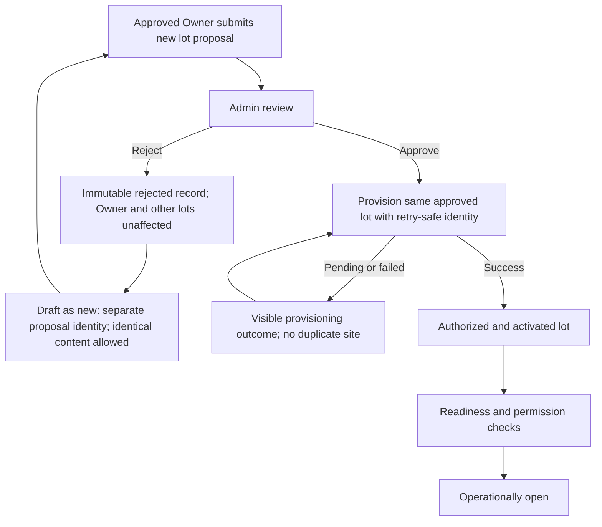
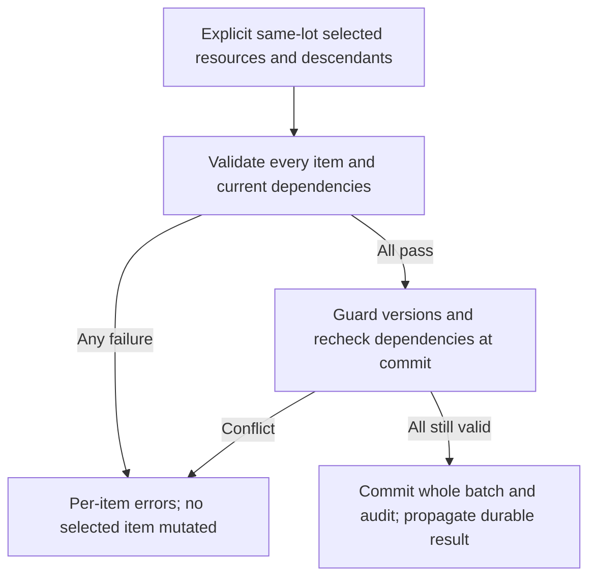

# Facility applications, structure and safe deactivation API design

SPARK-22 / SPARK-25 / SPARK-37 / SPARK-188 / SPARK-189 / SPARK-182 · SPARK-296 update, 21 October 2026. **v1.1 documentation review candidate based on approved decisions**; implementation and wire extensions pending.

Canonical behavior: [facility SRS](../../01-requirements/srs/modules/02-facility-capacity.md), [capacity rules](../../01-requirements/business-rules/02-facility-capacity.md), [UC-LOT-01](../../01-requirements/use-cases/uc-lot-01.md), [permissions](../../01-requirements/srs/permissions.md), [service ownership](../../02-architecture/service-boundaries/ownership-and-events.md), [state transitions](../../01-requirements/srs/state-transitions.md). These links replace duplicated BR narratives; existing reservation, reallocation and settlement/refund invariants remain applicable.

## First lot and additional-lot applications

The first lot is saved inside [Partner Registration](owner-register-api-design.md), before email OTP/verification and combined Admin review. No post-login first-lot creation is required. Approved Owners submit each additional lot as a **separate application**; an Owner's existing approval does not automatically approve a new lot.

| Application operation | Actor/auth | Required request/result and guard |
|---|---|---|
| Create/edit own draft | Current approved Owner, owned organization scope | New proposal identity and submitted facility/product/financial/integration evidence; route/schema pending V11-DES-04. |
| Submit additional lot | Current Owner and draft scope | Stable submission identity/version; server validates proposal. Retry returns the same proposal/result, not another application/site. |
| Review additional lot | Current Admin review permission | Approve/reject with actor/time/reason and inspected version; no Admin editing of pending additional-lot documents or other fields. |
| Draft as new | Owner authorized to read their immutable rejected proposal | Create a distinct draft/proposal referencing source history; identical content is allowed. Never reopen/overwrite rejected record. A retry of this command creates only one new draft. |

Rejection leaves Owner access and other approved lots unchanged. Approved/rejected proposals remain immutable. Final review, provisioning/activation and operational opening are separate; failed/unknown provisioning is visible and retry-safe. No in-app corrections workflow is introduced. V11-DES-04 must finalize paths, DTOs, version/idempotency transport and service ownership mapping; the legacy direct `POST /api/parking-lots` creation cannot bypass additional-lot review.



Before opening, Facility checks approved/provisioned configuration, supported category/layout/capacity and service/open-state configuration; Operations validates accepted occupancy/claims, readiness for admission and safe capacity; Payment provides valid financial terms where sales require them. Current Owner/lot permissions apply. Unmet/unknown readiness blocks opening. Approval or an `isActive` value cannot stand in for all those checks (V11-DES-04).

## Existing structure route references

Retain these integration paths with canonical service ownership; they do not prove the legacy FacilityService implementation meets the target. Normal Owner session and current owned-lot action scope are required, with Operator endpoints separately scoped. A supplied `tenantId` selects an authorized tenant, never grants it.

| Method/path | Request and response contract retained |
|---|---|
| `GET /api/parking-lots` | Owner-only listing, optional authorized `tenantId`; site identity/profile/configuration. It is not public discovery. |
| `GET /api/parking-lots/{id}/structure` | Site, units, slots, access paths and configuration; operational capacity is an Operations-sourced projection with source/freshness. |
| `POST /api/parking-lots/{id}/units` | `type`, `name`, `parentId`, `capacity`; generated unit ID. Same-lot hierarchy, no cycles, case-insensitive sibling uniqueness, outdoor root zone permitted. |
| `POST /api/parking-lots/{id}/slots` | `unitId`, `code`, `vehicleType`, `type`; generated ID. Same-lot unit, site-unique code and category/capacity guards. |
| `POST /api/parking-lots/{id}/paths` | `code`, `from`, `to`, `mapData`; generated ID. Same-lot endpoints and validated JSON; these are internal access paths, not geographic routing. |
| `PATCH /api/parking-lots/{id}/structure` | Existing action discriminator: profile, active, renameUnit, capacity, removeUnit, removeSlot, moveSlot, configureSlot, removePath, backup, markBackup. Action-specific authorization and dependency checks. |
| `POST /api/parking-lots/{id}/operations` | Existing `idempotencyKey`, `edit`, optional authorized `tenantId`; operation ID/status/reason/impact. Completed, pending and failed are distinct outcomes. |
| `GET /api/parking-lots/{id}/operations/{operationId}` | Authorized operation scope; read success does not mean operation completed. |
| `GET /api/parking-lots/{id}/operational-layout` | Operator with current assigned-lot `SLOT_OVERRIDE`; accepted operational projection, not Owner layout CRUD authority. |
| `POST /api/parking-lots/{id}/slots/{slotId}/backup` | Operator current lot `SLOT_OVERRIDE`, `reason`; eligible unoccupied/unprotected operational slot, audit and projection. Owner marking uses its explicit `BACKUP_MARK` action, not inherited authority. |

Retain applicable profile bounds: code 1–50, name 1–255, address 1–2000; paired latitude/longitude within [-90,90]/[-180,180]. Unit names 1–100, layout capacity nonnegative with existing `0` unbounded-layout semantics; never interpret that as unlimited bookable capacity. Slot codes 1–50. Existing coordinate/features/map JSON serialization and 65,536-character bound are compatibility details, not permission to upload new 3D assets. The conflicting historic spatial enum sets (`FLOOR/ZONE/BLOCK` versus a longer hierarchy) and legacy OVERSIZED/EV enum values require Facility wire compatibility review under V11-DES-04; they do not approve extra vehicle products or EV charging. Fixed deployment models remain unchanged.

### Selective slot registration (open design input — SPARK-238)

Registering a slot is already a single-slot operation (`POST /api/parking-lots/{id}/slots`), so "the Owner selects which meshes to manage" needs no new endpoint. What changes is the **default**: a lot is no longer expected to register every mesh at creation time.

- **Why bulk registration is the wrong default:** `removeSlot` is a soft delete (`UPDATE parking_slots SET deleted_at = CURRENT_TIMESTAMP`) and a tombstone is written to `structure_removed_resources` whenever live commitments exist. A flow that re-derives the whole slot set from a manifest deletes and re-creates rows on every edit, which mints new slot UUIDs, orphans allocation history and accumulates tombstones.
- **Constraint that fixes the shape:** `parking_slots` has a table-level `UNIQUE (tenant_id, site_id, slot_code)` plus the case-insensitive `uq_site_slot_code_ci`, while the "active" index is partial on `deleted_at IS NULL` (`02-facility-service-db.sql:84`, `02-facility-service-db.sql:88`, `integration/02-parking-service-alignment.sql:11`). Because the full unique constraint is not partial, a removed code cannot be inserted again — re-registering the same mesh must **resurrect** the existing row (`deleted_at = NULL`), not insert a new one.
- **Proposed behaviour:** register only the slots the Owner explicitly selects; make registration an idempotent upsert on `(site, slot_code)`; never delete a slot merely because a later request omits it.
- **Consequence to accept:** capacity counts **registered** slots only, so an unregistered mesh is neither bookable nor counted. Any capacity figure shown to the Owner must say so.

This note is design input for the facility-creation work stream (US-OW01 / FR-LOT-02). It is **not** part of SPARK-228, which only reads the resulting projection, and it is not yet an approved contract.

Existing action example for an unrelated valid rename:

```json
{
  "action": "renameUnit",
  "resourceId": "11111111-1111-4111-8111-111111111111",
  "name": "Zone A"
}
```

The Operator-only operational-layout route above does not satisfy the Driver's discovery-to-model read requirement. V11-DES-08 must agree a Driver-facing authorized model/availability projection and read scope, preserving the selected lot/vehicle/interval and redacting private operational data. Backend revalidation remains mandatory for booking; no new public route is approved here.

## Same-lot batch deactivation (D11)

FE supports multi-select. The request must explicitly identify all affected resources/descendants within **one lot**, the intended changes and current versions. Do not silently cascade deactivation. Validate every item for current permission, lot membership, descendants, active reservations/holds, occupancy, allocated/protected resources, pass/coverage and other dependencies. Resolve dependencies through the canonical domain workflows and recheck at commit.

If **any** item fails, mutate **none**; return **per-item validation errors** with safe resource/field reasons. A foreign/missing item's details must not leak. Cross-lot batches are rejected. Successful batch commits all selected changes and originating audit facts atomically within the owning service; independent consumer projection recovery does not allow partial business mutation. Method/path, exact `items`/version/error schema and cross-service dependency acknowledgement contract remain V11-DES-09. Do not describe the existing single-action endpoint as an implemented batch API.



## Ownership, capacity and recovery

Facility owns structural/service configuration; Operations owns accepted occupancy, uncertainty, claims, allocation, visits, availability and plan/coverage. IoT provides raw observations, not admission rights. Payment owns tariffs/refunds/settlement. User owns organization/membership. The historical `PUT /internal/tenants/{id}` in Parking is not the target organization-authority contract; internal provisioning/scope routes must be reconciled under V11-DES-04. No shared DB joins/FKs, remote DbContext writes or Domain-layer HTTP orchestration.

Keep physical state/occupancy separate from RESERVED/PROTECTED/BACKUP; an operational marking never changes physical reality. Category/scope capacity accounts for occupied, protected, pending-payment, effective backup and unavailable coverage without double subtraction. Configured backup and eligible marked backup overlap count once; child availability with unsplit inherited backup remains unknown/null, never fabricated. Available-only pass coverage grants no capacity guarantee.

Destructive changes and reductions preserve occupied vehicles, historical associations and accepted commitments. Use Operations impact/reallocation priority and Payment exception/refund contracts; missing dependencies remain pending/failed. Same idempotency identity binds actor/lot/exact request. Durable physical commit and projection acknowledgement remain distinct: after a lost acknowledgement, reconcile/publish the same result, do not reapply an edit or release an unknown commit blindly. Emergency actual physical closure and recovery remain governed by canonical state transitions, without pretending an emergency frees occupied capacity.

Retain safe validation/authentication/scope/not-found, duplicate identifier, structure busy/in-use/conflict and unavailable-dependency outcomes. Existing middleware disagrees on some HTTP mappings (`PATH_NOT_FOUND`, `UNIT_NOT_EMPTY`, capacity errors); final mapping and new per-item batch payload are V11-DES-03/V11-DES-09, not a claimed uniform RFC problem-details contract.

| Existing decision reference | v1.1 disposition |
|---|---|
| DEC-LOT-01 | Outdoor floorless root-zone support retained. |
| DEC-LOT-02 | Backup overlap counted once; canonical capacity rules govern. |
| DEC-LOT-03 | Pending payment consumes claim availability but is not confirmed reservation. |
| DEC-LOT-04 | Scoped Operator override; Owner backup marking only with explicit grant. |
| DEC-LOT-05 | No cross-service database writes; Facility/Operations/User/Payment/IoT authority replaces legacy Parking ownership. |
| DEC-LOT-06 | Model/layout metadata is not operational authority; fixed assets unchanged. |

Discovery and monthly/yearly API integration use [shared contracts](../../02-architecture/api/v1.1-contracts.md#discovery-and-parking-products). [New acceptance scenarios](../../04-testing/requirements-traceability/acceptance-scenarios.md) are NOT RUN.
