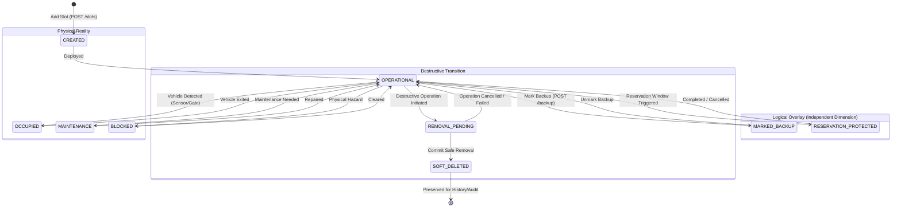
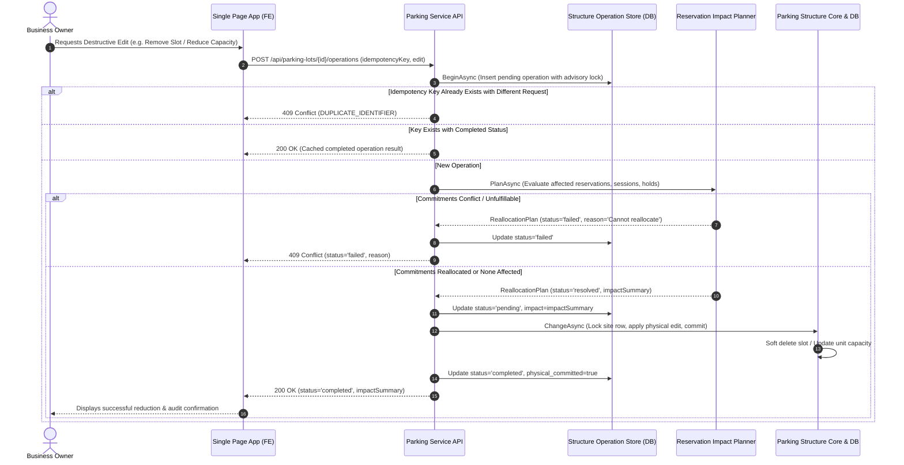
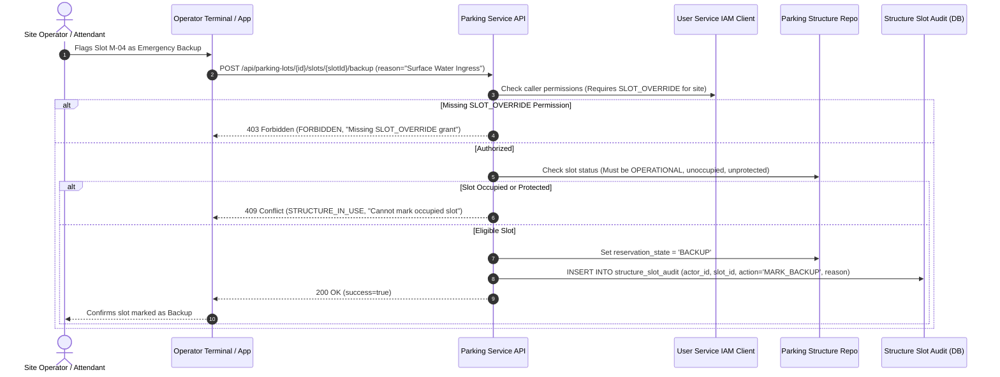

# SmartPark - Parking Structure Management API Design Specification

**Issue ID:** SPARK-22 / SPARK-25 / SPARK-37 (Design Foundation) · SPARK-188 (BE Implementation) · SPARK-189 (FE Integration) · SPARK-182 (API Testing & UAT)  
**Sprint:** Sprint 2  
**Estimate:** 1 SP  
**Author:** Architecture Lead / Team Lead  
**Status:** Approved Specification Baseline  
**Date:** 2026-10-13  
**Target Release:** SmartPark v0.9 Baseline  

---

## 1. Overview & Business Objectives

### 1.1 Objective
This document defines the normative REST API contract for **Parking Structure Management** (`/api/parking-lots/*` and associated operational/internal endpoints) for SmartPark Sprint 2. It unifies functional requirements (SRS §3.2.1–5, §3.4.5–7, §3.7.2; FR-LOT-01/02/03/04, FR-CAP-02/03/07, FR-OPS-03; UC-LOT-01; US-OW01/02, US-O05; BR-AUTH-01/03, BR-CAP-01/02/03/04/05) with the PostgreSQL persistence layer (`parking_sites`, `spatial_units`, `parking_slots`, `parking_access_paths`, `structure_backup_policies`, `structure_operations`, `structure_slot_audit`, `structure_change_audit`) implemented in `scripts/database/05.1-Database-Scripts.sql`, `05.6-Parking-Structure.sql`, and `05.9-Parking-Backup-Operations.sql`.

### 1.2 Core Scope & Business Rules

1. **Facility Lifecycle & Scoping:**
   - Business Owners can create, list, view, update profile attributes, and toggle service/active status for owned parking lots (`parking_sites`).
   - Every operation is strictly scoped to the caller's authenticated `tenant_id` and verified against active IAM membership. Cross-tenant access is rejected with `403 Forbidden`.
   
2. **Spatial Hierarchy & Outdoor Support:**
   - Spatial units follow a hierarchical structure: `BUILDING` → `FLOOR` → `ZONE` → `ROW` → `SECTION` (materialized via `path`, e.g. `/{siteId}/{unitId}/`).
   - **Outdoor Floorless Lots:** Outdoor lots are NOT required to manufacture an artificial floor. Root spatial units can be of type `ZONE` directly attached to the site.
   - Sibling names must be unique within the same parent (`lower(name)` case-insensitive).

3. **Physical Slots & Vehicle Categories:**
   - Physical slots (`parking_slots`) belong to a leaf spatial unit. Slot codes (`slot_code`) are unique within the site (`upper(slot_code)` case-insensitive).
   - Supported vehicle types: `CAR`, `MOTORCYCLE`, `OVERSIZED` (mapped from DB `SEDAN`, `MOTORBIKE`, `TRUCK`/`VAN`).
   - Supported slot categories: `STANDARD`, `VIP`, `EV`, `DISABLED` (mapped from DB `STANDARD`, `VIP`, `EV_CHARGING`, `HANDICAPPED`).
   - Optional 3D coordinate metadata (`coordinates_3d`) and feature attributes (`features`) are preserved as valid JSON objects (up to 65,536 characters).

4. **Separation of Physical State vs. Reservation/Protection State:**
   - Physical operational state (`operational_status`: `OPERATIONAL`, `MAINTENANCE`, `UNKNOWN`, `BLOCKED`) and IoT occupancy (`is_physically_occupied`: `true`/`false`) express physical reality.
   - Reservation intent (`RESERVED`), dynamic buffer (`PROTECTED`), and emergency reserve (`BACKUP`) are **logical/protection states** tracked independently.
   - `BACKUP` is **NEVER a physical-state replacement**. A slot marked as `BACKUP` retains its underlying physical status and occupancy.

5. **Canonical Capacity Accounting & Deduplication Formula (SRS §3.4.5 & BR-CAP-02/04):**
   ```
   Available Capacity = Total Capacity − Occupied − Protected − Pending Payment − Effective Backup − Unavailable
   ```
   - **Total Capacity ($Total$):** Total count of physical slots configured for that scope and vehicle type.
   - **Occupied ($Occupied$):** Slots with physical presence confirmed (`is_physically_occupied = true`).
   - **Protected ($Protected$):** Dynamically calculated from confirmed reservations within the Reservation Protection Window that do not yet have an occupied vehicle.
   - **Pending Payment ($PendingPayment$):** Temporary active payment holds. Pending payment consumes available capacity during its hold window, but is **NOT** confirmed reserved capacity.
   - **Backup Accounting & Prevention of Double Subtraction:**
     - **Configured Backup ($ConfiguredBackup$):** Owner-configured capacity reserve quota per unit/category (`structure_backup_policies`).
     - **Marked Backup ($MarkedBackup$):** Individually designated backup slots (`reservation_state = 'BACKUP'`).
     - **Eligible Marked Backup:** Marked backup slots that are physically unoccupied, `OPERATIONAL`, and not protected.
     - **Effective Backup ($EffectiveBackup$):** Overlap between configured quota and individually marked slots is counted **only once**:
       $$\text{EffectiveBackup} = \sum_{p \in \text{policies}} \max(p.\text{count}, \text{eligibleMarkedInPolicy}) + \text{eligibleMarkedOutsidePolicies}$$
     - If a marked backup slot is physically occupied or unavailable, it is counted under $Occupied$ or $Unavailable$, and is **NOT** double-subtracted under $EffectiveBackup$.
   - **Unavailable ($Unavailable$):** Slots in `MAINTENANCE`, `BLOCKED`, or `UNKNOWN` status that are not already counted as occupied or protected.
   - **Hierarchical Inheritance Rule:** When an ancestor unit configures backup capacity without an explicit child split, child views return `inheritedBackup: true` and `available: null`.

6. **Action-Level Permission Matrix & Separation of Duties:**
   - **Owner Actions:** Profile editing, lot activation/deactivation, spatial unit CRUD, slot CRUD, and capacity configuration require `BUSINESS_OWNER`. Backup capacity quota configuration requires explicit `BACKUP_CONFIGURE` authority.
   - **Operator Operational Marking:** Marking individual physical slots as operational emergency backup requires `SLOT_OVERRIDE` (for Operators) or an explicit `BACKUP_MARK` grant (for Owners). Owners do **NOT** inherit slot-level operational override by default.

7. **Destructive Changes, Capacity Reduction & Reallocation Workflow:**
   - Direct mutations (`removeSlot`, `removeUnit`, `capacity` reduction, deactivation) that could conflict with live commitments are guarded.
   - If a lot has active sessions, future confirmed reservations, or pending holds, destructive edits must proceed through the **Asynchronous Structure Operation Workflow** (`POST /api/parking-lots/{id}/operations`).
   - Reallocation priority: Earlier reservation start time → Earlier confirmation time → Same zone preference.
   - If reallocation is unfulfillable, the system transitions to the Owner refund/exception policy. **Occupied vehicles are NEVER evicted, and historical logs are NEVER deleted.**

8. **Service Autonomy & Integration Boundary:**
   - Parking Service owns structure and physical facts. It coordinates reservation and payment effects strictly via service integration contracts (`IStructureLease`, `IStructureCommitments`, `IStructureImpactPlanner`).
   - Parking Service **never performs direct writes** to the Reservation or Payment databases.
   - Incomplete downstream dependencies result in explicit `pending` or `failed` operational states—never false completion.

---

## 2. Endpoint & Permission Matrix

| Endpoint | Method | Required Role | Required Permission / Scope | Description |
| :--- | :---: | :---: | :--- | :--- |
| `/api/parking-lots` | `GET` | `BUSINESS_OWNER` | Owned Tenant Scope | Lists all parking lots owned by the authenticated business owner. |
| `/api/parking-lots` | `POST` | `BUSINESS_OWNER` | Owned Tenant Scope | Creates a new parking lot facility. |
| `/api/parking-lots/{id}/structure` | `GET` | `BUSINESS_OWNER` | Lot Owner Scope | Retrieves the full authoritative structure (units, slots, paths, capacity views). |
| `/api/parking-lots/{id}/structure` | `PATCH` | `BUSINESS_OWNER` | Specific Action Grant | Executes atomic layout updates (`profile`, `active`, `renameUnit`, `capacity`, `removeUnit`, `removeSlot`, `moveSlot`, `configureSlot`, `removePath`, `backup`, `markBackup`). |
| `/api/parking-lots/{id}/units` | `POST` | `BUSINESS_OWNER` | Lot Owner Scope | Creates a spatial unit (`BUILDING`, `FLOOR`, `ZONE`, `ROW`, `SECTION`). |
| `/api/parking-lots/{id}/slots` | `POST` | `BUSINESS_OWNER` | Lot Owner Scope | Creates a new physical parking slot under a spatial unit. |
| `/api/parking-lots/{id}/paths` | `POST` | `BUSINESS_OWNER` | Lot Owner Scope | Creates an access path or navigation route between units. |
| `/api/parking-lots/{id}/operations` | `POST` | `BUSINESS_OWNER` | Lot Owner Scope | Initiates an idempotent, impact-checked structure operation (removal, reduction). |
| `/api/parking-lots/{id}/operations/{opId}`| `GET` | `BUSINESS_OWNER` | Lot Owner Scope | Polls status and impact result of a structure operation. |
| `/api/parking-lots/{id}/operational-layout`| `GET` | `SITE_OPERATOR` | `SLOT_OVERRIDE` / Site Scope | Reads the operational slot layout for attendant/operator screens. |
| `/api/parking-lots/{id}/slots/{slotId}/backup`| `POST` | `SITE_OPERATOR` / `BUSINESS_OWNER` | `SLOT_OVERRIDE` or `BACKUP_MARK` | Marks/unmarks an individual slot as operational emergency backup with audit reason. |
| `/internal/tenants/{id}` | `PUT` | Service Key | `X-Service-Key` Header | Internal provisioning of tenant record in Parking DB upon Admin approval. |
| `/internal/sites/validate` | `POST` | Service Key | `X-Service-Key` Header | Internal batch validation of site and tenant active status. |

---

## 3. State & Sequence Models

### 3.1 Spatial Unit & Slot Lifecycle State Machine



### 3.2 Idempotent Two-Phase Structure Operation Sequence Diagram



### 3.3 Operational Backup Slot Marking Sequence Diagram



---

## 4. Requirement ↔ Data Schema ↔ DTO Field Mapping

| Requirement Identifier | API DTO Field Name (camelCase) | Data Type & Nullability | Validation & Business Constraints | DB Table & Column (snake_case) | DB Column Type |
| :--- | :--- | :--- | :--- | :--- | :--- |
| **FR-LOT-01** | `siteId` / `id` | `UUID` (Required) | Unique site identifier. | `parking_sites.id` | `UUID PK` |
| **FR-LOT-01** | `code` | `string` (Required) | Length 1–50, trimmed, upper-case unique per tenant. | `parking_sites.site_code` | `VARCHAR(50) NOT NULL` |
| **FR-LOT-01** | `name` | `string` (Required) | Length 1–255 characters. | `parking_sites.name` | `VARCHAR(255) NOT NULL` |
| **FR-LOT-01** | `address` | `string` (Required) | Length 1–2000 characters. | `parking_sites.address` | `TEXT NOT NULL` |
| **FR-LOT-01** | `latitude`, `longitude` | `decimal?` (Optional) | Lat [-90, 90], Long [-180, 180]; must be provided in pairs. | `parking_sites.latitude`, `longitude` | `DECIMAL(10,8)`, `(11,8)` |
| **FR-LOT-01** | `isActive` | `boolean` (Default: `true`) | Active service state. Inactivation requires safe checks. | `parking_sites.is_active` | `BOOLEAN NOT NULL` |
| **FR-LOT-02** | `type` (Spatial Unit) | `enum` (Required) | Enum: `BUILDING`, `FLOOR`, `ZONE`, `ROW`, `SECTION`. | `spatial_units.unit_type` | `VARCHAR(50) NOT NULL` |
| **FR-LOT-02** | `parentId` | `UUID?` (Nullable) | Ancestor must precede child in hierarchy; outdoor root uses `null`. | `spatial_units.parent_id` | `UUID REFERENCES spatial_units` |
| **FR-LOT-02** | `path` | `string` (System Generated) | Materialized path: `/{siteId}/.../{unitId}/`. | `spatial_units.path` | `TEXT NOT NULL` |
| **FR-LOT-02** | `maxCapacity` / `capacity` | `integer` (Default: `0`) | Layout capacity limit. `0` means no limit. $\ge$ physical slots. | `spatial_units.max_capacity` | `INT NOT NULL` |
| **FR-LOT-03** | `slotCode` / `code` | `string` (Required) | Length 1–50, upper-case unique per site. | `parking_slots.slot_code` | `VARCHAR(50) NOT NULL` |
| **FR-LOT-03** | `vehicleType` | `enum` (Required) | Enum: `CAR`, `MOTORCYCLE`, `OVERSIZED`. | `parking_slots.supported_vehicle_type` | `VARCHAR(50) NOT NULL` |
| **FR-LOT-03** | `slotType` | `enum` (Required) | Enum: `STANDARD`, `VIP`, `EV`, `DISABLED`. | `parking_slots.slot_type` | `VARCHAR(50) NOT NULL` |
| **FR-LOT-03** | `coordinates3D` | `string?` / `JSON` | Valid JSON string, max 65,536 chars. | `parking_slots.coordinates_3d` | `JSONB` |
| **FR-LOT-03** | `features` | `string?` / `JSON` | Valid JSON string, max 65,536 chars. | `parking_slots.features` | `JSONB` |
| **FR-OPS-03** | `operationalStatus` | `enum` (Read-only/System) | Enum: `OPERATIONAL`, `MAINTENANCE`, `UNKNOWN`, `BLOCKED`. | `parking_slots.operational_status` | `VARCHAR(50) NOT NULL` |
| **FR-OPS-03** | `isPhysicallyOccupied` | `boolean` (Read-only/IoT) | Physical ground truth from sensors/gate events. | `parking_slots.is_physically_occupied`| `BOOLEAN NOT NULL` |
| **FR-CAP-07** | `reservationState` | `string?` (Nullable) | Logical overlay state: `'BACKUP'`, `'RESERVED'`, `'PROTECTED'`, or `null`. | N/A (Derived / Overlay State) | Memory / Dynamic |
| **FR-CAP-07** | `configuredBackup` | `integer` (Configurable) | Quota configured by Owner (`structure_backup_policies`). | `structure_backup_policies.count` | `INT NOT NULL` |
| **BR-CAP-02** | `available` | `integer?` (Calculated) | $Total - Occupied - Protected - Pending - Backup - Unavail$. `null` if inherited. | Calculated DTO field | N/A |
| **BR-CAP-03** | `idempotencyKey` | `UUID` (Required) | Caller-provided unique key for destructive operations. | `structure_operations.idempotency_key` | `UUID UNIQUE` |

---

## 5. API Endpoint Technical Specifications

### 5.1 List Owned Parking Lots (`GET /api/parking-lots`)

#### Request Headers
```http
Authorization: Bearer <owner_jwt_token>
```

#### Query Parameters
- `tenantId` (`UUID`, Optional): If owner belongs to multiple tenants, specifies the target tenant scope.

#### Sample Success Response (`200 OK`)
```json
{
  "success": true,
  "data": [
    {
      "id": "c1a2b3c4-d5e6-7890-abcd-111122223333",
      "tenantId": "f0000000-0000-0000-0000-000000000001",
      "code": "SITE-CENTRAL-01",
      "name": "Saigon Central Lot",
      "address": "123 Le Loi, District 1, Ho Chi Minh City",
      "latitude": 10.776889,
      "longitude": 106.700806,
      "isActive": true,
      "totalPhysicalCapacity": 120,
      "status": "ACTIVE"
    }
  ]
}
```

---

### 5.2 Create Parking Lot (`POST /api/parking-lots`)

#### Request Body Schema
```json
{
  "$schema": "http://json-schema.org/draft-07/schema#",
  "type": "object",
  "required": ["code", "name", "address"],
  "additionalProperties": false,
  "properties": {
    "code": { "type": "string", "minLength": 1, "maxLength": 50, "example": "SITE-EAST-02" },
    "name": { "type": "string", "minLength": 1, "maxLength": 255, "example": "East Gate Plaza Lot" },
    "address": { "type": "string", "minLength": 1, "maxLength": 2000, "example": "456 Mai Chi Tho, District 2, HCMC" },
    "latitude": { "type": "number", "minimum": -90, "maximum": 90, "example": 10.785123 },
    "longitude": { "type": "number", "minimum": -180, "maximum": 180, "example": 106.745678 },
    "tenantId": { "type": "string", "format": "uuid" }
  }
}
```

#### Sample Success Response (`201 Created`)
```json
{
  "success": true,
  "data": {
    "id": "e2b3c4d5-f6a7-8901-bcde-444455556666",
    "tenantId": "f0000000-0000-0000-0000-000000000001",
    "code": "SITE-EAST-02",
    "name": "East Gate Plaza Lot",
    "address": "456 Mai Chi Tho, District 2, HCMC",
    "latitude": 10.785123,
    "longitude": 106.745678,
    "isActive": true,
    "totalPhysicalCapacity": 0,
    "status": "ACTIVE"
  }
}
```

---

### 5.3 Retrieve Full Authoritative Structure (`GET /api/parking-lots/{id}/structure`)

#### Request Headers
```http
Authorization: Bearer <owner_jwt_token>
```

#### Sample Success Response (`200 OK`)
```json
{
  "success": true,
  "data": {
    "site": {
      "id": "c1a2b3c4-d5e6-7890-abcd-111122223333",
      "tenantId": "f0000000-0000-0000-0000-000000000001",
      "code": "SITE-CENTRAL-01",
      "name": "Saigon Central Lot",
      "address": "123 Le Loi, District 1, Ho Chi Minh City",
      "latitude": 10.776889,
      "longitude": 106.700806,
      "isActive": true,
      "totalPhysicalCapacity": 50,
      "status": "ACTIVE"
    },
    "units": [
      {
        "id": "u1111111-1111-1111-1111-111111111111",
        "parentId": null,
        "path": "/c1a2b3c4-d5e6-7890-abcd-111122223333/u1111111-1111-1111-1111-111111111111/",
        "type": "ZONE",
        "name": "Zone Outdoor A",
        "maxCapacity": 50
      }
    ],
    "slots": [
      {
        "id": "s1111111-1111-1111-1111-111111111111",
        "unitId": "u1111111-1111-1111-1111-111111111111",
        "code": "A-01",
        "vehicleType": "CAR",
        "type": "STANDARD",
        "operationalStatus": "OPERATIONAL",
        "isPhysicallyOccupied": false,
        "reservationState": "BACKUP",
        "coordinates3D": "{\"x\": 10.5, \"y\": 0.0, \"z\": 22.1}",
        "features": "{\"covered\": false, \"hasEvCharger\": false}"
      }
    ],
    "paths": [
      {
        "id": "p1111111-1111-1111-1111-111111111111",
        "code": "ENTRY-NORTH",
        "fromUnitId": null,
        "toUnitId": "u1111111-1111-1111-1111-111111111111",
        "mapData": "{\"pathType\": \"ENTRY\", \"waypoints\": [[10, 5], [10, 20]]}"
      }
    ],
    "backupPolicies": [
      {
        "unitId": "u1111111-1111-1111-1111-111111111111",
        "vehicleType": "CAR",
        "count": 2
      }
    ],
    "capacityViews": [
      {
        "unitId": null,
        "vehicleType": "CAR",
        "total": 50,
        "occupied": 20,
        "protected": 10,
        "pendingPayment": 2,
        "configuredBackup": 2,
        "markedBackup": 1,
        "effectiveBackup": 2,
        "unavailable": 1,
        "available": 15,
        "inheritedBackup": false
      },
      {
        "unitId": "u1111111-1111-1111-1111-111111111111",
        "vehicleType": "CAR",
        "total": 50,
        "occupied": 20,
        "protected": 10,
        "pendingPayment": 2,
        "configuredBackup": 2,
        "markedBackup": 1,
        "effectiveBackup": 2,
        "unavailable": 1,
        "available": 15,
        "inheritedBackup": false
      }
    ]
  }
}
```

---

### 5.4 Structure Mutation (`PATCH /api/parking-lots/{id}/structure`)

This endpoint accepts polymorphic actions validated via `action` discriminator.

#### Action Types & Payload Examples:

1. **Update Profile:**
   ```json
   { "action": "profile", "code": "SITE-CENTRAL-01", "name": "Saigon Central Lot (Renovated)", "address": "123 Le Loi, D1", "latitude": 10.776889, "longitude": 106.700806 }
   ```
2. **Toggle Active Service State:**
   ```json
   { "action": "active", "active": false }
   ```
3. **Rename Spatial Unit:**
   ```json
   { "action": "renameUnit", "resourceId": "u1111111-1111-1111-1111-111111111111", "name": "Zone Outdoor VIP" }
   ```
4. **Set Unit Capacity Limit:**
   ```json
   { "action": "capacity", "resourceId": "u1111111-1111-1111-1111-111111111111", "capacity": 60 }
   ```
5. **Configure Backup Capacity Policy:**
   ```json
   { "action": "backup", "unitId": "u1111111-1111-1111-1111-111111111111", "vehicleType": "CAR", "capacity": 3 }
   ```
6. **Move Slot to Another Spatial Unit:**
   ```json
   { "action": "moveSlot", "resourceId": "s1111111-1111-1111-1111-111111111111", "unitId": "u2222222-2222-2222-2222-222222222222", "code": "B-01" }
   ```
7. **Configure Slot Metadata / Features:**
   ```json
   { "action": "configureSlot", "resourceId": "s1111111-1111-1111-1111-111111111111", "vehicleType": "CAR", "slotType": "EV", "coordinates3D": "{\"x\": 10, \"y\": 0, \"z\": 15}", "features": "{\"hasEvCharger\": true, \"evPowerKw\": 22}" }
   ```
8. **Owner Emergency Mark/Unmark Slot Backup (`BACKUP_MARK` permission required):**
   ```json
   { "action": "markBackup", "resourceId": "s1111111-1111-1111-1111-111111111111", "active": true }
   ```

#### Sample Success Response (`200 OK`)
```json
{
  "success": true
}
```

---

### 5.5 Idempotent Destructive Operations Workflow (`POST /api/parking-lots/{id}/operations`)

Used for safe removal, slot relocation, or capacity reduction where downstream commitments must be evaluated.

#### Request Body Schema
```json
{
  "idempotencyKey": "a9b8c7d6-e5f4-3210-fedc-ba9876543210",
  "edit": {
    "action": "removeSlot",
    "resourceId": "s1111111-1111-1111-1111-111111111111"
  }
}
```

#### Responses:
- **Completed Immediately (`200 OK`):**
  ```json
  {
    "success": true,
    "data": {
      "id": "op-12345678-abcd-ef01-2345-6789abcdef01",
      "siteId": "c1a2b3c4-d5e6-7890-abcd-111122223333",
      "status": "completed",
      "reason": null,
      "impact": "Slot s1111111 removed cleanly. 0 reservations affected."
    },
    "message": "Operation op-12345678: completed."
  }
  ```
- **Asynchronous Reallocation in Progress (`202 Accepted`):**
  ```json
  {
    "success": false,
    "data": {
      "id": "op-12345678-abcd-ef01-2345-6789abcdef01",
      "siteId": "c1a2b3c4-d5e6-7890-abcd-111122223333",
      "status": "pending",
      "reason": "Impact resolved; awaiting physical commit and projection acknowledgement.",
      "impact": "2 reservations scheduled for zone reallocation."
    },
    "message": "Operation op-12345678: pending."
  }
  ```
- **Conflict / Unfulfillable (`409 Conflict`):**
  ```json
  {
    "success": false,
    "data": {
      "id": "op-12345678-abcd-ef01-2345-6789abcdef01",
      "siteId": "c1a2b3c4-d5e6-7890-abcd-111122223333",
      "status": "failed",
      "reason": "Occupied slot cannot be removed or reallocated.",
      "impact": null
    },
    "message": "Operation op-12345678: failed. Occupied slot cannot be removed or reallocated."
  }
  ```

---

### 5.6 Operational Layout & Operator Slot Override (`POST /api/parking-lots/{id}/slots/{slotId}/backup`)

#### Request Headers
```http
Authorization: Bearer <operator_jwt_token>
Content-Type: application/json
```

#### Request Body Schema
```json
{
  "reason": "Temporary ground surface oil spill remediation."
}
```

#### Sample Success Response (`200 OK`)
```json
{
  "success": true
}
```

---

## 6. Error Catalogue & RFC 7807 Machine-Readable Errors

All error responses adhere to the SmartPark RFC 7807 format:

```json
{
  "type": "https://api.smartpark.com/errors/STRUCTURE_IN_USE",
  "title": "Structure In Use",
  "status": 409,
  "code": "STRUCTURE_IN_USE",
  "detail": "Occupied, unknown, allocated or protected slots cannot be removed or moved.",
  "instance": "/api/parking-lots/c1a2b3c4-d5e6-7890-abcd-111122223333/structure",
  "timestamp": "2026-10-13T06:50:00Z"
}
```

### Complete Error Code Inventory Table

| HTTP Status | Error Code | Description / Root Cause | Actionable FE Guidance |
| :---: | :--- | :--- | :--- |
| `400` | `INVALID_STRUCTURE` | Malformed layout, invalid coordinates, invalid JSON, or non-hierarchical parent. | Validate input constraints and highlight offending field. |
| `400` | `CAPACITY_EXCEEDED` | Attempted to add physical slot exceeding ancestor spatial unit's `maxCapacity`. | Prompt user to increase spatial unit capacity first. |
| `401` | `UNAUTHENTICATED` | Missing, expired, or malformed Bearer JWT token. | Redirect user to Login. |
| `403` | `FORBIDDEN` | Caller lacks `BUSINESS_OWNER` or site assignment; or lacks `SLOT_OVERRIDE` / `BACKUP_MARK`. | Display permission denied alert banner. |
| `404` | `SITE_NOT_FOUND` | Specified parking lot does not exist or was deleted. | Navigate back to Lot Overview. |
| `404` | `UNIT_NOT_FOUND` | Specified spatial unit does not exist within target site. | Refresh spatial hierarchy tree. |
| `404` | `SLOT_NOT_FOUND` | Specified slot does not exist within target site. | Refresh slot list view. |
| `404` | `PATH_NOT_FOUND` | Specified access path does not exist. | Refresh access paths list. |
| `409` | `DUPLICATE_IDENTIFIER` | Duplicate sibling unit name, duplicate site slot code, or reused idempotency key with differing payload. | Prompt user with unique naming requirement. |
| `409` | `UNIT_NOT_EMPTY` | Attempted to delete a spatial unit that still contains child units, slots, or path links. | Require deletion/relocation of children first. |
| `409` | `STRUCTURE_IN_USE` | Attempted to delete/move a slot that is physically occupied, in `UNKNOWN` state, or protected. | Deny destructive edit; display active usage warning. |
| `409` | `STRUCTURE_CONFLICT` | Capacity dimensions overlap or exceed physical limits, or legacy declared capacity mismatch. | Prompt user to reconcile physical slot count with capacity pools. |
| `409` | `STRUCTURE_BUSY` | Concurrent modification detected on site; row lock acquisition timed out. | Retry operation automatically or prompt user to retry. |
| `503` | `COMMITMENTS_UNAVAILABLE` | Downstream Reservation/Commitments service unavailable during impact check. | Display retry notice: "Reservation service unavailable; try again shortly." |
| `503` | `IDENTITY_UNAVAILABLE` | User/IAM service unavailable during scope evaluation. | Display temporary unavailability notice. |

---

## 7. Edge Case Inventory & Validation Rules

### 7.1 Spatial Unit Hierarchy vs. Outdoor Floorless Lots
- **Outdoor Lots:** Root units of type `ZONE` (where `parent_id` is null) are first-class constructs. No dummy `BUILDING` or `FLOOR` is forced.
- **Cycle & Scope Prevention:** Units verify that `parent_id` belongs to the exact same `site_id` and that the parent type strictly precedes the child type (`(int)type > (int)parent.Type`), preventing cyclical trees or inverted hierarchy.

### 7.2 Capacity Accounting Edge Cases & Overlap Defense
- **Zero Capacity Semantics:** Unit capacity `0` denotes an unbounded layout without configured threshold. Positive capacity covers all descendant physical slots.
- **Double Subtraction Prevention:**
  - If 5 slots are designated as `BACKUP`, but the Owner's backup policy specifies `count = 5`, effective backup is $\max(5, 5) = 5$, **NOT 10**.
  - If a marked backup slot is physically occupied by a vehicle, it is deducted under $Occupied$, and is excluded from $EffectiveBackup$.
- **Negative Availability Guard:** If $Occupied + Protected + Pending + Backup > Total$, the system throws `CAPACITY_CONFLICT` rather than emitting negative numbers or silent clipping.

### 7.3 Concurrency & Lock Serialization
- **Site Row Locking:** All structure changes execute inside an explicit PostgreSQL transaction taking a site row lock (`SELECT 1 FROM parking_sites WHERE id = site_id FOR UPDATE`).
- **Trigger-Based Commitment Serialization:** Triggers `guard_structure_reservation`, `guard_structure_allocation`, `guard_structure_session`, and `guard_structure_capacity` take the identical site row lock before creating commitments, preventing race conditions between layout edits and reservations.
- **Advisory Locks on Operations:** Distributed advisory locks (`pg_advisory_lock(hashtextextended(id::text, 1))`) serialize concurrent execution of the same idempotency key.

### 7.4 Historical Preservation & Anti-Eviction Invariant
- **No Vehicle Eviction:** A vehicle parked in a slot can NEVER be evicted by a layout edit. The API rejects slot removal with `STRUCTURE_IN_USE`.
- **Soft Deletion & Referential Integrity:** Deleted slots and units retain their historical UUIDs (`deleted_at IS NOT NULL`). Foreign keys in completed reservations and past parking sessions remain valid. Direct SQL check `ck_deleted_slot_not_occupied` prevents revival of occupancy on deleted slots.

---

## 8. Unresolved Decision & Conflict Log

| Issue Key | Topic | Description & Decision Context | Status |
| :--- | :--- | :--- | :--- |
| **DEC-LOT-01** | Outdoor Lot Hierarchy | **Confirmed (SRS §3.2.1):** Outdoor parking lots do not require synthetic `FLOOR` records; root `ZONE` units are fully supported. | **Resolved** |
| **DEC-LOT-02** | Backup Capacity vs. Backup Slots | **Confirmed (SRS §3.4.5 & C-06):** Configured backup quota and individually marked backup slots are unified via $\max(\text{quota}, \text{marked})$, preventing double deduction. | **Resolved** |
| **DEC-LOT-03** | Pending Payment Accounting | **Confirmed (BR-CAP-02):** Pending payment holds deduct from available capacity during active hold, but are not counted as confirmed reservations. | **Resolved** |
| **DEC-LOT-04** | Operator Override vs. Owner Scope | **Confirmed (SPARK-202):** Marking individual slots as operational backup belongs to Operator (`SLOT_OVERRIDE`). Owners require explicit `BACKUP_MARK` grant. | **Resolved** |
| **DEC-LOT-05** | Service Boundary Writes | **Confirmed Architecture:** Parking Service never writes to Reservation/Payment databases; all downstream reconciliation goes through `IStructureCommitments` and `IStructureImpactPlanner`. | **Resolved** |
| **DEC-LOT-06** | 3D Visualization Payload Boundary | **Confirmed:** Map and 3D coordinate schemas remain non-authoritative JSON attributes (`coordinates_3d`, `features`, `map_data`), bounded to 64KB. | **Resolved** |

---

## 9. Verification & Acceptance Checklist

- [x] Versioned REST API technical specification documented for all parking structure management endpoints.
- [x] Endpoint Permission Matrix defined covering Owner operations, Operator overrides, and Internal service calls.
- [x] State Diagrams and Sequence Diagrams covering slot lifecycle, idempotent operations, and operational backup marking embedded.
- [x] Full Traceability Table mapping SRS requirements ↔ DB schema columns ↔ DTO attributes.
- [x] Sample payloads for Request, Success Response, and RFC 7807 Machine-Readable Errors included.
- [x] Canonical Capacity Accounting formula ($Total - Occupied - Protected - Pending - Backup - Unavail$) and overlap prevention fully specified.
- [x] Edge-case inventory (concurrency, outdoor lots, anti-eviction invariant, soft deletion, and downstream integration failure) complete.
