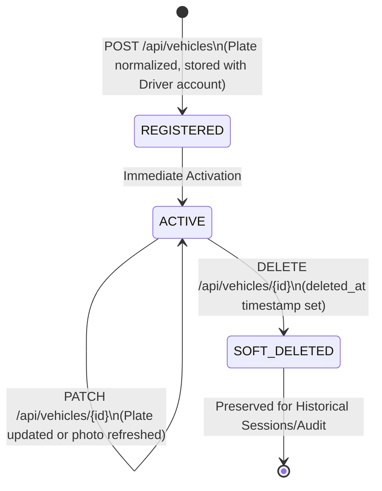
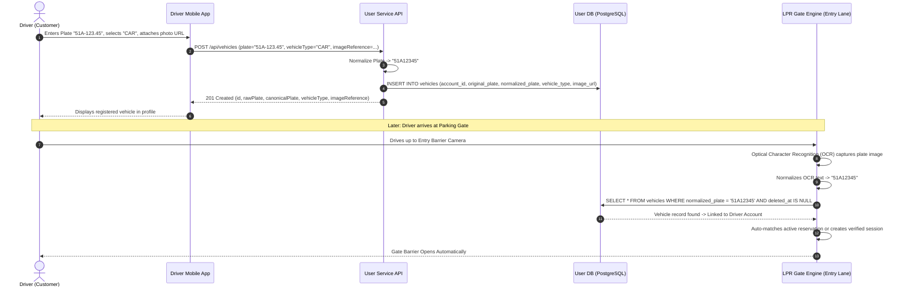

# SmartPark - Vehicle Registration & Canonical Plate Normalization API Design Specification

**Issue ID:** SPARK-220 (Vehicle Registration API Design) · SPARK-221 (BE Implementation) · SPARK-222 (FE Integration) · SPARK-223 (API Testing & LPR UAT)  
**Sprint:** Sprint 2  
**Estimate:** 1 SP  
**Author:** Architecture Lead / Team Lead  
**Status:** Approved Specification Baseline  
**Date:** 2026-10-13  
**Target Release:** SmartPark v0.9 Baseline  

---

## 1. Overview & Business Objectives

### 1.1 Objective
This document defines the normative REST API specification for **Driver Vehicle Registration** (`/api/vehicles`) and the **Canonical Plate Normalization Engine** for SmartPark Sprint 2. It bridges requirement specifications (SRS v0.9 §3.1.3; FR-VEH-01; FR-VEH-03; FR-AUTH-06; US-D09; BR-VEH-01/03) with the persistence model in PostgreSQL table `vehicles` (`scripts/database/05.1-Database-Scripts.sql` and `05.8-Account-Workflow-Vehicles.sql`) and establishes an unambiguous contract consumed by Backend, Frontend, and LPR (License Plate Recognition) gate services.

### 1.2 Core Scope & Business Rules

1. **Driver-Owned Plated Vehicle Registration (FR-VEH-01, US-D09):**
   - Authenticated Drivers can register, list, update, and remove (soft-delete) their personal plated vehicles.
   - Every operation is strictly scoped to the caller's authenticated identity (`account_id` belonging to an active Driver account).
   - Cross-account reading, updating, or deleting of vehicles is rejected with `404 Not Found` or `403 Forbidden` (`VEHICLE_NOT_FOUND` / `FORBIDDEN`).

2. **Dual-Plate Representation (Raw vs. Canonical):**
   - **Original/Raw Plate (`RawPlate` / `original_plate`):** Preserves the exact user input (with formatting, punctuation, and casing, e.g. `"51A-123.45"` or `"29-B1 987.65"`) for faithful frontend display.
   - **Canonical Normalized Plate (`CanonicalPlate` / `normalized_plate`):** Cleaned, stripped, and uppercase alphanumeric string (e.g. `"51A12345"`, `"29B198765"`) optimized for indexing, search, and automated License Plate Recognition (LPR) camera matching at entry/exit gates.

3. **Supported Vehicle Categories (BR-VEH-01):**
   - Supported vehicle types are strictly constrained to:
     - `CAR`: Automobiles, SUVs, Sedans.
     - `MOTORCYCLE`: Motorbikes, scooters, two-wheelers.
   - Commercial oversized vehicles and trailers are handled via manual operator workflows, not customer self-service.

4. **Image Reference & Security Boundary:**
   - The API accepts an optional or required vehicle image reference (`imageReference` / `image_url`, max 2048 chars).
   - **SSRF Defense:** The URL must be an absolute HTTPS URL (`https://...`). The server stores the reference as metadata and **does not fetch or crawl the URL server-side**.

5. **Exclusion of Non-Plated Vehicles (FR-VEH-03):**
   - Bicycles, unplated scooters, and unregistered vehicles are **strictly excluded** from permanent vehicle registration.
   - Non-plated visits utilize the walk-in parking session or temporary paper/RFID ticket workflow (FR-VEH-03) managed at the gate.

6. **Status of FR-VEH-02 (Duplicate Plates — Explicitly OPEN & Out of Scope):**
   - Requirement **FR-VEH-02 (Duplicate-plate claim, dispute, and ownership transfer)** remains **OPEN** in SRS v0.9.
   - As decided in schema migration `05.8-Account-Workflow-Vehicles.sql`, the database unique constraint on plates was replaced by a non-unique lookup index (`ix_active_vehicle_plate ON vehicles(normalized_plate) WHERE deleted_at IS NULL`).
   - If two drivers register the same license plate, the system allows the entry without collision error, but **does not grant cross-account access or ownership transfer**.
   - No speculative vehicle-claiming, title-verification (Cavet/GPLX upload), or dispute-resolution workflow is invented in this contract.

---

## 2. Endpoint & Permission Matrix

| Endpoint | Method | Required Role | Required Scope / State | Description |
| :--- | :---: | :---: | :--- | :--- |
| `/api/vehicles` | `GET` | `driver` | Authenticated Driver (`ACTIVE`) | Lists all active registered vehicles belonging to the caller's Driver account. |
| `/api/vehicles` | `POST` | `driver` | Authenticated Driver (`ACTIVE`) | Registers a new plated vehicle, normalizing the license plate. |
| `/api/vehicles/{id}` | `PATCH` | `driver` | Owner of Vehicle (`account_id`) | Updates vehicle profile, vehicle type, plate, or photo URL for an existing vehicle. |
| `/api/vehicles/{id}` | `DELETE` | `driver` | Owner of Vehicle (`account_id`) | Soft-deletes a registered vehicle record (`deleted_at = NOW()`). |

---

## 3. Canonical Plate Normalization Specification

To ensure 100% interoperability between Mobile FE, Web FE, Backend persistence, and LPR camera OCR engines, all components must adhere to the following normalization contract:

### 3.1 Normalization Algorithm
```text
1. Input: rawPlate (string), vehicleType (enum: CAR | MOTORCYCLE)
2. Trim leading and trailing whitespace: rawPlate = rawPlate.Trim()
3. Convert all characters to uppercase: rawPlate = rawPlate.ToUpperInvariant()
4. Strip all separators (spaces, dots, hyphens, underscores):
   canonicalPlate = Regex.Replace(rawPlate, @"[\s.\-_]", "")
5. Syntax Validation:
   - If vehicleType == "CAR":
     Regex: ^[1-9][0-9][A-Z][0-9]{5}$
     Length: exactly 8 characters.
     Format: [2-digit province code (10-99)] + [1 series letter (A-Z)] + [5 numeric digits]
   - If vehicleType == "MOTORCYCLE":
     Regex: ^[1-9][0-9][A-Z][A-Z0-9][0-9]{5}$
     Length: 8 or 9 characters.
     Format: [2-digit province code] + [1 series letter] + [1 optional letter or digit] + [5 numeric digits]
6. Output: canonicalPlate
```

### 3.2 Canonical Transformation Examples

| Input Plate (`plate`) | Vehicle Type (`vehicleType`) | Canonical Value (`canonicalPlate`) | Validation Result | Notes |
| :--- | :---: | :---: | :---: | :--- |
| `51A-123.45` | `CAR` | `51A12345` | ✅ Valid | Standard car plate with hyphen and dot |
| `30F - 987.65` | `CAR` | `30F98765` | ✅ Valid | Spaces and punctuation cleanly stripped |
| `59-F1 987.65` | `MOTORCYCLE` | `59F198765` | ✅ Valid | Motorcycle 2-character sub-series (`F1`) |
| `29B-12345` | `MOTORCYCLE` | `29B12345` | ✅ Valid | Motorcycle single-letter sub-series |
| `51a12345` | `CAR` | `51A12345` | ✅ Valid | Lowercase transformed to uppercase |
| `01A-123.45` | `CAR` | — | ❌ Invalid (`INVALID_PLATE`) | Invalid province code (`01` does not exist) |
| `51A-1234` | `CAR` | — | ❌ Invalid (`INVALID_PLATE`) | Insufficient digits (requires 5 digits in v0.9 baseline) |
| `ABC-123` | `CAR` | — | ❌ Invalid (`INVALID_PLATE`) | Non-Vietnamese format |

---

## 4. State & Sequence Models

### 4.1 Vehicle Lifecycle State Diagram



### 4.2 Vehicle Registration & Ingress LPR Matching Sequence Diagram



---

## 5. Requirement ↔ Data Schema ↔ DTO Field Mapping

| Requirement Identifier | API DTO Field Name (camelCase) | Data Type & Nullability | Validation & Business Constraints | DB Table & Column (snake_case) | DB Column Type |
| :--- | :--- | :--- | :--- | :--- | :--- |
| **FR-VEH-01** | `id` | `UUID` (System Generated) | Primary key for registered vehicle. | `vehicles.id` | `UUID PK` |
| **FR-VEH-01** | `plate` / `rawPlate` | `string` (Required) | Length 1–30 characters. Raw user-provided format. | `vehicles.original_plate` | `VARCHAR(30) NOT NULL` |
| **FR-VEH-01** | `canonicalPlate` | `string` (System Calculated) | Length 8–9 characters. Alphanumeric uppercase. | `vehicles.normalized_plate` | `VARCHAR(20) NOT NULL` |
| **BR-VEH-01** | `vehicleType` | `enum` (Required) | Enum: `'CAR'`, `'MOTORCYCLE'`. | `vehicles.vehicle_type` | `VARCHAR(50) NOT NULL` |
| **FR-VEH-01** | `imageReference` | `string?` (Optional) | Length $\le 2048$. Must be a valid absolute HTTPS URL. | `vehicles.image_url` | `TEXT NULL` |
| **FR-AUTH-06** | `accountId` | `UUID` (System Assigned) | Foreign key pointing to caller's Driver account. | `vehicles.account_id` | `UUID REFERENCES accounts` |
| **US-D09** | `createdAt` | `ISO 8601 Timestamp` | Record creation timestamp. | `vehicles.created_at` | `TIMESTAMPTZ NOT NULL` |
| **US-D09** | `updatedAt` | `ISO 8601 Timestamp` | Record last update timestamp. | `vehicles.updated_at` | `TIMESTAMPTZ NOT NULL` |
| **US-D09** | `deletedAt` | `ISO 8601 Timestamp?` | Soft delete timestamp (`null` if active). | `vehicles.deleted_at` | `TIMESTAMPTZ NULL` |

---

## 6. API Technical Specifications & Contract Payloads

### 6.1 Register Vehicle (`POST /api/vehicles`)

#### Request Headers
```http
Authorization: Bearer <driver_jwt_token>
Content-Type: application/json
```

#### Request Body Schema
```json
{
  "$schema": "http://json-schema.org/draft-07/schema#",
  "type": "object",
  "required": ["plate", "vehicleType"],
  "additionalProperties": false,
  "properties": {
    "plate": {
      "type": "string",
      "minLength": 1,
      "maxLength": 30,
      "example": "51A-123.45"
    },
    "vehicleType": {
      "type": "string",
      "enum": ["CAR", "MOTORCYCLE"],
      "example": "CAR"
    },
    "imageReference": {
      "type": "string",
      "maxLength": 2048,
      "format": "uri",
      "pattern": "^https://.+",
      "example": "https://storage.smartpark.com/vehicles/car-51a12345.jpg"
    }
  }
}
```

#### Sample Success Response (`201 Created`)
```json
{
  "success": true,
  "data": {
    "id": "7b8c9d0e-1f2a-3b4c-5d6e-7f8a9b0c1d2e",
    "accountId": "a1b2c3d4-e5f6-7890-abcd-1234567890ab",
    "rawPlate": "51A-123.45",
    "canonicalPlate": "51A12345",
    "vehicleType": "CAR",
    "imageReference": "https://storage.smartpark.com/vehicles/car-51a12345.jpg",
    "createdAt": "2026-10-13T10:15:30Z",
    "updatedAt": "2026-10-13T10:15:30Z"
  }
}
```

---

### 6.2 List Driver's Registered Vehicles (`GET /api/vehicles`)

#### Request Headers
```http
Authorization: Bearer <driver_jwt_token>
```

#### Sample Success Response (`200 OK`)
```json
{
  "success": true,
  "data": [
    {
      "id": "7b8c9d0e-1f2a-3b4c-5d6e-7f8a9b0c1d2e",
      "accountId": "a1b2c3d4-e5f6-7890-abcd-1234567890ab",
      "rawPlate": "51A-123.45",
      "canonicalPlate": "51A12345",
      "vehicleType": "CAR",
      "imageReference": "https://storage.smartpark.com/vehicles/car-51a12345.jpg",
      "createdAt": "2026-10-13T10:15:30Z",
      "updatedAt": "2026-10-13T10:15:30Z"
    },
    {
      "id": "8c9d0e1f-2a3b-4c5d-6e7f-8a9b0c1d2e3f",
      "accountId": "a1b2c3d4-e5f6-7890-abcd-1234567890ab",
      "rawPlate": "59-F1 987.65",
      "canonicalPlate": "59F198765",
      "vehicleType": "MOTORCYCLE",
      "imageReference": null,
      "createdAt": "2026-10-13T11:00:00Z",
      "updatedAt": "2026-10-13T11:00:00Z"
    }
  ]
}
```

---

### 6.3 Update Registered Vehicle (`PATCH /api/vehicles/{id}`)

#### Request Body Schema
```json
{
  "$schema": "http://json-schema.org/draft-07/schema#",
  "type": "object",
  "required": ["plate", "vehicleType"],
  "additionalProperties": false,
  "properties": {
    "plate": { "type": "string", "minLength": 1, "maxLength": 30, "example": "51A-123.45" },
    "vehicleType": { "type": "string", "enum": ["CAR", "MOTORCYCLE"], "example": "CAR" },
    "imageReference": { "type": "string", "maxLength": 2048, "example": "https://storage.smartpark.com/vehicles/car-new-photo.jpg" }
  }
}
```

#### Sample Success Response (`200 OK`)
```json
{
  "success": true,
  "data": {
    "id": "7b8c9d0e-1f2a-3b4c-5d6e-7f8a9b0c1d2e",
    "accountId": "a1b2c3d4-e5f6-7890-abcd-1234567890ab",
    "rawPlate": "51A-123.45",
    "canonicalPlate": "51A12345",
    "vehicleType": "CAR",
    "imageReference": "https://storage.smartpark.com/vehicles/car-new-photo.jpg",
    "createdAt": "2026-10-13T10:15:30Z",
    "updatedAt": "2026-10-13T11:30:00Z"
  }
}
```

---

### 6.4 Soft-Delete Vehicle (`DELETE /api/vehicles/{id}`)

#### Sample Success Response (`200 OK`)
```json
{
  "success": true,
  "message": "Vehicle removed successfully."
}
```

---

## 7. Error Catalogue & RFC 7807 Machine-Readable Errors

All error responses strictly follow the SmartPark RFC 7807 problem details specification:

```json
{
  "type": "https://api.smartpark.com/errors/INVALID_PLATE",
  "title": "Invalid License Plate",
  "status": 400,
  "code": "INVALID_PLATE",
  "detail": "Plate 'ABC-123' does not match the supported Vietnamese application format for CAR.",
  "instance": "/api/vehicles",
  "timestamp": "2026-10-13T10:15:30Z",
  "invalidParams": [
    {
      "name": "plate",
      "reason": "Expected 2-digit province code, 1 series letter, and 5 digits (e.g. 51A-123.45)."
    }
  ]
}
```

### Complete Error Code Inventory Table

| HTTP Status | Error Code | Description / Root Cause | Actionable FE Guidance |
| :---: | :--- | :--- | :--- |
| `400` | `INVALID_PLATE` | Plate string fails canonical Vietnamese regex rules. | Highlight plate input; display format guideline tooltip. |
| `400` | `VALIDATION_FAILED` | `imageReference` is not an absolute HTTPS URL or string exceeds length. | Prompt user with "Please provide a valid secure HTTPS photo link." |
| `401` | `UNAUTHENTICATED` | Missing, expired, or malformed JWT Bearer token. | Redirect caller to Login screen. |
| `403` | `FORBIDDEN` | Caller does not hold an active `DRIVER` account role. | Display unauthorized account alert. |
| `404` | `VEHICLE_NOT_FOUND` | Specified vehicle ID does not exist, is soft-deleted, or belongs to another Driver. | Return 404 and refresh the vehicle list. |
| `429` | `RATE_LIMIT_EXCEEDED`| Excessive vehicle mutation requests from caller. | Throttling alert with retry countdown. |

---

## 8. Edge Case Inventory & Technical Controls

### 8.1 Punctuation, Whitespace & Diacritics
- Users frequently enter plates with inconsistent punctuation: `"51-A 123.45"`, `"51A.12345"`, `"51A 123 45"`.
- The normalization regex `[\s.\-_]` ensures all such variations collapse into the identical canonical string `"51A12345"`.
- Non-alphanumeric unicode or special characters (e.g. accented vowels) fail the regex check and trigger `INVALID_PLATE`.

### 8.2 Cross-Account Isolation
- Query enforcement:
  ```sql
  SELECT * FROM vehicles 
  WHERE id = @id 
    AND account_id = ANY(@callerDriverAccountIds) 
    AND deleted_at IS NULL;
  ```
- If a Driver attempts to update or inspect another user's vehicle ID, the query returns zero rows, triggering a safe `404 Not Found` (`VEHICLE_NOT_FOUND`) to prevent ID enumeration.

### 8.3 Unresolved Duplicate Plates (FR-VEH-02 Boundary)
- If two different drivers register `51A-123.45`:
  - Both records persist independently in the database with their respective `account_id` values.
  - Driver A **cannot** see, edit, or delete Driver B's vehicle record.
  - At the parking gate, LPR queries active reservations by `normalized_plate = '51A12345'`. If an active reservation exists for Driver A, the gate admits Driver A.
  - Dispute resolution, cavet upload, ownership claiming, and title transfers remain **strictly deferred** to the future FR-VEH-02 specification.

### 8.4 Historical Referential Integrity & Soft Deletion
- Deleting a vehicle sets `deleted_at = NOW()`.
- Historical parking sessions (`parking_sessions`), past slot allocations, and financial invoices that reference `vehicle_id` or `account_id` remain intact and valid. Foreign keys are never cascaded or broken.

---

## 9. Unresolved Decision & Conflict Log

| Issue Key | Topic | Description & Decision Context | Status |
| :--- | :--- | :--- | :--- |
| **DEC-VEH-01** | Plate Normalization Algorithm | **Confirmed (08/10/2026 Baseline):** Normalization strips `[\s.\-_]` and uppercases. CAR format requires 2-digit province + 1 letter + 5 digits. MOTORCYCLE format requires 2-digit province + 2 chars + 5 digits. | **Resolved** |
| **DEC-VEH-02** | Duplicate Plate Claims (FR-VEH-02) | **Confirmed OPEN & Out of Scope:** Duplicate-plate dispute and ownership transfer workflows are deferred. Database dropped global uniqueness in migration `05.8` to permit independent driver registration without cross-account leakage. | **Deferred / OPEN** |
| **DEC-VEH-03** | Image Reference Storage | **Confirmed:** Server stores external HTTPS image references without executing server-side downloads, preventing SSRF vulnerabilities. | **Resolved** |
| **DEC-VEH-04** | Non-Plated Vehicle Support | **Confirmed (FR-VEH-03):** Non-plated vehicles (bicycles, carts) cannot be registered in `/api/vehicles`; they use gate parking session tickets. | **Resolved** |

---

## 10. Verification & Acceptance Checklist

- [x] Versioned REST API technical specification documented for all Vehicle endpoints (`GET`, `POST`, `PATCH`, `DELETE /api/vehicles`).
- [x] Authorization rules constrained to verified Driver identity (`account_id` scoping).
- [x] Canonical Plate Normalization algorithm and transformation test cases comprehensively defined.
- [x] Traceability Table mapping SRS v0.9 (FR-VEH-01/03, US-D09) ↔ PostgreSQL schema (`vehicles`) ↔ DTO attributes.
- [x] Sample payloads for Request, Success Response, and RFC 7807 Machine-Readable Errors included.
- [x] Duplicate-plate claim workflow (FR-VEH-02) explicitly marked as OPEN and out of scope, avoiding artificial assumptions.
- [x] Edge-case inventory (punctuation, SSRF defense, cross-account isolation, soft deletion) complete.
