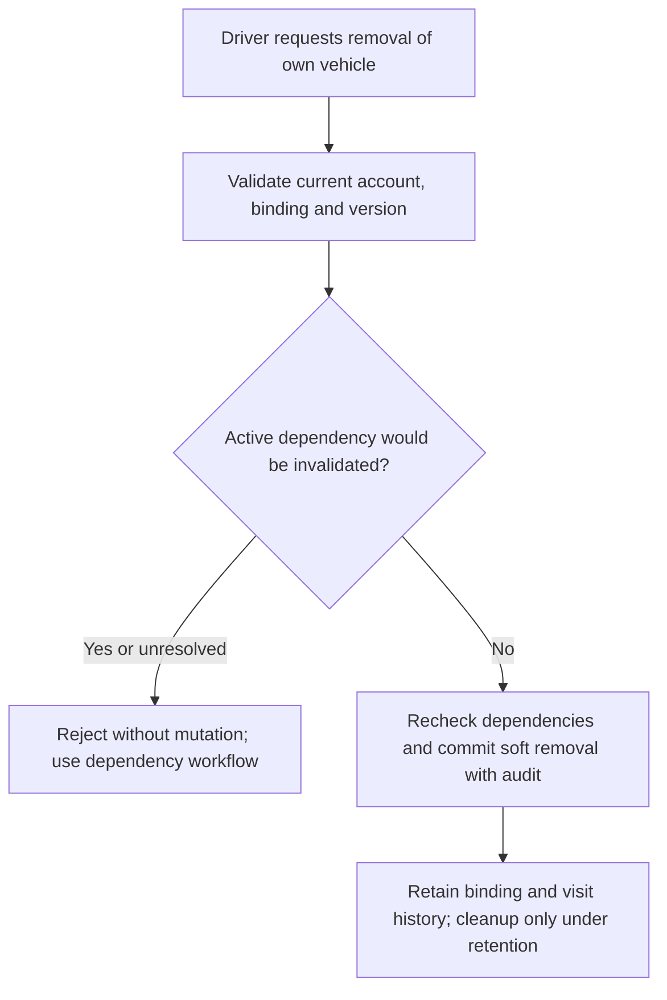

# Vehicle registration, binding and soft removal API design

SPARK-220 / SPARK-221 / SPARK-222 / SPARK-223 · SPARK-296 update, 21 October 2026. **v1.1 documentation review candidate based on approved decisions**; API compatibility and implementation pending.

Canonical behavior: [FR-VEH-01–04](../../01-requirements/srs/modules/01-identity-access.md), [UC-VEH-01](../../01-requirements/use-cases/uc-veh-01.md), [UC-VEH-02](../../01-requirements/use-cases/uc-veh-02.md), [media requirements](../../01-requirements/srs/modules/09-file-media.md), [service boundaries](../../02-architecture/service-boundaries/ownership-and-events.md). The old statement that FR-VEH-02 remains OPEN is superseded by the existing confirmed binding/dispute requirement; code permitting independent conflicting bindings is evidence of alignment work, not approved behavior.

## Actor, routes and input/output

Current Driver account and record ownership are required. Server derives account identity from current authenticated membership. Foreign/missing records return safe not-found/forbidden without disclosing another holder.

| Method/path | Required contract |
|---|---|
| `GET /api/vehicles` | Own active registered vehicles only; raw/canonical plate, category, authorized image reference and record metadata. Historical associations remain retained outside active listing. |
| `POST /api/vehicles` | Existing `plate`, `vehicleType` and vehicle image requirement; validate raw/canonical form, own asset binding and conflicting active normalized binding. Return created own record. |
| `PATCH /api/vehicles/{id}` | Validate own record and active dependencies before changing plate/category/image. Existing implementation expects the full field set; partial-update semantics and media-reference transport require V11-DES-10 agreement. |
| `DELETE /api/vehicles/{id}` | Retained design route for **soft removal only**; current implementation coverage is not claimed. Guard active dependencies/history; final response/error contract V11-DES-10. |

Retain record identity, raw input, canonical normalized plate, category, image reference, creation/update and nullable removal metadata. Raw plate preserves exact supplied text; normalization derives a separate value. Supported self-service plated categories remain CAR and MOTORCYCLE; non-plated visits use scoped operational session/ticket identity, not a fabricated permanent plate. No EV charging or new oversized self-service product is introduced.

## Normalization and media compatibility

Existing integration normalizes uppercase and strips whitespace, dots and hyphens. Preserve representative transformations `51a-123.45 → 51A12345` and `59-F1 987.65 → 59F198765`. The historical prototype regex supports CAR two digits + one letter + five digits, and MOTORCYCLE two digits + two series characters + five digits; its motorcycle pattern has nine characters, so the old eight-character accepted example contradicted it. Exact legal/special-series acceptance, underscore handling and shared FE/BE/LPR syntax remain technical format-review work under V11-DES-10. Do not claim a regex proves all legally valid Vietnamese plates or invent legal eligibility.

Vehicle images are required by the canonical SRS: JPEG/PNG/WebP up to 5 MiB, validated through backend uploads. User owns the image lifecycle; use a stable opaque owning-service asset reference and authorized restricted delivery, not an arbitrary client HTTPS URL. The old `imageReference` URL/string shape requires V11-DES-10 compatibility agreement; HTTPS syntax alone is not asset authorization. Preserve media retention and acknowledged holds; do not extend retention merely because an image is referenced by a historical visit.

Conceptual input, **not the finalized media wire schema**:

```json
{
  "plate": "51a-123.45",
  "vehicleType": "CAR",
  "imageReference": {"ownerService":"user-access","assetId":"<authorized-asset-id>"}
}
```

## Binding and removal guards

Reject conflicting active normalized binding without disclosing the existing account. [UC-VEH-02](../../01-requirements/use-cases/uc-veh-02.md) requires verified contact, relevant registration/transfer evidence, scoped Operator findings, existing-holder notification and a reasoned Admin decision. No transfer on silence, plate image or OTP alone; unresolved cases stay pending/escalated. User commits binding changes with version guard and retained association history. IoT recognition is an observation; Operations controls admission and never queries the User database directly or opens a gate solely from a plate match.

D12 removal first checks live reservations, visits, pass coverage and other active dependencies through their owning contracts. Reject removal that would invalidate them until handled by their approved workflows. Recheck dependencies at commit to serialize removal against new claims and binding changes. On success soft-remove the active association/record, retain account/vehicle/plate and historical visit/financial attribution, and exclude it from active listing. Removal is **not transfer approval**. Hard cleanup occurs only under approved retention and holds; no cascade deletion of historical associations.



## Errors, retries and retained decisions

Preserve `INVALID_PLATE`, validation, authentication, `FORBIDDEN`, `VEHICLE_NOT_FOUND` integration outcomes. Conflicting binding, invalid/unowned media, active dependency and concurrent-change errors must be safe and actionable; final codes/HTTP/envelope and removal repeat behavior are V11-DES-03/V11-DES-10. Retry cannot duplicate removal/history or approve a transfer. No raw exceptions or foreign-account identity are exposed.

| Existing reference | v1.1 disposition |
|---|---|
| DEC-VEH-01 | Raw/canonical separation retained; exact supported-format compatibility requires review. |
| DEC-VEH-02 | Confirmed guarded active binding/dispute workflow governs; historical non-unique implementation is not authority. |
| DEC-VEH-03 | Service-owned restricted media reference replaces arbitrary external URL shortcut. |
| DEC-VEH-04 | Non-plated visits use session/ticket workflow; no permanent invented plate. |

[Pending actions](../../02-architecture/api/v1.1-contracts.md#design-pending-owneraction-register): V11-DES-10. [New acceptance scenarios](../../04-testing/requirements-traceability/acceptance-scenarios.md) are NOT RUN.
