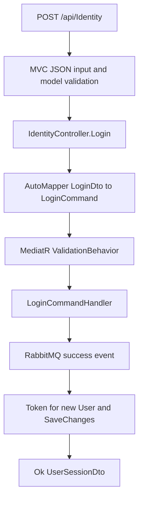
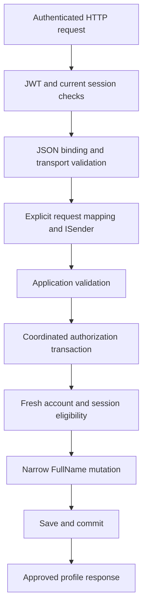

# Mentor example versus SmartPark: architecture review

**Review date:** 2026-10-23, Asia/Saigon  
**Scope:** architecture and US-U01 / SPARK-248 own-profile design; review only  
**Disposition:** retain the overall five-layer/CQRS direction; revise the uncommitted profile slice before acceptance.

## 1. Recommendation

Keep SmartPark's confirmed architecture. Adopt the mentor's separation of HTTP handling, Application requests/handlers, validation, and Persistence interfaces. Do **not** adopt the mentor login implementation as authentication code: it never verifies credentials. Keep SmartPark's existing password verification, session checks, and fresh account eligibility checks.

For normal profile editing, prefer a small Application-owned input DTO mapped explicitly to a command, an `ISender` controller, an Application-owned current-actor port implemented by API, a narrow domain name mutation, and Persistence-owned tracked writes. This is a recommendation about this feature, not a universal requirement to duplicate DTOs or use a particular controller base class.

The user clarified during this review that **account locking/session revocation during a profile save must be prevented atomically**. Therefore an explicit transaction or equivalent guarded write is justified here to coordinate authorization with persistence. It is not justified merely because EF calls `SaveChangesAsync`. Preserve last-write-wins for ordinary competing name edits; do not introduce mandatory client ETags or name-version conflicts.

The current uncommitted transaction does not fully achieve that security guarantee. Authentication first loads a tracked user; the later locking query can return that same stale entity. Locking only `users` also does not coordinate every session/account-role mutation. Resolve these boundaries before calling the slice safe.

Keep avatar replacement **and removal** deferred. Treat the branch's name normalization/length policy and `{ reference }` avatar shape as proposals: the user explicitly confirmed they were not approved. Preserve the approved avatar representation once identified; do not silently reinterpret stored URLs as opaque asset IDs or claim asset ownership from string syntax.

## 2. Inspected baseline, provenance, and limits

### 2.1 Baselines

| Label | Location/ref | Observed state |
|---|---|---|
| **D** — SmartPark develop | `https://github.com/Quangthm/Mock-Project-Smart-Parking`, `develop` | `00e1eabc31d43c76c41a19853bd9cb9a087c23dd`, verified through GitHub branch API and local refs. Latest commit is the v1.1 documentation merge. |
| **B** — committed feature branch | `C:\Github\smart-parking-system`, `feat/SPARK-248-manage-own-profile` | HEAD `6a0600e573fa5593607c20d6318353477dfbb9a4`. Compared directly with D without switching branches. |
| **W** — feature working tree | Same checkout | 36 pre-existing staged/unstaged changed paths. Profile implementation is uncommitted. New files are staged; many edits/deletion to existing files are unstaged. |
| **D read mirror** | `C:\Github\SmartPark-Recovery` | Clean `develop` checkout at the same D SHA; used for convenient baseline source reads. |
| **M** — mentor working files | `C:\Users\qtang\StudyMaterials\OJT\Project\SmartParkingTempDoc\MentorGiven\Project.CleanArchitecture\Project.CleanArchitecture` | Parent repository `SmartParkingTempDoc`, branch `main`, HEAD `ea46d78605e7f91aa15c28f238c78caa20118c56`; no remote reported. This is local example provenance, not a verified upstream mentor release. |

Mentor observations refer to current source, including the pre-existing edit to `Template.Application/Services/AccessTokenService.cs:42-46`: options now come from the `Jwt` section and the signing key comes from those options. The committed version used a different configuration lookup and a literal key. This report intentionally does not reproduce key material. Many mentor `.vs`, `bin`, and `obj` files were already changed; none was cleaned or reset.

B versus D changes **19 documentation/instruction/configuration paths**, adding the AGENTS router, `ai/rule.md`, architecture reference, skill documents, and digital-twin documentation. There is **no committed product-code difference** in that comparison. B contains nine commits not reachable from D, including merge commits; this is not nine distinct product changes.

W versus B adds profile contracts, actor adapter, commands/query, domain helpers, avatar mapping, error factory/middleware, and tests. It also changes `.gitignore`, authentication response wiring, repository methods, shared fixtures, and several existing registration/admin tests. The previous session record's test claims are historical evidence only; this review reports its own executed checks separately.

### 2.2 Framework/package evidence

| Component | Mentor M | SmartPark UserService D/B/W |
|---|---|---|
| Target framework | `net10.0` | `net10.0` |
| MediatR | 14.1.0 | 14.2.0 |
| FluentValidation | 12.1.1 | 12.1.1 |
| AutoMapper | 16.1.1 | 16.2.0 |
| EF Core | 10.0.7 | 10.0.12 |
| Npgsql EF provider | 10.0.1 | 10.0.3 |
| JWT bearer package | 10.0.9 | 10.0.12 |
| Messaging | MassTransit/RabbitMQ 9.1.0 configured | No broker in the reviewed profile/login path; RabbitMQ is the confirmed direction |
| Serialization | MVC System.Text.Json; manual exception output uses Newtonsoft.Json 13.0.4 | MVC/System.Text.Json and `WriteAsJsonAsync` |

Sources: M `Directory.Packages.props:9-34` and five project files; SmartPark `Application/SmartParking.UserService.Application.csproj:4-18`, `Persistence/SmartParking.UserService.Persistence.csproj:4-16`, and API/Infrastructure/Domain project files. Package declarations are not a certification of restore reproducibility or deployed runtime versions. Installed SDKs observed: 8.0.426 and 10.0.401; focused tests ran on `net10.0`.

### 2.3 Instructions and conflicts

Read W `AGENTS.md` → `ai/AGENTS.md`, relevant `ai/rule.md` coding/session rules, `ai/architecture-reference.md`, `ai/context/architecture-guardrails.md`, the existing SPARK-248 session, and the linked session-tracking guide. No applicable mentor ancestor `AGENTS.md` was found. D has an FE-scoped AGENTS file, not the root/backend router introduced on B. FE rules were not applied to this backend review.

| Conflict | Resolution for this review |
|---|---|
| D guardrails refer to Kafka; user confirms RabbitMQ; B conflict register also calls Kafka stale | Follow user-confirmed RabbitMQ. Do not add messaging to a name save without a consumer/use-case need. |
| W router points to `smartpark-srs-v1.0.md` and architecture v1.0 paths | Locate actual v1.1 documents. Do not treat a missing/stale path as authority. |
| Architecture reference labels ReservationService as two projects in places | Actual tree has API, Application, Domain, Persistence. Source/tree wins for implementation facts. |
| SRS FR-AUTH-03 describes Driver profile; user explicitly includes all four roles | Review Driver, Operator, Owner, Admin, respecting FR-AUTH-06 current access requirements. |
| Older session includes avatar removal and describes name/avatar choices as decisions | Latest user scope defers removal; user confirms those contracts are proposals. Do not rewrite the older session as though it reflected today's scope. |
| SRS v1.1 changes login token/profile behavior but D implementation still returns user data and uses older token lifetime | Record implementation/documentation drift; do not propagate it as newly approved profile behavior. A full auth migration is outside this review. |
| Coding DoD calls for full builds/tests after implementation | This task changes documentation only. Run focused useful verification and explicitly disclose unrun full/runtime/database checks. |

Review records belong in established `docs/04-testing/` (existing architecture/feature review reports and README), so the requested report is saved there rather than creating a competing `docs/reviews/` convention. A separate review-session record follows the repository's session guide.

**Limits:** no production database or media inventory inspected; no package upgrade, product edit, AGENTS edit, commit, push, branch switch, or reset. Mentor server startup, live RabbitMQ/gRPC, real JWT deployments, PostgreSQL concurrency reproduction, and the illustrative designs below are not runtime-validated here.

## 3. Evidence notation

In this report, `API/...`, `Application/...`, `Domain/...`, `Persistence/...`, and `Infrastructure/...` abbreviate:

`src/Services/UserService/SmartParking.UserService.<Layer>/...`

`Tests/...` means `tests/Services/SmartParking.UserService.Tests/...`. M paths begin `Template.*`. Every finding gives its baseline label. D/B line evidence is commit-stable; W/M line evidence refers to inspected working files and can move with later edits.

Relevant source anchors:

- [D authentication setup](https://github.com/Quangthm/Mock-Project-Smart-Parking/blob/00e1eabc31d43c76c41a19853bd9cb9a087c23dd/src/Services/UserService/SmartParking.UserService.Application/ApplicationDependencyInjection.cs#L39).
- [D login handler](https://github.com/Quangthm/Mock-Project-Smart-Parking/blob/00e1eabc31d43c76c41a19853bd9cb9a087c23dd/src/Services/UserService/SmartParking.UserService.Application/Usecase/Login/LoginCommandHandler.cs#L15).
- [W profile controller](../../src/Services/UserService/SmartParking.UserService.API/Controllers/ProfileController.cs).
- [W profile mutation](../../src/Services/UserService/SmartParking.UserService.Application/Profiles/Commands/UpdateOwnProfileCommand.cs).
- [W repository](../../src/Services/UserService/SmartParking.UserService.Persistence/Repositories/UserRepository.cs).
- [W API error integration](../../src/Services/UserService/SmartParking.UserService.API/Extensions/ApiErrorResponseExtensions.cs).
- [W exception middleware](../../src/Services/UserService/SmartParking.UserService.API/Middleware/ApiExceptionMiddleware.cs).

## 4. Comparison matrix

| Topic | Mentor implementation | Current SmartPark | Proposed direction | Recommendation | Tradeoff |
|---|---|---|---|---|---|
| Input model | Application `LoginDto` → `LoginCommand` | D same pattern; W profile uses separate one-field request/command | Separate DTO or direct command | Retain separate profile request with explicit allowlist mapping | One extra type buys transport evolution and protects future command-only fields; direct binding remains reasonable for a stable input-only command |
| DTO ownership | Application | Application | API or Application | Application ownership is valid here | API-owned DTOs help when transport-specific metadata becomes substantial; neither placement alone determines architecture quality |
| Mapping | AutoMapper `ReverseMap` for two fields | D AutoMapper login; W explicit profile mapping | Explicit tiny mapping; AutoMapper selectively | Explicit mapping for FullName; retain mapper for repeated projections with tests | More handwritten assignments, fewer runtime mapping/configuration failures |
| Dispatcher | `IMediator` in inherited base | D base; W controller injects `IMediator` directly | `ISender` | Prefer `ISender` for send-only controllers | Narrower interface, not a speed claim; `IMediator` remains valid |
| Mapper versus mediator | Both injected | Same in D login | Independent concerns | Choose mapper separately from sender | `IMapper` transforms objects; MediatR invokes use cases |
| Identity input | Login stub has no authenticated target | D `/me` passes claim-derived GUID; W `ICurrentActor` | Current actor or trusted command parameter | Actor port suits several own-profile handlers; include session identity for atomic checks | Ambient dependency versus more explicit command arguments; neither validates current permissions by itself |
| Binding/validation | `[ApiController]` inherited; command validator registered | D same; W binding error customization | Transport validation + FluentValidation pipeline | Keep both boundaries; verify DI/execution | JSON errors occur before a command exists; domain rules must remain valid outside HTTP |
| Domain invariants | Public data properties | W adds `UpdateFullName`, but FullName setter remains public | Narrow domain mutation | Keep mutation method; decide normalization/limits explicitly | Stronger cohesion; global setter restrictions require scoped migration of existing writers |
| Expected failures | Exceptions; login always returns token DTO | D login has `LoginResult`; other paths use `AuthException` | Results and/or typed expected exceptions | Retain existing result distinction; avoid a forced global Result migration | Results make branch handling visible; exceptions can propagate consistently through existing pipeline |
| Exceptions | Inner custom catch-all + outer `/Error`; dictionary helper | D three catches, no generic catch; W generic fallback added | Centralized mechanism | Prefer one tested boundary, custom middleware or `IExceptionHandler` | Built-in lifecycle handling reduces custom code; migration is optional, envelope coverage is mandatory |
| Uniform errors | Mixed Newtonsoft error body/MVC defaults | D partial; W 400 binding + 401/403 + exception bodies | Uniform 400/401/403/404/409/415/500 | Reuse one API factory and integrate all producers | More integration tests; cannot rewrite a started response |
| Repository writes | Generic `Update` available; login does not mutate loaded user | D tracked repos; W tracked name mutation, no `Update` | Narrow tracked update | Keep narrow mutation, fix freshness and security synchronization | Detached targeted updates can reduce reads but need explicit invariants/authorization |
| Unit of work | EF save wrapper | D transactions for login; W transaction+row lock for profile | Save once; explicit transaction only when meaningful | Atomic security check now gives a concrete reason for a transaction | Lock contention and all revokers must follow the protocol; no ETag needed for names |
| Unknown JSON | Default ignore | D mixed: some DTOs reject; W profile ignores | Scoped rejection suggested, not approved | Recommend scoped rejection for this new write contract, pending approval | Better typo detection; older/newer client compatibility requires rollout tests |
| Avatar | No relevant profile contract | D user response lacks avatar; W invents opaque-reference conversion and DELETE | Return approved existing representation; media later | Defer all avatar writes; resolve read representation without silent reinterpretation | Cannot claim media completion from a string validator |
| Messaging | Login publishes success before any auth | Not in reviewed SmartPark profile flow | RabbitMQ across services, MediatR in-process | No profile event/broker/SignalR unless a concrete requirement appears | Simpler synchronous save; reliable event publication later needs failure design/outbox |
| Logging/cancellation | Console output; tokens dropped; catch-all has no logger | W exception logger/cancellation catch; controller forwards token | Centralized request logging | One metadata completion event and one unexpected-failure owner | Avoid duplicate logs and body/token/PII exposure |

## 5. Findings ordered by severity

Severity is relative to accepting this design for real use. “Observed” describes source or executed behavior; “reasoned risk” identifies a concrete source-supported path not reproduced in this review. Style preferences are not security defects.

### F1 — Critical if used as real authentication: mentor login does not authenticate

- **Evidence (M):** `Template.Application/Usecase/Login/LoginCommandHandler.cs:65-90`; `Services/AccessTokenService.cs:40-65,75-78`; controller `IdentityController.cs:14-20`.
- **Current behavior:** validated strings are never compared with a stored password. Handler publishes “Login successfully”, obtains an unexecuted `IQueryable`, generates a token for `new User()`, saves, and returns an empty refresh token. Token subject falls back to `Test`. `ValidateAccessToken` separately returns `true` unconditionally.
- **Failure:** assuming broker/configuration dependencies succeed, arbitrary nonblank credentials can receive a token; downstream services might treat it as authenticated. This is a source-observed stub, not proof a deployed system was exploited.
- **Principle:** an authentication boundary must establish identity, not merely validate input shape. Naming a method `Login` cannot substitute for its postcondition.
- **Recommendation:** learn request decomposition from the example, never copy this business logic. Preserve SmartPark's real password/session/account checks.
- **Alternative:** keep the mentor code as an explicitly isolated demonstration with no usable auth endpoint/token issuance.
- **Verification:** valid, incorrect, unknown, locked, unverified and revoked cases; confirm no token/session or success event is created on failure.

### F2 — High: locking query may authorize from an already tracked stale user

- **Evidence (D/W):** `Application/ApplicationDependencyInjection.cs:53-67` calls `GetCurrentUserQuery` during JWT validation; `Usecase/Session/GetCurrentUserQuery.cs:16-18`; `Persistence/Repositories/UserRepository.cs:35-41,44-54`; W `UpdateOwnProfileCommand.cs:17-28`; scoped DbContext/UOW registration at `PersistenceDependencyInjection.cs:15-20`.
- **Current behavior:** authentication reads the user/roles into the same scoped EF context later used by the profile command. `FromSqlInterpolated(... FOR UPDATE)` is a tracking query without a reload. The user-row lock executes, but EF can return the existing entity without replacing its scalar values. Related tracked accounts/roles also require freshness care.
- **Failure scenario:** request authenticates while Active; another request commits an administrative lock and revocation; profile then locks the row but sees its earlier Active object and saves FullName. It does not need to overwrite Status to violate the user's atomic authorization requirement.
- **Classification/principle:** source-supported concurrency risk, not reproduced here. Identity-map reuse is not an authorization snapshot guarantee. EF documents that tracking queries do not overwrite an already tracked entity's values. [EF tracking behavior](https://learn.microsoft.com/en-us/ef/core/querying/tracking).
- **Recommendation:** make authentication eligibility reads projections/no-tracking; in the guarded mutation reload authoritative state under the required locks before mutation. Design related-account/role freshness explicitly. Do not use blanket `ChangeTracker.Clear()` after unrelated changes have been staged.
- **Alternative:** a Persistence operation with a fresh scoped context and a coordinated conditional write, designed to evaluate eligibility against authoritative state.
- **Verification:** real PostgreSQL test preloads user in the request context, commits lock in another context, then invokes the real handler in the first context. Assert refusal and unchanged FullName. Existing persistence tests use a fresh DbContext for each phase and do not cover this interleaving.

### F3 — High: a user-row lock alone does not coordinate session and permission revocation

- **Evidence (W):** `UpdateOwnProfileCommand.cs:22-28`, `OwnProfileAccess.cs:23-27`, `ICurrentActor.cs:13-17`, `UserRepository.cs:49-53`. **D/W:** `PostgresAuthSessionStore.cs:39-44` revokes by `ExecuteUpdateAsync` on sessions; `AccessTokenService.cs:24-35` derives eligibility from accounts/roles.
- **Current behavior:** the profile transaction locks `users`, then checks user/account role state, but does not recheck a particular session under coordinated synchronization. `ICurrentActor` has no token/session identifier. Standalone session revocation does not acquire the user-row lock.
- **Failure:** a logout/revocation commits after JWT validation and before the name save. The profile still commits. Similarly, locking only the parent row does not itself serialize every independent update/removal of related account/role rows. Specific writer behavior must be audited rather than assumed.
- **Principle:** atomicity spans all facts used to authorize the mutation, not just the record receiving the name. Last-write-wins applies to names, not security eligibility.
- **Recommendation:** define one lock/guard protocol shared by profile writes and all access invalidators (admin lock/disable, session logout/revocation/rotation, relevant role/account changes). A practical option is a common user authorization lock, fresh reads under it, and a consistent user-before-session lock order. Include trusted `jti` in actor context and recheck that session inside the guarded boundary. Audit all writers for participation.
- **Alternative:** use a coordinated authorization revision/conditional write or serializable transaction with deliberate retry/abort semantics. A lone `WHERE EXISTS(active session)` under ordinary isolation is not automatically a complete cross-table serialization guarantee.
- **Verification:** deterministic two-connection tests for revocation-first and profile-first order, role/account changes, session rotation, cancellation, rollback, and deadlock prevention. F2 must also be addressed.

The intended atomic meaning is serial ordering: if revocation commits first, the save is rejected; if a properly guarded save completes first, revocation takes effect afterward. No design can retroactively cancel a committed save. This concerns server-side authorization coordination, not client-visible name version conflicts.

### F4 — High scope conflict: avatar removal is implemented despite explicit deferral

- **Evidence (W):** `API/Controllers/ProfileController.cs:30-32`; `Application/Profiles/Commands/RemoveOwnAvatarCommand.cs:19-31`; `Domain/Entities/User.cs:60-63`; `Tests/OwnProfileTests.cs:288-300`; old session lines 13,43,94.
- **Current behavior/failure:** `DELETE /api/profile/me/avatar` clears the avatar and returns success; a caller can perform a media mutation expressly excluded from the current slice.
- **Principle:** scope and approval boundaries are behavioral requirements. Idempotent deletion is still deletion.
- **Recommendation:** exclude that endpoint/command from the future normal-profile PR; preserve this working tree during review. No removal/replacement success response should be advertised in the normal slice.
- **Alternative:** retain code in a separately reviewed media change, inactive in the normal slice until scope approval.
- **Verification:** profile tests must demonstrate avatar remains unchanged after permitted name edits and no avatar mutation operation is exposed. Update tests that currently assert deletion success when implementation work is authorized.

### F5 — High: generic errors can leak internals; fallback behavior is incomplete

- **Evidence (M):** `Middleware/ErrorExceptionHandler.cs:40-51,64-71,193-205`; `ExceptionHandlingMiddleware.cs:22-43`; `Program.cs:53-54`. **D:** `API/Middleware/AuthExceptionMiddleware.cs:10-32` and `Program.cs:107-114`.
- **Current behavior:** M returns `exception.Message` and `exception.Source`, labels every `DbUpdateException` as 400, and maps `NotImplementedException` to 400. Its dictionary matches exact runtime types, while its status switch uses assignability. D catches validation/auth/unauthorized exceptions but has no application generic fallback. W adds a safe generic 500 body, improving D.
- **Failure:** unexpected database/mapping errors disclose internals in M; a derived database exception may select a database status but generic details. D unhandled errors can escape the intended envelope, with developer details possible in Development.
- **Principle:** error translation must preserve status semantics and expose only intentional public messages.
- **Recommendation:** one centralized safe unexpected-error boundary; classify known domain conflicts separately from outages. Unknown database errors are not client validation failures. Log safe diagnostic context server-side. Audit arbitrary `UnauthorizedAccessException.Message` use too.
- **Alternative:** a disciplined custom middleware with type-pattern translation is sufficient; built-in handlers are not mandatory.
- **Verification:** missing mapping, database outage, known unique-conflict, derived exceptions and unexpected failures; assert status, shape, no stack/SQL/secret leakage, and one diagnostic event.

### F6 — Medium: framework-generated 404/415 responses still bypass W's uniform envelope

- **Evidence (W):** `ApiErrorResponseExtensions.cs:19-54` customizes ModelState and bearer challenge/forbid only; `Program.cs:111-117` has no status-code response integration; `ApiResponseFactory.cs:5-11` claims every response. D has fewer integration points.
- **Current behavior/failure:** an unknown route can return a bare 404; unsupported request media can produce MVC's 415 response rather than the factory's JSON shape. A custom ModelState 400 factory does not cover all client errors. ASP.NET Core's unsupported-content-type filter runs before its invalid-ModelState filter. [ASP.NET Core 10 source](https://raw.githubusercontent.com/dotnet/aspnetcore/v10.0.0/src/Mvc/Mvc.Core/src/ModelBinding/UnsupportedContentTypeFilter.cs).
- **Principle:** centralizing exceptions does not centralize responses that never throw.
- **Recommendation:** integrate MVC client-error results (e.g. `IClientErrorFactory` or a carefully scoped always-run result filter), route-miss/status-code handling, and the existing binding/challenge/forbid translators with one body factory. Preserve 415 as 415. Include 405 and configured 429 alongside the requested statuses where applicable.
- **Alternative:** standardize on ProblemDetails for all failures, but that is a wire-contract migration requiring approval, not a side effect of adopting `AddProblemDetails`.
- **Verification:** authenticated `text/plain` profile write, unknown route, forbidden endpoint, malformed JSON, explicit 404/409, and rate limit; assert body and status through the real middleware pipeline. Existing tests do not cover 404/415.

### F7 — Medium: W swallows exceptions after the response has started

- **Evidence (W):** `ApiExceptionMiddleware.cs:27-48,52-56`. **M:** `ExceptionHandlingMiddleware.cs:35-43` does not check `HasStarted` at all.
- **Current behavior/failure:** W catches the exception, calls a writer that returns immediately when `HasStarted`, and then finishes normally. A streaming/serialization failure can leave a truncated 200 response without propagation to the server's failure handling. M may instead throw while changing headers/status.
- **Principle:** once output starts, a new JSON error body is not available; swallowing failure is not recovery.
- **Recommendation:** use catch filters or rethrow from the catch when started, allowing server termination/error propagation; do not append a second JSON document. Clear an unstarted partial response before translating it, with intentional cache/header policy. Correct comments claiming HEAD/files/204 never reach middleware: they do traverse the pipeline.
- **Alternative:** built-in exception middleware implements started-response propagation; retain custom translation within that mechanism. [ASP.NET Core 10 implementation](https://raw.githubusercontent.com/dotnet/aspnetcore/v10.0.0/src/Middleware/Diagnostics/src/ExceptionHandler/ExceptionHandlerMiddlewareImpl.cs).
- **Verification:** TestServer endpoint starts output then throws; assert propagation/aborted body and no second envelope. Add pre-start partial-header/body and request-cancellation cases.

### F8 — Medium: avatar conversion promotes an unapproved representation and hides values

- **Evidence (W):** `Domain/ValueObjects/AssetReference.cs:25-37`; `Persistence/AppDbContext.cs:104-108`; `Profiles/Contracts/OwnProfileResponse.cs:13-25`; `ProfileAvatarResponse.cs`. `scripts/database/microservices/01-user-access-service-db.sql:15-17` has `full_name VARCHAR(255)` and `avatar_url TEXT`. Media design `docs/02-architecture/service-boundaries/media-contract.md:1-11,18-35` is a review candidate, not proof of approved profile wire shape.
- **Current behavior:** URL-like or over-255-character stored values become null when materialized. Other syntactically acceptable strings become an `AssetReference` without checking asset ownership/lifecycle. User confirmed this representation is only a proposal.
- **Failure scenario:** if existing approved avatars use stored URLs, reading a profile hides them. A fabricated short opaque string would also pass the value parser; this parser does not establish ownership. No live stored values were inspected, so actual affected records are unknown.
- **Principle:** representation validation, ownership authorization, and data migration are different responsibilities.
- **Recommendation:** identify the approved existing read contract and storage semantics before introducing conversion. Keep avatar writes deferred. A future media service must verify metadata, ownership, purpose, lifecycle and authorization before attachment.
- **Alternative:** a deliberate versioned migration to an opaque reference with backfill and compatibility adapter after media approval; a read-only projection adapter can preserve a verified legacy representation.
- **Verification:** approved existing examples round-trip without disappearing; invalid references are observable without leaking data; another user's asset cannot be attached in the later media flow.

### F9 — Medium architecture debt: use-case and HTTP concerns are still misplaced

- **Evidence (D/W):** `API/Controllers/UsersController.cs:14-39` calls `IUserManagementService`; its implementation `Persistence/Repositories/UserManagementService.cs:14-18,31-36,75-96` validates inputs, authorizes Admin, chooses transitions/errors, and writes the database. `Application/ApplicationDependencyInjection.cs:39-70` configures JWT/HttpContext events. M similarly configures JWT in Application and references bearer/MassTransit packages there.
- **Current behavior:** an inward interface exists, but a large part of use-case orchestration is implemented in Persistence; Application contains HTTP host wiring. This is not a direct controller-to-DbContext violation, and API project references to implementation assemblies for DI are legitimate.
- **Failure:** copying these paths for profiles spreads business policy through persistence classes and couples non-HTTP use cases to hosting details, bypassing the approved MediatR/validation route.
- **Principle:** dependency inversion involves ownership of behavior as well as interface location; cohesion keeps policy with use cases and transport adaptation with API.
- **Recommendation:** new profile work follows controller → command → Application handler → Persistence/Infrastructure ports. Move JWT event composition toward API in a separately scoped migration, retaining existing security checks.
- **Alternative:** intentionally keep legacy direct Application-service dispatch for existing flows while documenting migration boundaries; do not present it as the target for new work.
- **Verification:** architecture/reference checks and handler tests; controller constructors must not contain database/repository/external implementation dependencies.

### F10 — Medium readiness gap: shared validation behavior is synchronous

- **Evidence (M/D/W):** `Application/Common/Behaviors/ValidationBehavior.cs:40-57` invokes `v.Validate(context)` despite an asynchronous handler signature. Registrations are present: M DI lines 30-41; D/W DI lines 21-28.
- **Current behavior:** today's synchronous name/login rules execute. Adding `MustAsync` produces a runtime validation failure rather than supported async execution.
- **Principle:** pipeline contracts should honor cancellable async work without sharing a DbContext concurrently.
- **Recommendation:** call `ValidateAsync(context, cancellationToken)`; run validators sequentially if they can share scoped dependencies. Keep authentication/business writes outside pure input validators.
- **Alternative:** explicitly restrict this behavior to synchronous rules and enforce that restriction; acceptable only while no async validators are needed.
- **Verification:** dispatch an invalid command through the actual DI container and assert handler/repository are not invoked; add one async rule test and cancellation test when changing the behavior. [FluentValidation async guidance](https://docs.fluentvalidation.net/en/latest/async.html).

### F11 — Medium observability gap: logging/cancellation are not fully centralized

- **Evidence (M):** login handler line 67 uses Console; injected logger is unused; controller `Send` line 18 omits cancellation; `Infrastructure/MessageBroker/EventPublisher.cs:44-47` discards its token. **D/W:** no dedicated HTTP logging or request-logging behavior found in reviewed UserService registrations; W middleware lines 22-25,34-46 handles cancellation/logging selectively.
- **Current behavior:** framework logs may exist, but the source does not establish the approved consistent request-completion/error policy. W request cancellation is correctly distinguished from generic failure; timeout not caused by `RequestAborted` remains a different condition.
- **Failure:** long broker work survives caller cancellation; handled failures lack useful correlation or are logged twice after future logging additions. Logging all request objects would expose login passwords, tokens, contact details and profile names.
- **Principle:** one component should own each diagnostic event; propagation must preserve cancellation semantics.
- **Recommendation:** forward the request token through sender, validators, repository, save and external calls; log method, route template, status, duration, correlation and safe actor identifier under an explicit policy. Do not log bodies/credentials by default. One unexpected-failure logger; expected failures get appropriate severity/metrics.
- **Alternative:** rely on configured ASP.NET Core diagnostics plus a small enrichment layer if that meets the same measurable requirements. [HTTP logging guidance](https://learn.microsoft.com/en-us/aspnet/core/fundamentals/http-logging/?view=aspnetcore-10.0).
- **Verification:** cancel a waiting save, inspect one captured completion/error event, and assert credential/token/body redaction. Do not promise that cancellation rolls back a commit that already completed.

### F12 — Medium scope/contract gap: name rules are implemented, but not approved

- **Evidence (W):** `Domain/ValueObjects/ProfileName.cs:13-22`; validator lines 11-14; `User.cs:16,42-46`. User explicitly classified these as proposals.
- **Current behavior:** trim, reject control characters, require nonblank content, maximum 255 .NET string code units after trim. Database width 255 is real storage evidence, not automatic approval of identical product validation semantics. FullName also has a public setter that bypasses the method.
- **Failure:** clients may observe silent trimming or rejection not agreed in the contract; Unicode supplementary characters occupy two UTF-16 code units, so the code's notion of length is not automatically the database/user-visible notion. Rejecting controls does not make names universally safe HTML or remove privacy concerns.
- **Principle:** distinguish persistence capacity, business invariants, transport policy and output encoding.
- **Recommendation:** approve requiredness, normalization, character/length semantics and error contract before enforcement is called final. Reuse one pure domain policy from the Application validator once agreed; retain context-appropriate output encoding regardless of validation.
- **Alternative:** minimal nonblank validation plus a separately agreed storage-compatible limit and no automatic normalization. Do not expand schema in a review.
- **Verification:** missing/null/empty/whitespace, surrounding whitespace, accents/combining sequences, supplementary characters and exact approved limits. Audit other setters before making the property private in a later change.

### F13 — Low maintainability/testing gap: unnecessary mapping/base dependencies and overstated guarantees

- **Evidence (M):** base controller lines 17-27 requires both mapper and mediator for all derived controllers; login mapping profile lines 18-21 creates both directions. **W:** `OwnProfileResponse.cs:9-17` says Role absent while returning Role; actor registration comments claim startup failure without explicitly configuring validation in every environment; `Tests/OwnProfileTests.cs:259-269` names a wrong-type test “malformed body”.
- **Current behavior/failure:** dead dependencies and inaccurate comments conceal what contracts/tests actually guarantee. Missing AutoMapper map fails at runtime before dispatch. Successful DI discovery alone does not prove validator execution or universal startup validation.
- **Principle:** interface segregation and honest documentation improve testability; avoid inheritance solely as a dependency bag.
- **Recommendation:** inject only `ISender` for profile; explicit one-field mapping; test configured maps and the actual mapping direction when retaining AutoMapper. Correct comments and name tests for the cases they exercise.
- **Alternative:** keep the base controller when it supplies genuinely shared HTTP behavior; retain AutoMapper for larger repetitive read mappings.
- **Verification:** configuration validation plus a real DTO→command mapping assertion, DI dispatch test, malformed JSON test separate from wrong value type. ReverseMap uses different default validation semantics. [AutoMapper configuration validation](https://docs.automapper.io/en/stable/Configuration-validation.html).

## 6. Mentor login: actual call path

The source declares **`POST /api/Identity`**, not `/api/Identity/Login`. `[controller]` replaces the class suffix; `[HttpPost]` contributes no action-name segment. Host/scheme/port depend on launch/deployment configuration and were not exercised. Case-insensitive route matching is not a reason to document a different path.



1. **Startup/DI:** `Program.cs:12-16` adds MVC, Infrastructure, Application. Infrastructure calls Persistence registration, configures RabbitMQ and gRPC, and registers `IEventPublisher`. Persistence provides scoped EF context, repositories and UOW. Application registers MediatR handlers, validators, AutoMapper profiles, validation behavior and token service. Controller activation resolves `IMediator` and `IMapper`; the primary constructor forwards them to the base fields.
2. **Pipeline:** source order is HTTPS redirection, built-in exception handler, custom exception middleware, authentication, authorization, then explicit routing and mapped controllers. Login has no `[Authorize]` or configured fallback policy, so authentication middleware does not make login protected. For future protected endpoints use explicit routing → authentication → authorization ordering; the shown order should not be copied as a proven security pipeline.
3. **Binding:** `[ApiController]` on `ApiControllerBase` applies to derived controllers. `LoginDto` is a complex parameter not registered as a service, so body binding is inferred. `AddControllers` uses System.Text.Json because no MVC Newtonsoft formatter is registered. JSON errors and wrong types become ModelState errors; automatic 400 responses happen before the action. Unsupported media can produce 415. Nullable Username/Password do not themselves impose required DataAnnotations. [ASP.NET Core API behavior](https://learn.microsoft.com/en-us/aspnet/core/web-api/?view=aspnetcore-10.0), [inherited attribute source](https://raw.githubusercontent.com/dotnet/aspnetcore/v10.0.0/src/Mvc/Mvc.Core/src/ApiControllerAttribute.cs).
4. **Mapping:** `Mapper.Map<LoginCommand>(loginDto)` works by the reverse map configured in `LoginMapperProfile`; both members are same-name assignments. This is not handler result mapping. A missing registration/map throws before MediatR validation.
5. **Validation:** MediatR resolves `ValidationBehavior<LoginCommand,UserSessionDto>`. It synchronously evaluates registered validators; Username/Password have `NotNull().NotEmpty()` rules. Valid shape does not prove valid credentials. On failures it throws FluentValidation's `ValidationException`; otherwise it invokes the handler. No separate logging behavior was found.
6. **Handler/business behavior:** writes a console message, constructs a success event before authentication, and awaits publish. `UserRepository.Query()` is never enumerated, so that line does not execute a user lookup. `GenerateAccessToken(new User())` does not consult a stored account. `SaveChangesAsync` is called, but this method has not staged a user/session mutation. Do not describe this as a verified login database transaction.
7. **External work:** RabbitMQ is the actual external call; `PublishAsync` discards cancellation. A separate consumer logs receipt; it is not an in-process continuation of the request. gRPC is configured but this login handler does not call it. `ValidateAccessTokenCommandHandler` is a separate demo path and must not be conflated with the login/JWT authentication pipeline.
8. **Success response:** handler creates `UserSessionDto` directly (`AccessToken`, empty `RefreshToken`). Controller `Ok(result)` chooses HTTP 200; MVC serializes with its normal JSON options. There is no shared success envelope in this path. If the returned value later represented failure, `Ok` would still be 200 unless the controller translated it.
9. **Failure/logging:** validation and runtime exceptions from downstream are caught by the inner custom middleware and serialized manually with Newtonsoft. Normal MVC binding failures never enter that catch. No central exception logger exists in that custom middleware. Built-in framework logs and consumer logs are separate concerns.

### 6.1 What the mentor exception mechanism actually is

There is **no registered chain of specific `IExceptionHandler` implementations followed by a global implementation**. `ErrorExceptionHandler` is an ordinary manually constructed helper returning `(int, ErrorMessage)`. It does not implement `IExceptionHandler`, has no `TryHandleAsync` boolean, and is not registered with `AddExceptionHandler<T>`.

`UseExceptionHandler("/Error")` is outside `UseMiddleware<ExceptionHandlingMiddleware>()`. The inner middleware catches **all** exceptions and ordinarily consumes them. Thus the outer built-in handler generally does not see the original exception. It can see an exception escaping the inner handler, for example response-writing failure. No `/Error` endpoint was found; fallback re-execution therefore is not a demonstrated JSON fallback. An already-started response cannot be re-executed into a new error envelope.

The helper dictionary chooses exact types, with a generic fallback. Its return value is data for the one middleware writer, not propagation control. M's success/MVC errors and custom error body also use different serializer paths/casing defaults.

### 6.2 SmartPark's meaningful improvements

D's `AuthController.Login:57-67` checks `LoginResult.IsSuccess`, maps failure through `SignInErrors`, and only wraps success in `Ok`. Its handler verifies passwords, checks account state, updates lockout counters, persists session state, and uses a transaction for coordinated changes. `PostgresAuthSessionStore.AddAsync:9-12` itself saves, so login is not merely a trivial one-save name-edit analogue.

D's `OnTokenValidated` checks session activity and current user role/status, rather than trusting a JWT until expiry. W retains these checks while moving challenge/forbid body formatting to API. Preserve that behavior. The callback's existence is good; F2/F3 concern stronger **in-flight atomicity**, not a claim that D never checks revocation.

## 7. Design choices and concrete engineering rationale

### 7.1 DTO, command and mapping

For this slice, separate `Profiles/Contracts/UpdateOwnProfileRequest` and `Profiles/Commands/UpdateOwnProfileCommand` are modest, useful separation: the wire contract contains only client-editable name data while internal orchestration may evolve. Application ownership is consistent with existing DTOs and does not create an outward project dependency.

Direct command binding is also valid if the command exposes only approved input and no client-settable actor/security fields. If an internal command later grows a UserId or privileged flag, review binding immediately. Two types are not a mass-assignment defense by themselves; the explicit field allowlist and narrow mutation are.

`ISender` expresses send-only needs; `IMediator` includes both sending and publishing. Both can use the same mediator implementation. `IMapper` is independent. Prefer one assignment for FullName; retain AutoMapper where repeated mapping saves meaningful code, with verified registration and direction-specific tests. This applies interface segregation and appropriate simplicity without an invented performance claim. [MediatR interface source](https://raw.githubusercontent.com/jbogard/MediatR/master/src/MediatR/IMediator.cs) (upstream source; exact installed v14.2.0 tag retrieval was unavailable).

### 7.2 Actor identity versus current authorization

`ICurrentActor` lets Application depend on an identity abstraction rather than `HttpContext`. API supplies it from an authenticated ClaimsPrincipal. A proposed adapter should check `Identity.IsAuthenticated`, parse nonempty `sub`/`jti`, and keep raw claims distinct from authorization. W's adapter currently parses claims without its own authenticated-identity check; `[Authorize]` protects its current HTTP endpoints, so this is adapter hardening rather than a demonstrated bypass.

Explicit trusted actor parameters are a reasonable alternative: controller creates `new Command(trustedUserId, trustedTokenId, body.FullName)` with IDs sourced only from authenticated context. This makes input dependencies visible and supports background jobs more naturally, but every caller must establish trust. Never bind those IDs from a JSON command whose fields clients control. Tests can fake either port or trusted input; neither replaces fresh database/session checks.

### 7.3 Validation, invariants and cohesion

Transport owns parsing/type/content-type failures. FluentValidation owns command input diagnostics and runs for non-HTTP callers through the sender too. Domain owns a valid name transition independent of controllers. Reuse a pure approved name policy to avoid validators accepting values the entity rejects. Do not have domain types know MVC status codes or HttpContext.

A domain method throwing on invariant violation is not automatically a public validation response. The normal pipeline should reject invalid commands before mutation. If the pipeline is bypassed and `ArgumentException` surfaces, distinguish a programming invariant violation from a safe public expected failure; do not globally map every `ArgumentException` to 400.

The current name policy's public setter means the domain guard is not universal. Tightening all existing workflows is a separate change; do not imply merely adding one method enforces every write.

### 7.4 Results, exceptions, and centralization

Expected credential or business rejection can be represented by a result and translated explicitly at API. Exceptions are suitable for unexpected failures and can remain the established validation/auth rejection mechanism while a consistent result strategy is evaluated. A generic Result library, per-exception class explosion, or global migration is not necessary for a small name slice.

`Ok(failedResult)` is a semantic defect when failure should be non-2xx. D login already avoids it. W `ApiResponseFactory.Success(await Send(...))` is currently acceptable only because those handlers either return success data or throw. Revisit it if their return contract changes.

Custom middleware can satisfy centralized handling when lifecycle, cancellation, response clearing, and propagation are tested. A .NET 10 `IExceptionHandler` approach is a reasonable migration recommendation: register specific handlers before fallback, return `false` without writing when a type is unhandled, and return `true` only after writing the complete response. Use `UseExceptionHandler` as well as registrations. Implementations are singleton; avoid constructor injection of scoped DbContext/current actor. .NET 10 suppresses diagnostics for handled exceptions by default, so choose one logging owner and deliberate metrics behavior. [Official exception-handling guidance](https://learn.microsoft.com/en-us/aspnet/core/fundamentals/error-handling?view=aspnetcore-10.0), [registration source](https://raw.githubusercontent.com/dotnet/aspnetcore/v10.0.0/src/Middleware/Diagnostics/src/ExceptionHandler/ExceptionHandlerServiceCollectionExtensions.cs).

Do not add a catch-all handler in front of specific handlers, combine two swallowing boundaries, or assume `AddProblemDetails` changes every response into your envelope. Exception mechanism choice remains recommended, not approved. Uniform client response behavior is already required.

### 7.5 Tracked writes, detached alternatives, unit of work

Use an explicitly fresh tracked entity, change only FullName (and any already approved audit field), then save. Avoid `DbSet.Update(user)` on an already tracked user: it marks broader state modified and can overwrite security columns/related graph state with stale values. Both repositories expose generic Update; W's name handler correctly does not call it. Verify emitted SQL, not just object equality.

A detached alternative can attach a key-only entity and mark **only** FullName modified, but must establish identity/authorization and invariants separately, handle missing rows, and avoid two tracked instances for the same key. `ExecuteUpdateAsync` can express a targeted update/guard in Persistence, but bypasses tracked domain mutation and SaveChanges auditing; it also does not refresh tracked objects. Choose it for a concrete atomicity/performance benefit, not as a shortcut around policy. [Disconnected entities](https://learn.microsoft.com/en-us/ef/core/saving/disconnected-entities).

EF supplies transactional atomicity for an ordinary save; explicit begin/commit solely around that call adds no business guarantee. Here, the newly confirmed authorization coordination spans reads and competing security writes, giving an explicit transaction a separate purpose. Retain the existing UOW abstraction to coordinate that unit; no generic “unit of repository of service” wrapper is needed. Multiple saves and reliable DB-to-broker publication require separate reasoning; a database transaction cannot commit RabbitMQ atomically without a deliberate integration protocol. [EF transactions](https://learn.microsoft.com/en-us/ef/core/saving/transactions).

### 7.6 Unknown JSON properties — decision not yet approved

| Policy | Debugging/client behavior | Compatibility/rollout | Security and performance |
|---|---|---|---|
| Ignore (W profile today) | Typos/unsupported avatar fields can accompany a 200 name save and appear accepted | Tolerates extra fields from newer clients | Narrow mapping still prevents mass assignment; ignored data must never reach privileged mutation. No extension dictionary allocation. |
| Reject, scoped to new writes | Early 400 tells clients an unsupported member exists | Breaks callers sending extras; publish schema, validate clients, scope/version rollout | Improves contract clarity, not authorization. Native deserializer rejects in its normal pass; exception/error formatting costs exist for invalid requests. |
| Deliberate extension data | Preserves extras for an explicitly designed extension feature | Can support intentional extensibility with schema/version rules | Extra storage/allocation and untrusted-data lifecycle; never auto-map extensions into entity/security fields. No such feature is required here. |

Recommendation: scoped rejection for new profile writes, **pending approval**. Existing registration/workflow DTOs already use rejection attributes, but that is not approval for profile. Preserve the observed current behavior in the report and distinguish a future policy change from a security fix.

Native System.Text.Json unmapped-member handling occurs during deserialization. It is not a second JSON parse and not another MediatR command. Configure a specific type with an attribute or use API JSON contract metadata (`JsonTypeInfo.UnmappedMemberHandling`) for an explicitly selected group of request types. MVC JSON options are commonly shared; an endpoint group does not automatically create independent MVC serializer options. Do not apply a global switch to legacy contracts accidentally. [Unmapped member handling](https://learn.microsoft.com/en-us/dotnet/standard/serialization/system-text-json/missing-members), [extension data](https://learn.microsoft.com/en-us/dotnet/standard/serialization/system-text-json/handle-overflow).

Rejecting unknown `role` does not prove that an otherwise known field is authorized, an opaque asset is owned, or an identity claim is trustworthy. Duplicate recognized properties and payload size/depth are separate policy/testing concerns.

## 8. Recommended US-U01 call path



1. Keep all four roles eligible subject to their **current** access; use trusted `sub` and session `jti`, never a submitted target account ID.
2. Preserve JWT signature/issuer/audience/expiry checks and current session/account checks. Make eligibility-only reads projections/no-tracking to avoid contaminating the write context.
3. Deserialize once into the approved write contract. Binding failures go directly to the transport error translator; command validators are not invoked for malformed input.
4. Explicitly create the command with only permitted name data. Forward the request cancellation token through every stage.
5. Validate the approved name policy in Application; domain mutation enforces the same invariant.
6. Acquire the chosen security coordination boundary. Refresh user/account/role data and revalidate the precise session while access-invalidating writers participate in that boundary.
7. Mutate only FullName; one save for this operation, then commit. Roll back on failure/cancellation before commit. Two authorized name saves serialize as ordinary last-write-wins without ETags.
8. Return the agreed profile representation, including approved existing avatar data if available. No avatar replacement/removal route, contact update, password change, or security-property mutation is part of this slice.
9. Translate expected failures and unexpected exceptions consistently; capture one safe request-completion event and appropriate error diagnostics.

### 8.1 Illustrative code — not compiled or approved contracts

These excerpts show placement and responsibilities, **not a patch**. Existing W names/routes are reused to make review concrete; their wire contract is not thereby approved. Imports are shown where needed. Name length/normalization/error texts remain unresolved. `UserInfoDto` below is the verified D response with UserId, FullName, Email, Role; it deliberately does not invent an avatar field. A final own-profile response must incorporate the approved avatar representation after that decision, rather than ship the omission as final scope completion.

**Application/Profiles/Contracts/UpdateOwnProfileRequest.cs** and **Profiles/Commands/UpdateOwnProfileCommand.cs**:

```csharp
// Separate files in their respective existing namespaces.
public sealed record UpdateOwnProfileRequest(string? FullName);

public sealed record UpdateOwnProfileCommand(string? FullName)
    : MediatR.IRequest<UserService.Application.DTOs.UserInfoDto>;
```

No unmapped-member attribute is included: rejection is still awaiting approval.

**API/Controllers/ProfileController.cs** (reuses W's proposed route):

```csharp
using MediatR;
using Microsoft.AspNetCore.Authorization;
using Microsoft.AspNetCore.Mvc;
using UserService.API.Common;
using UserService.Application.Profiles.Commands;
using UserService.Application.Profiles.Contracts;

[ApiController, Authorize, Route("api/profile/me")]
public sealed class ProfileController(ISender sender) : ControllerBase
{
    [HttpPatch]
    public async Task<IActionResult> Update(
        UpdateOwnProfileRequest body, CancellationToken cancellationToken)
    {
        var result = await sender.Send(
            new UpdateOwnProfileCommand(body.FullName), cancellationToken);
        return ApiResponseFactory.Success(result).ToActionResult();
    }
}
```

Only use that success branch if the command returns success data or throws. A result-union return requires explicit failure translation first. Route convergence with existing `GET /api/auth/me` is still a design decision; do not publish a new route solely because this example uses W's path.

**Application/Common/Interfaces/Services/ICurrentActor.cs** (proposed session addition) and **API/Services/HttpCurrentActor.cs**:

```csharp
public interface ICurrentActor
{
    Guid? UserId { get; }
    Guid? AccessTokenId { get; } // trusted jti; proposed addition for session guard
}
```

```csharp
using System.IdentityModel.Tokens.Jwt;
using System.Security.Claims;
using UserService.Application.Common.Interfaces.Services;

public sealed class HttpCurrentActor(IHttpContextAccessor accessor) : ICurrentActor
{
    private ClaimsPrincipal? Principal => accessor.HttpContext?.User;
    public Guid? UserId => ReadId(JwtRegisteredClaimNames.Sub);
    public Guid? AccessTokenId => ReadId(JwtRegisteredClaimNames.Jti);

    private Guid? ReadId(string claimType) =>
        Principal?.Identity?.IsAuthenticated == true
        && Guid.TryParse(Principal.FindFirst(claimType)?.Value, out var id)
        && id != Guid.Empty ? id : null;
}

// API composition root, as separate registration statements:
// services.AddHttpContextAccessor();
// services.AddScoped<ICurrentActor, HttpCurrentActor>();
```

The role claim can be carried when a caller needs it, but it is not fresh permission evidence. Other hosts must supply trusted actor context explicitly; absence must fail closed.

**Application/Profiles/Commands/UpdateOwnProfileValidator.cs**:

```csharp
using FluentValidation;

public sealed class UpdateOwnProfileValidator
    : AbstractValidator<UpdateOwnProfileCommand>
{
    public UpdateOwnProfileValidator()
    {
        RuleFor(x => x.FullName).NotEmpty();
        // Illustrative nonblank rule only. Final approved name policy, limits,
        // normalization and public error details must be shared with Domain.
    }
}
```

`NotEmpty` rejects null/empty/whitespace strings. This excerpt does not claim the 255-character/control-character W policy is approved, nor that the final domain and validator policies may diverge.

**Persistence repository contract and Application handler:** the following proposed method is a concrete security requirement on Persistence, not a claim it already exists:

```csharp
// Proposed addition to IUserRepository, not the current implementation:
Task<SmartParking.UserService.Domain.Entities.User?> LockAndReloadForProfileAsync(
    Guid userId, CancellationToken cancellationToken);
```

Its contract must acquire the shared authorization lock, refresh tracked scalar state and relevant account/role state, and retain the lock until the caller's transaction completes. All access invalidators must use the same protocol. Merely renaming `GetByIdForUpdateAsync` is insufficient.

```csharp
using MediatR;
using UserService.Application.Common.Interfaces.Persistence;
using UserService.Application.Common.Interfaces.Services;
using UserService.Application.Common.Models.Exceptions;
using UserService.Application.DTOs;
using UserService.Application.Services;

public sealed class UpdateOwnProfileCommandHandler(
    IUnitOfWork work, ICurrentActor actor, IAuthSessionStore sessions)
    : IRequestHandler<UpdateOwnProfileCommand, UserInfoDto>
{
    public async Task<UserInfoDto> Handle(
        UpdateOwnProfileCommand request, CancellationToken ct)
    {
        var userId = actor.UserId ?? throw AuthException.InvalidToken();
        var tokenId = actor.AccessTokenId ?? throw AuthException.InvalidToken();

        await using var transaction = await work.BeginTransactionAsync(ct);
        var user = await work.UserRepository.LockAndReloadForProfileAsync(userId, ct)
            ?? throw AuthException.InvalidToken();
        OwnProfileAccess.RequireCurrentAccess(user);
        if (!await sessions.IsActiveAsync(tokenId, userId, ct))
            throw AuthException.InvalidToken();

        user.UpdateFullName(request.FullName!);
        await work.SaveChangesAsync(ct); // no Update(user)
        await transaction.CommitAsync(ct);
        return new UserInfoDto
        {
            UserId = userId, FullName = user.FullName,
            Email = user.Email ?? string.Empty,
            Role = AccessTokenService.CurrentRole(user)!
        };
    }
}
```

Place the handler in `UserService.Application.Profiles.Commands` so its enclosing `Profiles` access helper resolves. `OwnProfileAccess` and `UpdateFullName` are W helpers whose final error/name policies remain proposals. Reusing `AuthException.InvalidToken()` for an unavailable actor/session is verified existing vocabulary; final missing-profile 401 versus 404 policy must be agreed. **This excerpt is not safe as an isolated edit:** the new repository method and shared protocol in every revocation/permission writer are prerequisites. It illustrates a useful UOW transaction rather than adding transaction boilerplate to all commands.

**Error translation integration points, API:**

```csharp
// Existing integration to retain and complete:
services.AddApiErrorResponses(); // ModelState, bearer challenge and forbid
// Add MVC 415/client-error result and empty route-status translation
// using the same ApiResponseFactory; exact extra public codes need approval.

// If choosing the built-in alternative, these are proposed classes:
services.AddProblemDetails();
services.AddExceptionHandler<ApplicationExceptionHandler>();
services.AddExceptionHandler<UnexpectedExceptionHandler>();
// Later, before authentication/endpoints:
app.UseExceptionHandler();
```

Both proposed handler implementations must write the approved factory shape, not accidentally expose ProblemDetails alongside it. An unrecognized exception returns `false`; fallback writes safe 500 and returns `true`. Do not retain a swallowing custom middleware around this path. If keeping custom middleware instead, guard the catch itself:

```csharp
try { await next(context); }
catch (OperationCanceledException) when (context.RequestAborted.IsCancellationRequested)
{
    throw;
}
catch (Exception) when (context.Response.HasStarted)
{
    throw;
}
// Follow with explicit expected-type catches and a safe unexpected fallback.
```

These snippets identify integration points; they do not pretend to implement missing handlers, routes, public error codes, or all status-result producers.

## 9. Failure and boundary verification matrix

Expected outcomes below distinguish observed behavior from proposed acceptance criteria. No row implies every case was executed.

| Case | Observed current behavior / gap | Required or proposed verification |
|---|---|---|
| Malformed JSON, e.g. unfinished object | MVC rejects before sender; W ModelState factory intended to format 400 | Send invalid syntax; assert 400 envelope and no handler/save. Existing “malformed” test actually sends valid JSON with wrong type. |
| Wrong JSON value type | W HTTP test sends numeric FullName and passes with 400 | Keep test; cover object/array/null separately. |
| Missing or null name | Nullable request; W controller converts null to empty, validator rejects | Test `{}` and explicit null; approve final requiredness/error details. No accidental clear-name operation. |
| Empty/whitespace name | W validator/domain reject; selected tests passed | Preserve nonblank intent once approved; distinguish proposed normalization policy. |
| Unknown property | W ignores; avatar-extra test expects 200 with unchanged avatar | Approve reject versus ignore. Under either policy assert no unauthorized field changes. |
| Unsupported content type | MVC 415 producer bypasses custom 400 factory | Authenticated `text/plain` write must retain 415 and agreed error shape. |
| Missing/invalid/expired token | D/W bearer validation/challenge; W missing-token test passes | Exercise all three; retain `WWW-Authenticate: Bearer`, no application mutation. |
| Revoked session/newly locked before request | D/W `OnTokenValidated` checks both session and current user | Real store tests with otherwise valid JWT; ensure denial for every role. |
| Revocation/lock during save | W guard incomplete: F2/F3 | Two-connection interleavings, existing tracked identity, rollback and no name change when invalidation wins. |
| Submitted another user ID/role/status/permissions | Not in W request and explicitly unmapped; currently ignored | Submit each extra with valid name; reject if policy approved, otherwise unchanged security state and own target only. No body actor ID in command mapping. |
| Missing AutoMapper configuration | Login mapping throws before dispatch | Startup/config mapping test and safe 500 response; profile explicit mapping removes this dependency for this path. |
| Missing validator registration/behavior or direct handler call | Handler may run without input pipeline; domain method partly guards | Resolve sender in production-like DI, send invalid input, assert no repository call. Test domain invariant independently. |
| Database failure | W fake Save failure returns safe 500 in passing test | Real database rollback/commit failure remains untested; verify no false success and distinguish known conflict from outage. |
| Cancellation | W controller forwards token; middleware rethrows request abort | Cancel before save, while waiting on lock, and around commit; do not write misleading 500 for client abort or promise rollback after commit. |
| Response already started | W writer returns, swallowing caught error | Streaming failure test must prove propagation/abort and no attempted envelope replacement. |
| Concurrent name saves | No concurrency token/ETag; W locks serialize user writes | Both authorized saves complete; later serialized save wins; inspect SQL for FullName-only mutation and preserved credentials/status/roles/avatar. |
| Avatar replacement/removal | Replacement absent; unknown replacement fields ignored; DELETE active | Remove mutation surface from normal slice in a future change; no fake upload/removal success. Approved read representation still needs identification. |
| Failure value wrapped by `Ok` | D login handles `LoginResult` correctly | Preserve non-success status; if profile changes to results, test each failure before using Success wrapper. |
| Duplicate/sensitive logging | No full central policy verified | Capture logs; one unexpected-failure owner, safe correlation, no password/token/full request object/name contents. |
| Explicit 404 | W profile helper can throw 404, but auth may reject missing user first | Specify external behavior intentionally; do not assume internal handler 404 is reachable for every HTTP request. |
| 409 | Exists for specific D business conflicts, not normal name concurrency | Preserve legitimate conflicts; do not map every DB error or concurrent name save to 409. |
| HEAD, 204, binary/streaming success | No blanket success wrapping is implemented | Preserve bodyless/binary semantics; middleware comments are not evidence of exclusion. |
| Four roles | Profile uses `[Authorize]`, not a driver-only restriction | Parameterize driver/operator/owner/admin tests with active real account/session records, plus inactive cases. |
| Contact/password future flows | Excluded from profile input | Separate verification, token/session revocation and later 2FA tests; do not widen the name command. |

## 10. Performance assessment

**No benchmark was run and no latency/allocation figures are claimed.** The passing tests establish selected behavior, not performance.

| Work | Assessment and evidence level | Practical consequence |
|---|---|---|
| JSON deserialization | Source-supported: normal MVC binding parses the request; unmapped rejection happens in that pass | No extra parsing pipeline needed. Rejection costs/error allocation arise on invalid requests; measure adversarial/large payload behavior if relevant. |
| Explicit mapping | Reasoned expectation: one tiny additional request/command allocation and assignment | Simplicity is the reason to choose it; no demonstrated throughput problem with AutoMapper here. |
| AutoMapper | Source-supported configuration-driven mapping; actual warm/cold costs unmeasured | Test configuration, use where repeated mappings justify it; do not assert a numeric cost advantage. |
| MediatR | In-process dispatch/DI/behavior invocation; no broker round trip | `ISender` narrows capabilities, not inherently execution time. |
| Database/network | Observed structure: session query and current-user query during auth, then profile load/related load and save; M publishes to RabbitMQ | Reasoned expectation: I/O and lock waits are more likely material than one assignment. Preserve security while considering projection/reuse of a correctly synchronized authorization result. |
| Locking | Reasoned: an explicit transaction and contention can increase latency; no measured contention | Keep lock scopes short, no media/network calls inside, coordinate ordering/retries and cancellation. |
| Exceptions | Reasoned: throwing/capturing/formatting differs from returning a result; no measured hot path | Choose expected-failure representation for clarity and consistency first; measure before optimizing. |
| Logging | Source-supported possible overhead and PII exposure, especially body capture | Use metadata/redaction and one completion event; measure configured logging, not generic claims. |

No claim that every query must be a repository, every call needs a transaction, every operation needs RabbitMQ, or every UI change needs SignalR follows from Clean Architecture. Such additions need specific coordination, ownership, or integration value.

## 11. Confirmed decisions, recommendations, unresolved choices

### Confirmed by this task, including follow-up answers

- .NET 10; five named layers; CQRS/MediatR; Application FluentValidation pipeline; centralized logging/exception handling and uniform errors including non-exception producers.
- Persistence owns database access; Infrastructure owns external integration; Application orchestrates; API composition can reference implementations; controllers do not use repositories/DbContext/external implementations.
- Application DTO ownership is allowed. Repository/UOW abstractions need concrete value. No automatic explicit transactions solely to duplicate SaveChanges atomicity.
- All four roles manage their own permitted profile; FullName editing first; approved existing avatar read representation where available; avatar replacement **and removal deferred**.
- Contact changes require separate verification; password changes separate security flow; their tests must cover revocation and later 2FA. Role/status/permissions are never self-editable.
- Trusted actor target, current access/session checks; **in-flight security revocation must be coordinated atomically**, confirmed in the follow-up answer.
- Last-write-wins for normal name saves, no mandatory ETags; security fields remain protected.
- RabbitMQ cross-service; MediatR in-process; SignalR only when needed.
- User explicitly confirmed the current 255/trim/control-character rules and opaque avatar response are **proposals**, not approved contracts.

### Recommendations requiring architecture acceptance before enforcement as project rules

- Separate small Application request DTO + explicit mapping + send-only controller.
- Actor port with trusted session identifier; API adapter checks authenticated principal; explicit trusted actor parameters remain valid alternative.
- Shared authorization synchronization protocol with fresh reads, coordinated invalidators, and focused database race tests.
- One API response factory covering all producers. Built-in `IExceptionHandler` migration is optional; fixing lifecycle/error gaps is required.
- Sequential async validator execution where validators may share scoped persistence.
- Scoped unknown-member rejection for new profile writes; this remains unapproved.
- Domain name mutation and explicit mapping; no blanket Update of a tracked security-bearing entity.

### Open contract/design questions

1. **Name policy:** requiredness, normalization, Unicode length semantics, maximum and control-character policy. Database width is known; API policy is not approved.
2. **Avatar read contract:** which existing representation is approved and what actual legacy values exist? `{ reference }`, URL hiding, and 255-character asset limits remain proposals. Do not fabricate a media service or success response to close this gap.
3. **Route/response convergence:** keep retrieval on existing `GET /api/auth/me` or approve W's `/api/profile/me` family; decide exact response fields and safe missing-profile status/code. W is implementation evidence, not approval.
4. **Unknown JSON policy:** choose reject/ignore; deliberate extension data has no demonstrated use-case benefit here.
5. **Atomic protocol implementation:** requirement is confirmed, mechanism remains proposed. Identify every account/session/permission invalidator, locking order and refresh semantics. This changes scope beyond adding one name handler.
6. **Error migration details:** custom middleware versus built-in handlers, any additional 404/415/429 public codes and whether to retain current envelopes or intentionally migrate. Uniformity itself is already required.

None of these open items licenses implementing avatar removal, broad security updates, or trusting a still-valid token after committed access revocation.

## 12. Suggested future AGENTS.md rules — proposal only

Do not edit AGENTS during this review. If accepted, place concise operational rules in the router/guardrail owner and link a detailed architecture decision rather than duplicating policy across files.

| Rule | Do | Avoid |
|---|---|---|
| State provenance | `D = <sha>; working changes = reviewed separately` | Calling staged feature code “develop behavior” |
| Respect decision status | `Unknown-member rejection: PROPOSED` | Turning an AI session's recommendation into a confirmed contract |
| Thin API | `sender.Send(new UpdateOwnProfileCommand(body.FullName), ct)` | `controller.DbContext.Users.Update(body)` |
| Intentional dependencies | API DI calls `AddPersistenceServices` | Treating composition-root assembly references as controller business dependencies |
| Allowlist writes | `user.UpdateFullName(approvedName)` | `mapper.Map(request, user); repository.Update(user)` for a self-service profile |
| Trusted identity | Adapter reads authenticated `sub`/`jti` | `command.UserId = body.UserId` |
| Current access | Guard fresh account and exact session within coordinated mutation | Treating `ICurrentActor.UserId` or token role as fresh authorization |
| Fresh EF state | Projection for auth; explicit guarded reload for write | Assuming a second tracking query refreshes a tracked entity |
| Transaction purpose | Comment identifies security race and participating writers | Begin/commit every command because it uses a repository |
| Name concurrency | Last serialized authorized name write wins | Mandatory ETag/409 for ordinary simultaneous name edits |
| DTO ownership | Application request/command/response types when cohesive | “Clean Architecture requires all request DTOs in API” |
| Mapping choice | Explicit small mapping; tested larger maps | Injecting IMapper into every controller by inheritance |
| Validation layers | Binding errors at API, command rules in pipeline, invariants in Domain | Parsing JSON again in a validation command |
| Error coverage | Same approved body factory for binding/challenge/forbid/result/status/exception | Assuming exception middleware catches a normal 415 result |
| Started responses | Rethrow/allow abort after start | Return successfully from a catch after failing to write an envelope |
| Scope | Name slice with approved avatar read | DELETE/upload/fake media ownership under “profile basics” |
| Integration | RabbitMQ event only with owner, consumer, reliability need | Replacing in-process MediatR dispatch with a broker |
| Diagnostics | Metadata completion log, cancellation propagation, one error owner | Logging DTO bodies/passwords/tokens or duplicating error logs |
| Test evidence | List exact selected tests/results and unrun races | Repeating a previous session's full-suite result as current validation |

These rules apply SRP to HTTP versus use-case versus storage responsibilities, DIP to Application-owned ports, ISP to send-only controllers, and cohesion/coupling to feature-local DTOs and name policy. Substitutability matters for persistence fakes too: a no-op fake transaction does not establish the same guarantees as PostgreSQL. Prefer one useful abstraction over several layers that merely forward calls.

## 13. Reviewer checklist for AI-generated PRs

- [ ] Base SHA, branch SHA, staged/unstaged provenance and actual scope are recorded.
- [ ] Confirmed requirements override stale examples/session notes; proposals remain labeled.
- [ ] Every route and response-field change is approved or explicitly presented for review.
- [ ] Controller has only HTTP mapping/dispatch; no database/repository/external implementation calls.
- [ ] Current actor comes from authenticated identity and carries needed session identity; JSON cannot select another target.
- [ ] Current account, role/permission and session checks are fresh; atomic invalidation protocol covers all relevant writers.
- [ ] Race tests preload tracked state and exercise revocation/lock before commit, rather than testing only fresh contexts.
- [ ] Only FullName and approved audit fields change; SQL does not overwrite security/avatar/contact fields.
- [ ] No avatar replacement/removal, fake upload, or syntax-only ownership claim.
- [ ] Input policy/name limits are approved; DTO ownership and mapping are justified without dogma.
- [ ] MediatR/validator registrations are exercised through dispatch, not just direct handler calls.
- [ ] 400/401/403/404/409/415/500 bodies and status semantics are covered; 405/429 included when produced.
- [ ] Results representing failure are translated before any success wrapper.
- [ ] Started responses propagate failures; client cancellation is not converted to a misleading 500.
- [ ] One exception logging owner; no sensitive request/response data in logs.
- [ ] Ordinary name concurrency is last-write-wins; any explicit transaction documents the nontrivial invariant.
- [ ] Composition-root references are distinguished from forbidden runtime layer dependencies.
- [ ] Contact/password security flows and 2FA/revocation tests remain separate.
- [ ] Build/test output is current; skipped/unrun tests and environment limits are explicit.
- [ ] No unrelated code, package, AGENTS, commit, push, or cleanup changes are hidden in the PR.

## 14. Validation actually performed

| Check / command | Result |
|---|---|
| GitHub read-only branch API for SmartPark `develop` | Resolved `00e1eabc31d43c76c41a19853bd9cb9a087c23dd`; recursive tree and selected pinned files inspected. |
| `git rev-parse`, `git branch --show-current`, `git remote -v`, `git status --short --branch` | Recorded M/D/B/W. Sandbox Git ownership checks initially failed on C:\Github; approved read-only commands ran as the user. No global safe.directory configuration changed. |
| `git log --oneline develop..HEAD`; `git diff --stat develop HEAD`; `git diff --name-status develop HEAD` | Nine non-D commits; 19 changed committed paths, documentation/instruction/config only. |
| `git diff --stat HEAD`; staged/unstaged status | 36 pre-existing W changed paths; inspected relevant product/test changes without modifying/staging them. |
| `git diff --check`; `git diff --cached --check` | No whitespace diagnostics at inspection. |
| Focused `rg` searches and numbered complete method/registration reads | Traced mentor login/middleware/DI; SmartPark login/current-user/session/EF/profile/error paths; checked relevant requirements, media, API, instruction and test files. |
| `dotnet --list-sdks` | 8.0.426 and 10.0.401 installed. |
| `dotnet test tests/Services/SmartParking.UserService.Tests/SmartParking.UserService.Tests.csproj --no-restore --filter FullyQualifiedName~OwnProfileTests --nologo` | Failed before tests: NU1105, missing ParkingService API project information in existing restore metadata. This was not a test assertion failure. |
| Same focused `dotnet test` command **without** `--no-restore` | Restore completed; referenced projects and test project compiled. **19 passed, 0 failed, 0 skipped**, test-reported duration 9 seconds. No compiler warnings/errors appeared in the captured successful output. Restore/build generated artifacts; package declarations/source were not edited. |
| Official documentation/source review | ASP.NET Core 10 MVC/exception behavior and source; EF tracking/transactions/disconnected entities; System.Text.Json unknown members; FluentValidation async; AutoMapper config; MediatR interface source. |

**What the 19 tests establish:** selected W domain/name validation, actor failure, handler behavior, read/update, missing-token challenge, wrong JSON type, forbidden route, ignored avatar field, deletion behavior, and sanitized simulated save failure. Passing avatar-deletion tests demonstrate the scope conflict, not acceptability of that feature.

**Not run:** full solution build/test as separate commands, full UserService suite, mentor build/startup, real PostgreSQL profile/concurrency tests, container startup, external broker/media integration, load/benchmark tests, compiled illustrative examples, or new automated tests. No claim that existing 19 tests validate F2/F3/F6/F7. Existing DB tests and historical session results were read, not rerun or adopted as current results.

Final report checks verify its expected sections, balanced fenced blocks, local reference targets and unchanged pre-existing product diff. New files for this review are the report and its separate session record only; no user source or original session was changed.

## 15. References

Repository requirements/design (read relevant sections; not wholesale unrelated documents):

- [Identity/access SRS](../01-requirements/srs/modules/01-identity-access.md): profile boundaries and FR-AUTH-06 current access.
- [Story catalogue](../01-requirements/use-cases/user-stories/catalogue.md): current repository IDs differ from the user-supplied US-U01 label; preserve the task's meaning without inventing a catalogue entry.
- [v1.1 API contracts](../02-architecture/api/v1.1-contracts.md): separate authorized profile retrieval, pending API/security design details.
- [Media design candidate](../02-architecture/service-boundaries/media-contract.md): ownership, references, lifecycle and unresolved exact wire schemas.
- [Review folder guidance](README.md), [architecture reference](../../ai/architecture-reference.md), [guardrails](../../ai/context/architecture-guardrails.md), [AGENTS router](../../ai/AGENTS.md), [operating rules](../../ai/rule.md).
- [Previous SPARK-248 session](../../ai/tasks/active/TASK-SPARK-248-SESSION-20261022.md): historical implementation/test claims, superseded scope assumptions identified above.
- [Focused profile tests](../../tests/Services/SmartParking.UserService.Tests/OwnProfileTests.cs), [unrun persistence tests](../../tests/Services/SmartParking.UserService.Tests/OwnProfilePersistenceTests.cs).

Official framework/library references are linked at the claims they support throughout the report. ASP.NET Core source links pin v10.0.0 for the relevant major-version mechanism, not the exact installed patch. EF pages describe behavior applicable to EF Core 10; FluentValidation guidance covers 12.x's async rule requirement. MediatR's exact v14.2.0 source URL could not be fetched, so upstream interface source is explicitly labeled rather than represented as a pinned package audit.
