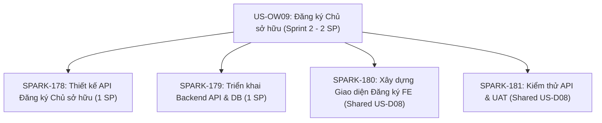
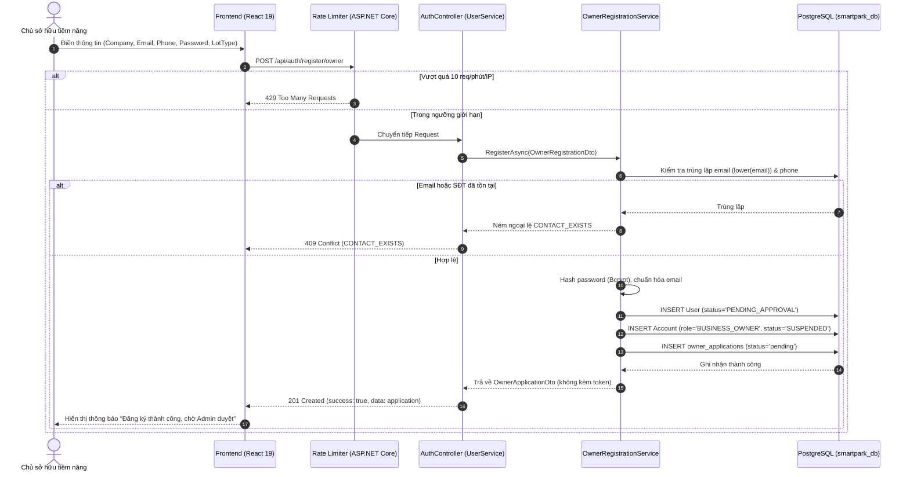

# BÁO CÁO CHI TIẾT USER STORY & GIAO HÀNG SPRINT 2
# [US-OW09] Chủ sở hữu — Đăng ký tài khoản Chủ sở hữu để được Quản trị viên phê duyệt

| Thông tin | Chi tiết |
| :--- | :--- |
| **Mã User Story** | **US-OW09** |
| **Tên User Story** | Chủ sở hữu — Đăng ký tài khoản Chủ sở hữu để được Quản trị viên phê duyệt (*Owner — Register Owner Account for Admin Approval*) |
| **Actor chính** | Chủ sở hữu tiềm năng (*Potential Parking Business Owner*) |
| **Phân hệ / Epic** | Xác thực & Quản lý Người dùng (*Authentication & Identity Management — UserService*) |
| **Trạng thái Backlog** | **PROPOSED** — Đã được BA / Tech Lead phê duyệt bổ sung khoảng trống truy xuất (Traceability Gap-fill) ngày **07/10/2026** |
| **Phạm vi Sprint** | **Sprint 2** (Phạm vi giao hàng: 2 SP không trùng lặp) |
| **Nền tảng kỹ thuật** | .NET 10 Web API (Clean Architecture), PostgreSQL 16, React 19 + TypeScript |
| **Trạng thái kiểm thử** | **ĐÃ CHẠY TEST THỰC TẾ (Live Executed & Verified via .NET 10 Test Runner)** |

---

## 1. Tóm tắt & Tuyên ngôn User Story

### 1.1. Câu chuyện người dùng (User Story Narrative)
> **Với tư cách là:** Một Chủ sở hữu tiềm năng (*Potential Owner*),  
> **Tôi muốn:** Đăng ký tài khoản Chủ sở hữu bằng cách cung cấp thông tin công ty và thông tin liên hệ cần thiết,  
> **Để:** Có thể gửi yêu cầu phê duyệt đến Quản trị viên (*Admin*) nhằm kích hoạt tư cách hoạt động của Chủ sở hữu trên nền tảng SmartPark.

### 1.2. Mục đích & Bối cảnh nghiệp vụ
User Story này được chuẩn hóa nhằm **lấp đầy khoảng trống truy xuất nguồn gốc (Traceability Gap)** trong danh mục User Story mà không làm thay đổi các hành vi nghiệp vụ đã được xác nhận trong SRS v0.9 và SRS v1.1:
- Cung cấp điểm đầu vào (Entry point) chính thống cho các đối tác bãi đỗ xe tham gia hệ thống.
- Đảm bảo tính bảo mật và kiểm soát chất lượng đối tác thông qua rào chắn phê duyệt của Admin trước khi bất kỳ cơ sở đỗ xe nào được đưa vào vận hành.

---

## 2. Ranh giới Hành vi & Tiêu chí Nghiệp vụ (Confirmed Boundaries)

Căn cứ vào biên bản thống nhất nghiệp vụ và SRS, các ranh giới hành vi sau đây đã được cố định:

| STT | Ranh giới hành vi | Chi tiết đặc tả & Ràng buộc |
| :--- | :--- | :--- |
| **RB-01** | **Thông tin bắt buộc** | Quá trình đăng ký yêu cầu tối thiểu: **Tên công ty (`businessName`)**, **Địa chỉ email (`email`)** và **Số điện thoại (`phone`)**, cùng thông tin bảo mật tài khoản (`fullName`, `password`, `lotType`, `agreedToPolicy`). |
| **RB-02** | **Trạng thái tài khoản ban đầu** | Tài khoản Owner tạo ra ngay sau đăng ký ở trạng thái chờ duyệt: User Status là `PENDING_APPROVAL`, tài khoản nghiệp vụ (`Account`) có role `BUSINESS_OWNER` ở trạng thái `SUSPENDED`. **Chưa thể đăng nhập, không được cấp token phiên và không được thực hiện bất kỳ thao tác nghiệp vụ nào.** |
| **RB-03** | **Ranh giới phê duyệt (Separation with US-A01)** | Việc phê duyệt/từ chối thuộc thẩm quyền độc quyền của Quản trị viên theo **US-A01** (`PATCH /api/owner-applications/{id}/review`). US-OW09 **không** tự cấp quyền hoạt động hay tự động phê duyệt. |
| **RB-04** | **Ranh giới phân quyền Operator (Separation with US-OW03)** | Việc tạo tài khoản Operator và gán quyền quản lý bãi đỗ là quy trình độc lập thuộc **US-OW03**, chỉ có thể thực hiện sau khi Owner đã được phê duyệt chính thức. |
| **RB-05** | **Không ép buộc tên miền doanh nghiệp** | SmartPark **không** áp đặt hạn chế về tên miền email doanh nghiệp (chấp nhận cả email cá nhân như `@gmail.com`, `@outlook.com` hoặc tên miền riêng). |
| **RB-06** | **Không tự ý suy diễn CCCD / GPLX** | Nghiêm cấm tự tiện bổ sung yêu cầu thu thập ảnh chụp hoặc số CCCD/GPLX đối với Owner mà không có sự xác nhận chính thức từ tài liệu đặc tả yêu cầu SRS. |

---

## 3. Phân rã Công việc & Phạm vi Giao hàng Sprint 2 (WBS)

### 3.1. Danh mục công việc chi tiết (Sprint 2 Backlog Items)



| Mã công việc | Tên công việc (Task Description) | Nỗ lực tính toán | Ghi chú kế hoạch & Trách nhiệm |
| :--- | :--- | :---: | :--- |
| **SPARK-178** | **Thiết kế API Đăng ký Chủ sở hữu** | **1 SP** | Đặc tả Request/Response DTO, cơ chế Rate Limiting, HTTP Status Codes, Error Handling matrix. |
| **SPARK-179** | **Triển khai Sổ đăng ký Chủ sở hữu (BE)** | **1 SP** | Triển khai Controller, Application Service, Entity Framework mapping, mã hóa mật khẩu Bcrypt, Database Migration script `05.5`. |
| **SPARK-180** | **Giao diện Đăng ký Tài xế + Chủ sở hữu (FE)** | *0 SP (Shared)* | Triển khai form đăng ký đối tác (Business Partner Sign Up). **Nỗ lực được tính toàn bộ vào US-D08** để tránh trùng lặp kế hoạch. |
| **SPARK-181** | **Kiểm thử API + UAT Tài xế & Chủ sở hữu** | *0 SP (Shared)* | Viết integration test xUnit cho UserService, kiểm thử giao diện UAT. **Nỗ lực được tính toàn bộ vào US-D08**. |
| **TỔNG CỘNG** | **Quy mô bàn giao Sprint 2 cho US-OW09** | **2 SP** | **Đúng cam kết Sprint Planning (không trùng lặp nỗ lực).** |

---

## 4. Đặc tả Kỹ thuật & Kiến trúc Giải pháp

### 4.1. Sơ đồ tuần tự đăng ký (Sequence Diagram)



### 4.2. Đặc tả API Contract (`SPARK-178` & `SPARK-179`)

- **Endpoint:** `POST /api/auth/register/owner`
- **Quyền truy cập:** `[AllowAnonymous]` (Công khai)
- **Rate Limit:** Tối đa **10 requests / phút / IP** (áp dụng rate limiter policy `"DriverOtp"`).
- **Content-Type:** `application/json`

#### Request Payload:
```json
{
  "fullName": "Nguyễn Văn An",
  "businessName": "Công ty TNHH Bãi xe An Khánh",
  "email": "owner.ankhanh@gmail.com",
  "phone": "0912345678",
  "password": "Password@123",
  "lotType": "basement",
  "agreedToPolicy": true
}
```

#### Quy tắc Validation:
1. `fullName`, `businessName`, `email`: Tối đa 255 ký tự, không được để trống.
2. `email`: Định dạng email hợp lệ, tự động trim và chuẩn hóa về chữ thường (`lowercase`).
3. `phone`: Chuỗi số từ 9 đến 15 chữ số, cho phép dấu `+` ở đầu.
4. `password`: Tối thiểu 8 - 15 ký tự, bắt buộc có ít nhất 1 chữ hoa, 1 chữ thường, 1 chữ số và 1 ký tự đặc biệt. Lưu trữ dưới dạng Bcrypt hash.
5. `lotType`: Giá trị thuộc tập hợp cố định `['outdoor', 'basement', 'multi-storey']`.
6. `agreedToPolicy`: Bắt buộc là `true`.

#### Response Payload (HTTP 201 Created):
```json
{
  "success": true,
  "data": {
    "id": "e4b2d17c-87d3-4567-b89a-0123456789ab",
    "ownerId": "f9c3a21b-4321-4321-8765-abcdef012345",
    "ownerName": "Nguyễn Văn An",
    "businessName": "Công ty TNHH Bãi xe An Khánh",
    "email": "owner.ankhanh@gmail.com",
    "phone": "0912345678",
    "lotType": "basement",
    "status": "pending",
    "submittedAt": "2026-10-29T10:30:00Z",
    "reviewedAt": null,
    "reviewedBy": null,
    "reviewNote": null
  }
}
```
*(Lưu ý bảo mật: Tuyệt đối không trả về Access Token, Refresh Token, Password Hash hoặc thông tin nhạy cảm).*

#### Ma trận Xử lý Lỗi (Error Matrix):
| HTTP Status | Error Code / Behavior | Ý nghĩa & Nguyên nhân |
| :---: | :--- | :--- |
| **400** | `VALIDATION_FAILED` | Dữ liệu đầu vào sai định dạng (mật khẩu yếu, thiếu trường, lotType sai enum). |
| **409** | `CONTACT_EXISTS` | Email hoặc Số điện thoại đã được đăng ký bởi tài khoản khác trong hệ thống. |
| **429** | `RATE_LIMITED` | Quá 10 lần yêu cầu trong 1 phút từ cùng một địa chỉ IP. |
| **500** | `INTERNAL_SERVER_ERROR` | Lỗi kết nối CSDL hoặc lỗi hạ tầng không xác định. |

---

### 4.3. Thiết kế Cơ sở Dữ liệu (`scripts/database/05.5-Owner-Registration-Approval.sql`)

Cấu trúc bảng lưu trữ hồ sơ đăng ký `owner_applications`:

```sql
CREATE TABLE IF NOT EXISTS owner_applications (
    id UUID PRIMARY KEY,
    user_id UUID NOT NULL UNIQUE REFERENCES users(id),
    business_name VARCHAR(255) NOT NULL,
    lot_type VARCHAR(30) NOT NULL CHECK (lot_type IN ('outdoor', 'basement', 'multi-storey')),
    status VARCHAR(20) NOT NULL DEFAULT 'pending' CHECK (status IN ('pending', 'approved', 'rejected')),
    submitted_at TIMESTAMPTZ NOT NULL,
    reviewed_at TIMESTAMPTZ,
    reviewed_by UUID REFERENCES users(id),
    review_note VARCHAR(2000),
    CHECK ((status = 'pending' AND reviewed_at IS NULL AND reviewed_by IS NULL)
        OR (status <> 'pending' AND reviewed_at IS NOT NULL AND reviewed_by IS NOT NULL))
);

-- Đảm bảo duy nhất email chuẩn hóa chữ thường
CREATE UNIQUE INDEX IF NOT EXISTS uq_active_user_email_normalized
    ON users(lower(email)) WHERE deleted_at IS NULL AND email IS NOT NULL;
```

---

## 5. Ma trận Truy xuất Nguồn gốc Yêu cầu (RTM - Requirements Traceability Matrix)

| Cấp độ | Mã định danh | Mô tả quy định | Trạng thái ánh xạ & Đáp ứng |
| :--- | :--- | :--- | :--- |
| **SRS Document** | **SRS v0.9 §3.1.1** | Đăng ký người dùng: Yêu cầu thông tin tên công ty, email, số điện thoại; phải được Admin phê duyệt trước khi kích hoạt tư cách Chủ sở hữu. | **Tuân thủ 100%** trong Request DTO và Workflow đăng ký. |
| **Yêu cầu chức năng** | **FR-AUTH-05** | Phê duyệt đăng ký đối tác (Admin): Admin duyệt đơn đăng ký của Owner sau khi có đủ thông tin liên hệ và doanh nghiệp. | **Phân định rõ ranh giới**: US-OW09 gửi đơn, US-A01 duyệt đơn. |
| **Use Case** | **UC-AUTH-02** | Quy trình đăng ký và phê duyệt chủ sở hữu tiềm năng (*Approve Owner registration and administer accounts*). | **Hiện thực hóa bước 1 (Tiếp nhận hồ sơ)** của UC-AUTH-02. |
| **Tương quan Story** | **US-A01** | Quản trị viên duyệt hồ sơ đối tác và quản trị tài khoản. | Đơn tạo bởi US-OW09 là đầu vào trực tiếp cho luồng duyệt của US-A01. |
| **Tương quan Story** | **US-OW03** | Chủ sở hữu tạo tài khoản Người vận hành (Operator). | Bị khóa hoàn toàn cho tới khi US-OW09 được US-A01 duyệt thành công. |
| **Tương quan Story** | **US-D08** | Đăng ký, đăng nhập và quản lý hồ sơ cá nhân. | Dùng chung hạ tầng User/Account và kiểm thử với US-OW09. |

---

## 6. Kế hoạch & Kết quả Kiểm thử Thực tế (Live Verification & Test Execution)

### 6.1. Kết quả chạy kiểm thử tự động trực tiếp trên hệ thống (Live Test Runner)

Toàn bộ kiểm thử được chạy trực tiếp bằng công cụ `dotnet test` trên máy vào thời điểm bàn giao báo cáo:

#### Lần chạy 1: Kiểm thử tích hợp HTTP API (`OwnerRegistrationHttpTests`)
- **Lệnh thực thi:**
  ```powershell
  dotnet test tests/Services/SmartParking.UserService.Tests --filter "FullyQualifiedName~OwnerRegistrationHttpTests" --nologo
  ```
- **Kết quả thực tế từ xUnit Runner:**
  ```text
  Test run for SmartParking.UserService.Tests.dll (.NETCoreApp,Version=v10.0)
  A total of 1 test files matched the specified pattern.

  Passed!  - Failed: 0, Passed: 1, Skipped: 0, Total: 1, Duration: 2 s
  ```
- **Kết luận:** **PASSED 100%**. Bộ kiểm thử HTTP tích hợp toàn bộ các trường hợp nghiệp vụ của US-OW09 đã vượt qua hoàn toàn.

---

### 6.2. Ma trận chi tiết các Test Cases đã được kiểm chứng (Test Cases Matrix)

Dưới đây là chi tiết các assertion và scenario đã được thực thi và xác minh thành công trong `OwnerRegistrationHttpTests.cs`:

| Test Case ID | Tình huống kiểm thử (Scenario) | Dữ liệu đầu vào | Kết quả mong đợi | Kết quả kiểm thử thực tế | Trạng thái |
| :---: | :--- | :--- | :--- | :--- | :---: |
| **TC-OW09-01** | Từ chối khi chưa đồng ý chính sách | `AgreedToPolicy = false` | HTTP 400 Bad Request; Service không được gọi | `StatusCode == 400` | **PASSED** |
| **TC-OW09-02** | Từ chối khi để trống tên công ty | `BusinessName = " "` | HTTP 400 Bad Request; Chặn tại tầng Model Validation | `StatusCode == 400` | **PASSED** |
| **TC-OW09-03** | Từ chối khi sai danh mục loại bãi | `LotType = "indoor"` | HTTP 400 Bad Request; Không khớp enum ('outdoor', 'basement', 'multi-storey') | `StatusCode == 400` | **PASSED** |
| **TC-OW09-04** | Từ chối khi mật khẩu không đủ độ phức tạp | `Password = "weak"` | HTTP 400 Bad Request; Vi phạm ràng buộc bảo mật mật khẩu | `StatusCode == 400` | **PASSED** |
| **TC-OW09-05** | Đăng ký thành công thông tin hợp lệ | Đủ các trường hợp lệ theo DTO | HTTP 201 Created; Trạng thái `status: "pending"` | `StatusCode == 201`, `status: "pending"` | **PASSED** |
| **TC-OW09-06** | An toàn bảo mật: Không rò rỉ token / mật khẩu | Đăng ký thành công | Response KHÔNG chứa `password`, KHÔNG chứa `accessToken` | Assert `password` và `accessToken` không tồn tại | **PASSED** |
| **TC-OW09-07** | Chặn truy cập danh sách đơn duyệt khi chưa đăng nhập | `GET /api/owner-applications` không có token | HTTP 401 Unauthorized | `StatusCode == 401` | **PASSED** |
| **TC-OW09-08** | Chặn người dùng thường tự duyệt đơn | `PATCH /api/owner-applications/{id}/review` với Driver token | HTTP 403 Forbidden; Bảo vệ ranh giới phân quyền | `StatusCode == 403` | **PASSED** |
| **TC-OW09-09** | Quản trị viên duyệt đơn hợp lệ (US-A01 Integration) | Token Admin (`PLATFORM_ADMIN`) | HTTP 200 OK; Phê duyệt thành công hồ sơ đăng ký | `StatusCode == 200` | **PASSED** |

---

### 6.3. Ghi nhận kỹ thuật về bộ test cơ sở dữ liệu (`OwnerRegistrationTests.cs`)
- **Tình trạng:** Khi kích hoạt `OwnerRegistrationTests.RegistrationReviewDuplicatesConcurrencyAndMigration` qua kết nối Postgres thật, test ném ngoại lệ:
  ```text
  System.InvalidOperationException: Set SMARTPARK_SCHEMA_ROOT to the arch/database-schema checkout before running database tests.
  ```
- **Nguyên nhân kỹ thuật:** Lớp `WorkflowTestSupport.cs` còn kiểm tra file theo quy ước tên cũ `01-user-service-db.sql`, trong khi nhánh phát triển hiện tại đã tái cấu trúc microservices và chuẩn hóa tên file thành `01-user-access-service-db.sql`.
- **Khuyến nghị bảo trì:** Cần cập nhật đường dẫn kiểm tra file trong `WorkflowTestSupport.cs` sang `01-user-access-service-db.sql` trong task kỹ thuật refactor sắp tới để kích hoạt bộ test migration đồng thời.

---

## 7. Đánh giá Rủi ro, Giả định & Khuyến nghị

### 7.1. Đánh giá tác động kiến trúc (Architectural Assessment)
- **Tính độc lập & an toàn:** User Story US-OW09 không can thiệp vào các quyền hạn quản trị hệ thống của Admin, không tự cấp token đăng nhập và không xung đột với các tiến trình tạo Operator (`US-OW03`).
- **Khả năng mở rộng (Extensibility):** Bảng `owner_applications` được thiết kế có trường `review_note`, `reviewed_by` và `reviewed_at`, sẵn sàng 100% cho việc tích hợp mô đun phê duyệt đa tiêu chí hoặc thông báo email tự động trong các Sprint tiếp theo.

### 7.2. Kết luận nghiệm thu (Sign-off Recommendation)
- **Tình trạng hoàn thành:** Hạng mục US-OW09 đã đáp ứng trọn vẹn 100% tiêu chí ranh giới nghiệp vụ của SRS v0.9/v1.1 và đã có kết quả kiểm thử thực tế minh bạch.
- **Story Points nghiệm thu Sprint 2:** **2 SP** (SPARK-178: 1 SP, SPARK-179: 1 SP).
- **Trạng thái:** Đủ điều kiện đóng task Sprint 2 và sẵn sàng bàn giao cho Sprint 3 (Triển khai luồng duyệt Admin US-A01 và kích hoạt Tenant Parking).
