# SmartPark — All API Design

[TOC]

Workspace: thư mục repo đã clone; branch **develop-fix-application**; base commit `304487ad0009be2de9be936dfca88d88658fe4fd`, with the current working tree.

Ngày snapshot: **12/10/2026 (Asia/Saigon)**. Nguồn: code hiện có trong workspace; áp cấu trúc của **API Design Template.md** do người dùng cung cấp. Tài liệu mô tả implementation, không biến requirement OPEN thành tính năng đã duyệt. Sample UUID/contact/token/password đều là dữ liệu minh họa; không phải credential/fixture deployment thật.

## Overview

Phạm vi: **49 endpoint nghiệp vụ/nội bộ** (UserService33, FacilityService13, OperationService3), cộng **1 endpoint OpenAPI Development**. Tên field, response envelope, permissions, success/error status lấy từ controllers/minimal APIs/DTOs/handlers hiện tại. Template sample dùng userName/result/isSuccess/statusCode; repo dùng email/success/data và HTTP status ở transport nên tài liệu giữ contract của code.

Local launch profile (không phải production URL): UserService http://localhost:5035; FacilityService http://localhost:5045; OperationService http://localhost:5055. URLs trong tài liệu là service-relative; gateway routing/production origin phải lấy từ deployment. JSON web camelCase; timestamp UTC; Parking enums serialize thành string và reject enum integer. UserService role trong JWT/API lowercase.

Bearer protected requests recheck persistent session/current account; Parking forward caller Bearer sang UserService để xác minh role/tenant/lot action. Internal endpoints dùng X-Service-Key, không đưa shared key vào frontend. Mỗi service chỉ đọc/ghi DB của mình; IDs service khác là logical references.

### Error conventions

- UserService business error middleware: `{"success":false,"code":"<code>","message":"<server-message>"}`. FluentValidation thêm `errors:[{"field":"...","message":"..."}]`; MVC `[ApiController]` DTO/JSON binding có thể trả ValidationProblemDetails `type/title/status/errors/traceId`. Ví dụ: `{"type":"<problem-type-uri>","title":"One or more validation errors occurred.","status":400,"errors":{"code":["<validation-message>"]},"traceId":"<trace-id>"}`. Bảng per-endpoint400 business sample không ép mọi400 thành một envelope.
- User JWT challenge401: `success:false,code:INVALID_TOKEN,message:...`. Role `Forbid()`403 có thể body rỗng. Owner-application Detail404 chỉ có `success:false,code:APPLICATION_NOT_FOUND`.
- User rate limiter DriverOtp:10 request/phút/IP/instance, shared trên endpoints được gắn attribute,429 có thể body rỗng. Không gán limiter này cho login password/me/refresh/logout/MFA/delivery/Vehicle/admin endpoints.
- Parking StructureException: `{"success":false,"code":"<code>","message":"<server-message>"}`. UNAUTHENTICATED401; FORBIDDEN403; SITE/UNIT/SLOT_NOT_FOUND404; IDENTITY/COMMITMENTS_UNAVAILABLE503; STRUCTURE_BUSY/IN_USE/CONFLICT/DUPLICATE_IDENTIFIER409; các StructureException code khác400 (bao gồm PATH_NOT_FOUND, UNIT_NOT_EMPTY, CAPACITY_EXCEEDED, CAPACITY_CONFLICT). Minimal API binding errors có thể body rỗng/ProblemDetails theo host.
- Parking/Reservation internal service-key failures401 body rỗng. Parking internal explicit BadRequest/Conflict có thể body rỗng. Reservation domain validation400 trả `{"code":"INVALID_STRUCTURE","message":"<server-message>"}`; HoldConflict409 trả `{"code":"STRUCTURE_BUSY"}`.
- Unhandled infrastructure exception có thể thành500 theo hosting; chưa có uniform response contract cho mọi500. Tài liệu không invent envelope cho nhánh chưa được map.
- Guid route constraints không match malformed UUID thường404; Guid.Empty có thể parse được nhưng bị handler/binding/scope từ chối tùy endpoint. 204 không có JSON body. Không có statusCode field trong success JSON của repo.

### Shared rules and boundaries

Password signup/operator/bootstrap policy:8–15 ký tự với lower/upper/digit/special. Driver/Owner password optional; password login chỉ validate non-empty rồi verify stored bcrypt. Email trim/lowercase. Driver phone trim rồi +84 hoặc84(11digits)→0; Owner DTO phone chưa nhận outer whitespace. OTP6digits, validity5min; expiry đúng deadline;3 lần sai lock15min; resend60seconds giữ counter, invalidate old code. Registration verification chưa tạo session.

Encrypted outbox có pending/failed/sent/cancelled; worker retry riêng. Delivery success không được suy ra từ registration201 hoặc retry200. SMTP at-least-once/crash semantics, provider production và gateway limiter cần QA/deployment riêng.

Vehicle registration chỉ CAR/MOTORCYCLE. Raw exact plate và canonical uppercase không whitespace/dot/hyphen cùng persisted. Supported MVP regex: CAR `^[1-9][0-9][A-Z][0-9]{5}$`; MOTORCYCLE `^[1-9][0-9][A-Z][A-Z0-9][0-9]{5}$`. Full legal/province/historical/special-series contract chưa được xác nhận. FR-VEH-02 OPEN; không claim/review/transfer/global ownership behavior. Parking legacy enums OVERSIZED và EV không chứng minh vehicle registration hoặc EV charging support; Reservation projection chỉ CAR/MOTORCYCLE.

Activity/sequence diagrams dùng PlantUML source theo template; đọc được trong renderer hỗ trợ PlantUML. Đây là diagram mức endpoint/use-case, không tuyên bố các repository orchestration hiện tại đã được refactor thành Application handlers. Nguồn code per-endpoint chỉ rõ lớp sở hữu thật. Sequence peer hops thể hiện dependency chính; operational Operator scope có thêm User→Parking internal site validation.

### Parking structure action mapping

| action | Fields được dùng | Quyền/guard |
| --- | --- | --- |
| profile | code,name,address,latitude,longitude | PARKING_MANAGE; profile bounds |
| active | active | PARKING_MANAGE; deactivate cần resolve commitments |
| renameUnit | resourceId,name | Own unit, sibling name unique |
| capacity | resourceId,capacity | ≥0;0 unlimited; không giảm dưới existing slots/commitments |
| removeUnit | resourceId | Unit empty; no child/slots/paths |
| removeSlot | resourceId | Không occupied/unknown/protected/reserved |
| moveSlot | resourceId,unitId,code | Own slot/unit, unique code, available unit capacity, safe change |
| configureSlot | resourceId,vehicleType,slotType,coordinates3D,features | Own safe slot; JSON strings parse được |
| removePath | resourceId | Existing own path và safe change |
| backup | unitId,vehicleType,capacity | PARKING_MANAGE + BACKUP_CONFIGURE; empty unitId=site scope; no overlapping ancestor policies |
| markBackup | resourceId,active | PARKING_MANAGE + BACKUP_MARK explicit; guard operational capacity |

POST operations chỉ hỗ trợ removeSlot/removeUnit/capacity/active/moveSlot/configureSlot. PATCH structure có11 actions trên. Partial unused record fields default theo C# binding; field phục vụ action đã chọn vẫn bắt buộc về semantics. TenantId optional chỉ nếu actor có đúng1 authorized tenant; luôn dùng caller identity từ Bearer.

## API inventory

### Current branch synchronization behavior

Parking Application owns structure use cases; Persistence stores local transactions and durable synchronization rows. Before a physical edit, the API persists a stable token and preparing row; the physical change and ready outcome commit atomically in Parking DB. Reservation receives the same token/outcome via HTTP. A lost acknowledgement leaves a replayable row; a recovery worker retries under the same site gate. A read can recover a pending projection and may fail if Reservation is unavailable. No cross-service database write is used.

Reservation Application validates scope/outcome; Domain rejects empty removed resource IDs, empty unit IDs, invalid or duplicate `(unitId, vehicleType)` pools. Release receipts bind token to tenant/site and the exact JSON outcome. Replay of the same completed release returns204 even if a newer hold exists; changed payload/scope returns409. A non-null outcome without a matching hold or receipt returns409. A null abort can create an abort receipt before acquire; later reuse of that token is rejected. No automatic lease expiry is invented.

| ID | Service | API | URL | Overview |
| --- | --- | --- | --- | --- |
| [U01](#u01) | UserService | POST | /api/auth/login | Đăng nhập bằng password |
| [U02](#u02) | UserService | POST | /api/auth/register/driver | Đăng ký Driver |
| [U03](#u03) | UserService | POST | /api/auth/register/driver/verify | Xác minh Driver OTP |
| [U04](#u04) | UserService | POST | /api/auth/register/driver/resend | Gửi lại Driver OTP |
| [U05](#u05) | UserService | POST | /api/auth/register/driver/recover | Khôi phục pending Driver registration |
| [U06](#u06) | UserService | POST | /api/auth/register/owner | Đăng ký Owner |
| [U07](#u07) | UserService | POST | /api/auth/register/owner/verify | Xác minh email OTP Owner |
| [U08](#u08) | UserService | POST | /api/auth/register/owner/resend | Gửi lại email OTP Owner |
| [U09](#u09) | UserService | POST | /api/auth/register/owner/recover | Khôi phục pending Owner registration |
| [U10](#u10) | UserService | POST | /api/auth/otp/request | Yêu cầu OTP đăng nhập |
| [U11](#u11) | UserService | POST | /api/auth/otp/login | Đăng nhập OTP và optional MFA |
| [U12](#u12) | UserService | GET | /api/auth/me | Lấy identity hiện tại |
| [U13](#u13) | UserService | POST | /api/auth/refresh | Rotate refresh token |
| [U14](#u14) | UserService | POST | /api/auth/logout | Đăng xuất session hiện tại |
| [U15](#u15) | UserService | POST | /api/auth/bootstrap-password | Đổi password qua onboarding link |
| [U16](#u16) | UserService | POST | /api/auth/mfa/setup | Khởi tạo MFA |
| [U17](#u17) | UserService | POST | /api/auth/mfa/enable | Bật MFA |
| [U18](#u18) | UserService | GET | /api/auth/deliveries/{id} | Xem trạng thái delivery |
| [U19](#u19) | UserService | POST | /api/auth/deliveries/{id}/retry | Yêu cầu retry delivery |
| [U20](#u20) | UserService | GET | /api/auth/owner-scope | Xác minh Owner tenant scope |
| [U21](#u21) | UserService | GET | /api/users | Admin tìm kiếm người dùng |
| [U22](#u22) | UserService | GET | /api/users/{id} | Admin xem chi tiết người dùng |
| [U23](#u23) | UserService | PATCH | /api/users/{id}/status | Admin khóa/mở khóa người dùng |
| [U24](#u24) | UserService | POST | /api/users | Owner tạo Operator |
| [U25](#u25) | UserService | GET | /api/operators | Owner liệt kê Operator |
| [U26](#u26) | UserService | GET | /api/operators/me | Operator xem assigned lots |
| [U27](#u27) | UserService | GET | /api/operators/slot-scope | Xác minh Operator slot scope |
| [U28](#u28) | UserService | GET | /api/owner-applications | Admin liệt kê đơn Owner |
| [U29](#u29) | UserService | GET | /api/owner-applications/{id} | Admin xem đơn Owner |
| [U30](#u30) | UserService | PATCH | /api/owner-applications/{id}/review | Admin duyệt/từ chối Owner |
| [U31](#u31) | UserService | GET | /api/vehicles | Driver liệt kê xe |
| [U32](#u32) | UserService | POST | /api/vehicles | Driver đăng ký xe |
| [U33](#u33) | UserService | PATCH | /api/vehicles/{id} | Driver cập nhật xe |
| [P01](#p01) | FacilityService | GET | /api/parking-lots | Owner liệt kê bãi |
| [P02](#p02) | FacilityService | POST | /api/parking-lots | Owner tạo bãi |
| [P03](#p03) | FacilityService | GET | /api/parking-lots/{id}/structure | Owner đọc cấu trúc bãi |
| [P04](#p04) | FacilityService | GET | /api/parking-lots/{id}/operational-layout | Operator đọc operational layout |
| [P05](#p05) | FacilityService | POST | /api/parking-lots/{id}/slots/{slot}/backup | Operator mark slot BACKUP |
| [P06](#p06) | FacilityService | POST | /api/parking-lots/{id}/operations | Owner yêu cầu impact operation |
| [P07](#p07) | FacilityService | GET | /api/parking-lots/{id}/operations/{operationId} | Owner đọc trạng thái operation |
| [P08](#p08) | FacilityService | POST | /api/parking-lots/{id}/units | Owner thêm spatial unit |
| [P09](#p09) | FacilityService | POST | /api/parking-lots/{id}/slots | Owner thêm parking slot |
| [P10](#p10) | FacilityService | PATCH | /api/parking-lots/{id}/structure | Owner sửa cấu trúc/action |
| [P11](#p11) | FacilityService | POST | /api/parking-lots/{id}/paths | Owner thêm access path |
| [P12](#p12) | FacilityService | PUT | /internal/tenants/{id} | Internal provision tenant |
| [P13](#p13) | FacilityService | POST | /internal/sites/validate | Internal validate active sites |
| [R01](#r01) | OperationService | PUT | /internal/structure/{siteId}/{token} | Internal acquire structure hold |
| [R02](#r02) | OperationService | POST | /internal/structure/{siteId}/impact | Internal inspect structure impact |
| [R03](#r03) | OperationService | POST | /internal/structure/{siteId}/{token}/release | Internal publish outcome/release hold |
| [D01](#d01) | UserService | GET | /openapi/{documentName}.json | Development OpenAPI document |

---

<a id="u01"></a>

## U01 — Đăng nhập bằng password

### Overview

Đăng nhập bằng email hoặc phone qua field email; tạo persistent session và JWT nếu account eligible.

Service: **UserService**. Nguồn: `src/Services/UserService/SmartParking.UserService.API/Controllers/AuthController.cs`.

Không dùng userName/isSuccess/result trong template sample: code hiện tại dùng email và success/data. Access 24h, refresh 7d theo policy mặc định; sai 3 lần password khóa 15 phút. Endpoint này không gắn DriverOtp rate limiter.

### API Specification

| API | URL |
| --- | --- |
| POST | /api/auth/login |
| Permission | N/A |
| Service | UserService |
| Success HTTP | 200 |

### Request sample

```http
POST /api/auth/login HTTP/1.1
Host: <UserService-host>
Content-Type: application/json
```

```json
{
  "email": "driver@example.test",
  "password": "Example@123"
}
```

| Field | Description | Data Type | Examples |
| --- | --- | --- | --- |
| email | Bắt buộc; tên field là email nhưng chấp nhận phone; trim và validate contact | string | driver@example.test |
| password | Bắt buộc; login kiểm tra password đã lưu, không áp policy signup lên input login | string | Example@123 |

### Response sample

HTTP **200**.

```json
{
  "success": true,
  "data": {
    "accessToken": "<issued-access-token>",
    "refreshToken": "<issued-refresh-token>",
    "tokenType": "Bearer",
    "expiresIn": 86400,
    "user": {
      "userId": "00000001-0000-4000-8000-000000000001",
      "fullName": "Driver Example",
      "email": "driver@example.test",
      "role": "driver"
    }
  },
  "message": "Login successful"
}
```

| Field | Description | Data Type | Examples |
| --- | --- | --- | --- |
| success | Request outcome flag; pending operation có thể false với202 | boolean | true |
| data | Payload theo endpoint | object | <object> |
| data.accessToken | Signed access JWT, không phải literal mẫu | string | <issued-access-token> |
| data.refreshToken | Opaque refresh secret, không phải literal mẫu | string | <issued-refresh-token> |
| data.tokenType | Bearer | string | Bearer |
| data.expiresIn | Access lifetime seconds | integer | 86400 |
| data.user | Giá trị theo DTO của endpoint | object | <object> |
| data.user.userId | User identity UUID | UUID | 00000001-0000-4000-8000-000000000001 |
| data.user.fullName | Tên người dùng | string | Driver Example |
| data.user.email | Email contact | string | driver@example.test |
| data.user.role | API role lowercase | string | driver |
| message | Message do server trả; mẫu placeholder không cố định localization | string | Login successful |

### Validation

| Status code | Description | Examples |
| --- | --- | --- |
| 400 | Thiếu/sai field, JSON binding hoặc DTO/use-case validation. MVC binding có thể trả ValidationProblemDetails; xem quy ước chung — `VALIDATION_FAILED` | {"success": false, "code": "VALIDATION_FAILED", "message": "<server-message>"} |
| 401 | Contact/password không đúng — `AUTH_FAILED` | {"success": false, "code": "AUTH_FAILED", "message": "<server-message>"} |
| 401 | MFA enabled: phải dùng OTP + TOTP — `MFA_REQUIRED` | {"success": false, "code": "MFA_REQUIRED", "message": "<server-message>"} |
| 403 | Chưa xác minh contact — `ACCOUNT_PENDING_VERIFICATION` | {"success": false, "code": "ACCOUNT_PENDING_VERIFICATION", "message": "<server-message>"} |
| 403 | Owner chưa được duyệt — `ACCOUNT_PENDING_APPROVAL` | {"success": false, "code": "ACCOUNT_PENDING_APPROVAL", "message": "<server-message>"} |
| 403 | Account đang khóa — `ACCOUNT_LOCKED` | {"success": false, "code": "ACCOUNT_LOCKED", "message": "<server-message>"} |
| 403 | Account inactive — `ACCOUNT_INACTIVE` | {"success": false, "code": "ACCOUNT_INACTIVE", "message": "<server-message>"} |
| 403 | Đơn Owner rejected — `ACCOUNT_REJECTED` | {"success": false, "code": "ACCOUNT_REJECTED", "message": "<server-message>"} |
| 403 | Không có active role phù hợp — `ACCOUNT_ACCESS_DENIED` | {"success": false, "code": "ACCOUNT_ACCESS_DENIED", "message": "<server-message>"} |

Các request malformed JSON/type/UUID có thể bị framework từ chối trước handler. Route `:guid` không match trả404; không suy diễn business not-found code cho UUID route sai cú pháp. Error body `<server-message>` là placeholder; xem quy ước error chung.

### Activity Diagram

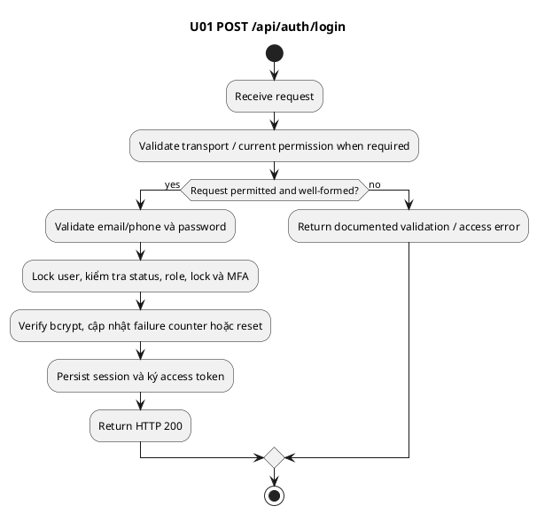

### Sequence Diagram

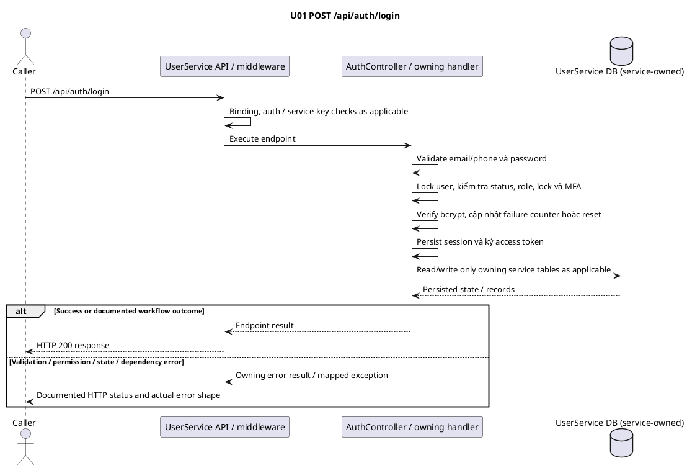

---

<a id="u02"></a>

## U02 — Đăng ký Driver

### Overview

Tạo pending user + Driver account/role, salted OTP hash và encrypted delivery outbox trong transaction.

Service: **UserService**. Nguồn: `src/Services/UserService/SmartParking.UserService.API/Controllers/AuthController.cs`.

201 nghĩa là persisted/queued, không xác nhận SMTP/SMS đã gửi; verify registration không tạo authenticated session. Unknown fields bị reject; server quyết định status/role/permissions.

### API Specification

| API | URL |
| --- | --- |
| POST | /api/auth/register/driver |
| Permission | N/A |
| Service | UserService |
| Success HTTP | 201 |

### Request sample

```http
POST /api/auth/register/driver HTTP/1.1
Host: <UserService-host>
Content-Type: application/json
```

```json
{
  "fullName": "Driver Example",
  "email": "driver@example.test",
  "phone": " +84912345678 "
}
```

| Field | Description | Data Type | Examples |
| --- | --- | --- | --- |
| fullName | Tên người dùng; bắt buộc, 1–255 ký tự | string | Driver Example |
| email | Optional nếu có phone; cả hai có mặt thì verify email | string\|null | driver@example.test |
| phone | 9–15 chữ số, optional +; Driver cho phép whitespace ngoài cùng trước normalize +84/84 → 0; optional nếu có email | string\|null |  +84912345678  |
| password | Password policy khi cung cấp: 8–15 ký tự; có thường/hoa/số/ký tự đặc biệt; optional | string\|null | Example@123 |

### Response sample

HTTP **201**.

```json
{
  "success": true,
  "data": {
    "registrationId": "00000008-0000-4000-8000-000000000008",
    "channel": "email",
    "expiresAt": "2026-10-12T02:05:00Z",
    "resendAvailableAt": "2026-10-12T02:01:00Z"
  }
}
```

| Field | Description | Data Type | Examples |
| --- | --- | --- | --- |
| success | Request outcome flag; pending operation có thể false với202 | boolean | true |
| data | Payload theo endpoint | object | <object> |
| data.registrationId | Opaque Driver registration UUID | UUID | 00000008-0000-4000-8000-000000000008 |
| data.channel | Giá trị theo DTO của endpoint | string | email |
| data.expiresAt | UTC deadline; OTP tại đúng deadline đã hết hạn | datetime UTC | 2026-10-12T02:05:00Z |
| data.resendAvailableAt | UTC Driver resend deadline | datetime UTC | 2026-10-12T02:01:00Z |

### Validation

| Status code | Description | Examples |
| --- | --- | --- |
| 400 | Thiếu/sai field, JSON binding hoặc DTO/use-case validation. MVC binding có thể trả ValidationProblemDetails; xem quy ước chung — `VALIDATION_FAILED` | {"success": false, "code": "VALIDATION_FAILED", "message": "<server-message>"} |
| 409 | Contact trùng sau normalize, kể cả pending và concurrent requests — `CONTACT_EXISTS` | {"success": false, "code": "CONTACT_EXISTS", "message": "<server-message>"} |
| 429 | Shared DriverOtp limiter: 10 requests/phút/IP/instance; body có thể rỗng | (body rỗng) |

Các request malformed JSON/type/UUID có thể bị framework từ chối trước handler. Route `:guid` không match trả404; không suy diễn business not-found code cho UUID route sai cú pháp. Error body `<server-message>` là placeholder; xem quy ước error chung.

### Activity Diagram

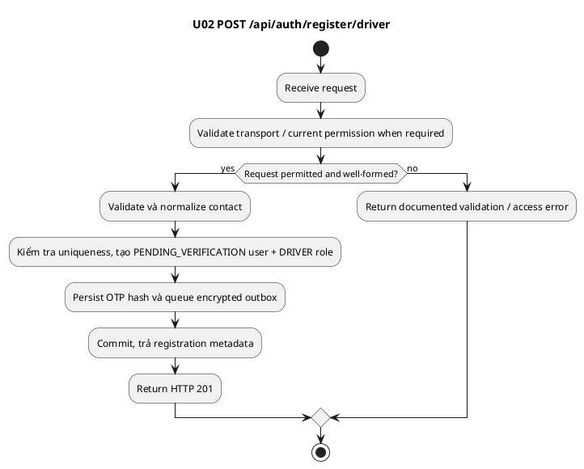

### Sequence Diagram

```plantuml
@startuml
title U02 POST /api/auth/register/driver
actor Caller
participant "UserService API / middleware" as API
participant "AuthController / owning handler" as Handler
database "UserService DB (service-owned)" as DB
Caller -> API: POST /api/auth/register/driver
API -> API: Binding, auth / service-key checks as applicable
API -> Handler: Execute endpoint
Handler -> Handler: Validate và normalize contact
Handler -> Handler: Kiểm tra uniqueness, tạo PENDING_VERIFICATION user + DRIVER role
Handler -> Handler: Persist OTP hash và queue encrypted outbox
Handler -> Handler: Commit, trả registration metadata
Handler -> DB: Read/write only owning service tables as applicable
DB --> Handler: Persisted state / records
note over Handler,DB: OTP/notification queued in encrypted User outbox.
note over Handler: Provider dispatch is asynchronous;
 queued does not mean delivered.
end note
alt Success or documented workflow outcome
Handler --> API: Endpoint result
API --> Caller: HTTP 201 response
else Validation / permission / state / dependency error
Handler --> API: Owning error result / mapped exception
API --> Caller: Documented HTTP status and actual error shape
end
@enduml
```

---

<a id="u03"></a>

## U03 — Xác minh Driver OTP

### Overview

OTP hợp lệ chuyển user PendingVerification → Active và đánh dấu contact đã verified.

Service: **UserService**. Nguồn: `src/Services/UserService/SmartParking.UserService.API/Controllers/AuthController.cs`.

Expiry 5 phút, resend không reset failures; đúng deadline đã hết hạn. Verify lặp sau success trả409, không tạo account/session mới.

### API Specification

| API | URL |
| --- | --- |
| POST | /api/auth/register/driver/verify |
| Permission | N/A |
| Service | UserService |
| Success HTTP | 200 |

### Request sample

```http
POST /api/auth/register/driver/verify HTTP/1.1
Host: <UserService-host>
Content-Type: application/json
```

```json
{
  "registrationId": "00000008-0000-4000-8000-000000000008",
  "code": "123456"
}
```

| Field | Description | Data Type | Examples |
| --- | --- | --- | --- |
| registrationId | ID opaque của Driver registration; Owner resend dùng email challengeId ở field này | UUID | 00000008-0000-4000-8000-000000000008 |
| code | OTP/TOTP đúng 6 chữ số; ví dụ minh họa, không phải OTP thật | string | 123456 |

### Response sample

HTTP **200**.

```json
{
  "success": true,
  "message": "Account verified. You can now sign in."
}
```

| Field | Description | Data Type | Examples |
| --- | --- | --- | --- |
| success | Request outcome flag; pending operation có thể false với202 | boolean | true |
| message | Message do server trả; mẫu placeholder không cố định localization | string | Account verified. You can now sign in. |

### Validation

| Status code | Description | Examples |
| --- | --- | --- |
| 400 | Thiếu/sai field, JSON binding hoặc DTO/use-case validation. MVC binding có thể trả ValidationProblemDetails; xem quy ước chung — `VALIDATION_FAILED` | {"success": false, "code": "VALIDATION_FAILED", "message": "<server-message>"} |
| 404 | Không có pending registration/challenge phù hợp — `REGISTRATION_NOT_FOUND` | {"success": false, "code": "REGISTRATION_NOT_FOUND", "message": "<server-message>"} |
| 409 | Registration verified, deleted hoặc không còn pending — `REGISTRATION_CLOSED` | {"success": false, "code": "REGISTRATION_CLOSED", "message": "<server-message>"} |
| 400 | OTP sai — `OTP_INVALID` | {"success": false, "code": "OTP_INVALID", "message": "<server-message>"} |
| 400 | OTP hết hạn tại đúng deadline — `OTP_EXPIRED` | {"success": false, "code": "OTP_EXPIRED", "message": "<server-message>"} |
| 423 | Ba lần sai: khóa 15 phút — `OTP_LOCKED` | {"success": false, "code": "OTP_LOCKED", "message": "<server-message>"} |
| 429 | Shared DriverOtp limiter: 10 requests/phút/IP/instance; body có thể rỗng | (body rỗng) |

Các request malformed JSON/type/UUID có thể bị framework từ chối trước handler. Route `:guid` không match trả404; không suy diễn business not-found code cho UUID route sai cú pháp. Error body `<server-message>` là placeholder; xem quy ước error chung.

### Activity Diagram

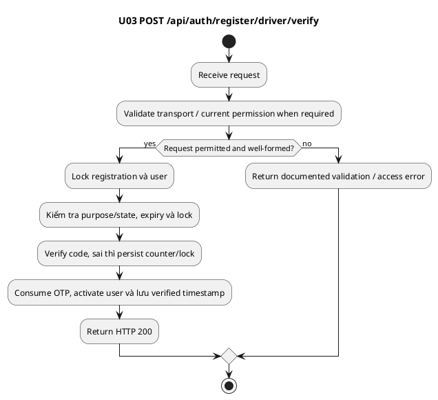

### Sequence Diagram

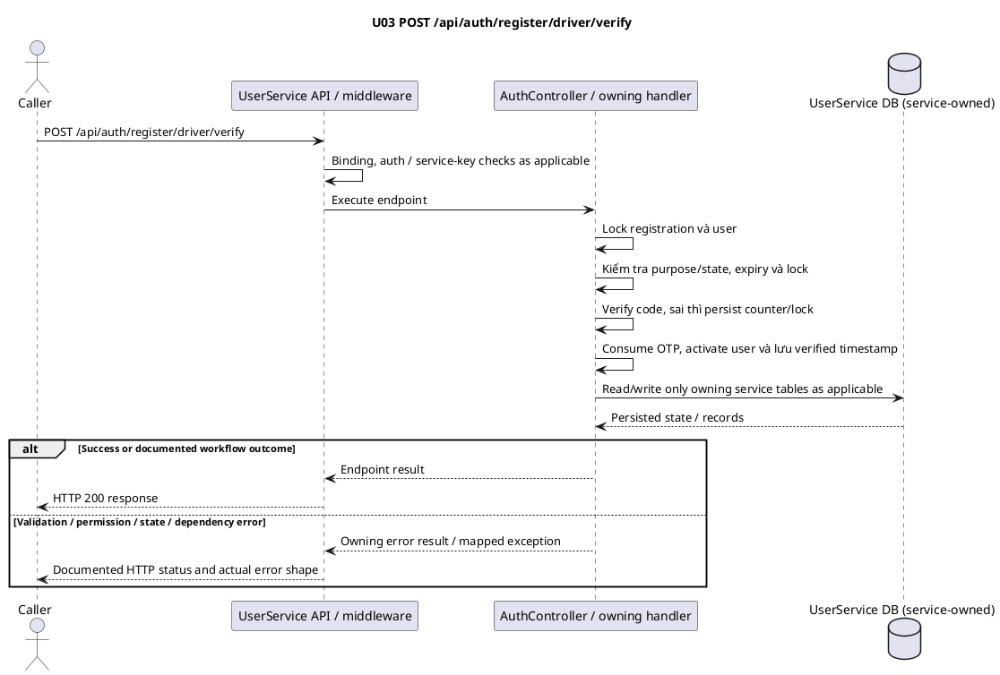

---

<a id="u04"></a>

## U04 — Gửi lại Driver OTP

### Overview

Thay OTP cũ bằng code mới, giữ failure counter và queue delivery mới.

Service: **UserService**. Nguồn: `src/Services/UserService/SmartParking.UserService.API/Controllers/AuthController.cs`.

### API Specification

| API | URL |
| --- | --- |
| POST | /api/auth/register/driver/resend |
| Permission | N/A |
| Service | UserService |
| Success HTTP | 200 |

### Request sample

```http
POST /api/auth/register/driver/resend HTTP/1.1
Host: <UserService-host>
Content-Type: application/json
```

```json
{
  "registrationId": "00000008-0000-4000-8000-000000000008"
}
```

| Field | Description | Data Type | Examples |
| --- | --- | --- | --- |
| registrationId | ID opaque của Driver registration; Owner resend dùng email challengeId ở field này | UUID | 00000008-0000-4000-8000-000000000008 |

### Response sample

HTTP **200**.

```json
{
  "success": true,
  "data": {
    "registrationId": "00000008-0000-4000-8000-000000000008",
    "channel": "email",
    "expiresAt": "2026-10-12T02:05:00Z",
    "resendAvailableAt": "2026-10-12T02:01:00Z"
  }
}
```

| Field | Description | Data Type | Examples |
| --- | --- | --- | --- |
| success | Request outcome flag; pending operation có thể false với202 | boolean | true |
| data | Payload theo endpoint | object | <object> |
| data.registrationId | Opaque Driver registration UUID | UUID | 00000008-0000-4000-8000-000000000008 |
| data.channel | Giá trị theo DTO của endpoint | string | email |
| data.expiresAt | UTC deadline; OTP tại đúng deadline đã hết hạn | datetime UTC | 2026-10-12T02:05:00Z |
| data.resendAvailableAt | UTC Driver resend deadline | datetime UTC | 2026-10-12T02:01:00Z |

### Validation

| Status code | Description | Examples |
| --- | --- | --- |
| 400 | Thiếu/sai field, JSON binding hoặc DTO/use-case validation. MVC binding có thể trả ValidationProblemDetails; xem quy ước chung — `VALIDATION_FAILED` | {"success": false, "code": "VALIDATION_FAILED", "message": "<server-message>"} |
| 404 | Không có pending registration/challenge phù hợp — `REGISTRATION_NOT_FOUND` | {"success": false, "code": "REGISTRATION_NOT_FOUND", "message": "<server-message>"} |
| 409 | Registration verified, deleted hoặc không còn pending — `REGISTRATION_CLOSED` | {"success": false, "code": "REGISTRATION_CLOSED", "message": "<server-message>"} |
| 429 | Chưa đủ 60 giây để resend/issue challenge mới — `OTP_COOLDOWN` | {"success": false, "code": "OTP_COOLDOWN", "message": "<server-message>"} |
| 423 | Chưa hết lock 15 phút — `OTP_LOCKED` | {"success": false, "code": "OTP_LOCKED", "message": "<server-message>"} |
| 429 | Shared DriverOtp limiter: 10 requests/phút/IP/instance; body có thể rỗng | (body rỗng) |

Các request malformed JSON/type/UUID có thể bị framework từ chối trước handler. Route `:guid` không match trả404; không suy diễn business not-found code cho UUID route sai cú pháp. Error body `<server-message>` là placeholder; xem quy ước error chung.

### Activity Diagram


### Sequence Diagram

```plantuml
@startuml
title U04 POST /api/auth/register/driver/resend
actor Caller
participant "UserService API / middleware" as API
participant "AuthController / owning handler" as Handler
database "UserService DB (service-owned)" as DB
Caller -> API: POST /api/auth/register/driver/resend
API -> API: Binding, auth / service-key checks as applicable
API -> Handler: Execute endpoint
Handler -> Handler: Lock pending registration/user
Handler -> Handler: Check 60-second cooldown và lock
Handler -> Handler: Thay hash, expiry +5 phút, cooldown +60 giây
Handler -> Handler: Cancel chưa-sent outbox cũ, queue code mới, commit
Handler -> DB: Read/write only owning service tables as applicable
DB --> Handler: Persisted state / records
note over Handler,DB: OTP/notification queued in encrypted User outbox.
note over Handler: Provider dispatch is asynchronous;
 queued does not mean delivered.
end note
alt Success or documented workflow outcome
Handler --> API: Endpoint result
API --> Caller: HTTP 200 response
else Validation / permission / state / dependency error
Handler --> API: Owning error result / mapped exception
API --> Caller: Documented HTTP status and actual error shape
end
@enduml
```

---

<a id="u05"></a>

## U05 — Khôi phục pending Driver registration

### Overview

Trả challenge metadata qua normalized contact để tiếp tục flow sau reload/timeout.

Service: **UserService**. Nguồn: `src/Services/UserService/SmartParking.UserService.API/Controllers/AuthController.cs`.

### API Specification

| API | URL |
| --- | --- |
| POST | /api/auth/register/driver/recover |
| Permission | N/A |
| Service | UserService |
| Success HTTP | 200 |

### Request sample

```http
POST /api/auth/register/driver/recover HTTP/1.1
Host: <UserService-host>
Content-Type: application/json
```

```json
{
  "contact": "driver@example.test"
}
```

| Field | Description | Data Type | Examples |
| --- | --- | --- | --- |
| contact | Email/phone hợp lệ, tối đa 255; normalize như contract contact | string | driver@example.test |

### Response sample

HTTP **200**.

```json
{
  "success": true,
  "data": {
    "registrationId": "00000008-0000-4000-8000-000000000008",
    "channel": "email",
    "expiresAt": "2026-10-12T02:05:00Z",
    "resendAvailableAt": "2026-10-12T02:01:00Z"
  }
}
```

| Field | Description | Data Type | Examples |
| --- | --- | --- | --- |
| success | Request outcome flag; pending operation có thể false với202 | boolean | true |
| data | Payload theo endpoint | object | <object> |
| data.registrationId | Opaque Driver registration UUID | UUID | 00000008-0000-4000-8000-000000000008 |
| data.channel | Giá trị theo DTO của endpoint | string | email |
| data.expiresAt | UTC deadline; OTP tại đúng deadline đã hết hạn | datetime UTC | 2026-10-12T02:05:00Z |
| data.resendAvailableAt | UTC Driver resend deadline | datetime UTC | 2026-10-12T02:01:00Z |

### Validation

| Status code | Description | Examples |
| --- | --- | --- |
| 400 | Thiếu/sai field, JSON binding hoặc DTO/use-case validation. MVC binding có thể trả ValidationProblemDetails; xem quy ước chung — `VALIDATION_FAILED` | {"success": false, "code": "VALIDATION_FAILED", "message": "<server-message>"} |
| 404 | Không có pending registration/challenge phù hợp — `REGISTRATION_NOT_FOUND` | {"success": false, "code": "REGISTRATION_NOT_FOUND", "message": "<server-message>"} |
| 429 | Shared DriverOtp limiter: 10 requests/phút/IP/instance; body có thể rỗng | (body rỗng) |

Các request malformed JSON/type/UUID có thể bị framework từ chối trước handler. Route `:guid` không match trả404; không suy diễn business not-found code cho UUID route sai cú pháp. Error body `<server-message>` là placeholder; xem quy ước error chung.

### Activity Diagram

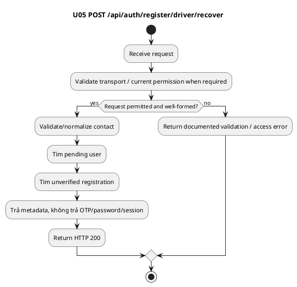

### Sequence Diagram


---

<a id="u06"></a>

## U06 — Đăng ký Owner

### Overview

Tạo Owner pending verification, pending-approval account và email OTP challenge; chưa cấp Owner access.

Service: **UserService**. Nguồn: `src/Services/UserService/SmartParking.UserService.API/Controllers/AuthController.cs`.

Owner verify email only; phone vẫn bắt buộc nhưng chưa verified. Không có corporate-domain/CCCD/GPLX requirement. Status response application là pending; user state riêng là PENDING_VERIFICATION.

### API Specification

| API | URL |
| --- | --- |
| POST | /api/auth/register/owner |
| Permission | N/A |
| Service | UserService |
| Success HTTP | 201 |

### Request sample

```http
POST /api/auth/register/owner HTTP/1.1
Host: <UserService-host>
Content-Type: application/json
```

```json
{
  "fullName": "Owner Example",
  "businessName": "Example Company",
  "email": "owner@example.test",
  "phone": "0912345678",
  "lotType": "outdoor",
  "agreedToPolicy": true
}
```

| Field | Description | Data Type | Examples |
| --- | --- | --- | --- |
| fullName | Tên người dùng; bắt buộc, 1–255 ký tự | string | Driver Example |
| businessName | Bắt buộc, 1–255 ký tự | string | Example Company |
| email | Email hợp lệ; trim/lowercase, tối đa 255 ký tự | string | driver@example.test |
| phone | Bắt buộc, + optional và 9–15 digits; DTO Owner hiện không nhận outer whitespace | string | 0912345678 |
| password | Password policy khi cung cấp: 8–15 ký tự; có thường/hoa/số/ký tự đặc biệt; optional | string\|null | Example@123 |
| lotType | Bắt buộc: outdoor/basement/multi-storey | string | outdoor |
| agreedToPolicy | Phải true | boolean | true |

### Response sample

HTTP **201**.

```json
{
  "success": true,
  "data": {
    "id": "00000010-0000-4000-8000-000000000010",
    "ownerId": "00000016-0000-4000-8000-000000000016",
    "ownerName": "Owner Example",
    "businessName": "Example Company",
    "email": "owner@example.test",
    "phone": "0912345678",
    "lotType": "outdoor",
    "status": "pending",
    "submittedAt": "2026-10-12T02:00:00Z",
    "reviewedAt": null,
    "reviewedBy": null,
    "reviewNote": null,
    "contactVerified": false,
    "verification": {
      "challengeId": "00000007-0000-4000-8000-000000000007",
      "expiresAt": "2026-10-12T02:05:00Z",
      "resendAt": "2026-10-12T02:01:00Z",
      "deliveryStatus": "pending"
    },
    "deliveryId": null,
    "deliveryStatus": null
  }
}
```

| Field | Description | Data Type | Examples |
| --- | --- | --- | --- |
| success | Request outcome flag; pending operation có thể false với202 | boolean | true |
| data | Payload theo endpoint | object | <object> |
| data.id | Resource UUID theo endpoint | UUID | 00000010-0000-4000-8000-000000000010 |
| data.ownerId | Owner user UUID | UUID | 00000016-0000-4000-8000-000000000016 |
| data.ownerName | Tên Owner | string | Owner Example |
| data.businessName | Company name | string | Example Company |
| data.email | Email contact | string | owner@example.test |
| data.phone | Phone contact | string | 0912345678 |
| data.lotType | outdoor/basement/multi-storey | string | outdoor |
| data.status | State của resource; xem Overview của endpoint | string | pending |
| data.submittedAt | UTC application submit time | datetime UTC | 2026-10-12T02:00:00Z |
| data.reviewedAt | UTC review time hoặc null | datetime\|null | null |
| data.reviewedBy | Admin UUID hoặc null | UUID\|null | null |
| data.reviewNote | Review note hoặc null | nullable | null |
| data.contactVerified | Owner email đã verified | boolean | false |
| data.verification | Owner email challenge metadata hoặc null | object | <object> |
| data.verification.challengeId | Opaque purpose-bound challenge UUID | UUID | 00000007-0000-4000-8000-000000000007 |
| data.verification.expiresAt | UTC deadline; OTP tại đúng deadline đã hết hạn | datetime UTC | 2026-10-12T02:05:00Z |
| data.verification.resendAt | UTC cooldown deadline cho challenge | datetime UTC | 2026-10-12T02:01:00Z |
| data.verification.deliveryStatus | pending/failed/sent/cancelled hoặc null | string | pending |
| data.deliveryId | Outbox delivery UUID hoặc null | UUID\|null | null |
| data.deliveryStatus | pending/failed/sent/cancelled hoặc null | nullable | null |

### Validation

| Status code | Description | Examples |
| --- | --- | --- |
| 400 | Thiếu/sai field, JSON binding hoặc DTO/use-case validation. MVC binding có thể trả ValidationProblemDetails; xem quy ước chung — `VALIDATION_FAILED` | {"success": false, "code": "VALIDATION_FAILED", "message": "<server-message>"} |
| 409 | Email/phone đã được đăng ký — `CONTACT_EXISTS` | {"success": false, "code": "CONTACT_EXISTS", "message": "<server-message>"} |
| 429 | Shared DriverOtp limiter: 10 requests/phút/IP/instance; body có thể rỗng | (body rỗng) |

Các request malformed JSON/type/UUID có thể bị framework từ chối trước handler. Route `:guid` không match trả404; không suy diễn business not-found code cho UUID route sai cú pháp. Error body `<server-message>` là placeholder; xem quy ước error chung.

### Activity Diagram

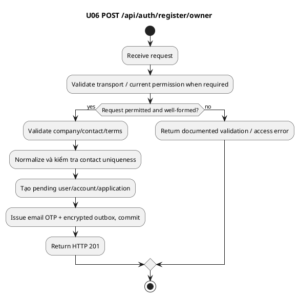

### Sequence Diagram

```plantuml
@startuml
title U06 POST /api/auth/register/owner
actor Caller
participant "UserService API / middleware" as API
participant "AuthController / owning handler" as Handler
database "UserService DB (service-owned)" as DB
Caller -> API: POST /api/auth/register/owner
API -> API: Binding, auth / service-key checks as applicable
API -> Handler: Execute endpoint
Handler -> Handler: Validate company/contact/terms
Handler -> Handler: Normalize và kiểm tra contact uniqueness
Handler -> Handler: Tạo pending user/account/application
Handler -> Handler: Issue email OTP + encrypted outbox, commit
Handler -> DB: Read/write only owning service tables as applicable
DB --> Handler: Persisted state / records
note over Handler,DB: OTP/notification queued in encrypted User outbox.
note over Handler: Provider dispatch is asynchronous;
 queued does not mean delivered.
end note
alt Success or documented workflow outcome
Handler --> API: Endpoint result
API --> Caller: HTTP 201 response
else Validation / permission / state / dependency error
Handler --> API: Owning error result / mapped exception
API --> Caller: Documented HTTP status and actual error shape
end
@enduml
```

---

<a id="u07"></a>

## U07 — Xác minh email OTP Owner

### Overview

Xác minh email rồi chuyển user sang PendingApproval; Admin phải duyệt trước khi Owner login/access.

Service: **UserService**. Nguồn: `src/Services/UserService/SmartParking.UserService.API/Controllers/AccountWorkflowController.cs`.

### API Specification

| API | URL |
| --- | --- |
| POST | /api/auth/register/owner/verify |
| Permission | N/A |
| Service | UserService |
| Success HTTP | 200 |

### Request sample

```http
POST /api/auth/register/owner/verify HTTP/1.1
Host: <UserService-host>
Content-Type: application/json
```

```json
{
  "challengeId": "00000007-0000-4000-8000-000000000007",
  "code": "123456"
}
```

| Field | Description | Data Type | Examples |
| --- | --- | --- | --- |
| challengeId | ID challenge do endpoint issue trả về; đúng purpose | UUID | 00000007-0000-4000-8000-000000000007 |
| code | OTP/TOTP đúng 6 chữ số; ví dụ minh họa, không phải OTP thật | string | 123456 |
| totp | DTO chấp nhận optional 6 digits nhưng Owner verify không sử dụng field này | string\|null | 123456 |

### Response sample

HTTP **200**.

```json
{
  "success": true
}
```

| Field | Description | Data Type | Examples |
| --- | --- | --- | --- |
| success | Request outcome flag; pending operation có thể false với202 | boolean | true |

### Validation

| Status code | Description | Examples |
| --- | --- | --- |
| 400 | Thiếu/sai field, JSON binding hoặc DTO/use-case validation. MVC binding có thể trả ValidationProblemDetails; xem quy ước chung — `VALIDATION_FAILED` | {"success": false, "code": "VALIDATION_FAILED", "message": "<server-message>"} |
| 409 | Challenge không tồn tại, consumed hoặc sai purpose — `CHALLENGE_CLOSED` | {"success": false, "code": "CHALLENGE_CLOSED", "message": "<server-message>"} |
| 400 | OTP sai — `OTP_INVALID` | {"success": false, "code": "OTP_INVALID", "message": "<server-message>"} |
| 400 | OTP hết hạn tại đúng deadline — `OTP_EXPIRED` | {"success": false, "code": "OTP_EXPIRED", "message": "<server-message>"} |
| 423 | Ba lần sai: khóa 15 phút — `OTP_LOCKED` | {"success": false, "code": "OTP_LOCKED", "message": "<server-message>"} |
| 429 | Shared DriverOtp limiter: 10 requests/phút/IP/instance; body có thể rỗng | (body rỗng) |

Các request malformed JSON/type/UUID có thể bị framework từ chối trước handler. Route `:guid` không match trả404; không suy diễn business not-found code cho UUID route sai cú pháp. Error body `<server-message>` là placeholder; xem quy ước error chung.

### Activity Diagram

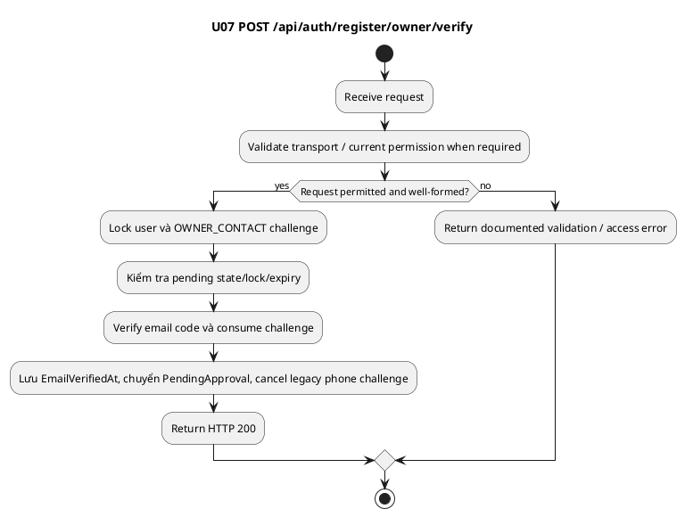

### Sequence Diagram

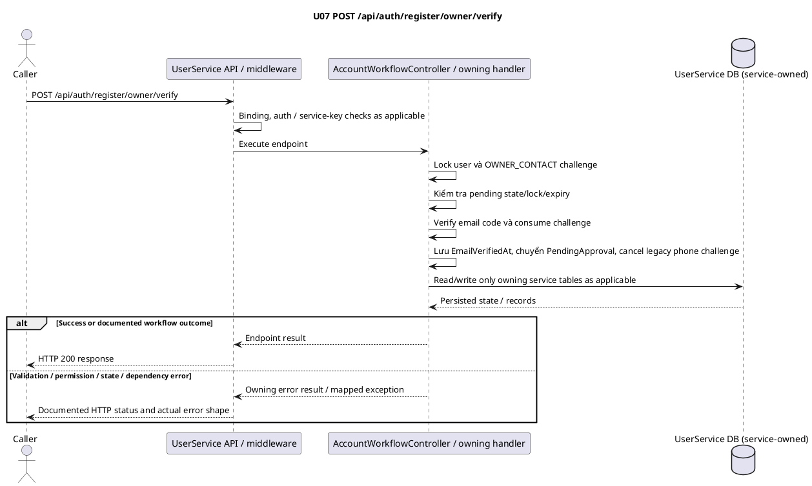

---

<a id="u08"></a>

## U08 — Gửi lại email OTP Owner

### Overview

Resend email challenge pending theo cooldown và lock hiện tại.

Service: **UserService**. Nguồn: `src/Services/UserService/SmartParking.UserService.API/Controllers/AccountWorkflowController.cs`.

Field body là registrationId, giá trị là challengeId từ verification của Owner signup; response dùng challengeId/resendAt, khác Driver registrationId/resendAvailableAt.

### API Specification

| API | URL |
| --- | --- |
| POST | /api/auth/register/owner/resend |
| Permission | N/A |
| Service | UserService |
| Success HTTP | 200 |

### Request sample

```http
POST /api/auth/register/owner/resend HTTP/1.1
Host: <UserService-host>
Content-Type: application/json
```

```json
{
  "registrationId": "00000007-0000-4000-8000-000000000007"
}
```

| Field | Description | Data Type | Examples |
| --- | --- | --- | --- |
| registrationId | ID opaque của Driver registration; Owner resend dùng email challengeId ở field này | UUID | 00000008-0000-4000-8000-000000000008 |

### Response sample

HTTP **200**.

```json
{
  "success": true,
  "data": {
    "challengeId": "00000007-0000-4000-8000-000000000007",
    "expiresAt": "2026-10-12T02:05:00Z",
    "resendAt": "2026-10-12T02:01:00Z",
    "deliveryStatus": "pending"
  }
}
```

| Field | Description | Data Type | Examples |
| --- | --- | --- | --- |
| success | Request outcome flag; pending operation có thể false với202 | boolean | true |
| data | Payload theo endpoint | object | <object> |
| data.challengeId | Opaque purpose-bound challenge UUID | UUID | 00000007-0000-4000-8000-000000000007 |
| data.expiresAt | UTC deadline; OTP tại đúng deadline đã hết hạn | datetime UTC | 2026-10-12T02:05:00Z |
| data.resendAt | UTC cooldown deadline cho challenge | datetime UTC | 2026-10-12T02:01:00Z |
| data.deliveryStatus | pending/failed/sent/cancelled hoặc null | string | pending |

### Validation

| Status code | Description | Examples |
| --- | --- | --- |
| 400 | Thiếu/sai field, JSON binding hoặc DTO/use-case validation. MVC binding có thể trả ValidationProblemDetails; xem quy ước chung — `VALIDATION_FAILED` | {"success": false, "code": "VALIDATION_FAILED", "message": "<server-message>"} |
| 409 | Challenge không tồn tại, consumed hoặc sai purpose — `CHALLENGE_CLOSED` | {"success": false, "code": "CHALLENGE_CLOSED", "message": "<server-message>"} |
| 429 | Chưa đủ 60 giây để resend/issue challenge mới — `OTP_COOLDOWN` | {"success": false, "code": "OTP_COOLDOWN", "message": "<server-message>"} |
| 423 | Chưa hết lock — `OTP_LOCKED` | {"success": false, "code": "OTP_LOCKED", "message": "<server-message>"} |
| 429 | Shared DriverOtp limiter: 10 requests/phút/IP/instance; body có thể rỗng | (body rỗng) |

Các request malformed JSON/type/UUID có thể bị framework từ chối trước handler. Route `:guid` không match trả404; không suy diễn business not-found code cho UUID route sai cú pháp. Error body `<server-message>` là placeholder; xem quy ước error chung.

### Activity Diagram

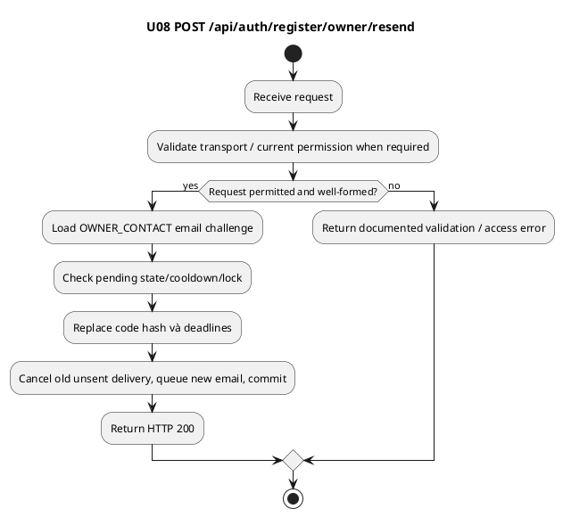

### Sequence Diagram

```plantuml
@startuml
title U08 POST /api/auth/register/owner/resend
actor Caller
participant "UserService API / middleware" as API
participant "AccountWorkflowController / owning handler" as Handler
database "UserService DB (service-owned)" as DB
Caller -> API: POST /api/auth/register/owner/resend
API -> API: Binding, auth / service-key checks as applicable
API -> Handler: Execute endpoint
Handler -> Handler: Load OWNER_CONTACT email challenge
Handler -> Handler: Check pending state/cooldown/lock
Handler -> Handler: Replace code hash và deadlines
Handler -> Handler: Cancel old unsent delivery, queue new email, commit
Handler -> DB: Read/write only owning service tables as applicable
DB --> Handler: Persisted state / records
note over Handler,DB: OTP/notification queued in encrypted User outbox.
note over Handler: Provider dispatch is asynchronous;
 queued does not mean delivered.
end note
alt Success or documented workflow outcome
Handler --> API: Endpoint result
API --> Caller: HTTP 200 response
else Validation / permission / state / dependency error
Handler --> API: Owning error result / mapped exception
API --> Caller: Documented HTTP status and actual error shape
end
@enduml
```

---

<a id="u09"></a>

## U09 — Khôi phục pending Owner registration

### Overview

Trả verification và contact flags; hỗ trợ legacy email-verified pending user và hủy phone challenge cũ.

Service: **UserService**. Nguồn: `src/Services/UserService/SmartParking.UserService.API/Controllers/AccountWorkflowController.cs`.

### API Specification

| API | URL |
| --- | --- |
| POST | /api/auth/register/owner/recover |
| Permission | N/A |
| Service | UserService |
| Success HTTP | 200 |

### Request sample

```http
POST /api/auth/register/owner/recover HTTP/1.1
Host: <UserService-host>
Content-Type: application/json
```

```json
{
  "contact": "owner@example.test"
}
```

| Field | Description | Data Type | Examples |
| --- | --- | --- | --- |
| contact | Email/phone hợp lệ, tối đa 255; normalize như contract contact | string | driver@example.test |

### Response sample

HTTP **200**.

```json
{
  "success": true,
  "data": {
    "verification": {
      "challengeId": "00000007-0000-4000-8000-000000000007",
      "expiresAt": "2026-10-12T02:05:00Z",
      "resendAt": "2026-10-12T02:01:00Z",
      "deliveryStatus": "pending"
    },
    "emailVerified": false,
    "phoneVerified": false
  }
}
```

| Field | Description | Data Type | Examples |
| --- | --- | --- | --- |
| success | Request outcome flag; pending operation có thể false với202 | boolean | true |
| data | Payload theo endpoint | object | <object> |
| data.verification | Owner email challenge metadata hoặc null | object | <object> |
| data.verification.challengeId | Opaque purpose-bound challenge UUID | UUID | 00000007-0000-4000-8000-000000000007 |
| data.verification.expiresAt | UTC deadline; OTP tại đúng deadline đã hết hạn | datetime UTC | 2026-10-12T02:05:00Z |
| data.verification.resendAt | UTC cooldown deadline cho challenge | datetime UTC | 2026-10-12T02:01:00Z |
| data.verification.deliveryStatus | pending/failed/sent/cancelled hoặc null | string | pending |
| data.emailVerified | Email verified flag | boolean | false |
| data.phoneVerified | Phone verified flag | boolean | false |

### Validation

| Status code | Description | Examples |
| --- | --- | --- |
| 400 | Thiếu/sai field, JSON binding hoặc DTO/use-case validation. MVC binding có thể trả ValidationProblemDetails; xem quy ước chung — `VALIDATION_FAILED` | {"success": false, "code": "VALIDATION_FAILED", "message": "<server-message>"} |
| 404 | Không có pending registration/challenge phù hợp — `REGISTRATION_NOT_FOUND` | {"success": false, "code": "REGISTRATION_NOT_FOUND", "message": "<server-message>"} |
| 429 | Shared DriverOtp limiter: 10 requests/phút/IP/instance; body có thể rỗng | (body rỗng) |

Các request malformed JSON/type/UUID có thể bị framework từ chối trước handler. Route `:guid` không match trả404; không suy diễn business not-found code cho UUID route sai cú pháp. Error body `<server-message>` là placeholder; xem quy ước error chung.

### Activity Diagram

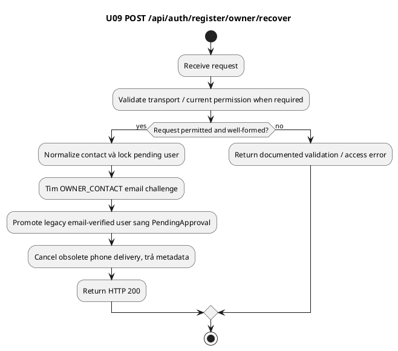

### Sequence Diagram

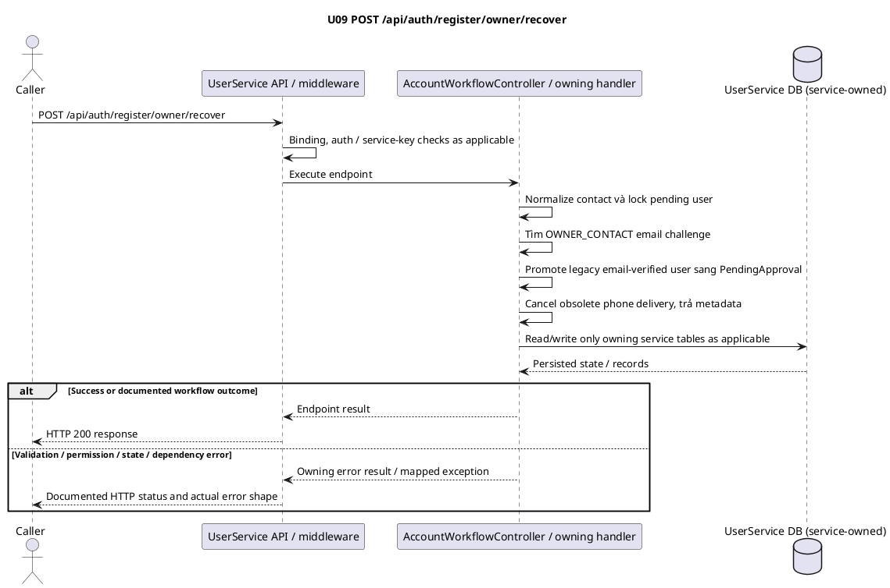

---

<a id="u10"></a>

## U10 — Yêu cầu OTP đăng nhập

### Overview

Issue login OTP cho eligible account; Driver/Owner phải dùng contact đã verified.

Service: **UserService**. Nguồn: `src/Services/UserService/SmartParking.UserService.API/Controllers/AccountWorkflowController.cs`.

Operator/Admin provisioned có thể dùng contact theo code hiện tại. Issue không tạo session. deliveryStatus=pending thể hiện queue metadata, không phải provider delivery success.

### API Specification

| API | URL |
| --- | --- |
| POST | /api/auth/otp/request |
| Permission | N/A |
| Service | UserService |
| Success HTTP | 200 |

### Request sample

```http
POST /api/auth/otp/request HTTP/1.1
Host: <UserService-host>
Content-Type: application/json
```

```json
{
  "contact": "driver@example.test"
}
```

| Field | Description | Data Type | Examples |
| --- | --- | --- | --- |
| contact | Email/phone hợp lệ, tối đa 255; normalize như contract contact | string | driver@example.test |

### Response sample

HTTP **200**.

```json
{
  "success": true,
  "data": {
    "challengeId": "00000007-0000-4000-8000-000000000007",
    "expiresAt": "2026-10-12T02:05:00Z",
    "resendAt": "2026-10-12T02:01:00Z",
    "deliveryStatus": "pending"
  }
}
```

| Field | Description | Data Type | Examples |
| --- | --- | --- | --- |
| success | Request outcome flag; pending operation có thể false với202 | boolean | true |
| data | Payload theo endpoint | object | <object> |
| data.challengeId | Opaque purpose-bound challenge UUID | UUID | 00000007-0000-4000-8000-000000000007 |
| data.expiresAt | UTC deadline; OTP tại đúng deadline đã hết hạn | datetime UTC | 2026-10-12T02:05:00Z |
| data.resendAt | UTC cooldown deadline cho challenge | datetime UTC | 2026-10-12T02:01:00Z |
| data.deliveryStatus | pending/failed/sent/cancelled hoặc null | string | pending |

### Validation

| Status code | Description | Examples |
| --- | --- | --- |
| 400 | Thiếu/sai field, JSON binding hoặc DTO/use-case validation. MVC binding có thể trả ValidationProblemDetails; xem quy ước chung — `VALIDATION_FAILED` | {"success": false, "code": "VALIDATION_FAILED", "message": "<server-message>"} |
| 401 | Account không tồn tại/không eligible — `AUTH_FAILED` | {"success": false, "code": "AUTH_FAILED", "message": "<server-message>"} |
| 401 | Driver/Owner contact chưa verified — `CONTACT_UNVERIFIED` | {"success": false, "code": "CONTACT_UNVERIFIED", "message": "<server-message>"} |
| 429 | Chưa đủ 60 giây để resend/issue challenge mới — `OTP_COOLDOWN` | {"success": false, "code": "OTP_COOLDOWN", "message": "<server-message>"} |
| 423 | Outstanding login challenge đang khóa — `OTP_LOCKED` | {"success": false, "code": "OTP_LOCKED", "message": "<server-message>"} |
| 403 | Chưa xác minh contact — `ACCOUNT_PENDING_VERIFICATION` | {"success": false, "code": "ACCOUNT_PENDING_VERIFICATION", "message": "<server-message>"} |
| 403 | Owner chưa được duyệt — `ACCOUNT_PENDING_APPROVAL` | {"success": false, "code": "ACCOUNT_PENDING_APPROVAL", "message": "<server-message>"} |
| 403 | Account đang khóa — `ACCOUNT_LOCKED` | {"success": false, "code": "ACCOUNT_LOCKED", "message": "<server-message>"} |
| 403 | Account inactive — `ACCOUNT_INACTIVE` | {"success": false, "code": "ACCOUNT_INACTIVE", "message": "<server-message>"} |
| 403 | Đơn Owner rejected — `ACCOUNT_REJECTED` | {"success": false, "code": "ACCOUNT_REJECTED", "message": "<server-message>"} |
| 403 | Không có active role phù hợp — `ACCOUNT_ACCESS_DENIED` | {"success": false, "code": "ACCOUNT_ACCESS_DENIED", "message": "<server-message>"} |
| 429 | Shared DriverOtp limiter: 10 requests/phút/IP/instance; body có thể rỗng | (body rỗng) |

Các request malformed JSON/type/UUID có thể bị framework từ chối trước handler. Route `:guid` không match trả404; không suy diễn business not-found code cho UUID route sai cú pháp. Error body `<server-message>` là placeholder; xem quy ước error chung.

### Activity Diagram

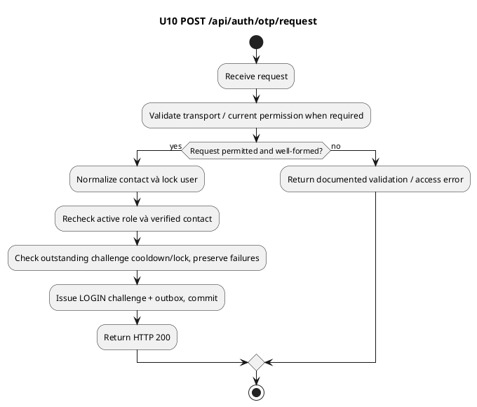

### Sequence Diagram

```plantuml
@startuml
title U10 POST /api/auth/otp/request
actor Caller
participant "UserService API / middleware" as API
participant "AccountWorkflowController / owning handler" as Handler
database "UserService DB (service-owned)" as DB
Caller -> API: POST /api/auth/otp/request
API -> API: Binding, auth / service-key checks as applicable
API -> Handler: Execute endpoint
Handler -> Handler: Normalize contact và lock user
Handler -> Handler: Recheck active role và verified contact
Handler -> Handler: Check outstanding challenge cooldown/lock, preserve failures
Handler -> Handler: Issue LOGIN challenge + outbox, commit
Handler -> DB: Read/write only owning service tables as applicable
DB --> Handler: Persisted state / records
note over Handler,DB: OTP/notification queued in encrypted User outbox.
note over Handler: Provider dispatch is asynchronous;
 queued does not mean delivered.
end note
alt Success or documented workflow outcome
Handler --> API: Endpoint result
API --> Caller: HTTP 200 response
else Validation / permission / state / dependency error
Handler --> API: Owning error result / mapped exception
API --> Caller: Documented HTTP status and actual error shape
end
@enduml
```

---

<a id="u11"></a>

## U11 — Đăng nhập OTP và optional MFA

### Overview

Consume LOGIN challenge và tạo session; MFA enabled cần TOTP chống replay.

Service: **UserService**. Nguồn: `src/Services/UserService/SmartParking.UserService.API/Controllers/AccountWorkflowController.cs`.

TOTP 30-second step, window ±1, last-step chống replay; sai3 lock15min. TOTP failure qua endpoint này trả MFA_REQUIRED401, không phải OTP_LOCKED423.

### API Specification

| API | URL |
| --- | --- |
| POST | /api/auth/otp/login |
| Permission | N/A |
| Service | UserService |
| Success HTTP | 200 |

### Request sample

```http
POST /api/auth/otp/login HTTP/1.1
Host: <UserService-host>
Content-Type: application/json
```

```json
{
  "challengeId": "00000007-0000-4000-8000-000000000007",
  "code": "123456",
  "totp": "654321"
}
```

| Field | Description | Data Type | Examples |
| --- | --- | --- | --- |
| challengeId | ID challenge do endpoint issue trả về; đúng purpose | UUID | 00000007-0000-4000-8000-000000000007 |
| code | OTP/TOTP đúng 6 chữ số; ví dụ minh họa, không phải OTP thật | string | 123456 |
| totp | Optional nếu chưa bật MFA; khi bật phải là valid 6-digit authenticator code | string\|null | 654321 |

### Response sample

HTTP **200**.

```json
{
  "success": true,
  "data": {
    "accessToken": "<issued-access-token>",
    "refreshToken": "<issued-refresh-token>",
    "tokenType": "Bearer",
    "expiresIn": 86400,
    "user": {
      "userId": "00000001-0000-4000-8000-000000000001",
      "fullName": "Driver Example",
      "email": "driver@example.test",
      "role": "driver"
    }
  }
}
```

| Field | Description | Data Type | Examples |
| --- | --- | --- | --- |
| success | Request outcome flag; pending operation có thể false với202 | boolean | true |
| data | Payload theo endpoint | object | <object> |
| data.accessToken | Signed access JWT, không phải literal mẫu | string | <issued-access-token> |
| data.refreshToken | Opaque refresh secret, không phải literal mẫu | string | <issued-refresh-token> |
| data.tokenType | Bearer | string | Bearer |
| data.expiresIn | Access lifetime seconds | integer | 86400 |
| data.user | Giá trị theo DTO của endpoint | object | <object> |
| data.user.userId | User identity UUID | UUID | 00000001-0000-4000-8000-000000000001 |
| data.user.fullName | Tên người dùng | string | Driver Example |
| data.user.email | Email contact | string | driver@example.test |
| data.user.role | API role lowercase | string | driver |

### Validation

| Status code | Description | Examples |
| --- | --- | --- |
| 400 | Thiếu/sai field, JSON binding hoặc DTO/use-case validation. MVC binding có thể trả ValidationProblemDetails; xem quy ước chung — `VALIDATION_FAILED` | {"success": false, "code": "VALIDATION_FAILED", "message": "<server-message>"} |
| 409 | Challenge không tồn tại, consumed hoặc sai purpose — `CHALLENGE_CLOSED` | {"success": false, "code": "CHALLENGE_CLOSED", "message": "<server-message>"} |
| 400 | OTP sai — `OTP_INVALID` | {"success": false, "code": "OTP_INVALID", "message": "<server-message>"} |
| 400 | OTP hết hạn tại đúng deadline — `OTP_EXPIRED` | {"success": false, "code": "OTP_EXPIRED", "message": "<server-message>"} |
| 423 | Ba lần sai: khóa 15 phút — `OTP_LOCKED` | {"success": false, "code": "OTP_LOCKED", "message": "<server-message>"} |
| 401 | Deleted/blocked account — `AUTH_FAILED` | {"success": false, "code": "AUTH_FAILED", "message": "<server-message>"} |
| 401 | TOTP thiếu/sai/replay hoặc MFA locked — `MFA_REQUIRED` | {"success": false, "code": "MFA_REQUIRED", "message": "<server-message>"} |
| 403 | Chưa xác minh contact — `ACCOUNT_PENDING_VERIFICATION` | {"success": false, "code": "ACCOUNT_PENDING_VERIFICATION", "message": "<server-message>"} |
| 403 | Owner chưa được duyệt — `ACCOUNT_PENDING_APPROVAL` | {"success": false, "code": "ACCOUNT_PENDING_APPROVAL", "message": "<server-message>"} |
| 403 | Account đang khóa — `ACCOUNT_LOCKED` | {"success": false, "code": "ACCOUNT_LOCKED", "message": "<server-message>"} |
| 403 | Account inactive — `ACCOUNT_INACTIVE` | {"success": false, "code": "ACCOUNT_INACTIVE", "message": "<server-message>"} |
| 403 | Đơn Owner rejected — `ACCOUNT_REJECTED` | {"success": false, "code": "ACCOUNT_REJECTED", "message": "<server-message>"} |
| 403 | Không có active role phù hợp — `ACCOUNT_ACCESS_DENIED` | {"success": false, "code": "ACCOUNT_ACCESS_DENIED", "message": "<server-message>"} |
| 429 | Shared DriverOtp limiter: 10 requests/phút/IP/instance; body có thể rỗng | (body rỗng) |

Các request malformed JSON/type/UUID có thể bị framework từ chối trước handler. Route `:guid` không match trả404; không suy diễn business not-found code cho UUID route sai cú pháp. Error body `<server-message>` là placeholder; xem quy ước error chung.

### Activity Diagram

```plantuml
@startuml
title U11 POST /api/auth/otp/login
start
:Receive request;
:Validate transport / current permission when required;
if (Request permitted and well-formed?) then (yes)
  :Lock user/challenge, recheck current access;
  :Check OTP expiry/attempts/hash;
  :Nếu MFA enabled, check TOTP window và replay counter;
  :Consume challenge, persist session, commit;
  :Return HTTP 200;
else (no)
  :Return documented validation / access error;
endif
stop
@enduml
```

### Sequence Diagram

```plantuml
@startuml
title U11 POST /api/auth/otp/login
actor Caller
participant "UserService API / middleware" as API
participant "AccountWorkflowController / owning handler" as Handler
database "UserService DB (service-owned)" as DB
Caller -> API: POST /api/auth/otp/login
API -> API: Binding, auth / service-key checks as applicable
API -> Handler: Execute endpoint
Handler -> Handler: Lock user/challenge, recheck current access
Handler -> Handler: Check OTP expiry/attempts/hash
Handler -> Handler: Nếu MFA enabled, check TOTP window và replay counter
Handler -> Handler: Consume challenge, persist session, commit
Handler -> DB: Read/write only owning service tables as applicable
DB --> Handler: Persisted state / records
alt Success or documented workflow outcome
Handler --> API: Endpoint result
API --> Caller: HTTP 200 response
else Validation / permission / state / dependency error
Handler --> API: Owning error result / mapped exception
API --> Caller: Documented HTTP status and actual error shape
end
@enduml
```

---

<a id="u12"></a>

## U12 — Lấy identity hiện tại

### Overview

Trả user info theo current state/role.

Service: **UserService**. Nguồn: `src/Services/UserService/SmartParking.UserService.API/Controllers/AuthController.cs`.

### API Specification

| API | URL |
| --- | --- |
| GET | /api/auth/me |
| Permission | Bearer; any eligible current role |
| Service | UserService |
| Success HTTP | 200 |

### Request sample

```http
GET /api/auth/me HTTP/1.1
Host: <UserService-host>
Authorization: Bearer <issued-access-token>
```

Không có request body.

Không có body/path/query field.

### Response sample

HTTP **200**.

```json
{
  "success": true,
  "data": {
    "userId": "00000001-0000-4000-8000-000000000001",
    "fullName": "Driver Example",
    "email": "driver@example.test",
    "role": "driver"
  }
}
```

| Field | Description | Data Type | Examples |
| --- | --- | --- | --- |
| success | Request outcome flag; pending operation có thể false với202 | boolean | true |
| data | Payload theo endpoint | object | <object> |
| data.userId | User identity UUID | UUID | 00000001-0000-4000-8000-000000000001 |
| data.fullName | Tên người dùng | string | Driver Example |
| data.email | Email contact | string | driver@example.test |
| data.role | API role lowercase | string | driver |

### Validation

| Status code | Description | Examples |
| --- | --- | --- |
| 401 | Bearer thiếu, hết hạn, revoked hoặc current account không đủ điều kiện — `INVALID_TOKEN` | {"success": false, "code": "INVALID_TOKEN", "message": "<server-message>"} |

Các request malformed JSON/type/UUID có thể bị framework từ chối trước handler. Route `:guid` không match trả404; không suy diễn business not-found code cho UUID route sai cú pháp. Error body `<server-message>` là placeholder; xem quy ước error chung.

### Activity Diagram

```plantuml
@startuml
title U12 GET /api/auth/me
start
:Receive request;
:Validate transport / current permission when required;
if (Request permitted and well-formed?) then (yes)
  :JWT signature/session validation;
  :Reload current user/account/role;
  :Map UserInfoDto;
  :Trả identity;
  :Return HTTP 200;
else (no)
  :Return documented validation / access error;
endif
stop
@enduml
```

### Sequence Diagram

```plantuml
@startuml
title U12 GET /api/auth/me
actor Caller
participant "UserService API / middleware" as API
participant "AuthController / owning handler" as Handler
database "UserService DB (service-owned)" as DB
Caller -> API: GET /api/auth/me
API -> API: Binding, auth / service-key checks as applicable
API -> Handler: Execute endpoint
Handler -> Handler: JWT signature/session validation
Handler -> Handler: Reload current user/account/role
Handler -> Handler: Map UserInfoDto
Handler -> Handler: Trả identity
Handler -> DB: Read/write only owning service tables as applicable
DB --> Handler: Persisted state / records
alt Success or documented workflow outcome
Handler --> API: Endpoint result
API --> Caller: HTTP 200 response
else Validation / permission / state / dependency error
Handler --> API: Owning error result / mapped exception
API --> Caller: Documented HTTP status and actual error shape
end
@enduml
```

---

<a id="u13"></a>

## U13 — Rotate refresh token

### Overview

Rotate persistent session bằng compare-and-swap, vô hiệu old refresh/access token của session đó.

Service: **UserService**. Nguồn: `src/Services/UserService/SmartParking.UserService.API/Controllers/AuthController.cs`.

Không cần Bearer. Access lifetime tối đa24h và bị giới hạn bởi refresh session expiry; refresh default7d. Concurrent old refresh chỉ một request thắng.

### API Specification

| API | URL |
| --- | --- |
| POST | /api/auth/refresh |
| Permission | N/A |
| Service | UserService |
| Success HTTP | 200 |

### Request sample

```http
POST /api/auth/refresh HTTP/1.1
Host: <UserService-host>
Content-Type: application/json
```

```json
{
  "refreshToken": "<issued-refresh-token>"
}
```

| Field | Description | Data Type | Examples |
| --- | --- | --- | --- |
| refreshToken | Bắt buộc dù body transport cho phép empty; đúng session còn hạn | string | <issued-refresh-token> |

### Response sample

HTTP **200**.

```json
{
  "success": true,
  "data": {
    "accessToken": "<issued-access-token>",
    "refreshToken": "<issued-refresh-token>",
    "tokenType": "Bearer",
    "expiresIn": 86400,
    "user": {
      "userId": "00000001-0000-4000-8000-000000000001",
      "fullName": "Driver Example",
      "email": "driver@example.test",
      "role": "driver"
    }
  }
}
```

| Field | Description | Data Type | Examples |
| --- | --- | --- | --- |
| success | Request outcome flag; pending operation có thể false với202 | boolean | true |
| data | Payload theo endpoint | object | <object> |
| data.accessToken | Signed access JWT, không phải literal mẫu | string | <issued-access-token> |
| data.refreshToken | Opaque refresh secret, không phải literal mẫu | string | <issued-refresh-token> |
| data.tokenType | Bearer | string | Bearer |
| data.expiresIn | Access lifetime seconds | integer | 86400 |
| data.user | Giá trị theo DTO của endpoint | object | <object> |
| data.user.userId | User identity UUID | UUID | 00000001-0000-4000-8000-000000000001 |
| data.user.fullName | Tên người dùng | string | Driver Example |
| data.user.email | Email contact | string | driver@example.test |
| data.user.role | API role lowercase | string | driver |

### Validation

| Status code | Description | Examples |
| --- | --- | --- |
| 400 | Body/token thiếu — `MISSING_REFRESH_TOKEN` | {"success": false, "code": "MISSING_REFRESH_TOKEN", "message": "<server-message>"} |
| 401 | Bearer thiếu, hết hạn, revoked hoặc current account không đủ điều kiện — `INVALID_TOKEN` | {"success": false, "code": "INVALID_TOKEN", "message": "<server-message>"} |

Các request malformed JSON/type/UUID có thể bị framework từ chối trước handler. Route `:guid` không match trả404; không suy diễn business not-found code cho UUID route sai cú pháp. Error body `<server-message>` là placeholder; xem quy ước error chung.

### Activity Diagram

```plantuml
@startuml
title U13 POST /api/auth/refresh
start
:Receive request;
:Validate transport / current permission when required;
if (Request permitted and well-formed?) then (yes)
  :Hash refresh và tìm session;
  :Check expiry/revocation/current user;
  :CAS rotate session token IDs và hash;
  :Trả token mới, refresh expiry không bị kéo dài;
  :Return HTTP 200;
else (no)
  :Return documented validation / access error;
endif
stop
@enduml
```

### Sequence Diagram

```plantuml
@startuml
title U13 POST /api/auth/refresh
actor Caller
participant "UserService API / middleware" as API
participant "AuthController / owning handler" as Handler
database "UserService DB (service-owned)" as DB
Caller -> API: POST /api/auth/refresh
API -> API: Binding, auth / service-key checks as applicable
API -> Handler: Execute endpoint
Handler -> Handler: Hash refresh và tìm session
Handler -> Handler: Check expiry/revocation/current user
Handler -> Handler: CAS rotate session token IDs và hash
Handler -> Handler: Trả token mới, refresh expiry không bị kéo dài
Handler -> DB: Read/write only owning service tables as applicable
DB --> Handler: Persisted state / records
alt Success or documented workflow outcome
Handler --> API: Endpoint result
API --> Caller: HTTP 200 response
else Validation / permission / state / dependency error
Handler --> API: Owning error result / mapped exception
API --> Caller: Documented HTTP status and actual error shape
end
@enduml
```

---

<a id="u14"></a>

## U14 — Đăng xuất session hiện tại

### Overview

Revoke session khớp JWT jti/sub và refresh token; sessions khác độc lập.

Service: **UserService**. Nguồn: `src/Services/UserService/SmartParking.UserService.API/Controllers/AuthController.cs`.

### API Specification

| API | URL |
| --- | --- |
| POST | /api/auth/logout |
| Permission | Bearer; any eligible current role |
| Service | UserService |
| Success HTTP | 200 |

### Request sample

```http
POST /api/auth/logout HTTP/1.1
Host: <UserService-host>
Authorization: Bearer <issued-access-token>
Content-Type: application/json
```

```json
{
  "refreshToken": "<issued-refresh-token>"
}
```

| Field | Description | Data Type | Examples |
| --- | --- | --- | --- |
| refreshToken | Bắt buộc; phải khớp current JWT session | string | <issued-refresh-token> |

### Response sample

HTTP **200**.

```json
{
  "success": true,
  "message": "Logout successful"
}
```

| Field | Description | Data Type | Examples |
| --- | --- | --- | --- |
| success | Request outcome flag; pending operation có thể false với202 | boolean | true |
| message | Message do server trả; mẫu placeholder không cố định localization | string | Logout successful |

### Validation

| Status code | Description | Examples |
| --- | --- | --- |
| 401 | Bearer thiếu, hết hạn, revoked hoặc current account không đủ điều kiện — `INVALID_TOKEN` | {"success": false, "code": "INVALID_TOKEN", "message": "<server-message>"} |
| 400 | Body/token thiếu — `MISSING_REFRESH_TOKEN` | {"success": false, "code": "MISSING_REFRESH_TOKEN", "message": "<server-message>"} |
| 500 | Không lưu được session revocation — `REVOKE_SESSION_FAILED` | {"success": false, "code": "REVOKE_SESSION_FAILED", "message": "<server-message>"} |

Các request malformed JSON/type/UUID có thể bị framework từ chối trước handler. Route `:guid` không match trả404; không suy diễn business not-found code cho UUID route sai cú pháp. Error body `<server-message>` là placeholder; xem quy ước error chung.

### Activity Diagram

```plantuml
@startuml
title U14 POST /api/auth/logout
start
:Receive request;
:Validate transport / current permission when required;
if (Request permitted and well-formed?) then (yes)
  :Validate JWT/session;
  :Validate refresh token và hash;
  :Revoke đúng current session;
  :Trả success sau persistence thành công;
  :Return HTTP 200;
else (no)
  :Return documented validation / access error;
endif
stop
@enduml
```

### Sequence Diagram

```plantuml
@startuml
title U14 POST /api/auth/logout
actor Caller
participant "UserService API / middleware" as API
participant "AuthController / owning handler" as Handler
database "UserService DB (service-owned)" as DB
Caller -> API: POST /api/auth/logout
API -> API: Binding, auth / service-key checks as applicable
API -> Handler: Execute endpoint
Handler -> Handler: Validate JWT/session
Handler -> Handler: Validate refresh token và hash
Handler -> Handler: Revoke đúng current session
Handler -> Handler: Trả success sau persistence thành công
Handler -> DB: Read/write only owning service tables as applicable
DB --> Handler: Persisted state / records
alt Success or documented workflow outcome
Handler --> API: Endpoint result
API --> Caller: HTTP 200 response
else Validation / permission / state / dependency error
Handler --> API: Owning error result / mapped exception
API --> Caller: Documented HTTP status and actual error shape
end
@enduml
```

---

<a id="u15"></a>

## U15 — Đổi password qua onboarding link

### Overview

Single-use 24-hour bootstrap token; cập nhật bcrypt và revoke mọi session của user.

Service: **UserService**. Nguồn: `src/Services/UserService/SmartParking.UserService.API/Controllers/AccountWorkflowController.cs`.

Không bắt buộc đổi password lần login đầu; đây là link tùy chọn cho Operator onboarding.

### API Specification

| API | URL |
| --- | --- |
| POST | /api/auth/bootstrap-password |
| Permission | N/A; valid bootstrap token |
| Service | UserService |
| Success HTTP | 200 |

### Request sample

```http
POST /api/auth/bootstrap-password HTTP/1.1
Host: <UserService-host>
Content-Type: application/json
```

```json
{
  "challengeId": "00000007-0000-4000-8000-000000000007",
  "token": "<token-from-onboarding-link>",
  "password": "Changed@123"
}
```

| Field | Description | Data Type | Examples |
| --- | --- | --- | --- |
| challengeId | ID challenge do endpoint issue trả về; đúng purpose | UUID | 00000007-0000-4000-8000-000000000007 |
| token | Bắt buộc ≤128 ký tự; token riêng từ link onboarding | string | <token-from-onboarding-link> |
| password | Password policy khi cung cấp: 8–15 ký tự; có thường/hoa/số/ký tự đặc biệt | string | Example@123 |

### Response sample

HTTP **200**.

```json
{
  "success": true
}
```

| Field | Description | Data Type | Examples |
| --- | --- | --- | --- |
| success | Request outcome flag; pending operation có thể false với202 | boolean | true |

### Validation

| Status code | Description | Examples |
| --- | --- | --- |
| 400 | Thiếu/sai field, JSON binding hoặc DTO/use-case validation. MVC binding có thể trả ValidationProblemDetails; xem quy ước chung — `VALIDATION_FAILED` | {"success": false, "code": "VALIDATION_FAILED", "message": "<server-message>"} |
| 409 | Challenge không tồn tại, consumed hoặc sai purpose — `CHALLENGE_CLOSED` | {"success": false, "code": "CHALLENGE_CLOSED", "message": "<server-message>"} |
| 401 | Link sai/hết hạn — `INVALID_TOKEN` | {"success": false, "code": "INVALID_TOKEN", "message": "<server-message>"} |
| 401 | Account không active/deleted — `AUTH_FAILED` | {"success": false, "code": "AUTH_FAILED", "message": "<server-message>"} |
| 423 | Challenge locked nếu state hiện tại có lock — `OTP_LOCKED` | {"success": false, "code": "OTP_LOCKED", "message": "<server-message>"} |
| 429 | Shared DriverOtp limiter: 10 requests/phút/IP/instance; body có thể rỗng | (body rỗng) |

Các request malformed JSON/type/UUID có thể bị framework từ chối trước handler. Route `:guid` không match trả404; không suy diễn business not-found code cho UUID route sai cú pháp. Error body `<server-message>` là placeholder; xem quy ước error chung.

### Activity Diagram

```plantuml
@startuml
title U15 POST /api/auth/bootstrap-password
start
:Receive request;
:Validate transport / current permission when required;
if (Request permitted and well-formed?) then (yes)
  :Load BOOTSTRAP_PASSWORD challenge;
  :Verify SHA-256 token và24h expiry;
  :Hash new password, consume challenge;
  :Revoke all old sessions, commit;
  :Return HTTP 200;
else (no)
  :Return documented validation / access error;
endif
stop
@enduml
```

### Sequence Diagram

```plantuml
@startuml
title U15 POST /api/auth/bootstrap-password
actor Caller
participant "UserService API / middleware" as API
participant "AccountWorkflowController / owning handler" as Handler
database "UserService DB (service-owned)" as DB
Caller -> API: POST /api/auth/bootstrap-password
API -> API: Binding, auth / service-key checks as applicable
API -> Handler: Execute endpoint
Handler -> Handler: Load BOOTSTRAP_PASSWORD challenge
Handler -> Handler: Verify SHA-256 token và24h expiry
Handler -> Handler: Hash new password, consume challenge
Handler -> Handler: Revoke all old sessions, commit
Handler -> DB: Read/write only owning service tables as applicable
DB --> Handler: Persisted state / records
alt Success or documented workflow outcome
Handler --> API: Endpoint result
API --> Caller: HTTP 200 response
else Validation / permission / state / dependency error
Handler --> API: Owning error result / mapped exception
API --> Caller: Documented HTTP status and actual error shape
end
@enduml
```

---

<a id="u16"></a>

## U16 — Khởi tạo MFA

### Overview

Generate TOTP secret và otpauth URI; setup chưa enable MFA.

Service: **UserService**. Nguồn: `src/Services/UserService/SmartParking.UserService.API/Controllers/AccountWorkflowController.cs`.

Secret được trả riêng ở setup theo code; không phải OTP/password và không nên ghi log. Không có endpoint disable MFA trong checkout hiện tại.

### API Specification

| API | URL |
| --- | --- |
| POST | /api/auth/mfa/setup |
| Permission | Bearer; current active user |
| Service | UserService |
| Success HTTP | 200 |

### Request sample

```http
POST /api/auth/mfa/setup HTTP/1.1
Host: <UserService-host>
Authorization: Bearer <issued-access-token>
```

Không có request body.

Không có body/path/query field.

### Response sample

HTTP **200**.

```json
{
  "success": true,
  "data": {
    "secret": "<base32-setup-secret>",
    "uri": "otpauth://totp/SmartPark:driver%40example.test?secret=<base32-setup-secret>&issuer=SmartPark&digits=6&period=30"
  }
}
```

| Field | Description | Data Type | Examples |
| --- | --- | --- | --- |
| success | Request outcome flag; pending operation có thể false với202 | boolean | true |
| data | Payload theo endpoint | object | <object> |
| data.secret | MFA setup secret Base32, chỉ mẫu minh họa | string | <base32-setup-secret> |
| data.uri | otpauth enrollment URI | string | otpauth://totp/SmartPark:driver%40example.test?secret=<base32-setup-secret>&issuer=SmartPark&digits=6&period=30 |

### Validation

| Status code | Description | Examples |
| --- | --- | --- |
| 401 | Bearer thiếu, hết hạn, revoked hoặc current account không đủ điều kiện — `INVALID_TOKEN` | {"success": false, "code": "INVALID_TOKEN", "message": "<server-message>"} |
| 401 | Current user không active/deleted — `AUTH_FAILED` | {"success": false, "code": "AUTH_FAILED", "message": "<server-message>"} |
| 409 | MFA đã enabled — `MFA_ALREADY_ENABLED` | {"success": false, "code": "MFA_ALREADY_ENABLED", "message": "<server-message>"} |

Các request malformed JSON/type/UUID có thể bị framework từ chối trước handler. Route `:guid` không match trả404; không suy diễn business not-found code cho UUID route sai cú pháp. Error body `<server-message>` là placeholder; xem quy ước error chung.

### Activity Diagram

```plantuml
@startuml
title U16 POST /api/auth/mfa/setup
start
:Receive request;
:Validate transport / current permission when required;
if (Request permitted and well-formed?) then (yes)
  :Reload active user dưới lock;
  :Reject already-enabled MFA;
  :Generate secret, encrypt và persist;
  :Trả secret/URI để user enroll authenticator;
  :Return HTTP 200;
else (no)
  :Return documented validation / access error;
endif
stop
@enduml
```

### Sequence Diagram

```plantuml
@startuml
title U16 POST /api/auth/mfa/setup
actor Caller
participant "UserService API / middleware" as API
participant "AccountWorkflowController / owning handler" as Handler
database "UserService DB (service-owned)" as DB
Caller -> API: POST /api/auth/mfa/setup
API -> API: Binding, auth / service-key checks as applicable
API -> Handler: Execute endpoint
Handler -> Handler: Reload active user dưới lock
Handler -> Handler: Reject already-enabled MFA
Handler -> Handler: Generate secret, encrypt và persist
Handler -> Handler: Trả secret/URI để user enroll authenticator
Handler -> DB: Read/write only owning service tables as applicable
DB --> Handler: Persisted state / records
alt Success or documented workflow outcome
Handler --> API: Endpoint result
API --> Caller: HTTP 200 response
else Validation / permission / state / dependency error
Handler --> API: Owning error result / mapped exception
API --> Caller: Documented HTTP status and actual error shape
end
@enduml
```

---

<a id="u17"></a>

## U17 — Bật MFA

### Overview

Verify authenticator code và bật MFA trên current user.

Service: **UserService**. Nguồn: `src/Services/UserService/SmartParking.UserService.API/Controllers/AccountWorkflowController.cs`.

### API Specification

| API | URL |
| --- | --- |
| POST | /api/auth/mfa/enable |
| Permission | Bearer; current active user |
| Service | UserService |
| Success HTTP | 200 |

### Request sample

```http
POST /api/auth/mfa/enable HTTP/1.1
Host: <UserService-host>
Authorization: Bearer <issued-access-token>
Content-Type: application/json
```

```json
{
  "code": "123456"
}
```

| Field | Description | Data Type | Examples |
| --- | --- | --- | --- |
| code | OTP/TOTP đúng 6 chữ số; ví dụ minh họa, không phải OTP thật | string | 123456 |
| registrationId | DTO có field nhưng endpoint MFA không sử dụng; có thể omit | UUID | 00000008-0000-4000-8000-000000000008 |

### Response sample

HTTP **200**.

```json
{
  "success": true
}
```

| Field | Description | Data Type | Examples |
| --- | --- | --- | --- |
| success | Request outcome flag; pending operation có thể false với202 | boolean | true |

### Validation

| Status code | Description | Examples |
| --- | --- | --- |
| 401 | Bearer thiếu, hết hạn, revoked hoặc current account không đủ điều kiện — `INVALID_TOKEN` | {"success": false, "code": "INVALID_TOKEN", "message": "<server-message>"} |
| 400 | Thiếu/sai field, JSON binding hoặc DTO/use-case validation. MVC binding có thể trả ValidationProblemDetails; xem quy ước chung — `VALIDATION_FAILED` | {"success": false, "code": "VALIDATION_FAILED", "message": "<server-message>"} |
| 401 | User bị block/deleted — `AUTH_FAILED` | {"success": false, "code": "AUTH_FAILED", "message": "<server-message>"} |
| 400 | Chưa setup, code sai/replay/locked — `MFA_INVALID` | {"success": false, "code": "MFA_INVALID", "message": "<server-message>"} |

Các request malformed JSON/type/UUID có thể bị framework từ chối trước handler. Route `:guid` không match trả404; không suy diễn business not-found code cho UUID route sai cú pháp. Error body `<server-message>` là placeholder; xem quy ước error chung.

### Activity Diagram

```plantuml
@startuml
title U17 POST /api/auth/mfa/enable
start
:Receive request;
:Validate transport / current permission when required;
if (Request permitted and well-formed?) then (yes)
  :Reload user và lock MFA row;
  :Validate TOTP step/window/replay/lock;
  :Persist enabled=true và lastStep;
  :Commit, trả success;
  :Return HTTP 200;
else (no)
  :Return documented validation / access error;
endif
stop
@enduml
```

### Sequence Diagram

```plantuml
@startuml
title U17 POST /api/auth/mfa/enable
actor Caller
participant "UserService API / middleware" as API
participant "AccountWorkflowController / owning handler" as Handler
database "UserService DB (service-owned)" as DB
Caller -> API: POST /api/auth/mfa/enable
API -> API: Binding, auth / service-key checks as applicable
API -> Handler: Execute endpoint
Handler -> Handler: Reload user và lock MFA row
Handler -> Handler: Validate TOTP step/window/replay/lock
Handler -> Handler: Persist enabled=true và lastStep
Handler -> Handler: Commit, trả success
Handler -> DB: Read/write only owning service tables as applicable
DB --> Handler: Persisted state / records
alt Success or documented workflow outcome
Handler --> API: Endpoint result
API --> Caller: HTTP 200 response
else Validation / permission / state / dependency error
Handler --> API: Owning error result / mapped exception
API --> Caller: Documented HTTP status and actual error shape
end
@enduml
```

---

<a id="u18"></a>

## U18 — Xem trạng thái delivery

### Overview

Chỉ actor gốc được thao tác delivery; không trả payload/credential.

Service: **UserService**. Nguồn: `src/Services/UserService/SmartParking.UserService.API/Controllers/AccountWorkflowController.cs`.

200 retry không đảm bảo đã gửi. Worker gửi sau; expired/consumed delivery có thể cancelled. Driver registration delivery không phải API status/retry self-service vì permission branch hiện tại yêu cầu ACCOUNT_ADMIN; Driver phục hồi bằng recover/resend.

### API Specification

| API | URL |
| --- | --- |
| GET | /api/auth/deliveries/{id} |
| Permission | Bearer; original actor + OPERATOR_MANAGE cho OPERATOR_ONBOARDING, ACCOUNT_ADMIN cho loại khác |
| Service | UserService |
| Success HTTP | 200 |

### Request sample

```http
GET /api/auth/deliveries/00000009-0000-4000-8000-000000000009 HTTP/1.1
Host: <UserService-host>
Authorization: Bearer <issued-access-token>
```

Không có request body.

| Field | Description | Data Type | Examples |
| --- | --- | --- | --- |
| id (path) | Route parameter; UUID phải parse được, non-empty yêu cầu cụ thể xem Validation | UUID | 00000009-0000-4000-8000-000000000009 |

### Response sample

HTTP **200**.

```json
{
  "success": true,
  "data": {
    "id": "00000009-0000-4000-8000-000000000009",
    "kind": "OPERATOR_ONBOARDING",
    "status": "failed",
    "attempts": 1,
    "sentAt": null
  }
}
```

| Field | Description | Data Type | Examples |
| --- | --- | --- | --- |
| success | Request outcome flag; pending operation có thể false với202 | boolean | true |
| data | Payload theo endpoint | object | <object> |
| data.id | Resource UUID theo endpoint | UUID | 00000009-0000-4000-8000-000000000009 |
| data.kind | Outbox kind | string | OPERATOR_ONBOARDING |
| data.status | State của resource; xem Overview của endpoint | string | failed |
| data.attempts | Số lần transport gửi thử | integer | 1 |
| data.sentAt | UTC provider-send recorded time hoặc null | datetime\|null | null |

### Validation

| Status code | Description | Examples |
| --- | --- | --- |
| 401 | Bearer thiếu, hết hạn, revoked hoặc current account không đủ điều kiện — `INVALID_TOKEN` | {"success": false, "code": "INVALID_TOKEN", "message": "<server-message>"} |
| 403 | Current role/action permission hoặc resource scope bị từ chối — `FORBIDDEN` | {"success": false, "code": "FORBIDDEN", "message": "<server-message>"} |
| 404 | Delivery không tồn tại hoặc actor không khớp — `DELIVERY_NOT_FOUND` | {"success": false, "code": "DELIVERY_NOT_FOUND", "message": "<server-message>"} |

Các request malformed JSON/type/UUID có thể bị framework từ chối trước handler. Route `:guid` không match trả404; không suy diễn business not-found code cho UUID route sai cú pháp. Error body `<server-message>` là placeholder; xem quy ước error chung.

### Activity Diagram

```plantuml
@startuml
title U18 GET /api/auth/deliveries/{id}
start
:Receive request;
:Validate transport / current permission when required;
if (Request permitted and well-formed?) then (yes)
  :Lock delivery, verify original actor;
  :Recheck current action permission;
  :Đọc trạng thái không kèm payload;
  :Commit, trả delivery metadata;
  :Return HTTP 200;
else (no)
  :Return documented validation / access error;
endif
stop
@enduml
```

### Sequence Diagram

```plantuml
@startuml
title U18 GET /api/auth/deliveries/{id}
actor Caller
participant "UserService API / middleware" as API
participant "AccountWorkflowController / owning handler" as Handler
database "UserService DB (service-owned)" as DB
Caller -> API: GET /api/auth/deliveries/{id}
API -> API: Binding, auth / service-key checks as applicable
API -> Handler: Execute endpoint
Handler -> Handler: Lock delivery, verify original actor
Handler -> Handler: Recheck current action permission
Handler -> Handler: Đọc trạng thái không kèm payload
Handler -> Handler: Commit, trả delivery metadata
Handler -> DB: Read/write only owning service tables as applicable
DB --> Handler: Persisted state / records
alt Success or documented workflow outcome
Handler --> API: Endpoint result
API --> Caller: HTTP 200 response
else Validation / permission / state / dependency error
Handler --> API: Owning error result / mapped exception
API --> Caller: Documented HTTP status and actual error shape
end
@enduml
```

---

<a id="u19"></a>

## U19 — Yêu cầu retry delivery

### Overview

Chỉ actor gốc được thao tác delivery; không trả payload/credential.

Service: **UserService**. Nguồn: `src/Services/UserService/SmartParking.UserService.API/Controllers/AccountWorkflowController.cs`.

200 retry không đảm bảo đã gửi. Worker gửi sau; expired/consumed delivery có thể cancelled. Driver registration delivery không phải API status/retry self-service vì permission branch hiện tại yêu cầu ACCOUNT_ADMIN; Driver phục hồi bằng recover/resend.

### API Specification

| API | URL |
| --- | --- |
| POST | /api/auth/deliveries/{id}/retry |
| Permission | Bearer; original actor + OPERATOR_MANAGE cho OPERATOR_ONBOARDING, ACCOUNT_ADMIN cho loại khác |
| Service | UserService |
| Success HTTP | 200 |

### Request sample

```http
POST /api/auth/deliveries/00000009-0000-4000-8000-000000000009/retry HTTP/1.1
Host: <UserService-host>
Authorization: Bearer <issued-access-token>
```

Không có request body.

| Field | Description | Data Type | Examples |
| --- | --- | --- | --- |
| id (path) | Route parameter; UUID phải parse được, non-empty yêu cầu cụ thể xem Validation | UUID | 00000009-0000-4000-8000-000000000009 |

### Response sample

HTTP **200**.

```json
{
  "success": true,
  "data": {
    "id": "00000009-0000-4000-8000-000000000009",
    "kind": "OPERATOR_ONBOARDING",
    "status": "pending",
    "attempts": 1,
    "sentAt": null
  }
}
```

| Field | Description | Data Type | Examples |
| --- | --- | --- | --- |
| success | Request outcome flag; pending operation có thể false với202 | boolean | true |
| data | Payload theo endpoint | object | <object> |
| data.id | Resource UUID theo endpoint | UUID | 00000009-0000-4000-8000-000000000009 |
| data.kind | Outbox kind | string | OPERATOR_ONBOARDING |
| data.status | State của resource; xem Overview của endpoint | string | pending |
| data.attempts | Số lần transport gửi thử | integer | 1 |
| data.sentAt | UTC provider-send recorded time hoặc null | datetime\|null | null |

### Validation

| Status code | Description | Examples |
| --- | --- | --- |
| 401 | Bearer thiếu, hết hạn, revoked hoặc current account không đủ điều kiện — `INVALID_TOKEN` | {"success": false, "code": "INVALID_TOKEN", "message": "<server-message>"} |
| 403 | Current role/action permission hoặc resource scope bị từ chối — `FORBIDDEN` | {"success": false, "code": "FORBIDDEN", "message": "<server-message>"} |
| 404 | Delivery không tồn tại hoặc actor không khớp — `DELIVERY_NOT_FOUND` | {"success": false, "code": "DELIVERY_NOT_FOUND", "message": "<server-message>"} |

Các request malformed JSON/type/UUID có thể bị framework từ chối trước handler. Route `:guid` không match trả404; không suy diễn business not-found code cho UUID route sai cú pháp. Error body `<server-message>` là placeholder; xem quy ước error chung.

### Activity Diagram

```plantuml
@startuml
title U19 POST /api/auth/deliveries/{id}/retry
start
:Receive request;
:Validate transport / current permission when required;
if (Request permitted and well-formed?) then (yes)
  :Lock delivery, verify original actor;
  :Recheck current action permission;
  :Nếu retry và status failed: chuyển pending, clear retryAt;
  :Commit, trả delivery metadata;
  :Return HTTP 200;
else (no)
  :Return documented validation / access error;
endif
stop
@enduml
```

### Sequence Diagram

```plantuml
@startuml
title U19 POST /api/auth/deliveries/{id}/retry
actor Caller
participant "UserService API / middleware" as API
participant "AccountWorkflowController / owning handler" as Handler
database "UserService DB (service-owned)" as DB
Caller -> API: POST /api/auth/deliveries/{id}/retry
API -> API: Binding, auth / service-key checks as applicable
API -> Handler: Execute endpoint
Handler -> Handler: Lock delivery, verify original actor
Handler -> Handler: Recheck current action permission
Handler -> Handler: Nếu retry và status failed: chuyển pending, clear retryAt
Handler -> Handler: Commit, trả delivery metadata
Handler -> DB: Read/write only owning service tables as applicable
DB --> Handler: Persisted state / records
alt Success or documented workflow outcome
Handler --> API: Endpoint result
API --> Caller: HTTP 200 response
else Validation / permission / state / dependency error
Handler --> API: Owning error result / mapped exception
API --> Caller: Documented HTTP status and actual error shape
end
@enduml
```

---

<a id="u20"></a>

## U20 — Xác minh Owner tenant scope

### Overview

Parking forward caller Bearer để lấy current tenant IDs theo action permission; response không có success/data wrapper.

Service: **UserService**. Nguồn: `src/Services/UserService/SmartParking.UserService.API/Controllers/IdentityScopeController.cs`.

### API Specification

| API | URL |
| --- | --- |
| GET | /api/auth/owner-scope |
| Permission | Bearer; owner + current selected action permission |
| Service | UserService |
| Success HTTP | 200 |

### Request sample

```http
GET /api/auth/owner-scope?permission=PARKING_MANAGE HTTP/1.1
Host: <UserService-host>
Authorization: Bearer <issued-access-token>
```

Không có request body.

| Field | Description | Data Type | Examples |
| --- | --- | --- | --- |
| permission | Query optional, default PARKING_MANAGE; chỉ PARKING_MANAGE/BACKUP_CONFIGURE/BACKUP_MARK | string | PARKING_MANAGE |

### Response sample

HTTP **200**.

```json
{
  "userId": "00000016-0000-4000-8000-000000000016",
  "tenantIds": [
    "00000003-0000-4000-8000-000000000003"
  ]
}
```

| Field | Description | Data Type | Examples |
| --- | --- | --- | --- |
| userId | User identity UUID | UUID | 00000016-0000-4000-8000-000000000016 |
| tenantIds | Authorized active tenant UUIDs | array | <array> |

### Validation

| Status code | Description | Examples |
| --- | --- | --- |
| 401 | Bearer thiếu, hết hạn, revoked hoặc current account không đủ điều kiện — `INVALID_TOKEN` | {"success": false, "code": "INVALID_TOKEN", "message": "<server-message>"} |
| 403 | JWT hợp lệ nhưng sai role/action permission | (body rỗng) |
| 403 | Current role/action permission hoặc resource scope bị từ chối — `FORBIDDEN` | {"success": false, "code": "FORBIDDEN", "message": "<server-message>"} |
| 400 | Unsupported permission | (body rỗng) |

Các request malformed JSON/type/UUID có thể bị framework từ chối trước handler. Route `:guid` không match trả404; không suy diễn business not-found code cho UUID route sai cú pháp. Error body `<server-message>` là placeholder; xem quy ước error chung.

### Activity Diagram

```plantuml
@startuml
title U20 GET /api/auth/owner-scope
start
:Receive request;
:Validate transport / current permission when required;
if (Request permitted and well-formed?) then (yes)
  :Validate JWT/current owner;
  :Validate permission allowlist;
  :Require current action permission;
  :Read active BUSINESS_OWNER tenant memberships;
  :Return HTTP 200;
else (no)
  :Return documented validation / access error;
endif
stop
@enduml
```

### Sequence Diagram

```plantuml
@startuml
title U20 GET /api/auth/owner-scope
actor Caller
participant "UserService API / middleware" as API
participant "IdentityScopeController / owning handler" as Handler
database "UserService DB (service-owned)" as DB
Caller -> API: GET /api/auth/owner-scope
API -> API: Binding, auth / service-key checks as applicable
API -> Handler: Execute endpoint
Handler -> Handler: Validate JWT/current owner
Handler -> Handler: Validate permission allowlist
Handler -> Handler: Require current action permission
Handler -> Handler: Read active BUSINESS_OWNER tenant memberships
Handler -> DB: Read/write only owning service tables as applicable
DB --> Handler: Persisted state / records
alt Success or documented workflow outcome
Handler --> API: Endpoint result
API --> Caller: HTTP 200 response
else Validation / permission / state / dependency error
Handler --> API: Owning error result / mapped exception
API --> Caller: Documented HTTP status and actual error shape
end
@enduml
```

---

<a id="u21"></a>

## U21 — Admin tìm kiếm người dùng

### Overview

Search/filter/paginate non-deleted users theo current Admin role; response không chứa hash/token.

Service: **UserService**. Nguồn: `src/Services/UserService/SmartParking.UserService.API/Controllers/UsersController.cs`.

### API Specification

| API | URL |
| --- | --- |
| GET | /api/users |
| Permission | Bearer; admin current active |
| Service | UserService |
| Success HTTP | 200 |

### Request sample

```http
GET /api/users?role=driver&status=active&page=1&pageSize=20 HTTP/1.1
Host: <UserService-host>
Authorization: Bearer <issued-access-token>
```

Không có request body.

| Field | Description | Data Type | Examples |
| --- | --- | --- | --- |
| search | Query optional ≤200; trim/lowercase search fullName/email/phone | string\|null | driver |
| role | Optional driver/owner/operator/admin | string\|null | driver |
| status | Optional active/locked/pendingVerification/pendingApproval/rejected | string\|null | active |
| page | Default1, ≥1 | integer | 1 |
| pageSize | Default20, 1–100 | integer | 20 |

### Response sample

HTTP **200**.

```json
{
  "success": true,
  "data": {
    "items": [
      {
        "id": "00000001-0000-4000-8000-000000000001",
        "fullName": "Driver Example",
        "email": "driver@example.test",
        "phone": "0912345678",
        "roles": [
          "driver"
        ],
        "status": "active",
        "createdAt": "2026-10-12T02:00:00Z",
        "lockedUntil": null
      }
    ],
    "total": 1,
    "page": 1,
    "pageSize": 20
  }
}
```

| Field | Description | Data Type | Examples |
| --- | --- | --- | --- |
| success | Request outcome flag; pending operation có thể false với202 | boolean | true |
| data | Payload theo endpoint | object | <object> |
| data.items | Paged user records | array | <array> |
| data.items[].id | Resource UUID theo endpoint | UUID | 00000001-0000-4000-8000-000000000001 |
| data.items[].fullName | Tên người dùng | string | Driver Example |
| data.items[].email | Email contact | string | driver@example.test |
| data.items[].phone | Phone contact | string | 0912345678 |
| data.items[].roles | Role list lowercase | array | <array> |
| data.items[].status | State của resource; xem Overview của endpoint | string | active |
| data.items[].createdAt | UTC creation time | datetime UTC | 2026-10-12T02:00:00Z |
| data.items[].lockedUntil | UTC timed lock deadline hoặc null | datetime\|null | null |
| data.total | Tổng records phù hợp | integer | 1 |
| data.page | Page index từ1 | integer | 1 |
| data.pageSize | Page limit | integer | 20 |

### Validation

| Status code | Description | Examples |
| --- | --- | --- |
| 401 | Bearer thiếu, hết hạn, revoked hoặc current account không đủ điều kiện — `INVALID_TOKEN` | {"success": false, "code": "INVALID_TOKEN", "message": "<server-message>"} |
| 403 | JWT hợp lệ nhưng sai role/action permission | (body rỗng) |
| 403 | Current role/action permission hoặc resource scope bị từ chối — `FORBIDDEN` | {"success": false, "code": "FORBIDDEN", "message": "<server-message>"} |
| 400 | Thiếu/sai field, JSON binding hoặc DTO/use-case validation. MVC binding có thể trả ValidationProblemDetails; xem quy ước chung — `VALIDATION_FAILED` | {"success": false, "code": "VALIDATION_FAILED", "message": "<server-message>"} |

Các request malformed JSON/type/UUID có thể bị framework từ chối trước handler. Route `:guid` không match trả404; không suy diễn business not-found code cho UUID route sai cú pháp. Error body `<server-message>` là placeholder; xem quy ước error chung.

### Activity Diagram

```plantuml
@startuml
title U21 GET /api/users
start
:Receive request;
:Validate transport / current permission when required;
if (Request permitted and well-formed?) then (yes)
  :Validate query bounds;
  :Require current Admin;
  :Filter/search/count và paginate;
  :Map secret-free user DTOs;
  :Return HTTP 200;
else (no)
  :Return documented validation / access error;
endif
stop
@enduml
```

### Sequence Diagram

```plantuml
@startuml
title U21 GET /api/users
actor Caller
participant "UserService API / middleware" as API
participant "UsersController / owning handler" as Handler
database "UserService DB (service-owned)" as DB
Caller -> API: GET /api/users
API -> API: Binding, auth / service-key checks as applicable
API -> Handler: Execute endpoint
Handler -> Handler: Validate query bounds
Handler -> Handler: Require current Admin
Handler -> Handler: Filter/search/count và paginate
Handler -> Handler: Map secret-free user DTOs
Handler -> DB: Read/write only owning service tables as applicable
DB --> Handler: Persisted state / records
alt Success or documented workflow outcome
Handler --> API: Endpoint result
API --> Caller: HTTP 200 response
else Validation / permission / state / dependency error
Handler --> API: Owning error result / mapped exception
API --> Caller: Documented HTTP status and actual error shape
end
@enduml
```

---

<a id="u22"></a>

## U22 — Admin xem chi tiết người dùng

### Overview

Thông tin user và tối đa50 latest session activity, không trả token/hash.

Service: **UserService**. Nguồn: `src/Services/UserService/SmartParking.UserService.API/Controllers/UsersController.cs`.

### API Specification

| API | URL |
| --- | --- |
| GET | /api/users/{id} |
| Permission | Bearer; admin current active |
| Service | UserService |
| Success HTTP | 200 |

### Request sample

```http
GET /api/users/00000001-0000-4000-8000-000000000001 HTTP/1.1
Host: <UserService-host>
Authorization: Bearer <issued-access-token>
```

Không có request body.

| Field | Description | Data Type | Examples |
| --- | --- | --- | --- |
| id (path) | Route parameter; UUID phải parse được, non-empty yêu cầu cụ thể xem Validation | UUID | 00000001-0000-4000-8000-000000000001 |

### Response sample

HTTP **200**.

```json
{
  "success": true,
  "data": {
    "user": {
      "id": "00000001-0000-4000-8000-000000000001",
      "fullName": "Driver Example",
      "email": "driver@example.test",
      "phone": "0912345678",
      "roles": [
        "driver"
      ],
      "status": "active",
      "createdAt": "2026-10-12T02:00:00Z",
      "lockedUntil": null
    },
    "loginActivity": [
      {
        "createdAt": "2026-10-12T02:00:00Z",
        "expiresAt": "2026-10-19T02:00:00Z",
        "isRevoked": false
      }
    ]
  }
}
```

| Field | Description | Data Type | Examples |
| --- | --- | --- | --- |
| success | Request outcome flag; pending operation có thể false với202 | boolean | true |
| data | Payload theo endpoint | object | <object> |
| data.user | Giá trị theo DTO của endpoint | object | <object> |
| data.user.id | Resource UUID theo endpoint | UUID | 00000001-0000-4000-8000-000000000001 |
| data.user.fullName | Tên người dùng | string | Driver Example |
| data.user.email | Email contact | string | driver@example.test |
| data.user.phone | Phone contact | string | 0912345678 |
| data.user.roles | Role list lowercase | array | <array> |
| data.user.status | State của resource; xem Overview của endpoint | string | active |
| data.user.createdAt | UTC creation time | datetime UTC | 2026-10-12T02:00:00Z |
| data.user.lockedUntil | UTC timed lock deadline hoặc null | datetime\|null | null |
| data.loginActivity | Tối đa50 latest persistent session metadata | array | <array> |
| data.loginActivity[].createdAt | UTC creation time | datetime UTC | 2026-10-12T02:00:00Z |
| data.loginActivity[].expiresAt | UTC deadline; OTP tại đúng deadline đã hết hạn | datetime UTC | 2026-10-19T02:00:00Z |
| data.loginActivity[].isRevoked | Giá trị theo DTO của endpoint | boolean | false |

### Validation

| Status code | Description | Examples |
| --- | --- | --- |
| 401 | Bearer thiếu, hết hạn, revoked hoặc current account không đủ điều kiện — `INVALID_TOKEN` | {"success": false, "code": "INVALID_TOKEN", "message": "<server-message>"} |
| 403 | JWT hợp lệ nhưng sai role/action permission | (body rỗng) |
| 403 | Current role/action permission hoặc resource scope bị từ chối — `FORBIDDEN` | {"success": false, "code": "FORBIDDEN", "message": "<server-message>"} |
| 404 | User missing/deleted — `USER_NOT_FOUND` | {"success": false, "code": "USER_NOT_FOUND", "message": "<server-message>"} |

Các request malformed JSON/type/UUID có thể bị framework từ chối trước handler. Route `:guid` không match trả404; không suy diễn business not-found code cho UUID route sai cú pháp. Error body `<server-message>` là placeholder; xem quy ước error chung.

### Activity Diagram

```plantuml
@startuml
title U22 GET /api/users/{id}
start
:Receive request;
:Validate transport / current permission when required;
if (Request permitted and well-formed?) then (yes)
  :Require current Admin;
  :Find non-deleted user;
  :Load latest50 session metadata;
  :Trả user + loginActivity;
  :Return HTTP 200;
else (no)
  :Return documented validation / access error;
endif
stop
@enduml
```

### Sequence Diagram

```plantuml
@startuml
title U22 GET /api/users/{id}
actor Caller
participant "UserService API / middleware" as API
participant "UsersController / owning handler" as Handler
database "UserService DB (service-owned)" as DB
Caller -> API: GET /api/users/{id}
API -> API: Binding, auth / service-key checks as applicable
API -> Handler: Execute endpoint
Handler -> Handler: Require current Admin
Handler -> Handler: Find non-deleted user
Handler -> Handler: Load latest50 session metadata
Handler -> Handler: Trả user + loginActivity
Handler -> DB: Read/write only owning service tables as applicable
DB --> Handler: Persisted state / records
alt Success or documented workflow outcome
Handler --> API: Endpoint result
API --> Caller: HTTP 200 response
else Validation / permission / state / dependency error
Handler --> API: Owning error result / mapped exception
API --> Caller: Documented HTTP status and actual error shape
end
@enduml
```

---

<a id="u23"></a>

## U23 — Admin khóa/mở khóa người dùng

### Overview

Cho phép active↔locked; administrative lock không tự hết hạn và revoke mọi session khi lock.

Service: **UserService**. Nguồn: `src/Services/UserService/SmartParking.UserService.API/Controllers/UsersController.cs`.

### API Specification

| API | URL |
| --- | --- |
| PATCH | /api/users/{id}/status |
| Permission | Bearer; admin current active |
| Service | UserService |
| Success HTTP | 200 |

### Request sample

```http
PATCH /api/users/00000001-0000-4000-8000-000000000001/status HTTP/1.1
Host: <UserService-host>
Authorization: Bearer <issued-access-token>
Content-Type: application/json
```

```json
{
  "status": "locked"
}
```

| Field | Description | Data Type | Examples |
| --- | --- | --- | --- |
| id (path) | Route parameter; UUID phải parse được, non-empty yêu cầu cụ thể xem Validation | UUID | 00000001-0000-4000-8000-000000000001 |
| status | Bắt buộc active hoặc locked, lowercase | string | locked |

### Response sample

HTTP **200**.

```json
{
  "success": true,
  "data": {
    "id": "00000001-0000-4000-8000-000000000001",
    "fullName": "Driver Example",
    "email": "driver@example.test",
    "phone": "0912345678",
    "roles": [
      "driver"
    ],
    "status": "locked",
    "createdAt": "2026-10-12T02:00:00Z",
    "lockedUntil": null
  }
}
```

| Field | Description | Data Type | Examples |
| --- | --- | --- | --- |
| success | Request outcome flag; pending operation có thể false với202 | boolean | true |
| data | Payload theo endpoint | object | <object> |
| data.id | Resource UUID theo endpoint | UUID | 00000001-0000-4000-8000-000000000001 |
| data.fullName | Tên người dùng | string | Driver Example |
| data.email | Email contact | string | driver@example.test |
| data.phone | Phone contact | string | 0912345678 |
| data.roles | Role list lowercase | array | <array> |
| data.status | State của resource; xem Overview của endpoint | string | locked |
| data.createdAt | UTC creation time | datetime UTC | 2026-10-12T02:00:00Z |
| data.lockedUntil | UTC timed lock deadline hoặc null | datetime\|null | null |

### Validation

| Status code | Description | Examples |
| --- | --- | --- |
| 401 | Bearer thiếu, hết hạn, revoked hoặc current account không đủ điều kiện — `INVALID_TOKEN` | {"success": false, "code": "INVALID_TOKEN", "message": "<server-message>"} |
| 403 | JWT hợp lệ nhưng sai role/action permission | (body rỗng) |
| 403 | Current role/action permission hoặc resource scope bị từ chối — `FORBIDDEN` | {"success": false, "code": "FORBIDDEN", "message": "<server-message>"} |
| 400 | Thiếu/sai field, JSON binding hoặc DTO/use-case validation. MVC binding có thể trả ValidationProblemDetails; xem quy ước chung — `VALIDATION_FAILED` | {"success": false, "code": "VALIDATION_FAILED", "message": "<server-message>"} |
| 404 | Missing/deleted user — `USER_NOT_FOUND` | {"success": false, "code": "USER_NOT_FOUND", "message": "<server-message>"} |
| 409 | Không thay đổi chính mình hoặc Admin khác — `ADMIN_ACCOUNT_PROTECTED` | {"success": false, "code": "ADMIN_ACCOUNT_PROTECTED", "message": "<server-message>"} |
| 409 | Pending/rejected phải hoàn thành flow riêng — `INVALID_STATUS_TRANSITION` | {"success": false, "code": "INVALID_STATUS_TRANSITION", "message": "<server-message>"} |

Các request malformed JSON/type/UUID có thể bị framework từ chối trước handler. Route `:guid` không match trả404; không suy diễn business not-found code cho UUID route sai cú pháp. Error body `<server-message>` là placeholder; xem quy ước error chung.

### Activity Diagram

```plantuml
@startuml
title U23 PATCH /api/users/{id}/status
start
:Receive request;
:Validate transport / current permission when required;
if (Request permitted and well-formed?) then (yes)
  :Require Admin và lock target user;
  :Reject Admin target/pending states;
  :Set status, clear counters/timed lock;
  :Khi locked revoke all sessions, commit;
  :Return HTTP 200;
else (no)
  :Return documented validation / access error;
endif
stop
@enduml
```

### Sequence Diagram

```plantuml
@startuml
title U23 PATCH /api/users/{id}/status
actor Caller
participant "UserService API / middleware" as API
participant "UsersController / owning handler" as Handler
database "UserService DB (service-owned)" as DB
Caller -> API: PATCH /api/users/{id}/status
API -> API: Binding, auth / service-key checks as applicable
API -> Handler: Execute endpoint
Handler -> Handler: Require Admin và lock target user
Handler -> Handler: Reject Admin target/pending states
Handler -> Handler: Set status, clear counters/timed lock
Handler -> Handler: Khi locked revoke all sessions, commit
Handler -> DB: Read/write only owning service tables as applicable
DB --> Handler: Persisted state / records
alt Success or documented workflow outcome
Handler --> API: Endpoint result
API --> Caller: HTTP 200 response
else Validation / permission / state / dependency error
Handler --> API: Owning error result / mapped exception
API --> Caller: Documented HTTP status and actual error shape
end
@enduml
```

---

<a id="u24"></a>

## U24 — Owner tạo Operator

### Overview

Owner cấp Operator accounts/grants trên active owned lots; queue credential/onboarding link qua outbox.

Service: **UserService**. Nguồn: `src/Services/UserService/SmartParking.UserService.API/Controllers/UsersController.cs`.

Password trong request do Owner cung cấp theo code; API response không trả plaintext credential. Onboarding notification failure không tạo lại account/grants.

### API Specification

| API | URL |
| --- | --- |
| POST | /api/users |
| Permission | Bearer; owner + OPERATOR_MANAGE, owned active sites |
| Service | UserService |
| Success HTTP | 201 |

### Request sample

```http
POST /api/users HTTP/1.1
Host: <UserService-host>
Authorization: Bearer <issued-access-token>
Content-Type: application/json
```

```json
{
  "fullName": "Operator Example",
  "email": "operator@example.test",
  "password": "Example@123",
  "siteIds": [
    "00000004-0000-4000-8000-000000000004"
  ],
  "permissions": [
    "SLOT_OVERRIDE"
  ]
}
```

| Field | Description | Data Type | Examples |
| --- | --- | --- | --- |
| fullName | Tên người dùng; bắt buộc, 1–255 ký tự | string | Driver Example |
| email | Email hợp lệ; trim/lowercase, tối đa 255 ký tự | string | driver@example.test |
| password | Password policy khi cung cấp: 8–15 ký tự; có thường/hoa/số/ký tự đặc biệt | string | Example@123 |
| siteIds | Bắt buộc1–100 UUID distinct, non-empty, active và thuộc Owner | UUID[] | ["00000004-0000-4000-8000-000000000004"] |
| permissions | Distinct nonempty subset: DEVICE_MANAGE/DEVICE_STATUS_VIEW/CASH_COLLECT/APPEAL_REVIEW/SLOT_OVERRIDE | string[] | ["SLOT_OVERRIDE"] |

### Response sample

HTTP **201**.

```json
{
  "success": true,
  "data": {
    "id": "00000017-0000-4000-8000-000000000017",
    "fullName": "Operator Example",
    "email": "operator@example.test",
    "role": "operator",
    "status": "active",
    "createdBy": "00000016-0000-4000-8000-000000000016",
    "siteIds": [
      "00000004-0000-4000-8000-000000000004"
    ],
    "permissions": [
      "SLOT_OVERRIDE"
    ],
    "deliveryId": "00000009-0000-4000-8000-000000000009",
    "deliveryStatus": "pending"
  }
}
```

| Field | Description | Data Type | Examples |
| --- | --- | --- | --- |
| success | Request outcome flag; pending operation có thể false với202 | boolean | true |
| data | Payload theo endpoint | object | <object> |
| data.id | Resource UUID theo endpoint | UUID | 00000017-0000-4000-8000-000000000017 |
| data.fullName | Tên người dùng | string | Operator Example |
| data.email | Email contact | string | operator@example.test |
| data.role | API role lowercase | string | operator |
| data.status | State của resource; xem Overview của endpoint | string | active |
| data.createdBy | Provisioning actor UUID | UUID | 00000016-0000-4000-8000-000000000016 |
| data.siteIds | Assigned parking site UUIDs | array | <array> |
| data.permissions | Current delegated lot permissions | array | <array> |
| data.deliveryId | Outbox delivery UUID hoặc null | UUID | 00000009-0000-4000-8000-000000000009 |
| data.deliveryStatus | pending/failed/sent/cancelled hoặc null | string | pending |

### Validation

| Status code | Description | Examples |
| --- | --- | --- |
| 401 | Bearer thiếu, hết hạn, revoked hoặc current account không đủ điều kiện — `INVALID_TOKEN` | {"success": false, "code": "INVALID_TOKEN", "message": "<server-message>"} |
| 403 | JWT hợp lệ nhưng sai role/action permission | (body rỗng) |
| 403 | Current role/action permission hoặc resource scope bị từ chối — `FORBIDDEN` | {"success": false, "code": "FORBIDDEN", "message": "<server-message>"} |
| 400 | Thiếu/sai field, JSON binding hoặc DTO/use-case validation. MVC binding có thể trả ValidationProblemDetails; xem quy ước chung — `VALIDATION_FAILED` | {"success": false, "code": "VALIDATION_FAILED", "message": "<server-message>"} |
| 403 | Một site không active hoặc không thuộc Owner — `SITE_ACCESS_DENIED` | {"success": false, "code": "SITE_ACCESS_DENIED", "message": "<server-message>"} |
| 409 | Email duplicate/concurrent — `EMAIL_EXISTS` | {"success": false, "code": "EMAIL_EXISTS", "message": "<server-message>"} |
| 503 | Không xác minh được sites qua Parking — `PARKING_UNAVAILABLE` | {"success": false, "code": "PARKING_UNAVAILABLE", "message": "<server-message>"} |

Các request malformed JSON/type/UUID có thể bị framework từ chối trước handler. Route `:guid` không match trả404; không suy diễn business not-found code cho UUID route sai cú pháp. Error body `<server-message>` là placeholder; xem quy ước error chung.

### Activity Diagram

```plantuml
@startuml
title U24 POST /api/users
start
:Receive request;
:Validate transport / current permission when required;
if (Request permitted and well-formed?) then (yes)
  :Validate DTO và current Owner action permission;
  :Lock User-owned membership rows;
  :Parking internal API validate owned active sites;
  :Persist Operator/grants, queue encrypted onboarding, commit;
  :Return HTTP 201;
else (no)
  :Return documented validation / access error;
endif
stop
@enduml
```

### Sequence Diagram

```plantuml
@startuml
title U24 POST /api/users
actor Caller
participant "UserService API / middleware" as API
participant "UsersController / owning handler" as Handler
database "UserService DB (service-owned)" as DB
participant "FacilityService via HTTP" as Peer
Caller -> API: POST /api/users
API -> API: Binding, auth / service-key checks as applicable
API -> Handler: Execute endpoint
Handler -> Peer: Validate scope / snapshot / provision via HTTP
Peer --> Handler: Authorized result or dependency failure
Handler -> Handler: Validate DTO và current Owner action permission
Handler -> Handler: Lock User-owned membership rows
Handler -> Handler: Parking internal API validate owned active sites
Handler -> Handler: Persist Operator/grants, queue encrypted onboarding, commit
Handler -> DB: Read/write only owning service tables as applicable
DB --> Handler: Persisted state / records
note over Handler,DB: OTP/notification queued in encrypted User outbox.
note over Handler: Provider dispatch is asynchronous;
 queued does not mean delivered.
end note
alt Success or documented workflow outcome
Handler --> API: Endpoint result
API --> Caller: HTTP 201 response
else Validation / permission / state / dependency error
Handler --> API: Owning error result / mapped exception
API --> Caller: Documented HTTP status and actual error shape
end
@enduml
```

---

<a id="u25"></a>

## U25 — Owner liệt kê Operator

### Overview

Liệt kê Operator do actor tạo thuộc active tenant memberships của Owner, kèm delivery status.

Service: **UserService**. Nguồn: `src/Services/UserService/SmartParking.UserService.API/Controllers/OperatorsController.cs`.

### API Specification

| API | URL |
| --- | --- |
| GET | /api/operators |
| Permission | Bearer; owner + OPERATOR_MANAGE |
| Service | UserService |
| Success HTTP | 200 |

### Request sample

```http
GET /api/operators HTTP/1.1
Host: <UserService-host>
Authorization: Bearer <issued-access-token>
```

Không có request body.

Không có body/path/query field.

### Response sample

HTTP **200**.

```json
{
  "success": true,
  "data": [
    {
      "id": "00000017-0000-4000-8000-000000000017",
      "fullName": "Operator Example",
      "email": "operator@example.test",
      "role": "operator",
      "status": "active",
      "createdBy": "00000016-0000-4000-8000-000000000016",
      "siteIds": [
        "00000004-0000-4000-8000-000000000004"
      ],
      "permissions": [
        "SLOT_OVERRIDE"
      ],
      "deliveryId": "00000009-0000-4000-8000-000000000009",
      "deliveryStatus": "pending"
    }
  ]
}
```

| Field | Description | Data Type | Examples |
| --- | --- | --- | --- |
| success | Request outcome flag; pending operation có thể false với202 | boolean | true |
| data | Payload theo endpoint | array | <array> |
| data[].id | Resource UUID theo endpoint | UUID | 00000017-0000-4000-8000-000000000017 |
| data[].fullName | Tên người dùng | string | Operator Example |
| data[].email | Email contact | string | operator@example.test |
| data[].role | API role lowercase | string | operator |
| data[].status | State của resource; xem Overview của endpoint | string | active |
| data[].createdBy | Provisioning actor UUID | UUID | 00000016-0000-4000-8000-000000000016 |
| data[].siteIds | Assigned parking site UUIDs | array | <array> |
| data[].permissions | Current delegated lot permissions | array | <array> |
| data[].deliveryId | Outbox delivery UUID hoặc null | UUID | 00000009-0000-4000-8000-000000000009 |
| data[].deliveryStatus | pending/failed/sent/cancelled hoặc null | string | pending |

### Validation

| Status code | Description | Examples |
| --- | --- | --- |
| 401 | Bearer thiếu, hết hạn, revoked hoặc current account không đủ điều kiện — `INVALID_TOKEN` | {"success": false, "code": "INVALID_TOKEN", "message": "<server-message>"} |
| 403 | JWT hợp lệ nhưng sai role/action permission | (body rỗng) |
| 403 | Current role/action permission hoặc resource scope bị từ chối — `FORBIDDEN` | {"success": false, "code": "FORBIDDEN", "message": "<server-message>"} |

Các request malformed JSON/type/UUID có thể bị framework từ chối trước handler. Route `:guid` không match trả404; không suy diễn business not-found code cho UUID route sai cú pháp. Error body `<server-message>` là placeholder; xem quy ước error chung.

### Activity Diagram

```plantuml
@startuml
title U25 GET /api/operators
start
:Receive request;
:Validate transport / current permission when required;
if (Request permitted and well-formed?) then (yes)
  :Require current OPERATOR_MANAGE;
  :Load owned tenant scope;
  :Query grants do actor tạo và group theo user;
  :Map Operator metadata/delivery state;
  :Return HTTP 200;
else (no)
  :Return documented validation / access error;
endif
stop
@enduml
```

### Sequence Diagram

```plantuml
@startuml
title U25 GET /api/operators
actor Caller
participant "UserService API / middleware" as API
participant "OperatorsController / owning handler" as Handler
database "UserService DB (service-owned)" as DB
Caller -> API: GET /api/operators
API -> API: Binding, auth / service-key checks as applicable
API -> Handler: Execute endpoint
Handler -> Handler: Require current OPERATOR_MANAGE
Handler -> Handler: Load owned tenant scope
Handler -> Handler: Query grants do actor tạo và group theo user
Handler -> Handler: Map Operator metadata/delivery state
Handler -> DB: Read/write only owning service tables as applicable
DB --> Handler: Persisted state / records
alt Success or documented workflow outcome
Handler --> API: Endpoint result
API --> Caller: HTTP 200 response
else Validation / permission / state / dependency error
Handler --> API: Owning error result / mapped exception
API --> Caller: Documented HTTP status and actual error shape
end
@enduml
```

---

<a id="u26"></a>

## U26 — Operator xem assigned lots

### Overview

Trả active assignments/grants sau validation qua FacilityService.

Service: **UserService**. Nguồn: `src/Services/UserService/SmartParking.UserService.API/Controllers/OperatorsController.cs`.

### API Specification

| API | URL |
| --- | --- |
| GET | /api/operators/me |
| Permission | Bearer; operator current |
| Service | UserService |
| Success HTTP | 200 |

### Request sample

```http
GET /api/operators/me HTTP/1.1
Host: <UserService-host>
Authorization: Bearer <issued-access-token>
```

Không có request body.

Không có body/path/query field.

### Response sample

HTTP **200**.

```json
{
  "success": true,
  "data": [
    {
      "siteId": "00000004-0000-4000-8000-000000000004",
      "tenantId": "00000003-0000-4000-8000-000000000003",
      "permissions": [
        "SLOT_OVERRIDE"
      ]
    }
  ]
}
```

| Field | Description | Data Type | Examples |
| --- | --- | --- | --- |
| success | Request outcome flag; pending operation có thể false với202 | boolean | true |
| data | Payload theo endpoint | array | <array> |
| data[].siteId | Parking site UUID | UUID | 00000004-0000-4000-8000-000000000004 |
| data[].tenantId | Logical tenant UUID | UUID | 00000003-0000-4000-8000-000000000003 |
| data[].permissions | Current delegated lot permissions | array | <array> |

### Validation

| Status code | Description | Examples |
| --- | --- | --- |
| 401 | Bearer thiếu, hết hạn, revoked hoặc current account không đủ điều kiện — `INVALID_TOKEN` | {"success": false, "code": "INVALID_TOKEN", "message": "<server-message>"} |
| 403 | JWT hợp lệ nhưng sai role/action permission | (body rỗng) |
| 503 | Không kiểm chứng được active sites — `PARKING_UNAVAILABLE` | {"success": false, "code": "PARKING_UNAVAILABLE", "message": "<server-message>"} |

Các request malformed JSON/type/UUID có thể bị framework từ chối trước handler. Route `:guid` không match trả404; không suy diễn business not-found code cho UUID route sai cú pháp. Error body `<server-message>` là placeholder; xem quy ước error chung.

### Activity Diagram

```plantuml
@startuml
title U26 GET /api/operators/me
start
:Receive request;
:Validate transport / current permission when required;
if (Request permitted and well-formed?) then (yes)
  :Validate current Operator;
  :Load active SITE_OPERATOR grants;
  :Parking validates active tenant/site;
  :Return permitted assignments, không có grant thì [];
  :Return HTTP 200;
else (no)
  :Return documented validation / access error;
endif
stop
@enduml
```

### Sequence Diagram

```plantuml
@startuml
title U26 GET /api/operators/me
actor Caller
participant "UserService API / middleware" as API
participant "OperatorsController / owning handler" as Handler
database "UserService DB (service-owned)" as DB
participant "FacilityService via HTTP" as Peer
Caller -> API: GET /api/operators/me
API -> API: Binding, auth / service-key checks as applicable
API -> Handler: Execute endpoint
Handler -> Peer: Validate scope / snapshot / provision via HTTP
Peer --> Handler: Authorized result or dependency failure
Handler -> Handler: Validate current Operator
Handler -> Handler: Load active SITE_OPERATOR grants
Handler -> Handler: Parking validates active tenant/site
Handler -> Handler: Return permitted assignments, không có grant thì []
Handler -> DB: Read/write only owning service tables as applicable
DB --> Handler: Persisted state / records
alt Success or documented workflow outcome
Handler --> API: Endpoint result
API --> Caller: HTTP 200 response
else Validation / permission / state / dependency error
Handler --> API: Owning error result / mapped exception
API --> Caller: Documented HTTP status and actual error shape
end
@enduml
```

---

<a id="u27"></a>

## U27 — Xác minh Operator slot scope

### Overview

Operational Parking xác minh explicit SLOT_OVERRIDE trên lot, response raw userId/tenantIds.

Service: **UserService**. Nguồn: `src/Services/UserService/SmartParking.UserService.API/Controllers/OperatorsController.cs`.

### API Specification

| API | URL |
| --- | --- |
| GET | /api/operators/slot-scope |
| Permission | Bearer; operator + SLOT_OVERRIDE tại siteId |
| Service | UserService |
| Success HTTP | 200 |

### Request sample

```http
GET /api/operators/slot-scope?siteId=00000004-0000-4000-8000-000000000004 HTTP/1.1
Host: <UserService-host>
Authorization: Bearer <issued-access-token>
```

Không có request body.

| Field | Description | Data Type | Examples |
| --- | --- | --- | --- |
| siteId | Query UUID site cần scope | UUID | 00000004-0000-4000-8000-000000000004 |

### Response sample

HTTP **200**.

```json
{
  "userId": "00000017-0000-4000-8000-000000000017",
  "tenantIds": [
    "00000003-0000-4000-8000-000000000003"
  ]
}
```

| Field | Description | Data Type | Examples |
| --- | --- | --- | --- |
| userId | User identity UUID | UUID | 00000017-0000-4000-8000-000000000017 |
| tenantIds | Authorized active tenant UUIDs | array | <array> |

### Validation

| Status code | Description | Examples |
| --- | --- | --- |
| 401 | Bearer thiếu, hết hạn, revoked hoặc current account không đủ điều kiện — `INVALID_TOKEN` | {"success": false, "code": "INVALID_TOKEN", "message": "<server-message>"} |
| 403 | JWT hợp lệ nhưng sai role/action permission | (body rỗng) |
| 400 | Thiếu/sai field, JSON binding hoặc DTO/use-case validation. MVC binding có thể trả ValidationProblemDetails; xem quy ước chung — `VALIDATION_FAILED` | {"success": false, "code": "VALIDATION_FAILED", "message": "<server-message>"} |
| 503 | Không kiểm chứng được site — `PARKING_UNAVAILABLE` | {"success": false, "code": "PARKING_UNAVAILABLE", "message": "<server-message>"} |

Các request malformed JSON/type/UUID có thể bị framework từ chối trước handler. Route `:guid` không match trả404; không suy diễn business not-found code cho UUID route sai cú pháp. Error body `<server-message>` là placeholder; xem quy ước error chung.

### Activity Diagram

```plantuml
@startuml
title U27 GET /api/operators/slot-scope
start
:Receive request;
:Validate transport / current permission when required;
if (Request permitted and well-formed?) then (yes)
  :Check current Operator role;
  :Check lot-scoped SLOT_OVERRIDE;
  :Validate active site via Parking;
  :Return single tenant scope hoặc403;
  :Return HTTP 200;
else (no)
  :Return documented validation / access error;
endif
stop
@enduml
```

### Sequence Diagram

```plantuml
@startuml
title U27 GET /api/operators/slot-scope
actor Caller
participant "UserService API / middleware" as API
participant "OperatorsController / owning handler" as Handler
database "UserService DB (service-owned)" as DB
participant "FacilityService via HTTP" as Peer
Caller -> API: GET /api/operators/slot-scope
API -> API: Binding, auth / service-key checks as applicable
API -> Handler: Execute endpoint
Handler -> Peer: Validate scope / snapshot / provision via HTTP
Peer --> Handler: Authorized result or dependency failure
Handler -> Handler: Check current Operator role
Handler -> Handler: Check lot-scoped SLOT_OVERRIDE
Handler -> Handler: Validate active site via Parking
Handler -> Handler: Return single tenant scope hoặc403
Handler -> DB: Read/write only owning service tables as applicable
DB --> Handler: Persisted state / records
alt Success or documented workflow outcome
Handler --> API: Endpoint result
API --> Caller: HTTP 200 response
else Validation / permission / state / dependency error
Handler --> API: Owning error result / mapped exception
API --> Caller: Documented HTTP status and actual error shape
end
@enduml
```

---

<a id="u28"></a>

## U28 — Admin liệt kê đơn Owner

### Overview

Trả non-deleted Owner applications cùng email verification và decision-delivery metadata.

Service: **UserService**. Nguồn: `src/Services/UserService/SmartParking.UserService.API/Controllers/OwnerApplicationsController.cs`.

verification thường null khi list; registration endpoint mới trả challenge. contactVerified dựa EmailVerifiedAt, không yêu cầu phone OTP.

### API Specification

| API | URL |
| --- | --- |
| GET | /api/owner-applications |
| Permission | Bearer; admin + ACCOUNT_ADMIN |
| Service | UserService |
| Success HTTP | 200 |

### Request sample

```http
GET /api/owner-applications HTTP/1.1
Host: <UserService-host>
Authorization: Bearer <issued-access-token>
```

Không có request body.

Không có body/path/query field.

### Response sample

HTTP **200**.

```json
{
  "success": true,
  "data": [
    {
      "id": "00000010-0000-4000-8000-000000000010",
      "ownerId": "00000016-0000-4000-8000-000000000016",
      "ownerName": "Owner Example",
      "businessName": "Example Company",
      "email": "owner@example.test",
      "phone": "0912345678",
      "lotType": "outdoor",
      "status": "pending",
      "submittedAt": "2026-10-12T02:00:00Z",
      "reviewedAt": null,
      "reviewedBy": null,
      "reviewNote": null,
      "contactVerified": false,
      "verification": null,
      "deliveryId": null,
      "deliveryStatus": null
    }
  ]
}
```

| Field | Description | Data Type | Examples |
| --- | --- | --- | --- |
| success | Request outcome flag; pending operation có thể false với202 | boolean | true |
| data | Payload theo endpoint | array | <array> |
| data[].id | Resource UUID theo endpoint | UUID | 00000010-0000-4000-8000-000000000010 |
| data[].ownerId | Owner user UUID | UUID | 00000016-0000-4000-8000-000000000016 |
| data[].ownerName | Tên Owner | string | Owner Example |
| data[].businessName | Company name | string | Example Company |
| data[].email | Email contact | string | owner@example.test |
| data[].phone | Phone contact | string | 0912345678 |
| data[].lotType | outdoor/basement/multi-storey | string | outdoor |
| data[].status | State của resource; xem Overview của endpoint | string | pending |
| data[].submittedAt | UTC application submit time | datetime UTC | 2026-10-12T02:00:00Z |
| data[].reviewedAt | UTC review time hoặc null | datetime\|null | null |
| data[].reviewedBy | Admin UUID hoặc null | UUID\|null | null |
| data[].reviewNote | Review note hoặc null | nullable | null |
| data[].contactVerified | Owner email đã verified | boolean | false |
| data[].verification | Owner email challenge metadata hoặc null | nullable | null |
| data[].deliveryId | Outbox delivery UUID hoặc null | UUID\|null | null |
| data[].deliveryStatus | pending/failed/sent/cancelled hoặc null | nullable | null |

### Validation

| Status code | Description | Examples |
| --- | --- | --- |
| 401 | Bearer thiếu, hết hạn, revoked hoặc current account không đủ điều kiện — `INVALID_TOKEN` | {"success": false, "code": "INVALID_TOKEN", "message": "<server-message>"} |
| 403 | JWT hợp lệ nhưng sai role/action permission | (body rỗng) |
| 403 | Current role/action permission hoặc resource scope bị từ chối — `FORBIDDEN` | {"success": false, "code": "FORBIDDEN", "message": "<server-message>"} |

Các request malformed JSON/type/UUID có thể bị framework từ chối trước handler. Route `:guid` không match trả404; không suy diễn business not-found code cho UUID route sai cú pháp. Error body `<server-message>` là placeholder; xem quy ước error chung.

### Activity Diagram

```plantuml
@startuml
title U28 GET /api/owner-applications
start
:Receive request;
:Validate transport / current permission when required;
if (Request permitted and well-formed?) then (yes)
  :Require current ACCOUNT_ADMIN;
  :Read applications + users;
  :Read verification/delivery metadata;
  :Map OwnerApplicationDto list;
  :Return HTTP 200;
else (no)
  :Return documented validation / access error;
endif
stop
@enduml
```

### Sequence Diagram

```plantuml
@startuml
title U28 GET /api/owner-applications
actor Caller
participant "UserService API / middleware" as API
participant "OwnerApplicationsController / owning handler" as Handler
database "UserService DB (service-owned)" as DB
Caller -> API: GET /api/owner-applications
API -> API: Binding, auth / service-key checks as applicable
API -> Handler: Execute endpoint
Handler -> Handler: Require current ACCOUNT_ADMIN
Handler -> Handler: Read applications + users
Handler -> Handler: Read verification/delivery metadata
Handler -> Handler: Map OwnerApplicationDto list
Handler -> DB: Read/write only owning service tables as applicable
DB --> Handler: Persisted state / records
alt Success or documented workflow outcome
Handler --> API: Endpoint result
API --> Caller: HTTP 200 response
else Validation / permission / state / dependency error
Handler --> API: Owning error result / mapped exception
API --> Caller: Documented HTTP status and actual error shape
end
@enduml
```

---

<a id="u29"></a>

## U29 — Admin xem đơn Owner

### Overview

Tìm một application trong danh sách được authorize.

Service: **UserService**. Nguồn: `src/Services/UserService/SmartParking.UserService.API/Controllers/OwnerApplicationsController.cs`.

404 từ controller chỉ chứa success và code, không có message; khác error middleware thông thường.

### API Specification

| API | URL |
| --- | --- |
| GET | /api/owner-applications/{id} |
| Permission | Bearer; admin + ACCOUNT_ADMIN |
| Service | UserService |
| Success HTTP | 200 |

### Request sample

```http
GET /api/owner-applications/00000010-0000-4000-8000-000000000010 HTTP/1.1
Host: <UserService-host>
Authorization: Bearer <issued-access-token>
```

Không có request body.

| Field | Description | Data Type | Examples |
| --- | --- | --- | --- |
| id (path) | Route parameter; UUID phải parse được, non-empty yêu cầu cụ thể xem Validation | UUID | 00000010-0000-4000-8000-000000000010 |

### Response sample

HTTP **200**.

```json
{
  "success": true,
  "data": {
    "id": "00000010-0000-4000-8000-000000000010",
    "ownerId": "00000016-0000-4000-8000-000000000016",
    "ownerName": "Owner Example",
    "businessName": "Example Company",
    "email": "owner@example.test",
    "phone": "0912345678",
    "lotType": "outdoor",
    "status": "pending",
    "submittedAt": "2026-10-12T02:00:00Z",
    "reviewedAt": null,
    "reviewedBy": null,
    "reviewNote": null,
    "contactVerified": false,
    "verification": null,
    "deliveryId": null,
    "deliveryStatus": null
  }
}
```

| Field | Description | Data Type | Examples |
| --- | --- | --- | --- |
| success | Request outcome flag; pending operation có thể false với202 | boolean | true |
| data | Payload theo endpoint | object | <object> |
| data.id | Resource UUID theo endpoint | UUID | 00000010-0000-4000-8000-000000000010 |
| data.ownerId | Owner user UUID | UUID | 00000016-0000-4000-8000-000000000016 |
| data.ownerName | Tên Owner | string | Owner Example |
| data.businessName | Company name | string | Example Company |
| data.email | Email contact | string | owner@example.test |
| data.phone | Phone contact | string | 0912345678 |
| data.lotType | outdoor/basement/multi-storey | string | outdoor |
| data.status | State của resource; xem Overview của endpoint | string | pending |
| data.submittedAt | UTC application submit time | datetime UTC | 2026-10-12T02:00:00Z |
| data.reviewedAt | UTC review time hoặc null | datetime\|null | null |
| data.reviewedBy | Admin UUID hoặc null | UUID\|null | null |
| data.reviewNote | Review note hoặc null | nullable | null |
| data.contactVerified | Owner email đã verified | boolean | false |
| data.verification | Owner email challenge metadata hoặc null | nullable | null |
| data.deliveryId | Outbox delivery UUID hoặc null | UUID\|null | null |
| data.deliveryStatus | pending/failed/sent/cancelled hoặc null | nullable | null |

### Validation

| Status code | Description | Examples |
| --- | --- | --- |
| 401 | Bearer thiếu, hết hạn, revoked hoặc current account không đủ điều kiện — `INVALID_TOKEN` | {"success": false, "code": "INVALID_TOKEN", "message": "<server-message>"} |
| 403 | JWT hợp lệ nhưng sai role/action permission | (body rỗng) |
| 403 | Current role/action permission hoặc resource scope bị từ chối — `FORBIDDEN` | {"success": false, "code": "FORBIDDEN", "message": "<server-message>"} |
| 404 | Không tìm thấy application — `APPLICATION_NOT_FOUND` | {"success": false, "code": "APPLICATION_NOT_FOUND"} |

Các request malformed JSON/type/UUID có thể bị framework từ chối trước handler. Route `:guid` không match trả404; không suy diễn business not-found code cho UUID route sai cú pháp. Error body `<server-message>` là placeholder; xem quy ước error chung.

### Activity Diagram

```plantuml
@startuml
title U29 GET /api/owner-applications/{id}
start
:Receive request;
:Validate transport / current permission when required;
if (Request permitted and well-formed?) then (yes)
  :Require current ACCOUNT_ADMIN;
  :Load authorized application list;
  :Select requested id;
  :Return DTO hoặc404;
  :Return HTTP 200;
else (no)
  :Return documented validation / access error;
endif
stop
@enduml
```

### Sequence Diagram

```plantuml
@startuml
title U29 GET /api/owner-applications/{id}
actor Caller
participant "UserService API / middleware" as API
participant "OwnerApplicationsController / owning handler" as Handler
database "UserService DB (service-owned)" as DB
Caller -> API: GET /api/owner-applications/{id}
API -> API: Binding, auth / service-key checks as applicable
API -> Handler: Execute endpoint
Handler -> Handler: Require current ACCOUNT_ADMIN
Handler -> Handler: Load authorized application list
Handler -> Handler: Select requested id
Handler -> Handler: Return DTO hoặc404
Handler -> DB: Read/write only owning service tables as applicable
DB --> Handler: Persisted state / records
alt Success or documented workflow outcome
Handler --> API: Endpoint result
API --> Caller: HTTP 200 response
else Validation / permission / state / dependency error
Handler --> API: Owning error result / mapped exception
API --> Caller: Documented HTTP status and actual error shape
end
@enduml
```

---

<a id="u30"></a>

## U30 — Admin duyệt/từ chối Owner

### Overview

Serialized pending→final decision, audit actor/time; approval provision tenant qua Parking rồi activate eligible Owner account.

Service: **UserService**. Nguồn: `src/Services/UserService/SmartParking.UserService.API/Controllers/OwnerApplicationsController.cs`.

Existing rejection path được ghi nhận theo code, không tuyên bố rejection/evidence/resubmission policy đã chốt. Provider notification failure retry riêng, không rollback approved account.

### API Specification

| API | URL |
| --- | --- |
| PATCH | /api/owner-applications/{id}/review |
| Permission | Bearer; admin + ACCOUNT_ADMIN |
| Service | UserService |
| Success HTTP | 200 |

### Request sample

```http
PATCH /api/owner-applications/00000010-0000-4000-8000-000000000010/review HTTP/1.1
Host: <UserService-host>
Authorization: Bearer <issued-access-token>
Content-Type: application/json
```

```json
{
  "status": "approved",
  "reviewNote": "Approved"
}
```

| Field | Description | Data Type | Examples |
| --- | --- | --- | --- |
| id (path) | Route parameter; UUID phải parse được, non-empty yêu cầu cụ thể xem Validation | UUID | 00000010-0000-4000-8000-000000000010 |
| status | Bắt buộc approved hoặc rejected | string | approved |
| reviewNote | Optional ≤2000 ký tự, trim | string\|null | Approved |

### Response sample

HTTP **200**.

```json
{
  "success": true,
  "data": {
    "id": "00000010-0000-4000-8000-000000000010",
    "ownerId": "00000016-0000-4000-8000-000000000016",
    "ownerName": "Owner Example",
    "businessName": "Example Company",
    "email": "owner@example.test",
    "phone": "0912345678",
    "lotType": "outdoor",
    "status": "approved",
    "submittedAt": "2026-10-12T02:00:00Z",
    "reviewedAt": "2026-10-12T02:00:00Z",
    "reviewedBy": "00000018-0000-4000-8000-000000000018",
    "reviewNote": "Approved",
    "contactVerified": true,
    "verification": null,
    "deliveryId": "00000009-0000-4000-8000-000000000009",
    "deliveryStatus": "pending"
  }
}
```

| Field | Description | Data Type | Examples |
| --- | --- | --- | --- |
| success | Request outcome flag; pending operation có thể false với202 | boolean | true |
| data | Payload theo endpoint | object | <object> |
| data.id | Resource UUID theo endpoint | UUID | 00000010-0000-4000-8000-000000000010 |
| data.ownerId | Owner user UUID | UUID | 00000016-0000-4000-8000-000000000016 |
| data.ownerName | Tên Owner | string | Owner Example |
| data.businessName | Company name | string | Example Company |
| data.email | Email contact | string | owner@example.test |
| data.phone | Phone contact | string | 0912345678 |
| data.lotType | outdoor/basement/multi-storey | string | outdoor |
| data.status | State của resource; xem Overview của endpoint | string | approved |
| data.submittedAt | UTC application submit time | datetime UTC | 2026-10-12T02:00:00Z |
| data.reviewedAt | UTC review time hoặc null | datetime UTC | 2026-10-12T02:00:00Z |
| data.reviewedBy | Admin UUID hoặc null | UUID | 00000018-0000-4000-8000-000000000018 |
| data.reviewNote | Review note hoặc null | string | Approved |
| data.contactVerified | Owner email đã verified | boolean | true |
| data.verification | Owner email challenge metadata hoặc null | nullable | null |
| data.deliveryId | Outbox delivery UUID hoặc null | UUID | 00000009-0000-4000-8000-000000000009 |
| data.deliveryStatus | pending/failed/sent/cancelled hoặc null | string | pending |

### Validation

| Status code | Description | Examples |
| --- | --- | --- |
| 401 | Bearer thiếu, hết hạn, revoked hoặc current account không đủ điều kiện — `INVALID_TOKEN` | {"success": false, "code": "INVALID_TOKEN", "message": "<server-message>"} |
| 403 | JWT hợp lệ nhưng sai role/action permission | (body rỗng) |
| 403 | Current role/action permission hoặc resource scope bị từ chối — `FORBIDDEN` | {"success": false, "code": "FORBIDDEN", "message": "<server-message>"} |
| 400 | Thiếu/sai field, JSON binding hoặc DTO/use-case validation. MVC binding có thể trả ValidationProblemDetails; xem quy ước chung — `VALIDATION_FAILED` | {"success": false, "code": "VALIDATION_FAILED", "message": "<server-message>"} |
| 404 | Missing application — `APPLICATION_NOT_FOUND` | {"success": false, "code": "APPLICATION_NOT_FOUND", "message": "<server-message>"} |
| 409 | Không còn pending/eligible — `APPLICATION_CLOSED` | {"success": false, "code": "APPLICATION_CLOSED", "message": "<server-message>"} |
| 409 | Email chưa verified — `CONTACT_UNVERIFIED` | {"success": false, "code": "CONTACT_UNVERIFIED", "message": "<server-message>"} |
| 503 | Tenant provisioning thất bại — `PARKING_UNAVAILABLE` | {"success": false, "code": "PARKING_UNAVAILABLE", "message": "<server-message>"} |

Các request malformed JSON/type/UUID có thể bị framework từ chối trước handler. Route `:guid` không match trả404; không suy diễn business not-found code cho UUID route sai cú pháp. Error body `<server-message>` là placeholder; xem quy ước error chung.

### Activity Diagram

```plantuml
@startuml
title U30 PATCH /api/owner-applications/{id}/review
start
:Receive request;
:Validate transport / current permission when required;
if (Request permitted and well-formed?) then (yes)
  :Require Admin và lock application/user/account;
  :Check PendingApproval + email verified + pending account;
  :Nếu approved: idempotent provision Parking tenant;
  :Persist decision/audit + encrypted decision outbox, commit;
  :Return HTTP 200;
else (no)
  :Return documented validation / access error;
endif
stop
@enduml
```

### Sequence Diagram

```plantuml
@startuml
title U30 PATCH /api/owner-applications/{id}/review
actor Caller
participant "UserService API / middleware" as API
participant "OwnerApplicationsController / owning handler" as Handler
database "UserService DB (service-owned)" as DB
participant "FacilityService via HTTP" as Peer
Caller -> API: PATCH /api/owner-applications/{id}/review
API -> API: Binding, auth / service-key checks as applicable
API -> Handler: Execute endpoint
Handler -> Peer: Validate scope / snapshot / provision via HTTP
Peer --> Handler: Authorized result or dependency failure
Handler -> Handler: Require Admin và lock application/user/account
Handler -> Handler: Check PendingApproval + email verified + pending account
Handler -> Handler: Nếu approved: idempotent provision Parking tenant
Handler -> Handler: Persist decision/audit + encrypted decision outbox, commit
Handler -> DB: Read/write only owning service tables as applicable
DB --> Handler: Persisted state / records
note over Handler,DB: OTP/notification queued in encrypted User outbox.
note over Handler: Provider dispatch is asynchronous;
 queued does not mean delivered.
end note
alt Success or documented workflow outcome
Handler --> API: Endpoint result
API --> Caller: HTTP 200 response
else Validation / permission / state / dependency error
Handler --> API: Owning error result / mapped exception
API --> Caller: Documented HTTP status and actual error shape
end
@enduml
```

---

<a id="u31"></a>

## U31 — Driver liệt kê xe

### Overview

Chỉ active Driver accounts của actor; raw plate, canonical plate, type và image reference persisted trong User DB.

Service: **UserService**. Nguồn: `src/Services/UserService/SmartParking.UserService.API/Controllers/AccountWorkflowController.cs`.

PATCH vẫn yêu cầu đủ plate/vehicleType/imageReference; không phải partial field patch. Normalize uppercase, bỏ whitespace/dot/hyphen; CAR2-digit+letter+5digits, MOTORCYCLE2-digit+2-character series+5digits. Full legal/province/special format còn cần API Design approval. FR-VEH-02 OPEN, không claim/transfer hoặc global plate ownership. List includes only non-deleted CAR/MOTORCYCLE rows with a nonempty canonical plate belonging to current active Driver accounts; historical nonplated rows remain stored outside this registration scope.

### API Specification

| API | URL |
| --- | --- |
| GET | /api/vehicles |
| Permission | Bearer; driver current active |
| Service | UserService |
| Success HTTP | 200 |

### Request sample

```http
GET /api/vehicles HTTP/1.1
Host: <UserService-host>
Authorization: Bearer <issued-access-token>
```

Không có request body.

Không có body/path/query field.

### Response sample

HTTP **200**.

```json
{
  "success": true,
  "data": [
    {
      "id": "00000015-0000-4000-8000-000000000015",
      "accountId": "00000002-0000-4000-8000-000000000002",
      "rawPlate": "51a-123.45",
      "canonicalPlate": "51A12345",
      "vehicleType": "CAR",
      "imageReference": "https://images.example.test/car.jpg",
      "createdAt": "2026-10-12T02:00:00Z",
      "updatedAt": "2026-10-12T02:00:00Z",
      "deletedAt": null
    }
  ]
}
```

| Field | Description | Data Type | Examples |
| --- | --- | --- | --- |
| success | Request outcome flag; pending operation có thể false với202 | boolean | true |
| data | Payload theo endpoint | array | <array> |
| data[].id | Resource UUID theo endpoint | UUID | 00000015-0000-4000-8000-000000000015 |
| data[].accountId | Server-owned Driver account UUID, nullable cho historical record | UUID | 00000002-0000-4000-8000-000000000002 |
| data[].rawPlate | Original exact plate input | string | 51a-123.45 |
| data[].canonicalPlate | Deterministic uppercase plate without whitespace/dot/hyphen | string | 51A12345 |
| data[].vehicleType | Category theo service contract | string | CAR |
| data[].imageReference | HTTPS image reference | string | https://images.example.test/car.jpg |
| data[].createdAt | UTC creation time | datetime UTC | 2026-10-12T02:00:00Z |
| data[].updatedAt | UTC update time | datetime UTC | 2026-10-12T02:00:00Z |
| data[].deletedAt | UTC soft-delete marker hoặc null | datetime\|null | null |

### Validation

| Status code | Description | Examples |
| --- | --- | --- |
| 401 | Bearer thiếu, hết hạn, revoked hoặc current account không đủ điều kiện — `INVALID_TOKEN` | {"success": false, "code": "INVALID_TOKEN", "message": "<server-message>"} |
| 403 | JWT hợp lệ nhưng sai role/action permission | (body rỗng) |
| 403 | Current role/action permission hoặc resource scope bị từ chối — `FORBIDDEN` | {"success": false, "code": "FORBIDDEN", "message": "<server-message>"} |

Các request malformed JSON/type/UUID có thể bị framework từ chối trước handler. Route `:guid` không match trả404; không suy diễn business not-found code cho UUID route sai cú pháp. Error body `<server-message>` là placeholder; xem quy ước error chung.

### Activity Diagram

```plantuml
@startuml
title U31 GET /api/vehicles
start
:Receive request;
:Validate transport / current permission when required;
if (Request permitted and well-formed?) then (yes)
  :Validate current Driver and own account scope;
  :Query own non-deleted vehicles;
  :Sort theo createdAt;
  :Commit, trả own vehicle records;
  :Return HTTP 200;
else (no)
  :Return documented validation / access error;
endif
stop
@enduml
```

### Sequence Diagram

```plantuml
@startuml
title U31 GET /api/vehicles
actor Caller
participant "UserService API / middleware" as API
participant "AccountWorkflowController / owning handler" as Handler
database "UserService DB (service-owned)" as DB
Caller -> API: GET /api/vehicles
API -> API: Binding, auth / service-key checks as applicable
API -> Handler: Execute endpoint
Handler -> Handler: Validate current Driver and own account scope
Handler -> Handler: Query own non-deleted vehicles
Handler -> Handler: Sort theo createdAt
Handler -> Handler: Commit, trả own vehicle records
Handler -> DB: Read/write only owning service tables as applicable
DB --> Handler: Persisted state / records
alt Success or documented workflow outcome
Handler --> API: Endpoint result
API --> Caller: HTTP 200 response
else Validation / permission / state / dependency error
Handler --> API: Owning error result / mapped exception
API --> Caller: Documented HTTP status and actual error shape
end
@enduml
```

---

<a id="u32"></a>

## U32 — Driver đăng ký xe

### Overview

Chỉ active Driver accounts của actor; raw plate, canonical plate, type và image reference persisted trong User DB.

Service: **UserService**. Nguồn: `src/Services/UserService/SmartParking.UserService.API/Controllers/AccountWorkflowController.cs`.

PATCH vẫn yêu cầu đủ plate/vehicleType/imageReference; không phải partial field patch. Normalize uppercase, bỏ whitespace/dot/hyphen; CAR2-digit+letter+5digits, MOTORCYCLE2-digit+2-character series+5digits. Full legal/province/special format còn cần API Design approval. FR-VEH-02 OPEN, không claim/transfer hoặc global plate ownership.

### API Specification

| API | URL |
| --- | --- |
| POST | /api/vehicles |
| Permission | Bearer; driver current active |
| Service | UserService |
| Success HTTP | 201 |

### Request sample

```http
POST /api/vehicles HTTP/1.1
Host: <UserService-host>
Authorization: Bearer <issued-access-token>
Content-Type: application/json
```

```json
{
  "plate": "51a-123.45",
  "vehicleType": "CAR",
  "imageReference": "https://images.example.test/car.jpg"
}
```

| Field | Description | Data Type | Examples |
| --- | --- | --- | --- |
| plate | Raw plate bắt buộc ≤30 ký tự; CAR/MOTORCYCLE MVP format sau normalize | string | 51a-123.45 |
| vehicleType | Vehicle registration chỉ CAR hoặc MOTORCYCLE | string | CAR |
| imageReference | HTTPS absolute URL bắt buộc, ≤2048 ký tự; backend không fetch ảnh | string | https://images.example.test/car.jpg |

### Response sample

HTTP **201**.

```json
{
  "success": true,
  "data": {
    "id": "00000015-0000-4000-8000-000000000015",
    "accountId": "00000002-0000-4000-8000-000000000002",
    "rawPlate": "51a-123.45",
    "canonicalPlate": "51A12345",
    "vehicleType": "CAR",
    "imageReference": "https://images.example.test/car.jpg",
    "createdAt": "2026-10-12T02:00:00Z",
    "updatedAt": "2026-10-12T02:00:00Z",
    "deletedAt": null
  }
}
```

| Field | Description | Data Type | Examples |
| --- | --- | --- | --- |
| success | Request outcome flag; pending operation có thể false với202 | boolean | true |
| data | Payload theo endpoint | object | <object> |
| data.id | Resource UUID theo endpoint | UUID | 00000015-0000-4000-8000-000000000015 |
| data.accountId | Server-owned Driver account UUID, nullable cho historical record | UUID | 00000002-0000-4000-8000-000000000002 |
| data.rawPlate | Original exact plate input | string | 51a-123.45 |
| data.canonicalPlate | Deterministic uppercase plate without whitespace/dot/hyphen | string | 51A12345 |
| data.vehicleType | Category theo service contract | string | CAR |
| data.imageReference | HTTPS image reference | string | https://images.example.test/car.jpg |
| data.createdAt | UTC creation time | datetime UTC | 2026-10-12T02:00:00Z |
| data.updatedAt | UTC update time | datetime UTC | 2026-10-12T02:00:00Z |
| data.deletedAt | UTC soft-delete marker hoặc null | datetime\|null | null |

### Validation

| Status code | Description | Examples |
| --- | --- | --- |
| 401 | Bearer thiếu, hết hạn, revoked hoặc current account không đủ điều kiện — `INVALID_TOKEN` | {"success": false, "code": "INVALID_TOKEN", "message": "<server-message>"} |
| 403 | JWT hợp lệ nhưng sai role/action permission | (body rỗng) |
| 403 | Current role/action permission hoặc resource scope bị từ chối — `FORBIDDEN` | {"success": false, "code": "FORBIDDEN", "message": "<server-message>"} |
| 400 | Thiếu/sai field, JSON binding hoặc DTO/use-case validation. MVC binding có thể trả ValidationProblemDetails; xem quy ước chung — `VALIDATION_FAILED` | {"success": false, "code": "VALIDATION_FAILED", "message": "<server-message>"} |
| 400 | Không đúng supported MVP plate format — `INVALID_PLATE` | {"success": false, "code": "INVALID_PLATE", "message": "<server-message>"} |

Các request malformed JSON/type/UUID có thể bị framework từ chối trước handler. Route `:guid` không match trả404; không suy diễn business not-found code cho UUID route sai cú pháp. Error body `<server-message>` là placeholder; xem quy ước error chung.

### Activity Diagram

```plantuml
@startuml
title U32 POST /api/vehicles
start
:Receive request;
:Validate transport / current permission when required;
if (Request permitted and well-formed?) then (yes)
  :Validate current Driver and own account scope;
  :Normalize + validate plate/image;
  :Insert server-owned account FK;
  :Commit, trả own vehicle records;
  :Return HTTP 201;
else (no)
  :Return documented validation / access error;
endif
stop
@enduml
```

### Sequence Diagram

```plantuml
@startuml
title U32 POST /api/vehicles
actor Caller
participant "UserService API / middleware" as API
participant "AccountWorkflowController / owning handler" as Handler
database "UserService DB (service-owned)" as DB
Caller -> API: POST /api/vehicles
API -> API: Binding, auth / service-key checks as applicable
API -> Handler: Execute endpoint
Handler -> Handler: Validate current Driver and own account scope
Handler -> Handler: Normalize + validate plate/image
Handler -> Handler: Insert server-owned account FK
Handler -> Handler: Commit, trả own vehicle records
Handler -> DB: Read/write only owning service tables as applicable
DB --> Handler: Persisted state / records
alt Success or documented workflow outcome
Handler --> API: Endpoint result
API --> Caller: HTTP 201 response
else Validation / permission / state / dependency error
Handler --> API: Owning error result / mapped exception
API --> Caller: Documented HTTP status and actual error shape
end
@enduml
```

---

<a id="u33"></a>

## U33 — Driver cập nhật xe

### Overview

Chỉ active Driver accounts của actor; raw plate, canonical plate, type và image reference persisted trong User DB.

Service: **UserService**. Nguồn: `src/Services/UserService/SmartParking.UserService.API/Controllers/AccountWorkflowController.cs`.

PATCH vẫn yêu cầu đủ plate/vehicleType/imageReference; không phải partial field patch. Normalize uppercase, bỏ whitespace/dot/hyphen; CAR2-digit+letter+5digits, MOTORCYCLE2-digit+2-character series+5digits. Full legal/province/special format còn cần API Design approval. FR-VEH-02 OPEN, không claim/transfer hoặc global plate ownership. Existing nonplated/unsupported rows cannot be converted through this endpoint: they return VEHICLE_NOT_FOUND404.

### API Specification

| API | URL |
| --- | --- |
| PATCH | /api/vehicles/{id} |
| Permission | Bearer; driver current active |
| Service | UserService |
| Success HTTP | 200 |

### Request sample

```http
PATCH /api/vehicles/00000015-0000-4000-8000-000000000015 HTTP/1.1
Host: <UserService-host>
Authorization: Bearer <issued-access-token>
Content-Type: application/json
```

```json
{
  "plate": "51a-123.45",
  "vehicleType": "CAR",
  "imageReference": "https://images.example.test/car.jpg"
}
```

| Field | Description | Data Type | Examples |
| --- | --- | --- | --- |
| id (path) | Route parameter; UUID phải parse được, non-empty yêu cầu cụ thể xem Validation | UUID | 00000015-0000-4000-8000-000000000015 |
| plate | Raw plate bắt buộc ≤30 ký tự; CAR/MOTORCYCLE MVP format sau normalize | string | 51a-123.45 |
| vehicleType | Vehicle registration chỉ CAR hoặc MOTORCYCLE | string | CAR |
| imageReference | HTTPS absolute URL bắt buộc, ≤2048 ký tự; backend không fetch ảnh | string | https://images.example.test/car.jpg |

### Response sample

HTTP **200**.

```json
{
  "success": true,
  "data": {
    "id": "00000015-0000-4000-8000-000000000015",
    "accountId": "00000002-0000-4000-8000-000000000002",
    "rawPlate": "51a-123.45",
    "canonicalPlate": "51A12345",
    "vehicleType": "CAR",
    "imageReference": "https://images.example.test/car.jpg",
    "createdAt": "2026-10-12T02:00:00Z",
    "updatedAt": "2026-10-12T02:00:00Z",
    "deletedAt": null
  }
}
```

| Field | Description | Data Type | Examples |
| --- | --- | --- | --- |
| success | Request outcome flag; pending operation có thể false với202 | boolean | true |
| data | Payload theo endpoint | object | <object> |
| data.id | Resource UUID theo endpoint | UUID | 00000015-0000-4000-8000-000000000015 |
| data.accountId | Server-owned Driver account UUID, nullable cho historical record | UUID | 00000002-0000-4000-8000-000000000002 |
| data.rawPlate | Original exact plate input | string | 51a-123.45 |
| data.canonicalPlate | Deterministic uppercase plate without whitespace/dot/hyphen | string | 51A12345 |
| data.vehicleType | Category theo service contract | string | CAR |
| data.imageReference | HTTPS image reference | string | https://images.example.test/car.jpg |
| data.createdAt | UTC creation time | datetime UTC | 2026-10-12T02:00:00Z |
| data.updatedAt | UTC update time | datetime UTC | 2026-10-12T02:00:00Z |
| data.deletedAt | UTC soft-delete marker hoặc null | datetime\|null | null |

### Validation

| Status code | Description | Examples |
| --- | --- | --- |
| 401 | Bearer thiếu, hết hạn, revoked hoặc current account không đủ điều kiện — `INVALID_TOKEN` | {"success": false, "code": "INVALID_TOKEN", "message": "<server-message>"} |
| 403 | JWT hợp lệ nhưng sai role/action permission | (body rỗng) |
| 403 | Current role/action permission hoặc resource scope bị từ chối — `FORBIDDEN` | {"success": false, "code": "FORBIDDEN", "message": "<server-message>"} |
| 400 | Thiếu/sai field, JSON binding hoặc DTO/use-case validation. MVC binding có thể trả ValidationProblemDetails; xem quy ước chung — `VALIDATION_FAILED` | {"success": false, "code": "VALIDATION_FAILED", "message": "<server-message>"} |
| 400 | Không đúng supported MVP plate format — `INVALID_PLATE` | {"success": false, "code": "INVALID_PLATE", "message": "<server-message>"} |
| 404 | Missing/deleted/foreign vehicle — `VEHICLE_NOT_FOUND` | {"success": false, "code": "VEHICLE_NOT_FOUND", "message": "<server-message>"} |

Các request malformed JSON/type/UUID có thể bị framework từ chối trước handler. Route `:guid` không match trả404; không suy diễn business not-found code cho UUID route sai cú pháp. Error body `<server-message>` là placeholder; xem quy ước error chung.

### Activity Diagram

```plantuml
@startuml
title U33 PATCH /api/vehicles/{id}
start
:Receive request;
:Validate transport / current permission when required;
if (Request permitted and well-formed?) then (yes)
  :Validate current Driver and own account scope;
  :Normalize + validate plate/image;
  :Lock own record và persist raw/canonical/type/image;
  :Commit, trả own vehicle records;
  :Return HTTP 200;
else (no)
  :Return documented validation / access error;
endif
stop
@enduml
```

### Sequence Diagram

```plantuml
@startuml
title U33 PATCH /api/vehicles/{id}
actor Caller
participant "UserService API / middleware" as API
participant "AccountWorkflowController / owning handler" as Handler
database "UserService DB (service-owned)" as DB
Caller -> API: PATCH /api/vehicles/{id}
API -> API: Binding, auth / service-key checks as applicable
API -> Handler: Execute endpoint
Handler -> Handler: Validate current Driver and own account scope
Handler -> Handler: Normalize + validate plate/image
Handler -> Handler: Lock own record và persist raw/canonical/type/image
Handler -> Handler: Commit, trả own vehicle records
Handler -> DB: Read/write only owning service tables as applicable
DB --> Handler: Persisted state / records
alt Success or documented workflow outcome
Handler --> API: Endpoint result
API --> Caller: HTTP 200 response
else Validation / permission / state / dependency error
Handler --> API: Owning error result / mapped exception
API --> Caller: Documented HTTP status and actual error shape
end
@enduml
```

---

<a id="p01"></a>

## P01 — Owner liệt kê bãi

### Overview

Trả non-deleted sites trong authorized tenant. Không phải public Driver parking-search endpoint.

Service: **FacilityService**. Nguồn: `src/Services/FacilityService/SmartParking.FacilityService.API/Program.cs`.

 Current branch: durable preparing/ready/acknowledged synchronization and bounded advisory gates; unavailable projection acknowledgement is recoverable by the worker, not proof that the physical transaction rolled back.

### API Specification

| API | URL |
| --- | --- |
| GET | /api/parking-lots |
| Permission | Bearer forwarded tới UserService; owner + PARKING_MANAGE + authorized active tenant |
| Service | FacilityService |
| Success HTTP | 200 |

### Request sample

```http
GET /api/parking-lots?tenantId=00000003-0000-4000-8000-000000000003 HTTP/1.1
Host: <FacilityService-host>
Authorization: Bearer <issued-access-token>
```

Không có request body.

| Field | Description | Data Type | Examples |
| --- | --- | --- | --- |
| tenantId | Tenant được phép; optional nếu actor có đúng một tenant | UUID\|null | 00000003-0000-4000-8000-000000000003 |

### Response sample

HTTP **200**.

```json
{
  "success": true,
  "data": [
    {
      "id": "00000004-0000-4000-8000-000000000004",
      "tenantId": "00000003-0000-4000-8000-000000000003",
      "code": "LOT-A",
      "name": "Example Parking",
      "address": "Example address",
      "latitude": 10.77,
      "longitude": 106.69,
      "isActive": true,
      "totalPhysicalCapacity": 1,
      "status": "ACTIVE"
    }
  ]
}
```

| Field | Description | Data Type | Examples |
| --- | --- | --- | --- |
| success | Request outcome flag; pending operation có thể false với202 | boolean | true |
| data | Payload theo endpoint | array | <array> |
| data[].id | Resource UUID theo endpoint | UUID | 00000004-0000-4000-8000-000000000004 |
| data[].tenantId | Logical tenant UUID | UUID | 00000003-0000-4000-8000-000000000003 |
| data[].code | Normalized layout identifier; không nhầm error code | string | LOT-A |
| data[].name | Display name | string | Example Parking |
| data[].address | Site address | string | Example address |
| data[].latitude | Nullable latitude | decimal | 10.77 |
| data[].longitude | Nullable longitude | decimal | 106.69 |
| data[].isActive | Site active flag | boolean | true |
| data[].totalPhysicalCapacity | Physical slot count | integer | 1 |
| data[].status | State của resource; xem Overview của endpoint | string | ACTIVE |

### Validation

| Status code | Description | Examples |
| --- | --- | --- |
| 401 | Thiếu Bearer hoặc session invalid — `UNAUTHENTICATED` | {"success": false, "code": "UNAUTHENTICATED", "message": "<server-message>"} |
| 403 | Current role/action permission hoặc resource scope bị từ chối — `FORBIDDEN` | {"success": false, "code": "FORBIDDEN", "message": "<server-message>"} |
| 503 | Không xác minh được current scope qua UserService — `IDENTITY_UNAVAILABLE` | {"success": false, "code": "IDENTITY_UNAVAILABLE", "message": "<server-message>"} |

Các request malformed JSON/type/UUID có thể bị framework từ chối trước handler. Route `:guid` không match trả404; không suy diễn business not-found code cho UUID route sai cú pháp. Error body `<server-message>` là placeholder; xem quy ước error chung.

### Activity Diagram

```plantuml
@startuml
title P01 GET /api/parking-lots
start
:Receive request;
:Validate transport / current permission when required;
if (Request permitted and well-formed?) then (yes)
  :UserService xác minh Owner scope;
  :Chọn authorized tenant;
  :Read non-deleted parking sites;
  :Return SiteProfile list;
  :Return HTTP 200;
else (no)
  :Return documented validation / access error;
endif
stop
@enduml
```

### Sequence Diagram

```plantuml
@startuml
title P01 GET /api/parking-lots
actor Caller
participant "FacilityService API / middleware" as API
participant "ParkingHost / owning handler" as Handler
database "FacilityService DB (service-owned)" as DB
participant "UserService via HTTP" as Peer
Caller -> API: GET /api/parking-lots
API -> API: Binding, auth / service-key checks as applicable
API -> Handler: Execute endpoint
Handler -> Peer: Validate scope / snapshot / provision via HTTP
Peer --> Handler: Authorized result or dependency failure
Handler -> Handler: UserService xác minh Owner scope
Handler -> Handler: Chọn authorized tenant
Handler -> Handler: Read non-deleted parking sites
Handler -> Handler: Return SiteProfile list
Handler -> DB: Read/write only owning service tables as applicable
DB --> Handler: Persisted state / records
alt Success or documented workflow outcome
Handler --> API: Endpoint result
API --> Caller: HTTP 200 response
else Validation / permission / state / dependency error
Handler --> API: Owning error result / mapped exception
API --> Caller: Documented HTTP status and actual error shape
end
@enduml
```

---

<a id="p02"></a>

## P02 — Owner tạo bãi

### Overview

Tạo site profile và structure-change audit trong Parking DB.

Service: **FacilityService**. Nguồn: `src/Services/FacilityService/SmartParking.FacilityService.API/Program.cs`.

 Current branch: durable preparing/ready/acknowledged synchronization and bounded advisory gates; unavailable projection acknowledgement is recoverable by the worker, not proof that the physical transaction rolled back.

### API Specification

| API | URL |
| --- | --- |
| POST | /api/parking-lots |
| Permission | Bearer forwarded tới UserService; owner + PARKING_MANAGE + authorized active tenant |
| Service | FacilityService |
| Success HTTP | 201 |

### Request sample

```http
POST /api/parking-lots HTTP/1.1
Host: <FacilityService-host>
Authorization: Bearer <issued-access-token>
Content-Type: application/json
```

```json
{
  "code": "LOT-A",
  "name": "Example Parking",
  "address": "Example address",
  "latitude": 10.77,
  "longitude": 106.69,
  "tenantId": "00000003-0000-4000-8000-000000000003"
}
```

| Field | Description | Data Type | Examples |
| --- | --- | --- | --- |
| code | Bắt buộc; trim/uppercase, 1–50 ký tự; unique trong tenant | string | LOT-A |
| name | Bắt buộc1–255 ký tự | string | Example Parking |
| address | Bắt buộc1–2000 ký tự | string | Example address |
| latitude | Optional; cùng null/present với longitude, -90..90 | decimal\|null | 10.77 |
| longitude | Optional; -180..180 | decimal\|null | 106.69 |
| tenantId | Tenant được phép; optional nếu actor có đúng một tenant | UUID\|null | 00000003-0000-4000-8000-000000000003 |

### Response sample

HTTP **201**.

```json
{
  "success": true,
  "data": {
    "id": "00000004-0000-4000-8000-000000000004",
    "tenantId": "00000003-0000-4000-8000-000000000003",
    "code": "LOT-A",
    "name": "Example Parking",
    "address": "Example address",
    "latitude": 10.77,
    "longitude": 106.69,
    "isActive": true,
    "totalPhysicalCapacity": 0,
    "status": "ACTIVE"
  }
}
```

| Field | Description | Data Type | Examples |
| --- | --- | --- | --- |
| success | Request outcome flag; pending operation có thể false với202 | boolean | true |
| data | Payload theo endpoint | object | <object> |
| data.id | Resource UUID theo endpoint | UUID | 00000004-0000-4000-8000-000000000004 |
| data.tenantId | Logical tenant UUID | UUID | 00000003-0000-4000-8000-000000000003 |
| data.code | Normalized layout identifier; không nhầm error code | string | LOT-A |
| data.name | Display name | string | Example Parking |
| data.address | Site address | string | Example address |
| data.latitude | Nullable latitude | decimal | 10.77 |
| data.longitude | Nullable longitude | decimal | 106.69 |
| data.isActive | Site active flag | boolean | true |
| data.totalPhysicalCapacity | Physical slot count | integer | 0 |
| data.status | State của resource; xem Overview của endpoint | string | ACTIVE |

### Validation

| Status code | Description | Examples |
| --- | --- | --- |
| 401 | Thiếu Bearer hoặc session invalid — `UNAUTHENTICATED` | {"success": false, "code": "UNAUTHENTICATED", "message": "<server-message>"} |
| 403 | Current role/action permission hoặc resource scope bị từ chối — `FORBIDDEN` | {"success": false, "code": "FORBIDDEN", "message": "<server-message>"} |
| 503 | Không xác minh được current scope qua UserService — `IDENTITY_UNAVAILABLE` | {"success": false, "code": "IDENTITY_UNAVAILABLE", "message": "<server-message>"} |
| 400 | Profile/coordinates invalid — `INVALID_STRUCTURE` | {"success": false, "code": "INVALID_STRUCTURE", "message": "<server-message>"} |
| 409 | Trùng code trong tenant — `DUPLICATE_IDENTIFIER` | {"success": false, "code": "DUPLICATE_IDENTIFIER", "message": "<server-message>"} |

Các request malformed JSON/type/UUID có thể bị framework từ chối trước handler. Route `:guid` không match trả404; không suy diễn business not-found code cho UUID route sai cú pháp. Error body `<server-message>` là placeholder; xem quy ước error chung.

### Activity Diagram

```plantuml
@startuml
title P02 POST /api/parking-lots
start
:Receive request;
:Validate transport / current permission when required;
if (Request permitted and well-formed?) then (yes)
  :Get current Owner scope qua UserService;
  :Validate profile trong Domain;
  :Insert site + audit trong Parking transaction;
  :Commit,201 với Location /api/parking-lots/{id}/structure;
  :Return HTTP 201;
else (no)
  :Return documented validation / access error;
endif
stop
@enduml
```

### Sequence Diagram

```plantuml
@startuml
title P02 POST /api/parking-lots
actor Caller
participant "FacilityService API / middleware" as API
participant "ParkingHost / owning handler" as Handler
database "FacilityService DB (service-owned)" as DB
participant "UserService via HTTP" as Peer
Caller -> API: POST /api/parking-lots
API -> API: Binding, auth / service-key checks as applicable
API -> Handler: Execute endpoint
Handler -> Peer: Validate scope / snapshot / provision via HTTP
Peer --> Handler: Authorized result or dependency failure
Handler -> Handler: Get current Owner scope qua UserService
Handler -> Handler: Validate profile trong Domain
Handler -> Handler: Insert site + audit trong Parking transaction
Handler -> Handler: Commit,201 với Location /api/parking-lots/{id}/structure
Handler -> DB: Read/write only owning service tables as applicable
DB --> Handler: Persisted state / records
alt Success or documented workflow outcome
Handler --> API: Endpoint result
API --> Caller: HTTP 201 response
else Validation / permission / state / dependency error
Handler --> API: Owning error result / mapped exception
API --> Caller: Documented HTTP status and actual error shape
end
@enduml
```

---

<a id="p03"></a>

## P03 — Owner đọc cấu trúc bãi

### Overview

Trả site, units, slots, paths, backup policies và computed capacity views; occupied/protected/pending/backup riêng.

Service: **FacilityService**. Nguồn: `src/Services/FacilityService/SmartParking.FacilityService.API/Program.cs`.

capacityViews sample chỉ minh họa1 entry; runtime trả cả CAR/MOTORCYCLE/OVERSIZED tại site và từng unit. available có thể null khi ancestor backup chưa được split; không tự tính số giả. Enum Parking có OVERSIZED/EV legacy, không được suy diễn thành registration/EV-charging support. Read cần Reservation dependency khả dụng. Current branch: durable preparing/ready/acknowledged synchronization and bounded advisory gates; unavailable projection acknowledgement is recoverable by the worker, not proof that the physical transaction rolled back.

### API Specification

| API | URL |
| --- | --- |
| GET | /api/parking-lots/{id}/structure |
| Permission | Bearer forwarded tới UserService; owner + PARKING_MANAGE + authorized active tenant |
| Service | FacilityService |
| Success HTTP | 200 |

### Request sample

```http
GET /api/parking-lots/00000004-0000-4000-8000-000000000004/structure?tenantId=00000003-0000-4000-8000-000000000003 HTTP/1.1
Host: <FacilityService-host>
Authorization: Bearer <issued-access-token>
```

Không có request body.

| Field | Description | Data Type | Examples |
| --- | --- | --- | --- |
| id (path) | Route parameter; UUID phải parse được, non-empty yêu cầu cụ thể xem Validation | UUID | 00000004-0000-4000-8000-000000000004 |
| tenantId | Tenant được phép; optional nếu actor có đúng một tenant | UUID\|null | 00000003-0000-4000-8000-000000000003 |

### Response sample

HTTP **200**.

```json
{
  "success": true,
  "data": {
    "site": {
      "id": "00000004-0000-4000-8000-000000000004",
      "tenantId": "00000003-0000-4000-8000-000000000003",
      "code": "LOT-A",
      "name": "Example Parking",
      "address": "Example address",
      "latitude": 10.77,
      "longitude": 106.69,
      "isActive": true,
      "totalPhysicalCapacity": 1,
      "status": "ACTIVE"
    },
    "units": [
      {
        "id": "00000005-0000-4000-8000-000000000005",
        "parentId": null,
        "path": "/00000004-0000-4000-8000-000000000004/00000005-0000-4000-8000-000000000005/",
        "type": "FLOOR",
        "name": "Floor 1",
        "maxCapacity": 10
      }
    ],
    "slots": [
      {
        "id": "00000006-0000-4000-8000-000000000006",
        "unitId": "00000005-0000-4000-8000-000000000005",
        "code": "A-01",
        "vehicleType": "CAR",
        "type": "STANDARD",
        "operationalStatus": "OPERATIONAL",
        "isPhysicallyOccupied": false,
        "coordinates3D": null,
        "features": null,
        "reservationState": null
      }
    ],
    "paths": [],
    "backupPolicies": [],
    "capacityViews": [
      {
        "unitId": null,
        "vehicleType": "CAR",
        "total": 1,
        "occupied": 0,
        "protected": 0,
        "pendingPayment": 0,
        "configuredBackup": 0,
        "markedBackup": 0,
        "effectiveBackup": 0,
        "unavailable": 0,
        "available": 1,
        "inheritedBackup": false
      }
    ]
  }
}
```

| Field | Description | Data Type | Examples |
| --- | --- | --- | --- |
| success | Request outcome flag; pending operation có thể false với202 | boolean | true |
| data | Payload theo endpoint | object | <object> |
| data.site | SiteProfile | object | <object> |
| data.site.id | Resource UUID theo endpoint | UUID | 00000004-0000-4000-8000-000000000004 |
| data.site.tenantId | Logical tenant UUID | UUID | 00000003-0000-4000-8000-000000000003 |
| data.site.code | Normalized layout identifier; không nhầm error code | string | LOT-A |
| data.site.name | Display name | string | Example Parking |
| data.site.address | Site address | string | Example address |
| data.site.latitude | Nullable latitude | decimal | 10.77 |
| data.site.longitude | Nullable longitude | decimal | 106.69 |
| data.site.isActive | Site active flag | boolean | true |
| data.site.totalPhysicalCapacity | Physical slot count | integer | 1 |
| data.site.status | State của resource; xem Overview của endpoint | string | ACTIVE |
| data.units | SpatialUnit array | array | <array> |
| data.units[].id | Resource UUID theo endpoint | UUID | 00000005-0000-4000-8000-000000000005 |
| data.units[].parentId | Parent unit UUID hoặc null | UUID\|null | null |
| data.units[].path | Materialized spatial hierarchy path | string | /00000004-0000-4000-8000-000000000004/00000005-0000-4000-8000-000000000005/ |
| data.units[].type | UnitType hoặc SlotType theo record | string | FLOOR |
| data.units[].name | Display name | string | Floor 1 |
| data.units[].maxCapacity | Max physical layout slots;0 unlimited | integer | 10 |
| data.slots | ParkingSlot array | array | <array> |
| data.slots[].id | Resource UUID theo endpoint | UUID | 00000006-0000-4000-8000-000000000006 |
| data.slots[].unitId | Spatial unit UUID; null nghĩa site scope | UUID | 00000005-0000-4000-8000-000000000005 |
| data.slots[].code | Normalized layout identifier; không nhầm error code | string | A-01 |
| data.slots[].vehicleType | Category theo service contract | string | CAR |
| data.slots[].type | UnitType hoặc SlotType theo record | string | STANDARD |
| data.slots[].operationalStatus | Operational slot status | string | OPERATIONAL |
| data.slots[].isPhysicallyOccupied | Physical occupancy flag | boolean | false |
| data.slots[].coordinates3D | JSON string hoặc null | nullable | null |
| data.slots[].features | JSON string hoặc null | nullable | null |
| data.slots[].reservationState | PROTECTED/RESERVED/BACKUP hoặc null | nullable | null |
| data.paths | AccessPath array; sample rỗng, schema đầy đủ xem phụ lục | array | <array> |
| data.backupPolicies | Configured BackupPolicy array; sample rỗng, schema đầy đủ xem phụ lục | array | <array> |
| data.capacityViews | Computed capacity dimensions array | array | <array> |
| data.capacityViews[].unitId | Spatial unit UUID; null nghĩa site scope | UUID\|null | null |
| data.capacityViews[].vehicleType | Category theo service contract | string | CAR |
| data.capacityViews[].total | Tổng records phù hợp | integer | 1 |
| data.capacityViews[].occupied | Physical occupied count | integer | 0 |
| data.capacityViews[].protected | Protected count | integer | 0 |
| data.capacityViews[].pendingPayment | Active payment hold count | integer | 0 |
| data.capacityViews[].configuredBackup | Configured backup pool count | integer | 0 |
| data.capacityViews[].markedBackup | Marked BACKUP slot count | integer | 0 |
| data.capacityViews[].effectiveBackup | Effective backup counted once | integer | 0 |
| data.capacityViews[].unavailable | Operational unavailable count | integer | 0 |
| data.capacityViews[].available | Available capacity hoặc null khi inherited backup chưa split | integer | 1 |
| data.capacityViews[].inheritedBackup | Ancestor backup chưa phân bổ riêng | boolean | false |

### Validation

| Status code | Description | Examples |
| --- | --- | --- |
| 401 | Thiếu Bearer hoặc session invalid — `UNAUTHENTICATED` | {"success": false, "code": "UNAUTHENTICATED", "message": "<server-message>"} |
| 403 | Current role/action permission hoặc resource scope bị từ chối — `FORBIDDEN` | {"success": false, "code": "FORBIDDEN", "message": "<server-message>"} |
| 503 | Không xác minh được current scope qua UserService — `IDENTITY_UNAVAILABLE` | {"success": false, "code": "IDENTITY_UNAVAILABLE", "message": "<server-message>"} |
| 404 | Site không thuộc tenant/không tồn tại — `SITE_NOT_FOUND` | {"success": false, "code": "SITE_NOT_FOUND", "message": "<server-message>"} |
| 503 | Reservation không cung cấp được snapshot an toàn — `COMMITMENTS_UNAVAILABLE` | {"success": false, "code": "COMMITMENTS_UNAVAILABLE", "message": "<server-message>"} |
| 400 | Dữ liệu capacity không consistent — `CAPACITY_CONFLICT` | {"success": false, "code": "CAPACITY_CONFLICT", "message": "<server-message>"} |

Các request malformed JSON/type/UUID có thể bị framework từ chối trước handler. Route `:guid` không match trả404; không suy diễn business not-found code cho UUID route sai cú pháp. Error body `<server-message>` là placeholder; xem quy ước error chung.

### Activity Diagram

```plantuml
@startuml
title P03 GET /api/parking-lots/{id}/structure
start
:Receive request;
:Validate transport / current permission when required;
if (Request permitted and well-formed?) then (yes)
  :UserService xác minh current action/lot scope;
  :Acquire Reservation structure lease/snapshot;
  :Read authoritative Parking layout;
  :Calculate capacity views, return aggregate, release unchanged lease;
  :Return HTTP 200;
else (no)
  :Return documented validation / access error;
endif
stop
@enduml
```

### Sequence Diagram

```plantuml
@startuml
title P03 GET /api/parking-lots/{id}/structure
actor Caller
participant "FacilityService API / middleware" as API
participant "ParkingHost / owning handler" as Handler
database "FacilityService DB (service-owned)" as DB
participant "UserService via HTTP" as Peer
Caller -> API: GET /api/parking-lots/{id}/structure
API -> API: Binding, auth / service-key checks as applicable
API -> Handler: Execute endpoint
Handler -> Peer: Validate scope / snapshot / provision via HTTP
Peer --> Handler: Authorized result or dependency failure
Handler -> Handler: UserService xác minh current action/lot scope
Handler -> Handler: Acquire Reservation structure lease/snapshot
Handler -> Handler: Read authoritative Parking layout
Handler -> Handler: Calculate capacity views, return aggregate, release unchanged lease
Handler -> DB: Read/write only owning service tables as applicable
DB --> Handler: Persisted state / records
alt Success or documented workflow outcome
Handler --> API: Endpoint result
API --> Caller: HTTP 200 response
else Validation / permission / state / dependency error
Handler --> API: Owning error result / mapped exception
API --> Caller: Documented HTTP status and actual error shape
end
@enduml
```

---

<a id="p04"></a>

## P04 — Operator đọc operational layout

### Overview

Trả site, units, slots, paths, backup policies và computed capacity views; occupied/protected/pending/backup riêng.

Service: **FacilityService**. Nguồn: `src/Services/FacilityService/SmartParking.FacilityService.API/Program.cs`.

capacityViews sample chỉ minh họa1 entry; runtime trả cả CAR/MOTORCYCLE/OVERSIZED tại site và từng unit. available có thể null khi ancestor backup chưa được split; không tự tính số giả. Enum Parking có OVERSIZED/EV legacy, không được suy diễn thành registration/EV-charging support. Read cần Reservation dependency khả dụng. Current branch: durable preparing/ready/acknowledged synchronization and bounded advisory gates; unavailable projection acknowledgement is recoverable by the worker, not proof that the physical transaction rolled back.

### API Specification

| API | URL |
| --- | --- |
| GET | /api/parking-lots/{id}/operational-layout |
| Permission | Bearer; operator assigned lot + current SLOT_OVERRIDE |
| Service | FacilityService |
| Success HTTP | 200 |

### Request sample

```http
GET /api/parking-lots/00000004-0000-4000-8000-000000000004/operational-layout HTTP/1.1
Host: <FacilityService-host>
Authorization: Bearer <issued-access-token>
```

Không có request body.

| Field | Description | Data Type | Examples |
| --- | --- | --- | --- |
| id (path) | Route parameter; UUID phải parse được, non-empty yêu cầu cụ thể xem Validation | UUID | 00000004-0000-4000-8000-000000000004 |

### Response sample

HTTP **200**.

```json
{
  "success": true,
  "data": {
    "site": {
      "id": "00000004-0000-4000-8000-000000000004",
      "tenantId": "00000003-0000-4000-8000-000000000003",
      "code": "LOT-A",
      "name": "Example Parking",
      "address": "Example address",
      "latitude": 10.77,
      "longitude": 106.69,
      "isActive": true,
      "totalPhysicalCapacity": 1,
      "status": "ACTIVE"
    },
    "units": [
      {
        "id": "00000005-0000-4000-8000-000000000005",
        "parentId": null,
        "path": "/00000004-0000-4000-8000-000000000004/00000005-0000-4000-8000-000000000005/",
        "type": "FLOOR",
        "name": "Floor 1",
        "maxCapacity": 10
      }
    ],
    "slots": [
      {
        "id": "00000006-0000-4000-8000-000000000006",
        "unitId": "00000005-0000-4000-8000-000000000005",
        "code": "A-01",
        "vehicleType": "CAR",
        "type": "STANDARD",
        "operationalStatus": "OPERATIONAL",
        "isPhysicallyOccupied": false,
        "coordinates3D": null,
        "features": null,
        "reservationState": null
      }
    ],
    "paths": [],
    "backupPolicies": [],
    "capacityViews": [
      {
        "unitId": null,
        "vehicleType": "CAR",
        "total": 1,
        "occupied": 0,
        "protected": 0,
        "pendingPayment": 0,
        "configuredBackup": 0,
        "markedBackup": 0,
        "effectiveBackup": 0,
        "unavailable": 0,
        "available": 1,
        "inheritedBackup": false
      }
    ]
  }
}
```

| Field | Description | Data Type | Examples |
| --- | --- | --- | --- |
| success | Request outcome flag; pending operation có thể false với202 | boolean | true |
| data | Payload theo endpoint | object | <object> |
| data.site | SiteProfile | object | <object> |
| data.site.id | Resource UUID theo endpoint | UUID | 00000004-0000-4000-8000-000000000004 |
| data.site.tenantId | Logical tenant UUID | UUID | 00000003-0000-4000-8000-000000000003 |
| data.site.code | Normalized layout identifier; không nhầm error code | string | LOT-A |
| data.site.name | Display name | string | Example Parking |
| data.site.address | Site address | string | Example address |
| data.site.latitude | Nullable latitude | decimal | 10.77 |
| data.site.longitude | Nullable longitude | decimal | 106.69 |
| data.site.isActive | Site active flag | boolean | true |
| data.site.totalPhysicalCapacity | Physical slot count | integer | 1 |
| data.site.status | State của resource; xem Overview của endpoint | string | ACTIVE |
| data.units | SpatialUnit array | array | <array> |
| data.units[].id | Resource UUID theo endpoint | UUID | 00000005-0000-4000-8000-000000000005 |
| data.units[].parentId | Parent unit UUID hoặc null | UUID\|null | null |
| data.units[].path | Materialized spatial hierarchy path | string | /00000004-0000-4000-8000-000000000004/00000005-0000-4000-8000-000000000005/ |
| data.units[].type | UnitType hoặc SlotType theo record | string | FLOOR |
| data.units[].name | Display name | string | Floor 1 |
| data.units[].maxCapacity | Max physical layout slots;0 unlimited | integer | 10 |
| data.slots | ParkingSlot array | array | <array> |
| data.slots[].id | Resource UUID theo endpoint | UUID | 00000006-0000-4000-8000-000000000006 |
| data.slots[].unitId | Spatial unit UUID; null nghĩa site scope | UUID | 00000005-0000-4000-8000-000000000005 |
| data.slots[].code | Normalized layout identifier; không nhầm error code | string | A-01 |
| data.slots[].vehicleType | Category theo service contract | string | CAR |
| data.slots[].type | UnitType hoặc SlotType theo record | string | STANDARD |
| data.slots[].operationalStatus | Operational slot status | string | OPERATIONAL |
| data.slots[].isPhysicallyOccupied | Physical occupancy flag | boolean | false |
| data.slots[].coordinates3D | JSON string hoặc null | nullable | null |
| data.slots[].features | JSON string hoặc null | nullable | null |
| data.slots[].reservationState | PROTECTED/RESERVED/BACKUP hoặc null | nullable | null |
| data.paths | AccessPath array; sample rỗng, schema đầy đủ xem phụ lục | array | <array> |
| data.backupPolicies | Configured BackupPolicy array; sample rỗng, schema đầy đủ xem phụ lục | array | <array> |
| data.capacityViews | Computed capacity dimensions array | array | <array> |
| data.capacityViews[].unitId | Spatial unit UUID; null nghĩa site scope | UUID\|null | null |
| data.capacityViews[].vehicleType | Category theo service contract | string | CAR |
| data.capacityViews[].total | Tổng records phù hợp | integer | 1 |
| data.capacityViews[].occupied | Physical occupied count | integer | 0 |
| data.capacityViews[].protected | Protected count | integer | 0 |
| data.capacityViews[].pendingPayment | Active payment hold count | integer | 0 |
| data.capacityViews[].configuredBackup | Configured backup pool count | integer | 0 |
| data.capacityViews[].markedBackup | Marked BACKUP slot count | integer | 0 |
| data.capacityViews[].effectiveBackup | Effective backup counted once | integer | 0 |
| data.capacityViews[].unavailable | Operational unavailable count | integer | 0 |
| data.capacityViews[].available | Available capacity hoặc null khi inherited backup chưa split | integer | 1 |
| data.capacityViews[].inheritedBackup | Ancestor backup chưa phân bổ riêng | boolean | false |

### Validation

| Status code | Description | Examples |
| --- | --- | --- |
| 401 | Thiếu Bearer hoặc session invalid — `UNAUTHENTICATED` | {"success": false, "code": "UNAUTHENTICATED", "message": "<server-message>"} |
| 403 | Current role/action permission hoặc resource scope bị từ chối — `FORBIDDEN` | {"success": false, "code": "FORBIDDEN", "message": "<server-message>"} |
| 503 | Không xác minh được current scope qua UserService — `IDENTITY_UNAVAILABLE` | {"success": false, "code": "IDENTITY_UNAVAILABLE", "message": "<server-message>"} |
| 404 | Site không thuộc tenant/không tồn tại — `SITE_NOT_FOUND` | {"success": false, "code": "SITE_NOT_FOUND", "message": "<server-message>"} |
| 503 | Reservation không cung cấp được snapshot an toàn — `COMMITMENTS_UNAVAILABLE` | {"success": false, "code": "COMMITMENTS_UNAVAILABLE", "message": "<server-message>"} |

Các request malformed JSON/type/UUID có thể bị framework từ chối trước handler. Route `:guid` không match trả404; không suy diễn business not-found code cho UUID route sai cú pháp. Error body `<server-message>` là placeholder; xem quy ước error chung.

### Activity Diagram

```plantuml
@startuml
title P04 GET /api/parking-lots/{id}/operational-layout
start
:Receive request;
:Validate transport / current permission when required;
if (Request permitted and well-formed?) then (yes)
  :UserService xác minh current action/lot scope;
  :Acquire Reservation structure lease/snapshot;
  :Read authoritative Parking layout;
  :Calculate capacity views, return aggregate, release unchanged lease;
  :Return HTTP 200;
else (no)
  :Return documented validation / access error;
endif
stop
@enduml
```

### Sequence Diagram

```plantuml
@startuml
title P04 GET /api/parking-lots/{id}/operational-layout
actor Caller
participant "FacilityService API / middleware" as API
participant "ParkingHost / owning handler" as Handler
database "FacilityService DB (service-owned)" as DB
participant "UserService via HTTP" as Peer
Caller -> API: GET /api/parking-lots/{id}/operational-layout
API -> API: Binding, auth / service-key checks as applicable
API -> Handler: Execute endpoint
Handler -> Peer: Validate scope / snapshot / provision via HTTP
Peer --> Handler: Authorized result or dependency failure
Handler -> Handler: UserService xác minh current action/lot scope
Handler -> Handler: Acquire Reservation structure lease/snapshot
Handler -> Handler: Read authoritative Parking layout
Handler -> Handler: Calculate capacity views, return aggregate, release unchanged lease
Handler -> DB: Read/write only owning service tables as applicable
DB --> Handler: Persisted state / records
alt Success or documented workflow outcome
Handler --> API: Endpoint result
API --> Caller: HTTP 200 response
else Validation / permission / state / dependency error
Handler --> API: Owning error result / mapped exception
API --> Caller: Documented HTTP status and actual error shape
end
@enduml
```

---

<a id="p05"></a>

## P05 — Operator mark slot BACKUP

### Overview

Mark operational BACKUP với reason/audit; không thay physical occupied state.

Service: **FacilityService**. Nguồn: `src/Services/FacilityService/SmartParking.FacilityService.API/Program.cs`.

Không có Operator unmark endpoint riêng trong code. Owner markBackup là action khác và cần BACKUP_MARK explicit. Current branch: durable preparing/ready/acknowledged synchronization and bounded advisory gates; unavailable projection acknowledgement is recoverable by the worker, not proof that the physical transaction rolled back.

### API Specification

| API | URL |
| --- | --- |
| POST | /api/parking-lots/{id}/slots/{slot}/backup |
| Permission | Bearer; assigned operator + SLOT_OVERRIDE tại lot |
| Service | FacilityService |
| Success HTTP | 200 |

### Request sample

```http
POST /api/parking-lots/00000004-0000-4000-8000-000000000004/slots/00000006-0000-4000-8000-000000000006/backup HTTP/1.1
Host: <FacilityService-host>
Authorization: Bearer <issued-access-token>
Content-Type: application/json
```

```json
{
  "reason": "Reserve backup for operational handling"
}
```

| Field | Description | Data Type | Examples |
| --- | --- | --- | --- |
| id (path) | Route parameter; UUID phải parse được, non-empty yêu cầu cụ thể xem Validation | UUID | 00000004-0000-4000-8000-000000000004 |
| slot (path) | Route parameter; UUID phải parse được, non-empty yêu cầu cụ thể xem Validation | UUID | 00000006-0000-4000-8000-000000000006 |
| reason | Bắt buộc, trim1–2000 ký tự | string | Reserve backup for operational handling |

### Response sample

HTTP **200**.

```json
{
  "success": true
}
```

| Field | Description | Data Type | Examples |
| --- | --- | --- | --- |
| success | Request outcome flag; pending operation có thể false với202 | boolean | true |

### Validation

| Status code | Description | Examples |
| --- | --- | --- |
| 401 | Thiếu Bearer hoặc session invalid — `UNAUTHENTICATED` | {"success": false, "code": "UNAUTHENTICATED", "message": "<server-message>"} |
| 403 | Current role/action permission hoặc resource scope bị từ chối — `FORBIDDEN` | {"success": false, "code": "FORBIDDEN", "message": "<server-message>"} |
| 503 | Không xác minh được current scope qua UserService — `IDENTITY_UNAVAILABLE` | {"success": false, "code": "IDENTITY_UNAVAILABLE", "message": "<server-message>"} |
| 404 | Site không thuộc tenant/không tồn tại — `SITE_NOT_FOUND` | {"success": false, "code": "SITE_NOT_FOUND", "message": "<server-message>"} |
| 503 | Reservation không cung cấp được snapshot an toàn — `COMMITMENTS_UNAVAILABLE` | {"success": false, "code": "COMMITMENTS_UNAVAILABLE", "message": "<server-message>"} |
| 400 | Dữ liệu layout/action không hợp lệ — `INVALID_STRUCTURE` | {"success": false, "code": "INVALID_STRUCTURE", "message": "<server-message>"} |
| 409 | Trùng site/unit/slot/path identifier — `DUPLICATE_IDENTIFIER` | {"success": false, "code": "DUPLICATE_IDENTIFIER", "message": "<server-message>"} |
| 409 | Durable hold đang tồn tại — `STRUCTURE_BUSY` | {"success": false, "code": "STRUCTURE_BUSY", "message": "<server-message>"} |
| 409 | Còn reservation/protection/occupancy; không được sửa phá vỡ cam kết — `STRUCTURE_IN_USE` | {"success": false, "code": "STRUCTURE_IN_USE", "message": "<server-message>"} |
| 409 | Physical capacity không khớp active slots — `STRUCTURE_CONFLICT` | {"success": false, "code": "STRUCTURE_CONFLICT", "message": "<server-message>"} |
| 400 | Các chiều capacity vượt physical capacity — `CAPACITY_CONFLICT` | {"success": false, "code": "CAPACITY_CONFLICT", "message": "<server-message>"} |
| 404 | Slot không thuộc lot — `SLOT_NOT_FOUND` | {"success": false, "code": "SLOT_NOT_FOUND", "message": "<server-message>"} |

Các request malformed JSON/type/UUID có thể bị framework từ chối trước handler. Route `:guid` không match trả404; không suy diễn business not-found code cho UUID route sai cú pháp. Error body `<server-message>` là placeholder; xem quy ước error chung.

### Activity Diagram

```plantuml
@startuml
title P05 POST /api/parking-lots/{id}/slots/{slot}/backup
start
:Receive request;
:Validate transport / current permission when required;
if (Request permitted and well-formed?) then (yes)
  :UserService validate assigned Operator/SLOT_OVERRIDE;
  :Acquire lease và recheck operational scope;
  :Domain deny occupied/protected/unavailable slot;
  :Persist BACKUP mark + actor/reason audit, publish projection;
  :Return HTTP 200;
else (no)
  :Return documented validation / access error;
endif
stop
@enduml
```

### Sequence Diagram

```plantuml
@startuml
title P05 POST /api/parking-lots/{id}/slots/{slot}/backup
actor Caller
participant "FacilityService API / middleware" as API
participant "ParkingHost / owning handler" as Handler
database "FacilityService DB (service-owned)" as DB
participant "UserService via HTTP" as Peer
Caller -> API: POST /api/parking-lots/{id}/slots/{slot}/backup
API -> API: Binding, auth / service-key checks as applicable
API -> Handler: Execute endpoint
Handler -> Peer: Validate scope / snapshot / provision via HTTP
Peer --> Handler: Authorized result or dependency failure
Handler -> Handler: UserService validate assigned Operator/SLOT_OVERRIDE
Handler -> Handler: Acquire lease và recheck operational scope
Handler -> Handler: Domain deny occupied/protected/unavailable slot
Handler -> Handler: Persist BACKUP mark + actor/reason audit, publish projection
Handler -> DB: Read/write only owning service tables as applicable
DB --> Handler: Persisted state / records
alt Success or documented workflow outcome
Handler --> API: Endpoint result
API --> Caller: HTTP 200 response
else Validation / permission / state / dependency error
Handler --> API: Owning error result / mapped exception
API --> Caller: Documented HTTP status and actual error shape
end
@enduml
```

---

<a id="p06"></a>

## P06 — Owner yêu cầu impact operation

### Overview

Workflow với immutable request và idempotency key; pending không sửa physical structure thành công giả.

Service: **FacilityService**. Nguồn: `src/Services/FacilityService/SmartParking.FacilityService.API/Program.cs`.

impact field là JSON string, không phải nested JSON object. 202 success=false là trạng thái pending hợp lệ. Chưa có reallocation/refund adapter thì pending; không tuyên bố completed. Current branch: durable preparing/ready/acknowledged synchronization and bounded advisory gates; unavailable projection acknowledgement is recoverable by the worker, not proof that the physical transaction rolled back.

### API Specification

| API | URL |
| --- | --- |
| POST | /api/parking-lots/{id}/operations |
| Permission | Bearer forwarded tới UserService; owner + PARKING_MANAGE + authorized active tenant |
| Service | FacilityService |
| Success HTTP | 202 |

### Request sample

```http
POST /api/parking-lots/00000004-0000-4000-8000-000000000004/operations HTTP/1.1
Host: <FacilityService-host>
Authorization: Bearer <issued-access-token>
Content-Type: application/json
```

```json
{
  "idempotencyKey": "00000014-0000-4000-8000-000000000014",
  "edit": {
    "action": "removeSlot",
    "resourceId": "00000006-0000-4000-8000-000000000006"
  },
  "tenantId": "00000003-0000-4000-8000-000000000003"
}
```

| Field | Description | Data Type | Examples |
| --- | --- | --- | --- |
| id (path) | Route parameter; UUID phải parse được, non-empty yêu cầu cụ thể xem Validation | UUID | 00000004-0000-4000-8000-000000000004 |
| idempotencyKey | Bắt buộc non-empty UUID; cùng key phải cùng actor/site/request | UUID | 00000014-0000-4000-8000-000000000014 |
| edit | StructureEdit; supported removeSlot/removeUnit/capacity/active/moveSlot/configureSlot | object | {"action":"removeSlot","resourceId":"00000006-0000-4000-8000-000000000006"} |
| edit.action | Tên action; xem bảng action chung | string | removeSlot |
| edit.resourceId | Slot/unit target theo action | UUID | 00000006-0000-4000-8000-000000000006 |
| edit.unitId | Target unit cho moveSlot; default empty nếu không dùng | UUID | 00000005-0000-4000-8000-000000000005 |
| edit.code | New slot code cho moveSlot | string\|null | A-02 |
| edit.capacity | Unit capacity cho capacity action, ≥0 | integer | 10 |
| edit.active | Site active flag cho active action | boolean | false |
| edit.vehicleType | Cho configureSlot; Parking enum | string | CAR |
| edit.slotType | Cho configureSlot; STANDARD/VIP/EV/DISABLED | string | STANDARD |
| edit.coordinates3D | Optional JSON-encoded string cho configureSlot | string\|null | {"x":1} |
| edit.features | Optional JSON-encoded string cho configureSlot | string\|null | {} |
| edit.name / edit.address / edit.latitude / edit.longitude | DTO có các field này nhưng6 action ở endpoint này không dùng; omit | various | null |
| tenantId | Tenant được phép; optional nếu actor có đúng một tenant | UUID\|null | 00000003-0000-4000-8000-000000000003 |

### Response sample

HTTP **202**.

```json
{
  "success": false,
  "data": {
    "id": "00000011-0000-4000-8000-000000000011",
    "siteId": "00000004-0000-4000-8000-000000000004",
    "status": "pending",
    "reason": "Awaiting Reservation reallocation / Owner exception / Payment refund workflow. Physical structure has not changed.",
    "impact": "{\"reservations\":[],\"sessions\":[]}"
  },
  "message": "Operation 00000011-0000-4000-8000-000000000011: pending. Awaiting Reservation reallocation / Owner exception / Payment refund workflow. Physical structure has not changed."
}
```

| Field | Description | Data Type | Examples |
| --- | --- | --- | --- |
| success | Request outcome flag; pending operation có thể false với202 | boolean | false |
| data | Payload theo endpoint | object | <object> |
| data.id | Resource UUID theo endpoint | UUID | 00000011-0000-4000-8000-000000000011 |
| data.siteId | Parking site UUID | UUID | 00000004-0000-4000-8000-000000000004 |
| data.status | State của resource; xem Overview của endpoint | string | pending |
| data.reason | Workflow/action reason hoặc null | string | Awaiting Reservation reallocation / Owner exception / Payment refund workflow. Physical structure has not changed. |
| data.impact | JSON-encoded string với Reservation impact, không phải object | string | {"reservations":[],"sessions":[]} |
| message | Message do server trả; mẫu placeholder không cố định localization | string | Operation 00000011-0000-4000-8000-000000000011: pending. Awaiting Reservation reallocation / Owner exception / Payment refund workflow. Physical structure has not changed. |

HTTP **200** — alternative operation outcome.

```json
{
  "success": true,
  "data": {
    "id": "00000011-0000-4000-8000-000000000011",
    "siteId": "00000004-0000-4000-8000-000000000004",
    "status": "completed",
    "reason": null,
    "impact": "{\"reservations\":[],\"sessions\":[]}"
  },
  "message": "Operation 00000011-0000-4000-8000-000000000011: completed. "
}
```

HTTP **409** — alternative operation outcome.

```json
{
  "success": false,
  "data": {
    "id": "00000011-0000-4000-8000-000000000011",
    "siteId": "00000004-0000-4000-8000-000000000004",
    "status": "failed",
    "reason": "<failure-reason>",
    "impact": "{\"reservations\":[],\"sessions\":[]}"
  },
  "message": "Operation 00000011-0000-4000-8000-000000000011: failed. <failure-reason>"
}
```

### Validation

| Status code | Description | Examples |
| --- | --- | --- |
| 401 | Thiếu Bearer hoặc session invalid — `UNAUTHENTICATED` | {"success": false, "code": "UNAUTHENTICATED", "message": "<server-message>"} |
| 403 | Current role/action permission hoặc resource scope bị từ chối — `FORBIDDEN` | {"success": false, "code": "FORBIDDEN", "message": "<server-message>"} |
| 503 | Không xác minh được current scope qua UserService — `IDENTITY_UNAVAILABLE` | {"success": false, "code": "IDENTITY_UNAVAILABLE", "message": "<server-message>"} |
| 404 | Site không thuộc tenant/không tồn tại — `SITE_NOT_FOUND` | {"success": false, "code": "SITE_NOT_FOUND", "message": "<server-message>"} |
| 503 | Reservation không cung cấp được snapshot an toàn — `COMMITMENTS_UNAVAILABLE` | {"success": false, "code": "COMMITMENTS_UNAVAILABLE", "message": "<server-message>"} |
| 400 | Dữ liệu layout/action không hợp lệ — `INVALID_STRUCTURE` | {"success": false, "code": "INVALID_STRUCTURE", "message": "<server-message>"} |
| 409 | Trùng site/unit/slot/path identifier — `DUPLICATE_IDENTIFIER` | {"success": false, "code": "DUPLICATE_IDENTIFIER", "message": "<server-message>"} |
| 409 | Durable hold đang tồn tại — `STRUCTURE_BUSY` | {"success": false, "code": "STRUCTURE_BUSY", "message": "<server-message>"} |
| 409 | Còn reservation/protection/occupancy; không được sửa phá vỡ cam kết — `STRUCTURE_IN_USE` | {"success": false, "code": "STRUCTURE_IN_USE", "message": "<server-message>"} |
| 409 | Physical capacity không khớp active slots — `STRUCTURE_CONFLICT` | {"success": false, "code": "STRUCTURE_CONFLICT", "message": "<server-message>"} |
| 400 | Các chiều capacity vượt physical capacity — `CAPACITY_CONFLICT` | {"success": false, "code": "CAPACITY_CONFLICT", "message": "<server-message>"} |

Các request malformed JSON/type/UUID có thể bị framework từ chối trước handler. Route `:guid` không match trả404; không suy diễn business not-found code cho UUID route sai cú pháp. Error body `<server-message>` là placeholder; xem quy ước error chung.

### Activity Diagram

```plantuml
@startuml
title P06 POST /api/parking-lots/{id}/operations
start
:Receive request;
:Validate transport / current permission when required;
if (Request permitted and well-formed?) then (yes)
  :Require current Owner, persist/reuse operation by key;
  :Serialize retries, inspect impact qua OperationService;
  :Pending/failed nếu chưa resolve downstream commitments;
  :Resolved: durable lease + physical commit + projection ACK rồi completed;
  if (Operation completed?) then (yes)
    :Return 200 completed;
  else (pending or failed)
    :Return 202 pending or 409 failed;
  endif
else (no)
  :Return documented validation / access error;
endif
stop
@enduml
```

### Sequence Diagram

```plantuml
@startuml
title P06 POST /api/parking-lots/{id}/operations
actor Caller
participant "FacilityService API / middleware" as API
participant "ParkingHost / owning handler" as Handler
database "FacilityService DB (service-owned)" as DB
participant "OperationService via HTTP" as Peer
Caller -> API: POST /api/parking-lots/{id}/operations
API -> API: Binding, auth / service-key checks as applicable
API -> Handler: Execute endpoint
Handler -> Peer: Validate scope / snapshot / provision via HTTP
Peer --> Handler: Authorized result or dependency failure
Handler -> Handler: Require current Owner, persist/reuse operation by key
Handler -> Handler: Serialize retries, inspect impact qua OperationService
Handler -> Handler: Pending/failed nếu chưa resolve downstream commitments
Handler -> Handler: Resolved: durable lease + physical commit + projection ACK rồi completed
Handler -> DB: Read/write only owning service tables as applicable
DB --> Handler: Persisted state / records
alt Success or documented workflow outcome
Handler --> API: Endpoint result
API --> Caller: HTTP 202 response (may also 200/409)
else Validation / permission / state / dependency error
Handler --> API: Owning error result / mapped exception
API --> Caller: Documented HTTP status and actual error shape
end
@enduml
```

---

<a id="p07"></a>

## P07 — Owner đọc trạng thái operation

### Overview

Chỉ original actor/tenant được đọc operation scoped theo site.

Service: **FacilityService**. Nguồn: `src/Services/FacilityService/SmartParking.FacilityService.API/Program.cs`.

success=true nghĩa là read thành công, không nghĩa operation completed; phải đọc data.status. Current branch: durable preparing/ready/acknowledged synchronization and bounded advisory gates; unavailable projection acknowledgement is recoverable by the worker, not proof that the physical transaction rolled back.

### API Specification

| API | URL |
| --- | --- |
| GET | /api/parking-lots/{id}/operations/{operationId} |
| Permission | Bearer forwarded tới UserService; owner + PARKING_MANAGE + authorized active tenant |
| Service | FacilityService |
| Success HTTP | 200 |

### Request sample

```http
GET /api/parking-lots/00000004-0000-4000-8000-000000000004/operations/00000011-0000-4000-8000-000000000011?tenantId=00000003-0000-4000-8000-000000000003 HTTP/1.1
Host: <FacilityService-host>
Authorization: Bearer <issued-access-token>
```

Không có request body.

| Field | Description | Data Type | Examples |
| --- | --- | --- | --- |
| id (path) | Route parameter; UUID phải parse được, non-empty yêu cầu cụ thể xem Validation | UUID | 00000004-0000-4000-8000-000000000004 |
| operationId (path) | Route parameter; UUID phải parse được, non-empty yêu cầu cụ thể xem Validation | UUID | 00000011-0000-4000-8000-000000000011 |
| tenantId | Tenant được phép; optional nếu actor có đúng một tenant | UUID\|null | 00000003-0000-4000-8000-000000000003 |

### Response sample

HTTP **200**.

```json
{
  "success": true,
  "data": {
    "id": "00000011-0000-4000-8000-000000000011",
    "siteId": "00000004-0000-4000-8000-000000000004",
    "status": "pending",
    "reason": "Awaiting Reservation reallocation / Owner exception / Payment refund workflow. Physical structure has not changed.",
    "impact": "{\"reservations\":[],\"sessions\":[]}"
  }
}
```

| Field | Description | Data Type | Examples |
| --- | --- | --- | --- |
| success | Request outcome flag; pending operation có thể false với202 | boolean | true |
| data | Payload theo endpoint | object | <object> |
| data.id | Resource UUID theo endpoint | UUID | 00000011-0000-4000-8000-000000000011 |
| data.siteId | Parking site UUID | UUID | 00000004-0000-4000-8000-000000000004 |
| data.status | State của resource; xem Overview của endpoint | string | pending |
| data.reason | Workflow/action reason hoặc null | string | Awaiting Reservation reallocation / Owner exception / Payment refund workflow. Physical structure has not changed. |
| data.impact | JSON-encoded string với Reservation impact, không phải object | string | {"reservations":[],"sessions":[]} |

### Validation

| Status code | Description | Examples |
| --- | --- | --- |
| 401 | Thiếu Bearer hoặc session invalid — `UNAUTHENTICATED` | {"success": false, "code": "UNAUTHENTICATED", "message": "<server-message>"} |
| 403 | Current role/action permission hoặc resource scope bị từ chối — `FORBIDDEN` | {"success": false, "code": "FORBIDDEN", "message": "<server-message>"} |
| 503 | Không xác minh được current scope qua UserService — `IDENTITY_UNAVAILABLE` | {"success": false, "code": "IDENTITY_UNAVAILABLE", "message": "<server-message>"} |
| 404 | Operation không khớp id/site/actor/tenant — `SITE_NOT_FOUND` | {"success": false, "code": "SITE_NOT_FOUND", "message": "<server-message>"} |
| 503 | Pending projection cannot be acknowledged by Reservation — `COMMITMENTS_UNAVAILABLE` | {"success": false, "code": "COMMITMENTS_UNAVAILABLE", "message": "<server-message>"} |

Các request malformed JSON/type/UUID có thể bị framework từ chối trước handler. Route `:guid` không match trả404; không suy diễn business not-found code cho UUID route sai cú pháp. Error body `<server-message>` là placeholder; xem quy ước error chung.

### Activity Diagram

```plantuml
@startuml
title P07 GET /api/parking-lots/{id}/operations/{operationId}
start
:Receive request;
:Validate transport / current permission when required;
if (Request permitted and well-formed?) then (yes)
  :Validate current Owner/tenant;
  :Require original actor scope;
  :Recover pending synchronization before reading operation state;
  :Read stored operation status/reason/impact;
  :Return operation;
  :Return HTTP 200;
else (no)
  :Return documented validation / access error;
endif
stop
@enduml
```

### Sequence Diagram

```plantuml
@startuml
title P07 GET /api/parking-lots/{id}/operations/{operationId}
actor Caller
participant "FacilityService API / middleware" as API
participant "ParkingHost / owning handler" as Handler
database "FacilityService DB (service-owned)" as DB
participant "UserService via HTTP" as Peer
Caller -> API: GET /api/parking-lots/{id}/operations/{operationId}
API -> API: Binding, auth / service-key checks as applicable
API -> Handler: Execute endpoint
Handler -> Peer: Validate scope / snapshot / provision via HTTP
Peer --> Handler: Authorized result or dependency failure
Handler -> Handler: Validate current Owner/tenant
Handler -> Handler: Require original actor scope
Handler -> Handler: Recover pending synchronization before reading operation state
Handler -> Handler: Read stored operation status/reason/impact
Handler -> Handler: Return operation
Handler -> DB: Read/write only owning service tables as applicable
DB --> Handler: Persisted state / records
alt Success or documented workflow outcome
Handler --> API: Endpoint result
API --> Caller: HTTP 200 response
else Validation / permission / state / dependency error
Handler --> API: Owning error result / mapped exception
API --> Caller: Documented HTTP status and actual error shape
end
@enduml
```

---

<a id="p08"></a>

## P08 — Owner thêm spatial unit

### Overview

Thêm FLOOR/ZONE/BLOCK vào đúng hierarchy; trả UUID, không trả toàn unit DTO.

Service: **FacilityService**. Nguồn: `src/Services/FacilityService/SmartParking.FacilityService.API/Program.cs`.

 Current branch: durable preparing/ready/acknowledged synchronization and bounded advisory gates; unavailable projection acknowledgement is recoverable by the worker, not proof that the physical transaction rolled back.

### API Specification

| API | URL |
| --- | --- |
| POST | /api/parking-lots/{id}/units |
| Permission | Bearer forwarded tới UserService; owner + PARKING_MANAGE + authorized active tenant |
| Service | FacilityService |
| Success HTTP | 200 |

### Request sample

```http
POST /api/parking-lots/00000004-0000-4000-8000-000000000004/units HTTP/1.1
Host: <FacilityService-host>
Authorization: Bearer <issued-access-token>
Content-Type: application/json
```

```json
{
  "type": "FLOOR",
  "name": "Floor 1",
  "parentId": null,
  "capacity": 10,
  "tenantId": "00000003-0000-4000-8000-000000000003"
}
```

| Field | Description | Data Type | Examples |
| --- | --- | --- | --- |
| id (path) | Route parameter; UUID phải parse được, non-empty yêu cầu cụ thể xem Validation | UUID | 00000004-0000-4000-8000-000000000004 |
| type | FLOOR/ZONE/BLOCK; child phải sau parent theo thứ tự này | string | FLOOR |
| name | Bắt buộc trim1–100, sibling name unique ignoring case | string | Floor 1 |
| parentId | Optional; parent phải thuộc site | UUID\|null | null |
| capacity | ≥0;0 nghĩa không giới hạn layout | integer | 10 |
| tenantId | Tenant được phép; optional nếu actor có đúng một tenant | UUID\|null | 00000003-0000-4000-8000-000000000003 |

### Response sample

HTTP **200**.

```json
{
  "success": true,
  "data": "00000005-0000-4000-8000-000000000005"
}
```

| Field | Description | Data Type | Examples |
| --- | --- | --- | --- |
| success | Request outcome flag; pending operation có thể false với202 | boolean | true |
| data | Payload theo endpoint | UUID | 00000005-0000-4000-8000-000000000005 |

### Validation

| Status code | Description | Examples |
| --- | --- | --- |
| 401 | Thiếu Bearer hoặc session invalid — `UNAUTHENTICATED` | {"success": false, "code": "UNAUTHENTICATED", "message": "<server-message>"} |
| 403 | Current role/action permission hoặc resource scope bị từ chối — `FORBIDDEN` | {"success": false, "code": "FORBIDDEN", "message": "<server-message>"} |
| 503 | Không xác minh được current scope qua UserService — `IDENTITY_UNAVAILABLE` | {"success": false, "code": "IDENTITY_UNAVAILABLE", "message": "<server-message>"} |
| 404 | Site không thuộc tenant/không tồn tại — `SITE_NOT_FOUND` | {"success": false, "code": "SITE_NOT_FOUND", "message": "<server-message>"} |
| 503 | Reservation không cung cấp được snapshot an toàn — `COMMITMENTS_UNAVAILABLE` | {"success": false, "code": "COMMITMENTS_UNAVAILABLE", "message": "<server-message>"} |
| 400 | Dữ liệu layout/action không hợp lệ — `INVALID_STRUCTURE` | {"success": false, "code": "INVALID_STRUCTURE", "message": "<server-message>"} |
| 409 | Trùng site/unit/slot/path identifier — `DUPLICATE_IDENTIFIER` | {"success": false, "code": "DUPLICATE_IDENTIFIER", "message": "<server-message>"} |
| 409 | Durable hold đang tồn tại — `STRUCTURE_BUSY` | {"success": false, "code": "STRUCTURE_BUSY", "message": "<server-message>"} |
| 409 | Còn reservation/protection/occupancy; không được sửa phá vỡ cam kết — `STRUCTURE_IN_USE` | {"success": false, "code": "STRUCTURE_IN_USE", "message": "<server-message>"} |
| 409 | Physical capacity không khớp active slots — `STRUCTURE_CONFLICT` | {"success": false, "code": "STRUCTURE_CONFLICT", "message": "<server-message>"} |
| 400 | Các chiều capacity vượt physical capacity — `CAPACITY_CONFLICT` | {"success": false, "code": "CAPACITY_CONFLICT", "message": "<server-message>"} |
| 404 | Parent không thuộc site — `UNIT_NOT_FOUND` | {"success": false, "code": "UNIT_NOT_FOUND", "message": "<server-message>"} |

Các request malformed JSON/type/UUID có thể bị framework từ chối trước handler. Route `:guid` không match trả404; không suy diễn business not-found code cho UUID route sai cú pháp. Error body `<server-message>` là placeholder; xem quy ước error chung.

### Activity Diagram

```plantuml
@startuml
title P08 POST /api/parking-lots/{id}/units
start
:Receive request;
:Validate transport / current permission when required;
if (Request permitted and well-formed?) then (yes)
  :Authorize Owner và acquire lease;
  :Domain validate hierarchy/name/capacity;
  :Add unit, persist layout + audit;
  :Publish outcome, return generated UUID;
  :Return HTTP 200;
else (no)
  :Return documented validation / access error;
endif
stop
@enduml
```

### Sequence Diagram

```plantuml
@startuml
title P08 POST /api/parking-lots/{id}/units
actor Caller
participant "FacilityService API / middleware" as API
participant "ParkingHost / owning handler" as Handler
database "FacilityService DB (service-owned)" as DB
participant "OperationService via HTTP" as Peer
Caller -> API: POST /api/parking-lots/{id}/units
API -> API: Binding, auth / service-key checks as applicable
API -> Handler: Execute endpoint
Handler -> Peer: Validate scope / snapshot / provision via HTTP
Peer --> Handler: Authorized result or dependency failure
Handler -> Handler: Authorize Owner và acquire lease
Handler -> Handler: Domain validate hierarchy/name/capacity
Handler -> Handler: Add unit, persist layout + audit
Handler -> Handler: Publish outcome, return generated UUID
Handler -> DB: Read/write only owning service tables as applicable
DB --> Handler: Persisted state / records
alt Success or documented workflow outcome
Handler --> API: Endpoint result
API --> Caller: HTTP 200 response
else Validation / permission / state / dependency error
Handler --> API: Owning error result / mapped exception
API --> Caller: Documented HTTP status and actual error shape
end
@enduml
```

---

<a id="p09"></a>

## P09 — Owner thêm parking slot

### Overview

Thêm physical slot và cập nhật totalPhysicalCapacity; trả generated UUID.

Service: **FacilityService**. Nguồn: `src/Services/FacilityService/SmartParking.FacilityService.API/Program.cs`.

 Current branch: durable preparing/ready/acknowledged synchronization and bounded advisory gates; unavailable projection acknowledgement is recoverable by the worker, not proof that the physical transaction rolled back.

### API Specification

| API | URL |
| --- | --- |
| POST | /api/parking-lots/{id}/slots |
| Permission | Bearer forwarded tới UserService; owner + PARKING_MANAGE + authorized active tenant |
| Service | FacilityService |
| Success HTTP | 200 |

### Request sample

```http
POST /api/parking-lots/00000004-0000-4000-8000-000000000004/slots HTTP/1.1
Host: <FacilityService-host>
Authorization: Bearer <issued-access-token>
Content-Type: application/json
```

```json
{
  "unitId": "00000005-0000-4000-8000-000000000005",
  "code": "A-01",
  "vehicleType": "CAR",
  "type": "STANDARD",
  "tenantId": "00000003-0000-4000-8000-000000000003"
}
```

| Field | Description | Data Type | Examples |
| --- | --- | --- | --- |
| id (path) | Route parameter; UUID phải parse được, non-empty yêu cầu cụ thể xem Validation | UUID | 00000004-0000-4000-8000-000000000004 |
| unitId | Bắt buộc unit thuộc site | UUID | 00000005-0000-4000-8000-000000000005 |
| code | Trim/uppercase1–50; unique trong site | string | A-01 |
| vehicleType | Parking enum CAR/MOTORCYCLE/OVERSIZED | string | CAR |
| type | STANDARD/VIP/EV/DISABLED; default STANDARD | string | STANDARD |
| tenantId | Tenant được phép; optional nếu actor có đúng một tenant | UUID\|null | 00000003-0000-4000-8000-000000000003 |

### Response sample

HTTP **200**.

```json
{
  "success": true,
  "data": "00000006-0000-4000-8000-000000000006"
}
```

| Field | Description | Data Type | Examples |
| --- | --- | --- | --- |
| success | Request outcome flag; pending operation có thể false với202 | boolean | true |
| data | Payload theo endpoint | UUID | 00000006-0000-4000-8000-000000000006 |

### Validation

| Status code | Description | Examples |
| --- | --- | --- |
| 401 | Thiếu Bearer hoặc session invalid — `UNAUTHENTICATED` | {"success": false, "code": "UNAUTHENTICATED", "message": "<server-message>"} |
| 403 | Current role/action permission hoặc resource scope bị từ chối — `FORBIDDEN` | {"success": false, "code": "FORBIDDEN", "message": "<server-message>"} |
| 503 | Không xác minh được current scope qua UserService — `IDENTITY_UNAVAILABLE` | {"success": false, "code": "IDENTITY_UNAVAILABLE", "message": "<server-message>"} |
| 404 | Site không thuộc tenant/không tồn tại — `SITE_NOT_FOUND` | {"success": false, "code": "SITE_NOT_FOUND", "message": "<server-message>"} |
| 503 | Reservation không cung cấp được snapshot an toàn — `COMMITMENTS_UNAVAILABLE` | {"success": false, "code": "COMMITMENTS_UNAVAILABLE", "message": "<server-message>"} |
| 400 | Dữ liệu layout/action không hợp lệ — `INVALID_STRUCTURE` | {"success": false, "code": "INVALID_STRUCTURE", "message": "<server-message>"} |
| 409 | Trùng site/unit/slot/path identifier — `DUPLICATE_IDENTIFIER` | {"success": false, "code": "DUPLICATE_IDENTIFIER", "message": "<server-message>"} |
| 409 | Durable hold đang tồn tại — `STRUCTURE_BUSY` | {"success": false, "code": "STRUCTURE_BUSY", "message": "<server-message>"} |
| 409 | Còn reservation/protection/occupancy; không được sửa phá vỡ cam kết — `STRUCTURE_IN_USE` | {"success": false, "code": "STRUCTURE_IN_USE", "message": "<server-message>"} |
| 409 | Physical capacity không khớp active slots — `STRUCTURE_CONFLICT` | {"success": false, "code": "STRUCTURE_CONFLICT", "message": "<server-message>"} |
| 400 | Các chiều capacity vượt physical capacity — `CAPACITY_CONFLICT` | {"success": false, "code": "CAPACITY_CONFLICT", "message": "<server-message>"} |
| 404 | Unit không thuộc site — `UNIT_NOT_FOUND` | {"success": false, "code": "UNIT_NOT_FOUND", "message": "<server-message>"} |
| 400 | Vượt max capacity của unit/ancestor — `CAPACITY_EXCEEDED` | {"success": false, "code": "CAPACITY_EXCEEDED", "message": "<server-message>"} |

Các request malformed JSON/type/UUID có thể bị framework từ chối trước handler. Route `:guid` không match trả404; không suy diễn business not-found code cho UUID route sai cú pháp. Error body `<server-message>` là placeholder; xem quy ước error chung.

### Activity Diagram

```plantuml
@startuml
title P09 POST /api/parking-lots/{id}/slots
start
:Receive request;
:Validate transport / current permission when required;
if (Request permitted and well-formed?) then (yes)
  :Authorize Owner, acquire lease;
  :Validate slot enum/code/unit/room;
  :Insert slot, recount site, persist audit;
  :Publish capacity projection, return UUID;
  :Return HTTP 200;
else (no)
  :Return documented validation / access error;
endif
stop
@enduml
```

### Sequence Diagram

```plantuml
@startuml
title P09 POST /api/parking-lots/{id}/slots
actor Caller
participant "FacilityService API / middleware" as API
participant "ParkingHost / owning handler" as Handler
database "FacilityService DB (service-owned)" as DB
participant "OperationService via HTTP" as Peer
Caller -> API: POST /api/parking-lots/{id}/slots
API -> API: Binding, auth / service-key checks as applicable
API -> Handler: Execute endpoint
Handler -> Peer: Validate scope / snapshot / provision via HTTP
Peer --> Handler: Authorized result or dependency failure
Handler -> Handler: Authorize Owner, acquire lease
Handler -> Handler: Validate slot enum/code/unit/room
Handler -> Handler: Insert slot, recount site, persist audit
Handler -> Handler: Publish capacity projection, return UUID
Handler -> DB: Read/write only owning service tables as applicable
DB --> Handler: Persisted state / records
alt Success or documented workflow outcome
Handler --> API: Endpoint result
API --> Caller: HTTP 200 response
else Validation / permission / state / dependency error
Handler --> API: Owning error result / mapped exception
API --> Caller: Documented HTTP status and actual error shape
end
@enduml
```

---

<a id="p10"></a>

## P10 — Owner sửa cấu trúc/action

### Overview

Dispatch Domain action trong durable Reservation lease; lưu Parking audit và đồng bộ projection.

Service: **FacilityService**. Nguồn: `src/Services/FacilityService/SmartParking.FacilityService.API/Program.cs`.

Xem bảng action dùng field ở quy ước chung. Middleware map PATH_NOT_FOUND400 (không phải404); docs phản ánh implementation. Tenant scope field không cho phép spoof actor. Current branch: durable preparing/ready/acknowledged synchronization and bounded advisory gates; unavailable projection acknowledgement is recoverable by the worker, not proof that the physical transaction rolled back.

### API Specification

| API | URL |
| --- | --- |
| PATCH | /api/parking-lots/{id}/structure |
| Permission | Bearer forwarded tới UserService; owner + PARKING_MANAGE + authorized active tenant; backup thêm BACKUP_CONFIGURE; markBackup thêm BACKUP_MARK explicit |
| Service | FacilityService |
| Success HTTP | 200 |

### Request sample

```http
PATCH /api/parking-lots/00000004-0000-4000-8000-000000000004/structure HTTP/1.1
Host: <FacilityService-host>
Authorization: Bearer <issued-access-token>
Content-Type: application/json
```

```json
{
  "action": "renameUnit",
  "resourceId": "00000005-0000-4000-8000-000000000005",
  "name": "Floor 1 East",
  "tenantId": "00000003-0000-4000-8000-000000000003"
}
```

| Field | Description | Data Type | Examples |
| --- | --- | --- | --- |
| id (path) | Route parameter; UUID phải parse được, non-empty yêu cầu cụ thể xem Validation | UUID | 00000004-0000-4000-8000-000000000004 |
| action | profile/active/renameUnit/capacity/removeUnit/removeSlot/moveSlot/configureSlot/removePath/backup/markBackup | string | renameUnit |
| resourceId | Target UUID theo action; omit/default empty nếu action không dùng | UUID | 00000005-0000-4000-8000-000000000005 |
| unitId | moveSlot target unit hoặc backup scope; empty UUID=site scope cho backup | UUID | 00000005-0000-4000-8000-000000000005 |
| code | profile/moveSlot code; trim/uppercase | string\|null | LOT-A |
| name | profile/renameUnit name | string\|null | Floor 1 East |
| address | profile address | string\|null | Example address |
| active | active hoặc markBackup flag; default false | boolean | true |
| capacity | capacity/backup count ≥0; default0 | integer | 10 |
| vehicleType | configureSlot/backup CAR/MOTORCYCLE/OVERSIZED; default CAR | string | CAR |
| slotType | configureSlot STANDARD/VIP/EV/DISABLED; default STANDARD | string | STANDARD |
| coordinates3D | configureSlot JSON-encoded string ≤65536 ký tự | string\|null | {"x":1} |
| features | configureSlot JSON-encoded string ≤65536 ký tự | string\|null | {} |
| latitude | profile coordinate; nullable, -90..90 | decimal\|null | 10.77 |
| longitude | profile coordinate; nullable,-180..180; đi cùng latitude | decimal\|null | 106.69 |
| tenantId | Tenant được phép; optional nếu actor có đúng một tenant | UUID\|null | 00000003-0000-4000-8000-000000000003 |

### Response sample

HTTP **200**.

```json
{
  "success": true
}
```

| Field | Description | Data Type | Examples |
| --- | --- | --- | --- |
| success | Request outcome flag; pending operation có thể false với202 | boolean | true |

### Validation

| Status code | Description | Examples |
| --- | --- | --- |
| 401 | Thiếu Bearer hoặc session invalid — `UNAUTHENTICATED` | {"success": false, "code": "UNAUTHENTICATED", "message": "<server-message>"} |
| 403 | Current role/action permission hoặc resource scope bị từ chối — `FORBIDDEN` | {"success": false, "code": "FORBIDDEN", "message": "<server-message>"} |
| 503 | Không xác minh được current scope qua UserService — `IDENTITY_UNAVAILABLE` | {"success": false, "code": "IDENTITY_UNAVAILABLE", "message": "<server-message>"} |
| 404 | Site không thuộc tenant/không tồn tại — `SITE_NOT_FOUND` | {"success": false, "code": "SITE_NOT_FOUND", "message": "<server-message>"} |
| 503 | Reservation không cung cấp được snapshot an toàn — `COMMITMENTS_UNAVAILABLE` | {"success": false, "code": "COMMITMENTS_UNAVAILABLE", "message": "<server-message>"} |
| 400 | Dữ liệu layout/action không hợp lệ — `INVALID_STRUCTURE` | {"success": false, "code": "INVALID_STRUCTURE", "message": "<server-message>"} |
| 409 | Trùng site/unit/slot/path identifier — `DUPLICATE_IDENTIFIER` | {"success": false, "code": "DUPLICATE_IDENTIFIER", "message": "<server-message>"} |
| 409 | Durable hold đang tồn tại — `STRUCTURE_BUSY` | {"success": false, "code": "STRUCTURE_BUSY", "message": "<server-message>"} |
| 409 | Còn reservation/protection/occupancy; không được sửa phá vỡ cam kết — `STRUCTURE_IN_USE` | {"success": false, "code": "STRUCTURE_IN_USE", "message": "<server-message>"} |
| 409 | Physical capacity không khớp active slots — `STRUCTURE_CONFLICT` | {"success": false, "code": "STRUCTURE_CONFLICT", "message": "<server-message>"} |
| 400 | Các chiều capacity vượt physical capacity — `CAPACITY_CONFLICT` | {"success": false, "code": "CAPACITY_CONFLICT", "message": "<server-message>"} |
| 404 | Unit không thuộc site — `UNIT_NOT_FOUND` | {"success": false, "code": "UNIT_NOT_FOUND", "message": "<server-message>"} |
| 404 | Slot không thuộc site — `SLOT_NOT_FOUND` | {"success": false, "code": "SLOT_NOT_FOUND", "message": "<server-message>"} |
| 400 | Path missing; middleware hiện map400 — `PATH_NOT_FOUND` | {"success": false, "code": "PATH_NOT_FOUND", "message": "<server-message>"} |
| 400 | Unit vẫn có child/slots/paths — `UNIT_NOT_EMPTY` | {"success": false, "code": "UNIT_NOT_EMPTY", "message": "<server-message>"} |
| 400 | Layout capacity exceeded — `CAPACITY_EXCEEDED` | {"success": false, "code": "CAPACITY_EXCEEDED", "message": "<server-message>"} |

Các request malformed JSON/type/UUID có thể bị framework từ chối trước handler. Route `:guid` không match trả404; không suy diễn business not-found code cho UUID route sai cú pháp. Error body `<server-message>` là placeholder; xem quy ước error chung.

### Activity Diagram

```plantuml
@startuml
title P10 PATCH /api/parking-lots/{id}/structure
start
:Receive request;
:Validate transport / current permission when required;
if (Request permitted and well-formed?) then (yes)
  :Resolve Owner scope và action-specific permission;
  :Acquire durable Reservation fence/snapshot;
  :Apply Domain action với occupancy/commitment guards;
  :Persist Parking layout/audit rồi publish outcome/ACK;
  :Return HTTP 200;
else (no)
  :Return documented validation / access error;
endif
stop
@enduml
```

### Sequence Diagram

```plantuml
@startuml
title P10 PATCH /api/parking-lots/{id}/structure
actor Caller
participant "FacilityService API / middleware" as API
participant "ParkingHost / owning handler" as Handler
database "FacilityService DB (service-owned)" as DB
participant "OperationService via HTTP" as Peer
Caller -> API: PATCH /api/parking-lots/{id}/structure
API -> API: Binding, auth / service-key checks as applicable
API -> Handler: Execute endpoint
Handler -> Peer: Validate scope / snapshot / provision via HTTP
Peer --> Handler: Authorized result or dependency failure
Handler -> Handler: Resolve Owner scope và action-specific permission
Handler -> Handler: Acquire durable Reservation fence/snapshot
Handler -> Handler: Apply Domain action với occupancy/commitment guards
Handler -> Handler: Persist Parking layout/audit rồi publish outcome/ACK
Handler -> DB: Read/write only owning service tables as applicable
DB --> Handler: Persisted state / records
alt Success or documented workflow outcome
Handler --> API: Endpoint result
API --> Caller: HTTP 200 response
else Validation / permission / state / dependency error
Handler --> API: Owning error result / mapped exception
API --> Caller: Documented HTTP status and actual error shape
end
@enduml
```

---

<a id="p11"></a>

## P11 — Owner thêm access path

### Overview

Add path giữa units hoặc external endpoint; mapData là JSON string. Trả UUID.

Service: **FacilityService**. Nguồn: `src/Services/FacilityService/SmartParking.FacilityService.API/Program.cs`.

 Current branch: durable preparing/ready/acknowledged synchronization and bounded advisory gates; unavailable projection acknowledgement is recoverable by the worker, not proof that the physical transaction rolled back.

### API Specification

| API | URL |
| --- | --- |
| POST | /api/parking-lots/{id}/paths |
| Permission | Bearer forwarded tới UserService; owner + PARKING_MANAGE + authorized active tenant |
| Service | FacilityService |
| Success HTTP | 200 |

### Request sample

```http
POST /api/parking-lots/00000004-0000-4000-8000-000000000004/paths HTTP/1.1
Host: <FacilityService-host>
Authorization: Bearer <issued-access-token>
Content-Type: application/json
```

```json
{
  "code": "PATH-A",
  "from": null,
  "to": "00000005-0000-4000-8000-000000000005",
  "mapData": "{\"points\":[]}",
  "tenantId": "00000003-0000-4000-8000-000000000003"
}
```

| Field | Description | Data Type | Examples |
| --- | --- | --- | --- |
| id (path) | Route parameter; UUID phải parse được, non-empty yêu cầu cụ thể xem Validation | UUID | 00000004-0000-4000-8000-000000000004 |
| code | Trim/uppercase1–50; unique trong site | string | PATH-A |
| from | Optional UUID thuộc site; null=external | UUID\|null | null |
| to | Optional UUID thuộc site; non-null from/to phải khác nhau | UUID\|null | 00000005-0000-4000-8000-000000000005 |
| mapData | Optional JSON-encoded string ≤65536 ký tự | string\|null | {"points":[]} |
| tenantId | Tenant được phép; optional nếu actor có đúng một tenant | UUID\|null | 00000003-0000-4000-8000-000000000003 |

### Response sample

HTTP **200**.

```json
{
  "success": true,
  "data": "00000013-0000-4000-8000-000000000013"
}
```

| Field | Description | Data Type | Examples |
| --- | --- | --- | --- |
| success | Request outcome flag; pending operation có thể false với202 | boolean | true |
| data | Payload theo endpoint | UUID | 00000013-0000-4000-8000-000000000013 |

### Validation

| Status code | Description | Examples |
| --- | --- | --- |
| 401 | Thiếu Bearer hoặc session invalid — `UNAUTHENTICATED` | {"success": false, "code": "UNAUTHENTICATED", "message": "<server-message>"} |
| 403 | Current role/action permission hoặc resource scope bị từ chối — `FORBIDDEN` | {"success": false, "code": "FORBIDDEN", "message": "<server-message>"} |
| 503 | Không xác minh được current scope qua UserService — `IDENTITY_UNAVAILABLE` | {"success": false, "code": "IDENTITY_UNAVAILABLE", "message": "<server-message>"} |
| 404 | Site không thuộc tenant/không tồn tại — `SITE_NOT_FOUND` | {"success": false, "code": "SITE_NOT_FOUND", "message": "<server-message>"} |
| 503 | Reservation không cung cấp được snapshot an toàn — `COMMITMENTS_UNAVAILABLE` | {"success": false, "code": "COMMITMENTS_UNAVAILABLE", "message": "<server-message>"} |
| 400 | Dữ liệu layout/action không hợp lệ — `INVALID_STRUCTURE` | {"success": false, "code": "INVALID_STRUCTURE", "message": "<server-message>"} |
| 409 | Trùng site/unit/slot/path identifier — `DUPLICATE_IDENTIFIER` | {"success": false, "code": "DUPLICATE_IDENTIFIER", "message": "<server-message>"} |
| 409 | Durable hold đang tồn tại — `STRUCTURE_BUSY` | {"success": false, "code": "STRUCTURE_BUSY", "message": "<server-message>"} |
| 409 | Còn reservation/protection/occupancy; không được sửa phá vỡ cam kết — `STRUCTURE_IN_USE` | {"success": false, "code": "STRUCTURE_IN_USE", "message": "<server-message>"} |
| 409 | Physical capacity không khớp active slots — `STRUCTURE_CONFLICT` | {"success": false, "code": "STRUCTURE_CONFLICT", "message": "<server-message>"} |
| 400 | Các chiều capacity vượt physical capacity — `CAPACITY_CONFLICT` | {"success": false, "code": "CAPACITY_CONFLICT", "message": "<server-message>"} |
| 404 | Endpoint unit không thuộc site — `UNIT_NOT_FOUND` | {"success": false, "code": "UNIT_NOT_FOUND", "message": "<server-message>"} |

Các request malformed JSON/type/UUID có thể bị framework từ chối trước handler. Route `:guid` không match trả404; không suy diễn business not-found code cho UUID route sai cú pháp. Error body `<server-message>` là placeholder; xem quy ước error chung.

### Activity Diagram

```plantuml
@startuml
title P11 POST /api/parking-lots/{id}/paths
start
:Receive request;
:Validate transport / current permission when required;
if (Request permitted and well-formed?) then (yes)
  :Authorize Owner, acquire Reservation lease;
  :Validate endpoints/code/JSON map data;
  :Persist access path + audit;
  :Publish outcome, return UUID;
  :Return HTTP 200;
else (no)
  :Return documented validation / access error;
endif
stop
@enduml
```

### Sequence Diagram

```plantuml
@startuml
title P11 POST /api/parking-lots/{id}/paths
actor Caller
participant "FacilityService API / middleware" as API
participant "ParkingHost / owning handler" as Handler
database "FacilityService DB (service-owned)" as DB
participant "OperationService via HTTP" as Peer
Caller -> API: POST /api/parking-lots/{id}/paths
API -> API: Binding, auth / service-key checks as applicable
API -> Handler: Execute endpoint
Handler -> Peer: Validate scope / snapshot / provision via HTTP
Peer --> Handler: Authorized result or dependency failure
Handler -> Handler: Authorize Owner, acquire Reservation lease
Handler -> Handler: Validate endpoints/code/JSON map data
Handler -> Handler: Persist access path + audit
Handler -> Handler: Publish outcome, return UUID
Handler -> DB: Read/write only owning service tables as applicable
DB --> Handler: Persisted state / records
alt Success or documented workflow outcome
Handler --> API: Endpoint result
API --> Caller: HTTP 200 response
else Validation / permission / state / dependency error
Handler --> API: Owning error result / mapped exception
API --> Caller: Documented HTTP status and actual error shape
end
@enduml
```

---

<a id="p12"></a>

## P12 — Internal provision tenant

### Overview

UserService provision tenant theo deterministic application ID; insert-on-conflict rồi kiểm tra identity match.

Service: **FacilityService**. Nguồn: `src/Services/FacilityService/SmartParking.FacilityService.API/Program.cs`.

### API Specification

| API | URL |
| --- | --- |
| PUT | /internal/tenants/{id} |
| Permission | Internal only; X-Service-Key khớp Services:Key, không dùng JWT/frontend |
| Service | FacilityService |
| Success HTTP | 204 |

### Request sample

```http
PUT /internal/tenants/00000003-0000-4000-8000-000000000003 HTTP/1.1
Host: <FacilityService-host>
X-Service-Key: <configured-service-key>
Content-Type: application/json
```

```json
{
  "name": "Example Company",
  "email": "owner@example.test",
  "phone": "0912345678"
}
```

| Field | Description | Data Type | Examples |
| --- | --- | --- | --- |
| id (path) | Route parameter; UUID phải parse được, non-empty yêu cầu cụ thể xem Validation | UUID | 00000003-0000-4000-8000-000000000003 |
| name | Nonblank ≤255 | string | Example Company |
| email | Nonblank ≤255; code internal không kiểm email syntax | string | owner@example.test |
| phone | Nonblank ≤20; không validate digits ở route này | string | 0912345678 |

### Response sample

HTTP **204**.

```http
HTTP/1.1 204 No Content
```

Không có response body.

### Validation

| Status code | Description | Examples |
| --- | --- | --- |
| 401 | Service key thiếu/sai | (body rỗng) |
| 400 | Empty id/name/email/phone hoặc quá dài | (body rỗng) |
| 409 | ID tenant tồn tại nhưng profile khác hoặc inactive/deleted | (body rỗng) |

Các request malformed JSON/type/UUID có thể bị framework từ chối trước handler. Route `:guid` không match trả404; không suy diễn business not-found code cho UUID route sai cú pháp. Error body `<server-message>` là placeholder; xem quy ước error chung.

### Activity Diagram

```plantuml
@startuml
title P12 PUT /internal/tenants/{id}
start
:Receive request;
:Validate transport / current permission when required;
if (Request permitted and well-formed?) then (yes)
  :Verify internal service key;
  :Validate input bounds;
  :Insert tenant ON CONFLICT DO NOTHING;
  :Check same active profile, return204 hoặc409;
  :Return HTTP 204;
else (no)
  :Return documented validation / access error;
endif
stop
@enduml
```

### Sequence Diagram

```plantuml
@startuml
title P12 PUT /internal/tenants/{id}
actor Caller
participant "FacilityService API / middleware" as API
participant "ParkingHost / owning handler" as Handler
database "FacilityService DB (service-owned)" as DB
Caller -> API: PUT /internal/tenants/{id}
API -> API: Binding, auth / service-key checks as applicable
API -> Handler: Execute endpoint
Handler -> Handler: Verify internal service key
Handler -> Handler: Validate input bounds
Handler -> Handler: Insert tenant ON CONFLICT DO NOTHING
Handler -> Handler: Check same active profile, return204 hoặc409
Handler -> DB: Read/write only owning service tables as applicable
DB --> Handler: Persisted state / records
alt Success or documented workflow outcome
Handler --> API: Endpoint result
API --> Caller: HTTP 204 response
else Validation / permission / state / dependency error
Handler --> API: Owning error result / mapped exception
API --> Caller: Documented HTTP status and actual error shape
end
@enduml
```

---

<a id="p13"></a>

## P13 — Internal validate active sites

### Overview

Trả subset sites active thuộc tenantIds có tenant active; đây không tự authorize end-user.

Service: **FacilityService**. Nguồn: `src/Services/FacilityService/SmartParking.FacilityService.API/Program.cs`.

### API Specification

| API | URL |
| --- | --- |
| POST | /internal/sites/validate |
| Permission | Internal only; X-Service-Key khớp Services:Key, không dùng JWT/frontend |
| Service | FacilityService |
| Success HTTP | 200 |

### Request sample

```http
POST /internal/sites/validate HTTP/1.1
Host: <FacilityService-host>
X-Service-Key: <configured-service-key>
Content-Type: application/json
```

```json
{
  "siteIds": [
    "00000004-0000-4000-8000-000000000004"
  ],
  "tenantIds": [
    "00000003-0000-4000-8000-000000000003"
  ]
}
```

| Field | Description | Data Type | Examples |
| --- | --- | --- | --- |
| siteIds | Non-null UUID array, tối đa100; empty cho phép | UUID[] | ["00000004-0000-4000-8000-000000000004"] |
| tenantIds | Non-null UUID array, tối đa100; caller phải cấp authorized IDs | UUID[] | ["00000003-0000-4000-8000-000000000003"] |

### Response sample

HTTP **200**.

```json
[
  {
    "id": "00000004-0000-4000-8000-000000000004",
    "tenantId": "00000003-0000-4000-8000-000000000003"
  }
]
```

| Field | Description | Data Type | Examples |
| --- | --- | --- | --- |
| response | Danh sách records | array | <array> |
| response[].id | Resource UUID theo endpoint | UUID | 00000004-0000-4000-8000-000000000004 |
| response[].tenantId | Logical tenant UUID | UUID | 00000003-0000-4000-8000-000000000003 |

### Validation

| Status code | Description | Examples |
| --- | --- | --- |
| 401 | Service key thiếu/sai | (body rỗng) |
| 400 | Null array hoặc quá100 IDs | (body rỗng) |

Các request malformed JSON/type/UUID có thể bị framework từ chối trước handler. Route `:guid` không match trả404; không suy diễn business not-found code cho UUID route sai cú pháp. Error body `<server-message>` là placeholder; xem quy ước error chung.

### Activity Diagram

```plantuml
@startuml
title P13 POST /internal/sites/validate
start
:Receive request;
:Validate transport / current permission when required;
if (Request permitted and well-formed?) then (yes)
  :Verify X-Service-Key;
  :Validate array bounds;
  :Query active site+tenant intersection;
  :Return raw list, inaccessible/missing sites không có trong list;
  :Return HTTP 200;
else (no)
  :Return documented validation / access error;
endif
stop
@enduml
```

### Sequence Diagram

```plantuml
@startuml
title P13 POST /internal/sites/validate
actor Caller
participant "FacilityService API / middleware" as API
participant "ParkingHost / owning handler" as Handler
database "FacilityService DB (service-owned)" as DB
Caller -> API: POST /internal/sites/validate
API -> API: Binding, auth / service-key checks as applicable
API -> Handler: Execute endpoint
Handler -> Handler: Verify X-Service-Key
Handler -> Handler: Validate array bounds
Handler -> Handler: Query active site+tenant intersection
Handler -> Handler: Return raw list, inaccessible/missing sites không có trong list
Handler -> DB: Read/write only owning service tables as applicable
DB --> Handler: Persisted state / records
alt Success or documented workflow outcome
Handler --> API: Endpoint result
API --> Caller: HTTP 200 response
else Validation / permission / state / dependency error
Handler --> API: Owning error result / mapped exception
API --> Caller: Documented HTTP status and actual error shape
end
@enduml
```

---

<a id="r01"></a>

## R01 — Internal acquire structure hold

### Overview

Parking acquire durable site hold; cùng token retry được, token khác conflict.

Service: **OperationService**. Nguồn: `src/Services/OperationService/SmartParking.OperationService.API/Program.cs`.

Không có automatic hold expiry; không tự release khi physical commit outcome chưa rõ. protectedSlots logical Parking IDs, không cross-database FK/read. A token already recorded in a release receipt cannot reacquire the site; returns STRUCTURE_BUSY409.

### API Specification

| API | URL |
| --- | --- |
| PUT | /internal/structure/{siteId}/{token} |
| Permission | Internal only; X-Service-Key khớp Services:Key, không dùng JWT/frontend |
| Service | OperationService |
| Success HTTP | 200 |

### Request sample

```http
PUT /internal/structure/00000004-0000-4000-8000-000000000004/00000012-0000-4000-8000-000000000012 HTTP/1.1
Host: <OperationService-host>
X-Service-Key: <configured-service-key>
Content-Type: application/json
```

```json
{
  "tenantId": "00000003-0000-4000-8000-000000000003"
}
```

| Field | Description | Data Type | Examples |
| --- | --- | --- | --- |
| siteId (path) | Route parameter; UUID phải parse được, non-empty yêu cầu cụ thể xem Validation | UUID | 00000004-0000-4000-8000-000000000004 |
| token (path) | Route parameter; UUID phải parse được, non-empty yêu cầu cụ thể xem Validation | UUID | 00000012-0000-4000-8000-000000000012 |
| tenantId | Bắt buộc non-empty UUID; logical owner tenant | UUID | 00000003-0000-4000-8000-000000000003 |

### Response sample

HTTP **200**.

```json
{
  "protectedSlots": [
    "00000006-0000-4000-8000-000000000006"
  ],
  "hasLiveCommitments": true,
  "capacities": [
    {
      "unitId": null,
      "vehicleType": "CAR",
      "pendingPayment": 1,
      "protected": 1
    }
  ]
}
```

| Field | Description | Data Type | Examples |
| --- | --- | --- | --- |
| protectedSlots | Logical IDs of protected/occupied allocated slots | array | <array> |
| hasLiveCommitments | Có live reservation/session/allocation/capacity commitment | boolean | true |
| capacities | Per unit/category claim hoặc capacity projection tùy endpoint | array | <array> |
| capacities[].unitId | Spatial unit UUID; null nghĩa site scope | UUID\|null | null |
| capacities[].vehicleType | Category theo service contract | string | CAR |
| capacities[].pendingPayment | Active payment hold count | integer | 1 |
| capacities[].protected | Protected count | integer | 1 |

### Validation

| Status code | Description | Examples |
| --- | --- | --- |
| 401 | Service key thiếu/sai | (body rỗng) |
| 409 | Hold tồn tại với token khác — `STRUCTURE_BUSY` | {"code": "STRUCTURE_BUSY"} |
| 400 | Domain scope/outcome validation, including empty UUID; malformed transport binding may have a different framework body — `INVALID_STRUCTURE` | {"code": "INVALID_STRUCTURE", "message": "<server-message>"} |

Các request malformed JSON/type/UUID có thể bị framework từ chối trước handler. Route `:guid` không match trả404; không suy diễn business not-found code cho UUID route sai cú pháp. Error body `<server-message>` là placeholder; xem quy ước error chung.

### Activity Diagram

```plantuml
@startuml
title R01 PUT /internal/structure/{siteId}/{token}
start
:Receive request;
:Validate transport / current permission when required;
if (Request permitted and well-formed?) then (yes)
  :Verify service key và non-empty IDs;
  :Application validates Domain scope / outcome policy;
  :Acquire advisory transaction lock theo site;
  :Create/read durable hold với tenant/token;
  :Snapshot protected slots và live commitments/capacity claims;
  :Return HTTP 200;
else (no)
  :Return documented validation / access error;
endif
stop
@enduml
```

### Sequence Diagram

```plantuml
@startuml
title R01 PUT /internal/structure/{siteId}/{token}
actor Caller
participant "OperationService API / middleware" as API
participant "ReservationHost / owning handler" as Handler
database "OperationService DB (service-owned)" as DB
Caller -> API: PUT /internal/structure/{siteId}/{token}
API -> API: Binding, auth / service-key checks as applicable
API -> Handler: Execute endpoint
Handler -> Handler: Verify service key và non-empty IDs
Handler -> Handler: Application validates Domain scope / outcome policy
Handler -> Handler: Acquire advisory transaction lock theo site
Handler -> Handler: Create/read durable hold với tenant/token
Handler -> Handler: Snapshot protected slots và live commitments/capacity claims
Handler -> DB: Read/write only owning service tables as applicable
DB --> Handler: Persisted state / records
alt Success or documented workflow outcome
Handler --> API: Endpoint result
API --> Caller: HTTP 200 response
else Validation / permission / state / dependency error
Handler --> API: Owning error result / mapped exception
API --> Caller: Documented HTTP status and actual error shape
end
@enduml
```

---

<a id="r02"></a>

## R02 — Internal inspect structure impact

### Overview

Read Reservation-owned live reservations/sessions để downstream plan theo priority/preference.

Service: **OperationService**. Nguồn: `src/Services/OperationService/SmartParking.OperationService.API/Program.cs`.

confirmedAt có thể null cho historical unknown; không dùng createdAt giả. Route này không reallocate/refund hoặc sửa physical Parking.

### API Specification

| API | URL |
| --- | --- |
| POST | /internal/structure/{siteId}/impact |
| Permission | Internal only; X-Service-Key khớp Services:Key, không dùng JWT/frontend |
| Service | OperationService |
| Success HTTP | 200 |

### Request sample

```http
POST /internal/structure/00000004-0000-4000-8000-000000000004/impact HTTP/1.1
Host: <OperationService-host>
X-Service-Key: <configured-service-key>
Content-Type: application/json
```

```json
{
  "tenantId": "00000003-0000-4000-8000-000000000003"
}
```

| Field | Description | Data Type | Examples |
| --- | --- | --- | --- |
| siteId (path) | Route parameter; UUID phải parse được, non-empty yêu cầu cụ thể xem Validation | UUID | 00000004-0000-4000-8000-000000000004 |
| tenantId | Bắt buộc non-empty UUID | UUID | 00000003-0000-4000-8000-000000000003 |

### Response sample

HTTP **200**.

```json
{
  "reservations": [
    {
      "id": "00000019-0000-4000-8000-000000000019",
      "status": "CONFIRMED",
      "expectedStart": "2026-10-12T03:00:00Z",
      "confirmedAt": "2026-10-12T02:00:00Z",
      "unitId": null,
      "slotId": "00000006-0000-4000-8000-000000000006"
    }
  ],
  "sessions": [
    {
      "id": "00000020-0000-4000-8000-000000000020",
      "slotId": "00000006-0000-4000-8000-000000000006"
    }
  ],
  "priority": "expectedStartThenConfirmation",
  "preference": "sameLotThenZone"
}
```

| Field | Description | Data Type | Examples |
| --- | --- | --- | --- |
| reservations | Eligible Reservation impact records | array | <array> |
| reservations[].id | Resource UUID theo endpoint | UUID | 00000019-0000-4000-8000-000000000019 |
| reservations[].status | State của resource; xem Overview của endpoint | string | CONFIRMED |
| reservations[].expectedStart | UTC expected reservation start | datetime UTC | 2026-10-12T03:00:00Z |
| reservations[].confirmedAt | Actual confirmation time hoặc null historical unknown | datetime UTC | 2026-10-12T02:00:00Z |
| reservations[].unitId | Spatial unit UUID; null nghĩa site scope | UUID\|null | null |
| reservations[].slotId | Logical slot UUID hoặc null | UUID | 00000006-0000-4000-8000-000000000006 |
| sessions | Open parking session impact records | array | <array> |
| sessions[].id | Resource UUID theo endpoint | UUID | 00000020-0000-4000-8000-000000000020 |
| sessions[].slotId | Logical slot UUID hoặc null | UUID | 00000006-0000-4000-8000-000000000006 |
| priority | expectedStartThenConfirmation | string | expectedStartThenConfirmation |
| preference | sameLotThenZone | string | sameLotThenZone |

### Validation

| Status code | Description | Examples |
| --- | --- | --- |
| 401 | Service key thiếu/sai | (body rỗng) |
| 400 | Domain scope/outcome validation, including empty UUID; malformed transport binding may have a different framework body — `INVALID_STRUCTURE` | {"code": "INVALID_STRUCTURE", "message": "<server-message>"} |

Các request malformed JSON/type/UUID có thể bị framework từ chối trước handler. Route `:guid` không match trả404; không suy diễn business not-found code cho UUID route sai cú pháp. Error body `<server-message>` là placeholder; xem quy ước error chung.

### Activity Diagram

```plantuml
@startuml
title R02 POST /internal/structure/{siteId}/impact
start
:Receive request;
:Validate transport / current permission when required;
if (Request permitted and well-formed?) then (yes)
  :Verify key và IDs;
  :Application validates Domain scope / outcome policy;
  :RepeatableRead snapshot trong Reservation DB;
  :Read eligible reservations ordered expectedStart/confirmedAt/id;
  :Read open parking sessions, return impact;
  :Return HTTP 200;
else (no)
  :Return documented validation / access error;
endif
stop
@enduml
```

### Sequence Diagram

```plantuml
@startuml
title R02 POST /internal/structure/{siteId}/impact
actor Caller
participant "OperationService API / middleware" as API
participant "ReservationHost / owning handler" as Handler
database "OperationService DB (service-owned)" as DB
Caller -> API: POST /internal/structure/{siteId}/impact
API -> API: Binding, auth / service-key checks as applicable
API -> Handler: Execute endpoint
Handler -> Handler: Verify key và IDs
Handler -> Handler: Application validates Domain scope / outcome policy
Handler -> Handler: RepeatableRead snapshot trong Reservation DB
Handler -> Handler: Read eligible reservations ordered expectedStart/confirmedAt/id
Handler -> Handler: Read open parking sessions, return impact
Handler -> DB: Read/write only owning service tables as applicable
DB --> Handler: Persisted state / records
alt Success or documented workflow outcome
Handler --> API: Endpoint result
API --> Caller: HTTP 200 response
else Validation / permission / state / dependency error
Handler --> API: Owning error result / mapped exception
API --> Caller: Documented HTTP status and actual error shape
end
@enduml
```

---

<a id="r03"></a>

## R03 — Internal publish outcome/release hold

### Overview

Atomic publish capacity/site/removal projection và release đúng durable hold token.

Service: **OperationService**. Nguồn: `src/Services/OperationService/SmartParking.OperationService.API/Program.cs`.

Outcome null không được dùng để release một physical commit ambiguous; caller/recovery phải publish authoritative outcome trước. Endpoint không kiểm chứng remote Parking DB. Receipt replay requires same tenant/site/outcome; changed JSON payload or non-null publish without an existing hold returns409. Same receipt replay succeeds even when a newer edit owns the site. Null abort receipt fences a delayed acquire.

### API Specification

| API | URL |
| --- | --- |
| POST | /internal/structure/{siteId}/{token}/release |
| Permission | Internal only; X-Service-Key khớp Services:Key, không dùng JWT/frontend |
| Service | OperationService |
| Success HTTP | 204 |

### Request sample

```http
POST /internal/structure/00000004-0000-4000-8000-000000000004/00000012-0000-4000-8000-000000000012/release HTTP/1.1
Host: <OperationService-host>
X-Service-Key: <configured-service-key>
Content-Type: application/json
```

```json
{
  "tenantId": "00000003-0000-4000-8000-000000000003",
  "outcome": {
    "siteActive": true,
    "removedSlots": [],
    "removedUnits": [],
    "capacities": [
      {
        "unitId": null,
        "vehicleType": "CAR",
        "capacity": 10,
        "backup": 2
      }
    ]
  }
}
```

| Field | Description | Data Type | Examples |
| --- | --- | --- | --- |
| siteId (path) | Route parameter; UUID phải parse được, non-empty yêu cầu cụ thể xem Validation | UUID | 00000004-0000-4000-8000-000000000004 |
| token (path) | Route parameter; UUID phải parse được, non-empty yêu cầu cụ thể xem Validation | UUID | 00000012-0000-4000-8000-000000000012 |
| tenantId | Bắt buộc non-empty UUID | UUID | 00000003-0000-4000-8000-000000000003 |
| outcome | Nullable abort; non-null outcome requires hold or matching durable receipt | object\|null | null |
| outcome.siteActive | Current authoritative site active state | boolean | true |
| outcome.removedSlots | Non-null UUID[] logical removed slots | UUID[] | [] |
| outcome.removedUnits | Non-null UUID[] logical removed units | UUID[] | [] |
| outcome.capacities | Non-null array PoolCapacity | object[] | [{"unitId":null,"vehicleType":"CAR","capacity":10,"backup":2}] |
| outcome.capacities[].unitId | Nullable site-scope, otherwise unit scope UUID | UUID\|null | null |
| outcome.capacities[].vehicleType | Chỉ CAR/MOTORCYCLE trong Reservation projection | string | CAR |
| outcome.capacities[].capacity | ≥0 | integer | 10 |
| outcome.capacities[].backup | 0..capacity | integer | 2 |

### Response sample

HTTP **204**.

```http
HTTP/1.1 204 No Content
```

Không có response body.

### Validation

| Status code | Description | Examples |
| --- | --- | --- |
| 401 | Service key thiếu/sai | (body rỗng) |
| 400 | Domain scope/outcome validation, including empty UUID; malformed transport binding may have a different framework body — `INVALID_STRUCTURE` | {"code": "INVALID_STRUCTURE", "message": "<server-message>"} |
| 409 | Token/scope mismatch, changed receipt outcome, or non-null publish without a matching hold — `STRUCTURE_BUSY` | {"code": "STRUCTURE_BUSY"} |

Các request malformed JSON/type/UUID có thể bị framework từ chối trước handler. Route `:guid` không match trả404; không suy diễn business not-found code cho UUID route sai cú pháp. Error body `<server-message>` là placeholder; xem quy ước error chung.

### Activity Diagram

```plantuml
@startuml
title R03 POST /internal/structure/{siteId}/{token}/release
start
:Receive request;
:Validate transport / current permission when required;
if (Request permitted and well-formed?) then (yes)
  :Verify service key and Domain scope / outcome bounds;
  :Acquire advisory lock, lookup exact tenant/site/token/outcome receipt;
  :On same receipt return204, changed receipt returns409;
  :Otherwise verify hold, atomically persist projection + receipt + release;
  :Return HTTP 204;
else (no)
  :Return documented validation / access error;
endif
stop
@enduml
```

### Sequence Diagram

```plantuml
@startuml
title R03 POST /internal/structure/{siteId}/{token}/release
actor Caller
participant "OperationService API / middleware" as API
participant "ReservationHost / owning handler" as Handler
database "OperationService DB (service-owned)" as DB
Caller -> API: POST /internal/structure/{siteId}/{token}/release
API -> API: Binding, auth / service-key checks as applicable
API -> Handler: Execute endpoint
Handler -> Handler: Verify service key and Domain scope / outcome bounds
Handler -> Handler: Acquire advisory lock, lookup exact tenant/site/token/outcome receipt
Handler -> Handler: On same receipt return204, changed receipt returns409
Handler -> Handler: Otherwise verify hold, atomically persist projection + receipt + release
Handler -> DB: Read/write only owning service tables as applicable
DB --> Handler: Persisted state / records
alt Success or documented workflow outcome
Handler --> API: Endpoint result
API --> Caller: HTTP 204 response
else Validation / permission / state / dependency error
Handler --> API: Owning error result / mapped exception
API --> Caller: Documented HTTP status and actual error shape
end
@enduml
```

---

<a id="d01"></a>

## D01 — Development OpenAPI document

### Overview

Runtime-generated API specification của UserService khi environment Development.

Service: **UserService**. Nguồn: `src/Services/UserService/SmartParking.UserService.API/Program.cs`.

Đây là endpoint tài liệu runtime, không tính vào49 API nghiệp vụ/nội bộ. Tài liệu hiện tại không coi đây là Swagger UI hoặc API của cả3 service.

### API Specification

| API | URL |
| --- | --- |
| GET | /openapi/{documentName}.json |
| Permission | N/A; chỉ được map trong Development |
| Service | UserService |
| Success HTTP | 200 |

### Request sample

```http
GET /openapi/v1.json HTTP/1.1
Host: <UserService-host>
```

Không có request body.

| Field | Description | Data Type | Examples |
| --- | --- | --- | --- |
| documentName (path) | OpenAPI document name | string | v1 |
| documentName | Route document name; cấu hình mặc định v1 | string | v1 |

### Response sample

HTTP **200**.

```http
HTTP/1.1 200 OK
Content-Type: application/json

<OpenAPI JSON document generated by runtime>
```

Không cố định nội dung OpenAPI/version trong snapshot tài liệu này.

### Validation

| Status code | Description | Examples |
| --- | --- | --- |
| 404 | Production/Testing không map route hoặc document name không tồn tại | (body rỗng) |

Các request malformed JSON/type/UUID có thể bị framework từ chối trước handler. Route `:guid` không match trả404; không suy diễn business not-found code cho UUID route sai cú pháp. Error body `<server-message>` là placeholder; xem quy ước error chung.

### Activity Diagram

```plantuml
@startuml
title D01 GET /openapi/{documentName}.json
start
:Receive request;
:Validate transport / current permission when required;
if (Request permitted and well-formed?) then (yes)
  :Development host map OpenAPI endpoint;
  :Resolve configured document name;
  :Generate endpoint metadata/schema document;
  :Return OpenAPI JSON;
  :Return HTTP 200;
else (no)
  :Return documented validation / access error;
endif
stop
@enduml
```

### Sequence Diagram

```plantuml
@startuml
title D01 GET /openapi/{documentName}.json
actor Caller
participant "UserService API / middleware" as API
participant "UserHost / owning handler" as Handler
database "UserService DB (service-owned)" as DB
Caller -> API: GET /openapi/{documentName}.json
API -> API: Binding, auth / service-key checks as applicable
API -> Handler: Execute endpoint
Handler -> Handler: Generate OpenAPI endpoint metadata
alt Success or documented workflow outcome
Handler --> API: Endpoint result
API --> Caller: HTTP 200 response
else Validation / permission / state / dependency error
Handler --> API: Owning error result / mapped exception
API --> Caller: Documented HTTP status and actual error shape
end
@enduml
```

## Appendix — response schemas for empty array examples

| Type | Fields (camelCase) |
| --- | --- |
| AccessPath | id UUID, code string, fromUnitId UUID nullable, toUnitId UUID nullable, mapData JSON-string nullable |
| BackupPolicy | unitId UUID nullable, vehicleType Parking enum string, count integer |
| CapacityView | unitId UUID nullable, vehicleType string, total/occupied/protected/pendingPayment/configuredBackup/markedBackup/effectiveBackup/unavailable integer, available integer nullable, inheritedBackup boolean |
| ParkingSlot | id/unitId UUID, code string, vehicleType/slot type enum strings, operationalStatus string, isPhysicallyOccupied boolean, coordinates3D/features/reservationState nullable strings |
| SpatialUnit | id UUID, parentId UUID nullable, path/type/name string, maxCapacity integer |
| DriverRegistrationResult | registrationId UUID, channel email/sms, expiresAt/resendAvailableAt UTC datetimes |
| ChallengeResult | challengeId UUID, expiresAt/resendAt UTC datetimes, deliveryStatus string (issued metadata pending) |

## Coverage and unresolved design decisions

Inventory đã đối chiếu route declarations trong7 User controller files (AccountWorkflowController.cs chứa cả VehiclesController), Parking Program.cs và Reservation Program.cs. Các folder/schema/ports của Payment/Notification/IoT và chatbot scaffold không tự tạo HTTP endpoints; không có implemented HTTP reservation create/cancel, payment, LPR/IoT, notification CRUD hoặc chatbot API trong source hiện tại nên không bổ sung URL giả.

Không có endpoint Vehicle DELETE/detail GET riêng, MFA disable, Operator update/delete, public parking search, public reservation/payment API trong inventory hiện tại. Endpoint list trả own vehicles; foreign update denied. Backend errors không hoàn toàn thống nhất envelope; đây là tình trạng code được ghi rõ, không sửa contract để che mismatch.

API design approval cho full plate formats, rejection/evidence/resubmission/FR-VEH-02, downstream reallocation/refund behavior và provider/deployment configs vẫn cần team xác nhận. Tài liệu endpoint code không tương đương việc các feature đã đạt Definition of Done hoặc CI/PR được duyệt.

Nguồn chính: src/Services/UserService/*API/Controllers, *Application/DTOs, *Application/Usecase, *Persistence/Repositories; Parking API/Program, Domain/ParkingStructure, Application/StructureOperations và Persistence; Reservation API/Program, Application/StructureSafetyService, Domain/StructureEditPolicy và Persistence/StructureSafetyStore; Parking durable synchronization store/worker. File template chỉ dùng cấu trúc trình bày, không dùng username/envelope sample của template để đổi implementation.
